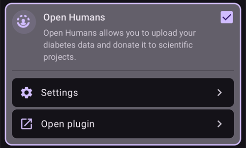
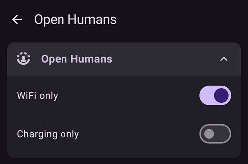
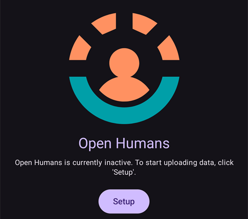
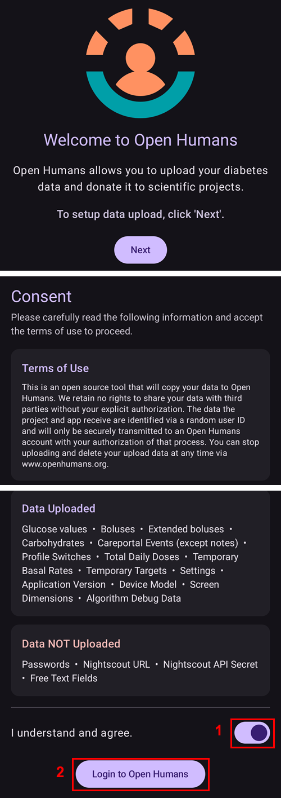
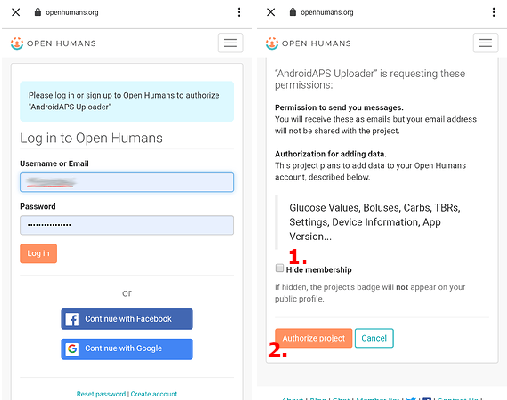
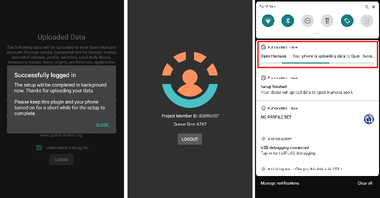
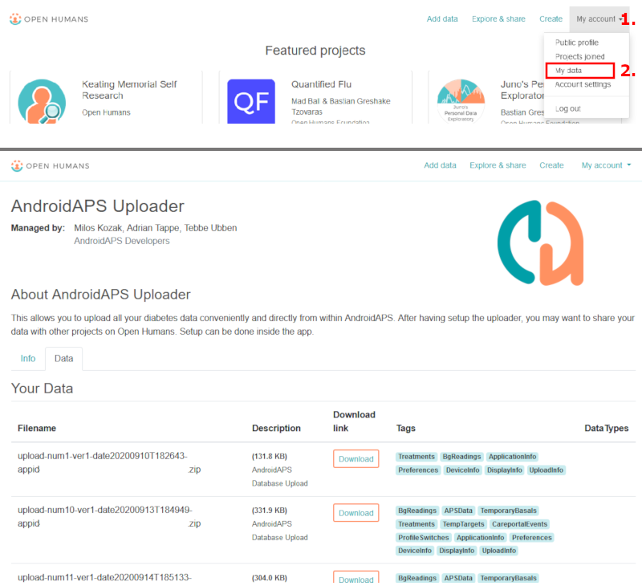

# Загрузчик Open Humans

## Поделитесь своими данными с исследователями

Вы можете помочь науке, поделившись данными с исследовательскими проектами! Это помогает ученым передавать знания дальше, развивать новые научные идеи и делать системы замкнутого цикла с открытым кодом более известными. AAPS готов к синхронизации данных с [Open Humans](https://www.openhumans.org), платформой, позволяющей подключаться, загружать и хранить ваши персональные данные – такие, как генетика, активность и данные о здоровье.

Вы сохраняете полный контроль над тем, что происходит с вашими данными и какие проекты вы хотите поддержать, предоставляя им доступ к вашим данным. В зависимости от проекта, к которому вы присоединились, данные оцениваются и используются разными способами.

Следующие данные будут загружены в вашу учетную запись Open Humans:

- Гликемия
- События портала терапии (кроме примечаний)
- Пролонгированные болюсы
- Смены профиля
- Суммарные суточные дозы
- Временная базальная скорость
- Временные цели
- Настройки
- Версия приложения
- Модель устройства
- Размеры экрана

Секретная или конфиденциальная информация, такая как URL-адрес Nightscout или API secret, не загружается.

## Настройка

1. Если это еще не сделано, создайте свой аккаунт на [Open Humans](https://www.openhumans.org). Можете для этого использовать существующие учетные записи Google или Facebook, если хотите.
2. Включите модуль **Open Humans** в [**Конфигурация** > **Связь**](../SettingUpAaps/ConfigBuilder.md).



3. Нажмите **Настройки** на карточке **Open Humans**. Можно разрешить загрузку только тогда, когда телефон подключен к Wi-Fi (**Только по WiFi**) и/или заряжается (**Только при зарядке**).



4. Нажмите **Открыть модуль** на карточке **Open Humans**, затем нажмите **Настройки**.



5. На экране **Добро пожаловать в Open Humans** нажмите **Далее**. Внимательно прочитайте экран **Согласие**: на нем показаны условия пользования, а также какие данные загружаются и какие не загружаются.
6. Включите **Я понимаю и соглашаюсь.** (1) и нажмите **Войти в Open Humans** (2).



7. Откроется сайт Open Humans. Войдите под своей учетной записью.
8. Решите, хотите ли вы скрыть свое участие в AAPS Uploader в публичном профиле Open Humans (1).
9. Нажмите **Authorize project** (2) (авторизовать проект).



```{admonition} Older screenshot
:class: note
На снимках экрана выше показана более ранняя версия сайта Open Humans со старым названием проекта **AndroidAPS Uploader**. Шаги остаются теми же.
```

10. Когда вы вернетесь в **AAPS**, на экране **Финальные настройки** вас спросят, хотите ли вы продолжить. Нажмите **Продолжить**.
11. Дождитесь надписи **Готово!**, затем нажмите **Закрыть**. С этого момента телефон время от времени загружает данные в фоновом режиме.
12. Теперь на экране модуля **Open Humans** показан ваш **Идентификатор участника проекта**. Нажмите **Выгрузить (передать данные) сейчас**, если хотите сразу начать загрузку.
13. Нажмите **Выход из системы**, если хотите прекратить загрузку данных в Open Humans.
14. Уведомление Android сообщит о работающей загрузке.



```{admonition} Older screenshot
:class: note
Скриншот выше сделан в более ранней версии **AAPS**. В **AAPS** 4 экраны подтверждения называются **Финальные настройки** и **Готово!**, размера очереди больше нет, а кнопки называются **Выгрузить (передать данные) сейчас** и **Выход из системы**.
```

15. Управлять своими данными теперь можно, войдя на сайт [Open Humans](https://www.openhumans.org).



## Совместные возможности

### ['Открытый' проект](https://www.open-diabetes.eu/)

"ОТКРЫТЫЙ" проект объединяет международный и межсекторальный консорциум пациентов, медиков, ученых в области социальных наук, компьютерщиков и организации по защите прав пациентов для изучения различных аспектов систем искусственной поджелудочной железы (DIY APS), число которых постоянно растет. Подробности - на их [сайте](https://www.open-diabetes.eu/).

В сентябре 2020 года проект 'OPEN' запустил [опрос](https://survey.open-diabetes.eu/), в котором также можно пожертвовать данные, загруженные в Open Humans. [Инструкция](https://open-diabetes.eu/en/open-survey/survey-tutorials/) по предоставлению своих данных Открытому проекту доступна на их сайте наряду с самим исследованием.

### [Общие Данные OpenAPS](https://www.openhumans.org/activity/openaps-data-commons/)

Проект Общие Данные OpenAPS был создан, чтобы предоставить простой способ обмена данными сообщества DIYAPS для исследований. Эти данные получают как профессиональные исследователи, которые проводят классические научные исследования, так и группы или отдельные люди из сообщества, которые хотят изучать данные в рамках своих собственных исследовательских проектов. Проект OpenAPS Data Commons использует платформу Open Humans, чтобы пользователи могли легко загружать и передавать свои данные из DIYAPS, включая AAPS, Loop и OpenAPS.

Свои данные можно передать в Open Humans одним из трех способов:

1. используйте опцию загрузчика AAPS для передачи данных в Open Humans
2. используйте передачу данных Nightscout для передачи данных в Open Humans
3. вручную загружать файлы данных в Open Humans.

После того, как вы создали учетную запись и начали передавать данные в Open Humans, вы также можете (если захотите) присоединиться к OpenAPS Data Commons, чтобы пожертвовать данные для исследований.

## Условия пользования

Это инструмент с открытым кодом для передачи данных в [Open Humans](https://www.openhumans.org). Мы не имеем права передавать ваши данные третьим лицам без вашего явного разрешения. Данные, которые получает проект и приложение, идентифицируются по случайному идентификатору пользователя и будут безопасно переданы только на учетную запись Open Humans с вашей авторизацией на этот процесс. Вы можете остановить загрузку и удалить ваши данные в любое время через [www.openhumans.org](https://www.openhumans.org). Помните, что некоторые проекты, получающие данные, могут не поддерживать это.

Также см. [условия пользования Open Humans](https://www.openhumans.org/terms/).

## Конфиденциальность данных

Open Humans заботятся о защите конфиденциальности и назначают числовой идентификатор для каждого проекта. Так проекты могут узнавать вас, но не могут установить вашу личность. Идентификатор приложения, который загружает AAPS, устроен так же и нужен только для управления данными. Больше информации можно найти здесь:

- [Политика использования данных Open Humans](https://www.openhumans.org/data-use/)
- [Open Humans GDPR](https://www.openhumans.org/gdpr/)
