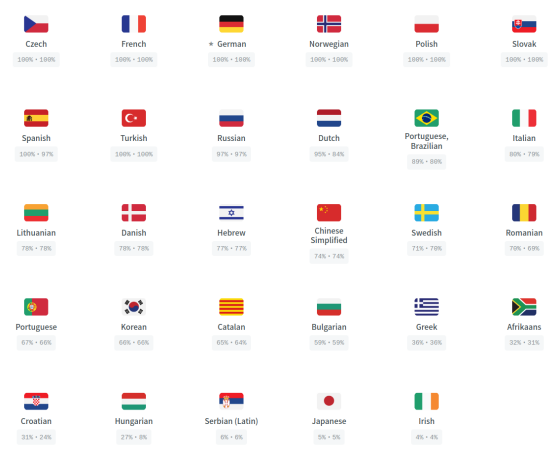
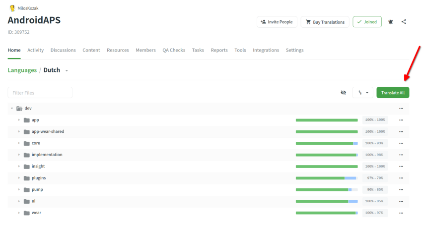
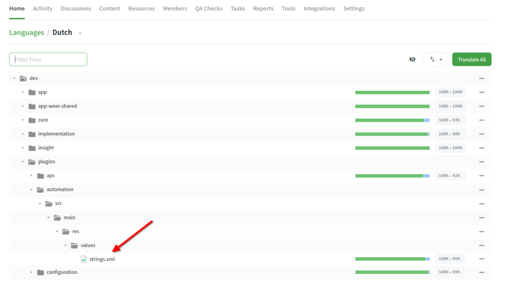
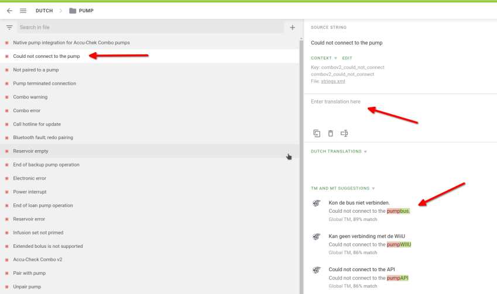
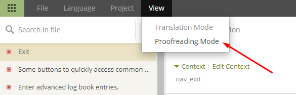
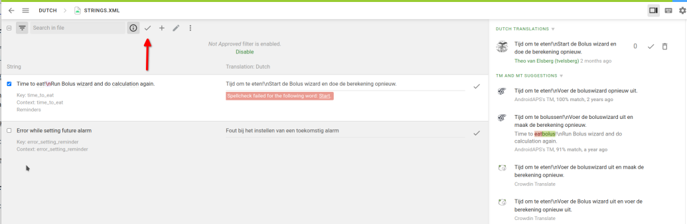
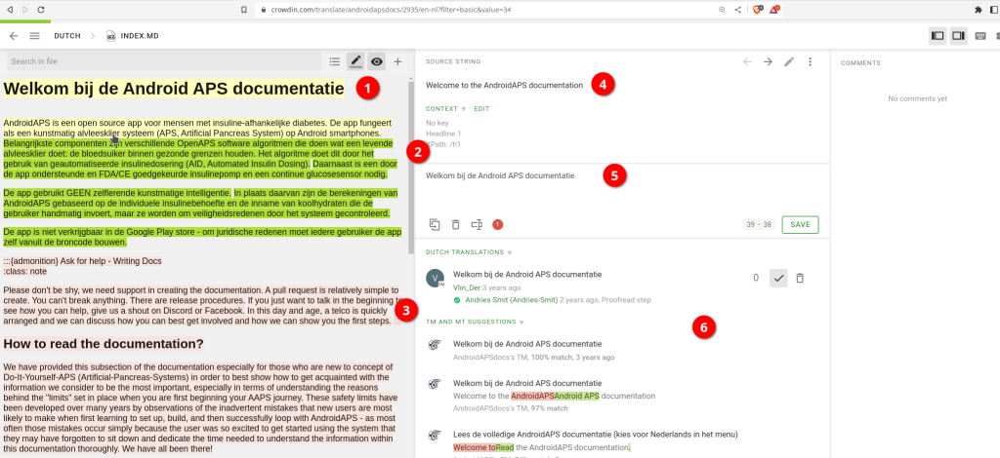
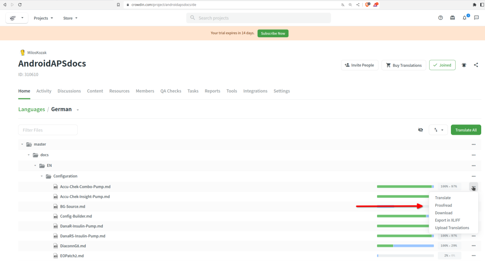

# Как переводить строки приложения AAPS и документации

* Для строк, которые используются в приложении, перейдите по ссылке <https://crowdin.com/project/androidaps> и войдите с помощью вашей учетной записи GitHub
* Для перевода статей документации перейдите по ссылке <https://crowdin.com/project/androidapsdocs> и залогиньтесь, используя вашу учетную запись GitHub

* Запросите участие в команде составителей документации. Для этого кликните по флагу желаемого языка, а затем нажмите кнопку "Join" ("Присоединиться") в правом верхнем углу следующей страницы. Пожалуйста, укажите свой язык, сообщите немного информации о себе, своем опыте с AAPS, о том, какую роль хотите получить - переводчика (translator) или корректора (proofreader) (указывайте корректора только если вы имеете опыт в переводах + опытный пользователь AAPS).

```{admonition} Ожидание одобрения :class: note

Одобрение выполняется человеком. Как некоммерческая организация мы не выставляем какие-либо сроки, но обычно одобрение занимает меньше 1 дня. Если вы не получили одобрения - пожалуйста, обратитесь к команде документации через Facebook или Discord (русскоязычные пользователи могут написать в группу AndroidApsGroup в Telegram).

    <br />* Когда мы вас одобрим, нажмите на флаг
       
    
    ## Перевод приложения
    
    (translations-translate-strings-for-AAPS-app)=
    ### Перевод строк приложения AAPS
    
    * Если вам все равно, какие строки переводить, просто нажмите кнопку "Translate All" ("Перевести всё"), чтобы начать. Будут показаны строки, которые нужно перевести.
    
       
    
    * If you want to translate an individual file please search for the file via search dialog or tree structure and click on the filename to start the translation work on strings in that file.
    
       
    
    * Переводите предложения слева: добавьте новый перевод или используйте предложенный вариант и отредактируйте его
    
       
    
    
    ### Корректура строк приложения AAPS
    
    * Корректоры начинают с выбора "Proofread" ("Корректура") на начальном экране языка.
    
       
    
    
      и одобрить переведенный текст
    
       
    
    Когда корректор одобряет перевод, он будет добавлен в следующую версию AAPS.
    
    (translations-translation-of-the-documentation)=
    ## Перевод документации
    
    * Нажмите на название страницы документации, которую хотите перевести
    
    
    
    
    * Переводите предложение за предложением
    
        1. Желтым выделен текст, над которым вы сейчас работаете.
    
        1. Зеленым - уже переведенный текст. Вам не требуется переводить его.
    
        1. Красным выделен текст, который еще не переведен.
    
        1. Это исходный текст, над которым вы сейчас работаете
    
        1. Ваш перевод. Вы можете скопировать текст из поля выше или выбрать один из предложенных ниже.
    
        1. Это предложения для перевода. Здесь, например, видно, насколько хорошо, по мнению Crowdin, подходит предложение, или что строка уже была переведена раньше и появилась снова только потому, что текст был перемещен, а не изменен.
        1. Нажмите кнопку "save" ("Сохранить") чтобы сохранить свое предложение перевода. Затем перевод будет передан корректору для окончательной проверки.
    
    
    
    * A translated page will not be published in docs before 
    
        1. перевод не будет проверен корректором
    
        1. не завершится синхронизация между Crowdin и GitHub (раз в час), после которой создается PR для GitHub.
    
        1. PR в Github не будет одобрен.
    
    В среднем вся процедура занимает от 1 до 3 дней, но в выходные и праздники могут быть задержки.
    
    ### Перевод ссылок
    
    ```{admonition} Ссылки больше не переводятся
    :class: note
    
    Ссылки больше не переводятся. Раньше здесь был раздел на эту тему, но его больше нет: после перехода на Markdown и myst_parser мы явно создаем метки в английском тексте, и они автоматически передаются в другие языки.
    
    

Вы переводите текст ссылки, отображаемый пользователю. Будьте внимательны и **не** удаляйте ссылку, которая обозначена парой тегов `<0></0>` (или с другими номерами, если в одном абзаце несколько ссылок).

Корректорам следует обращать особое внимание вопросу правильности ссылок!

### Корректура

* Корректоры должны переключиться в режим Proofreading
    
    
    
    и одобрить переведенный текст
    
    

* Когда корректор одобряет перевод, он будет добавлен в следующую сборку документации. Сборка выполняется по необходимости, без точного расписания, но примерно раз в неделю, кроме периода праздников. Для ускорения процесса вы можете проинформировать команду о появлении нового перевода.