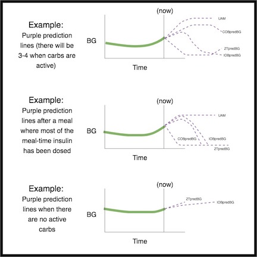
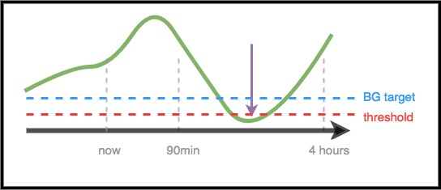
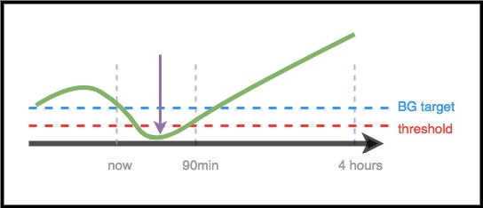
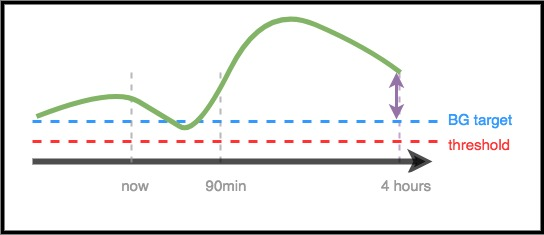
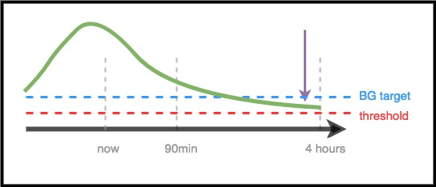

# Для врачей – общее введение и руководство по AAPS

```{note}
Эта страница – общее введение для врачей. Последний раз она проверялась в июне 2026 года. AAPS постоянно развивается, поэтому самые точные и актуальные сведения всегда смотрите в [основной документации AAPS](../index.md).
```

Эта страница предназначена для медицинских работников, которые проявили интерес к технологии искусственной поджелудочной железы, такой как AAPS, или для пациентов, которые хотят делиться этой информацией со своими лечащими врачами.

В этом руководстве содержится общая информация о самостоятельно построенных алгоритмах замкнутого цикла и, в частности, о том, как работает AAPS. Детальное описание системы AAPS в [ полной интернет-документации по AAPS ](../index.md). Если вопросы остаются, узнайте подробности у вашего пациента или обратитесь к сообществу. (Если вы не пользуетесь социальными сетями (например, [Twitter](https://twitter.com/kozakmilos) или Facebook), можете написать на developers@aaps.app). [ Здесь также можно найти результаты некоторых новых исследований & и связанные с ними данные ](https://openaps.org/outcomes/).

## Этапы самостоятельного создания системы замкнутого цикла:

Для начала работы с AAPS необходимо выполнить следующие действия:

* Найти [совместимую помпу](../Getting-Started/CompatiblePumps.md), [совместимое устройство Android](../Getting-Started/Phones.md) и [совместимый источник CGM](../Getting-Started/CompatiblesCgms.md).
* [Скачать исходный код AAPS и собрать приложение](../SettingUpAaps/BuildingAaps.md).
* [Configure the software to talk to their diabetes devices and specify settings and safety preferences](../SettingUpAaps/SetupWizard.md).

## Как работает замкнутый цикл

Без системы замкнутого цикла человек с диабетом собирает данные своей помпы и мониторинга ГК, решает, что делать, и принимает меры.

С помощью автоматизированной подачи инсулина система делает то же самое: собирает данные с помпы и мониторинга, передает их куда-либо (например, на Nightscout), использует эту информацию для расчетов и принятия решений о необходимом количестве инсулина, повышении или снижении базальной скорости использует временные изменения базы для внесения необходимых корректировок, чтобы в конечном итоге привести ГК в целевой диапазон.

Если устройство с AAPS сломается или окажется вне зоны связи с помпой, то после окончания последнего временного базала помпа снова работает как обычная помпа с заранее запрограммированной базальной скоростью.

## Как собираются данные:

С помощью AAPS, телефон на Android запускает специальное приложение для выполнения математических операций, телефон общается с поддерживаемой помпой через Bluetooth. AAPS может обмениваться данными с другими устройствами и с облаком через Wi-Fi или мобильный интернет. Так он получает дополнительную информацию и сообщает пациенту, опекунам и близким, что он делает и почему.

Устройство Android должно:

* общаться с помпой и читать историю введенного инсулина
* общаться с системой мониторинга (либо напрямую, либо через облако)- чтобы видеть, как ведет себя гликемия

Когда устройство собрало эти данные, алгоритм принимает решения на основе внесенных в программу параметров (ISF, CR, DIA, целевых значений ГК и т. д.). При необходимости он выдает команды помпе для изменения скорости доставки инсулина.

Она также соберет информацию о болюсах, потреблении углеводов и временных целевых корректировках от помпы или от Nightscout, чтобы использовать их в расчетах.

## Откуда он знает, что делать?

Программное обеспечение с открытым исходным кодом предназначено для того, чтобы устройство легко выполняло задания, которые выполнялись в ручном режиме для расчета того, как следует корректировать подачу инсулина. Сначала он собирает данные со всех подключенных устройств и из облака, подготавливает их и выполняет расчеты. Затем он прогнозирует, как будет меняться ГК в ближайшие часы в разных сценариях, и рассчитывает изменения, нужные, чтобы удержать ГК в целевом диапазоне или вернуть ее туда. Затем он отправляет необходимые корректировки на помпу. Затем он снова считывает данные и снова повторяет алгоритм корректировки.

Поскольку наиболее важным исходным параметром является уровень глюкозы в крови, поступающий от системы мониторинга, важно иметь высококачественные данные CGM.

AAPS предназначен для прозрачного отслеживания всех входных данных, а также выдаваемых рекомендаций и действий. Поэтому в любое время, просматривая журналы событий, легко ответить на вопрос, "почему он делает X?".

## Примеры принятия решений алгоритмом AAPS:

AAPS основывается на том же алгоритме и наборе функций, что и OpenAPS. Алгоритм выполняет несколько предсказаний (на основе параметров и ситуации), представляющих различные сценарии того, что может произойти в будущем. В Nightscout они отображаются в виде фиолетовых линий. AAPS показывает эти [линии прогноза](#aaps-screens-prediction-lines) разными цветами. В журнале событий будет описано, какие из этих предсказаний и в какие временные рамки будут управлять необходимыми действиями.

### Ниже приведены примеры фиолетовых линий прогнозирования, а также то, как они могут различаться:



(clinicianguide-dosing-scenarios)=

### Ниже приведены примеры различных временных рамок, влияющих на изменения в подаче инсулина:

### Сценарий 1- Нулевая ВБС для безопасности

В этом примере ГК увеличивается в краткосрочной перспективе, однако, как ожидается, она будет низкой в течение более длительного периода времени. По сути, ожидается, что она будет ниже целевого значения * и * порога безопасности. Для безопасности с целью предотвращения низкой ГК AAPS выдаст нулевую временную базальную скорость до тех пор пока конечная ГК (в любых временных рамках) не окажется выше порогового значения.



### Сценарий 2- Нулевая ВБС для безопасности

В этом примере ожидается, что ГК будет низкой в ближайшем будущем, но, в конечном счете, будет выше целевого значения. Тем не менее, поскольку краткосрочная ГК фактически ниже порога безопасности, AAPS будет выдавать нулевой базал до тех пор, пока не останется никакой предсказуемой точки, находящейся ниже порогового значения.



### Сценарий 3 - Требуется больше инсулина

В этом примере, краткосрочный прогноз показывает падение ниже целевого. Однако оно не ниже порога безопасности. Конечная ГК находится выше целевой. Поэтому AAPS не будет добавлять инсулин, который мог бы привести к низкой ГК в ближайшее время (то есть инсулин, из-за которого прогноз опустился бы ниже порога). Затем он оценит возможность добавление инсулина, который приведет самый низкий уровень предсказанной ГК к цели, как только это станет безопасно. *(В зависимости от настроек, а также от количества и времени нужного инсулина, этот инсулин может подаваться через временный базал или SMB (супер микроболюсы)).*



### Сценарий 4 - Пониженная ВБС для безопасности

В этом примере AAPS видит, что ГК поднимается намного выше цели. Однако из-за времени введения инсулина, в организме его уже достаточно, чтобы в конечном итоге привести ГК в желаемый диапазон. По сути, ГК, как ожидается, в конечном счете будет ниже целевого показателя. Поэтому AAPS не будет вводить дополнительный инсулин, чтобы не способствовать более низкой ГК на широком временном отрезке. Несмотря на то, что ГК высока/растет, здесь, скорее всего, будет задана низкая временная базальная скорость.



## Оптимизация параметров и внесение изменений

Как медицинскому работнику, который не имеет опыта с AAPS или подобными системами, вам может показаться сложным помочь своему пациенту оптимизировать настройки или внести изменения, улучшающие результаты. У нас много инструментов и [ инструкций](https://openaps.readthedocs.io/en/latest/docs/Customize-Iterate/optimize-your-settings.html), которые помогают пациентам делать небольшие, проверенные корректировки для улучшения своих настроек.

Самое важное для пациентов-это делать одно изменение за раз, и наблюдать за результатом в течение 2-3 дней, прежде чем решать, изменять ли другой параметр (если только такое изменение явно не идет во вред, - в этом случае следует немедленно вернуться к предыдущему параметру). Человек склонен сразу крутить все настройки и менять все сразу; но если кто-то делает это, то такое поведение приведет к суб-оптимальным настройками и его трудно будет вернуть в известное хорошее состояние.

Один из самых мощных инструментов для изменения настроек-это автоматизированный инструмент вычислений базальной скорости, чувствительности ISF и соотношения инсулин-углеводы CR. Это называется «[Autotune](#autotune-how-autotune-calculates-adjustments)». Он позволяет данным подсказывать вам или вашему пациенту, как постепенно менять настройки. Среди пользователей принято запускать (или просматривать) отчеты Autotune, прежде чем пытаться вручную внести изменения в параметры. Autotune встроен в AAPS как модуль (**Конфигурация** → **Общее** → **Автонастройка**); см. [Как пользоваться модулем Autotune](../AdvancedOptions/Autotune.md). Его можно запускать вручную или автоматически. Эти параметры нужны и для обычной подачи инсулина помпой, и для подачи инсулина в замкнутом цикле. Поэтому обсуждение результатов Autotune и изменение этих параметров – естественная точка соприкосновения с врачом.

Кроме того, поведение человека (основанное на ручном режиме компенсации диабета) часто влияет на результаты даже и в замкнутом цикле. Например, если прогноз показывает снижение ГК и AAPS уменьшает подачу инсулина во время снижения, то для подъема ГК с 70 мг/дл (3,9 ммоль/л) может понадобиться совсем немного углеводов (например, 3–4 г). Однако во многих случаях кто-то может взять для корректировки гораздо больше углеводов (например, придерживаясь правила 15), что приведет к более быстрому скачку как из-за дополнительной глюкозы, так и из-за того, что подача инсулина была снижена в период, ведущий к низкому.

## OpenAPS

**Это руководство создано на основе [руководства OpenAPS для врачей (The clinician's guide to OpenAPS)](https://openaps.readthedocs.io/en/latest/docs/Resources/clinician-guide-to-OpenAPS.html).** OpenAPS – это система, которая работает на маленьком портативном компьютере (его обычно называют «rig»). AAPS использует многие методы, реализовываные в OpenAPS, и разделяет большую часть логики и алгоритмов, поэтому это руководство очень похоже на оригинальное руководство. Большая часть информации об OpenAPS можно легко адаптировать к AAPS, при этом главное отличие - это аппаратная платформа, на которой работает программное обеспечение.

## Вывод

Это обзорная информация о том, как работает AAPS. Для получения более подробной информации обратитесь к пациенту, сообществу или прочитайте полную документацию AAPS в Интернете.

Дополнительное рекомендуемое чтение:

* [Полная документация AAPS](../index.md)
* Справочник [ Эталонный дизайн Open](https://OpenAPS.org/reference-design/), в котором объясняются принципы работы и безопасности OpenAPS: https://openaps.org/reference-design/
* [Полная документация OpenAPS](https://openaps.readthedocs.io/en/latest/index.html) 
  * Смотрите в этой документации, [как AAPS превращает прогнозы в решение о дозе](#aaps-screens-how-predictions-become-a-dosing-decision), или [документацию OpenAPS по determine-basal](https://openaps.readthedocs.io/en/latest/docs/While%20You%20Wait%20For%20Gear/Understand-determine-basal.html#understanding-the-determine-basal-logic), где алгоритм описан со всеми техническими подробностями