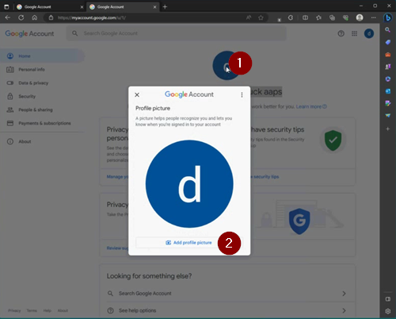
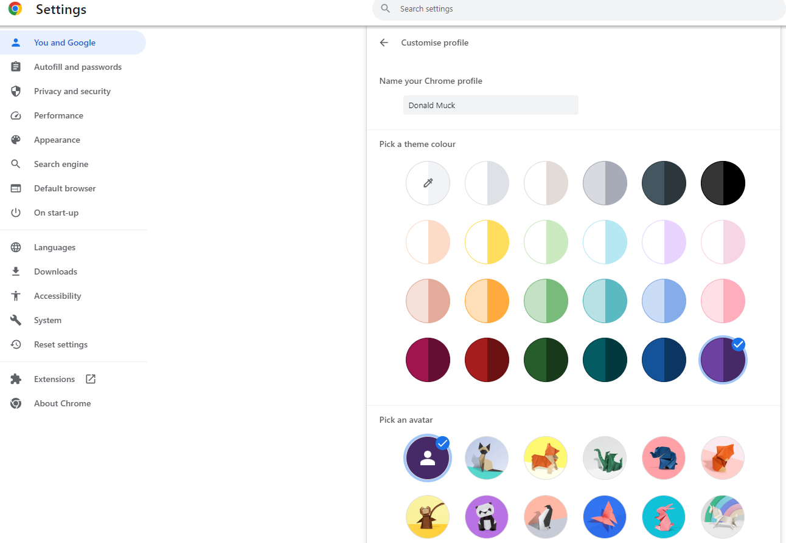
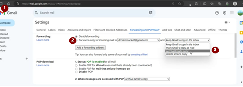

# Специальная учетная запись Google для AAPS (необязательно)

Некоторые пользователи **AAPS** предпочитают использовать для **AAPS** свою основную учетную запись электронной почты. Другие пользователи **AAPS** (или их опекуны) создают отдельную учетную запись электронной почты для **AAPS**. Это необязательно, ниже мы покажем пример, как это сделать.

Если вы не хотите создавать отдельную учетную запись Gmail для **AAPS**, сразу переходите к следующему разделу, [Сборка AAPS](../SettingUpAaps/BuildingAaps.md).

```{admonition} Advantages of a dedicated Google account for AAPS
:class: dropdown

- Отдельное место на Google Диске означает, что **Экспорт настроек** не заполнит лимит вашего личного Google Диска.
- Каждая версия **AAPS** (и вспомогательных приложений, таких как xDrip, BYODA и др.) будет храниться в одном месте, которое не зависит от вашего компьютера. Если ваш ПК или телефон украдут, вы его потеряете или он сломается, доступ у вас все равно останется.
- By harmonizing the setup, it will make online support simpler across users with similar folder structure.
- В зависимости от настройки (см. ниже) у вас будет отдельное имя (псевдоним) для общения в сообществе, которое может защитить вашу личную информацию. 
- Children with T1D can preserve their own “everyday” email account as minors while using **AAPS** and associated features which require an adult account.
- Gmail allows you to register up to 4 accounts under the same phone number.
```

## Как создать специальную учетную запись Google для AAPS

(⌛Примерно 10 минут)


Требования:

* У вас есть ПК с Windows (Windows 10 или новее) и телефон Android (Android 12 или новее), на котором будет работать приложение **AAPS**. Оба компонента должны иметь все последние обновления безопасности, доступ в интернет и права администратора, так как некоторые шаги требуют загрузки и установки программ.
* На телефоне Android уже настроен ваш личный «повседневный» адрес электронной почты, например учетная запись Gmail.

```{admonition} Things to consider when setting up your new account
:class: dropdown
- Из соображений конфиденциальности можно использовать имя, отличное от вашего, которое связано с учетной записью (например, t1dsuperstar). You can then use it in **AAPS** public forums while keeping your own identity private. Since Google requires a recovery email and phone number, it is still traceable.
- The new **AAPS** account will use the same phone number for verification as your “_everyday_” one. Для проверки она будет использовать ваш «повседневный» адрес электронной почты;
- Мы настроим пересылку, чтобы все письма, отправленные на новую учетную запись AAPS, пересылались на основную (так не нужно проверять два разных почтовых ящика);
- Используйте разные пароли для своей _повседневной_ учетной записи Gmail и учетной записи Gmail для AAPS
- Если вы используете в Google «двухэтапную аутентификацию» (многофакторную) для одной учетной записи Gmail, используйте ее и для второй.
- If you plan to use Google “Passkeys”, make sure you register multiple devices. Так вы не потеряете доступ к своей учетной записи. Делайте это только на устройствах, к которым никто кроме вас не имеет доступа (_например_, не на ПК с общей учетной записью, которую могут разблокировать другие люди).
```


```{admonition} Video Walkthrough!
:class: note
Нажмите [здесь](<https://drive.google.com/file/d/1dMZTIolO-kd2eB0soP7boEVtHeCDEQBF/view?usp=drive_link>), чтобы посмотреть видео о том, как создать отдельную учетную запись Google.
```

 В этом видео показаны шаги:

В этом примере: 
- Ваша существующая «_повседневная_» учетная запись Google – <donald.muck42@gmail.com>; 
- Ваша новая учетная запись Gmail для «_AAPS_» будет: <donald.muck42.aaps@gmail.com>; 


### Перейдите на <https://myaccount.google.com> 

 Если вы уже вошли в Google, вы попадете на страницу **My Account** своей «повседневной» учетной записи. (1) Нажмите вверху справа на изображение своего профиля (в этом случае это просто ) (2) выберите «_add another account_» (добавить аккаунт).


### Введите данные своей НОВОЙ отдельной учетной записи: 

- Введите данные новой учетной записи: 
- Создайте учётную запись
- для личного использования. 


### Введите личные данные:
 - Введите имя
 - фамилия
 - дату рождения (должна быть для взрослого)

### Выберите НОВЫЙ адрес электронной почты и пароль

В этом примере к существующему адресу Donald Muck добавлено «.AAPS»…\
Задайте пароль

### Введите номер телефона, на который может прийти SMS для проверки

Теперь Gmail отправит вам уникальный код для проверки.

### Введите резервный адрес электронной почты

В этом случае это будет ваш существующий «_повседневный_» адрес электронной почты…

### Завершите регистрацию учетной записи

Gmail покажет имя аккаунта. Вас попросят принять условия использования Gmail и подтвердить настройки персонализации.

### Настройте отображение нового профиля

Теперь вы должны быть на странице MyAccount в Gmail, где показана ваша новая учетная запись электронной почты для **AAPS**. По умолчанию изображение профиля будет установлено на первую букву вашего имени. Измените его на что-то уникальное, чтобы не путаться… в этом примере Donald.Muck.AAPS заменил  на .

\


### Откройте веб-сайт Gmail в обоих окнах для настройки новой учетной записи

Чтобы не следить за отдельной учетной записью электронной почты, перешлите все письма с новой учетной записи для **AAPS** на свою повседневную учетную запись\
Эта часть может немного запутать, потому что вам придется переключаться между двумя учетными записями туда и обратно. Чтобы упростить задачу, откройте два отдельных окна браузера поверх друг друга:

1. Переместите открытое окно браузера в верхнюю часть экрана и измените его размер так, чтобы оно занимало примерно верхнюю половину экрана…
2. Нажмите правой кнопкой мыши на значок браузера на панели задач
3. В меню выберите «New Window» (новое окно)... и расположите его так, чтобы оно занимало только нижнюю половину экрана.

Откройте <https://gmail.com> в каждом окне браузера. Убедитесь, что ваша личная учетная запись открыта вверху, а новая учетная запись для **AAPS** – внизу, и ее легко узнать по изображению профиля в правом верхнем углу. При необходимости вы всегда можете переключить учетную запись: нажмите на изображение профиля и выберите нужную.



Главные страницы Gmail должны выглядеть так:\


 ### В новой учетной записи Gmail (нижнее окно) откройте настройки Gmail…

- Нажмите на значок шестеренки слева от изображения профиля
- затем выберите «**See all Settings**» (все настройки)


### Настройка переадресации…

- Нажмите на вкладку «Переадресация и POP/IMAP»
- Нажмите «добавить адрес переадресации»
- Добавьте свой повседневный адрес электронной почты
- Gmail отправит код подтверждения на ваш «повседневный» адрес электронной почты.
- Вернитесь к своему повседневному профилю и щелкните ссылку, чтобы подтвердить, что вы принимаете переадресацию (или получите код из письма с подтверждением Gmail в своем «повседневном» окне Gmail, а затем вырежете и вставите его в свое «новое выделенное для AAPS» окно Gmail).

Между окнами придется немного попереключаться, но это будет гарантировать, что при проверке писем вашей повседневной учетной записи, вы также увидите письма, переадресованные с вашей учетной записи AAPS, такие, как оповещения Gmail.


### Подтверждение адреса переадресации электронной почты

- В «повседневном» Gmail (верхнее окно) вы получите письмо «Gmail forwarding Confirmation».
- Откройте его и нажмите на ссылку, чтобы подтвердить запрос

### Архивируйте переадресованные письма в новом специально выделенном аккаунте Gmail (в нижнем окне)

<!---->

1. Обновите нижнее окно
2. Выделите «переслать входящие письма»
3. И архивируйте копию Gmail (чтобы сохранить ваш новый специально выделенный почтовый ящик чистым)
4. Прокрутите страницу до самого низа, чтобы сохранить изменения\
   


Поздравляем! Итак, вы создали учетную запись Google, специально выделенную для AAPS. Следующий шаг – [Сборка AAPS](../SettingUpAaps/BuildingAaps.md).