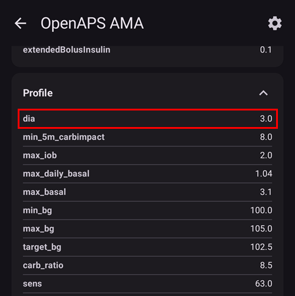

# Часто задаваемые вопросы по работе ИПЖ

Как добавить вопросы в FAQ: следуйте этим [инструкциям](../SupportingAaps/HowToEditTheDocs.md)

## General

### Can I just download the AAPS installation file?

Нет. Для AAPS нет готового apk-файла для скачивания. Вам нужно [собрать](../SettingUpAaps/BuildingAaps.md) его самостоятельно. Причина вот в чем:

AAPS используется для управления помпой и подачи инсулина. В соответствии с действующим Европейским законодательством, все системы, классифицируемые как IIa или IIb, являются медицинскими устройствами, подлежащими обязательной сертификации (получение знака CE), что в свою очередь требует соответствующих исследований и одобрений. Распространение несертифицированных устройств незаконно. Аналогичные законы существуют и в других частях мира.

Это положение не ограничивается торговлей, но относится к любому виду распространения (даже безвозмездному). Создание медицинского устройства для себя является единственным вариантом, не затрагиваемым этими правилами.

Именно поэтому распространение в виде готовых приложений (apk) недоступно.

(FAQ-how-to-begin)=

### How to begin?

Начните со страницы [Подготовка к работе с AAPS](../Getting-Started/PreparingForAaps.md): там все, что описано ниже, объясняется подробнее.

Прежде всего, нужно **подготовить компоненты, которые работают с ипж**:

* [поддерживаемая инсулиновая помпа](../Getting-Started/CompatiblePumps.md), 
* [смартфон на Android](../Getting-Started/Phones.md) (Apple iOS не поддерживается AAPS – можно посмотреть [iOS Loop](https://loopkit.github.io/loopdocs/)) и
* [система непрерывного мониторинга глюкозы](../Getting-Started/CompatiblesCgms.md). 

Во-вторых, нужно **настроить программные компоненты**: [AAPS](../SettingUpAaps/BuildingAaps.md), [источник данных CGM/FGM](../Getting-Started/CompatiblesCgms.md) и [сервер отчетности](../SettingUpAaps/SettingUpTheReportingServer.md).

В-третьих, нужно изучить и **понять архитектуру OpenAPS (reference design), чтобы проверить параметры вашей терапии**. Основной принцип замкнутого цикла – ваши [базальная скорость и углеводный коэффициент](../SettingUpAaps/YourAapsProfile.md) точны. Все рекомендации, выдаваемые ИПЖ предполагают, что ваши базовые потребности в инсулине удовлетворены и любые пики и провалы характеристики ГК - следствие других факторов, требующих дополнительных настроек ( нагрузка, стресс и пр.). Изменения, которые может вносить замкнутый цикл, ради безопасности ограничены (см. максимально допустимую временную базальную скорость в [Архитектуре OpenAPS](https://openaps.org/reference-design/)). Поэтому не стоит тратить допустимые дозы на исправление неправильного базала. Например, если перед едой у вас часто включается пониженный временный базал, то, скорее всего, ваш базал нужно настроить. С помощью [Autotune](#autotune-how-autotune-calculates-adjustments) можно проанализировать большой объем данных и узнать, нужно ли и как изменить базал и/или ISF, а также нужно ли изменить углеводный коэффициент. Или можно проверить и настроить базал [традиционным способом](https://integrateddiabetes.com/basal-testing/).

### What practicalities of looping do I have?

#### Password protection

Если вы не хотите, чтобы ваши настройки можно было легко изменить, защитите их паролем, PIN-кодом или биометрией телефона (отпечаток пальца, лицо). Откройте **Настройки** > **Защита** > **Защита настроек** и выберите тип защиты. Там же можно защитить все приложение или только болюсы. Подробнее см. [Защита настроек](#Preferences-settings-protection).

#### Android Wear Smartwatches

Если вы подаете болюс или меняете настройки через приложение AAPS на часах, каждый запрос нужно подтвердить на часах: после отправки часы показывают сводку с кнопкой **ПОДТВЕРДИТЬ**. См. [Работа AAPS с помощью смарт-часов на базе Wear OS](../RemoteFeatures/RemoteControlWearOS.md).

(FAQ-disconnect-pump)=

#### Disconnect pump

Если вы снимаете помпу на время душа, ванны, плавания, занятий спортом или других дел, обязательно сообщите AAPS, что инсулин не подается, чтобы IOB считался правильно.

Помпу можно отключить с помощью [значка цикла](#AapsScreens-loop-status) на главном экране AAPS: нажмите на него и выберите **Отключить помпу** с нужной длительностью. Если занятие длится дольше, чем планировалось, снова нажмите на значок и выберите новую длительность: сначала подключать помпу не нужно. Как избежать нехватки инсулина при долгом отключении, см. [Отключение помпы для душа или занятий](#pumps-cannulas-disconnecting).

#### Recommendations not only based on one single CGM reading

Для безопасности, рекомендации системы делаются не на одном показании ГК, а на среднем из последних значений (с учетом скользящей дельты). Поэтому, если пропущено несколько показаний, понадобится время на то, чтобы AAPS снова начал компенсацию ГК в режиме замкнутого цикла.

#### Further readings

There are several blogs with good tips to help you understand the practicalities of looping. Некоторых из них уже нет в сети: ссылки ниже с пометкой «archived copy» (архивная копия) открывают сохраненную копию в Internet Archive.

    * [Fine-tuning Settings](https://web.archive.org/web/20171029031305/http://seemycgm.com/2017/10/29/fine-tuning-settings/) See my CGM (archived copy)
    * [Why DIA matters](https://web.archive.org/web/20231130035027/http://seemycgm.com/2017/08/09/why-dia-matters/) See my CGM (archived copy)
    * [Limiting meal spikes](https://diyps.org/2016/07/11/picture-this-how-to-do-eating-soon-mode/) #DIYPS
    * [Hormones and autosens](https://web.archive.org/web/20170902081839/http://seemycgm.com/2017/06/06/hormones-2/) See my CGM (archived copy)
    

(what-emergency-equipment-is-recommended-to-take-with-me)= (FAQ-emergency-equipment)=

### Какое запасное оборудование рекомендуется брать с собой?

У вас всегда должен быть с собой тот же запасной набор, что и у любого человека с диабетом 1 типа на помповой терапии. При пользовании AAPS настоятельно рекомендуется также иметь:

* Банк батарей и кабель для зарядки смартфона, часов и (если это необходимо) BT reader или Link device
* Батарейки для помпы
* Доступ к вашим резервным копиям – и на телефоне, и в облаке (например, Google Диск, Dropbox), чтобы можно было снова настроить AAPS на другом телефоне (см. [Создание и восстановление резервных копий](../Maintenance/ExportImportSettings.md)): 
  * текущий [apk](../SettingUpAaps/BuildingAaps.md) AAPS и всех других приложений, которыми вы пользуетесь (например, xDrip, Juggluco, BYODA);
  * ваш файл хранилища ключей (со сборки apk) и его пароль;
  * последние файлы экспорта настроек AAPS и других ваших приложений;
  * ваш главный пароль **AAPS**: без него нельзя импортировать файл настроек. Если вы его забыли, см. [Как сбросить главный пароль?](#FAQ-reset-master-password)

(FAQ-organize-backups)=

#### Как организовать резервные копии?

Экспортируйте настройки очень регулярно: после каждой смены Pod или резервуара, после изменения профиля, после прохождения цели, при смене помпы… Даже если ничего не меняется, делайте экспорт раз в месяц. Сохраняйте несколько старых файлов экспорта.

**AAPS** может делать это за вас: он может автоматически экспортировать настройки (например, с помощью [автоматизации](#ExportImportSettings-Automating-Settings-Export) после каждой смены Pod) и сохранять экспорт прямо в облачную папку (Google Диск). См. [Создание и восстановление резервных копий](../Maintenance/ExportImportSettings.md).

### How can I safely and securely attach the CGM/FGM?

Его можно закрепить лейкопластырем. Существует несколько предварительно перфорированных 'накладок' для распространенных систем мониторинга (искать в Google, eBay. Amazon. Озон, Wildberries и т. п.). Некоторые пользователи применяют более дешевые стандартные кинезиотейпы или rocktape.

Его можно закрепить держателем. В продаже есть держатели CGM/FGM с повязками (поиск Google, eBay Amazon, Озон, Wildberries).

## APS algorithm

### Почему OpenAPS AMA показывает «dia: 3», хотя в моем профиле другое DIA?

Если в **Конфигурация** > **APS** выбран **OpenAPS AMA**, кнопка **Открыть модуль** показывает данные, которые передаются алгоритму. В его разделе **Профиль** значение `dia` всегда 3.0 или меньше:

В AMA параметр DIA на самом деле не означает «длительность действия инсулина». Этот параметр раньше привязывался к длительности действия инсулина DIA. Теперь же он означает, 'время, за которое нужно завершить коррекцию'. Он не имеет ничего общего с расчетом активного инсулина IOB. В алгоритме OpenAPS SMB больше нет необходимости в этом параметре.

## Other settings

### Nightscout settings

(FAQ-nsclient-blocked)=

#### AAPSClient (или AAPS) не загружает данные: «Заблокировано…». What can I do?

Статус NSClient показывает, почему данные не отправляются:

* **Заблокировано настройками подключения**: настройки подключения не разрешают текущее подключение. Например, вы пользуетесь мобильными данными, но разрешен только Wi-Fi, или вы не подключены к одной из разрешенных сетей Wi-Fi (SSID).
* **Заблокировано опциями зарядки**: настройки подключения разрешают синхронизацию только во время зарядки телефона (или только при работе от батареи), а сейчас это не так.
* **Нет подключения**: у телефона нет подключения к интернету.

Проверьте [настройки подключения NSClient](#Preferences-nsclient): **Использовать мобильные данные**, **Использовать роуминг**, **Использовать Wi-Fi**, **SSID для Wi-Fi**, **Синхронизировать при работе от батареи** и **Синхронизировать во время зарядки**.

### CGM settings

(FAQ-advanced-filtering)=

#### Почему AAPS пишет «Опция супер микро болюс всегда и после углеводов отключена т. к. активный источник ГК не поддерживает комплексное фильтрование»?

**Всегда включать супер микро болюс SMB** и **Включить SMB после углеводов** можно использовать только с [надежным источником данных ГК](#GettingStarted-TrustedBGSource): сенсором и приложением CGM, которые могут сообщить **AAPS**, от какого сенсора приходят значения. С любым другим источником ГК **AAPS** выключает эти две опции и показывает это сообщение. Проверьте список надежных источников и, если ваш сенсор там есть, убедитесь, что вы пользуетесь одним из указанных для него приложений CGM. См. также [Сглаживание данных гликемии](../CompatibleCgms/SmoothingBloodGlucoseData.md).

### Pump

#### Batteries

Цикл может разряжать батарею помпы быстрее обычного, так как система обменивается данными по Bluetooth гораздо чаще, чем человек при ручном управлении. Лучше менять батарею при 25% так как после этого связь становится труднее. Можно настроить предупредительные сигналы батареи помпы через переменную PUMP_WARN_BATT_P на сайте Nightscout. Способы увеличить срок жизни батареи включают:

* уменьшить длительность работы экрана LCD (в меню настроек помпы)
* уменьшить длительность работы подсветки (в меню настроек помпы)
* выбрать уведомления в виде звукового сигнала а не вибрации (в меню настроек помпы)
* Нажимать кнопки помпы только для перезагрузки; для просмотра журналов, уровня батареи и объема резервуара помпы пользоваться смартфоном с AAPS.
* На некоторых телефонах AAPS периодически закрывается для экономии энергии или высвобождения оперативной памяти. Когда AAPS вновь инициализируется, то при каждом старте устанавливает соединение Bluetooth с помпой и перечитывает текущую базальную скорость и журнал болюсов. Это расходует батарею. Чтобы проверить, происходит ли это, включите **Записывать событие запуска приложения** в **Дополнительных настройках** NSClient: Nightscout будет получать событие при каждом перезапуске AAPS, и проблему будет легко отследить. Чтобы это случалось реже, отключите оптимизацию батареи для AAPS, чтобы телефон перестал его закрывать: см. [экономию батареи](#FAQ-battery-savings) ниже.
* протирайте контакты батареи спиртовыми салфетками, чтобы на ней не оставались следы заводской смазки.
* для [помп Dana R/RS](../CompatiblePumps/DanaRS-Insulin-Pump.md) при запуске через батарею специально пропускается большой ток, чтобы разрушить пассивирующую пленку (она защищает от потери энергии при хранении), но это не всегда удается на 100%. Либо извлеките и снова вставьте батарею 2–3 раза, пока на экране не появится 100%, либо перед установкой на долю секунды замкните оба контакта батареи ключом для батареи.
* см. также советы для [разных типов батарей](#Accu-Chek-Combo-Tips-for-Basic-usage-battery-type-and-causes-of-short-battery-life)

#### Замена резервуаров и катетеров

Резервуар нужно менять прямо на помпе, затем замена записывается в **AAPS**. Следуйте пошаговому [руководству по замене резервуара и катетера помпы](#pumps-cannulas-changing-reservoir-and-cannula).

### Wallpaper

Обои AAPS для телефона можно найти на [странице о телефонах](#Phones-phone-wallpaper).

### Daily usage

Многие из ситуаций ниже можно один раз подготовить как [сценарий](#scenes): предустановку, которая одним нажатием переключает профиль, временную цель и другие настройки. **AAPS** предлагает готовые шаблоны, например *Нагрузка*, *Сон*, *Алкоголь* или *Купание*.

#### Hygiene

(what-to-do-when-taking-a-shower-or-bath)=

##### What to do when taking a shower or bath?

Помпу можно снять при приеме душа или ванной. За этот короткий промежуток времени вам может не понадобиться, но вы должны сообщить AAPS о том, что отключились для того, чтобы вычисления IOB были правильными. См. [описание выше](#FAQ-disconnect-pump). Шаблон [сценария](#scenes) *Купание* сделает это за вас.

#### Work

В зависимости от вида работы, возможно, вы используете иные методы терапии в рабочие дни. Если вы пользуетесь циклом, подумайте о [переключении профиля](../DailyLifeWithAaps/ProfileSwitch-ProfilePercentage.md) для вашего обычного рабочего дня. Например, профиль больше 100% можно установить, если работа не очень тяжелая (напр. сидя за столом), или меньше 100%, если вы активны и на ногах весь день. Можно также использовать высокую или низкую временную цель или [сдвиг времени профиля](#ProfileSwitch-ProfilePercentage-time-shift-of-the-circadian-percentage-profile), если вы работаете намного раньше или позже обычного или работаете посменно. Можно также создать второй профиль (например, «дом» и «рабочий день») и каждый день переключаться на нужный профиль или сохранить настройки рабочего дня как [сценарий](#scenes).

### Leisure activities

(FAQ-sports)=

#### Sports

Пересмотрите свои старые спортивные привычки, которые были до замкнутого цикла. Если вы как и прежде съедаете один или несколько углеводов на спорт, теперь система замкнутого цикла распознает их и соответствующим образом скорректирует.

Итак, в организме будет больше углеводов, но в то же время цикл будет противодействовать и подавать инсулин.

При работе с алгоритмом ИПЖ следует выполнить следующие действия:

* Выполните [переключение профиля](#ProfileSwitch-change-percentage) ниже 100%: нажмите на название профиля на главном экране, нажмите круглую кнопку **▶**, затем задайте **В процентах** и **Продолжительность**.
* Установите [временную цель «Нагрузка»](#TempTargets-activity-temp-target) выше вашей обычной цели. Если задан процент меньше 100% и длительность, на том же экране **Активировать** есть переключатель **Временная цель / Нагрузка**, который запускает оба сразу.
* Если вы пользуетесь SMB, убедитесь, что [«Включить SMB при высокой временной цели»](#Open-APS-features-enable-smb-with-high-temp-targets) и [«Всегда включать супер микро болюс SMB»](#Open-APS-features-enable-smb-always) выключены.

Важное значение имеет предварительная и последующая обработка этих настроек. Внесите изменения до занятий спортом и учитывайте эффект наполнения мышц.

Шаблоны [сценариев](#scenes) *Нагрузка* и *Ночь после нагрузки* объединяют эти настройки, так что их можно запустить одним нажатием. Если вы регулярно занимаетесь спортом в одно и то же время (например, на занятиях в спортзале), можно с помощью [автоматизации](../DailyLifeWithAaps/Automations.md) запускать переключение профиля и временную цель или сценарий. Автоматизация на основе геолокации также неплохая идея, но делает предварительную обработку более сложной.

Процент изменения профиля, величина временной цели при нагрузках и наилучшее время для внесения изменений индивидуальны. Если вы ищете подходящее для себя значение, начните с безопасной стороны (с меньшего процента профиля и более высокой временной цели).

#### Sex

Можете снять помпу для "свободы" но следует проинформировать об этом AAPS, чтобы расчеты активного инсулина IOB были правильными. См. [описание выше](#FAQ-disconnect-pump).

#### Drinking alcohol

Употребление алкоголя является рискованным в режиме замкнутого цикла, так как алгоритм ИПЖ не может правильно предсказать влияние алкоголя на ГК. Выработайте свой собственный подход к этому с помощью следующих функций AAPS:

* Деактивировать режим замкнутого цикла и разбираться с диабетом вручную или
* установить высокую временную цель и отключить UAM, чтобы цикл не повышал IOB из-за непредвиденного приема пищи, или
* выполните [переключение профиля](#ProfileSwitch-change-percentage) заметно ниже 100%; 

Шаблон [сценария](#scenes) *Алкоголь* – это отправная точка, которую можно адаптировать под свой способ.

При употреблении алкоголя всегда нужно следить за CGM, чтобы вручную избежать гипогликемии, съедая углеводы.

#### Сон

##### Как пользоваться циклом ночью без мобильной связи и излучения Wi-Fi?

Многие пользователи ночью переводят телефон в режим полета. Если вы хотите, чтобы цикл помогал вам во время сна, сделайте следующее (это сработает, только если ваше приложение CGM работает на том же телефоне, что и AAPS, например xDrip, Juggluco или BYODA; это НЕ сработает, если вы получаете значения ГК через Nightscout):

1. Включите на телефоне режим полета.
2. Подождите, пока режим полета не включится.
3. Включите Bluetooth.

Теперь вы не принимаете звонки и не подключены к Интернету. Но цикл продолжает работу.

Некоторые люди столкнулись с проблемами локальной трансляции (AAPS не получает значения ГК от xDrip), когда телефон в режиме полета. В xDrip перейдите в Settings > Inter-app settings > Identify receiver и введите `info.nightscout.androidaps`.

Если ночью вам нужны другие настройки (например, более высокая цель), хорошей отправной точкой будет шаблон [сценария](#scenes) *Сон*.

#### Путешествия

##### How to deal with time zone changes?

Если у вас DanaR или DanaR для корейского рынка делать ничего не надо. Для других помп подробнее см. страницу [Смена часового пояса и переход на летнее время](../DailyLifeWithAaps/TimezoneTraveling-DaylightSavingTime.md).

### Medical topics

#### Hospitalization

Если вы хотите рассказать своим врачам об AAPS и самодельном замкнутом цикле, можно распечатать [Для врачей – общее введение и руководство по AAPS](../UsefulLinks/ClinicianGuideToAaps.md).

#### Medical appointment with your endocrinologist

##### Reporting

Вы можете показать отчеты вашего сайта Nightscout (https://YOUR-NS-SITE.com/report) или посмотреть [Nightscout Reporter](https://nightscout-reporter.zreptil.de/).

## Frequent questions on Discord and their answers...

### My problem is not listed here.

См. [Где получить помощь?](../GettingHelp/WhereCanIGetHelp.md) Если вы нашли решение сами, **напомните нам добавить его в этот список!**

### Сборка и установка

(FAQ-build-errors)=

#### I have problems, errors building the app.

Посмотрите страницу устранения неполадок для вашего способа сборки **AAPS** (см. [Сборка AAPS](../SettingUpAaps/BuildingAaps.md)):

* сборка через браузер: [Сборка через браузер: устранение неполадок](#aaps-ci-troubleshooting),
* сборка в Android Studio: [Устранение неполадок Android Studio](../GettingHelp/TroubleshootingAndroidStudio.md).

(FAQ-build-error-file-name-too-long)=

#### Build error: file name too long

Эта ошибка может возникнуть при сборке в Android Studio: сборка останавливается с ошибкой, что имя файла слишком длинное. Возможные решения: Переместите исходный код в папку ближе к корню диска (например, "C:\src\AndroidAPS").

Из Android Studio: Убедитесь, что "Gradle" завершил синхронизацию и индексирование после открытия проекта с GitHub. Выполните Build->Clean Project прежде чем выполнять Rebuild Project. Выполните File > Invalidate Caches and Restart в Android Studio.

(FAQ-running-dev-version)=

#### Alert: Running dev version. Closed loop is disabled

**AAPS** показывает это сообщение, если вы запускаете версию разработчика (dev) без режима отладки: в версии dev замкнутый цикл работает только в режиме отладки.

Версия dev предназначена для тестирования, а не для реального использования цикла: прежде чем продолжить, прочитайте [Версия разработчиков](../AdvancedOptions/DevBranch.md).

Чтобы включить режим отладки:

1. Положите файл с именем `engineering_mode` в подпапку `extra` вашей папки AAPS (той, которую вы выбрали в мастере установки, обычно `AAPS/extra`). Любой файл подойдет если он назван правильно.
2. Перезапустите **AAPS**, чтобы он нашел файл.

Совет: сделайте копию существующего лог-файла и переименуйте его в "engineering_mode" (примечание: без расширения!).

### Objectives

#### I'm stuck on an objective and need help.

Сначала прочитайте [Прохождение целей](../SettingUpAaps/CompletingTheObjectives.md). Если вы все еще не можете продвинуться, сделайте снимок экрана с вопросом и ответами и опубликуйте его в канале AAPS в Discord. Не забудьте указать какие опции вы выбираете (или нет) и почему. Вы получите подсказки и помощь, но ответы надо найти самостоятельно.

### Настройки, пароли и резервные копии

(FAQ-reset-master-password)=

#### Как сбросить главный пароль?

Если вы забыли главный пароль, его можно сбросить на серийный номер вашей помпы:

1. Создайте пустой файл с именем `PasswordReset` (без расширения) в подпапке `extra` вашей папки AAPS (обычно `AAPS/extra`).
2. Перезапустите **AAPS**. Помпа должна быть подключена: **AAPS** показывает «Ожидание помпы…» и должен прочитать серийный номер помпы в течение 30 секунд.
  
  Чтобы перезапустить **AAPS**, закройте его через **меню** (☰) > **Выход**, затем откройте снова. **AAPS** ищет файл только при запуске с нуля. Закрыть экран или смахнуть приложение недостаточно, потому что **AAPS** продолжает работать в фоне. Если «Ожидание помпы…» не появляется, используйте **Остановить** в Android **О приложении** для **AAPS** или перезапустите телефон. Повторная установка текущего apk **AAPS** поверх установленного приложения тоже помогает: настройки сохраняются.

3. **AAPS** показывает «Пароль задан!»: теперь ваш главный пароль – это **серийный номер помпы**. Файл `PasswordReset` удаляется автоматически.

4. Откройте **Настройки** > **Защита** > **Главный пароль** и задайте новый пароль.

Если связь с помпой не установится вовремя, ничего не изменится: проверьте подключение помпы и попробуйте снова.

Сбрасывается только главный пароль. Пароль или PIN-код для настроек, приложения или болюса не сбрасывается, но вместо них всегда можно использовать главный пароль.

    {admonition} Старые файлы настроек
    :class: warning
    Файлы настроек, экспортированные со старым главным паролем, можно импортировать только с этим старым паролем.

(FAQ-where-are-settings-files)=

#### Where can I find settings files?

Файлы настроек хранятся в подпапке `preferences` папки AAPS, которую вы выбрали в [мастере установки](#SetupWizard-StoragePermission) (например, `/internal storage/AAPS/preferences`). Если вы настроили облачную папку (Google Диск), экспорт может сохраняться и там. См. [Создание и восстановление резервных копий](../Maintenance/ExportImportSettings.md).

ВНИМАНИЕ: Убедитесь что помните пароль, без него вы не сможете импортировать зашифрованный файл настроек!

(FAQ-import-settings-earlier-versions)=

#### Как импортировать настройки из более ранних версий AAPS в AAPS v3 или v4?

В AAPS v3 или v4 можно импортировать только настройки, экспортированные в AAPS v2.8x или новее. Если вы пользовались версией AAPS старше v2.8x или вам нужно использовать экспорт настроек старше v2.8x, сначала нужно установить AAPS v2.8. Импортируйте старые настройки v2.x в v2.8. Убедившись, что все в порядке, экспортируйте настройки из v2.8. Установите текущую версию AAPS и импортируйте в нее настройки v2.8.

Если вы собираете старую и новую версию одним и тем же ключом, вам даже не придется импортировать настройки. Новую версию можно установить поверх старой.

Появились новые цели. Нужно будет их подтвердить.

(FAQ-delete-treatments)=

#### Где можно удалить записи терапии?

Откройте **меню** (☰) и выберите **История терапии**. Нажмите и удерживайте запись, чтобы выбрать ее, при необходимости нажмите на другие записи, затем нажмите на значок **корзины** и подтвердите. См. [История терапии](#aaps-screens-treatments).

### Проблемы с телефоном и связью

(FAQ-aaps-stops)=

#### AAPS stops everyday around the same time.

* На некоторых телефонах Google Play Защита может каждое утро закрывать **AAPS**. Если это происходит, откройте настройки Google Play и отключите **Google Play Защиту**.
* Проверьте, нет ли на телефоне приложений для «очистки» (например, CCleaner), и удалите их.
* Отключите все оптимизации батареи для **AAPS** (см. [экономию батареи](#FAQ-battery-savings) ниже).

(FAQ-battery-savings)=

#### How to configure battery savings?

Телефон может приостанавливать **AAPS** и связанные приложения (приложение CGM, Bluetooth), когда вы им не пользуетесь. Тогда **AAPS** не может выполнять свою работу, а Bluetooth-соединения с сенсором и помпой (или RileyLink) могут обрываться. Это вызывает оповещения «помпа недоступна» и ошибки связи.

Отключите оптимизацию батареи для **AAPS**, вашего приложения CGM (например, xDrip) и системного приложения Bluetooth. Как это сделать, зависит от марки, модели телефона и версии Android:

* см. [Оптимизация батареи](#generaltroubleshooting-android-related-issues) для телефонов Pixel, Samsung и Huawei,
* в **AAPS** откройте **меню** (☰) > **О программе** и нажмите **Не останавливать приложение?**, или откройте сайт [Don't kill my app](https://dontkillmyapp.com/) для других марок.

Если вы не уверены, что проблема вызвана экономией батареи, можно временно отключить на телефоне всю экономию батареи: батарея будет разряжаться быстрее, но вы быстро увидите, исчезнет ли проблема.

(FAQ-pump-unreachable-alerts)=

#### Pump unreachable alerts several times a day or at night.

Телефон может приостанавливать **AAPS** или даже Bluetooth, из-за чего теряется связь с помпой или RileyLink (см. [экономию батареи](#FAQ-battery-savings) выше).

Можно также изменить, когда появляется оповещение: нажмите на значок **Настройки** (шестеренка) справа вверху главного экрана, затем выберите **Локальные оповещения** > **Порог недоступности помпы** (от 30 до 300 минут). Посмотрите страницу вашей помпы: для некоторых рекомендуется определенное значение, например 120 минут для [Omnipod DASH](../CompatiblePumps/OmnipodDASH.md).

(FAQ-link-unresponsive)=

#### My link/pump/pod is unresponsive (RL/OL/EmaLink…)

На некоторых телефонах бывают обрывы Bluetooth-соединения с Link (RL/OL/EmaLink).

Иногда Link перестает отвечать (AAPS сообщает, что он подключен, но Link не может связаться с помпой или управлять ею).

Сначала попробуйте кнопку **Сбросить RileyLink** на экране помпы (см. страницу вашей помпы: [Medtronic](#MedtronicPump-what-to-do-if-i-loose-connection-to-rileylink-and-or-pump), [Omnipod Eros](#OmnipodEros-reset-rileylink-config-notes)). Если это не помогло, проще всего заставить все эти части снова работать вместе так:

1. Выключите Link.
2. Закройте **AAPS** (**меню** (☰) > **Выход**).
3. Нажмите и удерживайте значок **AAPS**, откройте Android **О приложении**, нажмите **Остановить**, затем **Хранилище** > **Очистить кеш** (НЕ очищайте хранилище/данные!).
4. Изредка на некоторых телефонах здесь нужна перезагрузка. Можно попробовать без перезагрузки.
5. Включите Link.
6. Запустите **AAPS**.
7. На экране помпы нажмите **Привязать RileyLink** и снова выберите свой Link.

### Удаленное управление

(FAQ-aapsclient)=

#### Настройка и использование приложения AAPSClient для удаленного управления

**AAPSClient** – это отдельное приложение, с помощью которого опекун может удаленно следить за **AAPS** и управлять им. Начиная с **AAPS** v4, для управления **AAPS** из AAPSClient нужно один раз выполнить сопряжение двух приложений. См.:

* [Приложение AAPSClient](#aapsclient-app): установка, первый запуск и сопряжение,
* [Управление «основной телефон ↔ клиент»](#client-master-control): чем можно управлять и как работает сопряжение,
* [AAPSClient на смарт-часах](#remotecontrol-smartwatches).

(FAQ-hardened-mode)=

#### Терапия, которую я ввожу на сайте Nightscout, не применяется

Это [защищенный режим](#client-master-control-hardened-mode). Пока управление с клиента включено (в Простом режиме – всегда), **AAPS** принимает изменения только от сопряженных клиентов, а не с сайта Nightscout или из других приложений. Вместо этого вводите их на сопряженном **AAPSClient**.

### Оповещения и предупреждения

#### У меня красный значок предупреждения (красный треугольник) / AAPS не включает замкнутый цикл / цикл остается в LGS / у меня был желтый треугольник

Красный значок предупреждения на ярлыке источника ГК – это функция безопасности AAPS. Полное объяснение см. в разделе [Знак предупреждения ГК](#aaps-screens-bg-warning-sign).

Красный значок предупреждения на ярлыке источника ГК в нижней панели (красный треугольник в старых версиях) означает, что у вас есть двойные значения ГК и AAPS не может точно рассчитать дельты. Замкнутый цикл переключается в режим **Приостановка помпы на низкой ГК**: он по-прежнему снижает или приостанавливает базал, чтобы защитить вас от низкой ГК, но не подает инсулин на коррекцию. Чтобы убрать предупреждение, нужно удалить по одному значению ГК из каждой пары двойных значений. Нажмите на ярлык, чтобы открыть [экран источника ГК](#aaps-screens-bg-source): двойное значение выделено красным. Нажмите и удерживайте одну строку, которую хотите удалить, отметьте по одной строке из каждой пары двойных значений и нажмите на значок корзины. Если двойных значений ГК слишком много, возможно, потребуется сбросить базы данных AAPS. В этом случае вы также потеряете статистику, IOB, COB и выбранный профиль.

Когда предупреждение исчезнет, AAPS сам не вернется в режим **Замкнутый цикл**. Нажмите на значок цикла на главном экране и снова выберите **Замкнутый цикл**.

Возможные причины проблемы: xDrip и/или NS достраивают пропущенные ГК.

Желтый треугольник в старых версиях означал нестабильный интервал между значениями ГК (значения ГК приходят не каждые 5 мин регулярно или пропадают). Это часто бывает с Libre или после замены трансмиттера G6. **AAPS** 4 его больше не показывает: он пересчитывает значения в фоне, и цикл работает правильно.

### Помпа Omnipod DASH

(FAQ-move-dash-pod)=

#### Можно ли перенести активный DASH Pod на другой телефон?

Состояние Pod входит в экспорт настроек, поэтому активный Pod можно перенести на другой телефон: экспортируйте настройки прямо перед переносом и импортируйте их на другом телефоне. Официально это не поддерживается, и есть риск потерять Pod: по возможности попробуйте это, когда срок работы вашего Pod подходит к концу.

Сначала прочитайте эти разделы:

* [Экспорт и импорт настроек](#omnipod-dash-export-import) на странице Omnipod DASH и [Помпы без трубки](#ExportImportSettings-tubeless-pumps): на новом телефоне поставьте галочку **Также заменить настройки помпы** и используйте файл, экспортированный, пока на вас был текущий Pod,
* [Утилизация Pod](#omnipod-dash-discard-pod) – чтобы потом удалить Pod со старого телефона. Держите старый телефон в режиме полета, пока Pod не будет утилизирован, чтобы два телефона никогда не обменивались данными с Pod одновременно.