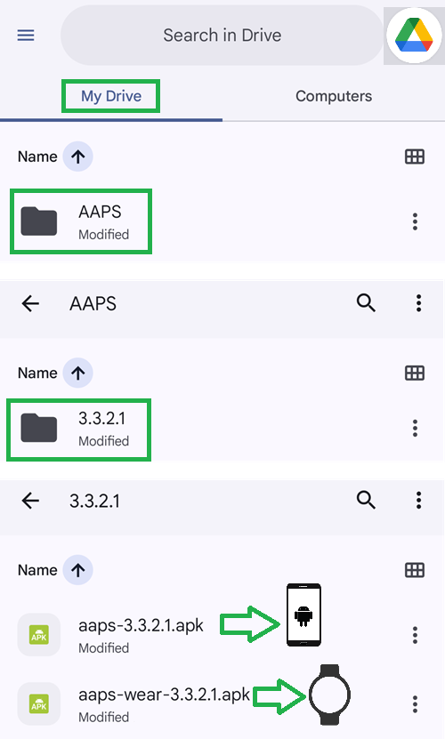
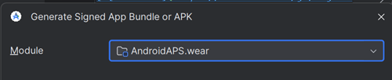
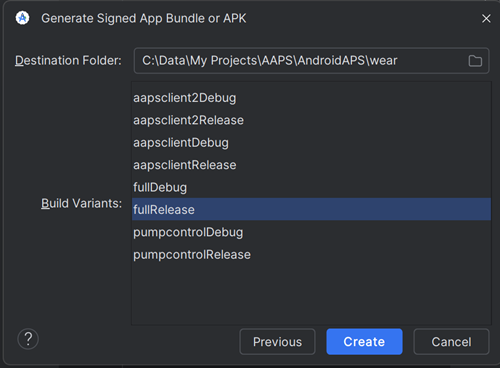

# Сборка приложения AAPS для Wear

Приложение **AAPS** для смарт-часов на Wear OS (**Wear apk**, `aaps-wear-….apk`) – это отдельный установочный файл, не тот, что у приложения **AAPS** для телефона. Вам нужны оба: приложение на телефоне управляет циклом, приложение на часах показывает его данные и может отправлять ему команды. Приложение для часов устанавливается с телефона, см. [Настройка AAPS на часах Wear OS](WearOsSmartwatch.md).

Два приложения работают вместе, только если они совпадают:

- **Одна и та же версия AAPS** на телефоне и на часах.
- **Одно и то же хранилище ключей** для подписи обоих приложений.

Проще всего обеспечить это, если собрать оба приложения **одновременно**, в одной сборке. Сборка через браузер делает это за вас: каждая сборка создает apk для телефона и Wear apk вместе. В Android Studio или в командной строке вы собираете Wear apk вторым шагом, сразу после apk для телефона.

```{note}
Уже пользуетесь **AAPS** на телефоне, но у вас нет Wear apk из той же сборки? Соберите оба приложения заново с тем же хранилищем ключей и переустановите также приложение на телефоне. Wear apk, собранный через несколько месяцев или в другой версии Android Studio, скорее всего, не будет совместим с приложением на телефоне.
```

## Поддерживаемые версии Wear OS

**AAPS** работает на часах с **Wear OS 3.0, 3.2 или 3.5** (Android 11, уровень API 30) **или новее** (Wear OS 4, 5 и 6). Часы с Wear OS 2 не поддерживаются.

```{warning}
Циферблаты AAPS доступны для смарт-часов на Wear OS с уровнем API от 30 до 33 (Wear OS 3.0, 3.2, 3.5 и 4).<br>
Новые версии Wear OS постепенно ломают циферблаты AAPS – см. [Изменения циферблатов в Wear OS](#wearos-watchface-changes) и [Ограничения Wear OS 5](#BuildingAapsWearOs-WearOS5).
```

(building-aaps-wear-os-method)=

## Как получить Wear apk при вашем способе сборки

Следуйте разделу для того способа, которым вы [собираете AAPS](../SettingUpAaps/BuildingAaps.md).

(building-aaps-wear-os-browser)=

### Сборка через браузер (рекомендуется)

**Ничего дополнительно делать не нужно.** Каждая сборка через браузер создает два файла из одного исходного кода и с одним хранилищем ключей:

- `aaps-….apk`: приложение для телефона.
- `aaps-wear-….apk`: приложение для часов.

Wear apk соответствует [варианту](#browserbuild-variant), который вы выбрали для сборки: `fullRelease` дает приложение **AAPS Wear**, `aapsclientRelease` – приложение **AAPSClient Wear**, `pumpcontrolRelease` – приложение **PumpControl Wear**. Каждое приложение Wear работает только со своим приложением на телефоне.

Где найти Wear apk:

- **AAPS Builder**: на странице сборки прокрутите вниз до **Artifacts** и скачайте `aaps-wear-….apk` рядом с приложением для телефона, как показано в разделе [Шаг 5 – Установите приложение на телефон](#aaps-builder-step5). Скачайте его на телефон, на котором работает **AAPS**, если вы устанавливаете приложение для часов с телефона (Wear Installer 2 или Easy Fire Tools), или на компьютер, если вы используете ADB.

  

- **Fork с Google Диском**: откройте свой Google Диск, папку `AAPS`, затем папку собранной версии. В ней есть apk для телефона и Wear apk, см. [Шаг 4 – Соберите APK](#github-build-apk).

  

Храните Wear apk вместе с apk для телефона в своих резервных копиях. С **AAPS Builder** файлы хранятся на странице сборки только 14 дней.

Дальше: установите Wear apk на часы, см. [Настройка AAPS на часах Wear OS](WearOsSmartwatch.md).

(building-aaps-wear-os-android-studio)=

### Android Studio

Wear apk собирается так же, как apk для телефона, второй подписанной сборкой. Делайте это сразу после apk для телефона, в той же версии Android Studio и с тем же хранилищем ключей.

- Следуйте инструкциям на странице [Сборка в Android Studio](../SettingUpAaps/ComputerBuild.md).
- Когда вы дойдете до [выбора модуля](#Building-APK-wearapk) в разделе «Сборка подписанного apk AAPS», обязательно выберите **`AndroidAPS.wear`**.



Выберите «**fullRelease**», чтобы создать файл apk **AAPS** для Wear.



Вместо этого можно собрать **“pumpcontrolRelease”** из выпадающего меню, которое позволит дистанционно управлять помпой, но вне цикла.

Дальше: установите Wear apk на часы, см. [Настройка AAPS на часах Wear OS](WearOsSmartwatch.md).

(building-aaps-wear-os-troubleshooting)=

#### Устранение неполадок при сборке в Android Studio

При сборке полного приложения **AAPS** (и вообще любого подписанного приложения) Android Studio создает файл .json в той же папке. Из-за этого возникают ошибки с [незафиксированными изменениями](#troubleshooting_androidstudio-uncommitted-changes), когда вы пытаетесь собрать следующее подписанное приложение, например приложение **AAPS** для Wear. Самый быстрый способ решения это переход к папке, в которой было построено полное приложение AAPS, путь к папке, вероятно, выглядит как-то так:

`C:\Users\Your Name\AndroidStudioProjects\AndroidAPS\app\full\release.`

Удалите или переместите ненужный файл .json из этой папки. Затем попробуйте снова собрать приложение **AAPS** для Wear. If that doesn't work, the more detailed [troubleshooting guide](../GettingHelp/TroubleshootingAndroidStudio.md) will help you to identify the specific file causing the issue, which could also be your keystore file.

(building-aaps-wear-os-cli)=

### Командная строка

Следуйте странице [Инструкция по сборке из командной строки](../SettingUpAaps/CLIBuild.md) и повторите шаги компиляции и подписи для модуля `wear` с тем же хранилищем ключей:

```sh
./gradlew :wear:assembleFullRelease
```

Неподписанный Wear apk записывается в папку `wear/build/outputs/apk/full/release/`. Подпишите его с помощью `apksigner` точно так же, как apk для телефона, затем установите его на часы, см. [Настройка AAPS на часах Wear OS](WearOsSmartwatch.md).
