# Настройка AAPS на часах Wear OS

Инструкции ниже относятся к apk **AAPS Wear**, который вам нужно собрать. Если вы его еще не собрали, см. руководство по ссылке [здесь](../WearOS/BuildingAapsWearOS.md). При сборке обязательно используйте тот же файл хранилища ключей, что и для apk **AAPS** на телефоне.

Часть информации подходит также для apk **Wear** для **AAPSClient** и **PumpControl**. Каждое приложение **Wear** связывается с соответствующим приложением на телефоне. Например, приложение **AAPSClient Wear** можно использовать, чтобы показывать данные **AAPSClient**, а не данные **AAPS**. Если рядом установлено несколько вариантов клиента (**AAPSClient**, **AAPSClient2**, **AAPSClient3**), у карточек каждого из них есть небольшой заголовок в акцентном цвете этого варианта, чтобы их можно было различить при пролистывании.

## Версии Wear OS и совместимость

(wearos-watchface-changes)=

### Изменения циферблатов в Wear OS (влияние на циферблаты AAPS)

```{admonition} Why newer Wear OS watches break AAPS watchfaces
:class: warning

В июне 2025 года Google [объявил об изменениях](https://android-developers.googleblog.com/2025/06/upcoming-changes-to-wear-os-watch-faces.html): старый движок циферблатов (движок AndroidX / Wearable Support Library, или «WSL») постепенно заменяется новым декларативным форматом **Watch Face Format**. Пользовательские циферблаты **AAPS** построены на старом движке, поэтому чем новее версия Wear OS, тем выше вероятность, что циферблат AAPS будет работать неправильно или перестанет работать.

Это касается именно **циферблатов** — **дополнения** AAPS, карточки и функции удаленного управления не затронуты. Поэтому же **обновление прошивки/системы на часах Wear OS может сломать циферблаты AAPS**, а вернуть часы к более старой версии Wear OS после этого нельзя. Если ваш циферблат AAPS сейчас работает, **отключите автоматическое обновление часов**.
```

В таблице ниже показано, как изменение Google влияет на циферблаты AAPS (на старом движке) в зависимости от версии Wear OS:

| Версия Wear OS          | Базовая версия Android | Уровень API | Влияние на циферблаты AAPS (старые)                                                                                                                                                                             |
| ----------------------- | ---------------------- | ----------- | --------------------------------------------------------------------------------------------------------------------------------------------------------------------------------------------------------------- |
| Wear OS 6               | Android 16             | 36          | **Старые циферблаты больше недоступны** — вместо них AAPS устанавливает [циферблат в формате Watch Face Format](#wearos-aaps-v4-watchface): ваш пользовательский циферблат или циферблат с дополнениями AAPS V4 |
| Wear OS 5               | Android 14             | 34          | **Сильное** — активный (интерактивный) режим часто не работает, дополнения зависают, анимации останавливаются                                                                                                   |
| Wear OS 4               | Android 13             | 33          | **Среднее** — замедление, пропущенные обновления, частичные сбои                                                                                                                                                |
| Wear OS 3.0 / 3.2 / 3.5 | Android 11             | 30          | **Слабое** — старый движок все еще поддерживается                                                                                                                                                               |

Если на вашей версии часов циферблаты AAPS работают ненадежно, вы можете показывать данные AAPS с помощью **дополнений** на совместимом циферблате или использовать [GlucoDataHandler](https://play.google.com/store/apps/details?id=de.michelinside.glucodatahandler) с дополнением, который получает данные от модуля [Внешние приложения-компаньоны](#external-companion-apps) в **AAPS**. На **Wear OS 6 и новее** AAPS устанавливает замещающий циферблат в новом формате — см. ниже.

(wearos-aaps-v4-watchface)=

### Wear OS 6 и новее — циферблат, который устанавливает AAPS

Часы с **Wear OS 6 или новее** не могут использовать классические циферблаты AAPS как циферблаты. Для таких часов приложение AAPS для часов содержит два циферблата в новом формате Google **Watch Face Format**. Wear OS позволяет приложению установить только **один** циферблат, поэтому вы выбираете, какой из двух будет на часах:

- **Пользовательский циферблат** (по умолчанию): показывает пользовательский циферблат, который вы загрузили с телефона кнопкой **Загрузить циферблат** (см. [Переход на циферблат AAPS](#WearOS_changing-to-AAPS-watchface)). Часы рисуют ваш дизайн как картинку, поэтому работает любой существующий пользовательский циферблат. Ячейки для дополнений, которые может задавать пользовательский циферблат, на этой картинке **недоступны**, потому что Wear OS передает данные дополнений только настоящему циферблату. Нажмите и удерживайте циферблат, чтобы открыть его единственную настройку: что показывает режим Always On — простые часы или ваш дизайн с пониженной яркостью.
- **Циферблат с дополнениями** (циферблат **AAPS V4**): его **семь ячеек для дополнений** уже **настроены на данные AAPS**: значение ГК, IOB, COB, [дополнение «График ГК»](#Watchfaces-complications), базальная скорость / временная цель и значок **Режим работы** в левой верхней ячейке (нажмите на него, чтобы изменить режим цикла с часов). Нажмите на время вверху, чтобы открыть на часах приложение будильника. В редакторе циферблата можно изменить, что показывает каждая ячейка.

Выбор делается на телефоне: откройте модуль **Смарт-часы Wear** и в разделе **Циферблат, установленный на часах** выберите один из двух. Эта карточка видна, только пока подключены часы с Wear OS 6 или новее. **AAPS** просит подтверждения, потому что часы сразу меняют циферблат. При переключении с **Циферблата с дополнениями** дополнения, которые вы изменили в редакторе циферблата, также сбрасываются на значения по умолчанию, и подтверждение об этом предупреждает. Пока выбран **Циферблат с дополнениями**, кнопки пользовательского циферблата скрыты, а вместо них показан предварительный просмотр циферблата. Если вы загружаете пользовательский циферблат, пока выбран **Циферблат с дополнениями**, **AAPS** напоминает, что нужно переключиться на **Пользовательский циферблат**, чтобы увидеть его на часах.

- Выбранный циферблат **устанавливается и включается автоматически** при первом запуске приложения AAPS на таких часах и **обновляется автоматически** вместе с приложением для часов.
- Если вы удалили циферблат, внизу **главного меню** AAPS на часах появляется пункт **Установить циферблат** — нажмите на него, чтобы установить циферблат снова.

Пока подключены часы с Wear OS 5 или старше, карточка **Циферблат, установленный на часах** не показывается совсем (нужный для нее механизм требует Wear OS 6); классические циферблаты работают там как раньше.

(wearos-complications-watchface-setup)=

### Циферблат с дополнениями — рекомендуемая настройка

У **Циферблата с дополнениями** семь ячеек для дополнений. Нажмите и удерживайте циферблат, нажмите **Настроить** и выберите источник данных для каждой ячейки. Ячейки пронумерованы так же, как в редакторе циферблата: **1** слева, **2** в центре, **3** справа, **4** график, **5** внизу, **6** слева вверху и **7** справа вверху.

| Настройка по умолчанию                                                                                    | Альтернативная настройка                                                                                        |
| --------------------------------------------------------------------------------------------------------- | --------------------------------------------------------------------------------------------------------------- |
|  | 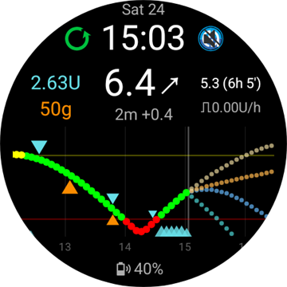 |

| Ячейка | Положение     | Default                                                                       | Альтернатива                                  |
| ------ | ------------- | ----------------------------------------------------------------------------- | --------------------------------------------- |
| 1      | Слева         | IoB Icon                                                                      | CoB & IoB                                     |
| 2      | В центре      | Blood Glucose                                                                 | Blood Glucose                                 |
| 3      | Справа        | CoB Icon                                                                      | BR & Target                                   |
| 4      | Graph         | BG Graph                                                                      | BG Graph                                      |
| 5      | Внизу         | BR & Target                                                                   | Uploader/Phone Battery                        |
| 6      | Слева вверху  | Режим работы                                                                  | Режим работы                                  |
| 7      | Справа вверху | Батарея загрузчика/телефона или ярлык приложения **Отложить оповещения AAPS** | Ярлык приложения **Отложить оповещения AAPS** |

Ярлык **Отложить оповещения AAPS** выбирается среди собственных дополнений часов **Ярлык приложения**. Нажатие на него откладывает сигнал тревоги, который звучит на телефоне.

```{tip}
Включите **Always On Display** на часах (**Настройки** > **Экран**). Тогда циферблат продолжает показывать вашу глюкозу, когда рука опущена, а не пустой экран или простые часы.
```

```{admonition} No complication data while the watch is locked
:class: note
Если в **Настройки** > **Безопасность и конфиденциальность** задан **Тип блокировки**, часы скрывают данные дополнений, пока они заблокированы, и на циферблате видны пустые ячейки, пока вы их не разблокируете. Чтобы данные оставались видны, выключите **Скрыть информацию** (Hide information) в том же меню.
```

### Wear OS 3

Установите apk **AAPS Wear** с помощью [Wear Installer 2](https://youtu.be/abgN4jQqHb0?si=5L7WUeYMSd_8IdPV), Easy Fire Tools (описано ниже) или ADB.  
Работа **AAPS Wear** без ограничений.

(BuildingAapsWearOs-WearOS5)=

### Wear OS 4 и Wear OS 5

Пример: Galaxy Watch 4, 5, 6, 7 и Ultra или Pixel Watch, которые **еще не** обновлены до Wear OS 6. Проверьте версию в **Настройки** > **Сведения о часах** > **Программное обеспечение**.

Установите apk **AAPS Wear** с помощью [Wear Installer 2](https://youtu.be/abgN4jQqHb0?si=5L7WUeYMSd_8IdPV) (для Wear OS 5 следуйте [этому видео](https://www.youtube.com/watch?v=yef_qGvcCnk)). Все функции **AAPS Wear** работают, но классические циферблаты **AAPS** ограничены, как описано в таблице выше: замедлены на Wear OS 4 и часто не работают на Wear OS 5.

```{admonition} Wear OS 5
:class: warning
На Wear OS 5 циферблат AAPS нужно выбрать в Wear Installer 2 сразу после установки приложения Wear: в конце установки программа предлагает циферблат **AAPS (Custom)**. Если вы случайно переключитесь на другой циферблат, повторите установку. Изменить настройки циферблата (Тёмная, Соответствующий делитель и т. д.) может быть невозможно.

Если классический циферблат у вас сейчас работает, **отключите автоматическое обновление часов**: следующее обновление прошивки, скорее всего, его сломает. Если вы все же обновитесь до Wear OS 6, прочитайте раздел выше: тогда **AAPS** устанавливает свой циферблат в новом формате.
```

Если циферблат работает слишком ненадежно, используйте вместо него [GlucoDataHandler](https://play.google.com/store/apps/details?id=de.michelinside.glucodatahandler) с дополнением. Для этого в **AAPS** должен быть включен модуль [Внешние приложения-компаньоны](#external-companion-apps).

### Wear OS 6 и новее

Пример: Galaxy Watch 4 и новее с One UI 8 Watch, Pixel Watch после обновления 2025 года. Большинство часов Galaxy и Pixel уже получили это обновление.

Установите apk **AAPS Wear** с помощью [Wear Installer 2](https://youtu.be/abgN4jQqHb0?si=5L7WUeYMSd_8IdPV). Классические циферблаты недоступны; **AAPS** автоматически устанавливает циферблат, выбранный на телефоне, см. [циферблат, который устанавливает AAPS](#wearos-aaps-v4-watchface). Работа **AAPS Wear** без ограничений.

## Как настроить смарт-часы Samsung Galaxy Watch 4 для работы с **AAPS**

This section assumes you are totally new to Smartwatches, and gives you basic orientation of a popular watch, the **Galaxy Watch 4**, followed by a step-by-step guide to setup **AAPS** on the watch.

_Это руководство написано для Galaxy Watch с Wear OS 3._ На Wear OS 4 и новее часы запрашивают **код сопряжения**, когда телефон или компьютер подключается через ADB. Wear Installer 2 и порядок действий в терминале [ниже](#BuildingAapsWearOs-WearOS5-TShoot) это поддерживают.

Вот базовые руководства по настройке [Galaxy Watch 5](https://www.youtube.com/watch?v=Y5upzOIxwTU) и [Galaxy Watch 6](https://www.youtube.com/watch?v=D6bq20KzPW0)

## Basic smartwatch familiarity

После базовой настройки часов по видео выше откройте Play Маркет на телефоне и скачайте следующие приложения: «Galaxy Wearable», «Samsung» и либо «Easy Fire tools», либо «Wear Installer 2».

There are plenty of 3rd party YouTube videos which will help you with getting familiar with your new smartwatch, for example:

[https://www.youtube.com/watch?v=tSVkqWNmO2c](https://www.youtube.com/watch?v=tSVkqWNmO2c)

The app “Galaxy Wearable” also has an instruction manual section in it. Open galaxy wearable on the phone, search for the watch, attempt to pair the watch with the phone. В зависимости от версии вам может быть предложено установить еще одно приложение, «galaxy watch 4 plugin», из Play Маркета (скачивание занимает время). Install this on the phone, and then attempt to pair the watch and phone again in the wearable app. Go through a series of menus and tick various preferences.

## Setting up a Samsung account

Убедитесь, что в учетной записи электронной почты, с которой вы создаете учетную запись Samsung, указана дата рождения, по которой пользователю 13 лет или больше. Иначе разрешения Samsung очень трудно подтвердить. If you have given your child under 13 a Gmail account and are using that email address, you cannot simply change it to an adult account. One way around this is to modify the current date-of-birth to make the current age 12 years and 364 days old. The following day, the account will be converted to an adult account, and you can progress with the setup of the Samsung account.

(remote-control-transferring-the-aaps-wear-app-onto-your-aaps-phone)=

## Перенос приложения **AAPS** Wear на телефон с **AAPS**

Перенести Wear.apk из Android Studio на телефон можно одним из способов:

a) с помощью USB-кабеля скопировать apk-файл **AAPS** Wear на телефон, а затем установить его на часы вручную (sideload). Transfer Wear.apk to the phone via USB into the downloads folder; or

b)  cut and paste Wear.apk from Android Studio onto your Gdrive.


Чтобы вручную установить (sideload) AAPS на часы, можно использовать: 1) Wear Installer 2 2) Easy Fire tools 3) Android Debug Bridge (ADB) Мы рекомендуем Wear Installer 2, потому что инструкции и процесс в видео очень понятны и хорошо объяснены. Если Wear Installer 2 у вас не работает, попробуйте Easy Fire Tools или ADB, оба способа описаны ниже.

### Ручная установка (sideload) **AAPS** Wear с телефона на часы с помощью Wear Installer 2

 

Wear Installer 2, разработанный [Malcolm Bryant](https://www.youtube.com/@Freepoc), можно скачать из Google Play на телефон и использовать для ручной установки (sideload) приложения AAPS Wear на часы. В приложении есть удобное [видео](https://youtu.be/abgN4jQqHb0?si=5L7WUeYMSd_8IdPV) о том, как выполнить ручную установку (sideload).

```{tip}
Для часов с Wear OS 5 следуйте инструкциям из [этого видео](https://www.youtube.com/watch?v=yef_qGvcCnk).
Советы по устранению неполадок см. [ниже](#BuildingAapsWearOs-WearOS5-TShoot).
```

Там есть все нужные подробности (лучше открыть видео на другом устройстве, чтобы смотреть его во время настройки телефона).

Как сказано в видео, после завершения выключите отладку ADB на часах, чтобы не разряжать батарею смарт-часов.

Или вы можете (но не для Wear OS 5):

### Ручная установка **AAPS** Wear на часы с помощью Easy Fire tools

1) Скачайте _[Easy Fire Tools](https://play.google.com/store/apps/details?id=de.agondev.easyfiretools&hl=en)_ из Play Маркета на телефон


2)  Make yourself a developer in the watch (once set up and connected to phone):

Откройте **Настройки** > **Система** > **О часах** > **Версии** (названия меню отличаются у разных марок часов — на некоторых часах это **Сведения о часах** > **Сведения о ПО** > **Версия ПО**).

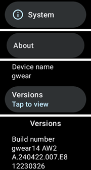

Быстро нажмите несколько раз на **Номер сборки** (или **Версия ПО**), пока не появится сообщение, что вы стали разработчиком.

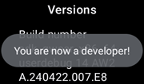

Вернитесь в **Настройки** > **Система**: теперь там есть новое меню **Параметры разработчика**.

В **Параметрах разработчика** включите **Отладку ADB** и **Отладку по Wi-Fi** (Wireless debugging) и подтвердите запросы. Затем в разделе отладки по Wi-Fi показываются **IP-адрес и порт** часов, например: **192.168.1.214** : 5555. Вам нужен только IP-адрес (здесь **192.168.1.214**), а не номер порта после двоеточия. Обратите внимание, что IP-адрес может измениться, например каждый раз, когда вы переходите на новый телефон для AAPS.

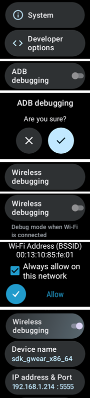

ШАГ 3) Введите IP-адрес, _например_ **192.168.1.214**, в Easy Fire tools на телефоне (откройте меню слева, настройки и введите IP-адрес).

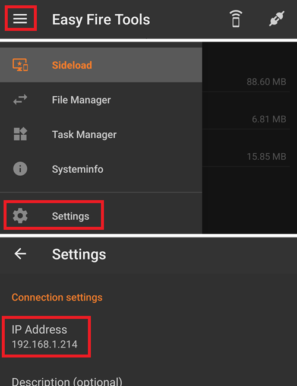

Then click the plug socket icon on the top right. При подключении он станет зеленым.

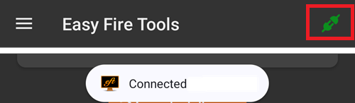


ШАГ 4) Следуйте инструкциям [здесь](https://wearablestouse.com/blog/2022/01/04/install-apps-apk-samsung-galaxy-watch-4/?utm_content=cmp-true), чтобы вручную установить (т. е. перенести) aaps-wear.apk на смарт-часы с помощью Easy Fire tools


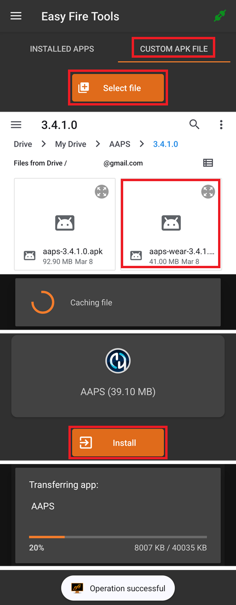


(BuildingAapsWearOs-WearOS5-TShoot)=

### Через терминал
Подключите смарт-часы и компьютер к одной сети Wi-Fi.

- Чтобы установить ADB, скачайте его отсюда: https://developer.android.com/tools/releases/platform-tools
- Откройте терминал.
- В Windows создайте новую папку с именем `adb` на диске `C:`. Откройте скачанный ранее файл `platform-tools-latest-windows.zip`. Скопируйте все файлы из `platform-tools` в `C:\adb` и откройте эту папку в командной строке (правый клик и «Открыть в терминале»). Введите команду ниже, чтобы добавить в путь папку, где находится ADB: `setx PATH "%PATH%;C:\adb"`
- На Mac вместо ручной установки можно использовать homebrew: `brew install android-platform-tools`

На часах:
- Откройте Настройки → Сведения о часах → **Сведения о ПО**
- Нажмите на «Версия ПО» 7 раз, пока не увидите, что режим разработчика включен.
- Откройте Настройки → Параметры разработчика. Включите **Отладку ADB**
- Откройте Настройки → Параметры разработчика → Отладка по Wi-Fi (Wireless debugging) → **Подключить новое устройство** (Pair new device)

Появятся код сопряжения Wi-Fi, IP-адрес и порт:


- В терминале: `adb pair ipaddress:port` Например: `adb pair 10.10.1.125:36299`
- Вас попросят ввести код сопряжения. Введите его.
- Вы увидите ответ:<br> `Successfully paired to 10.10.1.125:36299 [guid=adb-RXXXW20LMKJY-eh5zBj]`<br>
- В терминале введите: <br>`adb devices`.<br> Вы должны увидеть примерно следующее:<br> `List of devices attached`<br> `10.10.1.125:36299  offline`<br> `adb-RFAW20LMKJY-eh5zBj._adb-tls-connect._tcp   device`<br>

- Теперь перейдите в папку на компьютере, где находится apk Wear, и введите<br> `adb install wear-full.apk` <br>заменив wear-full.apk на имя вашего apk-файла.
- Вы увидите:<br> `Performing Streamed Install`<br> `Success`


(wear-os-5-troubleshooting)=

### Общие рекомендации по устранению неполадок для Wear OS 5

- Не используйте раздачу Wi-Fi (точку доступа на телефоне). Это не сработает.
- Отладку ADB на телефоне включать не нужно (только на часах). Выключите отладку ADB на телефоне.
- Подключайтесь к своей локальной сети, в которой телефон и часы видят друг друга (не подключайтесь к гостевой сети Wi-Fi).
- Убедитесь, что часы и телефон находятся в одной сети и подключены к одному устройству Wi-Fi. Особенно проблемы могут создавать повторители Wi-Fi или точки доступа.
- Находитесь рядом с основным роутером, затем перезапустите телефон и часы.

**Pairing :**

- Часы: Отладка по Wi-Fi (Wireless debugging): запишите IP-адрес.
- Wear Installer: введите IP-адрес в приложении Wear Installer.
- Выберите «Подключить новое устройство» (Pair new), запишите показанный код сопряжения и номер порта.
- Wear Installer: введите код сопряжения + пробел + номер порта.
- Wear Installer должен сообщить, что сопряжение выполнено успешно. Если этого не произошло, закройте Wear Installer и попробуйте снова.

После сопряжения вы сможете установить apk AAPS Wear:

- Закройте и снова запустите Wear Installer.
- В разделе отладки по Wi-Fi запишите IP-адрес и номер порта и проверьте или введите IP-адрес и номер порта в Wear Installer.
- Примечание: этот номер порта отличается от того, который использовался для сопряжения!

## Setting up the connection between the watch and the phone from **AAPS**

Последний шаг — настроить **AAPS** на телефоне для работы с **Wear.apk** на часах. Для этого включите модуль Wear:

* Откройте приложение **AAPS** на телефоне

* Откройте **меню** (☰) в левом верхнем углу и перейдите в **Конфигурация** > **Связь**

* Отметьте **Смарт-часы Wear**


Чтобы вводить болюс или выполнять другие действия с часов, включите также **Управление с часов** в [Настройки > Wear](#preferences-wear).

Чтобы перейти на другой циферблат **AAPS**, нажмите и удерживайте циферблат на главном экране часов и нажмите **Настроить**. Then swipe right until you get to all the **AAPS**  faces.

If the **AAPS** Wear.apk has been successfully side-loaded onto the smartwatch, it will look like this:


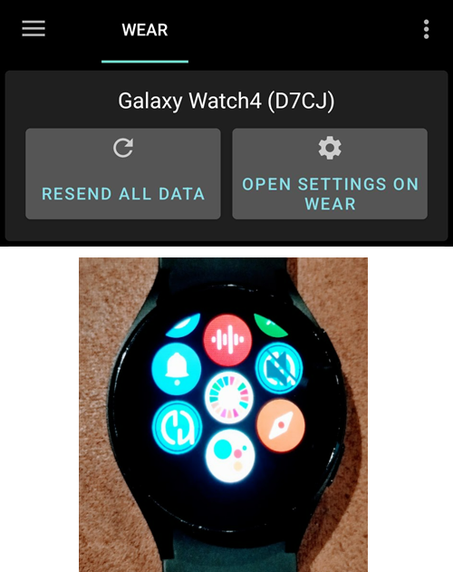


На некоторых смарт-часах, например Samsung Galaxy, нужно **включить** «Удаленное подключение» в разделе «Дополнительные функции» Samsung Galaxy, чтобы использовать **Wear.apk** и **AAPS** удаленно через Wi-Fi.

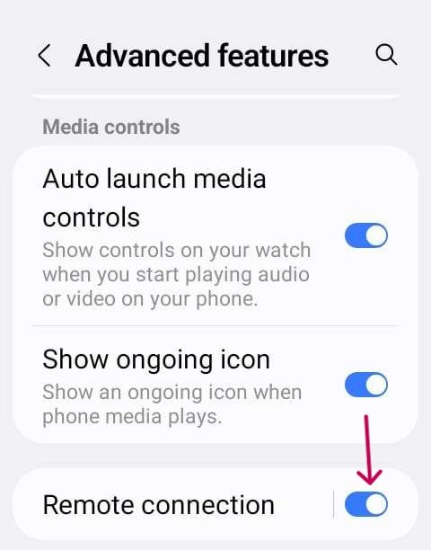

(wear-os-watch-phone-communication)=

### Устранение неполадок связи между часами **AAPS** и телефоном **AAPS**

1.  If EasyFire tools does not connect or if you are receiving ‘authorisation failed’ > check IP address has been correctly entered.
2.  Check that the smartwatch is connected to the internet (and not just connected to the phone via Bluetooth).
3.  Check that the **AAPS** Phone and smartwatch are paired or linked in Samsung app.
4.  It may also help to do a hard restart of Phone and smartwatch (meaning turning phone on and off)
5.  Если вам удалось скачать Wear.apk на телефон, но данные ГК не приходят, _проверьте_, что вы установили на часы правильный apk **AAPS** Wear: приложение для часов из сборки через браузер — это файл `aaps-wear-….apk`, см. [Сборка приложения AAPS для Wear](../WearOS/BuildingAapsWearOS.md). Если вы установили один из следующих файлов: a) apk **AAPSClient** Wear (а на телефоне работает **AAPS**); b) файл `.aab`; или c) файл со словом «debug» в имени, значит, при сборке вы выбрали не тот apk для Wear OS.
6.  Check that your router is not isolating the devices from one another.

Больше советов по устранению неполадок можно найти [здесь](https://freepoc.org/wear-installer-help-page/#:~:text=If%20you%20are%20having%20problems,your%20phone%20and%20your%20watch.)

(WearOS_changing-to-AAPS-watchface)=

## Changing to an AAPS Watchface on your WearOS watch

There are a number of watchfaces available in the standard build of the AAPS Wear OS APK build. Once you have installed the AAPS Wear APK on your watch, they will be available. Here are the steps for selecting one:

1. На часах (с WearOS) нажмите и удерживайте текущий циферблат, чтобы открыть экран выбора циферблатов, прокрутите до конца вправо, пока не увидите кнопку «Добавить циферблат», и нажмите ее

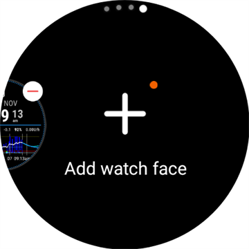

2. Прокручивайте список, пока не найдете "AAPS (Custom)" (в зависимости от часов циферблаты установленных приложений находятся в разделе «Загруженные» или сгруппированы по приложениям), и нажмите на середину изображения, чтобы добавить его в список ваших текущих циферблатов. Don't worry about the current appearance of the "AAPS (Custom)" watchface, we will select your preferred skin in the next step.

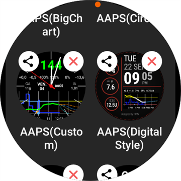

3. Теперь откройте AAPS на телефоне и откройте модуль Wear: **Конфигурация** > **Связь** > **Смарт-часы Wear** > **Открыть модуль** (если модуль не включен, сначала отметьте **Смарт-часы Wear**).

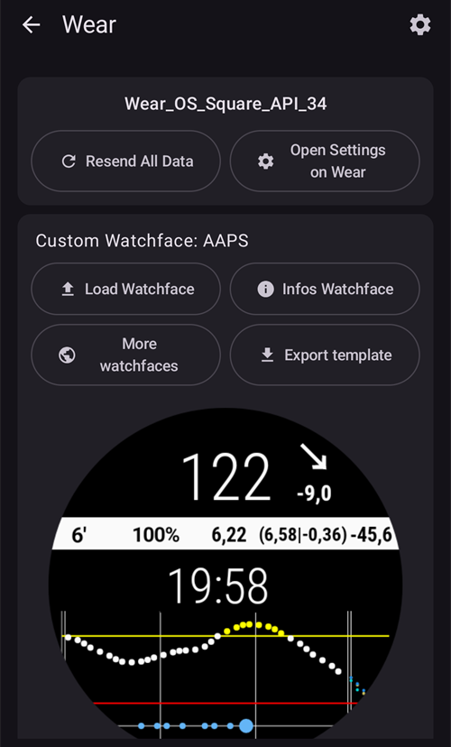

4. Click on the "Load Watchface" button and select the watchface that you like

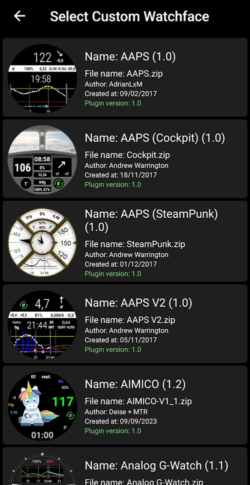

5. Проверьте часы: циферблат "AAPS (Custom)" теперь должен показывать выбранный вами вид. Give it a few seconds to refresh. Экран **Wear** на телефоне теперь показывает название загруженного циферблата и его предварительный просмотр. **Циферблат Infos** показывает его подробности и поля, которые он содержит, а **Еще циферблаты** открывает [сайт обмена](../ExchangeSiteCustomWatchfaces/index.md), где можно скачать другие пользовательские циферблаты. Теперь вы можете настроить дополнения и т. д.: нажмите и удерживайте циферблат, а затем нажмите кнопку «Настроить» на изображении циферблата.

```{admonition} Complications on a custom watchface
:class: note
Пользовательские циферблаты, созданные в версии 3.0 или новее формата пользовательских циферблатов, могут содержать до пяти ячеек для дополнений; их положение и размер задает циферблат (**Расположение дополнений**). На часах нажмите и удерживайте циферблат, нажмите **Настроить** и нажмите на **Дополнение 1** … **Дополнение 5**, чтобы выбрать источник данных для каждой ячейки. Те же строки есть в приложении AAPS на часах в **Настройки** > **AAPS(Custom)**; нажатие на строку там открывает тот же выбор. **Приоритет типа дополнения** определяет, что ячейка предпочитает — значение или шкалу, текст или значок, — когда источник данных предлагает несколько вариантов. Измененный приоритет применяется только при следующем выборе источника данных для этой ячейки.

Эти ячейки работают только на часах с **Wear OS 5 или старше**, где пользовательский циферблат работает как настоящий циферблат. На **Wear OS 6 и новее** пользовательский циферблат показывается как картинка без ячеек для дополнений, и шаги 1 и 2 выше не нужны: проверьте, что в модуле **Смарт-часы Wear** на телефоне в разделе **Циферблат, установленный на часах** выбран **Пользовательский циферблат** (см. [циферблат, который устанавливает AAPS](#wearos-aaps-v4-watchface)).
```

## AAPSv2 watchface - Legend

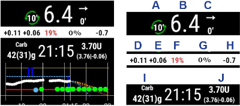

A - time since last loop run

B - CGM reading

C - minutes since last CGM reading

D - изменение по сравнению с последним значением CGM (в ммоль/л или мг/дл)

E - average change CGM reading last 15 minutes

F - phone battery

G - basal rate (shown in U/h during standard rate and in % during TBR)

H - BGI (влияние на глюкозу крови) -> насколько ГК «должна» расти или падать только из-за действия инсулина.

I - carbs (carbs on board | e-carbs in the future)

J - insulin on board (from bolus | from basal)
