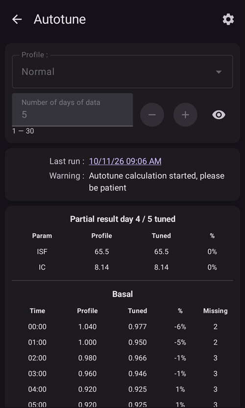
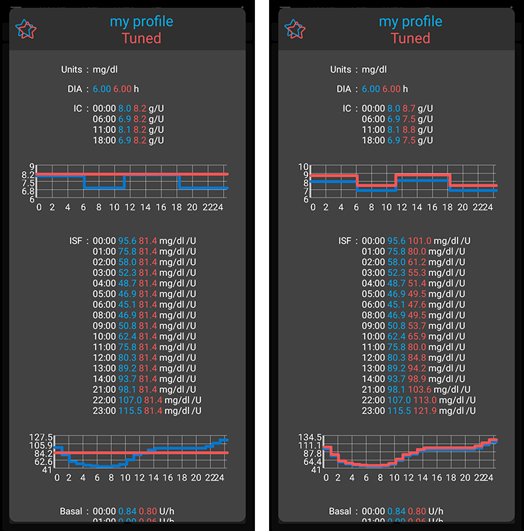

# Ako používať plugin Autotune

Plugin Autotune je implementácia algoritmu autotune z OpenAPS v AAPS. Analyzuje vašu nedávnu históriu v AAPS a navrhuje úpravy bazálnych dávok, ISF a sacharidového pomeru.

Autotune Plugin is available in AAPS releases since [3.4](https://github.com/nightscout/AndroidAPS/releases/tag/3.4.0.0) but is hidden by default.

(autotune-how-autotune-calculates-adjustments)=
## Ako Autotune vypočítava úpravy

Autotune sa pozrie späť na vašu nedávnu históriu v AAPS – hodnoty z CGM, bolusy, sacharidy a dočasné bazály – a zistí, kde váš **profil** (bazálne dávky, ISF, sacharidový pomer) celkom nezodpovedá tomu, čo sa s vašou glykémiou skutočne dialo.

Pre každý 5-minútový údaj porovná **skutočnú zmenu glykémie** so zmenou, ktorú predpovedal váš profil, a výslednú odchýlku zaradí do jednej z troch skupín:

* odchýlky, ktoré nastali bez aktívnych sacharidov a bez aktivity inzulínu (použijú sa na ladenie **bazálnych dávok**, hodinu po hodine),
* odchýlky, ktoré nastali po boluse/korekcii bez sacharidov (použijú sa na ladenie **ISF**), alebo
* odchýlky, ktoré nastali počas vstrebávania sacharidov (použijú sa na ladenie **sacharidového pomeru**).

Potom sa pozrie na vzorec odchýlok v každej skupine (pomocou percentilov namiesto jednoduchého priemeru, aby niekoľko zašumených údajov neskreslilo výsledok) a navrhne novú hodnotu pre danú hodinu/parameter.

Aby jeden výpočet neurobil príliš veľkú korekciu, každý výpočet Autotune posunie hodnotu iba o časť cesty k tomu, čo naznačujú dáta: najviac o 10 % pri ISF a sacharidovom pomere a najviac o 20 % pri každom bazálnom úseku. Celkový posun ďalej obmedzujú nastavenia **Autosens max** / **Autosens min** (pozrite [Ďalšie nastavenia](#autotune-other-settings) nižšie) – rovnaké hranice, ktoré obmedzujú Autosens. Preto je Autotune určený na opakované spúšťanie (deň po dni alebo každú noc), a nie na to, aby ste mu dôverovali po jedinom výpočte: výsledky by sa mali postupne ustáliť a veľký skok pri jednom výpočte je signál, aby ste si dáta znova skontrolovali (vynechané sacharidy, deň so zlým senzorom _atď._), a nie aby ste mu slepo dôverovali.

Autotune sa dá spustiť tromi spôsobmi: ručne jednorazovo priamo v plugine (ako je opísané nižšie), automaticky každú noc pomocou [pravidla automatizácie](#autotune-run-autotune-with-an-automation-rule), alebo – úplne mimo AAPS – ako samostatný nástroj príkazového riadku nad exportovanými dátami; takto ho niektoré komunitné návody opisujú na použitie bez telefónu s bežiacim AAPS.

*Podrobný matematický opis algoritmu oref0 nájdete v [dokumentácii Autotune od OpenAPS](https://openaps.readthedocs.io/en/latest/docs/Customize-Iterate/autotune.html).*

## Zobrazenie pluginu Autotune

V podpriečinku `extra` vo vašom [AAPS priečinku](#preferences-maintenance-settings) v telefóne vytvorte prázdny súbor s názvom `enable_autotune`.

***NOTE: Ensure you check in the AAPS settings where your AAPS Directory is, and that you placed the file in the correct one. Several users have put the file into the wrong folder.***


Reštartujte **AAPS**. Potom otvorte **ponuku** (☰), zvoľte **Konfigurácia**, potom kategóriu **Všeobecné** a zaškrtnite **Autotune**. Na karte sa potom zobrazí **Nastavenia** a **Otvoriť plugin**:


## Používateľské rozhranie Autotune

Ťuknite na **Otvoriť plugin** na karte **Autotune** a otvorí sa obrazovka Autotune:


- V rozbaľovacej ponuke Profil môžete zvoliť vstupný profil, ktorý chcete ladiť (predvolene je zvolený váš aktuálne aktívny profil)
  - Poznámka: pri každom výbere nového profilu sa predchádzajúce výsledky odstránia a **Počet dní s dátami** sa nastaví na predvolenú hodnotu
- Ďalej **Počet dní s dátami** (v starších verziách **Ladiť dni**) slúži na výber počtu dní, ktoré sa použijú pri výpočte na ladenie profilu. Minimálna hodnota je 1 deň a maximálna 30 dní. Toto číslo by nemalo byť príliš malé, aby ste dostali správne iteratívne a vyhladené výsledky (viac ako 7 dní pre každý výpočet)
  - Poznámka: pri každej zmene hodnoty **Počet dní s dátami** sa predchádzajúce výsledky odstránia
- Posledné spustenie je odkaz, ktorý obnoví váš posledný platný výpočet. Ak ste Autotune v aktuálny deň nespustili, alebo ak boli predchádzajúce výsledky odstránené zmenou parametra výpočtu vyššie, môžete obnoviť parametre a výsledky posledného úspešného výpočtu.
- Upozornenie vám zobrazí napríklad informácie o zvolenom profile (ak máte niekoľko hodnôt IC alebo niekoľko hodnôt ISF)
  - Poznámka: Výpočet Autotune pracuje iba s jednou hodnotou IC a jednou hodnotou ISF. V súčasnosti neexistuje žiadny algoritmus Autotune na ladenie cirkadiánneho IC alebo cirkadiánneho ISF. Ak má váš vstupný profil niekoľko hodnôt, v časti upozornenia uvidíte priemernú hodnotu, ktorá sa použije pri ladení profilu.
- Tlačidlo Skontrolovať vstupný profil otvorí prehliadač profilu, aby ste mohli rýchlo overiť svoj profil (jednotky, IC, ISF, bazál a cieľ)
  - Poznámka: Autotune ladí iba IC (jedna hodnota), ISF (jedna hodnota) a bazál (s cirkadiánnymi zmenami). Jednotky a cieľ zostanú vo výstupnom profile nezmenené.

- „Spustiť Autotune“ spustí výpočet Autotune so zvoleným profilom a zvoleným počtom dní s dátami
  - Poznámka: Výpočet Autotune môže trvať dlho. Po spustení môžete prejsť na inú obrazovku (hlavná obrazovka, ...) a neskôr sa vrátiť do pluginu Autotune a pozrieť si výsledky

  

- Počas výpočtu potom nižšie uvidíte priebežné výsledky

  - Poznámka: Počas výpočtu sú nastavenia zamknuté, takže už nemôžete zmeniť zvolený vstupný profil ani počet dní. Ak chcete spustiť ďalší výpočet s inými parametrami, musíte počkať na koniec aktuálneho výpočtu.

  

- Keď sa výpočet Autotune dokončí, uvidíte výsledok (profil Vyladené) a pod ním štyri tlačidlá.

  

- Je dôležité vždy porovnať vstupný profil (stĺpec „Profil“), výstupný profil (stĺpec „Vyladené“) a percento zmeny pre každú hodnotu (stĺpec „%“).

- Pri bazálnych dávkach máte aj počet „chýbajúcich dní“. Chýbajúce dni vznikajú, keď Autotune nemá dosť dát zaradených ako „Bazál“ na vyladenie bazálnej dávky pre toto obdobie (napríklad po každom jedle, keď sa vstrebávajú sacharidy). Toto číslo by malo byť čo najnižšie, najmä keď je bazál dôležitý (napríklad v noci alebo na konci popoludnia)

- Tlačidlo „Porovnať profily“ otvorí porovnanie profilov. Vstupný profil je zobrazený modrou a výstupný profil (s názvom „Vyladené“) červenou.

  - Poznámka: v príklade nižšie má vstupný profil cirkadiánne zmeny IC a ISF, ale vypočítaný výstupný profil má jedinú hodnotu. Ak je pre vás dôležité získať cirkadiánny výstupný profil, pozrite [Cirkadiánny profil IC alebo ISF](#autotune-circadian-ic-or-isf-profile) nižšie.

  

- Ak výsledkom dôverujete (malé percento zmeny medzi vstupným a výstupným profilom), môžete kliknúť na tlačidlo „Aktivovať profil“ a potom to potvrdiť tlačidlom OK.

  - Aktivácia profilu Vyladené automaticky vytvorí nový profil „Vyladené“ vo vašom zozname profilov (**Spravovať → Profil**).
  - Ak už máte v **Spravovať → Profil** profil s názvom „Vyladené“, tento profil sa pred aktiváciou aktualizuje vypočítaným profilom Autotune

  

- Ak si myslíte, že profil Vyladené treba upraviť (napríklad ak sú podľa vás niektoré zmeny príliš veľké), môžete kliknúť na tlačidlo „Kopírovať do lokálneho profilu“

  - V **Spravovať → Profil** sa vytvorí nový profil s predponou „Vyladené“ a s dátumom a časom výpočtu

  

- Profil Vyladené potom môžete upraviť: otvorte **Spravovať** > **Profil**, potiahnutím prejdite na kartu s názvom „Vyladené“ s dátumom a časom výpočtu a ťuknite na tlačidlo **Upraviť** (ceruzka)

  - hodnoty v profile sa v používateľskom rozhraní zaokrúhlia podľa možností vašej pumpy

  

- Ak chcete nahradiť vstupný profil výsledkom Autotune, kliknite na tlačidlo „Aktualizovať vstupný profil“ a potvrďte okno tlačidlom OK

  - Note: if you click on "Activate profile" after "Update input profile", then you will activate your updated profile and not the default "Tuned" profile.

  

- Ak ste vstupný profil aktualizovali, tlačidlo „Aktualizovať vstupný profil“ sa nahradí tlačidlom „Vrátiť vstupný profil“ (pozrite snímku obrazovky nižšie). Takto hneď uvidíte, či váš aktuálny vstupný profil v **Spravovať → Profil** už obsahuje výsledok posledného výpočtu, alebo nie. You also have the possibility to recover your input profile without autotune result with this button

  


## Nastavenia Autotune

(autotune-plugin-settings)=

### Nastavenia pluginu Autotune

  

```{admonition} Only DEV
:class: note
Funkcia **Automatické prepnutie profilu** je dostupná iba v režime Dev/Engineering Mode.
```

- **Automatické prepnutie profilu** (predvolene vypnuté): pozrite [Spustenie Autotune pomocou pravidla automatizácie](#autotune-run-autotune-with-an-automation-rule) nižšie. Ak toto nastavenie zapnete, vstupný profil sa automaticky aktualizuje profilom Vyladené a aktivuje sa.
  - **Buďte opatrní: po aktualizácii a aktivácii profilu Vyladené bez úprav musíte niekoľko nasledujúcich dní overovať, či sa tým váš okruh zlepšuje, a až potom mu dôverovať**

- **Započítavať UAM ako bazál** (predvolene vypnuté): Toto nastavenie je pre používateľov, ktorí používajú AndroidAPS bez zadávania sacharidov (Full UAM). Keď je vypnuté, zabráni zaradeniu UAM ako bazálu.
  - Poznámka: ak je počas dňa zistená aspoň jedna hodina vstrebávania sacharidov, všetky dáta zaradené ako „UAM“ sa zaradia ako bazál bez ohľadu na toto nastavenie (zapnuté alebo vypnuté)
- **Predvolený počet dní pre ladenie** (predvolene 5): Týmto nastavením môžete určiť predvolenú hodnotu. Pri každom výbere nového profilu v plugine Autotune sa **Počet dní s dátami** nahradí touto predvolenou hodnotou
- **Použiť cirkadiánne IC/ISF** (predvolene vypnuté): pozrite [Cirkadiánny profil IC alebo ISF](#autotune-circadian-ic-or-isf-profile) nižšie.

(autotune-other-settings)=
### Ďalšie nastavenia

- Autotune na obmedzenie zmien používa aj nastavenia Autosens max a Autosens min. Tieto hodnoty môžete zobraziť a upraviť v [**Nastavenia** > **Nastavenie vstrebávania sacharidov** > **Rozšírené nastavenia**](../SettingUpAaps/Preferences.md) (**Autosens max** a **Autosens min**).

  


## Pokročilá funkcia

(autotune-circadian-ic-or-isf-profile)=

### Cirkadiánny profil IC alebo ISF

- Ak máte vo svojom profile výrazné zmeny IC a/alebo ISF a úplne dôverujete ich cirkadiánnemu časovaniu a zmenám, môžete zapnúť **Použiť cirkadiánne IC/ISF** (v starších verziách „Apply average result in circadian IC/ISF“)

  - Výpočet Autotune sa vždy robí s jednou hodnotou a cirkadiánne zmeny Autotune neladí. Toto nastavenie iba použije priemernú zmenu vypočítanú pre IC a/alebo ISF na vaše cirkadiánne hodnoty

- Na snímke obrazovky nižšie vidíte profil Vyladené s vypnutým (vľavo) a zapnutým (vpravo) použitím priemernej zmeny

  


### Ladenie konkrétnych dní v týždni

- Ak ťuknete na ikonu **oka** vpravo od poľa **Počet dní s dátami**, zobrazí sa výber dní. Môžete určiť, ktoré dni v týždni sa majú zahrnúť do výpočtu Autotune (na snímke obrazovky nižšie vidíte príklad pre „pracovné dni“, kde sú sobota a nedeľa z výpočtu Autotune vyradené)
  - Ak je počet dní zahrnutých do výpočtu Autotune nižší ako **Počet dní s dátami**, vpravo od výberu dní uvidíte, koľko dní bude zahrnutých (v príklade nižšie 10 dní)
  - This setting gives good results only if the number of remaining days is not too small (for example if you Tune a specific profile for week end days with only Sunday and Saturday selected, you should set **Number of days of data** to at least 21 or 28 to have 6 or 8 days included in Autotune calculation)

  

- Počas výpočtu Autotune vidíte priebeh výpočtov („Čiastočný výsledok - vyladený deň 1 / 4“ v príklade nižšie, so sobotou a nedeľou vylúčenými)

  


(autotune-run-autotune-with-an-automation-rule)=

## Spustenie Autotune pomocou pravidla automatizácie

```{admonition} Only DEV
:class: note
Funkcia **Automatické prepnutie profilu** je dostupná iba v režime Dev/Engineering Mode.
```

Prvým krokom je nastaviť správny spúšťač pre pravidlo automatizácie s Autotune:

Poznámka: viac informácií o nastavení pravidla automatizácie nájdete [tu](../DailyLifeWithAaps/Automations.md).

- Mali by ste zvoliť spúšťač Opakovaný čas: Autotune spúšťajte iba raz denne. Autotune je navrhnutý na každodenné spúšťanie (pri každom novom spustení sa posuniete o deň ďalej a zmeny profilu by sa mali rýchlo stať veľmi malými)

  

- Na začiatku je lepšie spúšťať Autotune počas dňa, aby ste mohli skontrolovať výsledky. Ak chcete spúšťať Autotune v noci, musíte v spúšťači zvoliť 4:00 alebo neskôr, aby sa aktuálny deň zahrnul do ďalšieho výpočtu Autotune.

  

- Potom môžete zvoliť akciu **Profil Autotune** (v skupine **Uzavretý okruh & inzulín**)

  

- Potom môžete upraviť parametre akcie pre váš výpočet. V novej akcii **Vyberte profil pre ladenie** zobrazuje prvý profil zo zoznamu miestnych profilov, pole **Ladiť dni** je prázdne a všetky dni sú zvolené. Zvoľte profil, ktorý chcete ladiť, a zadajte počet dní v poli **Ladiť dni** (1 až 30).

  

- Po niekoľkých dňoch, ak výsledkom Autotune úplne dôverujete a percento zmeny je nízke, môžete v [nastaveniach Autotune](#autotune-plugin-settings) zapnúť „**Automatické prepnutie profilu**“, aby sa profil po výpočte automaticky aktualizoval a aktivoval.

Poznámka: ak chcete automaticky ladiť profily pre konkrétne dni v týždni (napríklad jeden profil pre „víkendové dni“ a ďalší pre „pracovné dni“), vytvorte pre každý profil jedno pravidlo a zvoľte rovnaké dni v spúšťači aj v akcii Autotune. Počet dní na ladenie musí byť dosť vysoký, aby sa ladenie urobilo aspoň zo 6 alebo 8 dní, a nezabudnite v spúšťači zvoliť čas po 4:00...

- Nižšie je príklad pravidla, ktoré beží každý pracovný deň (pondelok až piatok) o 4:00 a ladí profil „Normal“ so 14 dňami v poli **Ladiť dni**, iba pracovné dni (takže do výpočtu Autotune sa zahrnie iba 10 dní).

  


## Tipy a triky

Autotune pracuje s informáciami, ktoré sú vo vašej databáze. Ak ste práve nainštalovali AAPS na nový telefón, musíte niekoľko dní počkať, kým budete môcť spustiť Autotune s dostatočným počtom dní na relevantné výsledky.

Autotune je iba pomôcka; je dôležité pravidelne kontrolovať, či s vypočítaným profilom súhlasíte. Ak máte akékoľvek pochybnosti, zmeňte nastavenia Autotune (napríklad počet dní) alebo skopírujte výsledky do miestneho profilu a profil pred použitím upravte.

Autotune vždy niekoľko dní spúšťajte ručne a výsledky skontrolujte, skôr než ich použijete. Automatizáciu začnite používať až vtedy, keď výsledkom Autotune úplne dôverujete a keď sú rozdiely medzi predchádzajúcim a vypočítaným profilom veľmi malé (nikdy skôr)

- Autotune môže niektorým používateľom fungovať veľmi dobre a iným nie, preto: **Ak výsledku Autotune nedôverujete, nepoužívajte ho**

Je tiež dôležité analyzovať výsledky Autotune, aby ste pochopili (alebo sa pokúsili pochopiť), prečo Autotune navrhuje tieto zmeny

- môže dôjsť k celkovému zosilneniu alebo zoslabeniu vášho profilu (napríklad zvýšenie celkového bazálu spolu so znížením hodnôt ISF a IC). môže to súvisieť s niekoľkými nasledujúcimi dňami s korekciou autosens nad 100 % (treba vyššiu agresivitu) alebo pod 100 % (ste citlivejší)
- Autotune niekedy navrhne iný pomer medzi bazálnymi dávkami a IC/ISF (napr. nižší bazál a agresívnejšie IC/ISF)

Autotune neodporúčame používať v týchto prípadoch:

- Nezadávate všetky sacharidy
  - Ak nezadáte sacharidy, ktoré ste zjedli na korekciu hypoglykémie, Autotune uvidí neočakávaný vzostup glykémie a zvýši bazálne dávky o 4 hodiny skôr. To môže byť presný opak toho, čo potrebujete na predídenie hypoglykémii, najmä ak sa to stane uprostred noci. Preto je dôležité zadávať všetky sacharidy, najmä tie na korekciu hypoglykémie.
- Počas dňa máte veľa období so zisteným UAM.
  - Zadali ste všetky sacharidy a správne ste ich odhadli?
  - Všetky obdobia UAM (okrem prípadu, keď počas dňa nezadáte žiadne sacharidy a zaradenie UAM ako bazálu je vypnuté) sa zaradia ako bazál, čo môže bazál výrazne zvýšiť (oveľa viac, než je potrebné)

- Vaše vstrebávanie sacharidov je veľmi pomalé: ak je väčšina vstrebávania sacharidov vypočítaná pomocou parametra min_5m_carbimpact (tieto obdobia uvidíte ako malú oranžovú bodku v hornej časti krivky COB), výpočet COB môže byť nesprávny a viesť k nesprávnym výsledkom.
  - Pri športe ste zvyčajne citlivejší a glykémia veľmi nestúpa, takže počas cvičenia alebo po ňom je bežné vidieť obdobia s pomalými sacharidmi. Ak však máte príliš často neočakávane pomalé vstrebávanie sacharidov, možno treba upraviť profil (vyššia hodnota IC) alebo je min_5m_carbimpact trochu príliš vysoký.
- Máte „veľmi zlé dni“, napríklad ste niekoľko hodín v hyperglykémii a na návrat do rozsahu potrebujete obrovské množstvo inzulínu, alebo máte po výmene senzora dlhé obdobia nesprávnych hodnôt glykémie. Ak máte za posledné týždne iba jeden alebo 2 „zlé dni“, môžete tieto dni vo výpočte Autotune ručne vypnúť, aby sa z výpočtu vylúčili, a znova **dôkladne skontrolujte, či môžete výsledkom dôverovať**
- Ak je percento zmeny príliš veľké
  - Môžete skúsiť zvýšiť počet dní, aby ste dostali vyhladenejšie výsledky
