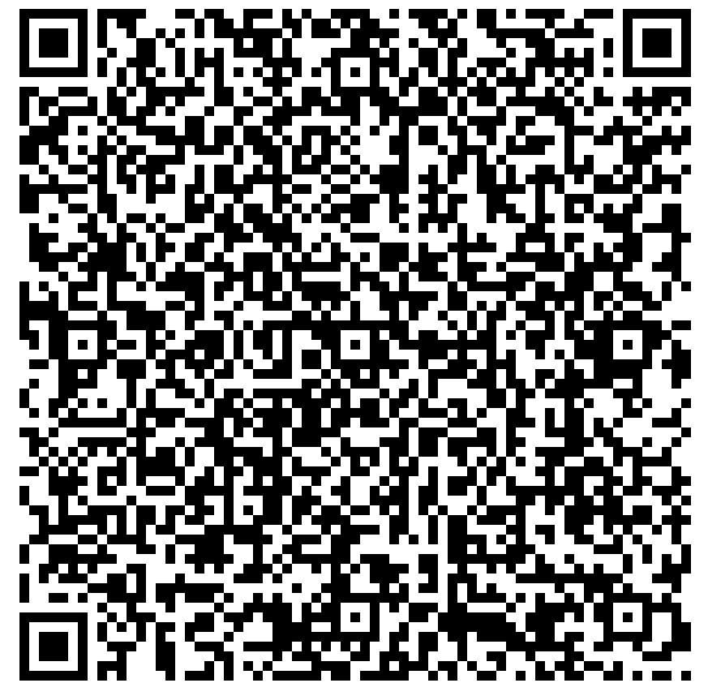

# Ako nastaviť FSL 2 a OOP2 na priame (natívne) pripojenie Bluetooth v xDrip

Prevedené zo stránky [MinimalL00per](https://www.minimallooper.com/post/how-to-setup-freestyle-libre-2-and-oop2-to-use-a-native-Bluetooth-connection-in-xdrip) do formátu markdown a **upravené/aktualizované**: 25. 8. 2025, psonnera

Zoznam definícií nájdete na konci tohto dokumentu. Ak nepoznáte niektoré pojmy alebo skratky, pokojne *[prejdite nižšie](#minimallooper-definitions)*, kde sú vysvetlené.

 

## Konfigurácia

### Hardvér

- *FSL2 a 2+* **POZNÁMKA: Verzie pre USA, Kanadu, Nový Zéland a Austráliu NIE SÚ podporované**

**(VOLITEĽNÉ) Čítačka (Reader)** (nie je kompatibilná s FSL2+)

- Reader 1 (s aktualizovaným firmvérom)

- Reader 2

*POZNÁMKA: Ak chcete v tomto riešení používať čítačku (Reader), MUSÍTE senzor SPUSTIŤ NAJPRV ČÍTAČKOU. Ak to neurobíte, nebudete môcť čítačkou načítavať hodnoty z aktivovaného senzora. Po zahriatí senzora môžete načítavať hodnoty aplikáciou LL alebo xDrip.*

### Softvér

**OOP** – Out of Process Algorithm (externý algoritmus), externá aplikácia pre Android (APK), ktorá pomáha získať surové dáta zo senzora a z nich hodnoty glykémie. xDrip posiela zozbierané surové dáta FSL2 z BT do OOP a hodnoty glykémie sa vracajú späť do xDrip.

- **OOP2**

  - **Funguje iba s európskymi senzormi FSL2/2+**

  - Uzavretý zdrojový kód (nie je dostupný na GitHube)

  - Účelom je dešifrovať šifrované surové hodnoty zo senzora a vrátiť ich do xDrip. Potom môže xDrip pracovať buď so surovými dátami, ktoré vyžadujú kalibráciu, alebo poskytovať hodnoty glykémie podobné ako Reader 1.

[***xDrip***](https://jamorham.github.io/)

- [*Nightly*](https://github.com/NightscoutFoundation/xDrip/releases) – najnovší zdrojový kód, zostavený každú noc. Nie je dôkladne otestovaná

- [*Stable*](https://xdrip-plus-updates.appspot.com/stable/xdrip-plus-latest.apk) – najnovšia stabilná otestovaná verzia.

- **NOTE: new sensors require an updated OOP2 app, for this it is recommended to use at least the latest xDrip release (Stable) version, matching the latest OOP2.**

 

## Postup

- *Najprv si stiahnite a nainštalujte nižšie uvedené aplikácie*
- *Odinštalujte aplikácie, ktoré môžu spôsobovať konflikty*
- *Ako spustiť senzor FSL2 v režime Bluetooth Native pomocou LL a xDrip
  - [*Krok 1: Inštalácia a nastavenie aplikácií*](#minimallooper-step1)
  - [*Krok 2: Nastavenie xDrip*](#minimallooper-step2)
  - [*Krok 3: Fyzicky zaveďte senzor*](#minimallooper-step3)
  - [*Krok 4: Spustite aplikáciu LL a spustite senzor úplne prvým skenovaním NFC*](#minimallooper-step4)
  - [*Krok 5: Otvorte xDrip a NASKENUJTE senzor FSL2 cez NFC*](#minimallooper-step5)
  - [*Krok 6: Spustite nový senzor v xDrip*](#minimallooper-step6)
  - [*Krok 7: Počkajte 60 sekúnd a znova naskenujte senzor cez NFC*](#minimallooper-step7)
  - [*Krok 8: Zber dát počas 3 až 15 minút*](#minimallooper-step8)
  - [*Krok 9: Overte, že je senzor pripojený a posiela dáta*](#minimallooper-step9)

- *[Poznámky](#minimallooper-notes)*
- *[Výhody](#minimallooper-advantages)*
- *[Nevýhody](#minimallooper-disadvantages)*
- <u>*\[Riešenie problémov\](#minimallooper-troubleshooting)*</u>

## Skôr než začnete

Dôrazne odporúčame vykonať tento postup s **novým senzorom**. Hoci sa uvádza, že pripojenie je možné aj s už bežiacim senzorom (***pozrite [nižšie](#minimallooper-started-sensor)***), je veľmi pravdepodobné, že aplikácia LL alebo čítačka (Reader) počas pripájania vytvorí nový súkromný zdieľaný kľúč na komunikáciu. To znamená, že po spárovaní xDrip nový kľúč nepozná a nebude môcť so senzorom komunikovať. Pripojenie s bežiacim senzorom skúšate na vlastné riziko, najlepšie ku koncu životnosti senzora.

### Najprv si stiahnite a nainštalujte nižšie uvedené aplikácie

(Libre2_OOP2)=

- **OOP2** – verzie oop2 nájdete na:

  (*Poznámka: na otvorenie odkazu musíte byť prihlásení do účtu Google.*)

*[oop2.apk](https://drive.google.com/file/d/1106h2s12b3Ev9gKCTU2G75q8h9ChHjcz/view?usp=sharing)* – OOP2_21_09_25 (05d1989) **2025.09.21** (najnovšia verzia)

- **xDrip** – **<u>najnovšiu verziu</u>** (minimálne verzia 2025.09.26) nájdete na:

[*xDrip.apk*](https://github.com/NightscoutFoundation/xDrip/releases)

(minimallooper-started-sensor)=

### Čo ak je môj senzor už spustený? Can I still get readings in xDrip? ÁNO!

Veľa ľudí sa pýtalo, či sa tento postup dá použiť s už aktívnym senzorom, a môžem jednoznačne povedať **ÁNO**, môžete pripojiť aj senzor, ktorý už beží.

1.  **NAJPRV** sa uistite, že ste v xDrip urobili zmeny konfigurácie a nastavení a že ste nainštalovali a nastavili OOP2, ako je uvedené nižšie.

2.  **POTOM** pokračujte *krokom 5* a pred začiatkom sa **UISTITE**, že ste aplikáciu LL vynútene zastavili. Potom postupujte až do konca.

*POZNÁMKA: Aktivovaný senzor FSL2 nebudete môcť používať s čítačkou FSLReader, AK NEBOL spustený najprv touto čítačkou. Ak BOL senzor spustený najprv čítačkou FSLReader, budete môcť senzor **skenovať** a načítavať hodnoty z OBOCH – zo senzora aj z aplikácií ako LL a xDrip.*

## Ako spustiť senzor FSL2 v režime Bluetooth Native pomocou LL a xDrip

*POZNÁMKA: Ak sú na snímkach obrazovky nastavenia, ktoré nie sú zvlášť označené RÁMČEKOM a sú NEZAŠKRTNUTÉ (t. j. vypnuté), PROSÍM, NECHAJTE ICH VYPNUTÉ. Snímky obrazovky zobrazujú funkčnú konfiguráciu pre VŠETKY zobrazené nastavenia. If you want to experiment turning other features on/off after you have a working sensor, you are free to do so at your own risk.*

(minimallooper-step1)=

### Krok 1: Inštalácia a nastavenie aplikácií

**Nainštalujte a nastavte OOP2** a overte, že funguje, tým, že aplikáciu jednoducho otvoríte.


**Nastavenia**

- *Use service* **zapnuté**

- *Use foreground service* **zapnuté**

- *Timer Duration* **5 minút**

  - Ak nedostávate výsledky dosť rýchlo, zmeňte na **1 s** (toto nastavenie je na snímke obrazovky nižšie).

**Verzia 2: 93e5cac-2020.12.08 (najnovšia verzia)**


**Nainštalujte xDrip**, minimálne verziu: najnovšie vydanie. Ďalšiu dokumentáciu k inštalácii a nastaveniu xDrip nájdete [*tu*](../CompatibleCgms/xDrip.md).

(minimallooper-step2)=

### Krok 2: Nastavenie xDrip

**Hardware Data Source**: Libre Bluetooth


**NFC Scan features**: *nastavenia, ktoré tu nie sú uvedené, majú byť vypnuté.*

- *Use NFC feature*: **zapnuté**
- *Sensor Age or Expiry*: **zapnuté**
- *Scan when not in xDrip*: **zapnuté**
- *Use Any-tag optimized reading method*: **vypnuté**, ale ak máte problémy so skenovaním, skúste **zapnuté**


- *Starting Bluetooth connection with FSL2 sensor*: **Always connect to libre2 sensors**


- *Smooth libre 3 data when using xxx method*: nechajte predvolenú hodnotu. Pri senzoroch so zašumenými hodnotami hodnotu zvýšte, pri stabilných ju znížte.


**Less Common Settings -\> Bluetooth Settings** (*tieto nastavenia sú dôležité a môžu sa líšiť podľa vášho telefónu/zostavy*)

- *Turn Bluetooth on*: **zapnuté**
- *Trust Auto-Connect*: **zapnuté**
- *Use Background Scans*: **zapnuté**
- *Always discover services*: **zapnuté**

xDrip môžete nastaviť pomocou QR kódu nižšie. Musíte ho naskenovať (alebo načítať obrázok) v xDrip -> Auto Configure.

```{admonition} QR Code
:class: dropdown


```


Keď naskenujete QR kód vyššie a máte telefón Samsung (užitočné je to aj pri mnohých čínskych značkách), naskenujte aj ďalší QR kód nižšie, ktorý zmení nastavenia pre spoľahlivejšie pripojenie:

- *Trust Auto-Connect*: **vypnuté**
- *Use Background Scans*: **vypnuté**

```{admonition} QR Code
:class: dropdown


```


**Advanced settings for FSL2** (*voliteľné, ale užitočné*)

- *show Raw values in Graph*: **zapnuté**

- *show Sensor info in Status*: **zapnuté**


**Extra Logging Settings** (*potrebné na ladenie, ak niečo nefunguje správne*)

- *Extra tags for logging*: zadajte túto hodnotu

`BgReading:d,jamorham librereceiver:v,LibreOOPAlgorithm:v,jamorham nsemulator:v,DexCollectionService:v`


(minimallooper-OOPsettings)=

**Less Common Settings -\> Other misc options**

> **Nastavenia pre konfiguráciu OOP2**

- *Out of process Libre algorithm*: **VYPNUTÉ**

(*PRI OOP2 SA UISTITE, ŽE JE TOTO NASTAVENIE **VYPNUTÉ**, INAK NEBUDETE DOSTÁVAŤ HODNOTY!*)


(minimallooper-step3)=

### Krok 3: Fyzicky zaveďte senzor

(minimallooper-step4)=

### Krok 4: Spustite aplikáciu LL a spustite senzor úplne prvým skenovaním NFC

Spustite aplikáciu LL, potom naskenujte novo zavedený senzor a potom aplikáciu LL zatvorte a zakážte alebo odinštalujte. **Pred pokračovaním a spustením senzora v xDrip musíte stále počkať celých 60 minút, kým sa senzor zahreje**. Na hodnoty z tohto obdobia sa nespoliehajte, pretože senzor sa ešte interne kalibruje a hodnoty veľmi kolíšu.

#### Krok 4a (VOLITEĽNÝ, použitie čítačky FSLReader):

**Spustite senzor FSL2 (nie 2+) úplne prvým skenovaním NFC čítačkou FSLReader**

Ak chcete na čítanie hodnôt zo senzora FSL2 používať **čítačku FSLReader** a zároveň aplikáciu LL alebo xDrip, **musíte novo zavedený senzor FSL2 NAJPRV naskenovať čítačkou FSL Reader.** Po skončení zahrievania senzora potom môžete hodnoty skenovať aplikáciou LL alebo xDrip.

*POZNÁMKA: Aplikácia LL je potrebná iba na ÚPLNE PRVÉ skenovanie NFC po zavedení senzora. Slúži na odoslanie inicializačného signálu na zahrievanie. Potom aplikáciu MUSÍTE zakázať (nastavenia aplikácie -\> vynútiť zastavenie) alebo odinštalovať. Môžete použiť upravenú (patched) aplikáciu 2.3 alebo oficiálne verzie, na tom nezáleží. Hlavné je zabrániť behu aplikácie LL vo chvíli, keď sa xDrip snaží spustiť spárovanie so senzorom cez BT, pretože aplikácia LL narúša komunikáciu a tým aj opätovné pripájanie cez Bluetooth.*

*Podľa hlásení stačí v systémových nastaveniach Androidu pre aplikáciu LL vypnúť **povolenie prístupu k polohe**, aby aplikácia nerušila pripojenie. Niekoľko používateľov hlásilo, že im to funguje. Opäť **odporúčam aplikáciu zakázať alebo odinštalovať**, ale ak chcete experimentovať, môžete to skúsiť.*

(minimallooper-step5)=

### Krok 5: Otvorte xDrip a NASKENUJTE senzor FSL2 cez NFC

(*Pripomienka! Uistite sa, že LL je zakázaný (s vypnutou polohou) alebo odinštalovaný A ŽE ste počkali celých 60 minút, kým sa senzor zahreje a interne nakalibruje.*)

**NASKENUJTE senzor FSL2 cez NFC** pomocou xDrip. Tým sa do senzora pošle signál, aby zapol párovanie cez Bluetooth a mohol sa začať proces spárovania. Po úspešnom skenovaní NFC senzora FSL 2 sa v dolnej časti obrazovky Overview v xDrip nakrátko zobrazí malá notifikácia s textom **Scanning** a po nej notifikácia **Scanned OK!**.


(minimallooper-step6)=

### Krok 6: Spustite nový senzor v xDrip

Na **obrazovke Overview v xDrip** stlačte **ponuku (☰)** v ľavom hornom rohu. Potom zvoľte **Start Sensor**.

Na obrazovke **Start New Sensor** stlačte **Start Sensor**. Zobrazí sa otázka **Did you insert it today?** (Zaviedli ste ho dnes?). Odpovedzte stlačením **NOT TODAY**.


*POZNÁMKA: Ak ste omylom klikli na „YES, TODAY“, musíte v hlavnej ponuke xDrip zvoliť „Stop sensor“ a potom „Start sensor“ a znova pokračovať krokom 5.*

(minimallooper-step7)=

### Krok 7: Počkajte 60 sekúnd a znova naskenujte senzor cez NFC

A second NFC scan is needed in order to **ADD** the sensor as the Bluetooth device that xDrip will use to retrieve the readings. Po dokončení sa zobrazí notifikácia **NEW SENSOR STARTED**.


Je potrebné počkať 60 sekúnd, pretože počas tohto procesu sa senzor nedá skenovať viac ako raz za minútu. Ak senzor naskenujete príliš skoro, na obrazovke Overview v xDrip sa zobrazí varovanie **Not so quickly, wait 60 seconds**.


Otvorte záznamy udalostí (event logs) v xDrip a skontrolujte, že sa senzor s xDrip správne spároval.


(minimallooper-step8)=

### Krok 8: Zber dát počas 3 až 15 minút

Za 3 až 15 minút sa zozbiera dosť dát na zobrazenie prvých hodnôt. *Ak ani potom nedostávate hodnoty, niekedy pomôže reštartovať telefón.*

Ak používate telefón Samsung (alebo mnohých čínskych značiek) a máte problémy s prijímaním dát, naskenujte QR kód nižšie v xDrip -> Auto Configure.

```{admonition} QR Code
:class: dropdown


```

Zmení nastavenia Bluetooth v xDrip na:

- *Trust Auto-Connect*: **vypnuté**
- *Use Background Scans*: **vypnuté**

(minimallooper-step9)=

### Krok 9: Overte, že je senzor pripojený a posiela dáta

Na obrazovke Overview v xDrip stlačte ponuku (☰) vľavo hore a zvoľte **System Status**. Na obrazovke System Status pole aktívneho zariadenia **Bluetooth Device:** zobrazuje názov senzora FSL2 v tvare **ABB___XXXXXXXXXXX**, kde XXX predstavuje sériové číslo senzora. The **Connection Status** field displays **Connected** and the **Sensor Start:** field displays the time the sensor was started.


Na obrazovke **BT Device** (potiahnite doľava) môžete overiť ďalšie podrobnosti o pripojení senzora a táto obrazovka slúži aj na riešenie problémov s pripojením. Nižšie je zoznam polí a ich význam, ktorý vám pomôže pri riešení problémov s pripojením.

*POZNÁMKA: V tomto okne **<u>NEDOTÝKAJTE SA</u> nastavenia Bluetooth Pairing a NEMEŇTE ho z hodnoty <u>Disabled</u>**. Ak to urobíte, spustí sa pokus o priame spárovanie, ktorý zlyhá (Not bonded), a celý postup budete musieť začať znova od kroku 5.*


- **Phone Service State:** Kedy sa telefón naposledy pripojil k senzoru cez BT (malo by to byť pred menej ako 5 minútami)
- **Bluetooth Device:** Zobrazuje aktuálny stav pripojenia (buď **Connected**, alebo **Disconnected**)
- **Device Mac Address**: Toto je hardvérové ID senzora
- **Bluetooth Pairing**: This should be **<u>Disabled, tap to enable</u>**. Dajte pozor, aby ste na to NEŤUKLI. Ak naň omylom ťuknete, ťukajte znova, kým sa nevráti na Disabled.
- **Slowest wake up**: Toto môžete ignorovať. xDrip doesn't spend its time waiting for readings: it will start expecting them after a certain time (traditionally 5 minutes). Ak v tom čase žiadne dáta neprídu, uvidíte „Woke up early“, čo znamená, že xDrip očakával pripravené dáta, ale žiadne neboli. Slowest wake up je najdlhšie oneskorenie, ktoré sa vyskytlo pred bežným prijatím dát.
- **Next Wake up**: Malo by tu byť 5 minút


(minimallooper-notes)=

### Poznámky

- **Skenovanie NFC aplikáciou LL PO dokončení spárovania v xDrip**: Skenovať cez NFC môžete, ale najprv musí byť dokončené spárovanie s xDrip. Vždy sa pozrite do xDrip, či sa blíži 5-minútová hodnota (napr. pred 4 minútami). Ak sa blíži 5 min, počkajte, kým príde nová hodnota cez BT, a až potom skenujte cez NFC. Ak to trafíte v nesprávnom čase, narušíte proces BT v xDrip a hodnoty cez BT neprídu. Opätovné spárovanie a nové posielanie hodnôt môže chvíľu trvať a niekedy môže LL pripojenie senzora cez BT „ukradnúť“. Medzi týmito hodnotami cez BT som však nemal žiadne problémy so skenovaním NFC a následným okamžitým zakázaním aplikácie. Nie som si istý, či treba LL zakázať zakaždým, ale ja ho pre istotu zakazujem.

- **What is going on?** When a Bluetooth connection is made a private shared key is created that is needed to allow communication between the sensor and the calling application/device. Je veľmi pravdepodobné, že aplikácia LL alebo čítačka (Reader) počas pripájania vytvorí nový súkromný zdieľaný kľúč na komunikáciu. To znamená, že po spárovaní xDrip nový kľúč nepozná a nebude môcť so senzorom komunikovať.

  - Several users have reported that the LL app can be restarted after successfully starting the sensor and receiving readings in xDrip. V povoleniach Androidu pre aplikáciu LL stačí vypnúť nastavenie **Povoliť prístup k polohe**. Potom by ste mali môcť používať aplikáciu LL a xDrip súčasne. Odporúčam nevyberať predvolenú aplikáciu na skenovanie NFC a pri každom skenovaní NFC zvoliť, ktorou aplikáciou chcete senzor načítať. NEZABUDNITE tiež pri ďalšej výmene senzora po úvodnom skenovaní NFC pre zahrievanie nového senzora vynútene zastaviť aplikáciu LL. Keď je senzor nastavený a xDrip prijíma hodnoty, môžete aplikáciu LL znova spustiť.

&nbsp;

- **Reštart telefónu**: Po reštarte a po zakázaní alebo vynútenom zastavení aplikácie NEZABUDNITE skontrolovať, že aplikácia LL NEBEŽÍ. Odporúčam vyskúšať reštart a pozrieť sa, či sa LL znova automaticky spustí. Môžete sa pozrieť do nastavení aplikácie LL v nastaveniach aplikácií Androidu vo vašom telefóne. Ak je stále povolená, aplikáciu LL znova zakážte. Jediným spôsobom, ako tomu zabrániť, môže byť odinštalovanie aplikácie LL. Cieľom je zabrániť tomu, aby LL omylom „ukradol“ spárovanie cez BT. Po reštarte tiež potrvá rovnakých 3–15 minút, kým dostanete hodnoty zo senzora cez BT. Buďte trpezliví a počítajte s tým, ak reštartujete krátko pred tým, ako potrebujete hodnotu glykémie na bolus, jedlo atď.

&nbsp;

- **Nastavenia optimalizácie batérie**: Uistite sa, že tieto aplikácie VYLÚČITE z optimalizácie batérie vo vašom telefóne

  - xDrip

  - OOP 2

  - LL

  - AAPS

&nbsp;

- **Používanie režimu lietadlo:** V niektorých situáciách je potrebné zapnúť režim lietadlo (keď letíte lietadlom ;-), keď v noci spíte a nechcete mať signály Wi-Fi alebo mobilnej siete z telefónu blízko hlavy) a zapnutie režimu lietadlo môže spôsobiť problémy s komunikáciou cez Bluetooth. Ak v telefóne zapnete režim lietadlo a potom aktivujete Bluetooth, hodnoty glykémie sa stratia. Jediné riešenie je reštartovať kolektor v xdrip+ -\> System Status -\> Classic Status Page. Po reštarte kolektora sa hodnoty glykémie znova objavili.

 

(minimallooper-advantages)=

### Výhody

- **Upravená aplikácia LL už nie je potrebná** Na získanie hodnôt zo senzora FSL2 už nepotrebujete upravenú (patched) verziu aplikácie LL. Upravenú aplikáciu LL môžete používať, ale aj oficiálne verzie aplikácie LL dokážu urobiť prvé inicializačné skenovanie NFC rovnako ako upravená aplikácia. Čo sa týka inicializačného skenovania NFC na spustenie senzora, nie je medzi nimi žiadny rozdiel.

&nbsp;

- **Skenovacie zariadenie NFC od tretej strany už nie je potrebné** Skenovacie zariadenia NFC od tretích strán (napr. Miaomiao, Bubble alebo Blucon) už nie sú potrebné *(ale stále sa dajú použiť)* na zber hodnôt, pretože senzor ich teraz dokáže posielať sám cez Bluetooth. Menej hardvéru znamená menej vecí, ktoré sa môžu pokaziť, menej zariadení na nabíjanie a minimalistickejšiu zostavu.

&nbsp;

- **Hodnoty budete môcť stále skenovať cez NFC čítačkou FSL2 Reader (verzia 1 s aktualizovaným firmvérom alebo verzia 2), AK bol senzor FSL2 spustený NAJPRV čítačkou FSL Reader.** Samostatnú čítačku FSL2 môžete stále používať na skenovanie hodnôt z aktívneho senzora aj potom, čo je spárovaný cez Bluetooth s xDrip.

  - You **MUST** start the sensor with the very first NFC scan to initiate sensor warmup **with the FSL Reader FIRST**. Potom budú môcť hodnoty z už aktivovaného senzora načítavať cez NFC aj iné aplikácie.
- Podľa môjho chápania senzor FSL2 (pokiaľ nemá vytvorené pripojenie a ani sa oň nepokúša) vždy presne každé 2 minúty oznamuje cez BLE svoju prítomnosť (a dostupnosť) (vidí to každé zariadenie Bluetooth, ktoré dokáže vyhľadávať zariadenia Bluetooth). Zariadenie, ktoré na toto oznámenie odpovie ako prvé, vyhráva a je *jediné* zariadenie, ktoré sa môže k senzoru pripojiť a čítať ho, pretože počas pripájania pri skenovaní NFC sa vytvorí súkromný zdieľaný kľúč, ktorým sa dešifruje komunikácia FSL 2. Senzor potom nie je dostupný pre iné zariadenia, ktoré tento súkromný zdieľaný kľúč nemajú a možno sa tiež pokúšajú pripojiť. Zdá sa, že čítačka FSL 2 vyhrá vždy, nech je „súperom“ ktokoľvek.

&nbsp;

- **Minimálna zostava zariadení** Mojím cieľom vždy bolo mať na tele čo najmenej zdravotníckych pomôcok. FSL2 v kombinácii so systémom Omnipod tento cieľ splnil. Ešte dôležitejšie je to pri cestovaní (na krátke aj dlhé vzdialenosti), pretože počet vecí a výmen setov je menší, a tak mám v batožine viac miesta na iné veci. Dúfam, že v budúcnosti bude existovať náplasťová pumpa, ktorá bude mať iba vymeniteľný zásobník a čip s motorom budú tvoriť časť, ktorú si ponecháte a použijete opakovane. Znížilo by to množstvo odpadu a obalov pri výmenách miesta vpichu, čo opäť znamená viac miesta v kufri na iné veci.

&nbsp;

- **Pri výmene senzora už žiadne hodinové výpadky** Keďže ďalší senzor môžete spustiť aplikáciou LL úvodným skenovaním NFC, aktuálny senzor môže ďalej bežať a zároveň posielať hodnoty cez Bluetooth. Po 20 minútach môžete dostávať hodnoty z nového senzora, ale najlepšie je počkať 1 hodinu, kým sa senzor správne interne nakalibruje. To znamená, že môžete zastaviť aktuálny senzor a spustiť nový (keď bol zavedený a zahriaty skenovaním NFC aplikáciou LL o hodinu skôr) a do 3 až 15 minút budete mať prvé kalibrácie a hodnoty.

&nbsp;

(minimallooper-disadvantages)=

### Nevýhody

- **Reštart telefónu:** Keďže po reštarte telefónu sa musí proces Bluetooth spustiť znova, musíte najprv ručne zakázať aplikáciu LL (ak ste ju neodinštalovali) a trpezlivo počkať na prvé hodnoty (3 až 15 min). To znamená naplánovať reštarty telefónu tak, aby neboli v dôležitých chvíľach, napríklad pri korekčných bolusoch alebo v čase jedál a desiat.

&nbsp;

- **LL a xDrip nemôžete súčasne používať na hodnoty cez Bluetooth**. LL sa vždy bude snažiť „ukradnúť“ pripojenie Bluetooth k senzoru a spárovanie. Ak sa to stane, zostanete s LL až do konca životnosti senzora. Takže súčasný beh oboch aplikácií nefunguje vždy. Ako uvádzam nižšie, môžete povoliť aplikáciu LL a skenovaním NFC získať hodnotu v LL (ak potrebujete porovnať hodnoty, chcete získať históriu pre seba alebo reporty pre diabetológa), ale hneď ako hodnotu máte, aplikáciu zakážte a nepokúšajte sa o to v minúte pred tým, ako xDrip načíta svoju hodnotu cez Bluetooth. Nie som si istý, ako pri tom funguje čítačka FSL2, ale vyskúšam to neskôr.
- Several users have reported that the LL app can be restarted after successfully starting the sensor and receiving readings in xDrip. V povoleniach Androidu pre aplikáciu LL stačí vypnúť nastavenie **Povoliť prístup k polohe**. Potom by ste mali môcť používať aplikáciu LL a xDrip súčasne. Odporúčam nevyberať predvolenú aplikáciu na skenovanie NFC a pri každom skenovaní NFC zvoliť, ktorou aplikáciou chcete senzor načítať. NEZABUDNITE tiež pri ďalšej výmene senzora po úvodnom skenovaní NFC pre zahrievanie nového senzora vynútene zastaviť aplikáciu LL. Keď je senzor nastavený a xDrip prijíma hodnoty, môžete aplikáciu LL znova spustiť.

&nbsp;

- **Skenovacie zariadenia NFC od tretích strán sa stále dajú používať**. Áno, uviedol som to ako nevýhodu, ale chcel som tiež upozorniť, že ak sa so senzorom niečo pokazí a LL nad ním prevezme kontrolu, vždy sa môžete vrátiť k tomu, že na senzor umiestnite skenovacie zariadenie NFC a budete dostávať hodnoty v xDrip. Ak vám viac vyhovuje zostava so skenovacím zariadením NFC od tretej strany (Miaomiao, Bubble, Blucon), môžete ho použiť aj namiesto priameho pripojenia cez Bluetooth. Niektoré telefóny niekedy nefungujú dobre s priamym spárovaním senzora cez Bluetooth a získavaním dát. Tieto zariadenia môžete používať ako zálohu alebo bežne, v každom prípade je to stále jedna z možností.
- If you are planning on using the **FSL Reader** as an NFC scanning device to take readings, you MUST start the FSL2 sensor with the **VERY FIRST NFC scan** to warm up the sensor with the **READER FIRST**.

&nbsp;

- **Dáta sa nebudú automaticky nahrávať do LV** Keďže aplikácia LL nemá trvalé pripojenie cez Bluetooth (pretože LL by nemala bežať súčasne s xDrip, keď senzor aktívne posiela hodnoty cez Bluetooth), nedostáva hodnoty zo senzora automaticky. To znamená, že údaje o glykémii sa automaticky nenahrávajú do LV a teda ani do iných telefónov s LL. Uvádzam to ako nevýhodu, pretože viem, že veľa rodičov sa na túto funkciu spolieha, rovnako ako tí, ktorí musia používať reporty z LV pre svojho lekára. Stále môžete otvoriť aplikáciu LL a každých 8 hodín naskenovať senzor, aby ste dostali spätne doplnené dáta zo senzora do LL (3-krát denne, aspoň každých 8 hodín, ale na zachytenie všetkých 24 hodín dát bude asi treba viac skenovaní), ale opäť je to ručný postup.

&nbsp;

(minimallooper-definitions)=

### Definície

- **BT** – Bluetooth

- **BLE** – Bluetooth Low Energy

- **FSL** – FreeStyle Libre
  - **Libre 1 (FSL1)** – iba NFC. Prvá verzia senzora

  - **Libre 2 (FSL2)** - Bluetooth and NFC. Druhá verzia senzora.

  - **Libre 3 (FSL3)** – Bluetooth a NFC. Tretia, menšia verzia senzora. Nie je podporovaný v OOP2 (pozrite Juggluco).

- **LL** – LibreLink, **aplikácia**, ktorou sa senzor spúšťa úvodným skenovaním NFC

- **LV** – LibreView, cloudová služba na zdieľanie dát s vaším diabetologickým tímom (zvážte použitie Tidepoolu alebo Nightscoutu)

- **MM** – MiaoMiao, názov a výrobca skenovacieho zariadenia NFC od tretej strany, ktoré posiela hodnoty cez Bluetooth do xDrip.

- **NFC** – Near Field Communication (komunikácia na krátku vzdialenosť), fyzický úkon, pri ktorom priblížite snímač NFC vo vašom telefóne k senzoru, aby sa načítala hodnota. Často sa to nazýva „skenovanie senzora“, „sken senzora“ alebo „skenovanie NFC“. Tento proces vôbec nepoužíva Bluetooth.

- **OOP1** – Out of Process Algorithm verzia 1, aplikácia tretej strany, ktorá prijíma surové hodnoty (doručené do xDrip zo senzora cez Bluetooth alebo skenovaním NFC), spracuje ich algoritmom (veľmi podobným hardvérovému algoritmu na čipe senzora) a vráti do xDrip kalibrovanú hodnotu glykémie (kalibrovanú algoritmom OOP1, nie vlastnou kalibráciou xDrip). xDrip ju potom buď zobrazí, alebo ju v prípade potreby ďalej spracuje vlastnou kalibráciou (kalibráciou z krvi z prsta).

- **OOP2** - Out of Process Algorithm version 2, the 3rd party app that receives encrypted data delivered from the FSL 2 sensor (by Bluetooth or NFC scan) and then decrypts the encrypted data. Po dešifrovaní sa dáta posielajú do xDrip.

 

(minimallooper-troubleshooting)=

### Riešenie problémov

#### Senzor sa nedarí naskenovať cez NFC

- Uistite sa, že máte v nastaveniach Androidu zapnutú čítačku NFC v telefóne.
- Čítačka NFC musí byť kompatibilná so štítkami **ISO 15693**. Niektoré telefóny Cubot sa používajú veľmi ťažko.
- Look into your phone documentation to identify the NFC antenna position. Priložte telefón k senzoru a podržte ho tam 10 sekúnd: čítanie NFC v xDrip trvá dlhšie ako v aplikácii výrobcu alebo v čítačke.
- Pred skenovaním senzora skúste xDrip zatvoriť.
- Uistite sa, že senzor nechce čítať žiadna iná aplikácia (pri skenovaní sa môže zobraziť výber z rôznych aplikácií: zvoľte xDrip, ale telefónom nehýbte).
- Vyskúšajte všetky kombinácie nastavení NFC v xDrip *Use faster multi-block reading method* a *Use Any-tag optimized reading method*. Skenovanie NFC je zvyčajne spoľahlivejšie, keď sú obe tieto možnosti **vypnuté**.

#### Zaseknuté pri zbere prvých hodnôt

*Poznámka: FSL 2 nie je pri ručnej kalibrácii považovaný za dôveryhodný zdroj dát.*

Kým nebude všetko fungovať, nastavte stratégiu [kalibrácie OOP2](#minimallooper-OOPsettings) na „No calibration“.

Potom sa môžete rozhodnúť, či budete kalibrovať, alebo nie.


#### Senzor sa hlási ako FSL1


Uistite sa, že používate najnovšie verzie xDrip a OOP2.

#### Pripojenie k senzoru zlyháva

- Overte, že OOP1 je vypnutý (pozrite [tu](#minimallooper-OOPsettings))


- Overte, že OOP2 neuspávajú aplikácie a nastavenia telefónu na šetrenie batérie
- Overte, že je Google Play Protect vypnutý, pretože by OOP2 ukončil
- Zmenili ste Bluetooth Pairing v System Status? Ťuknite naň znova, aby sa vrátilo na **<u>Disabled</u>**


#### Chýbajúce hodnoty

Uistite sa, že OOP2 zobrazuje hodnoty, ktoré nie sú 0 alebo -1. Inak to môže znamenať, že senzor zlyháva (príklad nižšie v mmol/l).


Ak sa vek senzora nezvyšuje, môže to tiež znamenať, že senzor má problémy. To znamená, že xDrip prijal hodnotu, ale zahodil ju, pretože nebola prijateľná (chyba senzora).


#### Spárovanie senzora úplne od začiatku

1. Ponuka xDrip -> Stop sensor (senzor FSL2 to nezastaví, iba zmení stav v xDrip na nespustený)
2. Ponuka xDrip -> System status -> Forget device
3. Naskenujte senzor cez NFC v xDrip. Počkajte aspoň jednu minútu
4. Ponuka xDrip -> Start sensor. Počkajte aspoň jednu minútu
5. Scan the sensor with xDrip NFC, a few times, always waiting at least one minute between two scans.
