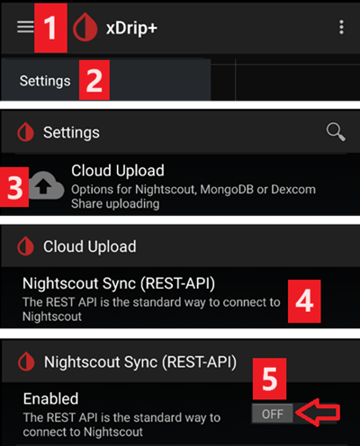
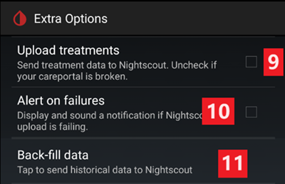

# Nastavenia xDrip

Ak ho ešte nemáte, stiahnite a nainštalujte najnovšie vydanie xDrip zo [stránky s vydaniami xDrip](https://github.com/NightscoutFoundation/xDrip/releases).

Pre aplikáciu xDrip vypnite optimalizáciu batérie a povoľte činnosť na pozadí.

## Základné nastavenia pre všetky systémy CGM a FGM

### Vypnite nahrávanie do Nightscoutu

Nedovoľte žiadnej inej aplikácii nahrávať dáta (glykémiu a ošetrenia) do Nightscoutu.

→ Ponuka ☰ (1) → Settings (2) → Cloud Upload (3) -> Nightscout Sync (REST-API)(4) → prepnite `Enabled` na **OFF** (5)

#### Vypnite automatickú kalibráciu a ošetrenia

Uistite sa, že `Automatic Calibration` (7) je vypnutá. Ak je políčko `Automatic Calibration` zaškrtnuté, raz zapnite `Download treatments` (6), potom zrušte zaškrtnutie `Automatic Calibration` a `Download treatments` znova vypnite.

Ťuknite na `Extra Options`(8)

    {admonition} Bezpečnostné upozornenie
    :class: warning
    V xDrip musíte vypnúť „Upload treatments“, inak sa ošetrenia v AAPS môžu zdvojiť a COB a IOB budú nesprávne.

Vypnite `Upload treatments`(9) a uistite sa, že **NEBUDETE** používať `Back-fill data` (11).

Aj možnosť `Alert on failures` by mala byť vypnutá (10). Inak dostanete alarm každých 5 minút, keď budú problémy s Wi-Fi alebo mobilnou sieťou, alebo keď server nebude dostupný.

### **Inter-app Settings** (vysielanie)

Ak budete používať AAPS a dáta sa majú posielať napr. do AAPS, musíte v xDrip v Inter-App settings zapnúť vysielanie.

→ Ponuka ☰ (1) → Settings (2) → Inter-app settings (3) → Broadcast locally **ON** (4)

Aby boli hodnoty v AAPS rovnaké ako v xDrip, zapnite `Send the displayed glucose value` (5).

Zapnite Compatible Broadcast (6).

Ak ste v xDrip zapli aj `Accept treatments` a v plugine xDrip v AAPS `Povoliť odosielanie do xDrip+`, xDrip bude z AAPS dostávať informácie o inzulíne, sacharidoch a bazálnej dávke.

Ak zapnete `Accept Calibrations`, xDrip bude používať kalibrácie z AAPS. Pri používaní tejto funkcie so senzormi Dexcom buďte opatrní: najprv si prečítajte [toto](https://navid200.github.io/xDrip/docs/Calibrate-G6.html).

Nezabudnite vypnúť Import Sounds, aby xDrip nevydal zvuk vždy, keď AAPS pošle zmenu bazálu alebo profilu.

(xdrip-identify-receiver)=

#### Identifikácia prijímača

- Ak zistíte problémy s lokálnym vysielaním (AAPS nedostáva hodnoty glykémie z xDrip), choďte do → Ponuka ☰ (1) Settings (2) → Inter-app settings (3) → Identify receiver (7) a zadajte `info.nightscout.androidaps` pre zostavenie AAPS (ak používate zostavenie PumpControl, zadajte namiesto toho `info.nightscout.aapspumpcontrol`!!).
- Pozor: automatické opravy textu niekedy menia i na veľké písmeno. Pri písaní `info.nightscout.androidaps` (alebo `info.nightscout.aapspumpcontrol` pre PumpControl) **musíte použiť iba malé písmená**. Veľké I by zabránilo aplikácii prijímať hodnoty glykémie z xDrip.
    
    

## Kalibrácia v xDrip pomocou AAPS

- Ak chcete kalibrovať pomocou AAPS, v xDrip choďte do Settings → Interapp Compatibility → Accept Calibrations a zvoľte ON. 
- Môžete si pozrieť aj možnosti v Settings → Less Common Settings → Advanced Calibration Settings.

## Senzory Dexcom

Všetko, čo sa týka samotného senzora a vysielača Dexcom (spustenie, zastavenie, výmena, kalibrácia, riešenie problémov), je popísané a aktualizované v [dokumentácii xDrip pre Dexcom](https://navid200.github.io/xDrip/docs/Dexcom_page.html). Pri senzore postupujte podľa týchto pokynov; jedinou časťou špecifickou pre AAPS sú nastavenia, ktoré spájajú xDrip s **AAPS** (popísané vyššie na tejto stránke).

### Dexcom G6 a ONE

- Nastavte xDrip podľa [odporúčaných nastavení](https://navid200.github.io/xDrip/docs/G6-Recommended-Settings.html).
- Vysielače Dexcom G6 a ONE môžu byť súčasne pripojené k prijímaču Dexcom (alebo k pumpe t:slim) a k jednej aplikácii v telefóne.
- Keď používate xDrip ako prijímač, najprv odinštalujte aplikáciu Dexcom. **Nemôžete naraz pripojiť xDrip aj aplikáciu Dexcom k vysielaču!**
- Ak potrebujete Clarity a chcete využívať funkcie xDrip, použite [Build Your Own Dexcom App](#DexcomG6-if-using-g6-with-build-your-own-dexcom-app) s lokálnym vysielaním do xDrip, alebo použite xDrip ako sprievodnú aplikáciu (Companion), ktorá prijíma notifikácie z oficiálnej aplikácie Dexcom (hodnoty glykémie môžu prichádzať s oneskorením).

#### Reštart senzora

- Pri súčasných vysielačoch xDrip vždy používa [natívny algoritmus](https://navid200.github.io/xDrip/docs/Native-Algorithm.html) vysielača; nie je dôvod ho vypínať.
- [Preventívne reštarty](https://navid200.github.io/xDrip/docs/Preemptive-Restart.html) fungujú iba so starými vysielačmi (firmvér 1.6.5.25 alebo starší), kde sú potrebné, aby sa senzor nezastavil po 10 dňoch. Novšie vysielače (Firefly) ich ignorujú.
- Reštart senzora s vysielačom Firefly vyžaduje [odpojenie vysielača](https://navid200.github.io/xDrip/docs/Remove-transmitter.html) a hodnoty po reštarte môžu byť výrazne nepresné, čo je pri používaní okruhu nebezpečné: prečítajte si celý návod [Reštart senzora](https://navid200.github.io/xDrip/docs/Restart-G6-sensor.html) a [kalibrujte opatrne](https://navid200.github.io/xDrip/docs/Calibrate-after-G6Restart.html).

(xdrip-connect-g6-transmitter-for-the-first-time)=

#### Spustenie, zastavenie a výmena senzorov

Postupujte podľa pokynov:

- [Spustenie vysielača G6 alebo ONE](https://navid200.github.io/xDrip/docs/Starting-G6.html)
- [Zastavenie a spustenie senzora G6 alebo ONE](https://navid200.github.io/xDrip/docs/Dexcom/StartG6Sensor.html)
- [Odpojenie vysielača od senzora](https://navid200.github.io/xDrip/docs/Remove-transmitter.html)
- [Životnosť vysielača](https://navid200.github.io/xDrip/docs/Transmitter-lifetime.html) sa dá predĺžiť ([hard reset](https://navid200.github.io/xDrip/docs/Hard-Reset.html)) iba pri vysielačoch s vymenenou batériou alebo upravených vysielačoch, nie pri Firefly.

(xdrip-replace-transmitter)=

#### Výmena vysielača

- Vypnite pôvodný prijímač Dexcom (ak ho používate) a nezapínajte ho, kým xDrip nezobrazuje hodnoty.
- Forget the device in xDrip (System Status → Forget Device) AND in the smartphone's Bluetooth settings (shown as DexcomXX where XX are the last two digits of the transmitter serial number).
- Starý vysielač držte mimo dosahu Bluetooth, aby sa znova nepripojil.
- Potom postupujte podľa návodu [Spustenie vysielača G6 alebo ONE](https://navid200.github.io/xDrip/docs/Starting-G6.html).

### Dexcom G7, ONE+ a Stelo

- Postupujte podľa [návodu pre G7, ONE+ a Stelo](https://navid200.github.io/xDrip/docs/Dexcom/G7.html) (vyžaduje sa novšie vydanie xDrip – pozrite odkazovanú stránku).
- Pozrite aj [stránku Dexcom G7, ONE+ a Stelo](../CompatibleCgms/DexcomG7.md), kde nájdete dostupné nastavenia s **AAPS**.

(xdrip-troubleshooting-dexcom-g5-g6-and-xdrip)=

### Riešenie problémov s Dexcom a xDrip

- [Riešenie problémov s pripojením G6/ONE](https://navid200.github.io/xDrip/docs/Connectivity-troubleshoot.html)
- [Riešenie problémov G7/ONE+/Stelo](https://navid200.github.io/xDrip/docs/Dexcom/G7_Troubleshooting.html)
- [Problém pri spustení nového senzora](https://navid200.github.io/xDrip/docs/Dexcom/SensorFailedStart.html)
- Úplný zoznam: pozrite časť **Troubleshooting** na [stránke xDrip pre Dexcom](https://navid200.github.io/xDrip/docs/Dexcom_page.html).

## Libre 1

- Nastavenie mostíka NFC na Bluetooth v xDrip
    
    → Ponuka ☰ (1) → Settings (2) → Less common settings (3) → Bluetooth Settings (4)

- V Bluetooth Settings nastavte zaškrtávacie políčka presne podľa snímok obrazovky nižšie (5)
    
    - Vypnite watchdogy (strážne funkcie), pretože resetujú Bluetooth v telefóne a prerušia spojenie s pumpou.
    
    

- Môžete skúsiť zapnúť tieto nastavenia (7)
    
    - Use scanning
    - Trust Auto-Connect
    - Use Background Scans

- Ak ľahko strácate spojenie s mostíkom alebo sa spojenie ťažko obnovuje, **VYPNITE ICH** (8).
    
    

- Všetky ostatné možnosti nechajte vypnuté, pokiaľ neviete, prečo ich chcete zapnúť.
    
    

### Úroveň batérie čítačky Libre smart reader

- Úroveň batérie mostíkov ako MiaoMiao a Bubble sa dá zobraziť v AAPS (nie Blucon).
- Podrobnosti nájdete na [stránke so snímkami obrazovky](#screens-sensor-level-battery).

### Pripojte vysielač Libre a spustite senzor

- Ak to váš senzor vyžaduje (Libre 2 EU a Libre 1 US), nainštalujte najnovší algoritmus „out of process“.

- Senzor už musí byť spustený aplikáciou výrobcu alebo čítačkou (xDrip nevie spustiť ani zastaviť senzory Libre).

- Ako zdroj dát nastavte Libre Bluetooth.
    
    → Ponuka ☰ (1) → Settings (2) → v Hardware Data source vyberte Libre Bluetooth (3)
    
    

- Vyhľadajte Bluetooth zariadenia a pripojte mostík.
    
    → Ponuka ☰ (1) → Scan Bluetooth (2) → Scan (3)
    
    - Ak xDrip nemôže nájsť mostík, uistite sa, že nie je pripojený k aplikácii výrobcu. Dajte ho nabiť a resetujte ho.
    
    

- Spustite senzor v xDrip.
    
        {admonition} Bezpečnostné upozornenie
        :class: warning
        Nepoužívajte údaje zo senzora pred koncom hodinového zahrievania: hodnoty môžu byť extrémne vysoké a spôsobiť nesprávne rozhodnutia v AAPS.
    
    → Ponuka ☰ (1) → Start sensor (2) → Start sensor (3) → Nastavte presný čas, kedy ste senzor spustili čítačkou alebo aplikáciou výrobcu. Ak ste ho nespustili dnes, odpovedzte „Not Today“ (4).

(xdrip-libre2-patched-app)=

## Upravená aplikácia Libre 2

- Ako zdroj dát nastavte upravenú aplikáciu Libre.
    
    → Ponuka ☰ (1) → Settings (2) → v Hardware Data source vyberte Libre (patched App) (3)
    
    

- Do Less Common Settings->Extra Logging Settings->Extra tags for logging môžete pridať `BgReading:d,xdrip libre_receiver:v`. Do logu sa tak zapíšu ďalšie chybové správy na riešenie problémov.

