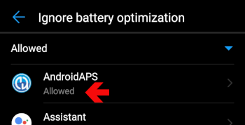

# Ako nastaviť telefón Huawei

**Ktorých telefónov sa táto stránka týka:** telefónov Huawei so systémom **EMUI 12 až EMUI 15**. Všetky sú založené na Androide 12, čo je minimum pre aktuálnu verziu **AAPS**. Na telefóne so staršou verziou EMUI môžete používať iba [staršiu verziu AAPS](#maintenance-android-version-aaps-version).

```{admonition} Telefóny s HarmonyOS NEXT / HarmonyOS 5 :class: warning

Novšie telefóny Huawei predávané v Číne používajú HarmonyOS NEXT (HarmonyOS 5 a novší). Tento systém už nie je Android a **AAPS** na ňom nefunguje. ```

Telefóny Huawei veľmi agresívne zatvárajú aplikácie bežiace na pozadí. Všetky nastavenia nižšie použite pre **AAPS** aj pre svoju aplikáciu CGM (napríklad xDrip+ alebo Juggluco). Inak sa okruh a hodnoty glykémie môžu zastaviť, keď je obrazovka vypnutá.

Názvy ponúk sa môžu v jednotlivých modeloch trochu líšiť. Ak nastavenie nemôžete nájsť, napíšte jeho názov do vyhľadávacieho poľa v hornej časti **Nastavení**.

Snímky obrazovky nižšie pochádzajú zo staršej verzie EMUI. Nastavenia sú rovnaké v EMUI 12 až 15.

## Ignorovanie optimalizácie batérie

1. Otvorte **Nastavenia > Aplikácie > Aplikácie** (Settings > Apps > Apps).
2. Ťuknite na ponuku **⋮** v pravom hornom rohu a vyberte **Špeciálny prístup > Optimalizácia batérie** (Special access > Battery optimization).
3. Ťuknite na šípku v hornej časti zoznamu a vyberte **Všetky aplikácie** (All apps).
4. Vyberte **AAPS** a zvoľte **Nepovoliť** (Don't allow). Huawei potom aplikácie v tomto zozname už nebude optimalizovať.
5. To isté zopakujte pre svoju aplikáciu CGM.



## Spúšťanie aplikácií: povoľte beh na pozadí

1. Otvorte **Nastavenia > Batéria > Spúšťanie aplikácií** (Settings > Battery > App launch) (alebo **Nastavenia > Aplikácie > Aplikácie >** vyberte aplikáciu **> Batéria > Spúšťanie aplikácií**).
2. Nájdite **AAPS** a vypnite **Spravovať automaticky** (Manage automatically).
3. V okne **Spravovať manuálne** (Manage manually) zapnite všetky tri možnosti: 
    - **Automatické spustenie (Auto-launch)**
    - **Sekundárne spustenie** (Secondary launch – aplikáciu môžu spustiť iné aplikácie)
    - **Spustenie na pozadí (Run in background)**
4. To isté zopakujte pre svoju aplikáciu CGM.


## Uzamknite AAPS v zozname posledných aplikácií

Uzamknuté aplikácie sa nezatvoria, keď vymažete zoznam posledných aplikácií.

1. Otvorte zoznam posledných aplikácií.
2. Na karte **AAPS** potiahnite prstom nadol. Na karte sa zobrazí symbol zámky.
3. To isté urobte pre svoju aplikáciu CGM.


## Režim úspory energie

Nechajte **Režim úspory energie** (Power saving mode) a **Ultra úsporu energie** (Ultra power saving) vypnuté (**Nastavenia > Batéria**). Tieto režimy zatvárajú aplikácie na pozadí bez ohľadu na nastavenia vyššie.

## Ak sa AAPS na pozadí stále zastavuje

Ďalšie riešenia špecifické pre Huawei nájdete na stránke [Don't kill my app](https://dontkillmyapp.com/huawei).

## Telefóny Honor

Honor je teraz samostatná značka a jej telefóny používajú MagicOS namiesto EMUI. Nastavenia behu na pozadí sú veľmi podobné: v nastaveniach batérie aplikácie nájdite **Spúšťanie aplikácií**, vypnite **Spravovať automaticky**, povoľte všetky tri možnosti a potom aplikáciu odstráňte z optimalizácie batérie.