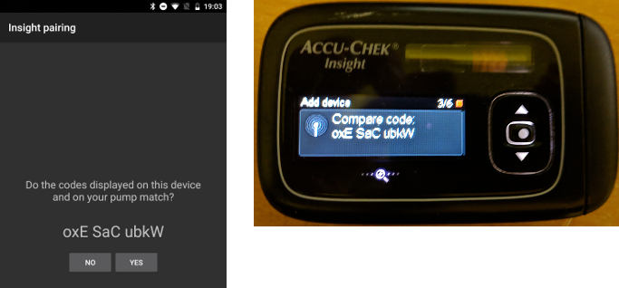

# Accu-Chek Insight

**Tento softvér je súčasťou riešenia umelého pankreasu „urob si sám“ (DIY), nie je to produkt. Vyžaduje, aby ste si VY systém prečítali, naučili sa ho a porozumeli mu, vrátane toho, ako ho používať. Nie je to niečo, čo za vás urobí celú liečbu diabetu. Pomôže vám však zlepšiť liečbu diabetu aj kvalitu života, ak ste ochotní venovať tomu potrebný čas. Neponáhľajte sa, dajte si čas na učenie. Za to, čo s ním urobíte, zodpovedáte iba vy sami.**

```{admonition} Pumpa Accu-Chek Insight sa postupne prestáva predávať :class: note

Roche sa sťahuje z trhu inzulínových púmp, aby svoju ponuku pre diabetes zamerala na CGM Accu-Chek SmartGuide. Oznámila koniec predaja púmp Accu-Chek Combo aj Accu-Chek Insight; aj jej posledná mikropumpa Accu-Chek Solo sa postupne prestáva predávať (posledné dodávky v Nemecku koncom roka 2025). Zmena sa zavádza postupne podľa regiónov, začína sa v Nemecku a očakáva sa, že budú nasledovať ďalšie európske trhy. Podpora pumpy Insight je už uvedená ako ukončená (pozrite [Pumpy, ktoré sa už nepredávajú](./Future-possible-Pump-Drivers.md)). Ak sa na túto pumpu spoliehate, naplánujte si včas prechod na podporovanú pumpu.

    <br />```{note}
    Predtým, ako **AAPS** malo natívny ovládač pre Insight, sa Insight ovládal cez samostatnú aplikáciu [SightRemote](https://github.com/TebbeUbben/SightRemote). SightRemote už nie je potrebná ani udržiavaná: ak ju máte z tých čias stále nainštalovanú, odinštalujte ju a namiesto nej používajte aktuálnu verziu **AAPS**.
    

```{contents} Obsah :depth: 1 :local: true

    <br />## Možnosti pumpy s AAPS
    
    * Komunikuje s **AAPS** cez vlastný Bluetooth telefónu, bez ďalšieho komunikačného zariadenia.
    * Automatické spracovanie letného času (DST) a časového pásma.
    
    ## Požiadavky na hardvér a softvér
    
    * Pumpa Roche Accu-Chek Insight (akýkoľvek firmvér, fungujú všetky)
    
    Poznámka: AAPS zapisuje údaje vždy do **prvého bazálneho profilu v pumpe**.
    
    * Telefón s Androidom 12 alebo novším (pozrite [Telefóny](../Getting-Started/Phones.md))
    * Aplikácia AAPS nainštalovaná v telefóne
    
    ## Nastavenie
    
    * Pumpa Insight by mala byť naraz pripojená iba k jednému zariadeniu. Ak ste predtým používali diaľkové ovládanie Insight (glukomer), musíte glukomer odstrániť zo zoznamu spárovaných zariadení pumpy: **Menu** > **Settings** > **Communication** > **Remove device**.
    
       
    
    * V [Konfigurácia > Pumpa](#Config-Builder-pump) vyberte kartu **Accu-Chek Insight**. Naraz môže byť aktívna iba jedna pumpa.
    
       
    
       Keď je vybraná, karta **Accu-Chek Insight** zobrazuje dve tlačidlá, **Nastavenia** a **Otvoriť plugin**:
    
       
    
       **Nastavenia** otvoria nastavenia ovládača Accu-Chek Insight (pozrite [Nastavenia v AAPS](#Accu-Chek-Insight-Pump-settings-in-aaps)).
    
       **Otvoriť plugin** (alebo **Spravovať → Pumpa**) otvorí obrazovku pumpy Accu-Chek Insight. Kým nie je pumpa spárovaná, vyzerá takto:
    
       
    
    (accu-chek-insight-pairing)=
    ### Párovanie
    
    * Na obrazovke pumpy ťuknite na **Párovanie Insight**. Otvorí sa sprievodca párovaním a vyhľadá zariadenia Bluetooth v okolí (horná časť obrázka nižšie).
    * Na pumpe Insight prejdite do **Menu** > **Settings** > **Communication** > **Add Device**. Pumpa zobrazí túto obrazovku (dolná časť obrázka nižšie) so sériovým číslom pumpy.
    
       
    
    * V telefóne ťuknite v zozname zariadení Bluetooth na sériové číslo pumpy. Ak vás Android požiada o potvrdenie párovania, ťuknite na **Spárovať**.
    
       
    
    * Pumpa aj telefón zobrazia kód. Skontrolujte, či sú kódy na oboch zariadeniach rovnaké. Potvrďte na pumpe a v telefóne ťuknite na **Áno**. (Ak sa kódy nezhodujú, ťuknite na **Nie**.)
    
       
    
    * Telefón zobrazí **Párovanie dokončené**. Ťuknutím na **Koniec** sa vrátite na obrazovku pumpy.
    
       
    
    * Aby ste overili, že je všetko v poriadku, pozrite sa na obrazovku pumpy (**Spravovať → Pumpa**). Keď je pumpa spárovaná, zobrazuje informácie o pumpe, napríklad **Sériové číslo**, **Dátum výroby**, **Verzia softvéru** a **Adresa Bluetooth**.
    
       
    
       ```{admonition} Staršia snímka obrazovky
       :class: note
       Okrem hornej časti prvého obrázka sú snímky párovania vyššie zo staršej verzie **AAPS** a v **AAPS** 4 môžu vyzerať inak.
       ```
    
    * Ak chcete párovanie zrušiť, ťuknite na obrazovke pumpy na **Zrušiť párovanie** a potvrďte **Reset informácií o párovaní?**. Potom sa znova zobrazí tlačidlo **Párovanie Insight**.
    
    Poznámka: Medzi pumpou a telefónom nie je trvalé spojenie. **AAPS** sa pripája iba vtedy, keď je to potrebné (napríklad na nastavenie dočasného bazálu, podanie bolusu alebo načítanie histórie pumpy). Inak by sa batérie telefónu aj pumpy vybíjali oveľa rýchlejšie.
    
    (Accu-Chek-Insight-Pump-settings-in-aaps)=
    ## Nastavenia v AAPS
    
    Nastavenia otvoríte tlačidlom **Nastavenia** na karte **Accu-Chek Insight** v **Konfigurácia** > **Pumpa** alebo ikonou ozubeného kolieska v pravom hornom rohu obrazovky pumpy.
    
    
    
    V nastaveniach Insight v **AAPS** môžete zapnúť tieto možnosti:
    
    * **Zaznamenať výmenu zásobníka**: automaticky zaznamená výmenu inzulínového zásobníka, keď na pumpe spustíte program „fill cannula“ (plnenie kanyly).
    
    * **Zaznamenať výmenu hadičky**: pridá poznámku do databázy **AAPS**, keď na pumpe spustíte program „tube filling“ (plnenie hadičky).
    
    * **Zaznamenať výmenu kanyly**: pridá poznámku do databázy **AAPS**, keď na pumpe spustíte program „cannula filling“ (plnenie kanyly). **Poznámka: Výmena kanyly zároveň resetuje Autosens.**
    
    * **Zaznamenať výmenu batérie**: zaznamená výmenu batérie, keď do pumpy vložíte novú batériu.
    
    * **Zaznamenať zmenu režimu prevádzky**: pridá poznámku do databázy **AAPS** vždy, keď pumpu spustíte, zastavíte alebo pozastavíte.
    
    * **Zaznamenať výstrahy**: pridá poznámku do databázy **AAPS** vždy, keď pumpa vydá výstrahu (okrem pripomienok, zrušenia bolusu a zrušenia dočasného bazálu, ktoré sa nezaznamenávajú).
    
    * **Povoliť emuláciu dočasných bazálov**: pumpa Insight dokáže nastaviť dočasné bazály (TBR) iba do 250 %. Aby sa tento limit obišiel, emulácia dočasných bazálov povie pumpe, aby extra inzulín podala ako predĺžený bolus, ak sa požaduje dočasný bazál vyšší ako 250 %.
    
      **Poznámka: Používajte naraz iba jeden predĺžený bolus. Viac predĺžených bolusov naraz môže spôsobiť chyby.**
    
    * **Zakázať vibrácie pri ručnom podaní bolusu**: pumpa Insight nebude vibrovať, keď podáva ručný bolus (alebo predĺžený bolus). Dostupné iba s firmvérom Insight 3.x.
    
    * **Zakázať vibrácie pri automatickom podaní bolusu**: pumpa Insight nebude vibrovať, keď podáva automatický bolus (SMB alebo dočasný bazál s emuláciou dočasných bazálov). Dostupné iba s firmvérom Insight 3.x.
    
    * **Min. doba trvania obnovenia [s]** a **Max. doba trvania obnovenia [s]**: ako dlho **AAPS** čaká, kým to po neúspešnom pokuse o pripojenie skúsi znova. Môžete nastaviť od 0 do 20 sekúnd. Ak máte problémy s pripojením, zvoľte dlhší čas čakania.
        <br><br>Príklad pre min. dobu trvania obnovenia = 5 a max. dobu trvania obnovenia = 20
        <br><br>žiadne spojenie -> čakať <b>5</b> s
          <br>  nový pokus -> žiadne spojenie -> čakať <b>6</b> s
          <br>  nový pokus -> žiadne spojenie -> čakať <b>7</b> s
          <br>  nový pokus -> žiadne spojenie -> čakať <b>8</b> s
          <br>...
          <br>nový pokus -> žiadne spojenie -> čakať <b>20</b> s
          <br>nový pokus -> žiadne spojenie -> čakať <b>20</b> s
          <br>...
    
    * **Oneskorenie odpojenia [s]**: ako dlho (v sekundách) **AAPS** čaká po dokončení operácie, kým sa od pumpy odpojí. Môžete nastaviť od 0 do 15 sekúnd. Predvolená hodnota je 5 sekúnd.
    
    Za obdobia, keď bola pumpa zastavená, **AAPS** zaznamená dočasný bazál 0 %.
    
    ### Obrazovka pumpy
    
    Obrazovka pumpy Accu-Chek Insight (**Spravovať → Pumpa**) zobrazuje aktuálny stav pumpy, napríklad **Stav**, **Naposledy pripojené**, **Prevádzkový režim**, **Batéria**, **Stav zásobníka**, dnešné celkové denné dávky (**CDD bolusov**, **CDD bazálov**), bazálne dávky a posledný bolus. Keď je pumpa spárovaná, má tieto tlačidlá:
    
    * **Obnoviť**: obnoví stav pumpy.
    * **Povoliť oznámenie o ukončení dočasného bazálu (nastavenie pumpy)** / **Zakázať oznámenie o ukončení dočasného bazálu (nastavenie pumpy)**: štandardná pumpa Insight spustí alarm, keď sa dočasný bazál skončí. Týmto tlačidlom tento alarm zapnete alebo vypnete bez potreby konfiguračného softvéru.
    * **Zrušiť párovanie**: zruší párovanie s pumpou (pozrite [Párovanie](#accu-chek-insight-pairing)).
    
    
    
    ```{admonition} Staršia snímka obrazovky
    :class: note
    Snímka obrazovky vyššie je zo staršej verzie **AAPS**. V **AAPS** 4 vyzerá obrazovka pumpy inak a má aj tlačidlo **Zrušiť párovanie**.
    

## Nastavenia na pumpe

Nastavte výstrahy na pumpe podľa nasledujúceho popisu:

* Menu > Settings > Device settings > Mode settings > Quiet > Signal > Sound
* Menu > Settings > Device settings > Mode settings > Quiet > Volume > 0 (odstráňte všetky dieliky)
* Menu > Modes > Signal mode > Quiet

Tým stíšite všetky alarmy pumpy a AAPS rozhodne, či je alarm pre vás dôležitý. Ak AAPS alarm nepotvrdí, jeho hlasitosť sa zvýši (najprv pípanie, potom vibrácie).

(Accu-Chek-Insight-Pump-vibration)=

### Vibrácie

Podľa verzie firmvéru vašej pumpy Insight krátko zavibruje pri každom podaní bolusu (napríklad keď AAPS podá SMB alebo keď emulácia dočasného bazálu podá predĺžený bolus).

* Firmvér 1.x: pumpa podľa návrhu nevibruje.
* Firmvér 2.x: vibrácie sa nedajú vypnúť.
* Firmvér 3.x: AAPS podáva bolus potichu.

Verziu firmvéru nájdete v ponuke pumpy.

## Výmena batérie

Výdrž batérie pumpy Insight pri používaní okruhu je 10 až 14 dní, max. 20 dní. Používateľ, ktorý to hlási, používa lítiové batérie Energizer.

V pumpe Insight sa nachádza malá interná batéria, ktorá uchováva základné informácie ako napríklad aktuálny čas počas výmeny batérie. Ak výmena batérie trvá príliš dlho, interná batéria sa môže vybiť, hodiny sa vynulujú a po vložení novej batérie vás pumpa požiada o zadanie nového času a dátumu. Ak sa to stane, všetky záznamy v AAPS pred výmenou batérie sa už nebudú zahŕňať do výpočtov, pretože správny čas nie je možné presne určiť.

(Accu-Chek-Insight-Pump-insight-specific-errors)=

## Chyby špecifické pre pumpu Insight

### Predĺžený bolus

Používajte naraz iba jeden predĺžený bolus, pretože viac predĺžených bolusov naraz môže spôsobiť chyby.

### Časový limit

Niekedy pumpa Insight neodpovedá, kým **AAPS** nadväzuje spojenie. **AAPS** potom zobrazí oznámenie „Vypršal čas na pripojenie - reštartujte Bluetooth“.


Ak sa to stane, vypnite Bluetooth na pumpe A v telefóne asi na 10 sekúnd a potom ho znova zapnite.

## Prekračovanie časových pásiem s pumpou Insight

Informácie o cestovaní cez časové pásma nájdete v časti [Cestovanie cez časové pásma s pumpami](#timezone-traveling-insight).

## Kde získať pomoc

Vývoj ovládača Insight robí komunita **dobrovoľne**. Skôr než požiadate o pomoc:

1. **Prečítajte si** príslušnú časť tejto dokumentácie, aby ste si overili, ako má funkcia fungovať.
2. **Opýtajte sa** na kanáli *#AAPS* na [Discorde](https://discord.gg/4fQUWHZ4Mw) alebo na niektorom z ďalších [kanálov komunity](../GettingHelp/WhereCanIGetHelp.md).
3. **Nahláste chybu**: prehľadajte [existujúce hlásenia (issues)](https://github.com/nightscout/AndroidAPS/issues); ak tam vaša chyba nie je, otvorte [nové hlásenie](https://github.com/nightscout/AndroidAPS/issues) a priložte svoje [log súbory](../GettingHelp/AccessingLogFiles.md).

Keď žiadate o pomoc, uveďte značku a model telefónu, verziu Androidu, verziu **AAPS** a jednoduchý popis problému (čo sa zmenilo, kedy to naposledy fungovalo).