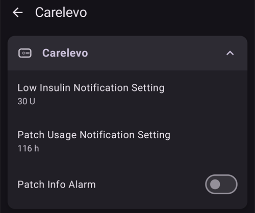

# CareLevo

CareLevo je náplasťová pumpa bez hadičky od výrobcu CareMedi. Každá náplasťová pumpa pojme až 300 U inzulínu a nosí sa až 7 dní (168 hodín). S **AAPS** komunikuje cez Bluetooth vášho telefónu, bez ďalšieho zariadenia.

```{admonition} New driver
:class: warning
Ovládač CareLevo je v **AAPS** nový. Skôr než aktivujete svoju prvú náplasťovú pumpu, prečítajte si celú túto stránku a majte poruke návod na použitie od výrobcu pumpy.
```

Najmenšia dávka, ktorú náplasťová pumpa dokáže podať, je 0,05 U. Bazálne dávky v **Profile** nastavte aspoň na 0,05 U/h, v krokoch po 0,05 U/h. Inak sa inzulín, s ktorým počíta **Profil**, a inzulín, ktorý pumpa podá, mierne líšia. **AAPS** používa bazálne dávky, ktoré náplasťová pumpa prijala.

```{contents} Table of contents
:depth: 1
:local: true
```

## Funkcie pumpy s AAPS

* Komunikuje s **AAPS** priamo cez Bluetooth vášho telefónu, bez ďalšieho komunikačného zariadenia.
* Bolus v krokoch po 0,05 U.
* Bazálne dávky od 0,05 U/h do 15 U/h v krokoch po 0,05 U/h, s 30-minútovými bazálnymi úsekmi.
* Dočasné bazály nastavené ako absolútna hodnota, až na 12 hodín.
* Predĺžený bolus až na 8 hodín.
* Zmeny letného času a časového pásma musíte riešiť ručne. Náplasťová pumpa vás upozorní na zmenu časového pásma.

## Nastavenie pumpy

1. Otvorte **ponuku** (☰) v ľavom hornom rohu hlavnej obrazovky **AAPS** a vyberte **Konfigurácia**.
1. V sekcii Pumpa vyberte **CareLevo**.
1. Tlačidlom Späť sa vráťte na hlavnú obrazovku.


## Nastavenia

Obrazovku pumpy otvoríte cez **Spravovať → Pumpa** (alebo **Konfigurácia → Pumpa → Otvoriť plugin**).

Nastavenia CareLevo otvoríte stlačením ikony **Nastavenia** (ozubené koliesko) v pravom hornom rohu. K dispozícii sú tri nastavenia:



### Nastavenie upozornenia na nízku hladinu inzulínu

Náplasťová pumpa vás upozorní, keď množstvo inzulínu, ktoré zostáva v zásobníku, klesne na zvolenú hodnotu. Nastaviť ho môžete od 20 U do 50 U v krokoch po 5 U. Predvolená hodnota je 30 U. Nezávisle od tohto nastavenia spustí náplasťová pumpa kritický alarm a zastaví podávanie inzulínu, keď v nej zostane menej ako 10 U.

### Nastavenie upozornení na dobu používania náplasťovej pumpy

Náplasťová pumpa vás upozorní, keď ju nosíte zvolený počet hodín, aby ste si mohli naplánovať výmenu. Nastaviť ho môžete od 24 do 167 hodín. Predvolená hodnota je 116 hodín.

### Alarm informácií o náplasťovej pumpe

Keď je toto nastavenie zapnuté, pumpa pípne na začiatku a na konci bolusu, predĺženého bolusu alebo dočasného bazálu. Predvolene je vypnuté.

## Obrazovka pumpy


Obrazovka pumpy ukazuje tieto údaje: **Stav Bluetooth** (Žiadna aktívna náplasťová pumpa, Odpojený alebo Pripojený), **Sériové číslo** náplasťovej pumpy, **Čas aktivácie** a **Expirácia**, aktuálna **Bazálna dávka** a **Dočasná bazálna dávka**, **Zostávajúci inzulín** (zostávajúci / naplnený), **Zostávajúci čas náplasťovej pumpy** a **Celkové množstvo podaného inzulínu**.

Tlačidlá závisia od stavu náplasťovej pumpy:

* **Aktivovať náplasťovú pumpu**: spustí aktiváciu novej náplasťovej pumpy, pozrite nižšie.
* **Sprievodca inzulínom**: ukáže dvanásť krokov plnenia náplasťovej pumpy inzulínom.
* **Pozastaviť podávanie inzulínu** / **Obnoviť podávanie inzulínu**: pozastaví a znova spustí podávanie inzulínu, pozrite nižšie.
* **Zahodiť náplasťovú pumpu**: ukončí aktuálnu náplasťovú pumpu, aby sa dala aktivovať nová.

## Aktivácia náplasťovej pumpy

Skôr než začnete, skontrolujte, či je v **AAPS** aktívny **Profil** a či je zapnutý Bluetooth. Náplasťovú pumpu treba po zapnutí aktivovať v obmedzenom čase. Ak čas vyprší, náplasťová pumpa spustí alarm **Časový limit na aplikáciu náplasťovej pumpy** a nedá sa použiť.

Na obrazovke pumpy stlačte **Aktivovať náplasťovú pumpu** a postupujte podľa krokov. Kým nie je zavedená ihla, môžete kedykoľvek zrušiť. Čo ste zadali, sa zahodí.

### Výber inzulínu

Potvrďte inzulín, ktorý používate. Náplasťová pumpa potrebuje rýchlo pôsobiaci inzulín U-100.

### Naplnenie náplasťovej pumpy inzulínom

Náplasťovú pumpu naplňte 50 až 300 U podľa toho, ako dlho ju budete nosiť. Ak potrebujete návod na plnenie, stlačte **Sprievodca inzulínom**. Potom ťuknite na naplnené množstvo a vyberte množstvo, ktoré ste naplnili. **AAPS** ho používa na zobrazenie zostávajúceho inzulínu.

### Pripojenie náplasťovej pumpy

1. Vyberte náplasťovú pumpu z blistra a odstráňte kryt ihly.
1. Stlačte vypínač náplasťovej pumpy na viac ako jednu sekundu. Po pípnutí ťuknite na **Vyhľadať náplasťovú pumpu**.
1. Ak je nájdená náplasťová pumpa tá správna, ťuknite na **Potvrdiť**. Ak nie je, ťuknite na **Znova vyhľadať**.

### Kontrola bezpečnosti

Keď je náplasťová pumpa pripojená, stlačte **Bezpečnostná kontrola**. Náplasťová pumpa sa sama otestuje a naplní (prime). Skontrolujte, či sa na hrote ihly vytvorila kvapka inzulínu. Ak kvapku nevidíte, stlačte **Opakovať**. Keď je kontrola dokončená, stlačte **Ďalej**.

### Miesto a prilepenie náplasťovej pumpy

1. Vyberte miesto, kde budete náplasťovú pumpu nosiť.
1. Miesto dôkladne očistite alkoholovým tampónom.
1. Odstráňte krycí papier lepiacej pásky a náplasťovú pumpu prilepte na kožu tak, aby označená bodka smerovala nahor.
1. Keď je náplasťová pumpa prilepená, stlačte **Ďalej**.

### Zavedenie ihly

1. Otočte bezpečnostný kryt v smere šípky a odstráňte ho.
1. Stlačte tlačidlo aplikátora úplne nadol a podržte ho 10 sekúnd. Keď je ihla zavedená, ozve sa pípnutie.
1. Odstráňte aplikátor a stlačte **Potvrdiť zavedenie**.

Ak zavedenie zlyhá, **AAPS** vám povie, koľko pokusov zostáva. Keď už nezostáva žiadny pokus, náplasťová pumpa spustí alarm **Chyba vloženia ihly** a musí sa vymeniť.

Podávanie inzulínu sa začne hneď po potvrdení zavedenia.

## Správy o boluse

Ak náplasťová pumpa bolus odmietne, **AAPS** vám povie prečo. Napríklad *Bolus nie je možné podať. Dostupný bolus: 2,8 U* znamená, že náplasťová pumpa teraz môže podať iba toto množstvo.

Ak bolus zastavíte a náplasťová pumpa zastavenie nepotvrdí, **AAPS** počká na koniec bolusu a zaznamená množstvo, ktoré náplasťová pumpa nahlási. Ak bolus nebol zaznamenaný (napríklad preto, že bol zastavený počas podávania), **AAPS** ho doplní z celkového súčtu náplasťovej pumpy a požiada vás, aby ste pred ďalším pokusom skontrolovali IOB.

## Pozastavenie a obnovenie podávania inzulínu

Na obrazovke pumpy stlačte **Pozastaviť podávanie inzulínu** a vyberte, na ako dlho sa má podávanie pozastaviť: od 30 minút do 4 hodín v krokoch po 30 minút. Podávanie sa samo neobnoví: keď pozastavenie skončí, náplasťová pumpa spustí výstrahu **Spustite inzulín**. Na obrazovke pumpy stlačte **Obnoviť podávanie inzulínu** alebo vo výstrahe **Spustiť inzulín** a potvrďte.

## Zahodenie náplasťovej pumpy

Na obrazovke pumpy stlačte **Zahodiť náplasťovú pumpu** a potvrďte. Podávanie inzulínu sa zastaví a náplasťovú pumpu už nie je možné použiť. Odstráňte náplasťovú pumpu z tela a aktivujte novú.

Keď náplasťovú pumpu zastavil kritický alarm, alarm ponúkne namiesto toho **Deaktivovať náplasťovú pumpu**. Jeho stlačením sa náplasťová pumpa zahodí rovnakým spôsobom.

(carelevo-alarms-and-notifications)=

## Alarmy a oznámenia

Náplasťová pumpa hlási udalosti na troch úrovniach. Všetky sa zobrazujú ako notifikácie **AAPS**.

### Kritické alarmy

Podávanie inzulínu sa zastavilo. Konajte hneď:

* **Nízka hladina inzulínu**: zostáva menej ako 10 U. Deaktivujte náplasťovú pumpu a vymeňte ju.
* **Náplasťová pumpa expirovala**: náplasťová pumpa dosiahla koniec svojej životnosti. Deaktivujte náplasťovú pumpu a vymeňte ju.
* **Nízky stav batérie**: zahoďte náplasťovú pumpu a vymeňte ju.
* **High/Low Temperature**: move to a suitable temperature, between 40 ℉ and 99 ℉ (4.4 ℃ and 37.2 ℃).
* **Automatické vypnutie**: náplasťová pumpa sa zastavila, pretože výstraha Automatické vypnutie bola ignorovaná. Bazálne podávanie znova spustíte stlačením **Spustiť inzulín**.
* **Časový limit na aplikáciu náplasťovej pumpy**, **Samodiagnostika zlyhala**, **Chyba náplasťovej pumpy**, **Oklúzia** a **Chyba vloženia ihly**: deaktivujte náplasťovú pumpu a vymeňte ju.

### Výstrahy

Podávanie inzulínu pokračuje, ale niečo si vyžaduje vašu pozornosť:

* **Nízka hladina inzulínu**: zásobník dosiahol množstvo nastavené v **Nastavenie upozornenia na nízku hladinu inzulínu**. Pripravte sa na výmenu náplasťovej pumpy.
* **Náplasťová pumpa čoskoro exspiruje** a **Životnosť náplasťovej pumpy vypršala**: vymeňte náplasťovú pumpu.
* **Nízky stav batérie**: pripravte sa na výmenu náplasťovej pumpy.
* **High/Low Temperature**: delivery is paused until the patch is back between 40 ℉ and 99 ℉ (4.4 ℃ and 37.2 ℃).
* **Automatické vypnutie**: ťuknite na **OK**. Ak výstrahu ignorujete, zmení sa na kritický alarm a podávanie sa zastaví.
* **Aktivácia náplasťovej pumpy nebola dokončená**: ťuknite na **OK** a dokončite aktiváciu.
* **Spustite inzulín**: pozastavenie, ktoré ste nastavili, skončilo. Podávanie obnovíte ťuknutím na **Spustiť inzulín**.
* **Zapnúť Bluetooth** a **BLE nie je pripojené**: telefón sa nemôže spojiť s náplasťovou pumpou. Zapnite Bluetooth alebo skontrolujte pripojenie náplasťovej pumpy.

### Oznámenia

Iba na informáciu: **Nízka hladina inzulínu**, **Upozornenie na čas používania náplasťovej pumpy** (uplynul čas nastavený v **Nastavenie upozornení na dobu používania náplasťovej pumpy**), **Oznámenie o kontrole náplasťovej pumpy**, **Zmena časového pásma** a **Skontrolujte hladinu glukózy v krvi** (v nastavenom čase po boluse).

Náplasťová pumpa hlási aj spustenie a ukončenie svojej vlastnej funkcie ochrany pred nízkou glykémiou (**LGS**). **AAPS** túto funkciu nepoužíva, nízku glykémiu rieši okruh sám.

## Kde získať pomoc

Problémy s ovládačom CareLevo nahláste na [stránke GitHub issues projektu AAPS](https://github.com/nightscout/AndroidAPS/issues) alebo v komunitných kanáloch AAPS, pozrite [Kde získať pomoc](../GettingHelp/WhereCanIGetHelp.md).
