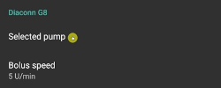
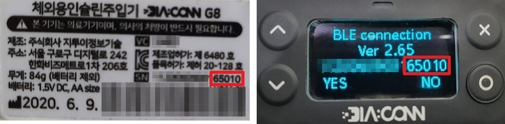

# Diaconn G8

```{contents} Table of contents
:depth: 1
:local: true
```

## Funkcie pumpy s AAPS

* Komunikuje s **AAPS** priamo cez Bluetooth vášho telefónu, bez ďalšieho komunikačného zariadenia.
* Zmeny letného času a časového pásma musíte riešiť ručne.

## Párovanie inzulínovej pumpy cez Bluetooth

- Ťuknite na **ponuku** (☰) v ľavom hornom rohu.


- Ťuknite na **Konfigurácia** > **Pumpa** a vyberte **Diaconn G8**.


Po výbere sa na karte **Diaconn G8** zobrazia dve tlačidlá, **Nastavenia** a **Otvoriť plugin**:


**Nastavenia** otvorí nastavenia ovládača Diaconn G8 (pozrite [Nastavenia možností inzulínovej pumpy Diaconn G8](#diaconn-g8-insulin-pump-option-setting) nižšie).

**Otvoriť plugin** (alebo **Spravovať** > **Pumpa**) otvorí obrazovku pumpy Diaconn G8. Kým nie je pumpa spárovaná, vyzerá takto:




```{admonition} Older screenshot
:class: note
Snímka obrazovky vyššie je zo staršej verzie **AAPS**. V **AAPS** 4 sa párovanie spúšťa tlačidlom **Spárovať** na obrazovke pumpy; nastavenie **Vybraná pumpa** už neexistuje.
```

- Na obrazovke pumpy ťuknite na **Spárovať**. Otvorí sa obrazovka **Párovanie pumpy Diaconn** a **AAPS** vyhľadá pumpy v okolí.
- Keď sa v zozname zobrazí číslo modelu vašej inzulínovej pumpy, ťuknite naň (napríklad **DIACONN-65010**).


- Číslo modelu môžete zistiť dvoma spôsobmi:

1. Posledných 5 číslic sériového čísla (SN) na zadnej strane pumpy.
2. Stlačte tlačidlo O > Information > BLE > posledných 5 číslic.



- Po výbere pumpy sa zobrazí okno s výzvou na zadanie PIN kódu. Zadajte PIN, ktorý sa zobrazuje na pumpe, a dokončite tak pripojenie.

 

- Keď sa zobrazí **Spárovanie úspešné!**, ťuknite na **OK** a vrátite sa na obrazovku pumpy.

## Kontrola stavu pumpy a synchronizácia logov

- Keď je pumpa pripojená, otvorte obrazovku pumpy (**Spravovať** > **Pumpa**). Zobrazuje stav pumpy (batériu, zásobník, posledné spojenie, posledný bolus, bazálnu dávku a ďalšie).
- Ťuknutím na **Obnoviť** sa pripojíte k pumpe, aktualizujete stav a zosynchronizujete logy.
- Ťuknutím na **História pumpy** zobrazíte históriu načítanú z pumpy.


```{admonition} Older screenshot
:class: note
Snímka obrazovky vyššie je zo staršej verzie **AAPS**. V **AAPS** 4 sa stav pumpy zobrazuje na obrazovke pumpy (**Spravovať** > **Pumpa**) a synchronizuje sa tlačidlom **Obnoviť**.
```

(diaconn-g8-bluetooth-troubleshooting)=

## Riešenie problémov s Bluetooth

**Čo robiť pri nestabilnom spojení s pumpou cez Bluetooth.**

### Spôsob 1) Reštartujte AAPS a potom znovu skontrolujte pumpu

- Ťuknite na **ponuku** (☰) v ľavom hornom rohu.
- Ťuknite na **Ukončiť** v dolnej časti ponuky.


- Znovu spustite **AAPS** a skontrolujte spojenie s pumpou.

### Spôsob 2) Ak prvý spôsob nepomôže, odpojte Bluetooth a potom ho znovu pripojte.

- Stlačte a podržte tlačidlo Bluetooth hore asi 3 sekundy.


- Na spárovanej inzulínovej pumpe Diaconn G8 stlačte tlačidlo Setting.


- Zvoľte Unpair (zrušenie párovania).


- V **AAPS** otvorte obrazovku pumpy (**Spravovať** > **Pumpa**), ťuknite na **Zrušiť párovanie** a potvrďte **Resetovať informácie o párovaní?**.
- Zopakujte postup párovania pumpy cez Bluetooth (pozrite vyššie).

## Ďalšie informácie

(diaconn-g8-insulin-pump-option-setting)=

### Nastavenia možností inzulínovej pumpy Diaconn G8

- **Konfigurácia** > **Pumpa** > **Diaconn G8** > **Nastavenia**
- Alebo na obrazovke pumpy (**Spravovať** > **Pumpa**) ťuknite na ikonu nastavení (ozubené koliesko) v pravom hornom rohu.


- **Rýchlosť bolusu** určuje, ako rýchlo pumpa podáva bolus.
- Ak je zapnutá možnosť **Zaznamenať výmenu zásobníka**, pri udalosti „Výmena inzulínu“ sa príslušné údaje automaticky nahrajú do Starostlivosti.
- Ak je zapnutá možnosť **Zaznamenať výmenu kanyly**, pri udalosti „Výmena setu“ sa príslušné údaje automaticky nahrajú do Starostlivosti.
- Ak je zapnutá možnosť **Zaznamenať výmenu hadičky**, pri udalosti „Výmena hadičky“ sa príslušné údaje automaticky pridajú ako poznámka.
- Ak je zapnutá možnosť **Zaznamenať výmenu batérie**, pri udalosti „Výmena batérie“ sa príslušné údaje automaticky nahrajú do Starostlivosti. Výmenu batérie môžete zaznamenať aj sami cez **Spravovať** > **Výmena batérie v pumpe**. (Poznámka: Pred výmenou batérie zastavte všetky prebiehajúce funkcie podávania inzulínu.)
- **Synchronizácia do Diaconn cloudu** posiela logy pumpy do Diaconn cloudu.


```{admonition} Older screenshot
:class: note
Snímka obrazovky vyššie je zo staršej verzie **AAPS**. V **AAPS** 4 sa výmena batérie zaznamenáva cez **Spravovať** > **Výmena batérie v pumpe**; karta **Akcie** už neexistuje.
```

### Funkcia predĺženého bolusu

- Ak použijete predĺžený bolus, vypne sa uzavretý okruh.
- Prečo predĺžený bolus nefunguje v uzavretom okruhu, sa dočítate na [tejto stránke](#extended-bolus-and-why-they-wont-work-in-closed-loop-environment).

## Kde získať pomoc

Vývoj ovládača Diaconn G8 robí komunita na **dobrovoľníckom** základe. Skôr než požiadate o pomoc:

1. **Prečítajte si** príslušnú časť tejto dokumentácie a overte si, ako má funkcia fungovať.
2. **Opýtajte sa** na kanáli *#AAPS* na [Discorde](https://discord.gg/4fQUWHZ4Mw) alebo v niektorom z ďalších [komunitných kanálov](../GettingHelp/WhereCanIGetHelp.md).
3. **Nahláste chybu**: prehľadajte [existujúce hlásenia (issues)](https://github.com/nightscout/AndroidAPS/issues); ak tam vaša chyba nie je, otvorte [nové hlásenie](https://github.com/nightscout/AndroidAPS/issues) a priložte svoje [log súbory](../GettingHelp/AccessingLogFiles.md).

Keď žiadate o pomoc, uveďte značku a model telefónu, verziu Androidu, verziu **AAPS** a jednoduchý opis problému (čo sa zmenilo a kedy to naposledy fungovalo).
