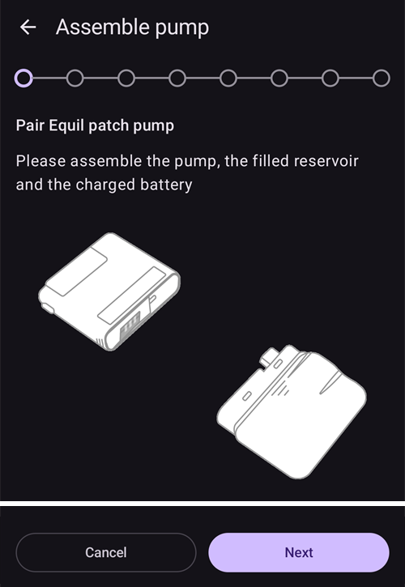

# Equil

Tento návod popisuje nastavenie inzulínovej pumpy Equil.

```{contents} Table of contents
:depth: 1
:local: true
```

## Funkcie pumpy s AAPS

* Náplasťová pumpa bez hadičky, ktorá komunikuje s **AAPS** cez vstavaný Bluetooth vášho telefónu, bez ďalšieho komunikačného zariadenia.
* **AAPS** pracuje s Equil ako s náplasťovou pumpou so zásobníkom na 200 U: hlavná obrazovka ukazuje stavové kontrolky náplasťovej pumpy a **Plnenie/doplňovanie** ani **Výmena batérie v pumpe** sa neponúkajú. Plnenie, naplnenie kanyly a výmena batérie sa robia v sprievodcoch pumpy.
* Kým je pumpa pozastavená alebo zastavená, **AAPS** zaznamená dočasný bazál 0 U/h. Do IOB sa tak nezapočíta žiadny bazálny inzulín.
* Zmeny letného času a časového pásma musíte riešiť ručne.

## Hardvérové a softvérové požiadavky
* **Kompatibilný hardvér Equil**

  Momentálne sú podporované Equil 5.3 a 5.4.

* **AAPS** zostavená a nainštalovaná podľa návodu [Zostavenie AAPS](../SettingUpAaps/BuildingAaps.md)

## Nastavenie

### Výber pumpy Equil

Otvorte **ponuku** (☰) v ľavom hornom rohu, zvoľte **[Konfigurácia](#Config-Builder-pump)** a v sekcii **Pumpa** vyberte **Equil**.

Po výbere sa na karte **Equil** zobrazia dve tlačidlá, **Nastavenia** a **Otvoriť plugin**:


**Otvoriť plugin** (alebo **Spravovať** → **Pumpa**) otvorí obrazovku pumpy Equil. Kým nie je pumpa spárovaná, vyzerá takto:


### Nastavenia

Nastavenia Equil otvoríte tlačidlom **Nastavenia** na karte **Equil** alebo ikonou ozubeného kolieska v pravom hornom rohu obrazovky pumpy.


* **Upozornenie na nízky stav batérie**: upozorní vás, keď je batéria pumpy slabá.
* **Výstraha nízkej hladiny inzulínu**: upozorní vás, keď je v zásobníku málo inzulínu.
* **Tón výstrahy**: ako vás pumpa upozorní: **Stíšiť**, **Iba vibrovať**, **Iba zvuky** alebo **Vibrácie a zvuky**.
* **Rýchlosť bolusu**: ako rýchlo sa bolus podá: **1,5 J/min (štandard)**, **3 J/min**, **6 J/min** alebo **12 J/min**. Rýchlejšie dávkovanie bolusu môže viesť k častejším alarmom oklúzie.


```{admonition} Max basal and max bolus on the patch
:class: note
Samotná pumpa odmietne každú bazálnu dávku nad maximom, ktoré do nej **AAPS** naprogramuje. **AAPS** vezme vyššiu z dvoch hodnôt: vaše [nastavenie](../SettingUpAaps/Preferences.md) **max bazál** alebo najvyššiu hodinovú bazálnu dávku vo vašom **Profile**. Pumpa tak vždy prijme váš profil aj dočasné bazály, ktoré okruh požaduje. **AAPS** do pumpy posiela aj váš maximálny povolený bolus.

Keď zmeníte **max bazál** alebo **max bolus**, **AAPS** pošle nové hodnoty do pumpy automaticky. Posielajú sa aj pri každom prepnutí profilu. Na samotnej pumpe nie je potrebné nič nastavovať.
```

### Spárovanie pumpy

Na obrazovke pumpy stlačte **Párovať**. Sprievodca vás prevedie každým krokom. Rad bodiek hore ukazuje, ako ďaleko ste.

Ak sa Android opýta, či môže **AAPS** vyhľadávať zariadenia v okolí a pripájať sa k nim, stlačte **Povoliť** (Allow). **AAPS** to potrebuje na nájdenie pumpy.


Sprievodca má tieto kroky. Stlačením **Ďalej** pokračujete, stlačením **Zrušiť** sprievodcu opustíte.

1. **Vyžaduje sa profil**: zobrazí sa, len ak ste v **AAPS** ešte nikdy neaktivovali **Profil**. Vyberte profil, ktorý chcete použiť, a stlačte **Aktivovať profil**.
1. **Zložiť pumpu**: spojte pumpu, naplnený zásobník a nabitú batériu.

   

1. **Vyhľadať pumpu**: **AAPS** vyhľadá pumpy Equil v okolí. Zo zoznamu vyberte svoju pumpu.

   
1. **Spárovať zariadenie**: v poli **Nastaviť heslo pre spárovanie** môžete zadať heslo na spárovanie. Musí mať 4 znaky, zvolené z `ABCDEF0123456789`. Stlačte **Párovať**.

   

1. **Zvoliť inzulín**: zobrazí sa, len ak máte nastavený viac ako jeden inzulín. Vyberte inzulín, ktorý je v zásobníku.
1. **Plnenie / Doplňovanie**: pumpa **nesmie** byť na svojej základni. Stlačte **Plnenie/doplňovanie** a plňte zásobník, kým sa na hrote ihly neobjaví kvapka inzulínu. Stlačte **Ďalej**.

   
1. **Striedanie miest**: zobrazí sa, len ak je v nastaveniach striedania miest zapnuté **Spravovať rotáciu umiestnenia pumpy**. Ťuknite na miesto, kam pumpu pripojíte, alebo stlačte **Preskočiť**.
1. **Pripojiť pumpu**: pripojte pumpu na jej základňu.

   
1. **Naplniť kanylu**: keď je pumpa na základni, stlačte **Odstrániť vzduch**, aby sa z kanyly odstránil vzduch. Stlačte **Ďalej**.

   

1. **Potvrdiť**: umiestnite pumpu na telo a stlačte **Dokončiť**.

   

```{warning}
Ak ste si nastavili vlastné heslo na spárovanie (odporúča sa kvôli vašej bezpečnosti), uložte si ho na bezpečné miesto. Heslo sa uloží v pumpe. Pumpa ho bude vyžadovať pri každom novom spárovaní, kým ju v **AAPS** správne neodpárujete. Dovtedy sa pumpa nedá používať ani s pôvodným ručným ovládačom (PDA).
```

### Obrazovka pumpy po spárovaní

Keď je pumpa spárovaná, obrazovka pumpy ukazuje tieto tlačidlá:

* **Obnoviť**: hneď načíta stav a históriu pumpy.
* **Pozastaviť** / **Obnoviť podávanie inzulínu**: zastaví alebo znova spustí podávanie inzulínu.
* **Vymeniť zásobník**: prevedie vás odpojením pumpy, vložením nového zásobníka (a v prípade potreby novej batérie), plnením a opätovným pripojením. Prvý krok sa pýta: *Zavediete aj nový infúzny set (základňu a kanylu)?*
  * **Áno, nový infúzny set**: zvolíte miesto, kanyla sa naplní a **AAPS** zaznamená výmenu inzulínu aj výmenu kanyly.
  * **Nie, iba zásobník alebo batériu**: kanyla sa nenaplní a **AAPS** zaznamená iba výmenu inzulínu.

  Po výmene zásobníka sa ako stav batérie zobrazuje **-**, kým ho **AAPS** znova nenačíta z pumpy.

  

* **História**: ukáže udalosti zaznamenané pumpou.
* **Zrušiť párovanie zariadenia**: prevedie vás odpojením pumpy a zrušením jej spárovania s **AAPS**. Tým sa zastaví podávanie inzulínu, piest pumpy sa vráti späť na začiatok a spárovanie sa odstráni.

### Alarmy

* Alarm nízkej hladiny inzulínu zaznie raz pri každej úrovni (10 U, 5 U a 2 U) a keď je zásobník prázdny. Alarm slabej batérie zaznie raz pri 10 % a raz pri 5 %. Každá úroveň spustí alarm iba raz, až do ďalšej výmeny zásobníka.
* Alarmy a zastavenia pumpy sa zaznamenávajú aj ako oznámenia v ošetreniach, s časom, keď ich pumpa zapísala. Neskôr tak uvidíte, kedy a prečo sa pumpa zastavila.
* Ak sa zásobník počas bolusu vyprázdni, **AAPS** zaznamená iba inzulín podaný do tej chvíle a oznámi vám obe množstvá.

## Kde získať pomoc

Ovládač Equil vyvíja komunita na **dobrovoľníckom** základe. Skôr než požiadate o pomoc:

1. **Prečítajte si** príslušnú časť tejto dokumentácie a overte si, ako má funkcia fungovať.
2. **Opýtajte sa** na kanáli *#AAPS* na [Discorde](https://discord.gg/4fQUWHZ4Mw) alebo v niektorom z ďalších [komunitných kanálov](../GettingHelp/WhereCanIGetHelp.md).
3. **Nahláste chybu**: prehľadajte [existujúce hlásenia (issues)](https://github.com/nightscout/AndroidAPS/issues); ak tam vaša chyba nie je, otvorte [nové hlásenie](https://github.com/nightscout/AndroidAPS/issues) a priložte svoje [log súbory](../GettingHelp/AccessingLogFiles.md).

Keď žiadate o pomoc, uveďte značku a model telefónu, verziu Androidu, verziu **AAPS** a jednoduchý opis problému (čo sa zmenilo a kedy to naposledy fungovalo).
