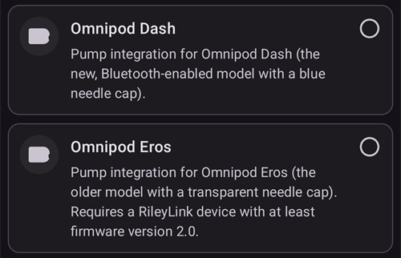
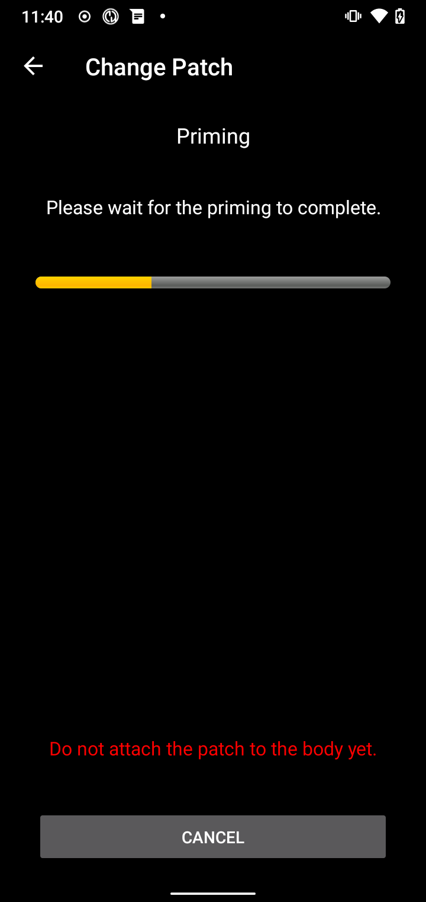

(medtrum-nano-300u)=
# Medtrum Nano 200U / 300U

Tento návod popisuje konfiguráciu inzulínovej pumpy Medtrum.

```{contents} Table of contents
:depth: 1
:local: true
```

## Funkcie pumpy s AAPS
* Podporované sú všetky funkcie okruhu (SMB, TBR atď.)
* Automatická zmena letného času a časového pásma
* Ovládač v AAPS nepodporuje predĺžený bolus

## Hardvérové a softvérové požiadavky
* **Kompatibilné základne pumpy Medtrum a Patche so zásobníkom**
    - Momentálne podporované:
        - Medtrum TouchCare Nano 200U so základňou pumpy ref.: **MD0201** a **MD8201**.
        - Medtrum TouchCare 300U so základňou pumpy ref.: **MD8301**.
        - Ak máte nepodporovaný model a chcete darovať hardvér alebo pomôcť s testovaním, kontaktujte nás cez Discord [tu](https://discordapp.com/channels/629952586895851530/1076120802476441641).
* **AAPS zostavené a nainštalované** podľa návodu [Zostavenie AAPS](../SettingUpAaps/BuildingAaps.md).
* **Kompatibilný telefón s Androidom** s pripojením Bluetooth BLE
    - Pozrite si [poznámky k vydaniu](../Maintenance/ReleaseNotes.md) AAPS

## Skôr než začnete

**BEZPEČNOSŤ NA PRVOM MIESTE** Nerobte tento postup v prostredí, kde by ste sa nevedeli zotaviť z chyby (náhradné Patche, inzulín a zariadenia na ovládanie pumpy sú nevyhnutné).

**PDM ani aplikácia Medtrum nebudú fungovať s Patchom, ktorý aktivoval AAPS.** Doteraz ste možno na posielanie príkazov do pumpy používali PDM alebo aplikáciu Medtrum. Z bezpečnostných dôvodov môžete aktivovaný Patch používať iba so zariadením alebo aplikáciou, ktorou bol aktivovaný.

*To NEZNAMENÁ, že by ste mali PDM vyhodiť. Odporúčame uschovať ho na bezpečnom mieste ako zálohu pre núdzové situácie, napríklad ak stratíte telefón alebo AAPS nefunguje správne.*

**Vaša pumpa neprestane podávať inzulín, keď nie je pripojená k AAPS** Predvolené bazálne dávky sú naprogramované v pumpe podľa aktuálne aktívneho profilu. Kým AAPS funguje, posiela príkazy na dočasné bazály, ktoré trvajú najviac 120 minút. Ak pumpa z nejakého dôvodu nedostane žiadne nové príkazy (napríklad pretože sa stratilo spojenie kvôli vzdialenosti medzi pumpou a telefónom), po skončení dočasného bazálu sa pumpa vráti k predvolenej bazálnej dávke naprogramovanej v pumpe.

**Profil AAPS nepodporuje bazálne dávky v 30-minútových časových úsekoch** Ak s AAPS začínate a prvýkrát nastavujete profil bazálnych dávok, majte na pamäti, že bazálne dávky začínajúce v polhodine nie sú podporované a profil bazálnych dávok musíte upraviť tak, aby začínali vždy v celú hodinu. Ak máte napríklad bazálnu dávku 1,1 jednotky, ktorá začína o 09:30 a trvá 2 hodiny do 11:30, nebude to fungovať. Túto bazálnu dávku 1,1 jednotky musíte zmeniť na časový úsek 9:00 – 11:00 alebo 10:00 – 12:00. Hoci samotný hardvér pumpy Medtrum podporuje v profile bazálne dávky v 30-minútových krokoch, AAPS ich zatiaľ vo svojich algoritmoch nedokáže zohľadniť.

**Bazálne dávky 0 U/h v profile AAPS NEPODPORUJE** Hoci pumpa Medtrum nulovú bazálnu dávku podporuje, AAPS na určenie automatickej liečby používa násobky bazálnej dávky z profilu, a preto s nulovou bazálnou dávkou nemôže fungovať. Najnižšia bazálna dávka v profile je 0,05 U/h.

Dočasnú nulovú bazálnu dávku dosiahnete funkciou „Odpojiť pumpu“ alebo kombináciou Deaktivovať uzavretý okruh / dočasný bazál alebo Pozastaviť uzavretý okruh / dočasný bazál.

## Nastavenie

```{caution}
Keď aktivujete Patch pomocou **AAPS**, **MUSÍTE** vypnúť všetky ostatné zariadenia, ktoré môžu komunikovať so základňou pumpy Medtrum, napríklad aktívny PDM alebo aplikáciu Medtrum.
```

### Krok 1: Vyberte pumpu Medtrum

#### Možnosť 1: Nové inštalácie

Ak inštalujete **AAPS** prvýkrát, nastavením vás prevedie **Sprievodca nastavením**. Keď sa dostanete ku kroku **Pumpa**, vyberte **Medtrum**.

Ak si nie ste istí, môžete vybrať aj **Virtuálna pumpa** a **Medtrum** vybrať neskôr, po nastavení **AAPS** (pozrite možnosť 2).


#### Možnosť 2: Obrazovka Konfigurácia

Pri existujúcej inštalácii môžete pumpu **Medtrum** vybrať v časti [Konfigurácia > Pumpa](#Config-Builder-pump):

Otvorte **ponuku** (☰) vľavo hore, ťuknite na **Konfigurácia** > **Pumpa** a vyberte kartu **Medtrum**. Naraz môže byť aktívna iba jedna pumpa.



Po výbere sa na karte **Medtrum** zobrazia dve tlačidlá, **Nastavenia** a **Otvoriť plugin**:


**Otvoriť plugin** (alebo **Spravovať → Pumpa**) otvorí obrazovku pumpy Medtrum. Používate ju na výmenu Patchov a na zobrazenie stavu pumpy. Pred aktiváciou Patchu vyzerá takto:


(medtrum-step-2)=
### Krok 2: Zmeňte nastavenia Medtrum

Ťuknite na **Nastavenia** na karte **Medtrum** v časti **Konfigurácia** > **Pumpa**. Môžete tiež ťuknúť na ikonu ozubeného kolieska v pravom hornom rohu obrazovky pumpy Medtrum. Otvorí sa **Nastavenie pumpy Medtrum**:


```{note}
Nastavenie **Sériové číslo** už neexistuje. **AAPS** nájde vašu základňu pumpy pomocou vyhľadávania Bluetooth pri prvej aktivácii Patchu (pozrite [Krok 3](#medtrum-activate-patch)) a zapamätá si jej sériové číslo. Ak chcete použiť inú základňu pumpy, pozrite [Zrušiť párovanie](#medtrum-unpair).
```

#### Nastavenie výstrah

***Predvolené: Pípnutie.***

Toto nastavenie mení spôsob, akým vás pumpa upozorní na varovanie alebo chybu.

- **Pípnutie**: Patch pri alarmoch a varovaniach pípa.
- **Tichý**: Patch vás na alarmy a varovania neupozorní.

Poznámka: V tichom režime **AAPS** aj tak spustí alarm, podľa nastavenia hlasitosti vášho telefónu. Ak na alarm nereagujete, Patch nakoniec začne pípať.

#### Oznámenie o výstrahe pumpy

***Predvolené: Zapnuté.***

Toto nastavenie mení spôsob, akým **AAPS** zobrazuje notifikácie pri nekritických varovaniach pumpy. Ak je zapnuté, pri varovaní pumpy sa na telefóne zobrazí notifikácia, napríklad pri:
- Slabá batéria
- Takmer prázdny zásobník (20 jednotiek)
- Patch čoskoro expiruje

Ak sú alarmy pumpy nastavené na **Tichý**, odporúčame toto nastavenie nechať zapnuté. V oboch prípadoch sa tieto varovania zobrazujú aj na obrazovke pumpy Medtrum v časti [Aktívne alarmy](#medtrum-active-alarms).

(medtrum-patch-expiration)=
#### Expirácia Patchu

***Predvolené: Zapnuté.***

Toto nastavenie mení správanie Patchu. Ak je zapnuté, Patch expiruje po 3 dňoch a vydá zvukové varovanie, ak máte zapnutý zvuk. Po 3 dňoch a 8 hodinách Patch prestane fungovať.

Ak je toto nastavenie vypnuté, Patch vás pred zastavením nevaruje. S novším firmvérom základne pumpy funguje Patch najviac 5 dní.

#### Výstraha expirácie pumpy [hodiny]

***Predvolené: 72 hodín.***

Toto nastavenie mení čas varovania pred expiráciou. Keď je zapnutá [Expirácia Patchu](#medtrum-patch-expiration), **AAPS** zobrazí notifikáciu po uplynutí tohto počtu hodín od aktivácie.

#### Hodinové maximum inzulínu [jednotky]

***Predvolené: 25 U.***

Toto nastavenie mení maximálne množstvo inzulínu, ktoré sa môže podať za jednu hodinu. Ak sa tento limit prekročí, Patch sa pozastaví a spustí alarm. Alarm môžete resetovať tlačidlom **Resetovať alarmy** na obrazovke pumpy, pozrite [Resetovať alarmy](#nano-reset-alarms).

Nastavte rozumnú hodnotu podľa vašej potreby inzulínu.

#### Denné maximum inzulínu [jednotky]

***Predvolené: 80 U.***

Toto nastavenie mení maximálne množstvo inzulínu, ktoré sa môže podať za jeden deň. Ak sa tento limit prekročí, Patch sa pozastaví a spustí alarm. Alarm môžete resetovať tlačidlom **Resetovať alarmy** na obrazovke pumpy, pozrite [Resetovať alarmy](#nano-reset-alarms).

Nastavte rozumnú hodnotu podľa vašej potreby inzulínu.

#### Vykonať skenovanie pri chybách pripojenia

***Predvolené: Vypnuté.***

Nachádza sa v časti **Rozšírené nastavenia**.

Zapnite iba vtedy, ak máte problémy s pripojením. Ak je zapnuté, ovládač pred pokusom o opätovné pripojenie znovu vyhľadá pumpu. Uistite sa, že povolenie Poloha pre **AAPS** je nastavené na „Povoliť vždy“ (Allow all the time).

### Krok 2b: Nastavenia upozornení AAPS

Tieto nastavenia nie sú súčasťou ovládača Medtrum. Otvoríte ich ikonou **Nastavenia** (ozubené koliesko) v pravom hornom rohu hlavnej obrazovky. Viac nájdete v časti [Nastavenia](../SettingUpAaps/Preferences.md).

#### Strážny pes BT

Otvorte **Nastavenia** > **Pumpa**:


**Strážny pes BT** vypne Bluetooth v telefóne na jednu sekundu, ak sa **AAPS** nedokáže pripojiť k pumpe. To môže pomôcť na niektorých telefónoch, kde Bluetooth zamŕza.

Ak máte často problémy s pripojením k pumpe, zapnite toto nastavenie.

#### Lokálne výstrahy

Otvorte **Nastavenia** > **Lokálne výstrahy**:


##### Výstraha pri nedostupnej pumpe

***Predvolené: Zapnuté.***

Keď je zapnutý ovládač Medtrum, toto nastavenie je vždy zapnuté. Upozorní vás, keď je pumpa nedostupná. To sa môže stať, keď je pumpa mimo dosahu alebo keď nereaguje kvôli chybnému Patchu alebo základni pumpy, napríklad keď medzi základňu pumpy a Patch vnikne voda.

Z bezpečnostných dôvodov sa toto nastavenie nedá vypnúť.

##### Prah nedostupnosti pumpy

***Predvolené: 30 min.***

Toto nastavenie mení, ako dlho **AAPS** čaká, kým vás upozorní, že pumpa je nedostupná.

Pri pumpe Medtrum môžete toto nastavenie zmeniť, ale z bezpečnostných dôvodov odporúčame ponechať 30 minút.

(medtrum-activate-patch)=
### Krok 3: Aktivujte Patch

**Skôr než budete pokračovať:**
- Pripravte si základňu pumpy Medtrum a nový Patch so zásobníkom.
- Vypnite ostatné zariadenia, ktoré môžu komunikovať s pumpou Medtrum (PDM a aplikáciu Medtrum).
- Ideálne je, ak je **AAPS** nastavené a [profil je aktivovaný](../DailyLifeWithAaps/ProfileSwitch-ProfilePercentage.md). Ak nie je aktívny žiadny profil, aktivácia začne krokom **Vyžaduje sa profil**, v ktorom zvolíte profil na aktiváciu.

#### Spustenie aktivácie

Otvorte [obrazovku pumpy Medtrum](#nano-overview) (**Spravovať → Pumpa**) a ťuknite na **Vymeniť Patch**. Ak ste nastavili [ochranu nastavení](#Preferences-protection), musíte najprv zadať heslo alebo PIN.

Ak je už nejaký Patch aktívny, najprv budete vyzvaní, aby ste ho deaktivovali, pozrite [Deaktivácia Patchu](#nano-deactivate-patch).

Aktivácia je sprievodca krok za krokom. Podľa pokynov naplňte a aktivujte nový Patch. Ak chcete skončiť, v ktoromkoľvek kroku ťuknite na **Zrušiť**.

```{important}
Patch si nasaďte na telo a kanylu zaveďte až vtedy, keď vás k tomu vyzve sprievodca (po dokončení plnenia).
```

Prvé kroky, ktoré uvidíte, závisia od vášho nastavenia:

1. **Vyžaduje sa profil**: iba ak nie je aktívny žiadny profil. Vyberte profil, ktorý sa má použiť, a pokračujte.
2. **Vyhľadať pumpu**: iba prvýkrát alebo po použití [Zrušiť párovanie](#medtrum-unpair). Pripojte základňu pumpy k novému Patchu, aby sa zapla. **AAPS** vyhľadá základne pumpy Medtrum v okolí (ich názvy začínajú na `MT`). V zozname ťuknite na svoju. **AAPS** uloží jej sériové číslo a potom prejde rovno na plnenie Patchu.

   

3. **Aktivovať Patch**: iba ak **AAPS** už vašu základňu pumpy pozná. Na obrazovke je text „Žiadny aktívny Patch. Stlačte **Ďalej** pre zahájenie aktivačného procesu.“ Uistite sa, že základňa pumpy ešte **nie je** pripojená k Patchu, a potom ťuknite na **Ďalej**.


#### Pripojenie a naplnenie Patchu


Pripojte základňu pumpy k Patchu, odstráňte zvyšný vzduch a naplňte Patch inzulínom. Na aktiváciu je potrebných najmenej 70 jednotiek. Na obrazovke sa zobrazuje stav zásobníka. Patch si zatiaľ nenasadzujte na telo.

Keď je Patch rozpoznaný a naplnený, zobrazí sa tlačidlo **Ďalej**. Ťuknite naň.

#### Výber inzulínu

Tento krok sa zobrazí iba vtedy, ak máte v **AAPS** nastavený viac ako jeden inzulín. Vyberte inzulín, ktorým plníte Patch. **AAPS** po aktivácii použije prepnutie profilu s týmto inzulínom.

#### Plnenie Patchu (prime)


**Neodstraňujte** bezpečnostný zámok. Stlačte tlačidlo ihly na Patchi do polovice a potom ťuknite na **Ďalej**, aby sa spustilo plnenie.



Počkajte, kým sa plnenie dokončí.


Keď je plnenie dokončené, pokračujte ťuknutím na **Ďalej**.

#### Striedanie miest

Tento krok sa zobrazí iba vtedy, ak miesta pumpy spravujete pomocou funkcie [Striedanie miest](#Aapsscreens-site-rotation) (nastavenie **Spravovať rotáciu umiestnenia pumpy**). Zvoľte, kam na tele Patch umiestnite, alebo tento krok preskočte.

#### Pripojenie Patchu


Očistite pokožku a odstráňte ochranné fólie. Odstráňte bezpečnostný zámok, nasaďte Patch na telo a stlačením tlačidla ihly zaveďte kanylu.

Ťuknutím na **Ďalej** aktivujete Patch.

#### Aktivácia Patchu


**AAPS** aktivuje pumpu a nastaví počiatočnú bazálnu dávku. Počkajte, prosím. Po dokončení aktivácie sa zobrazí táto obrazovka:


```{admonition} Older screenshot
:class: note
Okrem kroku **Vyhľadať pumpu** sú snímky obrazovky aktivácie vyššie zo staršej verzie **AAPS** a v **AAPS** 4 môžu vyzerať inak.
```

Ukazuje, koľko jednotiek zostáva v Patchi. Ťuknutím na **OK** sa vrátite na obrazovku pumpy.

```{tip}
Po novej aktivácii [exportujte svoje nastavenia](../Maintenance/ExportImportSettings.md). Vďaka tomu môžete túto reláciu Patchu neskôr obnoviť, napríklad v novom telefóne.
```

(nano-deactivate-patch)=

### Deaktivácia Patchu

Ak chcete aktívny Patch deaktivovať, otvorte [obrazovku pumpy Medtrum](#nano-overview) (**Spravovať → Pumpa**) a ťuknite na **Vymeniť Patch**.


Budete vyzvaní, aby ste potvrdili, že chcete aktuálny Patch deaktivovať. **Tento krok sa nedá vrátiť späť.** Ťuknite na **Ďalej** pre deaktiváciu alebo na **Zrušiť** pre návrat na obrazovku pumpy.


Ak **AAPS** nedokáže Patch deaktivovať (napríklad preto, že základňa pumpy už bola z Patchu odpojená), ťuknite na **Zahodiť**, aby AAPS zabudlo aktuálnu reláciu Patchu. Potom môžete aktivovať nový Patch.


Po dokončení deaktivácie zasuňte ihlu a odstráňte Patch z tela. Odpojte základňu pumpy a použitý Patch zlikvidujte. Ťuknite na **OK** pre návrat na obrazovku pumpy alebo na **Ďalej** pre spustenie aktivácie nového Patchu.

(nano-resume-interrupted-activation)=

### Obnovenie prerušenej aktivácie

Ak sa aktivácia Patchu preruší, napríklad pretože sa vybije batéria telefónu, môžete v nej pokračovať. Otvorte [obrazovku pumpy Medtrum](#nano-overview) (**Spravovať → Pumpa**) a ťuknite na **Vymeniť Patch**.


Ťuknutím na **Ďalej** budete v aktivácii pokračovať. Ťuknutím na **Zahodiť** resetujete stav aktivácie, aby ste mohli aktivovať nový Patch.


```{admonition} Older screenshot
:class: note
Snímky obrazovky v častiach **Deaktivácia Patchu** a **Obnovenie prerušenej aktivácie** sú zo staršej verzie **AAPS** a v **AAPS** 4 môžu vyzerať inak.
```

Ovládač načíta stav aktivácie z pumpy. Ak sa to podarí, sprievodca pokračuje krokom, v ktorom sa zastavil.

(nano-overview)=

## Obrazovka pumpy

Obrazovka pumpy Medtrum (**Spravovať → Pumpa**) zobrazuje aktuálny stav Patchu Medtrum. Má aj tlačidlá na výmenu Patchu, resetovanie alarmov a obnovenie stavu. Pruh v hornej časti zobrazuje dôležité stavy, napríklad **Patch nie je aktivovaný** alebo **Pumpa je pozastavená**.


Na obrazovke môžu byť tieto riadky. Niektoré riadky sa zobrazia iba vtedy, keď majú hodnotu.

- **Posledné spojenie**: ako dávno sa **AAPS** naposledy pripojilo k pumpe.
- **Posledný bolus**: posledný podaný bolus.
- **Batéria**: aktuálne napätie batérie Patchu.
- **Zásobník**: aktuálny stav zásobníka.
- **Sériové číslo**: sériové číslo vašej základne pumpy.
- **Stav pumpy**: aktuálny stav pumpy. Napríklad **Aktívny** (Patch je aktivovaný a funguje normálne) alebo **Zastavený** (Patch nie je aktivovaný).
- **Základná hodnota bazálu**: bazálna dávka z vášho profilu, ktorá práve beží.
- **Dočasný bazál**: dočasný bazál, ak nejaký beží.
- **Aktívny bolus**: bolus, ktorý sa práve podáva.
- **Aktívne alarmy**: pozrite [nižšie](#medtrum-active-alarms).
- **Typ pumpy**: model vašej základne pumpy.
- **Verzia FW**: verzia firmvéru základne pumpy.
- **Č. Patch**: poradové číslo aktivovaného Patchu. Pri každej aktivácii nového Patchu sa zvýši o jedna.
- **Aktivácia**: dátum a čas aktivácie Patchu a ako dávno to bolo.
- **Patch expiruje**: dátum a čas, kedy Patch expiruje. Ak je [Expirácia Patchu](#medtrum-patch-expiration) vypnutá, zobrazí sa **Nepovolené**.

(medtrum-active-alarms)=
### Aktívne alarmy

Tento riadok zobrazuje alarmy, ktoré sú práve aktívne, napríklad takmer prázdny zásobník alebo blížiacu sa expiráciu Patchu.

### Obnoviť

Toto tlačidlo obnoví stav Patchu. Je dostupné iba vtedy, keď je Patch aktívny a **AAPS** práve nie je pripojené k pumpe.

### Vymeniť Patch

Toto tlačidlo spustí sprievodcu výmenou Patchu. Viac informácií nájdete v časti [Aktivácia Patchu](#medtrum-activate-patch).

(medtrum-unpair)=
### Zrušiť párovanie

Toto tlačidlo sa zobrazí iba vtedy, keď **AAPS** pozná nejakú základňu pumpy. Vymaže uložené sériové číslo základne pumpy a odpojí ju. Pri ďalšej aktivácii Patchu **AAPS** znovu vyhľadá základňu pumpy (krok **Vyhľadať pumpu**). Použite ho, ak prechádzate na inú základňu pumpy. Urobte to iba vtedy, keď nie je aktívny žiadny Patch.

(nano-reset-alarms)=

### Resetovať alarmy

Tlačidlo **Resetovať alarmy** sa na obrazovke pumpy zobrazí iba vtedy, keď sa Patch sám pozastavil, napríklad po alarme denného maxima inzulínu. Ťuknutím naň resetujete alarmy a obnovíte podávanie inzulínu.


```{admonition} Older screenshot
:class: note
Snímka obrazovky vyššie je zo staršej verzie **AAPS**. V **AAPS** 4 vyzerá obrazovka pumpy inak, ale tlačidlo **Resetovať alarmy** funguje rovnako.
```

## Výmena telefónu, export/import nastavení

Pri prechode na nový telefón postupujte takto:
* V starom telefóne [exportujte nastavenia](../Maintenance/ExportImportSettings.md).
* Preneste súbor s nastaveniami zo starého telefónu do nového a importujte ho do **AAPS**. Na obrazovke importu zaškrtnite **Nahradiť aj nastavenia pumpy**, inak sa relácia Patchu do nového telefónu neprenesie.

Importovaný súbor s nastaveniami musí byť z relácie Patchu, ktorú práve používate, inak sa Patch nepripojí (pozrite [Pumpy bez hadičky](#ExportImportSettings-tubeless-pumps)).

Po importe nastavení ovládač zosynchronizuje históriu s pumpou. Môže to chvíľu trvať, podľa toho, aký starý je súbor s nastaveniami. Priebeh („Synchronizujú sa záznamy, zostáva …“) sa zobrazuje na hlavnej obrazovke:


(medtrum-nano-troubleshooting)=

## Riešenie problémov

### Problémy s pripojením

Ak máte časové limity pripojenia alebo iné problémy s pripojením:
- V nastaveniach aplikácie **AAPS** v Androide nastavte povolenie Poloha na „Povoliť vždy“ (Allow all the time).
- Skúste zapnúť **Vykonať skenovanie pri chybách pripojenia** (nastavenia Medtrum > **Rozšírené nastavenia**) a **Strážny pes BT** (**Nastavenia** > **Pumpa**), pozrite [Krok 2](#medtrum-step-2).

### Problémy s Bluetooth
Známe problémy s Bluetooth spojením, výpadky pumpy/Podov alebo problémy s aktiváciou a pripojením: [Problémy súvisiace s Bluetooth](../GettingHelp/BluetoothTroubleshooting.md)

### Aktivácia bola prerušená

Ak sa aktivácia preruší, napríklad kvôli vybitej batérii telefónu alebo pádu telefónu, môžete v nej pokračovať. Na obrazovke pumpy ťuknite na **Vymeniť Patch** a postupujte podľa krokov v časti [Obnovenie prerušenej aktivácie](#nano-resume-interrupted-activation).

### Ako predchádzať chybám Patchu

Patch môže hlásiť rôzne chyby. Aby ste predišli častým chybám:
- Uistite sa, že základňa pumpy je v Patchi správne usadená a nie sú viditeľné žiadne medzery.
- Pri plnení Patchu netlačte na piest príliš veľkou silou. Nesnažte sa naplniť Patch nad maximum, ktoré platí pre váš model.

## Kde získať pomoc

Všetku vývojársku prácu na ovládači Medtrum robí komunita na **dobrovoľníckom** základe; prosíme vás, aby ste na to pamätali a pred žiadosťou o pomoc postupovali podľa týchto pokynov:

-  **Úroveň 0:** Prečítajte si príslušnú časť tejto dokumentácie, aby ste pochopili, ako má funkcia, s ktorou máte problém, fungovať.
-  **Úroveň 1:** Ak máte stále problémy, ktoré pomocou tohto dokumentu neviete vyriešiť, prejdite na kanál *#Medtrum* na **Discorde** pomocou [tohto pozývacieho odkazu](https://discord.gg/4fQUWHZ4Mw).
-  **Úroveň 2:** Pozrite si existujúce hlásenia v [Issues](https://github.com/nightscout/AAPS/issues), či už váš problém niekto nenahlásil. Ak áno, potvrďte ho, okomentujte ho alebo doplňte informácie o vašom probléme. Ak nie, vytvorte prosím [nové hlásenie (issue)](https://github.com/nightscout/AndroidAPS/issues) a priložte [vaše log súbory](../GettingHelp/AccessingLogFiles.md).
-  **Buďte trpezliví – väčšinu členov našej komunity tvoria dobrosrdeční dobrovoľníci a riešenie problémov si často vyžaduje čas a trpezlivosť od používateľov aj vývojárov.**