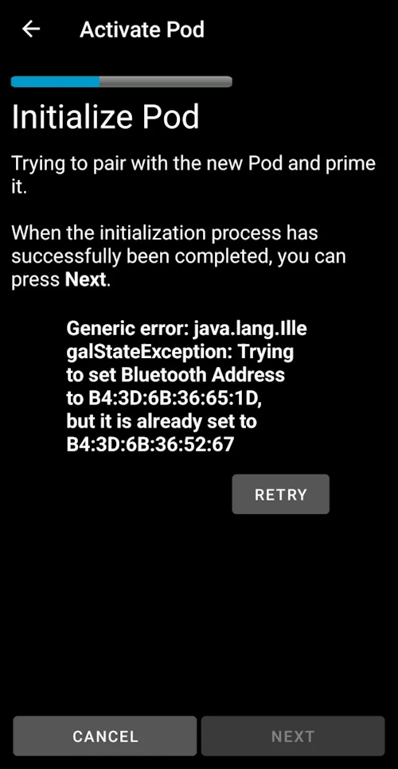

# Omnipod DASH

Tieto pokyny sú na nastavenie pumpy generácie **Omnipod DASH** **(NIE Omnipod Eros)**. Ovládač DASH je overený spôsob, ako používať okruh s Omnipodom.

```{contents} Table of contents
:depth: 1
:local: true
```

## Špecifikácie Omnipod DASH

Hlavné vlastnosti **Omnipod DASH** („DASH“):

- Pody DASH sa poznajú podľa **modrého krytu ihly** (starší Pod EROS má priehľadný kryt ihly). Inak sú Pody z hľadiska fyzických rozmerov rovnaké.
- DASH nepotrebuje BLE prepojovacie zariadenie (bridge) (NIE JE potrebný RileyLink, OrangeLink ani EmaLink).
- Bluetooth spojenie s DASH sa používa iba pri odosielaní príkazu (napr. bolusu) a hneď po odoslaní príkazu sa odpojí.
- **AAPS** počká, kým bude Pod dostupný, a potom odošle príkazy.
- Pri aktivácii Podu **AAPS** nájde nový Pod DASH a pripojí sa k nemu.
- Očakávaný dosah od telefónu: 5–10 metrov (môže sa líšiť).

(omnipod-dash-constraints)=

## Známe obmedzenia/problémy Omnipod DASH v AAPS
- Všeobecne sa odporúča používať **AAPS** na Androide 14 alebo 16. Na Androide 15 komunita nahlásila veľa [problémov](https://github.com/nightscout/AndroidAPS/issues/3471). Ak však používate Android 15, pravdepodobne budete musieť zapnúť **Bluetooth párovanie** (v časti **Rozšírené nastavenia** v [nastaveniach Dash](#omnipod-dash-advanced-settings)), aby ste mohli úspešne aktivovať a používať Pody; viac informácií o nastaveniach párovania nájdete v časti [Riešenie problémov](../GettingHelp/GeneralTroubleshooting.md).
- Zmeny letného času a časového pásma sa neuplatnia automaticky. Po zmene času musíte Pod aktualizovať ručne: na obrazovke pumpy DASH stlačte **Obnoviť** a potom stlačte **Nastaviť čas** (zobrazí sa, keď sa časové pásmo Podu a telefónu líšia) alebo vykonajte **Prepnutie profilu** (pozrite [Zmena časového pásma pre Omnipod Dash](#timezone-traveling-with-pumps)).
- Dash podporuje bazálnu dávku iba v krokoch po 0,05 U/h. Ak sa pokúsite nastaviť bazál s krokmi 0,01 vo svojom **profile AAPS**, AAPS nezobrazí varovanie, hoci Pod zaokrúhli dávku nahor na kroky po 0,05. Ak na obrazovke pumpy DASH otvoríte **História Podu**, zobrazí sa, že bol nastavený bazál 0,05. To tiež znamená, že najnižšia bazálna dávka, ktorú DASH v **AAPS** povolí, je 0,05 U/h.
- Súbor s nastaveniami obsahuje aktívnu reláciu Podu. Po každej aktivácii Podu exportujte nastavenia a pred importom nastavení si prečítajte časť [Export a import nastavení](#omnipod-dash-export-import).
- Pri nastavovaní nového bazálneho profilu DASH pozastaví podávanie pred nastavením nového bazálneho **profilu**. Ak dôjde k prerušeniu komunikácie alebo k chybe, bazálny profil sa automaticky znova nespustí. Podrobnosti nájdete v časti [Obnovenie podávania inzulínu](#omnipod-dash-resuming-insulin-delivery).
- Ak sú výstrahy nastavené a Pod sa blíži ku koncu platnosti, Pod bude pípať, kým výstrahy nestíšite, podrobnosti nájdete v časti [Stíšenie výstrah Podu](#omnipod-dash-silencing-pod-alerts).
- Existuje niekoľko známych problémov s Bluetooth, ktoré môžu spôsobiť problémy pri aktivácii Podu. Známy problém a riešenia týchto problémov nájdete v časti [Problémy súvisiace s Bluetooth](../GettingHelp/BluetoothTroubleshooting.md).

(hardware-software-requirements)=

(omnipod-dash-hardware-software-requirements)=
## Hardvérové a softvérové požiadavky

- Omnipod DASH sa pozná podľa modrého krytu ihly.


- **A Compatible Android phone** with Bluetooth Low Energy (BLE) (see [Phones](../Getting-Started/Phones.md) for more info). In addition, the following information will help guide you on other key considerations around successfully activating and using the DASH on a compatible phone:
    -  Ovládač Omnipod Dash v **AAPS** sa spája s Podom DASH cez Bluetooth.  
      **AAPS** automaticky nadviaže nové Bluetooth spojenie s Podom vždy, keď potrebuje odoslať príkaz (napr. bolus), a po odoslaní príkazu sa Bluetooth spojenie okamžite preruší.
       - **POZNÁMKA:**
         - Bluetooth spojenie môžu prerušiť alebo rušiť iné Bluetooth zariadenia pripojené k telefónu, na ktorom beží **AAPS**, napríklad slúchadlá atď. Takéto zariadenia môžu na niektorých modeloch telefónov spôsobovať chyby pripojenia alebo problémy s aktiváciou Podu. Pri výbere telefónu pre Omnipod DASH sa oplatí pozrieť zoznam [otestovaných hardvérových zostáv](https://docs.google.com/spreadsheets/u/1/d/e/2PACX-1vScCNaIguEZVTVFAgpv1kXHdsHl3fs6xT6RB2Z1CeVJ561AvvqGwxMhlmSHk4J056gMCAQE02sAWJvT/pubhtml?gid=683363241&single=true), kde nájdete overené funkčné konfigurácie.
         - There are a number of known issues with Bluetooth which can cause pod activation problems (See [Troubleshooting](#omnipod-dash-troubleshooting) for advice on other Bluetooth issues) specifically the [Bluetooth related issues](#omnipod-dash-bluetooth-related-issues) section.
    - Telefón musí mať **Android 12 alebo novší** a **AAPS** musí byť zostavený a nainštalovaný podľa pokynov [**Zostavenie AAPS**](../SettingUpAaps/BuildingAaps.md). Vždy používajte najnovšiu vydanú verziu.
- Podporovaný [**systém kontinuálneho monitorovania glukózy (CGM)**](../Getting-Started/CompatiblesCgms.md)

Nasledujúce pokyny vysvetľujú, ako pomocou **AAPS** aktivovať novú reláciu Podu. You should wait for your current Pod to be close to expiry, as you will need to activate a new Pod with **AAPS**. Deaktivovaný Pod sa už nedá znova použiť ani znova aktivovať, deaktivácia je konečná.

## Skôr než začnete

Uistite sa, že ste si prečítali a pochopili celú túto príručku, časť **Skôr než začnete** a tiež časť **[Obmedzenia a problémy Omnipod a AAPS](#omnipod-dash-constraints)**, aby ste sa vyhli známym problémom.

### **BEZPEČNOSŤ NA PRVOM MIESTE** – **NEMALI BY STE** sa pokúšať pripojiť **AAPS** k Podu prvýkrát bez prístupu ku všetkým nasledujúcim veciam:
1. Náhradné Pody (3 alebo viac)
2. Náhradný inzulín a pomôcky na liečbu perom (MDI)
3. Funkčný Omnipod PDM (pre prípad, že **AAPS** zlyhá)
4. Podporovaný telefón je nevyhnutný! (Pozrite [Hardvérové/softvérové požiadavky](#hardware-software-requirements))
5. Správna verzia AAPS zostavená a nainštalovaná

### Po tom, čo ovládač Dash v AAPS aktivuje váš Pod, už váš Omnipod Dash PDM nebude pre tento Pod potrebný.
- Pred používaním **AAPS** ste vy alebo váš opatrovateľ museli ovládať Pod pomocou Omnipod PDM (alebo v niektorých regiónoch pomocou aplikácie v telefóne) a ním posielať príkazy do DASH (napr. bolus).
- DASH dokáže na ovládanie a posielanie príkazov obslúžiť iba jedno pripojené Bluetooth zariadenie (napr. PDM alebo telefón).
- Zariadenie, ktoré Pod úspešne aktivuje, je odvtedy jediné zariadenie, ktoré môže s týmto Podom komunikovať. To znamená, že keď aktivujete DASH vaším telefónom s Androidom pomocou **AAPS**, **s týmto Podom už nebudete môcť používať svoj PDM!** Počas celej doby, keď je Pod aktívny, je ovládač Dash v **AAPS** na vašom telefóne s Androidom novým PDM pre váš Pod.
- **NEVYHADZUJTE svoj PDM!** Odporúčame ho ponechať ako zálohu a pre núdzové situácie, napríklad keď stratíte telefón alebo keď **AAPS** nefunguje správne.

### Váš Pod **NEPRESTANE** podávať inzulín, keď nie je pripojený k AAPS.
Pri aktivácii sa do Podu naprogramujú predvolené bazálne dávky podľa aktuálne aktívneho [**profilu**](../SettingUpAaps/YourAapsProfile.md).  
Pokiaľ **AAPS** funguje, posiela príkazy na úpravu bazálnej dávky, ktoré bežia maximálne 120 minút.  
Ak Pod z nejakého dôvodu nedostane žiadne nové príkazy (napríklad preto, že sa stratila komunikácia kvôli vzdialenosti Pod ➜ telefón), Pod sa automaticky vráti k predvoleným bazálnym dávkam podľa vášho [**profilu**](../SettingUpAaps/YourAapsProfile.md).

### Profily v AAPS nepodporujú 30-minútové časové úseky bazálnej dávky
Ak ste v **AAPS** noví a nastavujete svoj bazálny [**profil**](../SettingUpAaps/YourAapsProfile.md) prvýkrát, majte na pamäti, že bazálne dávky, ktoré začínajú v polhodine, nie sú podporované. Napríklad ak máte na Omnipod PDM bazálnu dávku 1,1 jednotky, ktorá začína o 09:30 a trvá 2 hodiny do 11:30, nie je možné presne zopakovať tento bazálny **profil** v **AAPS**.  
Túto bazálnu dávku 1,1 jednotky budete musieť zmeniť na časový úsek 9:00–11:00 alebo 10:00–12:00. Hoci samotný hardvér DASH podporuje v bazálnom **profile** 30-minútové úseky, **AAPS** túto funkciu NEPODPORUJE.

### Bazálne dávky 0 U/h v profile NIE SÚ v AAPS podporované
Hoci DASH podporuje nulovú bazálnu dávku, **AAPS** používa na určenie automatickej liečby násobky bazálnej dávky z **profilu** používateľa; s nulovou bazálnou dávkou nemôže fungovať.  
Dočasnú nulovú bazálnu dávku namiesto toho dosiahnete funkciou „Odpojiť pumpu“ alebo kombináciou vypnutia okruhu/dočasného bazálu či pozastavenia okruhu/dočasného bazálu.  
**POZNÁMKA:** Najnižšia bazálna dávka, ktorú DASH v **AAPS** povolí, je 0,05 U/h.

## Výber Dash v AAPS

Ovládač Omnipod DASH môžete v **AAPS** vybrať **dvoma** spôsobmi:

### Možnosť 1: Nové inštalácie

Keď inštalujete **AAPS** prvýkrát, **Sprievodca nastavením** vás prevedie hlavnými funkciami a požiadavkami na inštaláciu **AAPS**. Keď sa dostanete ku kroku **Pumpa**, vyberte **Omnipod Dash**.


Ak si ešte nie ste istí, môžete zatiaľ vybrať **Virtuálna pumpa** a **Omnipod Dash** vybrať neskôr, po nastavení **AAPS** (pozrite možnosť 2).

(omnipod-dash-option-2-config-builder)=
### Možnosť 2: Obrazovka Konfigurácia

V existujúcej inštalácii môžete pumpu **Omnipod Dash** vybrať na obrazovke **Konfigurácia**:

1. Otvorte **ponuku** (☰) v ľavom hornom rohu hlavnej obrazovky a vyberte **Konfigurácia**.
2. Ťuknite na **Pumpa** a označte prepínač **Omnipod Dash** (*„Integrácia pumpy pre Omnipod Dash (nový model s funkciou Bluetooth a modrým krytom)“*).

3. Po výbere sa na karte **Omnipod Dash** zobrazia dve tlačidlá:
   - **Nastavenia** otvorí [nastavenia Dash](#omnipod-dash-settings).
   - **Otvoriť plugin** otvorí [obrazovku pumpy DASH](#omnipod-dash-tab).

   

### Overenie výberu ovládača Omnipod

Ak chcete skontrolovať, že je vybraný **Omnipod Dash**, otvorte **Spravovať** (dolná navigácia hlavnej obrazovky) a ťuknite na **Pumpa**. Otvorí sa obrazovka pumpy DASH, ako je zobrazené v nasledujúcej časti.

(omnipod-dash-tab)=

## Obrazovka pumpy DASH

Na obrazovke pumpy DASH spravujete svoje Pody: aktivujete a deaktivujete ich, obnovujete stav Podu, stíšite výstrahy a prezeráte históriu Podu. Otvoríte ju cez **Spravovať** > **Pumpa** alebo tlačidlom **Otvoriť plugin** na karte **Omnipod Dash** v **Konfigurácia** > **Pumpa**.

Takto vyzerá obrazovka bez aktívneho Podu:


A takto vyzerá obrazovka s aktívnym Podom:


Ikona **Nastavenia** (ozubené koliesko) v pravom hornom rohu otvorí [nastavenia Dash](#omnipod-dash-settings).

***POZNÁMKA:** Ak niektoré pole na obrazovke pumpy zobrazuje (neznáme), stlačte **Obnoviť** a aktualizujte stav Podu.*

### Polia

- **Adresa Bluetooth:** Bluetooth adresa Podu.

- **Kvalita pripojenia:** Ako spoľahlivo sa **AAPS** pripája k Podu, zobrazené ako *úspešné pripojenia / všetky pokusy o pripojenie :: úspešnosť*, napríklad `412/420 :: 98.10 %`. Po viac ako 50 úspešných pripojeniach sa hodnota pod 90 % zafarbí nažlto a pod 70 % načerveno. Nízka hodnota naznačuje problém s Bluetooth (pozrite [Problémy súvisiace s Bluetooth](#omnipod-dash-bluetooth-related-issues)).

- **Stav doručenia:** Nespracovaný stav podávania, ktorý hlási Pod. Toto pole sa zobrazuje iba vo vývojárskych (engineering mode) zostaveniach.

- **Jedinečné ID:** Jedinečné ID, ktoré **AAPS** priradil Podu pri aktivácii.

- **Číslo šarže:** Výrobné číslo šarže Podu.

- **Poradové číslo:** Poradové číslo Podu.

- **Verzia firmvéru:** Verzie firmvéru a Bluetooth Podu.

- **Čas na Pode:** Aktuálny čas na Pode aj s jeho časovým pásmom. Text sa zafarbí načerveno, keď sa časové pásmo Podu líši od časového pásma telefónu, a nažlto, keď sa čas Podu líši o viac ako 10 minút.

- **Expirácia Podu:** Dátum a čas, kedy Pod expiruje (72 hodín po aktivácii). Text sa zafarbí nažlto počas posledných 4 hodín pred týmto časom. Nikdy sa nezafarbí načerveno, pretože Pod aj potom ďalej podáva inzulín.

- **Definitívny koniec Podu:** Koniec lehoty Podu (8 hodín po **Expirácia Podu**, teda maximálna životnosť Podu je 80 hodín). Text sa zafarbí nažlto, keď začne lehota (v čase **Expirácia Podu**), a načerveno počas posledných 4 hodín pred definitívnym koncom. Počas lehoty zobrazuje aj zostávajúci čas, napríklad *(zostáva 17 min)*. Na definitívnom konci Pod prestane podávať inzulín a musí sa vymeniť.

- **Stav Podu:** Stav Podu: **Žiadny aktívny Pod**, **Prebieha inštalácia**, **V prevádzke**, **Pozastavené** alebo po chybe Podu **ALARM**.

- **Posledné spojenie:** Ako dávno **AAPS** naposledy komunikoval s Podom.

  - *Pred chvíľou* – pred menej ako 10 sekundami.

  - *Pred menej ako minútou* – pred 10 až 60 sekundami.

  - *pred XX min* – pred viac ako 1 minútou (a po hodine *pred X h a XX min*).

- **Posledný bolus:** Množstvo posledného bolusu odoslaného do Podu a ako dávno bol podaný. Nepotvrdený bolus je označený (neznáme).

- **Základná hodnota bazálu:** Bazálna dávka naprogramovaná pre aktuálny čas vo vašom bazálnom **profile**.

- **Dočasná bazálna dávka:** Dočasný bazál (TBR), ktorý práve beží, s časom začiatku a trvaním. Toto pole sa zobrazuje iba počas behu dočasného bazálu (TBR).

- **Zásobník:** Zobrazuje *Zostáva viac ako 50 U*, keď v zásobníku zostáva viac ako 50 jednotiek. Pod 50 jednotiek sa zobrazuje presné množstvo. Pod 20 jednotiek sa hodnota zafarbí načerveno.

- **Celkovo podané:** Celkové množstvo inzulínu podaného zo zásobníka. Zahŕňa aj inzulín použitý na plnenie.

- **Výstrahy aktívneho Podu:** Výstrahy, ktoré sú na Pode práve aktívne, napríklad *Pod čoskoro expiruje* alebo *Nízka hladina zásobníka*.

- **Chyby:** Chyba Podu, ak Pod zlyhal, zobrazená načerveno ako *Chyba Podu:*, za ktorou nasleduje kód a názov chyby, napríklad *Chyba Podu: 020 ALARM_OCCLUDED*. Minulé chyby a podrobnejšie informácie nájdete v [Histórii Podu](#omnipod-dash-view-pod-history) a v log súboroch. Pozrite [Zlyhania Podu](#omnipod-dash-pod-failures).

- **PDM upozornenie:** Zobrazuje sa iba po chybe Podu. Zobrazuje chybu tak, ako by ju zobrazil Omnipod PDM: nadpis (napríklad *Zistená oklúzia*, *Prázdny zásobník* alebo *Pod expiroval*), čo sa stalo (napríklad *Podávanie inzulínu bolo zastavené. Vymeňte Pod.*) a kód *Ref:*.

### Tlačidlá

Tlačidlá v dolnej časti obrazovky pumpy sa menia podľa stavu Podu. Zobrazujú sa iba tlačidlá, ktoré majú v danej chvíli zmysel.

- **Obnoviť:** Vyžiada si od Podu jeho aktuálny stav.
  - *Použite ho na aktualizáciu stavu Podu a na vymazanie polí, ktoré zobrazujú (neznáme).*
  - *Viac informácií nájdete nižšie v časti [Riešenie problémov](#omnipod-dash-troubleshooting).*

- **Stíšiť alarmy:** Zastaví pípanie výstrah Podu (napríklad pri expirácii Podu alebo nízkej hladine zásobníka). Zobrazuje sa iba vtedy, keď má Pod aktívnu výstrahu. Pozrite [Stíšenie výstrah Podu](#omnipod-dash-silencing-pod-alerts).

- **Obnoviť podávanie:** Obnoví podávanie inzulínu na pozastavenom Pode. Zobrazuje sa iba vtedy, keď je podávanie pozastavené. Pozrite [Obnovenie podávania inzulínu](#omnipod-dash-resuming-insulin-delivery).

- **Nastaviť čas:** Aktualizuje Pod na časové pásmo vášho telefónu tak, že znova odošle váš bazálny **profil**. Zobrazuje sa iba vtedy, keď sa časové pásmo Podu líši od časového pásma vášho telefónu.

- [**Aktivovať Pod**](#omnipod-dash-activate-pod): Naplní a aktivuje nový Pod. Zobrazuje sa, keď nie je aktívny žiadny Pod.

- [**Deaktivovať Pod**](#omnipod-dash-deactivate-pod): Deaktivuje aktívny Pod. Zobrazuje sa hneď, ako je Pod spárovaný s **AAPS**, aj keď sa aktivácia zastavila v polovici (napríklad preto, že Pod počas aktivácie zlyhal). **AAPS** vás pred deaktiváciou Podu požiada o potvrdenie.

- **Prehrať testovacie pípnutie:** Pod raz pípne na skúšku.

- [**História Podu**](#omnipod-dash-view-pod-history): Zobrazuje históriu činností aktívneho Podu.

- **Vyradiť Pod:** Odstráni nedokončený Pod z **AAPS**. Zobrazuje sa iba vtedy, keď sa aktivácia Podu zastavila v polovici. **AAPS** vás požiada o potvrdenie. Po vyradení už **AAPS** nemôže s týmto Podom komunikovať: odstráňte ho z tela.


```{admonition} Older screenshot
:class: note
Snímka obrazovky vyššie je zo staršej verzie **AAPS**, ktorá mala samostatnú ponuku **Správa Podu**. V **AAPS** 4 sú všetky tieto akcie vrátane **Aktivovať Pod**, **Deaktivovať Pod**, **Prehrať testovacie pípnutie** a **História Podu** tlačidlami s textovými popismi priamo na obrazovke pumpy.
```

(omnipod-dash-activate-pod)=

## Aktivovať Pod

1. Otvorte obrazovku pumpy DASH (**Spravovať** > **Pumpa**) a stlačte **Aktivovať Pod**. Otvorí sa sprievodca aktiváciou.

   

   ```{admonition} Older screenshot
   :class: note
   Snímka obrazovky vyššie je zo staršej verzie **AAPS**. V **AAPS** 4 je **Aktivovať Pod** tlačidlo priamo na obrazovke pumpy DASH, nie v ponuke **Správa Podu**.
   ```

   Ak ste v **AAPS** ešte nikdy neaktivovali **profil**, sprievodca najprv zobrazí krok **Vyžaduje sa profil**: vyberte profil, ktorý sa má pri aktivácii použiť, a pokračujte.

2. Zobrazí sa krok **Naplniť Pod**. Naplňte nový Pod dostatočným množstvom inzulínu na 3 dni, **aspoň 80 jednotkami**. Počúvajte, či Pod dvakrát pípne: znamená to, že bolo naplnené minimálne množstvo 80 jednotiek. Plniacu striekačku úplne vyprázdnite, aj keď ste už počuli dve pípnutia. Kryt ihly Podu zatiaľ neodstraňujte.

   ***POZNÁMKA:** Keď počítate množstvo inzulínu potrebné na 3 dni, nezabudnite, že plnenie Podu spotrebuje približne 3–10 jednotiek.*

   

   

   Uistite sa, že nový Pod a telefón s **AAPS** sú blízko seba, a stlačte **Ďalej**.

3. Ak v **AAPS** používate viac ako jeden inzulín, zobrazí sa krok **Zvoliť inzulín**. Zobrazuje **Práve aktívny** inzulín. Ak ste Pod naplnili iným inzulínom, stlačte **Zmeniť** a vyberte ho. Po dokončení aktivácie **AAPS** vykoná s týmto inzulínom **Prepnutie profilu**. Stlačte **Ďalej**.

   

4. V kroku **Inicializovať Pod** sa **AAPS** spáruje s novým Podom a naplní ho. Budete počuť cvaknutie a potom sériu tikavých zvukov, keď sa Pod sám plní. Po úspešnom dokončení sa zobrazí tlačidlo **Ďalej**. Stlačte **Ďalej**.

       

   ***POZNÁMKA**: Ak sa zobrazí chybové hlásenie, napríklad _Skenovanie zlyhalo_ alebo _'Could not find an available pod for activation'_ (môže sa to stať), nepanikárte. Stlačte **Opakovať**. Vo väčšine prípadov potom aktivácia úspešne pokračuje.*

   

   Ak Pod zlyhal (napríklad preto, že bol prekročený čas aktivácie), namiesto **Opakovať** sa zobrazí **Deaktivovať Pod**. Použite ho a začnite znova s novým Podom.

   Ak stlačíte **Zrušiť** pred dokončením aktivácie, **AAPS** vás požiada o potvrdenie, že chcete sprievodcu ukončiť. Stlačením **OK** sprievodcu opustíte, stlačením **Zrušiť** v ňom zostanete.

   

5. Ak v **AAPS** spravujete striedanie miest vpichu pumpy (**Spravovať rotáciu umiestnenia pumpy** v nastaveniach [Striedanie miest](#Aapsscreens-site-rotation)), zobrazí sa krok **Miesto aplikácie**. Na schéme tela vyberte, kam umiestnite Pod, a stlačte **Ďalej**, alebo stlačte **Preskočiť**.

   

6. Potom pripravte miesto vpichu pre nový Pod. Umyte si ruky, aby ste predišli riziku infekcie. Miesto vpichu očistite mydlom a vodou alebo alkoholovým tampónom a pred pokračovaním nechajte pokožku úplne uschnúť na vzduchu. Ak vám lepidlo dráždi pokožku, zvážte použitie ochranného tampónu alebo ochranného spreja.

   V kroku **Nasaďte Pod** odstráňte z Podu modrý plastový kryt ihly. Ak z Podu vyčnieva kanyla alebo čokoľvek iné, alebo Pod vyzerá nezvyčajne, **ZASTAVTE**: stlačte **Zrušiť** a začnite znova s novým Podom. Ak všetko vyzerá **v poriadku**, odstráňte z lepidla biely papierový kryt a nalepte Pod na zvolené miesto na tele.

   Po dokončení stlačte **Ďalej**.

   

7. Zobrazí sa potvrdzovací dialóg: *Keď stlačíte OK, kanyla sa vloží.* **Stlačte OK IBA vtedy, keď ste pripravení na vloženie kanyly!**

   

8. V kroku **Vložiť kanylu** **AAPS** nastaví váš plán bazálu a Pod vloží kanylu. Môže to chvíľu trvať (maximálne 1–2 minúty). **Buďte trpezliví!**

   ***POZNÁMKA:** Pred vložením kanyly je dobré zovrieť kožu v blízkosti miesta vloženia kanyly. Ihla tak vnikne hladko a znižuje sa riziko oklúzií (upchatí).*

       

9. Keď je kanyla úspešne vložená, zobrazí sa tlačidlo **Ďalej**. Stlačte **Ďalej**.

   

10. Zobrazí sa krok **Pod aktivovaný**. Skontrolujte, či bola kanyla vložená správne, a ak si myslíte, že nie, Pod vymeňte.

    Stlačte **Dokončiť**.

    Gratulujeme! Teraz ste spustili novú reláciu Podu.

    

11. Ste späť na obrazovke pumpy DASH. Teraz zobrazuje informácie o vašom aktívnom Pode vrátane aktuálnej bazálnej dávky, hladiny v zásobníku, podaného inzulínu, chýb Podu a výstrah. **Aktivovať Pod** sa nahradí tlačidlom **Deaktivovať Pod**: ďalší Pod nemôžete aktivovať bez toho, aby ste najprv deaktivovali aktívny Pod.

    ***POZNÁMKA:** Viac podrobností o zobrazených informáciách nájdete v časti [Obrazovka pumpy DASH](#omnipod-dash-tab).*

    

    ***POZNÁMKA:** Odporúčame exportovať nastavenia AŽ PO aktivácii Podu. Nastavenia exportujte po každej výmene Podu a raz mesačne. Exportovaný súbor s nastaveniami skopírujte do cloudového úložiska (napríklad Disk Google) alebo inam mimo telefónu pre prípad, že telefón stratíte (pozrite [**Exportovať nastavenia**](../Maintenance/ExportImportSettings.md)).*

Ak sa predchádzajúca aktivácia zastavila po naplnení Podu, stlačením **Aktivovať Pod** pokračujete od kroku **Nasaďte Pod**.

(omnipod-dash-deactivate-pod)=

## Deaktivovať Pod

Za normálnych okolností Pod vydrží tri dni (72 hodín) plus lehotu 8 hodín po varovaní o expirácii Podu: spolu 80 hodín.

Deaktivácia Podu (či už preto, že expiroval, alebo preto, že zlyhal):

1. Otvorte obrazovku pumpy DASH (**Spravovať** > **Pumpa**) a stlačte **Deaktivovať Pod**.

   

2. V kroku **Deaktivovať Pod** stlačte **Ďalej**. Dialóg sa spýta: *Deaktivovaný Pod už nie je možné znova použiť. Chcete teraz deaktivovať tento Pod?* Stlačením **OK** spustíte deaktiváciu Podu, stlačením **Zrušiť** si ho ponecháte. Deaktivácia zastaví všetko podávanie inzulínu a nedá sa vrátiť späť.

   

3. Krok **Deaktivácia Podu** sa zobrazuje, kým **AAPS** deaktivuje Pod. Pod pípne na potvrdenie, že deaktivácia bola úspešná.

   

   ```{admonition} Older screenshot
   :class: note
   Snímka obrazovky vyššie je zo staršej verzie **AAPS**. V **AAPS** 4 sprievodca zobrazuje svoj priebeh ako rad bodiek v hornej časti namiesto ukazovateľa priebehu.
   ```

   Po úspešnom dokončení deaktivácie sa zobrazí tlačidlo **Ďalej**. Stlačte **Ďalej**.

   

   Ak deaktivácia zlyhá, zobrazí sa chybové hlásenie a tlačidlo **Vyradiť Pod**. Skôr než ho použijete, prečítajte si nižšie časť [Vyradenie Podu](#omnipod-dash-discard-pod). Môžete tiež stlačiť **Zrušiť** a skúsiť **Deaktivovať Pod** znova neskôr.

4. Zobrazí sa krok **Pod deaktivovaný**. Odstráňte Pod z tela a stlačte **Dokončiť**.

   

5. Ste späť na obrazovke pumpy DASH. Skontrolujte, či pole **Stav Podu** zobrazuje **Žiadny aktívny Pod** a či sa znova zobrazuje tlačidlo **Aktivovať Pod**.

   

(omnipod-dash-discard-pod)=

### Vyradenie Podu

Pod vyraďte iba vtedy, keď všetka komunikácia s ním opakovane zlyháva. Ak **AAPS** stále dokáže s Podom komunikovať, použite namiesto toho **Deaktivovať Pod**.

- **AAPS** vás pred vyradením Podu požiada o potvrdenie.
- Potom už **AAPS** nemôže s týmto Podom komunikovať.
- **Podávanie inzulínu NEBOLO pozastavené**, pretože Pod nebol riadne deaktivovaný. **Odstráňte Pod z tela!**
- Krok **Pod vyradený** potvrdzuje, že stav Podu bol vyradený. Stlačte **Dokončiť**. Teraz môžete aktivovať nový Pod.

(omnipod-dash-resuming-insulin-delivery)=

## Obnovenie podávania inzulínu

**POZNÁMKA**: Počas **Prepnutí profilu** musí **AAPS**, rovnako ako pri používaní PDM, pozastaviť podávanie na Pode pred nastavením nového bazálneho **profilu**. Ak medzi príkazmi na pozastavenie a obnovenie zlyhá komunikácia, podávanie môže zostať pozastavené. Viac podrobností nájdete v časti [**Podávanie pozastavené**](#omnipod-dash-delivery-suspended) v riešení problémov.

Keď je podávanie inzulínu pozastavené, musíte Podu povedať, aby podávanie inzulínu obnovil. Keď je príkaz úspešne spracovaný, Pod znova podáva inzulín podľa bazálnej dávky pre aktuálny čas z vášho aktívneho bazálneho **profilu**. Pod znova prijíma príkazy na bolus, **TBR** a **SMB**.

1. Otvorte obrazovku pumpy DASH a skontrolujte, či pole **Stav Podu** zobrazuje **Pozastavené**. Stlačením **Obnoviť podávanie** poviete Podu, aby obnovil normálne podávanie inzulínu.

   

2. Keď bol príkaz úspešný, pole **Stav Podu** zobrazuje **V prevádzke** a tlačidlo **Obnoviť podávanie** zmizne.

   

   

   ```{admonition} Older screenshot
   :class: note
   Snímky obrazovky vyššie sú zo staršej verzie **AAPS**, ktorá zobrazovala potvrdzovací dialóg. V **AAPS** 4 výsledok overíte na obrazovke pumpy DASH: pole **Stav Podu** zobrazuje **V prevádzke** a tlačidlo **Obnoviť podávanie** zmizlo.
   ```

   Ak príkaz zlyhá, **AAPS** zobrazí varovný dialóg, ktorý začína textom *Podávanie inzulínu sa nepodarilo spustiť*. Stlačte **Obnoviť** a skúste to znova.

   

(omnipod-dash-silencing-pod-alerts)=

## Stíšenie výstrah Podu

Táto časť vysvetľuje, ako zastaviť pípanie Podu, keď sa Pod blíži ku koncu svojej životnosti. Kedy toto pípanie začne, závisí od nastavení **Výstrahy** (pozrite [Nastavenia Dash](#omnipod-dash-settings)):

- **Pripomenutie v hodinách pred vypršaním platnosti (72 hodín):** koľko hodín pred 72-hodinovou expiráciou začne Pod pípať.
- **Upozornenie v hodinách pred vypnutím (80 hodín):** koľko hodín pred 80-hodinovým vypnutím Pod pípne znova.

Maximálna životnosť Podu je 80 hodín (3 dni a 8 hodín). Výrobca Podu však odporúča nepoužívať ho dlhšie ako 72 hodín (3 dni).

***POZNÁMKA**: Tlačidlo **Stíšiť alarmy** sa na obrazovke pumpy DASH zobrazuje iba vtedy, keď má Pod aktívnu výstrahu, napríklad pri expirácii Podu alebo nízkej hladine zásobníka. Ak sa tlačidlo **Stíšiť alarmy** nezobrazuje, ale počujete pípanie Podu, stlačte **Obnoviť**.*

1. Keď nastane čas pripomenutia, Pod pípne, aby vás upozornil, že čoskoro expiruje a že ho musíte vymeniť. Na obrazovke pumpy DASH pole **Expirácia Podu (1)** zobrazuje presný čas, kedy Pod expiruje (72 hodín po aktivácii). Text sa 4 hodiny pred týmto časom zafarbí nažlto. Potom sa pole **Definitívny koniec Podu** zafarbí nažlto a zobrazuje čas, ktorý zostáva do chvíle, keď Pod prestane podávať inzulín. Pole **Výstrahy aktívneho Podu (2)** zobrazuje **Pod čoskoro expiruje** a zobrazí sa tlačidlo **Stíšiť alarmy (3)**.

   

2. Stlačte **Stíšiť alarmy**. **AAPS** odošle Podu príkaz na zastavenie pípania pri expirácii.

   

   ```{admonition} Older screenshot
   :class: note
   Snímka obrazovky vyššie je zo staršej verzie **AAPS**, kde bola táto obrazovka kartou **DASH**. V **AAPS** 4 je tlačidlo **Stíšiť alarmy** na obrazovke pumpy DASH (**Spravovať** > **Pumpa**).
   ```

3. Keď sú výstrahy stíšené, výstraha sa už nezobrazuje v poli **Výstrahy aktívneho Podu**, tlačidlo **Stíšiť alarmy** zmizne a Pod prestane pípať kvôli expirácii.

   

   ```{admonition} Older screenshot
   :class: note
   Snímka obrazovky vyššie je zo staršej verzie **AAPS**, ktorá zobrazovala potvrdzovací dialóg. V **AAPS** 4 výsledok overíte na obrazovke pumpy DASH: výstraha zmizla z poľa **Výstrahy aktívneho Podu**.
   ```

   Ak príkaz zlyhá, **AAPS** zobrazí varovný dialóg, ktorý začína textom *Nepodarilo sa potvrdiť výstrahy*. Stlačte **Obnoviť** a skúste to znova.

Výstraha nízkej hladiny zásobníka funguje rovnako. Keď množstvo inzulínu v Pode klesne na hodnotu **Počet jednotiek** nastavenú v nastaveniach **Výstrahy**, Pod pípne. Pole **Zásobník** zobrazuje zostávajúce množstvo, pole **Výstrahy aktívneho Podu** zobrazuje **Nízka hladina zásobníka** a zobrazí sa tlačidlo **Stíšiť alarmy**. Stlačením **Stíšiť alarmy** zastavíte pípanie; naplánujte si ďalšiu výmenu Podu.


(omnipod-dash-view-pod-history)=

## Zobrazenie histórie Podu

Táto časť vysvetľuje, ako si prezrieť históriu aktívneho Podu a filtrovať ju podľa typu akcie. História Podu zobrazuje príkazy odoslané do aktívneho Podu a ich výsledky počas jeho trojdňovej (72–80 hodín) životnosti.

Je užitočná na kontrolu bolusov, dočasných bazálov (TBR) a bazálnych príkazov odoslaných do Podu. Ostatné kategórie pomáhajú pri riešení problémov a ukazujú poradie udalostí, ktoré viedli k zlyhaniu.

**NOTE:** **Only the last command can be uncertain**. New commands *are not sent* until the **last 'uncertain' command becomes 'confirmed' or 'denied'**. To 'fix' an uncertain command, press **Refresh** on the DASH pump screen.

1. Otvorte obrazovku pumpy DASH a stlačte **História Podu**.

   

   ```{admonition} Older screenshot
   :class: note
   Snímka obrazovky vyššie je zo staršej verzie **AAPS**. V **AAPS** 4 je **História Podu** tlačidlo priamo na obrazovke pumpy DASH, nie v ponuke **Správa Podu**.
   ```

2. Obrazovka **História Podu** sa otvorí s vybraným filtrom **Všetko**. Zobrazuje každý príkaz s jeho časom a výsledkom, od najnovšieho, zoskupené podľa dní. Pomocou tlačidiel filtra v hornej časti (napríklad **Bolusy** alebo **Bazály**) zobrazíte iba jeden typ príkazu. Stlačením šípky späť sa vrátite na obrazovku pumpy DASH.

    

   ```{admonition} Older screenshot
   :class: note
   Druhá snímka obrazovky vyššie je zo staršej verzie **AAPS**, kde sa typ príkazu vyberal zo zoznamu **Typ**. V **AAPS** 4 používate tlačidlá filtra zobrazené na prvej snímke obrazovky.
   ```

   Pri bolusoch nasleduje za množstvom typ bolusu, ak nejde o normálny bolus, napríklad *0,05 U (SMB)* alebo *0,05 U (Korekcia bazálu)*. Korekcia bazálu je veľmi malý bolus (jeden pulz Podu, 0,05 U), ktorý ovládač odošle sám; vy ste oň nežiadali.

   ```{admonition} Why basal corrections happen
   :class: note
   Pod podáva bazálny inzulín v pulzoch po 0,05 U, ktoré časujú vnútorné hodiny. Pri každej zmene bazálnej dávky (napríklad keď okruh nastaví nový dočasný bazál (**TBR**)) Pod tieto hodiny reštartuje a pulz, ku ktorému práve smeroval, sa stratí. Keďže okruh mení bazálnu dávku často, najmä cez noc, Pod môže nakoniec podať menej bazálneho inzulínu, ako sa očakávalo.

   **AAPS** porovnáva bazálny inzulín, ktorý Pod hlási ako podaný, s tým, čo mal podať. Keď chýbajúce množstvo dosiahne polovicu pulzu alebo viac, ovládač podá jeden pulz navyše ako korekciu bazálu, takže stále dostanete bazálny inzulín, ktorý si vyžiadal váš profil a okruh. Počas pozastavenia Podu ani počas nulového dočasného bazálu (**TBR**) sa žiadna korekcia neodosiela.
   ```

(omnipod-dash-settings)=

## Nastavenia Dash

Nastavenia ovládača Dash môžete otvoriť dvoma spôsobmi:

- Stlačte ikonu **Nastavenia** (ozubené koliesko) v pravom hornom rohu [obrazovky pumpy DASH](#omnipod-dash-tab).
- Otvorte **ponuku** (☰) v ľavom hornom rohu hlavnej obrazovky a vyberte **Konfigurácia** > **Pumpa**. Na karte **Omnipod Dash** stlačte **Nastavenia**.

Nastavenia sú rozdelené do štyroch rozbaľovacích častí: **Potvrdzovacie pípnutia**, **Výstrahy**, **Notifikácie** a **Rozšírené nastavenia**. Ťuknutím na časť ju otvoríte:


Väčšina nastavení sú prepínače zapnuté/vypnuté.

### Potvrdzovacie pípnutia


Potvrdzovacie pípnutia Podu pri podaní a zmenách bolusu, bazálu, SMB a TBR.

**Pípnutie pri boluse povolené:**    Pod pípne, keď sa podá bolus. Predvolene zapnuté.

**Pípnutie pri bazále povolené:**    Pod pípne, keď sa nastaví nová bazálna dávka alebo keď sa aktívna bazálna dávka zruší či zmení. Predvolene vypnuté.

**Pípnutie pri SMB povolené:**  Pod pípne, keď sa podá SMB. Predvolene zapnuté.

**Pípnutie pri TBR povolené:**  Pod pípne, keď sa nastaví alebo zruší dočasný bazál (TBR). Predvolene vypnuté.

### Výstrahy


```{admonition} Older screenshot
:class: note
Snímka obrazovky vyššie je zo staršej verzie **AAPS**. V **AAPS** 4 sú tieto nastavenia v rozbaľovacej časti **Výstrahy**.
```

Výstrahy Podu pri expirácii, vypnutí a nízkej hladine zásobníka. Keď tieto nastavenia zmeníte počas aktívneho Podu, **AAPS** odošle nové nastavenia výstrah do Podu.

***POZNÁMKA:** Notifikácia **AAPS** sa pri každej výstrahe zobrazí VŽDY, keď **AAPS** po spustení výstrahy komunikuje s Podom. Zatvorenie notifikácie NEZASTAVÍ výstrahu Podu. Ak chcete výstrahu zastaviť, otvorte obrazovku pumpy DASH a stlačte **Stíšiť alarmy**.*

**Pripomenutie vypršania platnosti povolené:**    Keď je zapnuté, Pod pípne, keď nastane čas pripomenutia. Predvolene zapnuté.

**Pripomenutie v hodinách pred vypršaním platnosti (72 hodín):** Koľko hodín pred 72-hodinovou expiráciou Podu začne pripomenutie (1 až 24 hodín; predvolene 4).

**Upozornenie na vypršanie platnosti povolené:**   Keď je zapnuté, Pod pípne, keď nastane čas upozornenia, a znova 1 hodinu pred vypnutím. Predvolene zapnuté.

**Upozornenie v hodinách pred vypnutím (80 hodín):**  Koľko hodín pred 80-hodinovým vypnutím Podu začne upozornenie (1 až 8 hodín; predvolene 8).

**Upozornenie na nízky stav zásobníka povolené:**    Pod vás upozorní, keď množstvo inzulínu v zásobníku klesne na hodnotu v **Počet jednotiek**. Predvolene zapnuté.

**Počet jednotiek:**    Počet jednotiek, pri ktorom sa spustí výstraha nízkej hladiny zásobníka (5 až 50 jednotiek; predvolene 20).

### Notifikácie


Zvoľte, či má **AAPS** pri svojich notifikáciách prehrať zvuk, keď si nie je istý, či bol podaný TBR, SMB alebo bolus, a keď je podávanie pozastavené.

***POZNÁMKA:** Ide iba o notifikácie v telefóne; samotný Pod nepípa.*

**Zvuk upozornenia pre neistý dočasný bazál povolený:**  Prehrá zvuk s notifikáciou, keď si **AAPS** nie je istý, či bol nastavený TBR.

**Zvuk upozornenia pre neistý SMB povolený:**  Prehrá zvuk s notifikáciou, keď si **AAPS** nie je istý, či bol podaný SMB.

**Zvuk upozornenia pre neistý bolus povolený:**    Prehrá zvuk s notifikáciou, keď si **AAPS** nie je istý, či bol podaný bolus.

**Zvuk oznámenia pri pozastavenom podávaní povolený:**     Prehrá zvuk s notifikáciou, keď je podávanie inzulínu pozastavené.

(omnipod-dash-advanced-settings)=

### Rozšírené nastavenia


**Bluetooth párovanie:**  Spáruje Pod s telefónom cez Bluetooth (bonding). Skúste ho iba vtedy, keď Pod nedokáže udržať stabilné pripojenie, napríklad na Androide 15 (pozrite [Známe obmedzenia/problémy Omnipod DASH v AAPS](#omnipod-dash-constraints)). Keď je zapnuté, telefón zobrazuje žiadosti o párovanie, ktoré musíte prijať. Ak sa Pod pripája bez problémov, nechajte ho vypnuté. Na verziách nižších ako Android 15 nemá žiadny účinok. Predvolene vypnuté.

## Vek inzulínu a kanyly

[Riadok stavu](#screens-sensor-level-battery) na hlavnej obrazovke zobrazuje vek vášho inzulínu a kanyly. Pri Omnipode to funguje trochu inak ako pri pumpách s hadičkou.

**AAPS** pri každej aktivácii Podu automaticky zaznamená výmenu kanyly a výmenu inzulínu. Tým sa vek **Inzulín** a **Kanyla** po každej výmene Podu vynuluje. Nemusíte ich zaznamenávať sami cez **Plnenie/doplňovanie**. Je to preto, že Pod zavádza kanylu priamo do kože v mieste, kde je nalepený: Omnipod nepoužíva hadičku.

Vek **Batéria pumpy** sa nezobrazuje: batéria aj zásobník inzulínu sú zabudované v každom Pode a batéria vždy vydrží dlhšie ako samotný Pod (maximálne 80 hodín).


```{admonition} Older screenshot
:class: note
Snímka obrazovky vyššie je zo staršej verzie **AAPS**, kde sa tieto veky zobrazovali v sekcii **Starostlivosť** na karte **Akcie**. V **AAPS** 4 sa zobrazujú v riadku stavu na hlavnej obrazovke.
```

### Úroveň

**Hladina inzulínu**

Zobrazená hladina inzulínu je množstvo, ktoré hlási Pod. Pod však hlási skutočnú hladinu v zásobníku až vtedy, keď je pod 50 jednotkami. Dovtedy sa zobrazuje *Zostáva viac ako 50 U*. Hlásené množstvo nie je presné: keď Pod hlási „prázdny“, vo väčšine prípadov v zásobníku ešte zostáva niekoľko jednotiek inzulínu.

Obrazovka pumpy DASH zobrazuje hladinu takto:

  * **Zostáva viac ako 50 U** – Pod hlási v zásobníku viac ako 50 jednotiek.
  * **Pod 50 jednotiek** – Presné množstvo inzulínu zostávajúce v zásobníku, ako ho hlási Pod.

Ďalšia poznámka:
  * **SMS** – V odpovediach SMS vracia hodnotu, alebo 50+U, keď je to viac ako 50 jednotiek.
  * **Nightscout** – Do Nightscoutu nahráva hodnotu 50, keď je to viac ako 50 jednotiek (verzia 14.07 a staršie). Novšie verzie hlásia hodnotu 50+, keď je to viac ako 50 jednotiek.

(omnipod-dash-troubleshooting)=

## Riešenie problémov

Táto časť popisuje bežné známe problémy a ich riešenia pri používaní Omnipod DASH s AAPS. V dokumentácii je aj časť [Riešenie problémov](../GettingHelp/GeneralTroubleshooting.md), ktorú by ste si mali prečítať, pretože pokrýva aj témy dôležité pre niektoré problémy s Podom.

---

(omnipod-dash-bluetooth-related-issues)=

## Problémy súvisiace s Bluetooth

Známe problémy s Bluetooth spojením, výpadky pumpy/Podov alebo problémy s aktiváciou a pripojením: [Problémy súvisiace s Bluetooth](../GettingHelp/BluetoothTroubleshooting.md)

---

(omnipod-dash-delivery-suspended)=

### Podávanie pozastavené

  - Tlačidlo pozastavenia už neexistuje. Ak chcete Pod „pozastaviť“, môžete na x minút nastaviť nulový dočasný bazál (**TBR**).
  - Počas **Prepnutí profilu** musí DASH pozastaviť podávanie pred nastavením nového bazálneho **profilu**. Ak medzi týmito dvoma príkazmi zlyhá komunikácia, podávanie môže zostať pozastavené. Keď sa to stane:
     - Nebude sa podávať žiadny inzulín, teda ani bazál, SMB, ručné bolusy atď.
     - Môže sa zobraziť notifikácia, že jeden z príkazov nie je potvrdený: závisí to od toho, kedy k zlyhaniu došlo.
     - **AAPS** sa bude pokúšať nastaviť nový bazálny profil každých 15 minút.
     - **AAPS** bude každých 15 minút zobrazovať notifikáciu o pozastavenom podávaní, ak je podávanie stále pozastavené (obnovenie podávania zlyhalo).
     - Tlačidlo [**Obnoviť podávanie**](#omnipod-dash-resuming-insulin-delivery) sa zobrazuje na obrazovke pumpy DASH, ak chcete podávanie obnoviť ručne.
     - Ak **AAPS** nedokáže obnoviť podávanie sám (stane sa to, ak je Pod nedostupný, zvuk je stlmený atď.), Pod začne pípať 4-krát každú minútu počas 3 minút a potom sa to opakuje každých 15 minút, ak je podávanie stále pozastavené dlhšie ako 20 minút.
  - Pri nepotvrdených príkazoch stlačte **Obnoviť** na obrazovke pumpy DASH, aby sa potvrdili alebo zamietli.

*****POZNÁMKA:** Keď počujete pípanie Podu, nepredpokladajte bez kontroly telefónu, že podávanie bude pokračovať, podávanie môže zostať pozastavené, ***takže to musíte skontrolovať!******

---
(omnipod-dash-pod-failures)=

### Zlyhania Podu

- Pody občas zlyhajú z rôznych dôvodov, vrátane hardvérových problémov samotného Podu.
- Odporúčame neotvárať u spoločnosti Insulet žiadosti o podporu ani o výmenu, pretože AAPS nie je schválený spôsob používania Podov.
- Zoznam chybových kódov [**nájdete tu**](https://github.com/openaps/openomni/wiki/Fault-event-codes), pomôže vám určiť príčinu.

Keď Pod zlyhá, prestane podávať inzulín a nepretržite pípa. **AAPS** zobrazí na hlavnej obrazovke notifikáciu s kódom a názvom chyby a s kódom *Ref:*, napríklad *Chyba Podu: 020 ALARM_OCCLUDED*. Stlačením **Zatvoriť** notifikáciu zatvoríte. Pípanie Podu sa tým nezastaví.


Na obrazovke pumpy DASH pole **Stav Podu** zobrazuje **ALARM**, pole **Chyby** zobrazuje chybu Podu a pole **PDM upozornenie** ju vysvetľuje, napríklad *Zistená oklúzia. Podávanie inzulínu bolo zastavené. Vymeňte Pod. Skontrolujte si glykémiu*.


Zlyhaný Pod sa už nedá znova použiť. Skontrolujte si glykémiu, potom [deaktivujte Pod](#omnipod-dash-deactivate-pod) a aktivujte nový.

---
### Predchádzanie chybám Podu 49

Toto zlyhanie súvisí s nesprávnym stavom Podu pre daný príkaz alebo s chybou počas príkazu na podanie inzulínu. Stane sa to vtedy, keď sa ovládač a Pod nezhodujú v tom, aký je skutočný stav. Pod (ako vstavané bezpečnostné opatrenie) potom zareaguje neopraviteľným chybovým kódom 49 (0x31) a skončí ako takzvaný „screamer“: dlhé otravné pípanie, ktoré sa dá zastaviť iba prepichnutím otvoru na správnom mieste na zadnej strane Podu. Presný pôvod „chyby Podu 49“ je často ťažké zistiť. It can happen, for example, after application crashes, when running a development version or after a re-installation.

---

### Výstrahy „Pumpa nedostupná“

Keď sa s Podom počas vopred nastaveného času nepodarí nadviazať spojenie, zobrazí sa výstraha „Pumpa nedostupná“. Výstrahy „Pumpa nedostupná“ môžete nastaviť stlačením ikony **Nastavenia** (ozubené koliesko) vpravo hore na hlavnej obrazovke a výberom **Lokálne výstrahy** ➜ **Prah nedostupnosti pumpy**. Odporúčaná hodnota je upozornenie po **120** minútach.

---
(omnipod-dash-export-import)=
### Export a import nastavení

Export nastavení **AAPS** vám umožní obnoviť všetky nastavenia a ciele, napríklad po preinštalovaní **AAPS** alebo na novom telefóne. **Exportujte nastavenia hneď po každej aktivácii Podu** a súbor skopírujte na bezpečné miesto mimo telefónu (napríklad Disk Google), aby sa dal obnoviť aj aktívny Pod. Pozrite [Vytváranie a obnova záloh](#ExportImportSettings-Settings-Export).

```{admonition} Importing settings can end your active Pod
:class: warning
Na telefóne, ktorý už Pod ovláda, nechajte **Nahradiť aj nastavenia pumpy** nezačiarknuté: relácia Podu sa zachová a importujú sa iba ostatné nastavenia. Začiarknite ho iba na novom telefóne so súborom exportovaným počas Podu, ktorý máte práve nasadený. Pozrite [Pumpy bez hadičky](#ExportImportSettings-tubeless-pumps).
```

Ak importované nastavenia obsahujú Pod, ktorý už nie je aktívny, pozrite nasledujúcu časť.

---
### Import nastavení, ktoré obsahujú stav neaktívneho Podu

Pri importe nastavení, ktoré obsahujú údaje Podu, ktorý už nie je aktívny, sa AAPS pokúsi s ním spojiť, čo samozrejme zlyhá. V tejto situácii nemôžete aktivovať nový Pod.

Odstránenie starej relácie Podu:
1. Na obrazovke pumpy DASH stlačte **Deaktivovať Pod**. Deaktivácia najpravdepodobnejšie zlyhá.
2. Keď zlyhá, stlačte **Vyradiť Pod** a potvrďte (pozrite [Vyradenie Podu](#omnipod-dash-discard-pod)).
3. Keď je starý Pod odstránený, môžete aktivovať nový Pod.

### Generic error: java.lang.IllegalStateException: Trying to set a Bluetooth Address to ***, but it is already set to ***.

Ak sa vám táto chyba zobrazí pri pokuse o inicializáciu nového Podu, **AAPS** zlyhá, pretože má v konfigurácii stále uložené nastavenia starého Podu.



Môže sa to stať, ak obnovujete nastavenia zo zálohy alebo ak zlyhá deaktivácia Podu.

Ak to chcete vyriešiť, stlačením **Zrušiť** opustite aktiváciu. Na obrazovke pumpy DASH stlačte **Vyradiť Pod**, ak sa zobrazuje. V opačnom prípade stlačte **Deaktivovať Pod** a keď deaktivácia zlyhá, stlačte **Vyradiť Pod** (pozrite [Vyradenie Podu](#omnipod-dash-discard-pod)).

Teraz by ste mali byť schopní aktivovať nový Pod.

---
### Preinštalovanie AAPS

Pri odinštalovaní **AAPS** stratíte všetky nastavenia, ciele a aktuálnu reláciu Podu. **Aby ste ich mohli obnoviť, uistite sa, že máte k dispozícii nedávno exportovaný súbor s nastaveniami!**

Počas aktívneho Podu použite export vytvorený počas aktuálnej relácie Podu (pozrite [Export a import nastavení](#omnipod-dash-export-import)).

1. Exportujte nastavenia a kópiu uložte na bezpečné miesto (napr. Disk Google).
2. Odinštalujte **AAPS** a reštartujte telefón.
3. Nainštalujte novú verziu **AAPS**.
4. Importujte svoje nastavenia.
5. Skontrolujte všetky nastavenia (prípadne znova importujte nastavenia).
6. Aktivujte nový Pod.
7. Po dokončení: exportujte aktuálne nastavenia.

---
### Aktualizácia AAPS na novšiu verziu

Vo väčšine prípadov nie je potrebné aplikáciu odinštalovať. Môžete vykonať inštaláciu „na mieste“ (in-place) tak, že spustíte inštaláciu novej verzie. Je to možné aj počas aktívnej relácie Podu.

1. Exportujte svoje nastavenia.
2. Nainštalujte novú verziu **AAPS**.
3. Overte, že inštalácia bola úspešná
4. Obnovte podávanie Podu (OBNOVIŤ) alebo aktivujte nový Pod.
5. Po dokončení: exportujte aktuálne nastavenia.

---
### Výstrahy ovládača Omnipod

Ovládač Omnipod Dash zobrazuje na **hlavnej obrazovke** rôzne jedinečné výstrahy; väčšina z nich je informačných a dajú sa zatvoriť, niektoré však od používateľa vyžadujú akciu, aby sa odstránila príčina spustenej výstrahy.

Prehľad hlavných výstrah, s ktorými sa môžete stretnúť, je uvedený nižšie:

- *Chyba Podu: XXX NÁZOV*, za ktorou nasleduje *Ref: ...*: Pod zlyhal a prestal podávať inzulín. Vymeňte Pod. Pozrite [Zlyhania Podu](#omnipod-dash-pod-failures).
- *Žiadny aktívny Pod*: nenašla sa žiadna relácia Podu. Táto notifikácia sa bude znova zobrazovať, kým neaktivujete nový Pod. Po aktivácii Podu automaticky zmizne.
- *Podávanie inzulínu je pozastavené*: Pod pozastavil podávanie inzulínu. Pozrite [Obnovenie podávania inzulínu](#omnipod-dash-resuming-insulin-delivery).
- *Nastavenie bazálneho profilu pravdepodobne zlyhalo. Podávanie môže byť pozastavené! Please manually refresh the Pod status on the pump screen and resume delivery if needed.* Setting the basal **Profile** on the pod may have failed. Press **Refresh** on the DASH pump screen, and press **Resume Delivery** if it is shown.
- *Unable to verify whether SMB (X U) succeeded. Na potvrdenie alebo zamietnutie tohto príkazu aktualizujte stav Podu.* **AAPS** nedokázal potvrdiť, že bol podaný **SMB**. Na obrazovke pumpy DASH stlačte **Obnoviť** a skontrolujte pole **Posledný bolus**.
- *Stav podávania inzulínu je neurčitý. Na potvrdenie alebo zamietnutie aktualizujte stav Podu.* Rovnako pri normálnom boluse: stlačte **Obnoviť** na obrazovke pumpy DASH.
- *Časové pásmo Podu je iné ako časové pásmo telefónu. Bazálna dávka je nesprávna. Pre nápravu prepnite profil* Pozrite poznámku o letnom čase a časovom pásme v časti [Známe obmedzenia/problémy Omnipod DASH v AAPS](#omnipod-dash-constraints).

(omnipod-dash-where-to-get-help-for-dash)=

## Kde získať pomoc

Všetku vývojársku prácu na DASH robí komunita **dobrovoľne**; majte to na pamäti a pred žiadosťou o pomoc postupujte podľa týchto pokynov:

-  **Úroveň 0:** Prečítajte si príslušnú časť tejto dokumentácie, aby ste pochopili, ako má funkcia, s ktorou máte problém, fungovať.
-  **Úroveň 1:** Ak máte stále problémy, ktoré nedokážete vyriešiť pomocou tohto dokumentu, prejdite na kanál *#AAPS* na **Discorde** pomocou [tohto pozývacieho odkazu](https://discord.gg/4fQUWHZ4Mw). Pýtať sa môžete aj v mnohých skupinách na Facebooku a inde (pozrite [**Kde získať pomoc**](../GettingHelp/WhereCanIGetHelp.md))
-  **Level 2:** Search existing issues to see if your issue has already been reported at [Issues](https://github.com/nightscout/AndroidAPS/issues). If it exists, please confirm/comment/add information on your problem. Ak nie, vytvorte prosím [nové hlásenie (issue)](https://github.com/nightscout/AndroidAPS/issues) a priložte [vaše log súbory](../GettingHelp/AccessingLogFiles.md).
-  **Buďte trpezliví – väčšinu členov našej komunity tvoria dobrosrdeční dobrovoľníci a riešenie problémov si často vyžaduje čas a trpezlivosť od používateľov aj vývojárov.**

Keď žiadate o pomoc, pripravte si nasledujúce informácie, aby vám komunita mohla pomôcť s vašimi konkrétnymi otázkami a problémami:
- Výrobca a model telefónu s Androidom
- Verzia systému Android (napr. 15 alebo 16)
  - Aktualizovali ste nedávno verziu systému Android?
- Verzia **AAPS**, ktorú používate
- Jednoduchý popis problému, ktorý máte, s ohľadom na niektoré z nasledujúcich vecí
   - Fungovalo to predtým?
   - Kedy to fungovalo a kedy nie?
   - Zmenili ste niečo v konfigurácii alebo v nastaveniach profilu?
   - Spárovali ste nové Bluetooth zariadenie?
   - Aktualizovali ste alebo nainštalovali novú aplikáciu?
   - Ako dlho to fungovalo, kým to prestalo fungovať?
