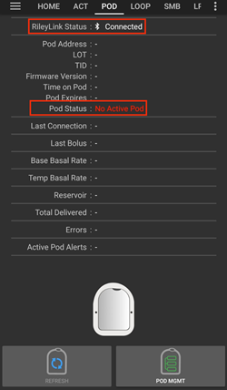
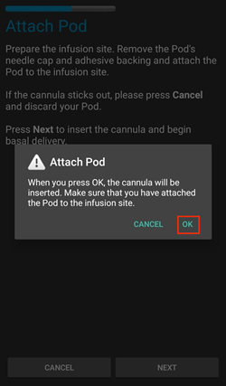
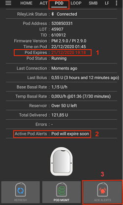
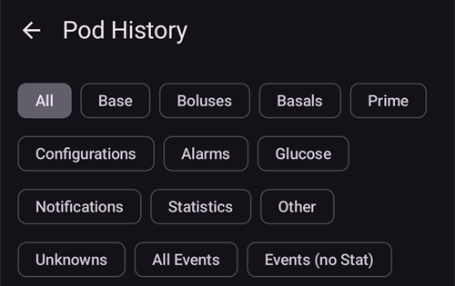
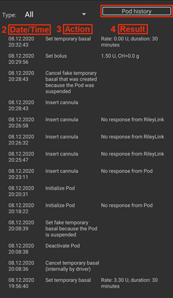
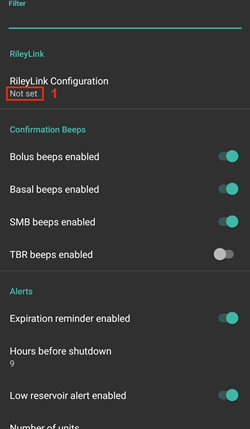

# Omnipod Eros

Tento návod je určený na nastavenie pumpy Omnipod generácie Eros (**NIE Omnipod Dash**).

```{admonition} Omnipod Eros is being phased out
:class: note

[Systém Omnipod](https://www.omnipod.com/current-podders/resources/omnipod-system) (pôvodný Omnipod, ktorý tvorí osobný manažér diabetu (PDM) a Pod) sa prestáva predávať a dátum ukončenia sa v jednotlivých krajinách líši. Napríklad v Kanade už nebude dostupný po 30. júni 2026. Ak sa spoliehate na pumpu Eros, naplánujte si včas prechod na podporovanú pumpu.
```

**Tento softvér je súčasťou riešenia umelého pankreasu typu „urob si sám“ (DIY). Nie je to produkt, ale vyžaduje, aby ste si VY systém naštudovali, naučili sa ho a porozumeli mu, vrátane toho, ako ho používať. Za to, čo s ním urobíte, zodpovedáte iba vy sami.**

```{contents} Table of contents
:depth: 1
:local: true
```

## Hardvérové a softvérové požiadavky

- **Komunikačné zariadenie Podu**

> Komponent, ktorý sprostredkúva komunikáciu medzi vaším telefónom s AAPS a Podmi generácie Eros.
> 
> > -   [Webová stránka OrangeLink](https://getrileylink.org/product/orangelink)
> > -  [433MHz RileyLink](https://getrileylink.org/product/rileylink433)
> > -   [Webová stránka Emalink](https://github.com/sks01/EmaLink) - [Kontakt](mailto:getemalink@gmail.com)
> > -   DiaLink - [Kontakt](mailto:Boshetyn@ukr.net)
> > -   [Webová stránka LoopLink](https://www.getlooplink.org/) - [Kontakt](https://jameswedding.substack.com/) - Netestované

-   **Mobilný telefón**

> Komponent, ktorý bude prevádzkovať AAPS a posielať riadiace príkazy komunikačnému zariadeniu Podu.
> 
> > - Podporovaný [telefón s Androidom](#Phones-list-of-tested-phones) s nastaveným **AAPS** a súvisiacimi komponentmi.

-   **Zariadenie na podávanie inzulínu**

> Component that will interpret commands received from the Pod communication device originating from your AAPS enabled phone.
> 
> > - Nový Pod Omnipod (generácia Eros – **NIE DASH**)

Tento návod predpokladá, že začínate novú reláciu Podu. Ak to tak nie je, buďte trpezliví a začnite tento postup pri ďalšej výmene Podu.

Na tejto stránke výraz **RileyLink** znamená ktorékoľvek z komunikačných zariadení Podu uvedených vyššie.

## Skôr než začnete

**BEZPEČNOSŤ NA PRVOM MIESTE** – nerobte tento postup v prostredí, v ktorom sa nedokážete zotaviť z chyby (náhradné Pody, inzulín, nabitý RileyLink a telefón sú nevyhnutnosťou).

**Keď ovládač Omnipod v AAPS aktivuje váš Pod, váš Omnipod PDM s ním už nebude fungovať**. Predtým ste na posielanie príkazov do Podu Omnipod Eros používali Omnipod PDM. Pod Omnipod Eros dovoľuje komunikáciu iba s jedným zariadením. Zariadenie, ktoré Pod úspešne aktivuje, je od tej chvíle jediné zariadenie, ktoré s ním smie komunikovať. To znamená, že keď aktivujete Pod Omnipod Eros s vaším RileyLinkom cez ovládač Omnipod v AAPS, **s týmto Podom už nebudete môcť používať PDM**. Ovládač Omnipod v AAPS spolu s RileyLinkom je teraz vaším PDM. *This does NOT mean you should throw away your PDM, it is recommended to keep it around as a backup, and for emergencies when AAPS is not working correctly.*

**S Podom môže naraz komunikovať iba jeden RileyLink.** **AAPS** si pamätá jeden spárovaný RileyLink. Ak spárujete iný, nahradí predchádzajúci.

**Váš Pod sa nevypne, keď je RileyLink mimo dosahu.** Keď je RileyLink mimo dosahu alebo je signál pre komunikáciu s aktívnym Podom blokovaný, Pod bude naďalej podávať bazálny inzulín. Pri aktivácii Podu sa do nového Podu naprogramuje bazálny profil nastavený v AAPS. Ak stratíte spojenie s Podom, Pod sa vráti k tomuto bazálnemu profilu. Nové príkazy nebudete môcť posielať, kým sa RileyLink nevráti do dosahu a znova nenadviaže spojenie.

**30-minútové bazálne profily NIE sú v AAPS podporované.** Ak s AAPS začínate a nastavujete svoj bazálny profil prvýkrát, pamätajte, že bazálne dávky, ktoré začínajú o pol hodiny, nie sú podporované. Bazálny profil musíte upraviť tak, aby začínal na celú hodinu. Napríklad, ak máte bazálnu dávku 1,1 jednotky, ktorá začína o 09:30 a trvá 2 hodiny do 11:30, nebude to fungovať.  Túto bazálnu dávku 1,1 jednotky musíte zmeniť na časový úsek 9:00–11:00 alebo 10:00–12:00.  Hoci samotný hardvér Omnipod 30-minútové úseky bazálneho profilu podporuje, algoritmy AAPS ich zatiaľ nedokážu zohľadniť.

## Povolenie ovládača Omnipod v AAPS

Ovládač Omnipod môžete v AAPS povoliť **dvoma spôsobmi**:

### Možnosť 1: Sprievodca nastavením

Po inštalácii novej verzie AAPS sa automaticky spustí **Sprievodca nastavením**. Ak ste už exportovali nastavenia z predchádzajúcej inštalácie, môžete ich v sprievodcovi importovať. Pri nových inštaláciách pokračujte nižšie.

Prejdite [Sprievodcom nastavením](../SettingUpAaps/SetupWizard.md) až ku kroku **Pumpa** a potom vyberte **Omnipod Eros** (popis znie „Integrácia pumpy pre Omnipod Eros“).


Sprievodca nastavením RileyLink nespáruje. Po dokončení sprievodcu otvorte obrazovku pumpy Omnipod a spárujte RileyLink podľa postupu v [časti Nastavenie RileyLinku](#OmnipodEros-rileylink-setup).

**ALEBO**

### Možnosť 2: Obrazovka Konfigurácia

Otvorte vľavo hore **ponuku** (☰) > **Konfigurácia** > **Pumpa** a vyberte **prepínač** pri **Omnipod Eros**.

Po výbere sa na karte **Omnipod Eros** zobrazia dve tlačidlá, **Nastavenia** a **Otvoriť plugin**:


**Nastavenia** otvorí nastavenia ovládača Omnipod (pozrite [Nastavenia Omnipodu](#OmnipodEros-omnipod-settings)):


**Otvoriť plugin** otvorí obrazovku pumpy Omnipod. Kedykoľvek ju môžete otvoriť aj z hlavnej obrazovky cez **Spravovať** > **Pumpa**. Na tejto stránke ju nazývame **obrazovka pumpy Omnipod**. Pred spárovaním RileyLinku a aktiváciou Podu vyzerá takto:


### Overenie výberu ovládača Omnipod

Ak chcete overiť, že ste ovládač Omnipod povolili, otvorte z hlavnej obrazovky **Spravovať** > **Pumpa**. Mali by ste vidieť obrazovku pumpy **Omnipod Eros**, ktorá je zobrazená vyššie. Ak ste ešte nespárovali RileyLink, **Stav RileyLinku** ukazuje **Nespustené** a **Stav Podu** ukazuje **Žiadny aktívny Pod**.

## Konfigurácia Omnipodu

Všetky funkcie Podu a RileyLinku sú tlačidlá na [obrazovke pumpy Omnipod](#OmnipodEros-omnipod-pod-tab) (**Spravovať** > **Pumpa**). Niektoré tlačidlá sa zobrazia iba v určitých situáciách, napríklad keď je Pod aktívny.

>  Obnovenie spojenia a stavu Podu
> 
>  Správa Podu (Aktivovať, Deaktivovať, Prehrať testovacie pípnutie, Štatistika RileyLink a História Podu)

```{admonition} Older screenshot
:class: note
Snímky obrazovky vyššie pochádzajú zo staršej verzie **AAPS**. V **AAPS** 4 nie je tlačidlo **POD MGMT** ani ponuka Správa Podu: **Obnoviť** a všetky akcie správy Podu sú tlačidlá na obrazovke pumpy Omnipod.
```

(OmnipodEros-rileylink-setup)=

### Nastavenie RileyLinku

Ak ste už RileyLink spárovali, pokračujte [časťou Aktivácia Podu](#OmnipodEros-activating-a-pod) nižšie.

*Poznámka: Dobrým vizuálnym znakom, že RileyLink nie je pripojený, je to, že na hlavnej obrazovke chýbajú tlačidlá ošetrení (panel Rýchleho spustenia). Rovnako to bude približne prvých 30 sekúnd po spustení AAPS, kým sa AAPS aktívne pripája k RileyLinku.*

1. Uistite sa, že je RileyLink úplne nabitý a zapnutý.

2. Umiestnite RileyLink [blízko telefónu](#OmnipodEros-optimal-omnipod-and-rileylink-positioning) (približne 30 cm alebo menej).

3. Otvorte obrazovku pumpy Omnipod (**Spravovať** > **Pumpa**) a stlačte **Spárovať RileyLink**.

4. Obrazovka **Spárovať RileyLink** hneď začne vyhľadávať zariadenia Bluetooth. Ťuknite na svoj RileyLink v zozname nájdených zariadení.

   

5. Keď sa zobrazí **RileyLink spárovaný úspešne** s názvom a adresou vášho zariadenia, stlačte **OK**.

6. Po návrate na obrazovku pumpy Omnipod skontrolujte, či sa **Stav RileyLinku** zmení na **Pripojené**. **Stav Podu** by mal ukazovať **Žiadny aktívny Pod**. Ak sa RileyLink nepripojí, stlačte **Resetovať RileyLink** alebo reštartujte **AAPS**.

 

 




```{admonition} Older screenshot
:class: note
Šesť snímok obrazovky vyššie (po kroku 6) pochádza zo staršej verzie **AAPS**. V **AAPS** 4 spárujete RileyLink tlačidlom **Spárovať RileyLink** na obrazovke pumpy Omnipod, nie cez **RileyLink Configuration** v nastaveniach Omnipodu. Vyhľadávanie sa spustí automaticky.
```

```{note}
Ak chcete prejsť na iný RileyLink (napríklad záložné zariadenie), stlačte znova **Spárovať RileyLink** a vyberte nové zariadenie. Nahradí zariadenie, ktoré bolo spárované predtým. Staré zariadenie nemusíte najprv odstrániť.
```

(OmnipodEros-activating-a-pod)=

### Aktivácia Podu

Pred aktiváciou Podu sa uistite, že je RileyLink spárovaný a **Stav RileyLinku** ukazuje **Pripojené**. Tlačidlo **Aktivovať Pod** zostane neaktívne, kým nie je RileyLink pripravený.

*PRIPOMIENKA: Z bezpečnostných dôvodov prebieha komunikácia s Podom pri párovaní počas aktivácie iba na krátku vzdialenosť. Pred spárovaním je rádiový signál Podu slabší, po spárovaní však Pod pracuje s plným výkonom signálu. Počas týchto postupov sa uistite, že je váš Pod* [v tesnej blízkosti](#OmnipodEros-optimal-omnipod-and-rileylink-positioning) *(približne 30 cm alebo menej), ale nie na RileyLinku ani tesne vedľa neho.*

01. Otvorte obrazovku pumpy Omnipod (**Spravovať** > **Pumpa**) a stlačte **Aktivovať Pod**.

    Ak ste ešte nikdy neaktivovali profil, najprv sa zobrazí krok **Vyžaduje sa profil**. Vyberte profil, ktorý sa použije pri aktivácii.

    >   
    > 
    > ```{admonition} Older screenshot
    >     :class: note
    >     Snímky obrazovky vyššie pochádzajú zo staršej verzie **AAPS**. V **AAPS** 4 je **Aktivovať Pod** tlačidlo na obrazovke pumpy Omnipod, nie v ponuke **POD MGMT**.
    > ```

02. Zobrazí sa obrazovka **Naplniť Pod**. Naplňte nový Pod inzulínom na 3 dni a počkajte na dve pípnutia. Znamenajú, že bolo naplnené minimálne množstvo 80 jednotiek. Plniacu striekačku úplne vyprázdnite, aj keď ste už počuli dve pípnutia. Pri výpočte celkového množstva inzulínu na 3 dni počítajte s tým, že plnenie Podu spotrebuje 12 až 15 jednotiek. Kryt ihly Podu zatiaľ neodstraňujte.

    > 
    > 
    > Uistite sa, že sú nový Pod a RileyLink v tesnej blízkosti (približne 30 cm alebo menej), a stlačte **Ďalej**.

03. **Zvoliť inzulín** (zobrazí sa iba vtedy, ak máte nastavený viac ako jeden inzulín): vyberte inzulín, ktorým plníte Pod, a stlačte **Ďalej**. Po aktivácii sa použije prepnutie profilu s týmto inzulínom.

04. Na obrazovke **Inicializovať Pod** začne Pod plnenie (budete počuť cvaknutie a potom sériu tikajúcich zvukov, kým sa Pod plní). Ak je RileyLink mimo dosahu aktivovaného Podu, dostanete chybové hlásenie **Žiadna odpoveď z Podu**. Ak k tomu dôjde, [presuňte RileyLink bližšie](#OmnipodEros-optimal-omnipod-and-rileylink-positioning) k Podu (približne 30 cm alebo menej), ale nie naň ani tesne vedľa neho, a stlačte **Opakovať**.

    >  

05. Keď je plnenie úspešné, zobrazí sa zelená fajka a tlačidlo **Ďalej** sa sprístupní. Stlačte **Ďalej**.

    > 

06. **Miesto aplikácie** (zobrazí sa iba vtedy, ak je v časti [Striedanie miest](#Aapsscreens-site-rotation) zapnuté **Spravovať rotáciu umiestnenia pumpy**): vyberte, kam si Pod na tele nalepíte, a stlačte **Ďalej**.

07. Zobrazí sa obrazovka **Nasaďte Pod**. Pripravte miesto infúzie pre nový Pod. Z Podu odstráňte plastový kryt ihly a biely papier z lepiacej plochy a nalepte Pod na zvolené miesto na tele. Ak kanyla vyčnieva, stlačte **Zrušiť** a Pod zahoďte. Po dokončení stlačte **Ďalej**.

    > 

08. Zobrazí sa potvrdzovacie okno: „Keď stlačíte OK, kanyla sa vloží“. **Stlačte OK IBA vtedy, keď ste pripravení na vloženie kanyly**.

    > 

09. Na obrazovke **Vložiť kanylu** môže chvíľu trvať, kým Omnipod zareaguje a vloží kanylu (najviac 1–2 minúty), buďte preto trpezliví.

    > Ak je RileyLink mimo dosahu aktivovaného Podu, dostanete chybové hlásenie **Žiadna odpoveď z Podu**. Ak k tomu dôjde, presuňte RileyLink bližšie k Podu (približne 30 cm alebo menej), ale nie naň ani tesne vedľa neho, a stlačte **Opakovať**.
    > 
    > Ak je RileyLink mimo dosahu Bluetooth alebo nemá aktívne spojenie s telefónom, dostanete chybové hlásenie **Žiadna odpoveď od RileyLinku**. Ak k tomu dôjde, presuňte RileyLink bližšie k telefónu a stlačte **Opakovať**.
    > 
    > *POZNÁMKA: Pred vložením kanyly je dobré stlačiť kožu v blízkosti miesta vpichu kanyly. Zaistí to hladké zavedenie ihly a zníži riziko upchatia (oklúzie).*
    > 
    > 
    > 
    >  

10. Po úspešnom vložení kanyly sa zobrazí zelená fajka a tlačidlo **Ďalej** sa sprístupní. Stlačte **Ďalej**.

    > 

11. Zobrazí sa obrazovka **Pod aktivovaný**. Skontrolujte, či bola kanyla vložená správne. Ak si myslíte, že nie, Pod vymeňte. Stlačte **Dokončiť**. Gratulujeme! Teraz ste spustili novú reláciu aktívneho Podu.

    >  
    > 
    > ```{admonition} Older screenshot
    >     :class: note
    >     Snímky obrazovky v krokoch 2 až 11 pochádzajú zo staršej verzie **AAPS** a v **AAPS** 4 môžu vyzerať inak. Kroky **Zvoliť inzulín** a **Miesto aplikácie** nie sú na obrázkoch.
    > ```

12. Vrátite sa na obrazovku pumpy Omnipod. Tlačidlo **Aktivovať Pod** sa nahradí tlačidlom **Deaktivovať Pod**, pretože ďalší Pod nemôžete aktivovať, kým nedeaktivujete aktívny Pod.

    Obrazovka pumpy teraz zobrazuje informácie o vašom aktívnom Pode vrátane aktuálnej bazálnej dávky, stavu zásobníka, podaného inzulínu, chýb a výstrah Podu. Viac podrobností nájdete v časti [Obrazovka pumpy Omnipod](#OmnipodEros-omnipod-pod-tab).

     

    ```{admonition} Older screenshot
    :class: note
    Snímky obrazovky vyššie pochádzajú zo staršej verzie **AAPS**. V **AAPS** 4 nie je ponuka Správa Podu: vrátite sa priamo na obrazovku pumpy Omnipod, kde **Deaktivovať Pod** nahradí **Aktivovať Pod**.
    ```

```{note}
Ak bola aktivácia po plnení prerušená (napríklad bola aplikácia zatvorená), stlačte znova **Aktivovať Pod**. Sprievodca bude pokračovať krokmi vloženia kanyly.
```

### Deaktivácia Podu

Za normálnych okolností by mal Pod vydržať tri dni (72 hodín) a ďalších 8 hodín po upozornení na expiráciu Podu, spolu teda 80 hodín používania.

Deaktivácia Podu (pri expirácii alebo pri zlyhaní Podu):

1. Otvorte obrazovku pumpy Omnipod (**Spravovať** > **Pumpa**) a stlačte **Deaktivovať Pod**.

   >   
   > 
   > ```{admonition} Older screenshot
   >    :class: note
   >    Snímky obrazovky vyššie pochádzajú zo staršej verzie **AAPS**. V **AAPS** 4 je **Deaktivovať Pod** tlačidlo na obrazovke pumpy Omnipod, nie v ponuke **POD MGMT**.
   > ```

2. Na obrazovke **Deaktivovať Pod** sa najprv uistite, že je RileyLink v tesnej blízkosti Podu, ale nie na ňom ani tesne vedľa neho. Potom stlačte **Ďalej**. Dialóg sa spýta: *Deaktivovaný Pod už nie je možné znova použiť. Chcete teraz deaktivovať tento Pod?* Stlačením **OK** spustíte deaktiváciu Podu, stlačením **Zrušiť** si ho ponecháte. Deaktivácia zastaví všetko podávanie inzulínu a nedá sa vrátiť späť.

   > 

3. Zobrazí sa obrazovka **Deaktivácia Podu** a Pod potvrdí úspešnú deaktiváciu pípnutím.

   > 
   > 
   > **AK deaktivácia zlyhá** a nezaznie potvrdzovacie pípnutie, môže sa zobraziť správa **Žiadna odpoveď od RileyLinku** alebo **Žiadna odpoveď z Podu**. Stlačte **Opakovať** a skúste deaktiváciu znova. Ak deaktivácia stále zlyháva, stlačte **Vyradiť Pod** a potvrďte. **AAPS** potom Pod zabudne. Podávanie inzulínu **nebolo** pozastavené, preto Pod odstráňte z tela. Ak váš Pod vydáva nepretržitý alarm, možno ho budete musieť stíšiť ručne (pomocou špendlíka alebo kancelárskej sponky), pretože **Vyradiť Pod** ho nestíši.
   > 
   > >   

4. Po úspešnej deaktivácii sa zobrazí zelená fajka. Stlačením **Ďalej** zobrazíte obrazovku **Pod deaktivovaný**. Teraz môžete Pod odstrániť, pretože aktívna relácia bola deaktivovaná.

   > 

5. Stlačením **Dokončiť** sa vrátite na obrazovku pumpy Omnipod.

   >  
   > 
   > ```{admonition} Older screenshot
   >    :class: note
   >    Snímky obrazovky v krokoch 2 až 5 pochádzajú zo staršej verzie **AAPS** a v **AAPS** 4 môžu vyzerať inak.
   > ```

6. Na obrazovke pumpy Omnipod skontrolujte, či **Stav RileyLinku** ukazuje **Pripojené** a **Stav Podu** ukazuje **Žiadny aktívny Pod**.

   >    
   > 
   > ```{admonition} Older screenshot
   >    :class: note
   >    Snímky obrazovky vyššie pochádzajú zo staršej verzie **AAPS**. V **AAPS** 4 vás **Dokončiť** vráti priamo na obrazovku pumpy Omnipod; nie je tu ponuka Správa Podu ani karta **Omnipod (POD)**.
   > ```

### Pozastavenie a obnovenie podávania inzulínu

Nasledujúci postup ukazuje, ako pozastaviť a obnoviť podávanie inzulínu.

*POZNÁMKA – ak nevidíte tlačidlo **Pozastaviť***, je predvolene skryté. Enable **Show Suspend Delivery button on the pump screen** in the [Omnipod settings](#OmnipodEros-omnipod-settings) under **Other**.

#### Pozastavenie podávania inzulínu

Týmto príkazom prepnete aktívny Pod do stavu pozastavenia. V stave pozastavenia Pod nepodáva žiadny inzulín. Tento príkaz napodobňuje funkciu pozastavenia, ktorú aktívnemu Podu posiela originálny Omnipod PDM.

1. Otvorte obrazovku pumpy Omnipod (**Spravovať** > **Pumpa**) a stlačte **Pozastaviť**. Príkaz na pozastavenie sa odošle cez RileyLink do aktívneho Podu.

2. Keď Pod pozastaví všetko podávanie inzulínu, **Stav Podu** ukazuje **Pozastavené** a tlačidlo **Pozastaviť** sa nahradí tlačidlom **Obnoviť podávanie**.

   >  
   > 
   > 
   > 
   >  
   > 
   > ```{admonition} Older screenshot
   >    :class: note
   >    Snímky obrazovky vyššie pochádzajú zo staršej verzie **AAPS**. V **AAPS** 4 tieto kroky prebiehajú na obrazovke pumpy Omnipod, nie na karte **Omnipod (POD)**, a výsledok sa zobrazí v poli **Stav Podu**.
   > ```

Ak príkaz zlyhá, v dialógu **Upozornenie** sa zobrazí „Nepodarilo sa pozastaviť podávanie inzulínu“ s dôvodom. Skontrolujte spojenie s RileyLinkom a skúste to znova.

#### Obnovenie podávania inzulínu

Týmto príkazom dáte aktívnemu, práve pozastavenému Podu pokyn obnoviť podávanie inzulínu. Po úspešnom spracovaní príkazu sa obnoví normálne podávanie inzulínu. Použije sa bazálna dávka, ktorá v aktívnom bazálnom profile platí pre aktuálny čas. Pod bude opäť prijímať príkazy na bolus, dočasný bazál (TBR) a SMB.

1. Otvorte obrazovku pumpy Omnipod a skontrolujte, či **Stav Podu** ukazuje **Pozastavené**. Stlačte **Obnoviť podávanie**.

2. Keď príkaz uspeje, **Stav Podu** opäť ukazuje **V prevádzke** a tlačidlo **Obnoviť podávanie** zmizne (tlačidlo **Pozastaviť** sa znova zobrazí, ak ste ho zapli).

   >  
   > 
   > 
   > 
   >  
   > 
   > ```{admonition} Older screenshot
   >    :class: note
   >    Snímky obrazovky vyššie pochádzajú zo staršej verzie **AAPS**. V **AAPS** 4 tieto kroky prebiehajú na obrazovke pumpy Omnipod, nie na karte **Omnipod (POD)**, a výsledok sa zobrazí v poli **Stav Podu**.
   > ```

Ak príkaz zlyhá, v dialógu **Upozornenie** sa zobrazí „Podávanie inzulínu sa nepodarilo spustiť“ s dôvodom. Skontrolujte spojenie s RileyLinkom a skúste to znova.

### Stíšenie výstrah Podu

*POZNÁMKA – Tlačidlo **Stíšiť alarmy** sa na obrazovke pumpy Omnipod zobrazí iba vtedy, keď má Pod aktívnu výstrahu (napríklad výstrahu expirácie Podu alebo nízkeho stavu zásobníka), a iba ak je vypnuté **Automaticky stíšiť výstrahy Podu**.*

Nasledujúci postup ukazuje, ako stíšiť pípanie Podu, ktoré začne, keď Pod dosiahne čas upozornenia pred expiráciou. Tento čas upozornenia sa nastavuje pomocou **Upozornenie v hodinách pred vypnutím (80 hodín)** v nastaveniach Omnipodu v časti **Výstrahy**. Maximálna životnosť Podu je 80 hodín (3 dni a 8 hodín), Insulet však odporúča neprekračovať limit 72 hodín (3 dni).

*POZNÁMKA – Ak ste v nastaveniach Omnipodu v časti **Výstrahy** zapli **Automaticky stíšiť výstrahy Podu**, **AAPS** stíši výstrahu automaticky pri najbližšej komunikácii s Podom a NEMUSÍTE to robiť ručne.*

1. Keď nastane čas upozornenia, Pod pípaním oznámi, že čoskoro expiruje a treba ho vymeniť. Na obrazovke pumpy Omnipod ukazuje **Expirácia Podu** presný čas, kedy Pod expiruje (72 hodín po aktivácii); 4 hodiny predtým sa zafarbí na **žlto**. **Definitívny koniec Podu** ukazuje, kedy Pod prestane podávať inzulín. **Výstrahy aktívneho Podu** ukazuje **Pod čoskoro expiruje** a zobrazí sa tlačidlo **Stíšiť alarmy**. **AAPS** tiež zobrazí notifikáciu o blížiacej sa expirácii Podu.

   >   
   > 
   > ```{admonition} Older screenshot
   >    :class: note
   >    Snímky obrazovky vyššie pochádzajú zo staršej verzie **AAPS**. V **AAPS** 4 sa tlačidlo **ACK ALERTS** volá **Stíšiť alarmy** a nachádza sa na obrazovke pumpy Omnipod.
   > ```

2. Stlačte **Stíšiť alarmy**. RileyLink pošle Podu príkaz, aby prestal s výstražným pípaním pred expiráciou.

   >  
   > 
   > ```{admonition} Older screenshot
   >    :class: note
   >    Snímka obrazovky vyššie je zo staršej verzie **AAPS**. V **AAPS** 4 sa tlačidlo volá **Stíšiť alarmy**.
   > ```

3. Keď sú výstrahy stíšené, Pod dvakrát pípne. **Výstrahy aktívneho Podu** už varovanie neukazuje, tlačidlo **Stíšiť alarmy** zmizne a Pod prestane s výstražným pípaním pred expiráciou.

   >  
   > 
   > ```{admonition} Older screenshot
   >    :class: note
   >    Snímka obrazovky vyššie je zo staršej verzie **AAPS**. V **AAPS** 4 sa výsledok zobrazí na obrazovke pumpy Omnipod: varovanie zmizne z poľa **Výstrahy aktívneho Podu**.
   > ```

Ak príkaz zlyhá (napríklad je RileyLink mimo dosahu Podu), v dialógu **Upozornenie** sa zobrazí „Nepodarilo sa potvrdiť výstrahy“ s dôvodom. Presuňte RileyLink bližšie k Podu a skúste to znova.


```{admonition} Older screenshot
:class: note
Snímka obrazovky vyššie je zo staršej verzie **AAPS**. V **AAPS** 4 sa v dialógu **Upozornenie** zobrazí „Nepodarilo sa potvrdiť výstrahy“ s dôvodom.
```

(OmnipodEros-view-pod-history)=

### Zobrazenie histórie Podu

Táto časť ukazuje, ako si prezrieť históriu aktívneho Podu a filtrovať ju podľa rôznych kategórií akcií. Nástroj História Podu vám umožňuje zobraziť akcie a výsledky odoslané do vášho práve aktívneho Podu počas jeho trojdňovej životnosti (72–80 hodín).

Táto funkcia je užitočná na overenie bolusov, dočasných bazálov a zmien bazálu, ktoré boli podané, ale nie ste si istí, či boli dokončené. Ostatné kategórie sú všeobecne užitočné pri riešení problémov a pri zisťovaní poradia udalostí, ktoré viedli k zlyhaniu.

*POZNÁMKA:* **Neisté** príkazy sa v histórii Podu zobrazia, ale pre ich povahu nemôžete mať istotu, že sú presné.

1. Otvorte obrazovku pumpy Omnipod (**Spravovať** > **Pumpa**) a stlačte **História Podu**.

   >   
   > 
   > ```{admonition} Older screenshot
   >    :class: note
   >    Snímky obrazovky vyššie pochádzajú zo staršej verzie **AAPS**. V **AAPS** 4 je **História Podu** tlačidlo na obrazovke pumpy Omnipod, nie v ponuke **POD MGMT**.
   > ```

2. Obrazovka **História Podu** zobrazuje všetky akcie Podu a ich výsledky, od najnovších, zoskupené podľa dní. Predvolene je vybrané **Všetko**. Ťuknutím na jedno z tlačidiel filtra hore zobrazíte iba jednu kategóriu. Šípkou späť vľavo hore sa vrátite na obrazovku pumpy Omnipod.

   > 

   >  
   > 
   > ```{admonition} Older screenshot
   >    :class: note
   >    Druhá snímka obrazovky pochádza zo staršej verzie **AAPS** a v **AAPS** 4 môže vyzerať inak.
   > ```

### Zobrazenie nastavení a histórie RileyLinku

Obrazovka **Štatistika RileyLink** zobrazuje nastavenia vášho RileyLinku a aktívneho Podu a históriu komunikácie oboch. Má dve karty: **Nastavenia** a **História**.

Tlačidlo **Štatistika RileyLink** je predvolene skryté. Ak ho chcete zobraziť na obrazovke pumpy Omnipod, zapnite **Zobraziť tlačidlo Štatistika RileyLink v menu Správa Podu** v [nastaveniach Omnipodu](#OmnipodEros-omnipod-settings) v časti **Iné**.

#### Ručné obnovenie spojenia Bluetooth s komunikačným zariadením Podu

Ak bolo vaše komunikačné zariadenie Podu nejaký čas mimo dosahu Bluetooth telefónu, **Stav RileyLinku** môže na obrazovke pumpy Omnipod hlásiť **RileyLink nedostupný**. **AAPS** sa zvyčajne znova pripojí samo, keď je zariadenie späť v dosahu. Ak sa to nestane:

1. Uistite sa, že je RileyLink zapnutý, nabitý a blízko telefónu.

2. Na obrazovke pumpy Omnipod stlačte **Resetovať RileyLink**. Správa potvrdí **Reset konfigurácie RileyLink**. Pozrite si [poznámky k resetu RileyLinku](#OmnipodEros-reset-rileylink-config-notes) nižšie.

3. Ak sa **spojenie Bluetooth** neobnoví, skúste funkciu Bluetooth v telefóne ručne **vypnúť** a znova **zapnúť**.

4. Ak sa stále nepripojí, stlačte **Spárovať RileyLink** a znova vyberte svoj RileyLink.

5. Po úspešnom opätovnom pripojení ukazuje **Stav RileyLinku** hodnotu **Pripojené**. **Stav pripojenia** môžete skontrolovať aj na karte **Nastavenia** obrazovky **Štatistika RileyLink**. Gratulujeme, teraz ste znova pripojili nakonfigurované komunikačné zariadenie Podu k AAPS!

 


```{admonition} Older screenshot
:class: note
Snímky obrazovky vyššie pochádzajú zo staršej verzie **AAPS**. V **AAPS** 4 sa znova pripojíte tlačidlom **Resetovať RileyLink** alebo **Spárovať RileyLink** na obrazovke pumpy Omnipod, nie tlačidlom obnovenia na obrazovke nastavení RileyLinku.
```

#### Nastavenia komunikačného zariadenia Podu a aktívneho Podu

Táto obrazovka zobrazuje informácie a stav práve spárovaného komunikačného zariadenia Podu aj práve aktívneho Podu Omnipod Eros. Informácie sa obnovujú automaticky.

1. Otvorte obrazovku pumpy Omnipod (**Spravovať** > **Pumpa**) a stlačte **Štatistika RileyLink**. Karta **Nastavenia** zobrazuje váš práve spárovaný **RileyLink** a aktívny Pod (**Zariadenie**).

   >   
   > 
   > ```{admonition} Older screenshot
   >    :class: note
   >    Snímky obrazovky vyššie pochádzajú zo staršej verzie **AAPS**. V **AAPS** 4 je **Štatistika RileyLink** tlačidlo na obrazovke pumpy Omnipod, nie v ponuke **POD MGMT**.
   > ```

   > 

##### Polia RileyLinku

> - **Adresa:** MAC adresa spárovaného komunikačného zariadenia Podu.
> - **Názov:** Názov Bluetooth spárovaného komunikačného zariadenia Podu.
> - **Úroveň batérie:** Aktuálna úroveň batérie pripojeného komunikačného zariadenia Podu. Zobrazí sa iba vtedy, keď je zapnuté **Zobraziť úroveň batérie reportovanú prostredníctvom OrangeLink/EmaLink/DiaLink**.
> - **Stav pripojenia**: Aktuálny stav spojenia Bluetooth medzi komunikačným zariadením Podu a telefónom s AAPS.
> - **Chyba pripojenia:** Ak nastane chyba spojenia Bluetooth s komunikačným zariadením Podu, zobrazia sa tu podrobnosti.
> - **Verzia firmvéru:** Aktuálna verzia firmvéru nainštalovaná v aktívne pripojenom komunikačnom zariadení Podu.

##### Polia zariadenia – s aktívnym Podom

> - **Typ zariadenia:** Typ zariadenia, ktoré komunikuje s komunikačným zariadením Podu (Omnipod (Eros)).
> - **Model nakonfigurovaného zariadenia:** Model zariadenia nastaveného na komunikáciu s komunikačným zariadením Podu.
> - **Model pripojeného zariadenia:** Model zariadenia, ktoré práve komunikuje s komunikačným zariadením Podu.
> - **Sériové číslo pumpy:** Sériové číslo práve aktivovaného Podu.
> - **Frekvencia pumpy:** Rádiová frekvencia, ktorá sa používa na komunikáciu s Podom.
> - **Posledná použitá frekvencia:** Posledná známa rádiová frekvencia, ktorú Pod použil na komunikáciu s komunikačným zariadením Podu.
> - **Posledné spojenie so zariadením:** Dátum a čas posledného kontaktu Podu s komunikačným zariadením Podu.

(omnipod-eros-rileylink-and-active-pod-history)=
#### História RileyLinku a aktívneho Podu

Táto karta zobrazuje, od najnovších, každý stav alebo akciu RileyLinku alebo práve pripojeného Podu. História je dostupná iba pre práve aktívny Pod. Po výmene Podu sa táto história vymaže a zaznamenávajú a zobrazujú sa iba udalosti z novo aktivovaného Podu.

1. Otvorte obrazovku pumpy Omnipod (**Spravovať** > **Pumpa**), stlačte **Štatistika RileyLink** a potom ťuknite na kartu **História**.

   >   
   > 
   > ```{admonition} Older screenshot
   >    :class: note
   >    Snímky obrazovky vyššie pochádzajú zo staršej verzie **AAPS**. V **AAPS** 4 je **Štatistika RileyLink** tlačidlo na obrazovke pumpy Omnipod, nie v ponuke **POD MGMT**.
   > ```

   > 

##### Polia

Každá položka zobrazuje:

> - **Zariadenie:** Zariadenie, ktorého sa akcia alebo stav týka.
> - **Čas:** Čas udalosti.
> - **Stav alebo akcia:** Stav zariadenia alebo akcia, ktorú zariadenie vykonalo.

(OmnipodEros-omnipod-pod-tab)=

## Obrazovka pumpy Omnipod

Nižšie je vysvetlenie stavových polí a tlačidiel na **obrazovke pumpy Omnipod** (**Spravovať** > **Pumpa** alebo **Konfigurácia** > **Pumpa** > **Otvoriť plugin**).

Ikona ozubeného kolieska vpravo hore otvorí [nastavenia Omnipodu](#OmnipodEros-omnipod-settings).

*POZNÁMKA: Ak niektoré stavové pole ukazuje (neznáme), stlačte **Obnoviť**, aby sa stav Podu obnovil a tento údaj zmizol.*


```{admonition} Older screenshot
:class: note
Snímka obrazovky vyššie pochádza zo staršej verzie **AAPS**, v ktorej bola táto obrazovka kartou **Omnipod (POD)**. V **AAPS** 4 je to obrazovka pumpy Omnipod a niektoré názvy polí a tlačidiel sú iné.
```

### Polia

- **Stav RileyLinku:** Zobrazuje aktuálny stav pripojenia RileyLinku. Chyby sa zobrazujú červenou farbou.

- *Nespustené* – zatiaľ nie je spárovaný žiadny RileyLink alebo sa pripojenie ešte nespustilo.
- *RileyLink nedostupný* – komunikačné zariadenie Podu je mimo dosahu Bluetooth telefónu, je vypnuté alebo má poruchu, ktorá bráni komunikácii cez Bluetooth.
- *RileyLink pripravený* – komunikačné zariadenie Podu je zapnuté a aktívne nadväzuje spojenie Bluetooth.
- *Pripojené* – komunikačné zariadenie Podu je zapnuté, pripojené a môže aktívne komunikovať cez Bluetooth.

- **Jedinečné ID:** Zobrazuje adresu aktívneho Podu.

- **Číslo šarže:** Zobrazuje číslo šarže (LOT) aktívneho Podu.

- **Poradové číslo:** Zobrazuje sériové číslo (TID) Podu.

- **Verzia firmvéru:** Zobrazuje verziu firmvéru aktívneho Podu.

- **Čas na Pode:** Zobrazuje aktuálny čas na aktívnom Pode. Zvýrazní sa, keď sa od času v telefóne líši o viac ako 5 minút.

- **Expirácia Podu:** Zobrazuje dátum a čas, kedy aktívny Pod expiruje. Text sa zafarbí nažlto počas posledných 4 hodín pred týmto časom. Nikdy sa nezafarbí načerveno, pretože Pod aj potom ďalej podáva inzulín.

- **Definitívny koniec Podu:** Zobrazuje koniec lehoty Podu (8 hodín po **Expirácia Podu**, teda maximálna životnosť Podu je 80 hodín). Text sa zafarbí nažlto, keď začne lehota (v čase **Expirácia Podu**), a načerveno počas posledných 4 hodín pred definitívnym koncom. Počas lehoty zobrazuje aj zostávajúci čas, napríklad *(zostáva 17 min)*. Na definitívnom konci Pod prestane podávať inzulín a musí sa vymeniť.

- **Stav Podu:** Zobrazuje stav aktívneho Podu (napríklad **Žiadny aktívny Pod**, **V prevádzke** alebo **Pozastavené**).

- **Posledné spojenie:** Zobrazuje, kedy naposledy prebehla komunikácia s aktívnym Podom. Text sa zafarbí na červeno, keď je prekročený [prah nedostupnosti pumpy](#OmnipodEros-troubleshooting).

- *Pred chvíľou* – pred menej ako 20 sekundami.
- *Pred menej ako minútou* – pred viac ako 20 sekundami, ale menej ako 60 sekundami.
- *Pred 1 minútou* – pred viac ako 60 sekundami, ale menej ako 120 sekundami (2 min)
- *Pred XX minútami* – pred viac ako 2 minútami, presný počet udáva hodnota XX

- **Posledný bolus:** Zobrazuje dávku posledného bolusu odoslaného do aktívneho Podu a v zátvorke, pred akým časom bol podaný.

- **Základná hodnota bazálu:** Zobrazuje bazálnu dávku, ktorá je pre aktuálny čas naprogramovaná v bazálnom profile.

- **Dočasná bazálna dávka:** Zobrazí sa iba vtedy, keď beží dočasný bazál. Zobrazuje ju v tomto formáte:

- Jednotky/hodina @ čas, keď bol TBR nastavený (uplynuté minúty / celkový počet minút, počas ktorých TBR pobeží)
- *Príklad:* 0.00U/h @18:25 ( 90/120 minút)

- **Zásobník:** Zobrazuje **Zostáva viac ako 50 U**, keď v zásobníku zostáva viac ako 50 jednotiek. Pod touto hodnotou sa zobrazuje približný počet jednotiek. Text sa zafarbí na červeno pod prahom nízkeho stavu zásobníka, ktorý je nastavený v [nastaveniach Výstrahy](#OmnipodEros-omnipod-settings).

- **Celkovo podané:** Zobrazuje celkový počet jednotiek inzulínu podaných zo zásobníka. *Ide iba o približnú hodnotu, pretože plnenie Podu nie je presný proces.*

- **Výstrahy aktívneho Podu:** Vyhradené pre výstrahy, ktoré sú na aktívnom Pode práve spustené. Zvyčajne sa používa, keď expirácia Podu prekročila 72 hodín a Pod vydáva svoje vlastné výstražné pípnutia.

- **Chyby:** Zobrazuje poslednú chybu, ktorá nastala (zobrazuje sa červenou). Prezrite si [históriu Podu](#OmnipodEros-view-pod-history), [históriu RileyLinku](#omnipod-eros-rileylink-and-active-pod-history) a log súbory, kde nájdete predchádzajúce chyby a podrobnejšie informácie.

### Tlačidlá

Tlačidlá v dolnej časti obrazovky pumpy sa menia podľa situácie. Tlačidlá, ktoré sa práve nedajú použiť, sú sivé, napríklad keď RileyLink nie je pripojený.

**Tlačidlá stavu Podu** (zobrazia sa, keď je Pod aktívny):

- **Obnoviť:** Pošle aktívnemu Podu príkaz na obnovenie, aby sa aktualizoval jeho stav. Použite ho na obnovenie stavu Podu a na vymazanie stavových polí, ktoré obsahujú text (neznáme). Ďalšie informácie nájdete v [časti Riešenie problémov](#OmnipodEros-troubleshooting) nižšie.

  

  ```{admonition} Older screenshot
  :class: note
  Snímka obrazovky vyššie pochádza zo staršej verzie **AAPS**. V **AAPS** 4 je to textové tlačidlo **Obnoviť** na obrazovke pumpy Omnipod.
  ```

- **Stíšiť alarmy:** Stíši pípanie a notifikácie o expirácii Podu a nízkom stave zásobníka. Zobrazí sa iba vtedy, keď má Pod aktívnu výstrahu a **Automaticky stíšiť výstrahy Podu** je vypnuté. Po stíšení výstrah tlačidlo zmizne.

  

  ```{admonition} Older screenshot
  :class: note
  Snímka obrazovky vyššie pochádza zo staršej verzie **AAPS**. V **AAPS** 4 sa toto tlačidlo volá **Stíšiť alarmy**.
  ```

- **Nastaviť čas:** Nastaví čas na Pode podľa aktuálneho času v telefóne. Zobrazí sa iba vtedy, keď sa čas na Pode líši od času v telefóne o viac ako 5 minút.

  

  ```{admonition} Older screenshot
  :class: note
  Snímka obrazovky vyššie pochádza zo staršej verzie **AAPS**. V **AAPS** 4 je to textové tlačidlo **Nastaviť čas** na obrazovke pumpy Omnipod.
  ```

- **Pozastaviť:** Pozastaví podávanie inzulínu v aktívnom Pode. Only shown if enabled in the settings (**Show Suspend Delivery button on the pump screen**).

  

  ```{admonition} Older screenshot
  :class: note
  Snímka obrazovky vyššie pochádza zo staršej verzie **AAPS**. V **AAPS** 4 je to textové tlačidlo **Pozastaviť** na obrazovke pumpy Omnipod.
  ```

- **Obnoviť podávanie:** Obnoví podávanie inzulínu v aktívnom Pode, ktorý je práve pozastavený. Zobrazí sa iba vtedy, keď je Pod pozastavený.

  

  ```{admonition} Older screenshot
  :class: note
  Snímka obrazovky vyššie pochádza zo staršej verzie **AAPS**. V **AAPS** 4 je to textové tlačidlo **Obnoviť podávanie** na obrazovke pumpy Omnipod.
  ```

**Tlačidlá správy Podu a RileyLinku:**


```{admonition} Older screenshot
:class: note
Snímka obrazovky vyššie je zo staršej verzie **AAPS**. V **AAPS** 4 nie je ponuka Správa Podu: tieto akcie sú tlačidlá priamo na obrazovke pumpy Omnipod.
```

- **Aktivovať Pod:** Naplní a aktivuje nový Pod. Zobrazuje sa, keď nie je aktívny žiadny Pod. Je dostupné iba vtedy, keď je RileyLink pripojený.

  

  ```{admonition} Older screenshot
  :class: note
  Snímka obrazovky vyššie pochádza zo staršej verzie **AAPS**. V **AAPS** 4 je **Aktivovať Pod** tlačidlo na obrazovke pumpy Omnipod, nie v ponuke Správa Podu.
  ```

- **Deaktivovať Pod:** Deaktivuje práve aktívny Pod. Zobrazí sa, hneď ako je Pod spárovaný, aj vtedy, keď sa aktivácia zastavila v polovici (napríklad preto, že Pod počas aktivácie zlyhal). Je dostupné iba vtedy, keď je RileyLink pripojený. **AAPS** vás pred deaktiváciou Podu požiada o potvrdenie.

- Tento príkaz použite na deaktiváciu Podu, ktorý vydáva nepretržitý alarm („screaming pod“, chyba 49).
- Ak deaktivácia zlyhá, sprievodca deaktiváciou ponúkne možnosť **Vyradiť Pod**.

  

  ```{admonition} Older screenshot
  :class: note
  Snímka obrazovky vyššie pochádza zo staršej verzie **AAPS**. V **AAPS** 4 je **Deaktivovať Pod** tlačidlo na obrazovke pumpy Omnipod, nie v ponuke Správa Podu.
  ```

- **Prehrať testovacie pípnutie:** Po stlačení Pod raz testovacie pípne. Zobrazí sa, keď je Pod spárovaný.

  

  ```{admonition} Older screenshot
  :class: note
  Snímka obrazovky vyššie pochádza zo staršej verzie **AAPS**. V **AAPS** 4 je **Prehrať testovacie pípnutie** tlačidlo na obrazovke pumpy Omnipod, nie v ponuke Správa Podu.
  ```

- **História Podu:** Zobrazuje históriu činnosti aktívneho Podu. Pozrite si [Zobrazenie histórie Podu](#OmnipodEros-view-pod-history).

  

  ```{admonition} Older screenshot
  :class: note
  Snímka obrazovky vyššie pochádza zo staršej verzie **AAPS**. V **AAPS** 4 je **História Podu** tlačidlo na obrazovke pumpy Omnipod, nie v ponuke Správa Podu.
  ```

- **Spárovať RileyLink:** Vyhľadá vaše komunikačné zariadenie Podu a spáruje ho. Pozrite si [Nastavenie RileyLinku](#OmnipodEros-rileylink-setup).

- **Štatistika RileyLink:** Otvorí obrazovku Štatistika RileyLink s dvoma kartami. Zobrazí sa iba vtedy, ak je zapnuté v nastaveniach (**Zobraziť tlačidlo Štatistika RileyLink v menu Správa Podu**).

- **Nastavenia** – zobrazuje informácie o nastaveniach RileyLinku a aktívneho Podu
- **História** – zobrazuje históriu komunikácie RileyLinku a Podu

  

  ```{admonition} Older screenshot
  :class: note
  Snímka obrazovky vyššie pochádza zo staršej verzie **AAPS**. V **AAPS** 4 je **Štatistika RileyLink** tlačidlo na obrazovke pumpy Omnipod, nie v ponuke Správa Podu.
  ```

- **Resetovať RileyLink:** Resetuje konfiguráciu práve pripojeného komunikačného zariadenia Podu. Pri spustení komunikácie sa do RileyLinku odošlú a v ňom nastavia konkrétne údaje:

- Nastavia sa pamäťové registre
- Nastavia sa komunikačné protokoly
- Nastaví sa vyladená rádiová frekvencia
  > 
  > Pozrite si [ďalšie poznámky](#OmnipodEros-reset-rileylink-config-notes) nižšie.

  

  ```{admonition} Older screenshot
  :class: note
  Snímka obrazovky vyššie pochádza zo staršej verzie **AAPS**. V **AAPS** 4 sa toto tlačidlo volá **Resetovať RileyLink** a nachádza sa na obrazovke pumpy Omnipod.
  ```

- **Vyradiť Pod:** Po potvrdení zahodí stav Podu, ktorý nereaguje. Zobrazí sa iba vtedy, keď bol Pod spustený, ale nie úplne spárovaný, pretože riadna deaktivácia už nie je možná:

- **Pod nie je úplne spárovaný**, a preto ignoruje príkazy na deaktiváciu.
- **Pod sa zasekol** počas párovania medzi krokmi.
- **Pod sa vôbec nespáruje.**
  > 
  > Po vyradení Podu s ním **AAPS** už nemôže komunikovať. Odstráňte Pod z tela.

  

  ```{admonition} Older screenshot
  :class: note
  Snímka obrazovky vyššie pochádza zo staršej verzie **AAPS**. V **AAPS** 4 je **Vyradiť Pod** tlačidlo na obrazovke pumpy Omnipod, nie v ponuke Správa Podu.
  ```

(OmnipodEros-reset-rileylink-config-notes)=

#### *Poznámky k resetu RileyLinku*

- Táto funkcia sa používa hlavne vtedy, keď práve aktívne komunikačné zariadenie Podu nereaguje a komunikácia sa zasekla.
- Ak komunikačné zariadenie Podu vypnete a znova zapnete, stlačte **Resetovať RileyLink**, aby sa tieto komunikačné parametre v komunikačnom zariadení Podu znova nastavili.
- Ak sa to NEUROBÍ, bude potrebné AAPS reštartovať po vypnutí a zapnutí komunikačného zariadenia Podu.
- Toto tlačidlo **NIE JE** potrebné stláčať pri prepínaní medzi rôznymi komunikačnými zariadeniami Podu.

(OmnipodEros-omnipod-settings)=

## Nastavenia Omnipodu

Nastavenia ovládača Omnipod otvoríte jedným z týchto spôsobov:

- stlačte ikonu ozubeného kolieska vpravo hore na obrazovke pumpy Omnipod (**Spravovať** > **Pumpa**), alebo
- otvorte vľavo hore **ponuku** (☰) > **Konfigurácia** > **Pumpa** a na karte **Omnipod Eros** stlačte **Nastavenia**.


```{admonition} Older screenshot
:class: note
Snímka obrazovky vyššie je zo staršej verzie **AAPS**. V **AAPS** 4 otvoríte nastavenia tlačidlom **Nastavenia** na karte **Omnipod Eros** alebo ikonou ozubeného kolieska na obrazovke pumpy Omnipod, nie ozubeným kolieskom nastavení v **Konfigurácia** ani ponukou s 3 bodkami.
```

Nastavenia sú zoskupené tak, ako je uvedené nižšie. Ťuknutím na skupinu ju rozbalíte. Väčšina položiek sú prepínače, ktoré môžete zapnúť alebo vypnúť:


*POZNÁMKA: Hviezdička (\*) označuje, že nastavenie je predvolene zapnuté.*

### RileyLink

Nastavenia komunikačného zariadenia Podu. Samotné zariadenie spárujete tlačidlom **Spárovať RileyLink** na obrazovke pumpy (pozrite [Nastavenie RileyLinku](#OmnipodEros-rileylink-setup)).

- **Použiť skenovanie:** Pred pripojením k OrangeLinku spustí vyhľadávanie. Môže to zlepšiť spojenie. V prípade potreby sa dá použiť aj s inými klonmi RileyLinku.

- **Zobraziť úroveň batérie reportovanú prostredníctvom OrangeLink/EmaLink/DiaLink:** Hlási skutočnú úroveň batérie OrangeLinku/EmaLinku/DiaLinku. Všetkým používateľom OrangeLinku/EmaLinku/DiaLinku **dôrazne odporúčame** toto nastavenie zapnúť.

- NEFUNGUJE s pôvodným RileyLinkom.
- Nemusí fungovať s alternatívami RileyLinku.
- Zapnuté – hlási aktuálnu úroveň batérie podporovaných komunikačných zariadení Podu.
- Vypnuté – hlási hodnotu n/a.

- **V Akciách povoliť zaznamenávanie výmeny batérie:** Dostupné iba vtedy, keď je zapnuté nastavenie hlásenia batérie uvedené vyššie. Niektoré komunikačné zariadenia Podu môžu používať bežné batérie, ktoré sa dajú vymeniť. Keď je toto nastavenie zapnuté, môžete zadať [záznam v Starostlivosti](#aaps-screens-careportal) **Výmena batérie v pumpe**, aby ste výmenu zaznamenali a vynulovali vek batérie.

### Potvrdzovacie pípnutia

Pod potvrdzuje pípnutím podanie a zmeny bolusu, bazálu, SMB a dočasného bazálu (TBR).

- **\*Pípnutie pri boluse povolené:** Zapnutie alebo vypnutie potvrdzovacích pípnutí pri podaní bolusu.
- **Pípnutie pri bazále povolené:** Zapnutie alebo vypnutie potvrdzovacích pípnutí pri nastavení novej bazálnej dávky, zrušení aktívnej bazálnej dávky alebo zmene aktuálnej bazálnej dávky.
- **\*Pípnutie pri SMB povolené:** Zapnutie alebo vypnutie potvrdzovacích pípnutí pri podaní SMB.
- **Pípnutie pri TBR povolené:** Zapnutie alebo vypnutie potvrdzovacích pípnutí pri nastavení alebo zrušení dočasného bazálu (TBR).

### Výstrahy

Poskytuje výstrahy AAPS a oznámenia v Nightscoute o expirácii Podu, vypnutí Podu a nízkom stave zásobníka podľa nastaveného prahu jednotiek.

*Notifikácia AAPS sa VŽDY zobrazí pre každú výstrahu po prvej komunikácii s Podom od spustenia výstrahy. Zatvorenie notifikácie výstrahu NESTÍŠI, POKIAĽ nie je zapnuté **Automaticky stíšiť výstrahy Podu**. Ak chcete výstrahu stíšiť RUČNE, otvorte obrazovku pumpy Omnipod a stlačte **Stíšiť alarmy**.*

- **\*Pripomenutie vypršania platnosti povolené:** Keď je zapnuté, Pod zapípa, keď nastane čas nastavený nižšie.
- **Upozornenie v hodinách pred vypnutím (80 hodín):** Počet hodín pred vypnutím Podu (80 hodín po aktivácii), keď sa spustí pripomenutie expirácie (1 až 8 hodín, predvolene 8).
- **\*Upozornenie na nízky stav zásobníka povolené:** Zapnutie alebo vypnutie výstrahy, keď počet zostávajúcich jednotiek v Pode dosiahne limit nízkeho stavu zásobníka nastavený v poli Počet jednotiek.
- **Počet jednotiek:** Počet jednotiek, pri ktorom sa spustí výstraha nízkeho stavu zásobníka Podu (5 až 50, predvolene 20).
- **Automaticky stíšiť výstrahy Podu:** Keď je zapnuté, notifikácia sa stále zobrazí, ale výstraha sa automaticky stíši pri najbližšej komunikácii s Podom po spustení výstrahy.

### Notifikácie

Poskytuje notifikácie AAPS a zvukové výstrahy telefónu, keď nie je isté, či boli dočasný bazál (TBR), SMB alebo bolus úspešné.

*POZNÁMKA: Ide iba o notifikácie, Pod nevydáva žiadne zvukové pípnutia.*

- **\*Zvuk upozornenia pre neistý dočasný bazál povolený:** Zapnite alebo vypnite toto nastavenie, aby sa spustila zvuková výstraha a vizuálna notifikácia, keď si AAPS nie je isté, či bol dočasný bazál (TBR) úspešne nastavený.
- **\*Zvuk upozornenia pre neistý SMB povolený:** Zapnite alebo vypnite toto nastavenie, aby sa spustila zvuková výstraha a vizuálna notifikácia, keď si AAPS nie je isté, či bol SMB úspešne podaný.
- **\*Zvuk upozornenia pre neistý bolus povolený:** Zapnite alebo vypnite toto nastavenie, aby sa spustila zvuková výstraha a vizuálna notifikácia, keď si AAPS nie je isté, či bol bolus úspešne podaný.

### Iné

Poskytuje rozšírené nastavenia na pomoc pri ladení.

- **Show Suspend Delivery button on the pump screen:** Hide or display the **Suspend** button on the Omnipod pump screen.
- **Zobraziť tlačidlo Protokol pulzov v menu Správa Podu:** Toto nastavenie je stále v zozname, ale súčasná verzia obrazovky pumpy nemá tlačidlo **Protokol pulzov**.

- **Zobraziť tlačidlo Štatistika RileyLink v menu Správa Podu:** Skryje alebo zobrazí tlačidlo **Štatistika RileyLink** na obrazovke pumpy Omnipod.
- **\*Letný čas / Detekcia časového pásma povolená:** Umožňuje automaticky zistiť zmeny časového pásma, ak sa telefón používa v oblasti, kde sa prechádza na letný čas (DST).

### Výmena alebo odstránenie aktívneho komunikačného zariadenia Podu (RileyLink)

Existuje veľa alternatív k pôvodnému RileyLinku (napríklad OrangeLink alebo EmaLink) a niekedy potrebujete viac zariadení alebo záložné zariadenie rovnakého typu. Preto možno budete musieť prejsť na iné zariadenie.

Ak chcete prejsť na iné zariadenie, otvorte obrazovku pumpy Omnipod (**Spravovať** > **Pumpa**), stlačte **Spárovať RileyLink** a vyberte nové zariadenie podľa postupu v časti [Nastavenie RileyLinku](#OmnipodEros-rileylink-setup). Nové zariadenie nahradí zariadenie, ktoré bolo spárované predtým.

 




 

```{admonition} Older screenshot
:class: note
Snímky obrazovky vyššie pochádzajú zo staršej verzie **AAPS**. V **AAPS** 4 pridáte zariadenie tlačidlom **Spárovať RileyLink** na obrazovke pumpy Omnipod, nie cez **RileyLink Configuration** v nastaveniach Omnipodu. Vyhľadávanie sa spustí automaticky.
```

Samostatné tlačidlo na odstránenie spárovaného zariadenia neexistuje. Ak prestanete RileyLink používať, jednoducho spárujte nový, keď ho budete potrebovať.


```{admonition} Older screenshot
:class: note
Snímky obrazovky vyššie pochádzajú zo staršej verzie **AAPS**. V **AAPS** 4 nie je tlačidlo **Odstrániť**: spárovanie nového RileyLinku nahradí predchádzajúci.
```

## Riadok stavu a Starostlivosť

V niekoľkých veciach sa Pod Omnipod líši od púmp s hadičkou, najmä po nasadení nového Podu.

Vek **inzulínu** a **kanyly** v [riadku stavu](#screens-sensor-level-battery) hlavnej obrazovky sa **po každej výmene Podu** **vynuluje** na 0 dní a 0 hodín. Je to tak kvôli tomu, ako je pumpa Omnipod skonštruovaná a ako funguje. **Batéria pumpy** a **zásobník inzulínu** sú súčasťou každého Podu. Keďže Pod zavádza kanylu priamo do kože v mieste nalepenia Podu, pumpy Omnipod nepoužívajú klasickú hadičku. *Preto sa po výmene Podu vek každej z týchto hodnôt automaticky vynuluje.* **Vek batérie pumpy** sa nehlási, pretože batéria v Pode vydrží vždy dlhšie, ako je životnosť Podu (maximálne 80 hodín).


### Úrovne

**Hladina inzulínu**

Hlásenie množstva inzulínu v Pode Omnipod Eros nie je presné. Je to preto, že nie je presne známe, koľko inzulínu bolo do Podu naplnené. Vie sa iba to, že keď pri plnení Podu zaznejú 2 pípnutia, bolo naplnených aspoň 80 jednotiek. Pod pojme maximálne 200 jednotiek. Aj plnenie môže spôsobiť odchýlky, pretože nejde o presný proces. Vzhľadom na oba tieto faktory je ovládač Omnipod napísaný tak, aby čo najlepšie odhadol množstvo inzulínu, ktoré zostáva v zásobníku.

> - **Nad 50 jednotiek** – hlási hodnotu 50+U, keď je v zásobníku viac ako 50 jednotiek.
> - **Pod 50 jednotiek** – hlási približnú vypočítanú hodnotu inzulínu, ktorý zostáva v zásobníku.
> - **SMS** – v odpovediach SMS vracia hodnotu alebo 50+U
> - **Nightscout** – do Nightscoutu nahráva hodnotu 50, keď je jednotiek viac ako 50 (verzia 14.07 a staršie).  Novšie verzie hlásia hodnotu 50+, keď je jednotiek viac ako 50.

**Úroveň batérie**

Hlásenie úrovne batérie je nastavenie, ktoré môžete zapnúť, aby sa zobrazovala aktuálna úroveň batérie komunikačných zariadení Podu, napríklad OrangeLink, EmaLink alebo DiaLink.  Hardvér RileyLink nedokáže hlásiť úroveň svojej batérie.  Úroveň batérie sa hlási po každej komunikácii s Podom, preto pri nabíjaní nemusíte vidieť plynulé (lineárne) zvyšovanie.  Ručné obnovenie aktualizuje aktuálnu úroveň batérie.  Keď je podporované komunikačné zariadenie Podu odpojené, hlási sa hodnota 0 %.

> - **Hardvér RileyLink NEDOKÁŽE hlásiť úroveň batérie**
> - **Na hlásenie úrovne batérie MUSÍ byť v nastaveniach Omnipodu zapnuté nastavenie „Zobraziť úroveň batérie reportovanú prostredníctvom OrangeLink/EmaLink/DiaLink“**
> - **Hlásenie úrovne batérie funguje IBA pre zariadenia OrangeLink, EmaLink a DiaLink**
> - **Hlásenie úrovne batérie MÔŽE fungovať aj pre iné zariadenia (okrem RileyLinku)**
> - **SMS** – ako odpoveď vracia aktuálnu úroveň batérie, ak je skutočná hodnota známa; hodnota n/a sa nevracia
> - **Nightscout** – úroveň batérie sa hlási, ak je skutočná hodnota známa; hodnota n/a sa nehlási

(OmnipodEros-troubleshooting)=

## Riešenie problémov

### Zlyhania Podu

Pody občas zlyhajú z rôznych dôvodov, vrátane hardvérových problémov samotného Podu. Odporúčame tieto chyby nehlásiť spoločnosti Insulet, pretože AAPS nie je schválený spôsob použitia. Zoznam chybových kódov, ktorý pomôže určiť príčinu, nájdete [tu](https://github.com/openaps/openomni/wiki/Fault-event-codes).

### Predchádzanie chybám Podu 49

Toto zlyhanie súvisí s nesprávnym stavom Podu pre daný príkaz alebo s chybou počas príkazu na podanie inzulínu. Odporúčame nastaviť synchronizáciu s Nightscoutom na *iba nahrávanie*: všetky možnosti „Prijímať ... z NS“ v nastaveniach synchronizácie klienta Nightscout nechajte vypnuté (pozrite [Nightscout](../SettingUpAaps/Nightscout.md)), aby ste predišli možným zlyhaniam.

### Výstrahy „Pumpa nedostupná“

Odporúčame nastaviť výstrahy nedostupnosti pumpy na **120 minút**. Stlačte ikonu **Nastavenia** (ozubené koliesko) vpravo hore na hlavnej obrazovke, vyberte **Lokálne výstrahy** > **Prah nedostupnosti pumpy** a nastavte ho na **120**.

(OmnipodEros-import-settings-from-previous-aaps)=
### Import nastavení z predchádzajúcej verzie AAPS

```{admonition} Importing settings can end your active Pod
:class: warning
Na telefóne, ktorý už Pod ovláda, nechajte **Nahradiť aj nastavenia pumpy** nezačiarknuté: relácia Podu sa zachová a importujú sa iba ostatné nastavenia. Zaškrtnite to iba vtedy, ak je súbor exportovaný počas Podu, ktorý máte práve nasadený. Pozrite [Pumpy bez hadičky](#ExportImportSettings-tubeless-pumps).
```

Najbezpečnejšie je preinštalovať **AAPS** medzi dvoma Podmi:

1. Deaktivujte reláciu Podu. Overte, že nemáte aktívnu reláciu Podu.
2. Exportujte nastavenia a kópiu si uložte na bezpečné miesto.
3. Odinštalujte predchádzajúcu verziu AAPS a reštartujte telefón.
4. Nainštalujte novú verziu AAPS a overte, že nemáte aktívnu reláciu Podu.
5. Importujte nastavenia a aktivujte nový Pod.

### Výstrahy ovládača Omnipod

Ovládač Omnipod zobrazuje na **hlavnej obrazovke** rôzne vlastné výstrahy. Väčšina z nich je informačná a dá sa zatvoriť. Niektoré však používateľovi oznamujú, čo má urobiť, aby odstránil príčinu spustenej výstrahy. Prehľad hlavných výstrah, s ktorými sa môžete stretnúť, je uvedený nižšie:

#### Žiadny aktívny Pod

Nebola zistená žiadna aktívna relácia Podu. Túto výstrahu môžete dočasne odložiť stlačením **ODLOŽIŤ**, ale bude sa znova spúšťať, kým neaktivujete nový Pod. Po aktivácii sa táto výstraha automaticky stíši.

#### Pod pozastavený

Informačná výstraha, že Pod bol pozastavený.

#### Nastavenie bazálneho profilu zlyhalo. Podávanie môže byť pozastavené! Please manually refresh the Pod status on the pump screen and resume delivery if needed.

Informačná výstraha, že nastavenie bazálneho profilu v Pode zlyhalo. Otvorte obrazovku pumpy Omnipod a stlačte **Obnoviť**, potom v prípade potreby **Obnoviť podávanie**.

#### Nedá sa overiť, či bol bolus SMB úspešný. Ak ste si istí, že bolus nebol úspešný, mali by ste položku SMB ručne odstrániť z Ošetrení.

Výstraha, že sa nepodarilo overiť, či bol bolus SMB úspešný. Skontrolujte pole **Posledný bolus** na obrazovke pumpy Omnipod, či bol SMB úspešný. Ak nebol, odstráňte záznam z ošetrení.

#### Nie je isté, či bol „task bolus/TBR/SMB“ dokončený, ručne overte, či bol úspešný.

Kvôli spôsobu, akým RileyLink a Omnipod komunikujú, môžu nastať situácie, keď *nie je isté*, či bol príkaz úspešne spracovaný. Preto bolo potrebné informovať používateľa o tejto neistote.

Nižšie je niekoľko príkladov, kedy sa môže zobraziť notifikácia o neistote.

- **Bolusy** – neisté bolusy nie je možné automaticky overiť. Notifikácia zostane až do ďalšieho bolusu, ale ručné obnovenie stavu Podu správu odstráni. *Pre tento typ notifikácie sú zvukové výstrahy predvolene zapnuté, pretože ich používateľ musí overiť ručne.*
- **Dočasné bazály, stavy Podu, prepnutia profilu, zmeny času** – ručné obnovenie stavu Podu správu odstráni.
- **Odchýlka času Podu -** Keď sa čas na Pode a čas v telefóne príliš líšia, okruh AAPS ťažko funguje a ťažko robí presné predpovede a odporúčania dávok. Ak je časový rozdiel medzi Podom a telefónom viac ako 5 minút, na obrazovke pumpy Omnipod sa zobrazí tlačidlo **Nastaviť čas**. Stlačením **Nastaviť čas** zosynchronizujete čas na Pode s časom v telefóne. Ak potom **Stav Podu** ukazuje **Pozastavené**, stlačte **Obnoviť podávanie**, aby Pod pokračoval v normálnej činnosti.

## Odporúčané postupy

(OmnipodEros-optimal-omnipod-and-rileylink-positioning)=

### Optimálne umiestnenie Omnipodu a RileyLinku

Anténa, ktorú RileyLink používa na komunikáciu s Podom Omnipod, je 433 MHz špirálová (helikálna) anténa. Vďaka svojej konštrukcii vyžaruje všesmerový signál v tvare trojrozmernej „šišky“ (toroidu), kde os z predstavuje zvislo stojacu anténu. To znamená, že existujú optimálne polohy na umiestnenie RileyLinku, najmä pri aktivácii a deaktivácii Podu.


> *(Obr. 1. Grafické znázornenie špirálovej antény so všesmerovým vyžarovaním*)

Z dôvodov bezpečnosti a ochrany sa *aktivácia* Podu musí robiť na *kratšiu vzdialenosť (približne 30 cm alebo menej)* než iné operácie, napríklad podanie bolusu, nastavenie dočasného bazálu alebo obyčajné obnovenie stavu Podu. Kvôli spôsobu, akým anténa RileyLinku vysiela signál, sa NEODPORÚČA umiestniť Pod priamo na RileyLink ani tesne vedľa neho.

Na obrázku nižšie je znázornený optimálny spôsob umiestnenia RileyLinku pri aktivácii a deaktivácii Podu. Pod sa môže aktivovať aj v iných polohách, ale najväčšiu úspešnosť budete mať s polohou z obrázka nižšie.

*Poznámka: Ak komunikácia zlyhá aj po optimálnom umiestnení Podu a RileyLinku, môže to byť spôsobené slabou batériou, ktorá znižuje dosah antény RileyLinku. Aby ste tomu predišli, uistite sa, že je RileyLink počas tohto postupu dostatočne nabitý alebo priamo pripojený k nabíjaciemu káblu.*


## Kde získať pomoc

Všetku vývojársku prácu na ovládači Omnipod robí komunita dobrovoľne. Prosíme vás, aby ste boli ohľaduplní a pri žiadosti o pomoc dodržiavali tieto zásady:

- **Úroveň 0:** Prečítajte si príslušnú časť tejto dokumentácie, aby ste pochopili, ako má funkcia, s ktorou máte problém, fungovať.
- **Úroveň 1:** Ak máte stále problémy, ktoré nedokážete vyriešiť pomocou tohto dokumentu, prejdite na kanál *#androidaps* na **Discorde** pomocou [tohto pozývacieho odkazu](https://discord.gg/4fQUWHZ4Mw).
- **Úroveň 2:** Vyhľadajte existujúce problémy (issues) a zistite, či už váš problém niekto nahlásil. Ak nie, vytvorte nový [problém (issue)](https://github.com/nightscout/AndroidAPS/issues) a priložte svoje [log súbory](../GettingHelp/AccessingLogFiles.md).
- **Buďte trpezliví – väčšinu členov našej komunity tvoria dobrosrdeční dobrovoľníci a riešenie problémov si často vyžaduje čas a trpezlivosť od používateľov aj vývojárov.**
