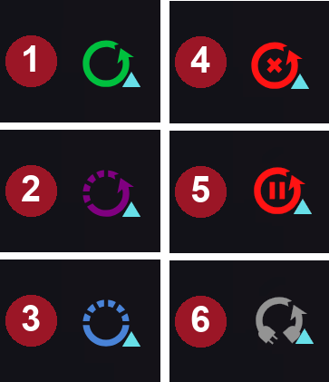
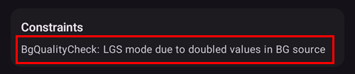
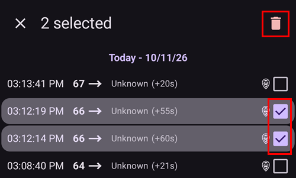
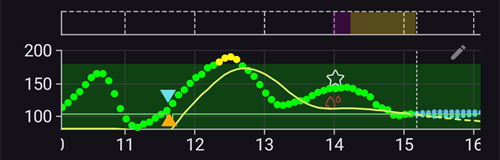
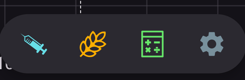

# Obrazovky AAPS

```{contents}
:backlinks: entry
:depth: 2
```

(the-homescreen)= (AapsScreens-the-homescreen)=

## Hlavná obrazovka


Toto je prvá obrazovka, s ktorou sa stretnete po otvorení **AAPS** a obsahuje väčšinu informácií, ktoré budete denne potrebovať.

### Sekcia A – Horná lišta

* **Ponuka** (☰) vľavo otvorí navigačný panel s položkami **História ošetrení**, **Prehliadač histórie**, **Štatistiky**, **Pomocník s profilom**, **Údržba**, **Sprievodca nastavením**, **Konfigurácia** a ďalšími.
* **Vyhľadávací riadok** nájde nastavenia, dialógy a dokumentáciu – stačí začať písať (pozrite [Globálne vyhľadávanie](../DailyLifeWithAaps/GlobalSearch.md)).
* Ikona **Nastavenia** (ozubené koliesko) vpravo otvorí všetky [nastavenia](../SettingUpAaps/Preferences.md).

(aaps-screens-profile--target)=

### Sekcia B – Blok stavu

#### Aktuálna glykémia

Posledná hodnota glykémie z vášho CGM sa zobrazuje vo veľkom kruhu vľavo spolu s rozdielom oproti predchádzajúcej hodnote (delta) a vekom hodnoty.

Farba hodnoty glykémie odráža stav v zadanom [rozsahu](#Preferences-range-for-visualization).

* zelená = v rozsahu
* červená = pod rozsahom
* žltá = nad rozsahom

  

(loop-status)= (AapsScreens-loop-status)=

#### Stav okruhu



Vedľa kruhu glykémie ikona ukazuje režim prevádzky okruhu (na obrázku zhora nadol):

1. Zelený kruh = [uzavretý okruh](#KeyAapsFeatures-ClosedLoop), okruh beží
2. Fialový kruh s bodkovanou čiarou = [ochrana pred nízkou glykémiou (LGS)](#KeyAapsFeatures-LGS)
3. Modrý kruh s bodkovanou čiarou = [otvorený okruh](#KeyAapsFeatures-OpenLoop)
4. Červený kruh s krížikom = okruh deaktivovaný (trvalo nefunguje)
5. Červená ikona pauzy = okruh pozastavený (dočasne zastavený, ale bazálny inzulín sa podáva) – vedľa ikony sa zobrazuje zostávajúci čas
6. Sivý kruh so zástrčkou = pumpa odpojená (dočasne sa nepodáva žiadny inzulín) – vedľa ikony sa zobrazuje zostávajúci čas

Stlačením ikony otvoríte dialóg okruhu. Obsah dialógu závisí od aktuálneho stavu:

* Keď okruh **beží** (uzavretý, otvorený alebo LGS), môžete prepnúť režim prevádzky (Uzavretý okruh, Ochrana pred nízkou glykémiou, Otvorený okruh alebo Deaktivovať uzavretý okruh), **pozastaviť** okruh alebo **odpojiť** pumpu na zvolený čas.
* Keď je okruh **deaktivovaný**, môžete ho znova zapnúť výberom režimu prevádzky alebo odpojiť pumpu.
* Keď je okruh **pozastavený**, môžete ho **obnoviť**, odpojiť pumpu alebo predĺžiť pozastavenie výberom nového času v časti **Pozastaviť uzavretý okruh**.
* Keď je pumpa **odpojená**, môžete ju **znovu pripojiť** alebo predĺžiť odpojenie výberom nového času v časti **Odpojiť pumpu**.

Keď predĺžite pozastavenie alebo odpojenie, nový čas **začína teraz**: nahradí zostávajúci čas, nepripočíta sa k nemu. Najprv nemusíte okruh obnoviť ani pumpu znovu pripojiť.

Dialóg, keď okruh beží ako uzavretý okruh:


Dialóg pri pozastavenom okruhu s tlačidlom **Obnoviť** a časmi na predĺženie pozastavenia:


Dialóg pri odpojenej pumpe s tlačidlom **Znovu pripojiť pumpu** a časmi na predĺženie odpojenia:


Dialóg v režime Ochrana pred nízkou glykémiou, v otvorenom okruhu a pri deaktivovanom okruhu sa líši iba ponúkanými režimami prevádzky:


Takto vyzerá hlavná obrazovka v jednotlivých režimoch. Farebný pás v hornej časti grafu sa zmení v čase prepnutia.

Ochrana pred nízkou glykémiou:


Otvorený okruh:


Uzavretý okruh je deaktivovaný:


Okruh pozastavený – vedľa ikony sa zobrazuje zostávajúci čas:


Pumpa odpojená – vedľa ikony sa zobrazuje zostávajúci čas. Tlačidlá ošetrení zostávajú na lište Rýchleho spustenia, takže stále môžete zadať inzulín podaný perom alebo sacharidy:


Po každom výbere je potrebné potvrdenie.

```{admonition} Alarm: pumpa neprijala nulový dočasný bazál :class: warning Kým je pumpa odpojená, **AAPS** udržiava na pumpe nulový dočasný bazál a ak chýba, nastaví ho znova. Ak sa to ani po 10 minútach nepodarí, **AAPS** spustí naliehavý alarm: *„Pumpa neprijala nulový dočasný bazál. Možno stále podáva bazálny inzulín. Skontrolujte pumpu.“* Alarm sa opakuje každých 15 minút, kým sa nulový dočasný bazál nenastaví alebo kým sa odpojenie neskončí. Ak ho uvidíte, skontrolujte pumpu: môže podávať bazálny inzulín, hoci ju **AAPS** zobrazuje ako odpojenú.

    <br />Poznámka: ponúkané režimy závisia od vášho postupu v [Cieľoch](../SettingUpAaps/CompletingTheObjectives.md) – Uzavretý okruh a LGS sú dostupné až po splnení príslušných cieľov.
    
    (aaps-screens-bg-warning-sign)=
    #### Varovný znak glykémie
    
    Ak **AAPS** zistí problém s prijímanými hodnotami glykémie, v dolnej lište hlavnej obrazovky sa objaví skratka k vášmu zdroju glykémie (pomenovaná podľa neho, napríklad **xDrip+ glykémia**) s červeným varovným odznakom. Ťuknutím naň otvoríte [obrazovku zdroja glykémie](#aaps-screens-bg-source).
    
    ##### Duplicitné údaje glykémie
    
    Červený varovný znak vás upozorňuje, že musíte hneď konať: prijímate **duplicitné údaje glykémie**, ktoré bránia okruhu pracovať správne. **AAPS** nedokáže z duplicitných hodnôt spoľahlivo vypočítať trend glykémie, preto prestane robiť korekcie.
    
    Ak bol okruh uzavretý, **AAPS** ho prepne do režimu [Ochrana pred nízkou glykémiou (LGS)](#KeyAapsFeatures-LGS): ikona okruhu sa zmení na fialovú.
    
      
    
    Stlačte ikonu okruhu: karta **Obmedzenia** hore vám povie dôvod: „BgQualityCheck: LGS mode due to doubled values in BG source“.
    
      
    
    ```{admonition} Váš okruh beží v režime Ochrana pred nízkou glykémiou
    :class: note
    Váš okruh beží ďalej, ale iba na ochranu pred nízkou glykémiou: **AAPS** môže stále znížiť alebo pozastaviť bazál, ale nepodá žiadny korekčný inzulín, kým tento problém nevyriešite!
    

Musíte zistiť, prečo máte duplicitné hodnoty glykémie:

* Je Dexcom bridge povolený na vašej Nightscout stránke? Vypnutie bridge je možné cez administračný panel vašej Nightscout stránky: nájdite premennú „enable“ a z nej odstráňte hodnotu „bridge“. (For Heroku [details can be found here](https://nightscout.github.io/troubleshoot/troubleshoot/#heroku).)
* Nahráva sa viacero zdrojov vašej glykémie do Nightscoutu? Ak používate aplikáciu BYODA, povoľte nahrávanie v **AAPS**, ale nepovoľujte ho v xDripe, ak ho používate.
* Máte nejakých sledujúcich, ktorí prijímajú údaje o vašej glykémii, ale zároveň ich aj odosielajú na vašu Nightscout stránku?
* Posledná možnosť: v [nastaveniach NSClienta](#Preferences-nsclient) vyberte nastavenia synchronizácie a vypnite možnosť „Prijímať CGM dáta z NS“.

Ak chcete varovanie hneď odstrániť a znova spustiť korekcie okruhu, vymažte duplicitné záznamy na obrazovke zdroja glykémie: ťuknite na skratku v dolnej lište. Duplicitná hodnota je zvýraznená červenou. Dlhým stlačením hodnoty začnete výber, označte duplicitné hodnoty a ťuknite na ikonu koša vpravo hore.



Ak je však veľa zdvojených údajov, jednoduchšie môže byť

* [zálohujte si nastavenia](../Maintenance/ExportImportSettings.md),
* resetujte databázu v ponuke údržby a
* [importujte nastavenia](../Maintenance/ExportImportSettings.md) znova

    {admonition} Prepnite späť na uzavretý okruh sami
    :class: important
    **AAPS** sa po odstránení duplicitných hodnôt sám nevráti do režimu **Uzavretý okruh**. Stlačte ikonu okruhu na hlavnej obrazovke a znova vyberte **Uzavretý okruh**.

##### Ploché údaje glykémie

Pri niektorých zdrojoch glykémie (Libre 1, AiDEX, Glutec, Medtronic a zdroje, ktoré neuvádzajú typ senzora) **AAPS** kontroluje aj hodnoty, ktoré sa nemenia: ak sa vaša glykémia počas 45 minút zmenila o menej ako 2 mg/dl (0,1 mmol/l), údaje sa považujú za chybné. Skratka zdroja glykémie potom zobrazí červený odznak plochého trendu a okruh zastaví každý vysoký dočasný bazál a nepodá žiadny korekčný inzulín, kým sa hodnoty znova nezačnú meniť. Skontrolujte senzor a aplikáciu, ktorá posiela hodnoty.

##### Nepravidelné údaje glykémie

Keď hodnoty prichádzajú v nepravidelných intervaloch alebo niektoré chýbajú, **AAPS** prepočíta 5-minútové hodnoty z hodnôt, ktoré má. Stáva sa to napríklad po výmene senzora alebo pri senzoroch Libre, ktorých časovanie sa každých pár hodín posunie o minútu či dve. Okruh funguje ďalej a nemusíte nič robiť. **AAPS** 4 pre tento prípad už nezobrazuje žltý varovný znak.

#### Aktuálny profil

Aktuálny profil sa zobrazuje vedľa ikony hviezdičky.

Ťuknutím na názov profilu otvoríte [obrazovku Profil](#aaps-screens-profile), kde môžete zobraziť podrobnosti profilu a [prepínať medzi rôznymi profilmi](../DailyLifeWithAaps/ProfileSwitch-ProfilePercentage.md).

Ak chcete **zmeniť percento profilu** (a jeho trvanie), ťuknite na názov profilu a potom na okrúhle tlačidlo **▶** (Aktivovať) vpravo dole na obrazovke Profil. V **AAPS** 3.x sa táto obrazovka otvárala dlhým stlačením názvu profilu; v **AAPS** 4 dlhé stlačenie nerobí nič. Postup krok za krokom: [Zmena percenta profilu](#ProfileSwitch-change-percentage).


1. Bežné zobrazenie so štandardnou aktiváciou profilu.
2. Prepnutie profilu s percentom 90 % a zostávajúcim trvaním 9 minút – kým beží dočasné prepnutie profilu, názov profilu je žltý.
3. Prepnutie profilu s časovým posunom 1 hodina a zostávajúcim trvaním 9 minút.

#### Cieľ


Pod názvom profilu sa zobrazuje aktuálna cieľová glykémia.

Krátkym stlačením cieľa otvoríte obrazovku **[Dočasný cieľ](../DailyLifeWithAaps/TempTargets.md)**.

1. Bežné zobrazenie: cieľový rozsah definovaný vo vašom profile.
2. Ak je nastavený dočasný cieľ, cieľ sa zafarbí na žlto/oranžovo s ikonou použitej predvoľby a zostávajúci čas v minútach sa zobrazí v zátvorkách.

(AapsScreens-visualization-of-dynamic-target-adjustment)=

#### Vizualizácia dynamickej úpravy cieľa

Pri použití [algoritmu SMB](#Config-Builder-aps) a funkcie [Autosens](#Open-APS-features-autosens) dokáže **AAPS** dynamicky upraviť váš cieľ na základe citlivosti.

V [nastaveniach OpenAPS SMB](#Preferences-openaps-smb-settings) povoľte jednu alebo obe tieto možnosti:

* „Citlivosť zvyšuje cieľ“ a/alebo
* „Rezistencia znižuje cieľ“

Ak **AAPS** zistí rezistenciu alebo citlivosť, cieľ sa zmení oproti hodnote z profilu a zobrazený cieľ zmení farbu, aby naznačil úpravu.

(aaps-screens-iob-cob-basal-sens)=

#### IOB, COB, bazál a citlivosť


1. **Injekčná striekačka**: aktívny inzulín (IOB) – množstvo aktívneho inzulínu vo vašom tele  
    Hodnota aktívneho inzulínu by bola nula, keby bežal iba váš štandardný bazál a nezostával žiadny inzulín z predchádzajúcich bolusov. 
    * IOB môže byť záporný, ak bol v poslednom čase aktívny znížený bazál.
    * Stlačením tohto údaja zobrazíte rozdelenie na bolusový a bazálny inzulín (prvý dialóg na obrázku – tu so záporným IOB po období zníženého bazálu)
2. **Klas**: [aktívne sacharidy (COB)](../DailyLifeWithAaps/CobCalculation.md) – ešte nevstrebané sacharidy, ktoré ste zjedli skôr
3. Modrozelené tlačidlo vpravo ukazuje **aktuálne podávanie bazálu**: rovná čiara, keď beží bazál z profilu, zmenená ikona, keď je aktívny dočasný bazál
4. **Riadok s percentom** zobrazuje aktuálnu citlivosť ([Autosens](#Open-APS-features-autosens) / [DynamicISF](../DailyLifeWithAaps/DynamicISF.md)). Keď okruh mení vašu citlivosť (ISF), riadok zobrazuje aj ISF z profilu, šípku a ISF, ktorú okruh práve používa, napríklad „80% 2.0 ↗ 2.5“. Stlačením riadka zobrazíte hodnotu Autosens a efektívnu ISF (druhý dialóg na obrázku). Ak okruh pracuje s inou hodnotou, ako je posledný výsledok Autosens (napríklad preto, že dočasný cieľ mení vašu citlivosť), dialóg zobrazí túto hodnotu aj ako **Autosens v algoritme**. Keď je Autosens vypnutý, okruh ponechá ISF z vášho profilu a efektívna ISF sa nezobrazí.

Dialóg IOB, ktorý otvoríte stlačením údaja IOB:


Stlačením modrozeleného tlačidla zobrazíte bežiaci dočasný bazál, kedy začal a ako dlho už beží:


(aaps-screens-carbs-required)=

#### Požadované sacharidy


Návrhy na sacharidy sa zobrazia, keď systém zistí potrebu ďalších sacharidov.

V tomto prípade si algoritmus oref myslí, že vám nebude stačiť nulový dočasný bazál a preto budete potrebovať ďalšie sacharidy.

Upozornenia na sacharidy sú oveľa sofistikovanejšie ako tie z bolusovej kalkulačky. Návrh sacharidov sa môže zobraziť, aj keď bolusová kalkulačka nezobrazuje chýbajúce sacharidy.

Upozornenia na potrebu sacharidov je možné v prípade potreby odoslať do Nightscoutu, v takom prípade sa upozornenie zobrazí a pošle ďalej.

### Sekcia C – Riadok stavu


Riadok stavu vizuálne upozorňuje na

* Vek kanyly
* Vek inzulínu (koľko dní sa používa zásobník) a stav zásobníka (jednotky)
* Vek senzora
* Vek a úroveň nabitia batérie pumpy (%)

Pri prekročení limitu sa hodnoty zobrazia žltou farbou.

Ak je prekročená kritická hodnota, hodnoty sa zobrazia červenou farbou.

The age is always shown in its short form, whatever the screen size: *4h* on the first day, *3d4h* later.

Limity môžete zmeniť cez malú ikonu **Nastavenia**, ktorá sa zobrazí, keď je riadok stavu **rozbalený** (šípka vpravo) – pozrite [Indikátory stavu](#Preferences-status-lights).

Rozbalený panel stavu má na konci niektorých riadkov aj tlačidlo na zaznamenanie výmeny, ktoré vynuluje príslušný vek: **Pridať** v riadku **Senzor** zaznamená zavedenie senzora. Ak to vaša pumpa podporuje, v riadkoch **Kanyla** (alebo **Náplasťová pumpa**) a **Inzulín** sa zobrazí **Plnenie/doplňovanie** a v riadku **Batéria pumpy** tlačidlo **Pridať**.


V závislosti od používanej pumpy sa nemusia zobraziť všetky tieto ikony.

(screens-sensor-level-battery)=

#### Úroveň nabitia senzora (batéria)

Funguje pre CGM s ďalším vysielačom, ako je MiaoMiao 2. (Technicky musí senzor posielať informácie o úrovni nabitia batérie do xDripu.)

Limity môžete nastaviť v [Indikátoroch stavu](#Preferences-status-lights).

(aaps-screens-main-graph)=

### Sekcia D – Hlavný graf



Graf zobrazuje vašu glykémiu (BG) nameranú vaším glukózovým senzorom (CGM).

Posúvaním a roztiahnutím dvoma prstami na grafe zmeníte zobrazený časový úsek.

Zelená oblasť znázorňuje váš cieľový rozsah.

Tento graf zobrazuje aj tieto informácie:

* Ručné bolusy: modrý trojuholník tesne nad krivkou glykémie, ktorý ukazuje nadol na hodnotu v danom okamihu, s množstvom inzulínu
* Zadané sacharidy: oranžový trojuholník tesne pod krivkou glykémie, ktorý ukazuje nahor na hodnotu, s množstvom sacharidov. Jedlo zadané spolu s bolusom vyzerá ako jedna značka rozdelená hodnotou glykémie.
* Trojuholníky majú tri veľkosti (malý, stredný, veľký) podľa množstva v porovnaní s najväčším množstvom za deň. Ak v tom čase nie je žiadna hodnota glykémie (výpadok senzora), trojuholník sa nakreslí v spodnej časti grafu.
* Kontroly glykémie a kalibrácie: zobrazia sa pri svojej nameranej hodnote, takže ich môžete porovnať s krivkou zo senzora
* Cieľ podľa profilu alebo zmenený dočasným cieľom: zelená čiara
* Prepnutia profilu: ikony hviezdičky v hornej časti grafu
* Stav okruhu: farebný pás v hornej časti grafu, keď je [režim prevádzky](#AapsScreens-loop-status) iný ako uzavretý okruh: modrá = otvorený okruh, fialová = LGS, červená = okruh deaktivovaný, žltá = okruh pozastavený, sivá = pumpa odpojená, oranžová = superbolus (na snímke obrazovky: fialová, potom žltá). História týchto zmien je uvedená v časti [Režim prevádzky](#AapsScreens-running-mode)
* [SMB](#Open-APS-features-super-micro-bolus-smb) sa v grafe glykémie nezobrazujú (bol by tam jeden každých pár minút): zobrazujú sa v [grafe IOB](#aaps-screens-iob).

Ťuknutím na **kontrolu glykémie** v grafe zobrazíte jej hodnotu a poznámku, ak ste ju napísali.

(aaps-screens-graph-press-and-hold)=

#### Zobrazenie hodnôt v danom čase

**Stlačte a chvíľu podržte** graf glykémie, aby ste videli hodnoty pri jednom meraní. Bodka označí najbližšiu hodnotu, vo všetkých grafoch sa v tom čase nakreslí prerušovaná čiara a okno v hornej časti grafu zobrazí:

* čas a hodnotu glykémie
* IOB, COB (iba ak je nad 0 g) a bazálnu dávku v tom čase – ikona bazálu ukazuje, či bežal dočasný bazál, rovnako ako na hlavnej obrazovke
* každý bolus, SMB alebo sacharidy v tom čase, s rovnakými trojuholníkmi ako v grafoch

Držte prst na obrazovke a posúvaním doľava alebo doprava prechádzajte od jednej hodnoty k ďalšej. Pri každej hodnote pocítite jemné cvaknutie a graf sa počas toho neposúva. Okno zostane zobrazené 2 sekundy po zdvihnutí prsta.

Rovnako to funguje aj v [ďalších grafoch](#aaps-screens-additional-graphs) pod grafom glykémie (IOB, COB...): stlačte a podržte ktorýkoľvek z nich.


(aaps-screens-graph-clock-change)=

#### Clock changes

When the clock of the phone jumped, at a daylight saving change or in a new time zone, a dashed vertical line marks that moment in the BG graph, with a small clock icon at its foot. The same dashed line runs through the [additional graphs](#aaps-screens-additional-graphs) below.


(AapsScreens-activate-optional-information)=

#### Aktivovať voliteľné údaje

Stlačením ikony **ceruzky** v pravom hornom rohu grafu otvoríte nastavenia grafu:


* **Výška grafu** určuje, aký vysoký bude graf.
* **AKT** pridá krivku aktivity inzulínu: plnú žltozelenú čiaru <span style="background:#141218;color:#D3F166;padding:0 0.3em;border:1px solid #141218;border-radius:4px">━━━━</span> (nezamieňajte si ju s bodkovanou žltou predikciou UAM)
* **PRED** pridá [predikčné čiary](#aaps-screens-prediction-lines) (pozrite nižšie)

(aaps-screens-prediction-lines)=

#### Predikčné čiary

Keď je **PRED** zapnuté, AAPS kreslí svoje predikcie ako **bodkované čiary** vpravo od čiary „teraz“. Každá predikcia má svoju farbu. Tmavá téma používa svetlejšie odtiene tých istých farieb a čiara vo vnútri zeleného cieľového rozsahu môže vyzerať trochu zelenšie.

| Čiara                     | Svetlá téma                                                                                                                       | Tmavá téma                                                                                                                         | Čo predpovedá                            |
| ------------------------- | --------------------------------------------------------------------------------------------------------------------------------- | ---------------------------------------------------------------------------------------------------------------------------------- | ---------------------------------------- |
| **IOB** (modrá)           | <span style="background:#FFFFFF;color:#1E88E5;padding:0 0.3em;border:1px solid #CCCCCC;border-radius:4px">●●●●</span>             | <span style="background:#141218;color:#64B5F6;padding:0 0.3em;border:1px solid #141218;border-radius:4px">●●●●</span>              | iba inzulín                              |
| **COB** (oranžová)        | <span style="background:#FFFFFF;color:#FB8C00;padding:0 0.3em;border:1px solid #CCCCCC;border-radius:4px">●●●●</span>             | <span style="background:#141218;color:#FFB74D;padding:0 0.3em;border:1px solid #141218;border-radius:4px">●●●●</span>              | aktívne sacharidy                        |
| **UAM** (žltá)            | <span style="background:#FFFFFF;color:#C9BD60;padding:0 0.3em;border:1px solid #CCCCCC;border-radius:4px">●●●●</span>             | <span style="background:#141218;color:#E6D39A;padding:0 0.3em;border:1px solid #141218;border-radius:4px">●●●●</span>              | neohlásené jedlo                         |
| **ZT** (azúrová)          | <span style="background:#FFFFFF;color:#00D2D2;padding:0 0.3em;border:1px solid #CCCCCC;border-radius:4px">●●●●</span>             | <span style="background:#141218;color:#4DD4D4;padding:0 0.3em;border:1px solid #141218;border-radius:4px">●●●●</span>              | nulový dočasný bazál (inzulín zastavený) |
| **aCOB** (svetlooranžová) | <span style="background:#FFFFFF;color:rgba(251,140,0,0.5);padding:0 0.3em;border:1px solid #CCCCCC;border-radius:4px">●●●●</span> | <span style="background:#141218;color:rgba(255,183,77,0.5);padding:0 0.3em;border:1px solid #141218;border-radius:4px">●●●●</span> | iba starší algoritmus AMA                |

Keď dve predikcie dávajú rovnaké hodnoty, ich bodky sa prekrývajú a vidíte iba jednu z farieb (napríklad UAM nad IOB, keď je glykémia stabilná).

* **COB** line (orange): [carbs on board](CobCalculation.md) (orange is used throughout AAPS for COB and carbs)
    
    Táto predikčná čiara ukazuje, kam sa bude uberať vaša glykémia (nie samotný COB!) na základe aktuálnych nastavení **Profilu**, za predpokladu, že odchýlky spôsobené vstrebávaním sacharidov zostanú konštantné. Táto čiara sa zobrazí, iba ak sú známe COB.

* Čiara **IOB** (modrá): aktívny inzulín (modrá sa v celom AAPS používa pre IOB a inzulín)
    
    Táto predikčná čiara ukazuje, čo by sa stalo iba pod vplyvom inzulínu. Napríklad ak ste si podali inzulín a potom ste nezjedli žiadne sacharidy.

* Čiara **ZT** (azúrová): nulový dočasný bazál (predpovedaná glykémia, keby sa nastavil dočasný bazál 0 %)
    
    Táto predikčná čiara ukazuje, ako by sa zmenila krivka glykémie, keby pumpa zastavila všetko podávanie inzulínu (0 % TBR). Čiara sa skončí, keď stúpne nad váš cieľ.
    
    *Táto čiara sa zobrazí iba vtedy, keď sa používa algoritmus [SMB](#Config-Builder-aps).*

* Čiara **UAM** (žltá): [neohlásené jedlá](#SensitivityDetectionAndCob-sensitivity-oref1)
    
    Neohlásené jedlá znamenajú, že systém zistil výrazný nárast glykémie spôsobený jedlom, adrenalínom alebo inými vplyvmi. Táto predikčná čiara je podobná **oranžovej čiare COB**, ale predpokladá, že odchýlky budú klesať konštantnou rýchlosťou (predĺžením súčasnej rýchlosti poklesu).
    
    *Táto čiara sa zobrazí iba vtedy, keď sa používa algoritmus [SMB](#Config-Builder-aps), v nastaveniach OpenAPS SMB je zapnuté **Povoliť UAM** a glykémia stúpa viac, ako vysvetľuje samotný inzulín.*

* Čiara **aCOB** (bledá, priehľadná oranžová): zrýchlené vstrebávanie sacharidov
    
    Similar to COB, but assuming a static 10 mg/dL/5m (0.555 mmol/L/5m) carb absorption rate. Zastarané a s obmedzenou užitočnosťou.
    
    *Táto čiara sa zobrazí iba vtedy, keď sa používa starší algoritmus [AMA](#Config-Builder-aps).*

Vaša skutočná krivka glykémie sa zvyčajne nachádza uprostred týchto čiar alebo blízko tej, ktorej predpoklady sa najviac podobajú vašej situácii.

(aaps-screens-how-predictions-become-a-dosing-decision)=

#### Ako AAPS mení predikcie na rozhodnutie o dávke

AAPS nedávkuje inzulín iba podľa vašej aktuálnej glykémie – v každom cykle okruhu (zhruba každých 5 minút) posúdi všetky vyššie uvedené predikčné čiary spolu a určí najbezpečnejší postup.

Základné pravidlo je **bezpečnosť na prvom mieste**: ak *ktorákoľvek* predikčná čiara v akomkoľvek časovom úseku klesne pod váš dolný bezpečnostný limit, AAPS nastaví nulový dočasný bazál (dočasný bazál 0 %) a ďalší inzulín nepodá, aj keď je vaša aktuálna glykémia vysoká. Až keď všetky predikčné čiary zostanú nad týmto limitom, AAPS zváži podanie ďalšieho inzulínu.

Keď je bezpečné podať viac inzulínu, AAPS sa pozrie, kde má glykémia podľa spojených predikcií nakoniec skončiť (**konečná glykémia**), a vypočíta, aká korekcia je potrebná na vrátenie tejto konečnej glykémie na cieľ – podá ju buď ako zvýšený dočasný bazál, alebo (ak je povolený algoritmus oref1/[SMB](#Open-APS-features-super-micro-bolus-smb)) ako malý okamžitý bolus. Ak je glykémia teraz vysoká, ale už sama dostatočne klesá, AAPS počká alebo môže dokonca znížiť bazálnu dávku, namiesto aby pridal inzulín, ktorý by neskoršiu nízku glykémiu ešte viac prehĺbil.

Príklady tejto logiky rozhodovania so skutočnými snímkami obrazovky nájdete v časti [scenáre dávkovania v Príručke pre lekárov](#clinicianguide-dosing-scenarios) – sú napísané pre lekárov, ale platia pre každého používateľa AAPS.

*Úplný technický popis výpočtu týchto predikcií a z nich vyplývajúceho rozhodnutia o dávke nájdete v [dokumentácii OpenAPS k determine-basal](https://openaps.readthedocs.io/en/latest/docs/While%20You%20Wait%20For%20Gear/Understand-determine-basal.html).*

#### Bazály

**Plná modrá** čiara zobrazuje bazálnu dávku podávanú vašou pumpou a zodpovedá skutočnému podávaniu v čase.

**Bodkovaná modrá** čiara ukazuje, aká by bola bazálna dávka, keby neboli žiadne dočasné úpravy bazálu (TBR).

Keď je podávaná štandardná bazálna dávka, plocha pod krivkou je zobrazená tmavomodrou farbou. Keď sa bazálna dávka dočasne upraví (zvýši alebo zníži), plocha pod krivkou sa zobrazí svetlomodrou farbou.

#### Aktivita

**Tenká žltá** čiara zobrazuje aktivitu inzulínu.

Vychádza z očakávaného poklesu glykémie vplyvom inzulínu vo vašom tele, ak by neboli prítomné žiadne iné faktory (napríklad sacharidy).

(AapsScreens-section-g-additional-graphs)= (aaps-screens-additional-graphs)=

### Sekcia E – Ďalšie grafy

Pod hlavným grafom môžete aktivovať ďalšie grafy. V [Jednoduchom móde](#preferences-simple-mode) sú ďalšie grafy prednastavené a nedajú sa zmeniť. Ak chcete nastaviť vlastnú konfiguráciu ďalších grafov, vypnite **Jednoduchý mód**.

Ďalšie grafy nasledujú hlavný graf: keď posúvate alebo zväčšujete graf glykémie, pohybujú sa s ním. Posunutie prsta do strany na ďalšom grafe tiež posunie všetky grafy. Nemajú vlastné časové popisy – čas odčítajte z grafu glykémie.

Ak chcete nastaviť ďalší graf, stlačte ikonu **ceruzky** v jeho pravom hornom rohu:


Vyberte rámčeky zodpovedajúce údajom, ktoré chcete v tomto grafe vidieť; tlačidlo **Odstrániť** graf vymaže.

Ak chcete vytvoriť ďalší graf, stlačte **Pridať graf** pod posledným grafom a rovnako vyberte jeho rámčeky:


Nový graf sa pridá pod ostatné – tu druhý ďalší graf so **SENS%** a **DEV**:


Väčšina používateľov považuje nasledujúcu konfiguráciu ďalších grafov za postačujúcu:

* Graf 1 s IOB, COB a zmenou citlivosti
* Graf 2 s odchýlkami a BGI.

#### Celkový inzulín (ABS)

Aktívny inzulín vrátane bolusov **a bazálu**.

(aaps-screens-iob)=

#### Aktívny inzulín (IOB)

Zobrazuje inzulín, ktorý máte v tele (= aktívny inzulín vo vašom tele). Zahŕňa inzulín z bolusov a dočasného bazálu (**ale nezahŕňa bazálne dávky nastavené vo vašom profile**).

Ak by počas DIA neboli žiadne [SMB](#Open-APS-features-super-micro-bolus-smb), žiadne bolusy a žiadna TBR, táto hodnota by bola nulová.

SMB sa v tomto grafe zobrazujú ako modré trojuholníky v troch veľkostiach podľa množstva v porovnaní s najväčším SMB za deň.

IOB môže byť záporný, ak nemáte žiadny zostávajúci bolus a dlhší čas máte nulový alebo nízky dočasný bazál.

Ubúdanie závisí od vašich [nastavení DIA a typu inzulínu](#Config-Builder-insulin-dia).

#### Aktívne sacharidy (COB)

Zobrazuje sacharidy, ktoré máte v tele (= aktívne, ešte nevstrebané sacharidy).

Ich ubúdanie závisí od [odchýlok, ktoré zistí algoritmus](../DailyLifeWithAaps/CobCalculation.md).

Ak zistí vyššiu absorpciu sacharidov, ako sa očakávalo, podá sa inzulín, čo zvýši IOB (viac alebo menej, v závislosti od vašich bezpečnostných nastavení).

#### Zmena citlivosti (SENS%)

Zobrazuje citlivosť, ktorú zistila funkcia [Autosens](#Open-APS-features-autosens).

Citlivosť je výpočet citlivosti na inzulín v dôsledku cvičenia, hormónov atď.

Upozorňujeme, že musíte plniť [Cieľ 8](#objectives-objective8), aby detekcia citlivosti/[Autosens](#Open-APS-features-autosens) automaticky upravila množstvo podaného inzulínu. Pred dosiahnutím tohto cieľa sa čiara v grafe zobrazí len pre informáciu.

### Premenlivá citlivosť (VSENS)

Zobrazuje citlivosť vypočítanú funkciou [DynamicISF](../DailyLifeWithAaps/DynamicISF.md). Vyplní sa, iba ak túto funkciu používate.

(screen-heart-rate-steps)=

#### Srdcová frekvencia (HR) a kroky

Tieto údaje môžu byť dostupné pri používaní [inteligentných hodiniek s Wear OS](../WearOS/WearOsSmartwatch.md). Povoľte ich v aplikácii **AAPS** Wear a udeľte povolenie na prístup k zdravotným údajom.

Steps are drawn as columns, and the heart rate as a curved line that breaks where the watch sent no data.

#### Odchýlky (DEV)

* **Sivé** stĺpce zobrazujú odchýlku spôsobenú sacharidmi.
* **Zelené** stĺpce zobrazujú, že glykémia je vyššia, než algoritmus očakával. Zelené stĺpce sa v [Autosens](#Open-APS-features-autosens) používajú na zvýšenie rezistencie.
* **Červené** stĺpce znázorňujú, že glykémia je nižšia, ako algoritmus očakával. Červené stĺpce sa v [Autosens](#Open-APS-features-autosens) používajú na zvýšenie citlivosti.
* **Žlté** stĺpce zobrazujú odchýlku spôsobenú UAM.
* **Čierne** stĺpce zobrazujú malé odchýlky, ktoré sa nezohľadňujú pri výpočte citlivosti

#### Vplyv na glykémiu (-BGI)

Táto čiara zobrazuje mieru, do akej by sa glykémia „mala“ zvýšiť alebo znížiť len na základe samotnej aktivity inzulínu.


Je vhodné zobrazovať túto čiaru spoločne so stĺpcami odchýlky. They share the same scale, but it is a different one than the other optional data, so it is a good idea to display them on a separate graph, as shown above. Porovnanie čiary BGI a stĺpcov odchýlok je ďalší spôsob, ako pochopiť, ako kolíše **glykémia**. Tu, v čase označenom **1**, sú stĺpce odchýlok vysoko nad čiarou BGI: glykémia stúpa viac, ako vysvetľuje samotná aktivita inzulínu (napríklad po sacharidoch). V čase označenom **2** sú stĺpce odchýlok pod nulou (červené): glykémia je nižšia, ako algoritmus očakával.

### Sekcia F – Lišta Rýchleho spustenia



Plávajúca lišta v dolnej časti obrazovky obsahuje vaše akcie **[Rýchleho spustenia](../DailyLifeWithAaps/QuickLaunch.md)**. Malé **ozubené koliesko** otvorí nastavenie Rýchleho spustenia, kde vyberiete, ktoré tlačidlá sa zobrazia (ošetrenia, záznamy v Starostlivosti, akcie CGM, obrazovky z panela **Spravovať**, tlačidlá [Rýchleho sprievodcu](../DailyLifeWithAaps/QuickWizards.md), [Scény](../DailyLifeWithAaps/Scenes.md) a ďalšie).

Typické nastavenie je zobrazené vyššie: **Inzulín**, **Sacharidy** a **Bolusová kalkulačka**.

Keď je pumpa **odpojená**, tlačidlá ošetrení zostávajú na lište, napríklad na zaznamenanie inzulínu podaného perom (pozrite [Inzulín](#aaps-screens-buttons-insulin) nižšie). Tie isté akcie sú dostupné aj v [paneli Ošetrenia](#aaps-screens-treatments-sheet) v dolnej navigácii.

(aaps-screens-buttons-insulin)=

#### Inzulín


Na podanie určitého množstva inzulínu bez použitia [bolusovej kalkulačky](#aaps-screens-bolus-wizard).

Zapnutím **Spustiť dočasný cieľ Pred jedlom** môžete automaticky spustiť [dočasný cieľ Pred jedlom](#TempTargets-eating-soon-temp-target).

If you do not want to bolus through the pump but record an insulin amount (i.e. insulin given by pen) enable "**Bolus will be recorded only (not delivered by pump)**". Ďalší riadok **Čas**, nastavený na **Teraz**, vám umožní zaznamenať injekciu inzulínu podanú v minulosti: zmeňte ho tlačidlami **-** / **+** alebo ťuknite na šípku a zadajte minúty alebo vyberte dátum a čas.

 

Tlačidlami **+0.5 / +1.0 / +2.0** môžete rýchlo zvýšiť množstvo inzulínu. Hodnoty prírastkov môžete zmeniť v [nastaveniach bolusovej kalkulačky](#Preferences-deliver-this-part-of-bolus-wizard-result).

Dialóg Inzulín môžete použiť aj vtedy, keď je pumpa pozastavená alebo odpojená, napr. na zaznamenanie inzulínu podaného perom. In this case, "**Bolus will be recorded only (not delivered by pump)**" is forced on (shown in red) and additional fields appear to select the insulin type and a **Time** offset for an injection made in the past:


#### Sacharidy


Zadávanie sacharidov bez podávania bolusu.

Niektoré [prednastavené dočasné ciele](#TempTargets-hypo-temp-target) (Hypoglykémia, Pred jedlom, Aktivita) môžete spustiť priamo prepínačmi hore.

**Čas sacharidov**: Kedy budete jesť / ste jedli sacharidy.

**Duration**: To be used for ["extended carbs"](ExtendedCarbs.md). Tento riadok je zbalený, aby ste doň omylom nezadali gramy: zmeňte ho tlačidlami **-** / **+** alebo ťuknite na šípku, otvorte ho a zadajte hodnotu.

Tlačidlami **+5 / +10 / +20** môžete rýchlo zvýšiť množstvo sacharidov.

#### Rýchly sprievodca

Jedným vopred nastaveným tlačidlom jednoducho zadáte množstvo sacharidov a nastavíte základy výpočtu.

Podrobnosti sa nastavujú v časti [Rýchly sprievodca](../DailyLifeWithAaps/QuickWizards.md).

(aaps-screens-treatments-sheet)=

### Sekcia G – Dolná navigácia

Dolná navigačná lišta poskytuje prístup k:

* **Ošetrenia** – panel rýchlych akcií s vašimi akciami ošetrení:
    
    

* **Scény** – zobrazí sa, iba ak máte aspoň jednu [scénu](../DailyLifeWithAaps/Scenes.md) alebo pravidlo **Automatizácie** označené ako **Akcia používateľa**. Otvorí panel, z ktorého ich môžete spustiť; odznak ukazuje, koľko ich môžete spustiť práve teraz. **Ceruzka** v hornej časti panela otvorí **Spravovať → Scény**.

* **Spravovať** – miesto pre všetko, čo v **AAPS** spravujete: Profil, Nastavenia inzulínu, Dočasný cieľ, Rýchly sprievodca, Scény, Automatizácia, Jedlo, Striedanie miest, Pumpa a Autorizovaní klienti. Pod nimi sú akcie pre zariadenia a bazál, napríklad Zavedenie senzora a Dočasný bazál. Niektoré položky sa zobrazia, iba ak sa týkajú vášho nastavenia – napríklad Plnenie/doplňovanie a výmena batérie závisia od vašej pumpy a Dočasný bazál, Predĺžený bolus a záznamy v Starostlivosti sú v [Jednoduchom móde](#preferences-simple-mode) skryté:
    
    

* **Ciele** – váš postup v [Cieľoch](../SettingUpAaps/CompletingTheObjectives.md); odznak ukazuje, koľko ich je splnených. Táto položka zmizne, keď sú všetky ciele splnené, a v **AAPSClient** nie je.

(aaps-screens-notifications)=

#### Notifikácie

Nad dolnou lištou vpravo sa môže zobraziť **bublina notifikácií**. Zhromažďuje aktívne notifikácie **AAPS**; malé číslo ukazuje, koľko ich je. Jej farba zodpovedá najdôležitejšej z nich: červená pre naliehavú správu, zelená pre jednoduchú informáciu.


Ťuknutím na bublinu otvoríte panel **Notifikácia**. Pri každej správe je uvedený čas, kedy vznikla. Stlačením **Zatvoriť** pod správou ju odstránite; niektoré správy majú namiesto toho iné tlačidlo, ktoré vás prenesie k nastaveniu, ktoré si vyžaduje vašu pozornosť.


(bolus-wizard)= (aaps-screens-bolus-wizard)=

## Bolusová kalkulačka


Keď chcete podať bolus k jedlu, zvyčajne ho podávate odtiaľto.

### Sekcia I

Hlavička **Výpočet** zobrazuje vypočítaný bolus. Ak aktívny inzulín (IOB) už prevyšuje vypočítaný bolus, zobrazí sa iba množstvo sacharidov, ktoré ešte treba zjesť.

Bolusovú kalkulačku môžete použiť pri akejkoľvek aktuálnej **glykémii**, aj keď je príliš vysoká alebo príliš nízka. Ak je **glykémia** nad cieľom, k bolusu na jedlo sa pridá korekcia. Ak je **glykémia** pod cieľom, bolus sa zníži, a ak je aktívneho inzulínu viac, ako je potrebné, kalkulačka namiesto návrhu inzulínu ukáže, koľko sacharidov ešte treba zjesť.

Riadok ikon pod hlavičkou ukazuje, ktoré vstupy idú do výpočtu (glykémia, trend, IOB, dočasný cieľ, COB). Stlačením ikony tento vstup do výpočtu zahrniete / vylúčite; ikona **(i)** zobrazí podrobné čísla výpočtu.

#### Kombinácie COB a IOB a ich význam

* Z bezpečnostných dôvodov nemožno vstup IOB vypnúť, keď je zapnutý COB, pretože by hrozilo riziko príliš veľa inzulínu, keďže **AAPS** by nezohľadnil už podaný inzulín.
* Ak zapnete COB a IOB, zohľadnia sa nevstrebané sacharidy, ktoré ešte nie sú pokryté inzulínom, + všetok inzulín podaný ako TBR alebo SMB.
* Ak zapnete IOB bez COB, **AAPS** zohľadní už podaný inzulín, ale neodpočíta ho voči sacharidom, ktoré sa ešte majú vstrebať. To vedie k upozorneniu na „chýbajúce sacharidy“.
* If you bolus for **additional food** shortly after a meal bolus (e.g. additional dessert) it can be helpful to **disable all inputs**. Takto sa pridávajú iba nové sacharidy, pretože hlavné jedlo sa nemusí hneď vstrebať, a preto sa IOB krátko po boluse k jedlu nebude presne zhodovať s COB.
* Z bezpečnostných dôvodov sa **dočasný cieľ** zahrnie do výpočtu, iba ak jeho vstup zapnete ručne.

(AapsScreens-section-j)=

### Sekcia J – Vstupné polia

Do poľa **Sacharidy** zadáte svoj odhad množstva sacharidov **v gramoch**, na ktoré chcete podať bolus; tlačidlá **+** pod ním rýchlo pridajú sacharidy. **AAPS** pracuje iba s gramami: ak počítate v chlebových jednotkách alebo výmenných jednotkách (*napr.* výmenné jednotky DAFNE „CHO“), pred zadaním ich prepočítajte na gramy. Pozrite si [poznámku o chlebových jednotkách](#your-aaps-profile-insulin-to-carbs-ratio) na stránke o profile.

#### Typ sacharidov: chlieb, koláč alebo pizza

Pod poľom **Sacharidy** tlačidlá **Chlieb**, **Koláč** a **Pizza** oznámia **AAPS**, ako rýchlo sa jedlo vstrebe. Pri možnostiach **Koláč** a **Pizza** bolus pokryje teraz iba časť sacharidov a zvyšok sa pridá neskôr ako eSacharidy. Percentá a časovanie nájdete v časti [Typ sacharidov: chlieb, koláč alebo pizza](#AapsScreens-carbs-type) na stránke o predĺžených sacharidoch.

Riadok **Korekcia** slúži na úpravu konečnej dávky, ak to z nejakého dôvodu potrebujete.

Vždy otvorené je iba pole **Sacharidy**. Ostatné riadky (**Korekcia**, **Čas sacharidov**, **Glykémia** a **Použiť percento**) sú zbalené: zobrazujú svoju hodnotu s tlačidlami **-** / **+**, takže ju môžete meniť po malých krokoch. Ťuknutím na šípku riadok otvoríte a zadáte hodnotu, ďalším ťuknutím ho zatvoríte. Tak sa vyhnete tomu, že by ste omylom zadali gramy do poľa **Korekcia**.


Ťuknutím kdekoľvek na riadok **Profil** otvoríte zoznam svojich profilov; potom ťuknite na názov profilu, ktorý chcete použiť pre tento výpočet.


Pole **Čas sacharidov** slúži na predbolus: systému oznámite, že sacharidy prídu až s oneskorením. Do tohto poľa môžete zadať záporné číslo, ak podávate bolus na sacharidy zjedené skôr.

**Nastaviť upozornenie** (pripomienka jedla): keď zadáte čas sacharidov v budúcnosti, zobrazí sa prepínač „**Nastaviť upozornenie**“, aby vám v zadanom čase pripomenul, že máte zjesť sacharidy, ktoré ste zadali do **AAPS**:


The reminder starts when the bolus has been delivered. While it runs, a **Time to eat** bar on the main screen counts down, with **Stop** and **+5 min**. **+5 min** moves the end of the wait five minutes later, and the bar shows the total wait. When the time has come, the reminder rings with its own sound, a soft kitchen timer. Besides **Silence alarm** (the screen stays open) and **Silence and close**, the alarm screen offers **+5 min**, which starts a new five-minute wait. Once it has rung, the bar reads *The time is up* with **+5 min** and **Dismiss**; **Silence and close** removes the bar too. The bar and the alarm are also shown on **AAPSClient**, and on the [watch](#WearOsSmartwatch-wizard-carb-time). The reminder does not create a timer in your phone's clock app. If Android does not let **AAPS** set alarms, the wizard asks you to allow *Alarms and reminders* for **AAPS** in the Android settings. The bell is not offered for a carb time in the past.


Pole **Glykémia** je zvyčajne už vyplnené poslednou hodnotou z vášho CGM. Ak nemáte funkčný CGM, pole bude prázdne. Keď je hodnota aktuálna, riadok **Glykémia** zostane zbalený. The field follows new readings while the wizard is open, until you change it yourself.

Tlačidlo s výsledkom v dolnej časti zobrazuje navrhovaný bolus; po jeho stlačení sa pred podaním inzulínu zobrazí žiadosť o potvrdenie. While the confirmation is waiting, the loop gives no SMB, so the bolus you confirm is still right. If an SMB is being delivered at that moment, **OK** waits until it has finished.

Dobré vedieť:

* Ak je vypočítaný bolus vyšší ako váš **[Maximálny bolus](#Preferences-maximum-bolus)**, zníži sa na maximálny bolus a potvrdenie zobrazí varovanie „Použité obmedzenie bolusu“. [Rýchly sprievodca](../DailyLifeWithAaps/QuickWizards.md) sa v takom prípade namiesto toho odmietne.
* When the bolus is only recorded (for example while the pump is disconnected), the "**Bolus will be recorded only (not delivered by pump)**" warning stays at the top of the dialog, also when you scroll.
* Bolus, ktorý podáte ručne, má prednosť pred [SMB](#Open-APS-features-super-micro-bolus-smb), ktorý čaká na podanie: SMB sa zruší a okruh znova prepočíta. Ak sa práve podáva SMB, váš bolus sa odmietne so správou „Práve prebieha podávanie SMB. Skúste to znova po jeho dokončení.“ Nepodá sa žiadny inzulín a sacharidy zadané s týmto bolusom sa neuložia: chvíľu počkajte a zadajte ich znova.

(AapsScreens-wrong-cob-detection)=

#### Chybná detekcia COB


Ak sa po použití bolusovej kalkulačky zobrazí vyššie uvedené upozornenie, **AAPS** zistil, že vypočítaná hodnota COB môže byť nesprávna. Ak si teda chcete znova podať bolus po predchádzajúcom jedle s COB, dávajte pozor na predávkovanie!

Podrobnosti nájdete v tipoch na [stránke s výpočtom COB](#CobCalculation-detection-of-wrong-cob-values).

Hľadáte kartu **Akcie** z **AAPS** 3.x? Jej funkcie sa presunuli na hlavnú obrazovku, do panela **Spravovať** a na lištu Rýchleho spustenia: pozrite [Kam zmizla karta Akcie?](#screens-action-tab).

(aaps-screens-careportal)=

## Záznamy v Starostlivosti

Vek a úrovne zobrazené v [riadku stavu](#screens-sensor-level-battery) (senzor, inzulín, kanyla, batéria pumpy) vychádzajú zo záznamov v Starostlivosti: **Plnenie/doplňovanie** (zaznamenáva výmenu miesta vpichu a zásobníka inzulínu), **Zavedenie senzora** a **Výmena batérie v pumpe**.

Môžete ich zaznamenať z rozbaleného panela stavu na hlavnej obrazovke, z panela **Spravovať** alebo tlačidlami [Rýchleho spustenia](../DailyLifeWithAaps/QuickLaunch.md).

**Plnenie/doplňovanie** zaznamená výmenu miesta vpichu a/alebo výmenu zásobníka inzulínu a môže podať množstvo na plnenie:


**Zavedenie senzora** a **Výmena batérie v pumpe** sa pýtajú iba na čas udalosti:


 Záznamy pohybu, oznámenia, otázky a poznámky zodpovedajú Careportalu v Nightscoute a sú špeciálnou formou poznámok.

V paneli **Spravovať** sa posuňte nadol a stlačením **Starostlivosť** zobrazíte tieto záznamy: **Kontrola glykémie**, **Poznámka**, **Pohyb**, **Otázka** a **Oznámenie**.


**Kontrola glykémie**, **Otázka** a **Oznámenie** umožňujú zadať hodnotu glykémie (z glukomera, zo senzora alebo z iného zdroja), poznámku a čas udalosti. V záznamoch **Otázka** a **Oznámenie** je riadok glykémie zbalený a vedľa hodnoty ukazuje typ merania: ak hodnotu zmeníte, typ sa zmení zo **Senzor** na **Glukomer**.


**Poznámka** a **Pohyb** umožňujú zadať trvanie (zbalený riadok: použite **-** / **+** alebo ťuknite na šípku a zadajte ho), poznámku a čas udalosti:


Vo všetkých týchto dialógoch (**Plnenie/doplňovanie**, **Zavedenie senzora**, **Výmena batérie v pumpe** a záznamy v Starostlivosti) sa pre čas udalosti používa rovnaký riadok **Čas** ako v [dialógu Inzulín](#aaps-screens-buttons-insulin) a v bolusovej kalkulačke: tlačidlami **-** / **+** posuniete čas po 5 minútach (až jeden týždeň dozadu a 12 hodín dopredu) alebo ťuknutím na šípku vyberiete ľubovoľný dátum a čas.

## Striedanie miest

**Spravovať → Striedanie miest** zaznamenáva na mape tela, kde bola umiestnená každá kanyla a senzor, aby ste mohli miesta striedať: pozrite [Striedanie miest](#Aapsscreens-site-rotation) na stránke o pumpách a kanylách.

**TDD** (celková denná dávka) a orientačné pravidlo pre pomer bazálu a bolusu sú vysvetlené pri [karte Inzulín v Štatistikách](#reviewing-tdd).

(AapsScreens-insulin-profile)=

## Inzulín


**Spravovať → Nastavenia inzulínu** zobrazuje a spravuje vaše nastavenia inzulínu. Každé nastavenie sa zobrazuje na karte s **časom vrcholu** a **[DIA](#Config-Builder-insulin-dia)**; to, ktoré sa používa, je označené **AKTÍVNY**. Pod kartou vidíte krivku aktivity. Prezývku, vrchol a DIA môžete upraviť pri každom nastavení okrem aktívneho: ak chcete zmeniť inzulín, ktorý používate, [pridajte nové nastavenie a aktivujte ho](#Config-Builder-insulin-change-active).

Čo to je a ako to nastaviť, sa dozviete v časti [Doba pôsobenia inzulínu](#Config-Builder-insulin-dia).

## Stav pumpy


**Spravovať → Pumpa** (alebo **Konfigurácia → Pumpa → Otvoriť plugin**) zobrazuje stav vašej pumpy: posledné pripojenie, základnú bazálnu dávku, batériu, zásobník...

* Zobrazené informácie závisia od modelu vašej pumpy.
* Podrobnosti nájdete na [stránke o pumpách](../Getting-Started/CompatiblePumps.md).

## Okruh, AMA / SMB

**Konfigurácia → Okruh → Otvoriť plugin** (a **Konfigurácia → APS → Otvoriť plugin**) zobrazujú podrobnosti o výpočtoch algoritmu a o tom, prečo **AAPS** koná tak, ako koná: posledný beh, výslednú požiadavku a obmedzenia. Obrazovka **Okruh** uvádza iba obmedzenia, ktoré skutočne obmedzili podaný dočasný bazál alebo SMB (a prečo uzavretý okruh nie je povolený, ak je to tak); obrazovka **APS** uvádza všetky obmedzenia, ktoré vstúpili do výpočtu.

Výpočty sa robia vždy, keď systém získa nový údaj z CGM.

Viac podrobností nájdete v [časti APS na stránke Konfigurácia](#Config-Builder-aps).

(aaps-screens-profile)=

## Profil


**Spravovať → Profil** (alebo ťuknutie na názov profilu na hlavnej obrazovke) otvorí obrazovku Profil: vaše profily ako karty, medzi ktorými prechádzate potiahnutím, s tlačidlami na pridanie, úpravu, klonovanie, vymazanie a **aktiváciu** profilu.

Profil obsahuje informácie o vašich individuálnych nastaveniach diabetu, ďalšie informácie nájdete na podrobnej stránke **[Profil](../SettingUpAaps/YourAapsProfile.md)**.

## Automatizácia


**Spravovať → Automatizácia** zobrazuje zoznam vašich pravidiel automatizácie. Pozrite si samostatnú stránku [tu](../DailyLifeWithAaps/Automations.md).

## NSClient


**Konfigurácia → Komunikácia → NSClientV3 → Otvoriť plugin** zobrazuje stav pripojenia k vašej stránke Nightscout: URL, stav websocketu, front a log synchronizácie.

Nastavenia môžete zmeniť v [nastaveniach NSClienta](#Preferences-nsclient).

V prípade problémov nájdete ďalšie informácie na tejto [stránke](../GettingHelp/TroubleshootingNsClient.md).

(aaps-screens-bg-source)=

## Zdroj glykémie – xDrip, BYODA...


**Konfigurácia → Zdroj glykémie → Otvoriť plugin** zobrazuje históriu hodnôt z CGM a umožňuje odstrániť hodnoty pri poruche (napr. falošne nízke hodnoty pri stlačení senzora) alebo duplicitné hodnoty.

## História ošetrení

Otvorte **ponuku** (☰) a vyberte **História ošetrení**, kde môžete zobraziť, skontrolovať a opraviť všetko, čo **AAPS** zaznamenal: sacharidy a bolusy, dočasné bazály, dočasné ciele, prepnutia profilu, záznamy v Starostlivosti, zmeny režimu okruhu a záznamy používateľa. Pozrite [História ošetrení](#aaps-screens-treatments) na stránke Kontrola údajov.

## Prehliadač histórie


Otvorte **ponuku** (☰) a vyberte **Prehliadač histórie**.

Umožňuje vrátiť sa späť v histórii **AAPS**. Pozrite si samostatnú stránku [Kontrola údajov > Prehliadač histórie](../Maintenance/Reviewing.md).

(aaps-screens-statistics)=

## Štatistiky


Otvorte **ponuku** (☰) a vyberte **Štatistiky**.

Na štyroch kartách zobrazuje štatistiky o vašej celkovej dennej dávke, čase v rozsahu, profile glykémie počas dňa (AGP) a vzorci vášho inzulínového cyklu. Pozrite si samostatnú stránku [Kontrola údajov > Štatistiky](#reviewing-statistics).

(aaps-screens-profile-helper)=

## Pomocník s profilom

Otvorte **ponuku** (☰) a vyberte **Pomocník s profilom**.


Pomocník s profilom vám umožní porovnať profily a vytvoriť počiatočné profily pre deti. Pozrite [Váš profil AAPS](../SettingUpAaps/YourAapsProfile.md) – časti [Vytvorenie profilu pre dieťa od začiatku](#your-aaps-profile-profile-from-scratch-for-a-kid) a [Porovnanie dvoch profilov](#your-aaps-profile-compare-profiles).

(aaps-screens-widgets)=

## Widgety na domovskej obrazovke

**AAPS** ponúka päť widgetov, ktoré môžete pridať na domovskú obrazovku telefónu, aby ste videli svoje údaje bez otvorenia aplikácie. Pozrite samostatnú stránku [Widgety na domovskej obrazovke](../DailyLifeWithAaps/Widgets.md).

