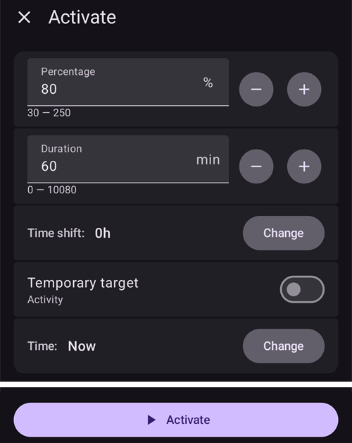
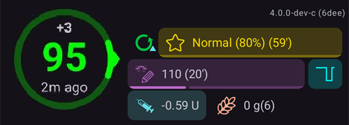

# Prepnutie profilu a percento profilu

Táto časť vysvetľuje, čo je **prepnutie profilu** a **percento profilu**. Ako vytvoriť **profil**, sa dozviete v časti [Váš profil AAPS](#your-aaps-profile-create-and-edit-profiles).

Keď s **AAPS** začínate, musíte si vytvoriť **profil**, naučiť sa, ako urobiť **prepnutie profilu**, a pochopiť, aký vplyv má **percento profilu** v **AAPS**. The features of a **Profile Switch** or **Profile Percentage** can be particularly beneficial for:

- menštruačnom cykle – percentuálnu úpravu **profilu** môžete nastaviť v **Automatizácii**, aby sa **AAPS** prispôsobil rôznym fázam hormonálneho cyklu s predpokladanou inzulínovou rezistenciou.

- cvičení – percentuálnu úpravu **profilu** môžete nastaviť v **Automatizácii** pre cvičenie, aby sa znížil bazál.

- práci v noci alebo na zmeny – pre ľudí, ktorí pracujú na zmeny, môžete nastaviť posun času v **profile**: počet hodín v **profile** zmeníte podľa toho, o koľko neskôr/skôr pôjdete spať alebo vstanete.

Prečo používať **percento profilu** namiesto dočasnej úpravy bazálu? Aby bolo **percento profilu** účinnejšie, úmerne zníži alebo zvýši tieto hodnoty: bazál, ISF a I:C. Vďaka tomu **AAPS** pri podávaní inzulínu počíta vyvážene. Samotné zníženie bazálu v **profile** v **AAPS** veľa nepomôže, ak algoritmus naďalej používa rovnaké pomery ISF a I:C.

(ProfileSwitch-change-percentage)=

## Zmena percenta profilu z hlavnej obrazovky

Potrebujete aspoň jeden uložený **profil**. **Percento profilu** sa vždy použije cez **prepnutie profilu**: **profil** aktivujete znova, tentoraz s percentom.

```{admonition} Prechádzate z AAPS 3? :class: note Dlhé stlačenie názvu profilu už neotvára dialóg prepnutia profilu. **Ťuknite** na názov profilu a potom na okrúhle tlačidlo **▶** vpravo dole: otvorí rovnaké nastavenia (percento, trvanie, dočasný cieľ Aktivita).

    <br />1. Na hlavnej obrazovke **ťuknite na názov profilu** (vedľa ikony hviezdičky). Otvorí sa [obrazovka Profil](#ProfileSwitch-manage-v4) na karte bežiaceho **profilu**, označenej ako **AKTÍVNY**.
    
       
    
    2. Ak chcete ponechať rovnaký **profil**, nechajte vybranú kartu **AKTÍVNY**. Ak chcete zároveň zmeniť **profil**, potiahnite prstom na inú kartu.
    3. Ťuknite na okrúhle tlačidlo **▶** (**Aktivovať**) vpravo dole. Otvorí sa obrazovka **Aktivovať**.
    4. Nastavte **Percento** pomocou **−** / **+** (po 5 %) alebo ho zadajte (30 až 250 %). Pole vždy začína na **100 %**: neukazuje percento, ktoré práve beží. Napríklad zadajte **80** pre o 20 % menej inzulínu alebo **120** pre o 20 % viac.
    5. Nastavte **Trvanie** v minútach:
       * **0** ponechá nové percento, kým neurobíte ďalšie **prepnutie profilu**;
       * každá iná hodnota ukončí prepnutie po tomto čase a **AAPS** sa vráti k **profilu**, ktorý bežal predtým.
    
       
    
    6. Ťuknite na **▶ Aktivovať** v dolnej časti obrazovky. Skontrolujte súhrn v dialógu **Prepnutie profilu** a ťuknite na **OK**.
    
       
    
    Na hlavnej obrazovke potom názov profilu ukazuje percento a zostávajúci čas, napríklad *Normal (80%) (59')*, a kým beží prepnutie s trvaním, je žltý. Hviezdička označuje prepnutie v grafe glykémie. Pozrite [hlavnú obrazovku](#aaps-screens-profile--target).
    
    
    
    Ak sa chcete pred koncom **vrátiť na 100 %**, zopakujte kroky a nechajte **Percento** na 100 a **Trvanie** na 0.
    
    ```{admonition} Percentá jedným ťuknutím
    :class: tip
    Ak často používate rovnaké percento (šport, choroba), pridajte si [skratku profilu](#profile-shortcuts) na panel Rýchleho spustenia alebo si vytvorte [scénu](Scenes.md). Obe jedným ťuknutím použijú profil s nastaveným percentom a trvaním.
    

(ProfileSwitch-manage-v4)=

## Správa a aktivácia profilov (Spravovať → Profil)

V **AAPS** v4 sa profily spravujú a aktivujú na obrazovke **Spravovať** (spodná navigácia) → **Profil** (*„Spravovať a aktivovať profily“*).

Obrazovka Profil zobrazuje vaše profily ako **karusel kariet, ktorými listujete potiahnutím prstom**. Karta bežiaceho profilu je označená ako **AKTÍVNY** a zobrazuje jeho celkový denný bazál (napr. *∑ 30,15 U*). Pod vybranou kartou vidíte podrobnosti profilu – **Jednotky**, typ **Inzulínu** a rozpisy **I:C**, **ISF**, **bazálu** a **cieľa** s grafmi.


Tlačidlá dole pracujú s **vybraným** profilom: **➕ Pridať**, **✏️ Upraviť**, **⧉ Klonovať** a **‘️ Vymazať**, a vpravo okrúhle tlačidlo **▶ Aktivovať**. Ako vyplniť štyri rozpisy v editore (I:C / ISF / BAZ / CIEĽ), nájdete v časti [Vytvorenie a úprava profilov](#your-aaps-profile-create-and-edit-profiles).

**⧉ Klonovať** používa ikonu dvoch štvorcov, ktorá sa často používa na *kopírovanie*, ale nič sa nevkladá: kópia sa vytvorí v jednom kroku. Potvrďte *Klonovať profil "Normal"?* a na koniec karuselu sa pridá a vyberie nový profil s názvom *Normal copy*, pripravený na **✏️ Upraviť** (kde ho môžete aj premenovať). Nie je to to isté ako klonovanie staršieho **prepnutia profilu** z histórie ošetrení, ktoré vytvorí nový profil *s použitým percentom a posunom času*. Pozrite [Uloženie prepnutia profilu na neskoršie použitie](#ProfileSwitch-keep-for-later).

(ProfileSwitch-read-only-mode)= **Iba tlačidlo ▶ Aktivovať?** Vaše nastavenia sú chránené, preto sa obrazovka otvorí iba na čítanie. Ťuknite na **✏️ ceruzku** v hornom paneli a zadajte heslo k nastaveniam. Pozrite si [Ochrana nastavení teraz zamyká aj obrazovky správy](#v4changes-read-only-management).

### Zmena poradia profilov

Ak máte viac ako jeden profil, môžete zvoliť ich poradie v karuseli: ťuknite na ikonu **Usporiadať** (⇅, dve šípky hore a dole) v hornom paneli. Namiesto ukazovateľa strán sa zobrazia **tlačidlá ◀ / ▶** s údajom *pozícia / celkom* – posúvajte kartu v strede dopredu alebo dozadu a potom potvrďte pomocou **✓** (alebo zrušte pomocou **✕**). Nové poradie sa uloží naraz, keď ho potvrdíte.


### Aktivácia profilu

Vyberte profil a ťuknite na **▶ Aktivovať**. Na obrazovke **Aktivovať** môžete upraviť, ako sa **prepnutie profilu** použije:


- **Percento** (30–250 %, vždy začína na 100 %) – upraví celý profil. 100 % použije profil bez zmeny; napríklad 70 % zníži bazál a vypočítanú dávku inzulínu (bolusy k jedlu aj korekcie) o 30 %. Nemení vaše cieľové glykémie ani vstrebávanie sacharidov. Celý účinok nájdete v časti [Percento profilu](#profile-percentage).
- **Trvanie** (0–10080 minút, teda až 7 dní) – ako dlho prepnutie trvá. **0 = bez obmedzenia** (kým znova neprepnete); iná hodnota ako nula sa po skončení vráti k predchádzajúcemu profilu.
- **Dočasný cieľ / Aktivita** – zobrazí sa len vtedy, keď nastavíte **Trvanie** a **Percento** pod 100 %. Keď ho zapnete, spustí sa aj [dočasný cieľ Aktivita](#TempTargets-activity-temp-target) na rovnakú dobu, ako by ste to urobili pred cvičením.
- **Posun času** – ukazuje *0h*; ťuknutím na **Zmeniť** posuniete rozpis dopredu alebo dozadu až o 23 hodín (užitočné pri práci na zmeny alebo pri cestovaní). Pozrite [Posun času](#ProfileSwitch-ProfilePercentage-time-shift-of-the-circadian-percentage-profile).
- **Znovu použiť** – zobrazí sa, keď bežiace prepnutie má iné percento ako 100 % alebo posun času, napríklad **Znovu použiť 80% 0h**. Ťuknutím naň vyplníte rovnaké percento a posun času, napríklad ak chcete predĺžiť prepnutie, ktoré čoskoro skončí.
    
    

- **Čas** – predvolene *Teraz*. Môžete zvoliť iný čas, až 24 hodín pred aktuálnym časom alebo po ňom. Prepnutie nastavené do budúcnosti začne v tom čase; dočasný cieľ Aktivita nastavený spolu s ním potom tiež začne v tom čase.
    
    

- **Poznámky** – zobrazia sa iba vtedy, ak je zapnuté [Zobraziť poznámky v dialogových oknách](#Preferences-show-notes-field-in-treatments-dialogs).

Ak bazálne dávky pri zvolenom percente nie sú kompatibilné s vašou pumpou, hore sa zobrazí varovanie a **▶ Aktivovať** zostane neaktívne: zvoľte iné percento.

Ťuknite na **▶ Aktivovať** a potom na **OK** v potvrdzovacom dialógu. Bežiaci profil potom má na svojej karte označenie **AKTÍVNY**.

```{admonition} Pumpa môže bazálne dávky zaokrúhliť :class: note Každá pumpa vie podávať bazálne dávky len vo vlastných krokoch (napríklad 0,05 U/h), preto zaokrúhli dávky vášho **profilu**. **AAPS** potom používa bazál, ktorý pumpa naozaj podáva, takže IOB a CDD zostanú správne. Ak pumpa podá za deň trochu viac alebo menej inzulínu ako váš **profil**, oznámenie *„Bazálny profil v pumpe bol aktualizovaný“* vám povie, o koľko, napríklad *„namiesto 10,12 U podáva 10,00 U denne“*.

Ak pumpa hlási bazál, ktorý je ďaleko od vášho **profilu**, **AAPS** ponechá bazál z **profilu** a požiada vás, aby ste skontrolovali bazálne dávky v pumpe.

    <br />```{admonition} Vďaka percentu a posunu času vám stačí jeden profil
    :class: note
    Namiesto vytvárania mnohých podobných profilov si ponechajte jeden základný profil a v opakujúcich sa situáciách (choroba, cvičenie, cestovanie) ho použite s iným **percentom** alebo **posunom času**. Presne toto automatizujú [scény](Scenes.md).
    

Prepnutie profilu nie je obmedzené len na túto obrazovku. Rovnaké prepnutie môžete spustiť aj z **hodiniek s Wear OS**, zo spárovaného **klienta** (pozrite [Ovládanie Master ↔ Client](../RemoteFeatures/ClientMasterControl.md)), zo **[scény](Scenes.md)** alebo pravidlom **Automatizácie**.

## Percento profilu

Je dôležité, aby ste rozumeli základným vlastnostiam **percenta profilu**. Ak pri **prepnutí profilu** nastavíte percentuálne zvýšenie alebo zníženie, parametre nastavené v **profile** sa zvýšia alebo znížia o rovnaké percento.

Napríklad: **prepnutie profilu** na 130 % (to znamená, že ste o 30 % viac inzulínovo rezistentní) dá **AAPS** pokyn, aby

- **zvýšil** bazálnu dávku o 30 %; 
- **znížil** **ISF**: vydelením číslom 1,3;
- **znížil** **I:C** vydelením číslom 1,3.

Pamätajte, že nižšie **ISF** alebo **I:C** znamená silnejší pomer a podanie väčšieho množstva inzulínu. Noví používatelia **AAPS** to ľahko prehliadnu.

Po výbere **AAPS** upraví predvolenú bazálnu dávku a **AAPS** (v otvorenom aj uzavretom okruhu) bude ďalej pracovať na základe zvoleného percentuálneho **profilu**.

Účinok percenta **profilu** zhŕňa táto tabuľka:

| Prepnutie profilu  
Percento |     Účinok     |     I:C  
g/U     | príklad  
15 g |          ISF  
mmol/L/U  
mg/dL/U          | U to lower  
2mmol/L  
40mg/dL |
|:----------------------------:|:--------------:|:-----------------:|:--------------:|:------------------------------------------:|:------------------------------:|
|             90 %             |     Slabší     | 5/0,9  
=**5,55** |     2.7 U      | 2,2/0,9  
=**2,4**  
  
40/0,9  
=**44,4** |             0.8 U              |
|          **100 %**           | **Štandardný** |       **5**       |    **3 U**     |                **2,2  
40**                |           **0.9** U            |
|            130 %             |    Silnejší    | 5/1,3  
=**3,85** |     3.9 U      | 2,2/1,3  
=**1,7**  
  
40/1,3  
=**30,8** |             1.2 U              |

(ProfileSwitch-ProfilePercentage-time-shift-of-the-circadian-percentage-profile)=

## Posun času cirkadiánneho percentuálneho profilu

„Posun času“ v **profile** posunie nastavenia vášho **profilu** v rámci denného cyklu („cirkadiánne“) o zadaný počet hodín. To môže pomôcť:

- **ľuďom, ktorí pracujú v noci alebo na zmeny**: pri nočných zmenách zmeníte počet hodín v **profile** podľa toho, o koľko neskôr/skôr pôjdete spať alebo vstanete; 
- **ľuďom, ktorí pri cestovaní menia časové pásma**; alebo
- **deťom s diabetom 1. typu**, ktoré majú pevný večerný režim a inzulínovú rezistenciu zohľadnenú vo svojom **profile**. Ak z nejakého dôvodu dieťa pôjde spať neskôr, opatrovateľ môže v **profile** dieťaťa použiť „posun času“, aby **AAPS** reagoval na inzulínovú rezistenciu v požadovanom čase.

Vždy ide o to, nastavenia **profilu** z ktorej hodiny majú nahradiť nastavenia aktuálneho času. Tento čas sa musí posunúť o x hodín. Preto dávajte pozor na smer posunu, ako ukazuje nasledujúci príklad:

- Aktuálny čas: 12:00
- **Kladný** posun času 
    - 2:00 **+10 h** -> 12:00
    - Kvôli kladnému posunu času sa namiesto nastavení, ktoré normálne platia o 12:00, použijú nastavenia z 2:00.
- **Záporný** posun času 
    - 22:00 **-10 h** -> 12:00
    - Kvôli zápornému posunu času sa namiesto nastavení, ktoré normálne platia o 12:00, použijú nastavenia z 22:00 (10 hodín večer).


Vďaka tomuto ukladaniu „snímok“ **profilu** sa dá oveľa presnejšie počítať minulosť a sledovať zmeny **profilu**.

(ProfileSwitch-keep-for-later)=

## Uloženie prepnutia profilu na neskoršie použitie

Keď urobíte prepnutie profilu s percentom a/alebo posunom času, môžete tento dočasný profil skopírovať do nového profilu.

Urobíte to tak, že otvoríte ponuku (☰) → **Ošetrenia** a prejdete na kartu **Prepnutie profilu**, pozrite [Klonovanie prepnutia profilu do nového profilu](#your-aaps-profile-clone-profile-switch).