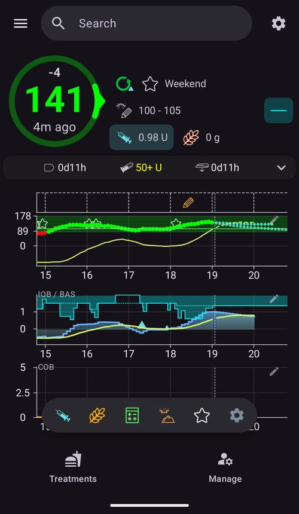

(quicklaunch)=
# Rýchle spustenie (panel rýchlych akcií v prehľade)

**Rýchle spustenie** je malý **panel rýchlych akcií**, ktorý sa vznáša v dolnej časti prehľadu **AAPS**, tesne nad dolnou navigáciou. Je to prispôsobiteľný rad tlačidiel na jedno ťuknutie: sami rozhodnete, ktoré akcie tam budú a v akom poradí, takže to, čo robíte najčastejšie, máte na hlavnej obrazovke vždy na jedno ťuknutie.

```{contents} Table of contents
:depth: 2
:local: true
```


---

## Používanie panela

Panel je v **prehľade**, medzi grafmi a dolnou navigáciou:



- **Ťuknutím** na ikonu spustíte jej akciu – presne tak, ako keby ste ju otvorili z jej bežnej obrazovky (bolus alebo ošetrenie stále najprv zobrazí obvyklé potvrdenie).
- **Dlhým stlačením** ikony zobrazíte **popis** s názvom akcie a krátkym vysvetlením.
- Ak pridáte **viac tlačidiel, ako sa zmestí** na obrazovku, ďalšie sa presunú do **rozbaľovacej ponuky** (tlačidlo **⋮** na konci panela).
- Každá ikona si ponecháva **farbu** svojej akcie (napr. inzulín, sacharidy, dočasný cieľ), takže ju na prvý pohľad spoznáte.

```{admonition} The toolbar is always there
:class: note
Posledné tlačidlo je vždy **Konfigurácia Rýchleho spustenia** (ozubené koliesko **⚙️**). Nedá sa odstrániť, takže sa na obrazovku konfigurácie dostanete vždy priamo z panela. V predvolenom stave panel obsahuje iba dve tlačidlá – **Bolusová kalkulačka** a toto ozubené koliesko.
```

---

## Konfigurácia Rýchleho spustenia

Ťuknite na ozubené koliesko **⚙️** na paneli (alebo otvorte **[Konfigurácia](../SettingUpAaps/ConfigBuilder.md) → … → Konfigurácia Rýchleho spustenia**), otvorí sa obrazovka **Konfigurácia Rýchleho spustenia** (*„Prispôsobte si tlačidlá rýchlej akcie v prehľade“*).


Obrazovka má dve časti:

- **Zvolené akcie** (hore) – tlačidlá, ktoré sú teraz na vašom paneli, v poradí ako na paneli.
- **Katalóg** pod nimi – všetky akcie, ktoré môžete pridať, zoskupené podľa kategórií. Každá položka katalógu má tlačidlo **➕** na pridanie.

### Zvolené akcie – zmena poradia, úprava, odstránenie

Každá zvolená akcia má:

- **⠿ úchyt na presúvanie** – stlačte a potiahnite, aby ste **zmenili poradie** tlačidiel (poradie tu je poradie na paneli),
- tlačidlo **−** – **odstráni** ju z panela,
- a iba pri skratke **Profil** tlačidlo **✏️** na úpravu jej percenta/trvania (pozrite [Skratky profilov](#profile-shortcuts)).

Zmeny sa prejavia **okamžite** – nie je tu samostatné tlačidlo *Uložiť*. Pridaná akcia sa umiestni na koniec panela; odtiaľ ju môžete presunúť.

---

## Kategórie akcií

Katalóg zoskupuje všetko, čo môžete pridať, do nasledujúcich kategórií v tomto poradí. Kategórie, ktoré nemajú čo ponúknuť (napr. nemáte žiadne scény), sa jednoducho nezobrazia.

### Ošetrenie

Bežné dialógy ošetrení a CGM:

- **Inzulín** – ručné podanie bolusu.
- **Sacharidy** – zaznamenanie sacharidov bez inzulínu.
- **Bolusová kalkulačka** – otvorí bolusovú kalkulačku.
- **Ošetrenie** – zaznamenanie inzulínu a sacharidov spolu.
- **CGM** – otvorí vašu aplikáciu CGM (napr. xDrip).
- **Kalibrácia** – kalibrácia senzora CGM.

### Starostlivosť

Udalosti Starostlivosti a záznamy o údržbe zariadení:

- **Kontrola glykémie**, **Poznámka**, **Pohyb**, **Otázka**, **Oznámenie**,
- **Zavedenie senzora**, **Výmena batérie v pumpe**, **Výmena setu**, **Plnenie/doplňovanie**, **Striedanie miest**.

**Plnenie/doplňovanie** a **Výmena batérie v pumpe** sa ponúkajú iba vtedy, keď ich vaša pumpa používa. Napríklad náplasťové pumpy sa plnia a menia batériu vo vlastných krokoch aktivácie, preto sa im tieto položky nezobrazujú (rovnako ako v paneli **Spravovať**).


Sú to tie isté položky, ku ktorým sa inak dostanete cez panely **[Ošetrenia](#v4changes-treatments)** a **[Spravovať](#v4changes-manage)** – Rýchle spustenie len umiestni tie, ktoré používate, do prehľadu.

### Spravovať

Obrazovky panela **[Spravovať](#v4changes-manage)** v rovnakom poradí, aby ste tú, ktorú používate najviac, mohli otvoriť z panela:

- **Profil**, **Nastavenia inzulínu** (správa a aktivácia konfigurácií inzulínu – zámerne sa volá inak ako **Inzulín**, pretože to tlačidlo podáva bolus), **Dočasný cieľ**, **Rýchly sprievodca**, **Scény**, **Automatizácia**, **Jedlo**,
- **Režim prevádzky** – uzavretie alebo otvorenie okruhu, jeho pozastavenie alebo odpojenie pumpy,
- **Autorizovaní klienti** – iba na hlavnom zariadení (master) alebo na spárovanom klientovi.

Tieto tlačidlá otvoria obrazovku; samy nič nespustia. Ak chcete spustiť scénu alebo Rýchleho sprievodcu jedným ťuknutím, pridajte ho z kategórie **Scény** alebo **Rýchly sprievodca** nižšie.

 

### Rýchly sprievodca

Každú vašu predvoľbu **[Rýchleho sprievodcu](QuickWizards.md)** môžete pridať ako tlačidlo, takže opakované jedlo máte v prehľade na jedno ťuknutie. Tlačidlo nesie názov predvoľby a zobrazuje množstvo sacharidov/inzulínu; ťuknutím spustíte Rýchleho sprievodcu s jeho obvyklým potvrdením.

Predvoľby Rýchleho sprievodcu nastavené na zobrazenie iba na hodinkách sa neponúkajú. Tlačidlo Rýchleho sprievodcu na paneli sa riadi rovnakými pravidlami ako v paneli **Ošetrenia**: mimo svojho [platného časového rozsahu](#quickwizard_validity) a krátko po použití je skryté. V konfigurácii panela zostáva a znova sa objaví, keď sa Rýchly sprievodca dá opäť použiť.

### Scény

Každú zapnutú **[scénu](Scenes.md)** môžete pridať ako tlačidlo. Ťuknutím sa zobrazí žiadosť o potvrdenie a potom sa scéna aktivuje (rovnaký súbor akcií, aký by ste dostali z obrazovky Scény). Táto kategória sa zobrazí iba vtedy, ak máte aspoň jednu scénu.

Popis aj katalóg zobrazujú rovnaký súhrn ako **Spravovať → Scény**, napríklad *„3 akcie, 2 h → Oddych“*, kde názov za šípkou je nasledujúca scéna.

### Automatizácia

Vaše pravidlá automatizácie typu **akcia používateľa** (tie, ktoré spúšťate ručne) môžete pridať ako tlačidlá. Ťuknutím sa zobrazí žiadosť o potvrdenie a potom sa vykonajú akcie daného pravidla.

```{admonition} Automation buttons run on the master
:class: note
Automatizácia sa vykonáva na **hlavnom zariadení (master)**, preto sa skratky automatizácie ponúkajú a spúšťajú iba na hlavnom zariadení. Na spárovanom **[klientovi](../RemoteFeatures/ClientMasterControl.md)** nie sú k dispozícii.
```

### Predvoľby dočasného cieľa

Každú vašu predvoľbu **[dočasného cieľa](TempTargets.md)** môžete pridať ako tlačidlo (zobrazí sa jej názov, cieľ a trvanie, napríklad *„Pred jedlom — 5,0 mmol/l, 45 min“*). Ťuknutím sa zobrazí žiadosť o potvrdenie a potom sa tento dočasný cieľ spustí.


(profile-shortcuts)=
### Profil

Každý **[profil](ProfileSwitch-ProfilePercentage.md)** môžete pridať ako **skratku**, ktorá jedným ťuknutím urobí **prepnutie profilu**. Na rozdiel od väčšiny skratiek má skratka profilu vlastné **percento** a **trvanie**, ktoré nastavíte po pridaní tlačidlom **✏️**:

- **Percento** (30–250 %, v krokoch po 5 %) – pri použití profil prispôsobí. 100 % ho použije bez zmeny.
- **Trvanie** (0–10080 min, teda až 7 dní, v krokoch po 10 min) – ako dlho prepnutie trvá. **0 = Permanentné** (kým znova neprepnete).


Vďaka tomu môžete mať pre **ten istý** profil viac tlačidiel s rôznou silou – napríklad *„Profil 100 %“* a *„Profil 70 % na 2 h“* – a ktorékoľvek použiť jedným ťuknutím. (Ten istý profil môžete pridať viackrát s rôznymi nastaveniami.)

### Pluginy


Nakoniec môžete ako skratku pridať akýkoľvek **zapnutý plugin**, ktorý má vlastnú obrazovku, a otvárať ju priamo. Sú zoskupené podľa typu pluginu – **Pumpa**, **Zdroj glykémie**, **APS**, **Okruh**, **Detekcia citlivosti**, **Vyhladzovanie**, **Kalibrácia**, **Obmedzenia**, **Komunikácia** a **Všeobecné** – takže sa napríklad z prehľadu dostanete priamo na obrazovku pumpy alebo okruhu.

---

## Rýchle spustenie a Master/Client

Na rozdiel od väčšiny vašich nastavení sa **panel Rýchleho spustenia nastavuje pre každé zariadenie zvlášť** – je uložený **lokálne a nesynchronizuje sa** medzi hlavným zariadením a spárovanými klientmi, takže každé zariadenie má vlastnú sadu tlačidiel. (*Je* však súčasťou **zálohy/exportu** nastavení, takže obnovenie ho na tom istom zariadení vráti.)

Čo môže každé zariadenie dať na svoj panel, stále závisí od toho, čo má: predvoľby Rýchleho sprievodcu, scény, predvoľby dočasného cieľa aj profily sa synchronizujú, takže katalóg klienta ponúka tie isté položky – len si ich vyberiete pre každé zariadenie. Niekoľko podrobností, ktoré treba vedieť:

- Tlačidlá, ktorých cieľ už neexistuje (vymazaný Rýchly sprievodca, scéna alebo predvoľba, vypnuté pravidlo), sa **automaticky preskočia**.
- Skratky **automatizácie** sa ponúkajú a spúšťajú iba na **hlavnom zariadení** (automatizácia sa vykonáva na hlavnom zariadení). Tlačidlá scén, Rýchleho sprievodcu, dočasného cieľa a profilu sú na klientovi k dispozícii.
- Keď na klientovi ťuknete na tlačidlo, ktoré sa musí vykonať na hlavnom zariadení (bolus, dočasný cieľ, prepnutie profilu alebo scéna), vykoná ho **hlavné zariadenie** a to tiež vytvorí potvrdenie. Pozrite [Ovládanie Master ↔ Client](../RemoteFeatures/ClientMasterControl.md).

---


<!-- =====================================================================
     Screenshots captured from a real master device:
       - quicklaunch_toolbar.png    (cropped close-up of the overview toolbar pill)
       - quicklaunch_overview.png   (full overview showing the toolbar in place)
       - quicklaunch_config.png     (Configure QuickLaunch: Selected actions + Treatment + start of Manage)
       - quicklaunch_dynamic.png    (catalog: Quick Wizard / Scenes / Automation / Temp Target Presets)
       - quicklaunch_categories.png (catalog: Profile shortcuts + plugin categories)
     No QuickLaunch action was actually run (nothing delivered; only scrolled).
     Maintainers: relocate page + images and fix cross-links as needed.
     ===================================================================== -->
