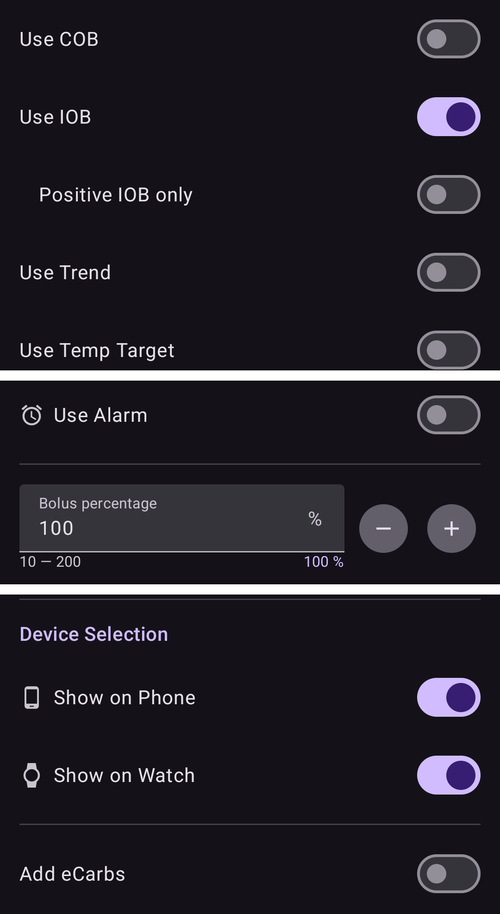

(quickwizards)=
# Rýchly sprievodca (bolusy na jedno ťuknutie)

**Rýchly sprievodca** je uložené tlačidlo na jedno ťuknutie pre opakované jedlo alebo situáciu. Obsahuje pevné množstvo **sacharidov** (a spôsob, ako na ne dávkovať), takže bolus môžete podať – alebo len zaznamenať sacharidy – jedným ťuknutím a potvrdením, namiesto toho, aby ste zakaždým otvárali celú bolusovú kalkulačku.

```{contents} Table of contents
:depth: 2
:local: true
```

---

## Otvorenie Rýchleho sprievodcu

Otvorte obrazovku **Spravovať** (dolná navigácia) a vyberte **Rýchly sprievodca** (*„Spravovať predvoľby rýchleho sprievodcu“*).

---

## Správa predvolieb Rýchleho sprievodcu

Vaše predvoľby Rýchleho sprievodcu sa zobrazujú ako **karusel kariet, ktorý môžete posúvať potiahnutím** (každá karta zobrazuje text tlačidla, sacharidy a platný časový rozsah). Editor pod ním nastavuje **vybranú** predvoľbu; dolný panel akcií obsahuje tlačidlá **➕ pridať**, **⧉ klonovať**, **🗑️ vymazať** a tlačidlo **▶**, ktoré spustí vybranú predvoľbu Rýchleho sprievodcu.


Hlavné polia editora sú:

- **Text tlačidla** – popis zobrazený na tlačidle.
- **Sacharidy** a **Čas jedla** – množstvo sacharidov a jeho časový posun.
- **Platný časový rozsah** – pozrite [Platnosť](#quickwizard_validity).
- **Nastavenia Kalkulačky** a **Voľba zariadenia** – pozrite nižšie.

---

## Tri režimy

Prepínač v hornej časti editora – **Sprievodca / Inzulín / Sacharidy** – určuje, **čo tlačidlo urobí** po ťuknutí:

- **Sprievodca** – spustí celú **bolusovú kalkulačku** pre nastavené sacharidy s použitím vašej aktuálnej **glykémie, IOB, COB a trendu** (podľa *Nastavení Kalkulačky* nižšie). Podá *vypočítaný* bolus a zaznamená sacharidy. Toto je klasický rýchly sprievodca.
- **Inzulín** – podá **pevné, vopred nastavené množstvo inzulínu**, ktoré určíte – bez výpočtu.
- **Sacharidy** – zaznamená **iba nastavené sacharidy**, **bez bolusu**.

---

## Nastavenia Kalkulačky (režim Sprievodca)

Pri tlačidle v režime **Sprievodca** vyberiete, ktoré vstupy výpočet použije:

- **Použiť glykémiu**, **Použiť COB**, **Použiť IOB** (s možnosťou *Iba kladný IOB*), **Použiť trend** (*Všetko / Iba kladné / Iba záporné*), **Použiť dočasný cieľ**, **Použiť alarm**.
- **Percento bolusu** – upraví vypočítaný bolus.
- **Pridať eSacharidy** – naplánuje aj predĺžené sacharidy.



---

## Platnosť – kedy sa tlačidlo zobrazí

(quickwizard_validity)= **Platný časový rozsah** (*Od / Do*) určuje, **kedy** sa predvoľba Rýchleho sprievodcu zobrazí a dá sa použiť. Tlačidlo nastavené napríklad na **06:00–10:00** sa zobrazí iba ráno – takže Rýchly sprievodca *Raňajky* vám pri večeri nezapratáva obrazovku (ani ho omylom neťuknete). Mimo svojho časového okna je tlačidlo skryté v paneli **Ošetrenia** aj na [paneli Rýchleho spustenia](QuickLaunch.md). Tlačidlo na paneli sa nevymaže: znova sa objaví, keď sa časové okno opäť otvorí.

Ak je platný časový rozsah kratší ako 4 hodiny, tlačidlo sa po použití skryje aj na 30 minút, aby sa to isté jedlo omylom nezadalo dvakrát.

---

## Miesta použitia – kde ho použijete

Prepínače **Voľba zariadenia** určujú, kde sa jednotlivé predvoľby Rýchleho sprievodcu zobrazia:

- **Zobraziť na telefóne** – zobrazí sa v **paneli [Ošetrenia](../Maintenance/V4Changes.md)** (s vypočítanou dávkou priamo na tlačidle). Rýchly sprievodca zobrazený na telefóne sa dá aj **pripnúť ako tlačidlo rýchlej akcie v prehľade**: otvorte *Konfigurácia Rýchleho spustenia* (⚙ na paneli [Rýchleho spustenia](QuickLaunch.md)) a pridajte ho z kategórie **Rýchly sprievodca**.
- **Zobraziť na hodinkách** – zobrazí sa na **dlaždici Rýchly sprievodca vo Wear OS** (prejdite na ňu v karuseli dlaždíc na hodinkách a potom ťuknutím na tlačidlo ho spustite – rovnako ako pri [dlaždici Scény](#scenes-from-watch)).

```{admonition} Don't see Device Selection?
:class: note
Časť **Voľba zariadenia** sa v editore zobrazí iba vtedy, keď je zapnutý plugin **Wear** a jeho nastavenie **Ovládanie cez Wear** je zapnuté. Bez toho sa každá predvoľba Rýchleho sprievodcu jednoducho zobrazí na telefóne.
```

Na telefóne sa predvoľby Rýchleho sprievodcu zobrazujú v hornej časti dolného panela **Ošetrenia**:


…a ako tlačidlo rýchlej akcie v prehľade:


Rýchleho sprievodcu môže spustiť aj spárovaný **klient** (**AAPSClient**) – **hlavné zariadenie (master)** ho vypočíta a podá (pozrite [Ovládanie Master ↔ Client](../RemoteFeatures/ClientMasterControl.md)).

Nech ho spustíte odkiaľkoľvek, ťuknutie na Rýchleho sprievodcu vždy zobrazí **potvrdenie** (pri spustení z klienta alebo hodiniek potvrdenie vytvorené hlavným zariadením) skôr, ako sa čokoľvek podá.

Rýchly sprievodca sa odmietne, ak je jeho dávka vyššia ako váš maximálny bolus alebo ak sú jeho sacharidy či eSacharidy vyššie ako vaše maximum sacharidov (napríklad po znížení limitu). Ak sú sacharidy nad limitom, tlačidlo v paneli **Ošetrenia** je neaktívne. Upravte Rýchleho sprievodcu alebo limit.

---

## Pridávanie a odstraňovanie

- **➕ Pridať** – vytvorí novú predvoľbu Rýchleho sprievodcu.
- **⧉ Klonovať** – skopíruje predvoľbu ako východisko.
- **🗑️ Vymazať** – odstráni predvoľbu.

Ak máte dve alebo viac predvolieb Rýchleho sprievodcu, môžete v karuseli zmeniť aj ich poradie: ťuknite na ikonu **Usporiadať** (⇅) v hornom paneli, kartu v strede posúvajte **tlačidlami ◀ / ▶** a potom potvrďte **✓**. (Ovládanie vyzerá rovnako ako pri [zmene poradia profilov](ProfileSwitch-ProfilePercentage.md).)

Predvoľby Rýchleho sprievodcu sú súčasťou synchronizovanej konfigurácie, takže sú spoločné pre hlavné zariadenie aj spárovaných klientov.

---


<!-- =====================================================================
     Screenshots captured from a real master device:
       - quickwizard_editor.png   (Manage → QuickWizard: carousel, mode, carbs, carb time, valid time range)
       - quickwizard_options.png  (Calculator Options, Bolus percentage, Device Selection)
       - quickwizard_overview.png (the QuickWizard quick-action button on the overview)
       - quickwizard_watch_tile.png (the Wear OS QuickWizard tile)
     No QuickWizard was actually run (no bolus delivered).
     Maintainers: relocate page + images and fix cross-links as needed.
     ===================================================================== -->
