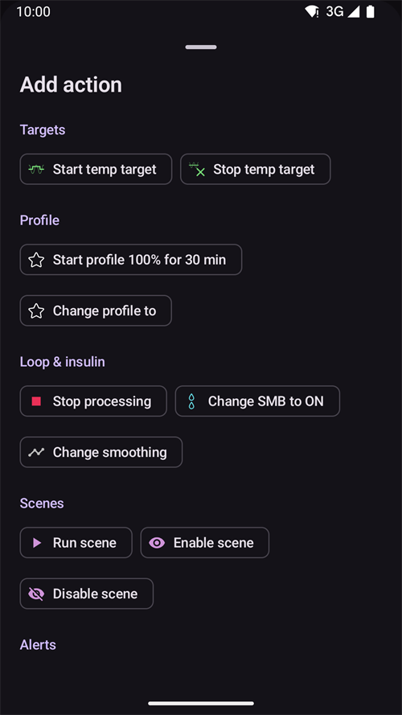

(scenes)=
# Scény (predvoľby pre situácie)

**Scéna** je pomenovaná predvoľba, ktorá použije **viac akcií naraz** – napríklad predvoľba *Spánok*, *Cvičenie* alebo *Choroba*, ktorá jedným ťuknutím prepne profil, nastaví dočasný cieľ, zapne alebo vypne SMB a pridá poznámku do Starostlivosti, voliteľne na nastavený čas.

```{contents} Table of contents
:depth: 2
:local: true
```

---

## Čo je scéna

Namiesto toho, aby ste pri každej opakovanej situácii menili viac vecí ručne, nastavíte ich raz ako scénu a aktivujete ju jedným ťuknutím. Scéna môže obsahovať ktorékoľvek z týchto akcií:

- **Prepnutie profilu** – prepne profil a/alebo ho zmení na percento (napr. 70 %).
- **Dočasný cieľ** – nastaví dočasný cieľ (napr. *Aktivita*, *Pred jedlom* alebo vlastnú hodnotu).
- **SMB zap/vyp** – zapne alebo vypne Super Micro Bolusy, kým je scéna aktívna.
- **Režim okruhu** – zmení režim prevádzky (napr. na opatrnejší režim).
- **Poznámka v Starostlivosti** – zaznamená udalosť (napr. *Pohyb*, *Choroba*), aby sa zobrazila v grafe a v Nightscoute.

Scéna má aj **trvanie** – pevný čas (minúty/hodiny/dni) alebo *Neurčitý (manuálne ukončenie)* – a **akciu po skončení**, ktorá sa vykoná, keď scéna skončí: buď **notifikáciu**, alebo môže scéna **nadviazať** na inú scénu (napríklad *Choroba → Cvičenie*).

---

## Správa scén

Otvorte **Spravovať → Scény**, kde môžete scény prezerať, vytvárať, upravovať, povoliť/zakázať a meniť ich poradie.


Každá karta scény zobrazuje:

- **políčko** na povolenie/zakázanie scény,
- **ikonu** a **názov**,
- zhrnutie – *„N akcií, trvanie“* a **→ nadväzujúcu scénu**, ak scéna nadväzuje na inú,
- a tri tlačidlá: **▶ aktivovať**, **✏️ upraviť**, **🗑️ vymazať**.

Novú scénu vytvoríte ťuknutím na tlačidlo **+**.

---

## Vytvorenie alebo úprava scény

### Začať od šablóny

Ak chcete scénu **vytvoriť**, ťuknite na obrazovke Scény na tlačidlo **+**. Prvý krok je **Začať od šablóny**: vyberte si hotovú scénu pre bežnú situáciu – *Cvičenie*, *Choroba*, *Choroba – vracanie*, *Spánok*, *Noc po cvičení*, *Pred jedlom*, *Alkohol*, *Šoférovanie*, *Kúpanie*, *Luteálna fáza*, *Horúce počasie*, *Lekársky zákrok* – alebo začnite s *Prázdnou* scénou. Každá šablóna **predvyplní odporúčané akcie** a všetko môžete upraviť v ďalších krokoch.


Keď vyberiete šablónu, zobrazí sa vysvetlenie jej účelu – *kedy* a *prečo* ju použiť – a až potom pokračujete:


### Prechod cez akcie

Zvyšok editora je krátky sprievodca **krok za krokom**. Každý krok je jeden typ akcie s prepínačom *„Zahrnúť … do scény“* – zapnite ho iba pri akciách, ktoré má táto scéna vykonať, a ostatné nechajte vypnuté.


Krokmi prechádzate tlačidlami **Ďalej**/**Späť**: *Prepnutie profilu*, *Dočasný cieľ*, *SMB*, *Režim okruhu*, *Poznámka v Starostlivosti*, potom **trvanie**, **akcia po skončení** (notifikácia alebo nadviazanie na inú scénu) a nakoniec **názov a ikona** scény. Keď skončíte, scénu uložte. (Ak chcete existujúcu scénu **upraviť**, ťuknite na jej tlačidlo **✏️** – dostanete sa priamo do týchto krokov.)

Každý krok začína krátkym vysvetlením, čo akcia robí. Kroky vyzerajú takto, tu so šablónou *Cvičenie*:

**Dočasný cieľ** – vyberte jednu z vašich predvolieb dočasného cieľa:


**SMB** – zapne alebo vypne SMB, kým je scéna aktívna:


**Režim prevádzky** – voliteľne zmení režim okruhu:


**Starostlivosť** – typ udalosti a poznámka, ktoré sa zaznamenajú:


**Trvanie** – ako dlho zostane scéna aktívna; 0 znamená, kým ju sami neukončíte:


**Nadväzujúca scéna** – voliteľne scéna, ktorá sa spustí, keď táto skončí:


**Scéna** – názov a ikona. Uložte stlačením **Dokončiť**:


---

## Aktivácia scény

Scénu aktivujete zo zoznamu **Scény** (tlačidlo **▶**) alebo z položky **Scény** na spodnej navigačnej lište. V paneli **Scény** na spodnej navigačnej lište má každá scéna rovnaké zhrnutie ako v zozname scén. **Ceruzka** v hornej časti panela otvorí **Spravovať → Scény**, kde môžete scény vytvárať alebo upravovať.


Pred použitím čohokoľvek sa zobrazí **potvrdenie**, ktoré presne vypíše, čo scéna urobí, aby ste to mohli skontrolovať:


Ak scéna nadväzuje na inú, potvrdenie končí znakom **→** a názvom nadväzujúcej scény, rovnako ako v zozname scén.

Keď scénu spustíte z položky **Scény** na spodnej navigačnej lište, potvrdenie je jednoduchšie dialógové okno s rovnakým zoznamom akcií. Aktivujte stlačením **OK**:


Po potvrdení sa akcie použijú a **aktívna scéna** sa zobrazí v hornej časti prehľadu s tlačidlom **Ukončiť scénu**. Ak scéna nadväzuje na inú, banner uvádza aj názov nadväzujúcej scény:


Akcie scény platia, kým:

- neskončí jej **trvanie** (vykoná sa **akcia po skončení** – notifikácia alebo nadviazanie na ďalšiu scénu), alebo
- neťuknete na **Ukončiť scénu** a neukončíte ju ručne. Ak scéna nadväzuje na inú, máte dve možnosti: **Prejsť na** nadväzujúcu scénu (aktívna scéna skončí a nadväzujúca sa spustí hneď), alebo **Ukončiť scénu** (aktívna scéna skončí a nadväzujúca sa nespustí).

Scéna bez nadväzujúcej scény sa iba spýta na potvrdenie:


Ukončenie scény **vráti späť** zmeny, ktoré urobila (napríklad prepnutie profilu a dočasný cieľ, ktoré spustila).

Kým je scéna aktívna, profil a cieľ na hlavnej obrazovke majú malú ikonu scény, ak ich nastavila scéna. Panel **Scény** na spodnej navigačnej lište zostáva dostupný na spustenie inej scény:


Keď trvanie skončí samo, zmeny sa hneď vrátia späť a banner sa zmení na **Scéna ukončená** s tlačidlom **Zatvoriť**. Zatvorenie iba odstráni banner z obrazovky – samotná scéna už skončila, takže pravidlá automatizácie a nadväzujúca scéna pokračujú bez čakania naň.

---

## Spúšťanie scén z automatizácie

Scénu nemusíte spúšťať ručne – môže ju za vás spustiť **Automatizácia**. Keď do pravidla automatizácie (**Spravovať → Automatizácia**) pridávate akciu, výber akcií má kategóriu **Scény**:

- **Spustiť scénu** – aktivuje scénu, keď sa splnia spúšťače pravidla (napríklad v nastavenom čase, keď niekam prídete, alebo keď glykémia prekročí hranicu).
- **Povoliť scénu** / **Zakázať scénu** – scénu sprístupní (alebo ju urobí nedostupnou) bez toho, aby ju aktivovala.



Automatizácia môže na scénu aj **reagovať**: zoznam spúšťačov obsahuje spúšťač **Scéna**, takže pravidlo sa môže vykonať iba vtedy, keď je aktívna určitá scéna. V kombinácii s **akciou po skončení** scény (vrátenie späť, notifikácia alebo nadviazanie na inú scénu) sa tak scény môžu automaticky spúšťať, nadväzovať na seba a končiť.

---

## Scény s Master/Client a hodinkami

**Práve aktívna scéna sa synchronizuje** na všetky vaše spárované zariadenia – aktivujte ju na jednom telefóne a ostatné ju zobrazia tiež.

Spárovaný **klient** (**AAPSClient**) môže scénu tiež aktivovať alebo ukončiť: požiadavka sa pošle do zariadenia **master**, ktoré vytvorí potvrdenie a použije scénu na svoj vlastný stav. Ako to funguje, pozrite [Ovládanie Master ↔ Client](../RemoteFeatures/ClientMasterControl.md).

(scenes-from-watch)=
### Z hodiniek s Wear OS

Scény sú na **hodinkách s Wear OS** dostupné ako **dlaždica Scéna**. V karuseli dlaždíc na hodinkách prejdite potiahnutím na dlaždicu **Scéna** (ak tam ešte nie je, najprv ju pridajte zo zoznamu dlaždíc) a ťuknite na scénu, ktorú chcete spustiť:


Dlaždica má štyri pozície. Predvolene sa každá pozícia vyplní **automaticky** ďalšou z vašich povolených scén, v poradí ako v telefóne. Ak si chcete vybrať sami, **dlho podržte dlaždicu** a otvorte jej nastavenia: pre každú zo štyroch pozícií môžete ponechať **Automatická**, pripnúť **konkrétnu scénu** alebo zvoliť **Žiadny**, aby pozícia zostala prázdna. Pozícia pripnutá na scénu, ktorá bola medzitým vymazaná alebo zakázaná, zobrazuje **Nedostupná** – vyberte pre ňu inú scénu.

Hodinky potom zobrazia potvrdenie – ťuknutím na **✓** scénu aktivujete, potiahnutím späť ju zrušíte:


Rovnako ako pri klientovi, **potvrdenie vytvorí a scénu spustí master**; hodinky iba prenesú požiadavku (cez telefón klienta, ak sú hodinky spárované s klientom).

Kým scéna beží – alebo sa na telefóne ešte zobrazuje jej banner **Scéna ukončená** – dlaždica zobrazuje tlačidlo **Koniec** a pod ním názov scény. Ťuknutím naň môžete priamo zo zápästia ukončiť aktívnu scénu alebo odstrániť zostávajúci banner.

Ak bežiaca scéna nadväzuje na inú, dlaždica zobrazuje aj tlačidlo **Preskočiť** a pod ním názov nadväzujúcej scény. Sú to tie isté dve možnosti ako v telefóne:

- **Koniec** – aktívna scéna skončí. Potvrdenie vám oznámi, že nadväzujúca scéna sa nespustí.
- **Preskočiť** – aktívna scéna skončí a nadväzujúca scéna sa spustí hneď. Potvrdenie uvádza obe scény.

[Obrazovka Stav okruhu](#WearOsSmartwatch-loop-status) na hodinkách tiež zobrazuje aktívnu scénu, zostávajúci čas a nadväzujúcu scénu.

---


<!-- =====================================================================
     Screenshots captured from a real master device:
       - scenes_list.png        (Manage → Scenes management list)
       - templates_picker.png   (create: "Start from template" picker)
       - template_explanation.png (create: chosen template's explanation)
       - scene_editor.png       (scene editor, Profile switch step)
       - scene_confirmation.png (scene activation confirmation — also used on the Client/Master page)
       - scene_active_banner.png (overview active-scene banner with the End Scene button)
       - automation_scene_action.png (Automation action picker — Scenes category)
       - scene_watch_tile.png    (Wear OS Scene tile)
       - scene_watch_confirm.png (Wear OS scene confirmation)
     Maintainers: relocate page + images and fix cross-links as needed.
     ===================================================================== -->
