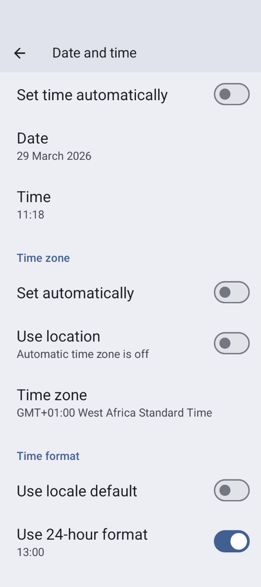

# Zmena časového pásma a letný čas

Keď sa zmení časové pásmo telefónu, **AAPS** asi 10 sekúnd po zmene znova od začiatku prepočíta **IOB**, bazál a citlivosť za minulé obdobie. Kým to prebieha, môže chvíľu trvať, kým sa grafy a hodnoty na hlavnej obrazovke aktualizujú.

(timezone-traveling-with-pumps)=

## Zmena časového pásma pri Omnipod Dash

* Obnovte stav pumpy v **Spravovať → Pumpa**
* Dočasne vyberte iný **profil** a potom sa prepnite späť na pôvodný alebo požadovaný **profil**

## Zmena časového pásma pri DanaR, kórejskej DanaR

Nie je problém so zmenou časového pásma v telefóne, pretože pumpa nepoužíva históriu

(timezone-traveling-danarv2-danars)=

## Zmena časového pásma pri DanaRv2, DanaRS, Dana-i

Tieto pumpy si vyžadujú zvláštnu pozornosť, pretože **AAPS** používa históriu z pumpy, ale záznamy v pumpe nemajú údaj o časovom pásme. **To znamená, že ak v telefóne zmeníte časové pásmo, záznamy sa načítajú s iným časovým pásmom a budú zdvojené.**

Sú dva spôsoby, ako sa tomu vyhnúť:

### Možnosť 1: Ponechajte domovský čas a posuňte čas profilu

* Vypnite „Automatický dátum a čas“ v nastaveniach telefónu (ručná zmena časového pásma).

* Telefón musí mať počas celej cesty nastavený váš štandardný čas ako doma.

* Posuňte čas **profilu** podľa časového rozdielu medzi domovským časom a časom v cieli cesty.
   
   * Ťuknutím na názov **profilu** na hlavnej obrazovke otvoríte [obrazovku Profil](#ProfileSwitch-manage-v4)
   * Vyberte svoj **profil** a ťuknite na **▶ Aktivovať**
   * Nastavte „**Posun času**“ podľa cieľa cesty a ťuknite na **Aktivovať**.
   
   
   
   * napr. Viedeň -> New York: **Prepnutie profilu** +6 hodín
   * napr. Viedeň -> Sydney: **Prepnutie profilu** -8 hodín

### Možnosť 2: Vymažte históriu pumpy

* Vypnite „Automatický dátum a čas“ v nastaveniach telefónu (ručná zmena časového pásma)

When you get off the plane:

* vypnite pumpu
* zmeňte časové pásmo na telefóne
* vypnite telefón, zapnite pumpu
* vymažte históriu pumpy
* zmeňte čas v pumpe
* zapnite telefón
* nechajte telefón spojiť sa s pumpou a dolaďte čas

(timezone-traveling-insight)=

## Zmena časového pásma pri Insight

Ovládač automaticky nastavuje čas na pumpe podľa času na telefóne.

Insight tiež zapisuje do histórie, kedy sa čas zmenil a z akého (starého) času na aký (nový) čas. Vďaka tomu sa v **AAPS** dá určiť správny čas aj napriek zmene času.

Môže to spôsobiť nepresnosti v **TDD** (celkových denných dávkach). Ale to by nemal byť problém.

Takže používatelia Insight sa vôbec nemusia obávať zmeny časových pásiem a zmeny času. Z tohto pravidla je jedna výnimka: pumpa Insight má malú vnútornú batériu na napájanie hodín atď. počas výmeny „skutočnej“ batérie. If changing battery takes too long this internal battery runs out of energy, the clock is reset and you are asked to enter time and date after inserting a new battery. V tom prípade AAPS pri výpočte vynechá všetky záznamy pred výmenou batérie, pretože ich správny čas nie je možné presne určiť.

## Zmena časového pásma pri Accu-Chek Combo

[Ovládač Combo](../CompatiblePumps/Accu-Chek-Combo-Pump-v2.md) automaticky prispôsobí čas pumpy času telefónu. Combo nevie ukladať časové pásma, iba miestny čas, a presne ten ovládač do pumpy naprogramuje. Okrem toho si uloží časové pásmo do lokálnych nastavení AAPS, aby mohol lokálny čas pumpy prepočítať na úplnú časovú značku s posunom časového pásma. Používateľ nemusí robiť nič; ak sa čas na Combe príliš líši od aktuálneho času v telefóne, čas pumpy sa automaticky upraví.

Upozorňujeme však, že to chvíľu trvá, pretože sa to dá vykonať iba v režime remote-terminal, čo je vo všeobecnosti pomalé. Je to obmedzenie pumpy Combo, ktoré sa nedá obísť.

## Zmena časového pásma pri Medtrum

Ovládač automaticky nastavuje čas na pumpe podľa času na telefóne.

Pri zmene časového pásma zostáva história neporušená, ovplyvnená môže byť iba TDD. Ručná zmena času v telefóne môže spôsobiť problémy s históriou a **IOB**. Ak čas zmeníte ručne, dôkladne skontrolujte **IOB**.

When the time zone or time changes running **TBRs** are stopped.

(time-adjustment-daylight-savings-time-dst)=

## LETNÝ ČAS (DST)

Úprava času pri prechode na letný čas.

Podľa toho, akú pumpu a CGM používate, môžu skoky v čase spôsobiť, že **AAPS** nebude fungovať správne. Pri niektorých pumpách je lepšie upraviť časové pásmo ešte pred prechodom na letný čas, keď ste hore, a nie počas noci.

### Automatická úprava letného času pri väčšine púmp

* **Okruh** sa však na 3 hodiny PO prechode na letný čas (zvyčajne od 1:00) deaktivuje a **AAPS** prejde na bazálny inzulín nastavený vo vašom **profile**. Robí sa to z bezpečnostných dôvodov – **IOB** môže byť príliš vysoký pre zdvojený bolus pred zmenou na letný čas.
* Po prechode na letný čas urobte **prepnutie profilu** na požadovaný **profil**, aby ste **okruh** znova zapli: ťuknite na názov profilu na hlavnej obrazovke a potom na okrúhle tlačidlo **▶** (pozrite [Aktivácia profilu](#ProfileSwitch-manage-v4)).
* Pred zmenou na letný čas tiež dostanete na hlavnej obrazovke **AAPS** oznámenie, že **okruh** bol dočasne vypnutý. Táto správa sa zobrazí bez pípnutia, vibrácie alebo podobného zvuku.

Ak podávate bolus pomocou kalkulačky **AAPS**, nepoužívajte údaje **COB** a **IOB**, pokiaľ si nie ste istí, že sú úplne správne. Buďte opatrní a túto funkciu niekoľko hodín po prechode na letný čas nepoužívajte.

### Letný čas pri Accu-Chek Insight

* Zmena na letný čas sa vykonáva automaticky. Žiadna akcia sa nevyžaduje.

### Letný čas pri Accu-Chek Combo

* Zmena na letný čas sa vykonáva automaticky. Žiadna akcia sa nevyžaduje.

### Letný čas pri Medtrum

* Zmena na letný čas sa vykonáva automaticky. Žiadna akcia sa nevyžaduje.

### Letný čas pri Omnipod Dash

* Either allow **AAPS** to temporarily default to background basal after DST has taken place as explained above.
* Otherwise, if you do not want **AAPS** to temporarily default to background basal overnight, you can change the time zone the day before DST is due to take place to avoid overnight disruption. UPOZORNENIE: TÁTO MOŽNOSŤ MÔŽE SPÔSOBIŤ PREDČASNÉ UKONČENIE ŽIVOTNOSTI PODU. AK SI ZVOLÍTE NASLEDUJÚCU MOŽNOSŤ, MAJTE PRI SEBE NÁHRADNÝ MATERIÁL.

#### Čo treba urobiť pred zmenou času

1. Vypnite v telefóne všetky nastavenia, ktoré automaticky nastavujú časové pásmo telefónu, aby ste mohli prejsť na požadované časové pásmo, ktoré nepoužíva letný čas. Ako to zapnúť, závisí od vášho smartfónu a verzie Androidu.
   
   * Niektoré telefóny majú dve nastavenia, jedno na automatické nastavenie času (ktoré by malo ideálne zostať zapnuté) a jedno na automatické nastavenie časového pásma (ktoré musíte VYPNÚŤ: **Nastaviť automaticky** (Set automatically) v časti **Časové pásmo** (Time zone) na snímke obrazovky nižšie).
   * Žiaľ, niektoré verzie Androidu majú jediný prepínač, ktorý zapína automatické nastavenie času aj časového pásma naraz. Toto budete musieť zatiaľ vypnúť.

2. Nájdite časové pásmo, ktoré má rovnaký čas ako vaše aktuálne miesto, ale nepoužíva letný čas.
   
   * Zoznam týchto krajín nájdete na [https://greenwichmeantime.com/countries](https://greenwichmeantime.com/countries/)
   * Pre stredoeurópsky čas (SEČ) to môže byť „Brazzaville“ (Kongo). Zmeňte časové pásmo telefónu na Kongo.

3. V **AAPS** obnovte stav pumpy a prepnite sa na požadovaný **profil**.

4. Check **AAPS's** **IOB** and **COB** and if this is inaccurate disable the **Loop** for at least one DIA or the maximum carb absorption time (**Absorption max time**), whichever is longer.

5. Čo treba spraviť po zmene času. Na návrat k miestnemu časovému pásmu je vhodný čas s nízkym **IOB**. Napr. hodinu pred jedlom, napríklad pred raňajkami. Ideálne by mali byť **COB** aj **IOB** blízko nuly.