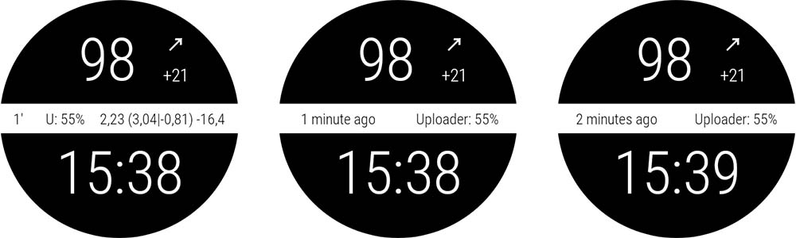

# Referenčný dokument pre vlastné ciferníky

Táto stránka je pre tvorcov nových ciferníkov. Uvádza všetky kľúčové slová a funkcie, ktoré máte k dispozícii, keď chcete vytvoriť alebo animovať nový ciferník.

- Nové funkcie a kľúče dostupné vo verzii Custom Watchface V2 (Wear apk 3.3.0 alebo novší) nájdete [tu](#cwf-reference-new-v2-features)

## Formát vlastného ciferníka

Custom Watchface (vlastný ciferník) je otvorený formát navrhnutý pre AAPS a spojený s novým ciferníkom „AAPS (Custom)“, ktorý je dostupný na hodinkách.

Súbor ciferníka je obyčajný súbor zip. Aby ho však systém rozpoznal ako súbor ciferníka, súbor zip musí obsahovať tieto súbory:

- Jeden obrázkový súbor s názvom CustomWatchface (môže to byť bitmapový súbor `CustomWatchface.jpg`, `CustomWatchface.png` alebo vektorový `CustomWatchface.svg`). Tento súbor je malá ikona, ktorá slúži na výber ciferníka po kliknutí na tlačidlo „Načítať ciferník“, a zároveň obrázok viditeľný v plugine Wear v AAPS.
- Jeden súbor s názvom `CustomWatchface.json` (pozrite [Štruktúra JSON](#cwf-reference-json-structure) nižšie). Tento druhý súbor je hlavný súbor, ktorý obsahuje všetky informácie potrebné na návrh ciferníka. Tento súbor json musí byť platný (pri ručnej úprave súboru v textovom editore je to asi najťažší bod, pretože jedna chýbajúca alebo nadbytočná čiarka stačí na to, aby bol formát json poškodený). Tento súbor JSON musí obsahovať aj blok `"metadata"` s kľúčom `"name"`, ktorý nemá prázdnu hodnotu. Toto bude názov vášho vlastného ciferníka (pozrite [Nastavenia metadát](#cwf-reference-metadata-settings) nižšie)
- tento súbor zip má byť čo najmenší (menej ako asi 500 kB). Ak je tento súbor príliš veľký, bude zablokovaný a neodošle sa do hodiniek.

Súbor zip môže obsahovať aj ďalšie súbory zdrojov:

- Pevne určené názvy súborov pre obrázky, ktoré sa použijú v štandardných zobrazeniach ciferníka (napríklad `Background`, `CoverChart`... pozrite [Zoznam pevne určených súborov zdrojov](#cwf-reference-list-of-hardcoded-resource-files) nižšie). Všetky tieto súbory môžu byť vo formáte `jpg`, `png` alebo `svg`. ale pre väčšinu z nich musíte použiť `png` alebo `svg`, ktoré podporujú priehľadnosť (súbory jpg sú menšie ako png, ale nemajú priehľadnosť). Najlepšiu kvalitu pri najmenšej veľkosti majú zvyčajne súbory svg (vektorový formát).
- Ďalšie súbory zdrojov s voľnými názvami. Tieto ďalšie súbory môžu byť obrázky alebo súbory písiem (pre písma sa prijímajú formáty `ttf` a `otf`). Pri týchto ďalších súboroch sa `filename` (bez prípony) použije v súbore JSON ako hodnota kľúča (keyValue), ktorá určuje, kde alebo kedy sa tieto súbory majú použiť.
  - obrázky sa často používajú ako pozadie textových zobrazení alebo na dynamickú animáciu (napríklad úroveň batérie od 0 % do 100 %)
  - súbory písiem vám umožňujú použiť vo vašom ciferníku vlastné písma

(cwf-reference-json-structure)=

## Štruktúra JSON

Súbory JSON môžete upravovať v textovom editore Notepad (alebo Notepad++) (uprednostnite Notepad++, ktorý rozpozná JSON a farebne ho zvýrazní)

- obsahuje textové kľúče `"string_key":` a hodnoty kľúčov, ktoré môžu byť reťazce ako `"key value"`, celé čísla, logické hodnoty ako `true` alebo `false`, alebo bloky dát.
- jednotlivé hodnoty sú oddelené čiarkou `,`
- Blok dát začína znakom `{` a končí znakom `}`
- súbor json je jeden celý blok, takže začína znakom `{` a končí znakom `}`. Všetky vnorené bloky v tomto súbore patria ku kľúču `"key"`, ktorý musí byť v rámci bloku jedinečný
- Kvôli lepšej čitateľnosti sa súbor json zvyčajne odsadzuje (každý nový kľúč je na novom riadku, každý nový blok je posunutý doprava o 4 medzery)

(cwf-reference-metadata-settings)=

### Nastavenia metadát

Tento blok je prvý blok v súbore json a je povinný. Obsahuje všetky informácie o tomto ciferníku, napríklad názov, autora, dátum vytvorenia alebo aktualizácie, verziu autora alebo verziu pluginu.

Nižšie je príklad bloku metadata:

```text
"metadata": {
    "name": "Default Watchface",
    "author": "myName",
    "created_at": "07\/10\/2023",
    "author_version": "1.0",
    "cwf_version": "1.0",
    "comment": "Default watchface, you can click on EXPORT WATCHFACE button to generate a template"
},
```

Znak `/` použitý v dátume je špeciálny znak. Aby ho súbor json správne rozpoznal, musíte pred neň dať únikový (escape) znak `\`

V niektorých súboroch json môžete vidieť ďalší kľúč `"filename"`. Tento kľúč sa automaticky vytvorí alebo aktualizuje, keď sa vlastný ciferník načíta do AAPS (slúži na to, aby sa používateľovi zobrazil názov súboru zip v priečinku exports), takže tento kľúč môžete z bloku metadata odstrániť.

(cwf-reference-general-parameter-settings)=

### Nastavenie všeobecných parametrov

Za prvým blokom s metadátami nastavíte niektoré všeobecné parametre (pozrite [Zoznam všeobecných parametrov](#cwf-reference-list-of-general-parameters) nižšie). Môžete tak nastaviť farby grafu (sacharidy, bolus, hodnoty glykémie...) a tiež predvolené farby pre hodnotu v rozsahu, pri hyperglykémii alebo hypoglykémii (predvolené farby hodnoty glykémie a šípok)

Nižšie je príklad všeobecných parametrov

```text
"highColor": "#FFFF00",
"midColor": "#00FF00",
"lowColor": "#FF0000",
"lowBatColor": "#E53935",
"carbColor": "#FB8C00",
"basalBackgroundColor": "#0000FF",
"basalCenterColor": "#64B5F6",
"gridColor": "#FFFFFF",
"pointSize": 2,
"enableSecond": true,
```
(cwf-reference-imageview-settings)=

### Nastavenia ImageView

Vlastný obrázok nastavíte tak, že použijete správny názov súboru, ktorý patrí ku každému ImageView v rozložení (layout) vlastného ciferníka. Blok json potom slúži iba na určenie polohy, veľkosti, viditeľnosti zobrazenia a voliteľne na úpravu farby:

Nižšie je príklad bloku obrázka pre second_hand (v tomto prípade v súbore zip nie je žiadny obrázok, preto sa použije predvolený obrázok sekundovej ručičky, ale s vlastnou farbou).

```text
"second_hand": {
    "width": 400,
    "height": 400,
    "topmargin": 0,
    "leftmargin": 0,
    "visibility": "visible",
    "color": "#BC906A"
}
```
Ak chcete, aby mala second_hand predvolenú farbu glykémie (lowRange, midRange alebo highRange), stačí upraviť posledný riadok s hodnotou kľúča `bgColor`

```json
    "color": "bgColor"
```

(cwf-reference-textview-settings)=

### Nastavenia TextView

TextView má viac dostupných parametrov ako ImageView: môžete nastaviť rotation (otočenie, celé číslo v stupňoch), textsize (veľkosť textu, celé číslo v pixeloch), gravity (určuje, či bude text vycentrovaný (predvolená hodnota), alebo zarovnaný doľava či doprava), nastaviť font, fontStyle a fontColor a tiež farbu pozadia TextView

```text
"basalRate": {
    "width": 91,
    "height": 32,
    "topmargin": 133,
    "leftmargin": 249,
    "rotation": 0,
    "visibility": "visible",
    "textsize": 23,
    "gravity": "center",
    "font": "default",
    "fontStyle": "bold",
    "fontColor": "#BDBDBD"
},
```
Ak niektoré zobrazenie vo svojom ciferníku nechcete používať, nastavte kľúč `"visibility"` na `"gone"`, ale nastavte aj veľkosť a polohu mimo viditeľnej oblasti, napríklad takto:

```text
"second": {
    "width": 0,
    "height": 0,
    "topmargin": 0,
    "leftmargin": 0,
    "rotation": 0,
    "visibility": "gone",
    "textsize": 46,
    "gravity": "center",
    "font": "default",
    "fontStyle": "bold",
    "fontColor": "#BDBDBD"
},
```
Ak sú veľkosť a poloha vo viditeľnej oblasti, počas obnovenia ciferníka môžete na chvíľu vidieť „záblesk“ skrytej hodnoty.

Ak chcete upraviť obrázok pozadia textového zobrazenia, použite kľúč `"background":` a ako hodnotu kľúča zadajte názov obrázka v súbore zip. Môžete tiež zmeniť iba farbu pozadia kľúčom `"color:"`.

```json
"background": "fileName"
```

K dispozícii sú aj 4 špeciálne textové zobrazenia (s názvami freetext1 až freetext4), ktoré majú špeciálny parameter `"textvalue":`. Môžete ním nastaviť napríklad popis

(cwf-reference-chartview-settings)=

### Nastavenia ChartView

Zobrazenie grafu (Chart view) je veľmi špeciálne zobrazenie, ktoré môže mať niektoré parametre spoločné s ImageView alebo s TextView...

Štandardné nastavenia tohto zobrazenia sú veľmi jednoduché:

```text
"chart": {
    "width": 400,
    "height": 170,
    "topmargin": 230,
    "leftmargin": 0,
    "visibility": "visible"
},
```
Dva ďalšie parametre, ktoré môžete pre Chart view zadať, sú farba pozadia (predvolene priehľadná) pomocou kľúča `"color"` alebo obrázok pozadia pomocou kľúča `"background"`.

(cwf-reference-how-to-build-watchface)=

## Ako zostaviť a navrhnúť váš prvý ciferník

### Potrebné nástroje

- Textový editor: odporúčam NotePad++ (alebo podobný), čo je jednoduchý textový editor, ale jeho výhodou je, že text zobrazuje farebne naformátovaný, takže sa ľahšie hľadajú chyby. postačí akýkoľvek jednoduchý textový editor. Cieľom je totiž upraviť informácie v json.
- Editor obrázkov (bitmapový a/alebo vektorový)
  - Ak používate bitmapy
    - Editor obrázkov musí zvládať priehľadnosť (potrebná pre všetky obrázky nad pozadím) a formát png (ak používate bitmapové obrázky)
    - Obrázok pozadia môže byť vo formáte jpg (menší ako png)
    - Editor obrázkov by mal vedieť merať grafické objekty v pixeloch (môže to byť jednoduchý štvorec) (top, left, width, height)
    - Image editor should be able to show you colors with RRGGBB code in hexadecimal
    - Editor obrázkov musí vedieť zmeniť veľkosť obrázka na 400px x 400px (je veľmi dôležité pracovať s týmto rozlíšením)
  - Ak používate vektory
    - Vektorový obrázok treba exportovať vo formáte svg

### Získajte šablónu, aby ste nezačínali od nuly

Keď chcete navrhnúť svoj prvý ciferník, najlepšie je začať od predvoleného ciferníka (tak budete mať najnovšiu verziu so všetkými dostupnými zobrazeniami v správnom poradí)

- Súbor zip získate kliknutím na tlačidlo „Exportovať šablónu“ v plugine Wear. Súbor zip potom nájdete v priečinku AAPS/exports
- Aby ste videli tlačidlá vlastného ciferníka, musíte mať k AAPS pripojené hodinky (hodinky sú potrebné aj na kontrolu, testovanie a doladenie vášho vlastného ciferníka)

Predvolený ciferník je veľmi jednoduchý a súbor zip obsahuje iba tieto 2 súbory:

- CustomWatchface.png (obrázok predvoleného ciferníka na výber ciferníka)
- CustomWatchface.json

### Usporiadajte si súbory v počítači

Najjednoduchšie je mať telefón pripojený k počítaču a pracovať s dvoma priečinkami:

- jeden prieskumník otvorený v priečinku, kde budú všetky súbory (json, bitmapové obrázky, vektorové obrázky, písma) a v ňom aj súbor CustomWatchface.zip
- druhý prieskumník (alebo upravený navigačný strom) otvorený tak, aby bol dostupný priečinok Telefón/AAPS/exports

Práca je potom veľmi jednoduchá: vždy, keď upravíte súbor json v textovom editore alebo obrázok v editore obrázkov (bitmapovom alebo vektorovom), stačí:

1. uložiť zmeny v každej aplikácii
2. pretiahnuť všetky súbory do súboru CustomWatchface.zip
3. pretiahnuť CustomWatchface.zip do priečinka AAPS/exports v telefóne
4. odoslať CustomWatchface do hodiniek a skontrolovať výsledok

### Začnite s úpravou ciferníka

Ako prvý krok určte názov ciferníka (je potrebný, aby ste ho pri testovaní ľahko vybrali) a začnite upravovať kľúče metadát na začiatku súboru json

Potom určite, ktoré informácie chcete zobraziť, teda ktoré zobrazenia majú byť viditeľné a ktoré skryté.

- budete zobrazovať sekundy, alebo nie?
- chcete navrhnúť analógové hodinky, alebo digitálne hodinky (alebo oboje...)

Teraz môžete začať upravovať súbor json: kľúč `"visibility":` každého zobrazenia nastavte na `"visible"` alebo `"gone"` (podľa toho, či zobrazenie chcete ponechať, alebo nie)

Môžete tiež začať približne nastavovať hodnoty horného a ľavého okraja (top, left margin) a šírky a výšky (width, height), aby ste ciferník začali usporadúvať (tieto hodnoty neskôr doladíte pomocou editora obrázkov)

Poznámka: všetko sa navrhuje v **obdĺžniku 400px x 400px**. Všetko sa teda umiestňuje v absolútnych súradniciach v rámci tejto veľkosti.

Keď navrhujete svoj prvý ciferník, musíte vedieť, že všetko je usporiadané vo vrstvách od zadnej po prednú. Každé zobrazenie (ImageView alebo TextView) teda môže zakryť niečo, čo je za ním...


V súbore json sú potom všetky zobrazenia zoradené od zadného po predné (pomôže vám to zapamätať si, čo je za čím...)

Ak navrhujete alebo upravujete svoj prvý vlastný ciferník, začnite jednoduchými vecami: zmeňte viditeľnosť niektorých zobrazení, pridajte vlastný obrázok pozadia bez zmeny súboru json...

### Nastavenie farieb

V súbore json je niekoľko kľúčov na zadanie farieb: `"color"`, `"fontColor"` pre zobrazenia, ale aj `"highColor"`, `"midColor"`, `"lowColor"`, ... (pozrite [Zoznam všeobecných parametrov](#cwf-reference-list-of-general-parameters))

Farby sa zadávajú textovým poľom, ktoré začína znakom `#` a pokračuje hodnotami RRGGBB (červená, zelená, modrá) v šestnástkovom formáte:

- `"#FFFFFF"` je biela, `"#000000"` je čierna, `"#FF0000"` je červená...

Môžete pridať aj 2 ďalšie hodnoty pre alfa vrstvu a určiť úroveň priehľadnosti (AARRGGBB):

- `"#00000000"` je úplne priehľadná a `"#FF000000"` je úplne nepriehľadná (takže `"#FF000000"` je to isté ako `"#000000"`)

Môžete tiež použiť špeciálnu hodnotu kľúča `"bgColor"`, ktorá automaticky použije `"highColor"`, `"midColor"`, `"lowColor"` zadané vo všeobecných parametroch podľa hodnoty glykémie:

- `"fontColor": "bgColor",` automaticky nastaví farbu písma zobrazenia podľa hodnoty glykémie
- Zobrazenia `sgv` (hodnota glykémie) a `direction` (šípka trendu) automaticky používajú farby glykémie nastavené vo všeobecných parametroch (ak chcete pre tieto 2 zobrazenia iné farby, musíte použiť pokročilú funkciu [dynData](#cwf-reference-dyndata-feature) s farbou v jednom kroku...)

Viac informácií o ImageViews a kľúči `"color":` nájdete v samostatnej kapitole [Úprava farby obrázka](#cwf-reference-tune-image-color) nižšie.

### Pridanie pevne určených obrázkov

najjednoduchší spôsob, ako začať upravovať ciferník, je pridať do súboru zip obrázky s konkrétnymi názvami (pozrite [Zoznam pevne určených súborov zdrojov](#cwf-reference-list-of-hardcoded-resource-files))

- Obrázok musí byť vo formáte `.jpg`, `.png` alebo `.svg`. ale pozor, jpg nepodporuje priehľadnosť, preto ho používajte iba pre vrstvu pozadia. Pre všetky medzivrstvy (cover_chart, cover_plate, ručičky) použite obrázok `.png` alebo `.svg`

- Ak máte vektorový editor obrázkov (napríklad Illustrator), uprednostnite tento formát: vytvorí malé textové súbory s príponou `.svg` a najlepšou kvalitou.
- Dbajte na presný názov súboru (vrátane veľkých a malých písmen)

Now if you want a dedicated background image, you only have to include within the zip file a file named `Background.jpg` (without changing anything else). Send the zip file to the watch and check the result!

Ak chcete upraviť hour_hand, minute_hand alebo second_hand pre analógové hodinky, jednoducho pridajte `HourHand.png` (alebo `HourHand.svg`), `MinuteHand.png` a `SecondHand.png`.

- tieto obrázky sa automaticky otáčajú okolo stredu obrázka, preto musia byť nastavené na 00:00:00 (a pre analógové hodinky „na celú plochu“ použite veľkosť 400 x 400 px umiestnenú na pozícii top 0 left 0)

V [Zozname pevne určených súborov zdrojov](#cwf-reference-list-of-hardcoded-resource-files) si môžete všimnúť, že pre každé obrázkové zobrazenie máte dva ďalšie pevne určené názvy súborov `High` a `Low` (napríklad môžete do súboru zip pridať ďalšie obrázky s názvami `BackgroundHigh.jpg` a `BackgroundLow.jpg`). obrázok sa potom automaticky zmení podľa vašej glykémie (v rozsahu, hyperglykémia alebo hypoglykémia). Ako príklad si pozrite ciferník AIMICO.

(cwf-reference-tune-image-color)=

### Úprava farby obrázka

Kľúč `"color"` sa dá použiť na úpravu predvolenej farby obrázka:

- pri použití na zobrazenie pozadia nastaví farbu pozadia (predvolene čierna)
- pri použití na cover_plate (jednoduchý ciferník) alebo ručičky zmení predvolený obrázok (biely) na zadanú farbu (vrátane `"bgColor"`)

Keď použijete kľúč `"color"` na bitmapový obrázok (`.jpg` alebo `.png`), farba vytvorí zaujímavý efekt na sýtosti farieb. Svoj bitmapový obrázok teda stále spoznáte.

Pri obrázku `.svg` nemá kľúč `"color"` žiadny účinok, farby vektorových súborov sú pevne dané v obrázku. Ak chcete meniť farby, musíte pridať niekoľko súborov `svg` a na zmenu použiť pokročilú funkciu [dynData](#cwf-reference-dyndata-feature)

### Použitie ďalších písiem pre TextViews

Vo wear apk je už k dispozícii niekoľko predvolených písiem (pozrite kľúče písiem v kapitole [Hodnoty kľúčov](#cwf-reference-key-values)). Ak však chcete použiť ďalšie písma, ktoré nie sú predvolene k dispozícii, môžete ich pridať do súboru zip:

- prijímajú sa 2 formáty písiem: súbory `.ttf` a `.otf`
- ak do súboru zip pridáte vlastné písmo, napríklad súbor s názvom `myCustomFont.ttf`, musíte v súbore json pre TextView použiť tento názov súboru:

```
"font": "myCustomFont",
```

Pamätajte, že niektoré písma môžu byť vo veľkých súboroch (a veľkosť súboru zip je obmedzená). Ak teda používate iba veľmi málo znakov (čísla, `.`, `,`), môžete bezplatnými nástrojmi odstrániť nepoužité znaky (napríklad [tu](https://products.aspose.app/font/generator/ttf-to-ttf)) a zmenšiť tak veľkosť písma.

(cwf-reference-advanced-features)=

## Pokročilé funkcie

(cwf-reference-preference-feature)=

### Funkcia Preferences (nastavenia)

CustomWatchface môže automaticky upraviť niektoré nastavenia hodiniek, aby sa ciferník zobrazoval správne (ak to používateľ povolí v nastaveniach Wear).

Túto funkciu však používajte opatrne. Nastavenia sú spoločné pre všetky ostatné ciferníky. Pri tejto funkcii preto dodržujte niekoľko pravidiel:

- nikdy nenastavujte nastavenia, ktoré sa týkajú skrytých zobrazení
- snažte sa, aby bolo viditeľných čo najviac zobrazení
- pokojne nastavte niektorým zobrazeniam väčšiu šírku:
  - TBR sa dá zobraziť ako percento (malá šírka), ale aj ako absolútna hodnota (oveľa širšia)
  - delta alebo priemerná delta s podrobnými informáciami môže byť široká
  - to isté platí pre iob2: toto zobrazenie môže ukazovať celkový IOB, ale ak je vybraný detailný IOB, text môže byť veľmi dlhý

Ak aj tak potrebujete niektoré veľmi špecifické nastavenia na správne zobrazenie (v príklade nižšie, ak nie je dosť miesta na detailný IOB, môžete tento parameter na hodinkách „vynútiť“ na `false`), môžete do bloku metadata vložiť obmedzenie nastavení, napríklad takto

```text
"metadata": {
    "name": "Default Watchface",
    "author": "myName",
    "created_at": "07\/10\/2023",
    "author_version": "1.0",
    "cwf_version": "1.0",
    "comment": "Default watchface, you can click on EXPORT WATCHFACE button to generate a template",
    "key_show_detailed_iob": false
},
```

Ak používateľ povolí vlastnému ciferníku meniť parametre hodiniek (nastavenie v plugine Wear), nastavenie Zobraziť detailný IOB sa nastaví na „vypnuté“ a uzamkne sa (tento parameter sa nedá zmeniť, kým sa povolenie v parametroch pluginu Wear nevypne alebo kým sa nevyberie iný ciferník)

- Keď používateľ vyberá ciferník, vidí pri výbere počet „požadovaných parametrov“

V príklade nižšie má ciferník Gota jeden požadovaný parameter. Ak povolenie nie je dané, počet sa zobrazí bielou farbou. Ak je povolenie dané, tento parameter sa na hodinkách nastaví a uzamkne (vtedy je počet oranžový)


(cwf-reference-twinview-feature)=

### Funkcia TwinView

Dvojité zobrazenia (twin views) umožňujú jednoducho upraviť polohu zobrazenia podľa toho, ktoré zobrazenia sú viditeľné. Nemá to také možnosti ako rozloženie zostavené celé z LinearLayout, ale zvládne veľa bežných prípadov.

V príklade nižšie vidíte ciferník AAPS (Cockpit) so všetkými zobrazeniami zapnutými v nastaveniach a ten istý ciferník s vypnutými nastaveniami „Zobrazovať stav batérie ďalších zariadení“ a „Zobraziť priemernú odchýlku“


Vidíte, že keď je jedno z dvojice zobrazení skryté, druhé sa posunie do stredu

v tomto príklade vidíte, že v bloku `"uploader_battery"` je pridaný kľúč `"twinView":`, ktorý určuje zobrazenie `"rig_battery"`, a v bloku `"rig_battery"` kľúč `"twinView":` určuje ako dvojča `"uploader_battery"`. Ďalší kľúč `"leftOffsetTwinHidden":` potom určuje, o koľko pixelov sa má zobrazenie posunúť, keď je dvojča skryté.

Na výpočet tohto čísla si všimnite, že rozdiel medzi leftMargin oboch dvojitých zobrazení je 50 pixelov, takže posun, aby zobrazenie zostalo v strede, je polovica tejto hodnoty jedným alebo druhým smerom.

Ak sú dvojité zobrazenia umiestnené nad sebou, musíte použiť kľúč `"topOffsetTwinHidden":`

```text
"uploader_battery": {
    "width": 49,
    "height": 30,
    "topmargin": 354,
    "leftmargin": 150,
    "rotation": 0,
    "visibility": "visible",
    "textsize": 23,
    "gravity": "center",
    "font": "roboto_condensed_bold",
    "fontStyle": "bold",
    "fontColor": "#FFFFFF",
    "twinView": "rig_battery",
    "leftOffsetTwinHidden": 25
},
"rig_battery": {
    "width": 49,
    "height": 30,
    "topmargin": 354,
    "leftmargin": 200,
    "rotation": 0,
    "visibility": "visible",
    "textsize": 23,
    "gravity": "center",
    "font": "roboto_condensed_bold",
    "fontStyle": "bold",
    "fontColor": "#FFFFFF",
    "twinView": "uploader_battery",
    "leftOffsetTwinHidden": -25
},
```
(cwf-reference-dyndata-feature)=

### Funkcia DynData

DynData je najsilnejšia funkcia, ak chcete do ciferníka pridať animáciu podľa niektorých interných hodnôt (napríklad hodnota glykémie, úroveň glykémie, delta, % batérie... zoznam dostupných dát nájdete [tu](#cwf-reference-dyndata-key-values))

Túto funkciu ukážem na príklade ciferníka AAPS (SteamPunk):


V tomto ciferníku musíme riadiť [otáčanie hodnoty glykémie](#cwf-reference-background-management) (od 30 do 330 stupňov) vpravo, [dynamický rozsah avg_delta](#cwf-reference-avg-delta-management) (stupnica do 5 mg/dl, 10 mg/dl alebo 20 mg/dl podľa hodnoty), [otáčanie ručičky](#cwf-reference-dynamic-rotation-management), ktoré musí byť zosúladené so stupnicou, a tiež rôzne vrstvy zobrazení...

Aby ste tomuto ciferníku porozumeli, nižšie sú všetky obrázky, ktoré sú v súbore zip:

Poznámka: aby bola vidieť priehľadnosť, všetky tieto obrázky sú na žltom pozadí a ohraničené červeným štvorcom


- V prvom riadku sa Background.jpg a CoverPlate.png automaticky priradia k príslušnému zobrazeniu (predvolené názvy súborov zobrazení) a steampunk_pointer.png bude riadiť dynData
- V druhom riadku vidíte 3 stupnice dynamického rozsahu pre avg_delta, ktoré bude tiež riadiť dynData
- V treťom riadku sa chartBackground.jpg prepojí ručne v zobrazení chart a súbory HourHand.png a MinuteHand.png sa automaticky priradia k príslušným zobrazeniam

(cwf-reference-background-management)=

#### Riadenie pozadia

Najprv k obrázku hodnoty glykémie: tu nie je na výber, môže byť iba vo vrstve pozadia (inak by bol pred zobrazením grafu a graf by nebol viditeľný!). Musíme teda priradiť hodnotu glykémie k pozadiu a potom otáčať obrázok pozadia podľa hodnoty glykémie.

Do bloku `"background"` vložíme 2 špeciálne kľúče na toto otáčanie:

```text
"background": {
    "width": 400,
    "height": 400,
    "topmargin": 0,
    "leftmargin": 0,
    "dynData": "rotateSgv",
    "rotationOffset": true,
    "visibility": "visible"
},
```
Kľúč `"dynData":` určí, ktorý blok sa použije na definovanie animácie (hodnota, rozsah, prepočet...). Tu má tento blok názov „rotateSgv“ (keď túto funkciu používate, zvoľte výstižný názov),

`"rotationOffset": true,` určuje, že očakávaná animácia podľa hodnoty má byť otáčanie. (ďalšie dostupné kľúče sú `"leftOffset"` a `"topOffset"`, ak chcete vytvoriť posuvník)

Teraz prejdeme na koniec súboru, za posledné zobrazenie:

```text
"second_hand": {
    "width": 120,
    "height": 120,
    "topmargin": 140,
    "leftmargin": 140,
    "visibility": "gone"
},
"dynData": {
    "rotateSgv": {
        "valueKey": "sgv",
        "minData": 30,
        "maxData": 330
    },
```
Vidíte, že za posledné zobrazenie (`"second_hand"`) sme pridali nový blok `"dynData": { ... }`, ktorý bude obsahovať všetky animácie:

Blok určený v zobrazení `"background"` má názov `"rotateSgv"` a je to prvý blok, ktorý nájdete v `"dynData"`!

Tento blok je jednoduchý: prvý kľúč s názvom `"valueKey":` určuje, ktorá hodnota sa má použiť. v tomto prípade je `"sgv"` „keyValue“, ktorá určuje hodnotu glykémie (vo väčšine prípadov má keyValue rovnaký názov ako zobrazenie, ktoré túto informáciu ukazuje).

Pri hodnote glykémie je predvolené min data nastavené na 39 mg/dl a max data na 400 mg/dl (všetky dostupné hodnoty kľúčov a príslušné hodnoty min/max data nájdete nižšie v [Hodnotách kľúčov DynData](#cwf-reference-dyndata-key-values)).

V bloku `"rotateSgv"` sa dva ďalšie kľúče (`"minData":` a `"maxData":`) použijú na nastavenie minimálnej a maximálnej hodnoty dát na 30 a 330. S týmito min a max hodnotami môžeme hodnotu dát priamo použiť (bez prepočtu) na otočenie pozadia v stupňoch. V tomto prípade sa všetky hodnoty glykémie nad 330 mg/dl obmedzia na 330, hornú hranicu obrázka.

#### Riadenie grafu

Predvolené pozadie grafu je priehľadné. Aby sme skryli stupnicu glykémie, ktorá je v obrázku pozadia, musíme pridať špeciálny obrázok pozadia (tento obrázok bude obsahovať celkové tiene ciferníka Steampunk). The link to chartBackground.jpg file is done with `"background":` key

Veľkosť a poloha zobrazenia samozrejme musia byť nastavené presne na pixel!

```text
"chart": {
    "width": 216,
    "height": 107,
    "topmargin": 280,
    "leftmargin": 80,
    "visibility": "visible",
    "background": "chartBackground"
},
```
(cwf-reference-avg-delta-management)=

#### Riadenie priemernej delty

Na riadenie dynamického rozsahu priemernej delty použijeme štyri zobrazenia freetext. freetext1 sa použije na riadenie stupnice obrázka a freetext2 až freetext4 na riadenie otáčania ručičky podľa stupnice.

**freetext1**

Ako bolo vysvetlené vyššie, zobrazenia freetext sú pred grafom a pred pozadím, preto sme pridali priehľadnú oblasť, aby boli tieto obrázky vidieť (pravá a spodná strana obrázka)

Odstránená spodná časť týchto obrázkov bola použitá ako pozadie grafu, aby všetko dokonale zapadlo.

```text
"freetext1": {
    "width": 400,
    "height": 400,
    "topmargin": 0,
    "leftmargin": 0,
    "rotation": 0,
    "visibility": "visible",
    "dynData": "avgDeltaBackground"
},
```
Pre toto zobrazenie pridáme prepojenie na ďalší blok `"dynData"` s názvom `avgDeltaBackground`. Tento blok bude riadiť stupnicu avgDelta podľa hodnoty avgDelta.

```text
"avgDeltaBackground": {
    "valueKey": "avg_delta",
    "minData": -20,
    "maxData": 20,
    "invalidImage": "steampunk_gauge_mgdl_5",
    "image1": "steampunk_gauge_mgdl_20",
    "image2": "steampunk_gauge_mgdl_20",
    "image3": "steampunk_gauge_mgdl_10",
    "image4": "steampunk_gauge_mgdl_5",
    "image5": "steampunk_gauge_mgdl_5",
    "image6": "steampunk_gauge_mgdl_10",
    "image7": "steampunk_gauge_mgdl_20",
    "image8": "steampunk_gauge_mgdl_20"
},
```
- `"valueKey":` vytvorí prepojenie s hodnotou `"avg_delta"`
- min a max Data tiež obmedzia rozsah na maximálnu hodnotu dostupnú v tomto ciferníku (od -20 mg/dl do 20 mg/dl). Používatelia mmol, pamätajte, že všetky interné hodnoty sú v AAPS vždy v mg/dl.

Teraz uvidíme, ako riadiť dynamický obrázok pozadia podľa hodnoty.

`"invalidImage":` je kľúč, ktorý určuje obrázok zobrazený pri neplatných dátach (alebo pri chýbajúcich dátach). Tu vytvoríme prepojenie na ďalší obrázok v súbore zip so stupnicou 5 mg/dl

Potom použijeme sériu obrázkov od `"image1":` po `"image8":`. Počet zadaných obrázkov určuje počet krokov medzi `minData` a `maxData`.

- `image1` určuje obrázok, ktorý sa zobrazí, keď sa avg_delta rovná `minData` alebo je k nej blízko, a obrázok s najvyšším číslom (tu `image8`) určuje obrázok, ktorý sa zobrazí, keď sa avg_delta rovná `maxData` alebo je k nej blízko
- medzi -20 mg/dl a 20 mg/dl je celkový rozsah 40 mg/dl, po vydelení 8 (počet zadaných obrázkov) dostaneme 8 krokov po 5 mg/dl
- Teraz môžeme priradiť obrázky pozadia podľa hodnoty avg_delta, od najnižších hodnôt: medzi -20 a -15 a tiež medzi -15 a -10 použijeme pre stupnicu `steampunk_gauge_mgdl_20`, potom medzi -10 a -5 `steampunk_gauge_mgdl_10` a tak ďalej až po +15 a +20, kde znova použijeme obrázok pozadia `steampunk_gauge_mgdl_20`

(cwf-reference-dynamic-rotation-management)=

**freetext2 až freetext4**

Pre tieto zobrazenia skombinujeme dynamické obrázky a funkciu otáčania vysvetlenú vyššie:

```text
"freetext2": {
    "width": 276,
    "height": 276,
    "topmargin": 64,
    "leftmargin": 64,
    "rotation": 0,
    "visibility": "visible",
    "dynData": "avgDelta5",
    "rotationOffset": true
},
"freetext3": {
    "width": 276,
    "height": 276,
    "topmargin": 64,
    "leftmargin": 64,
    "rotation": 0,
    "visibility": "visible",
    "dynData": "avgDelta10",
    "rotationOffset": true
},
"freetext4": {
    "width": 276,
    "height": 276,
    "topmargin": 64,
    "leftmargin": 64,
    "rotation": 0,
    "visibility": "visible",
    "dynData": "avgDelta20",
    "rotationOffset": true
},
```
Každé zobrazenie tu patrí ku konkrétnej stupnici (je teda prepojené so samostatným blokom dynData). Všimnite si tiež, že pre tieto 3 zobrazenia je zapnutý kľúč `"rotationOffset":`. Teraz sa pozrite na prvý blok dynData:

```text
"avgDelta5": {
    "valueKey": "avg_delta",
    "minData": -20,
    "maxData": 20,
    "rotationOffset": {
        "minValue": -120,
        "maxValue": 120
    },
    "invalidImage": "null",
    "image1": "null",
    "image2": "null",
    "image3": "null",
    "image4": "steampunk_pointer",
    "image5": "steampunk_pointer",
    "image6": "null",
    "image7": "null",
    "image8": "null"
},
```
Aj keď sa dynamický rozsah použije iba pre dáta avg_delta medzi -5 a +5, je dôležité zachovať celkový rozsah -20, +20 mg/dl, aby bola ručička pri prepínaní stupníc zosúladená s pozadím. Preto ponechávame rovnaký celkový rozsah ako pre `avgDeltaBackground` a rovnaký počet krokov (8 obrázkov).

Všimnite si, že `"invalidImage"` aj niekoľko kľúčov `"imagexx"` má hodnotu `"null"` (môže to byť akýkoľvek reťazec, ktorý nie je názvom súboru v súbore zip). Keď sa súbor s daným názvom nenájde, obrázok pozadia zobrazenia bude priehľadný. Toto nastavenie teda zaistí, že ručička bude viditeľná iba v kroku 4 a kroku 5 (priemerná delta medzi -5 mg/dl a +5 mg/dl) a mimo tohto rozsahu viditeľná nebude.

Teraz vidíte nový blok `"rotationOffset":`, ktorý obsahuje dva kľúče `"minValue":` a `"maxValue":`. Tieto hodnoty slúžia na prepočet medzi internými dátami (v mg/dl) a uhlom otočenia, ktorý chceme dosiahnuť.

- Ciferník Steampunk je navrhnutý tak, aby sa ručička otáčala najviac od -30 stupňov do 30 stupňov. Podľa stupnice (tu od -5 mg/dl do 5 mg/dl) teda chceme pre tieto hodnoty 30 stupňov. Pretože `minData` a `maxData` sú 4-krát väčšie, zodpovedajúce minValue a maxValue sú 4 * 30 stupňov, teda -120 a +120 stupňov. Pri každom otočení nad alebo pod +-30 stupňov však bude ručička skrytá (žiadny viditeľný obrázok) a ručička bude viditeľná iba pre hodnoty medzi -5 a +5 mg/dl... A presne to tu chceme.

The other dynData blocks are defined the same way to tune `"avgDelta10"`and `"avgDelta20"`

#### Zobrazenie loop

v ciferníku Steampunk sú zelené a červené šípky okruhu (pre stav) vypnuté. Aj to sa riadi špeciálnym blokom dynData priradeným k zobrazeniu loop.

```text
    "loopArrows": {
        "invalidImage": "greyArrows",
        "image1": "greenArrows",
        "image2": "redArrows"
    }
```
Pretože tento blok volá iba zobrazenie loop a predvolené dáta tohto zobrazenia sú informácie o okruhu, kľúč `"valueKey":` je voliteľný.

Predvolené `minData` a `maxData` pre loop sú 0 min a 28 min. Pri dvoch obrázkoch sa teda všetky hodnoty pod 14 min zobrazia s pozadím `image1` a všetky hodnoty nad 14 min s `image2`. 14 min je presne hranica, pri ktorej sa zelená šípka mení na červenú.

V tomto príklade súbory `greyArrows`, `greenArrows` a `redArrows` nie sú v súbore zip, takže tieto šípky sú jednoducho odstránené (neviditeľné). Tento blok však môžete použiť „tak, ako je“, ak chcete upraviť šípky stavu vlastnými obrázkami pozadia.

#### Zobrazenia rig_battery a uploader_battery

Na záver prehľadu funkcie dynData sa pozrieme na zobrazenie batérie. Cieľom je prispôsobiť farbu textu podľa úrovne batérie (od 0 do 100 %)

```text
"uploader_battery": {
    "width": 60,
    "height": 28,
    "topmargin": 100,
    "leftmargin": 170,
    "rotation": 0,
    "visibility": "visible",
    "textsize": 20,
    "gravity": "center",
    "font": "default",
    "fontStyle": "bold",
    "fontColor": "#00000000",
    "dynData": "batteryIcons",
    "twinView": "rig_battery",
    "topOffsetTwinHidden": -13
},
"rig_battery": {
    "width": 60,
    "height": 28,
    "topmargin": 74,
    "leftmargin": 170,
    "rotation": 0,
    "visibility": "visible",
    "textsize": 20,
    "gravity": "center",
    "font": "default",
    "fontStyle": "bold",
    "fontColor": "#00000000",
    "dynData": "batteryIcons",
    "twinView": "uploader_battery",
    "topOffsetTwinHidden": 13
},
```
Vidíte, že obe zobrazenia zdieľajú rovnaký blok `dynData` s názvom `batteryIcons`. Je to možné, pretože predvolene sa použijú dáta zobrazenia (takže bez kľúča `"valueKey":` v bloku `batteryIcons` sa blok použije s dátami `uploader_battery` alebo `rig_battery` podľa zobrazenia).

Tieto dve zobrazenia používajú aj funkciu TwinView vysvetlenú [tu](#cwf-reference-twinview-feature).

Teraz sa pozrime na blok dynData:

```text
"batteryIcons": {
    "invalidFontColor": "#00000000",
    "fontColor1": "#A00000",
    "fontColor2": "#000000",
    "fontColor3": "#000000",
    "fontColor4": "#000000",
    "fontColor5": "#000000"        
},
```
Používame presne rovnakú logiku ako pri dynamickom obrázku pozadia, ale so špeciálnymi kľúčmi (`"invalidFontColor"` a `"fontColor1"` až `"fontColor5"`, ktoré určujú 5 krokov po 20 %).

- `"fontColor1"` (tmavočervená) sa použije pre všetky hodnoty pod 20 % a biela pre všetky hodnoty nad touto hranicou.
- Ak chcete hranicu znížiť na „pod 10 %“, stačí pridať 5 ďalších kľúčov od `"fontColor6"` po `"fontColor10"`. Môžete tiež upraviť každú farbu, ak chcete postupný prechod od zelenej cez žltú a oranžovú po červenú...

(cwf-reference-dynpref-feature)=

### Funkcia DynPref

Pred čítaním tejto kapitoly musíte rozumieť tomu, ako funguje [dynData](#cwf-reference-dyndata-feature), pretože DynPref je pokročilé použitie DynData: teraz budete môcť upraviť každý blok DynData podľa nastavení, ktoré zvolil používateľ:

Funkciu DynPref ukážeme na dvoch príkladoch:

- Ciferník Steampunk (jednoduché použitie: v jednom ciferníku je verzia pre mg/dl aj mmol a ciferník sa automaticky prepne podľa jednotiek zvolených v AAPS).
- Ciferník AAPS V2 kombinuje rôzne nastavenia, aby mohol riadiť farbu textu a pozadie podľa nastavení dark a match divider.

#### Jednoduché použitie dynPref v ciferníku Steampunk

V ciferníku Steampunk máme dve sady obrázkov podľa jednotiek: obrázok `background`, ktorý má stupnicu glykémie a otáča sa podľa hodnoty glykémie. a `freeText1`, ktorý obsahuje dynamickú stupnicu podľa hodnoty avgDelta. Aby jeden ciferník automaticky ukazoval správne jednotky, musíme obrázok vyberať podľa zvolenej jednotky.

Urobíme to tak, že v bloku zobrazenia nahradíme kľúč `dynData` kľúčom `dynPref`:

```text
 "background": {
    "width": 400,
    "height": 400,
    "topmargin": 0,
    "leftmargin": 0,
    "dynPref": "rotateSgv",
    "rotationOffset": true,
    "visibility": "visible"
},
```
Kľúče `dynPref` sa používajú veľmi podobne ako kľúče `dynData` vysvetlené v predchádzajúcej kapitole

Teraz sa pozrieme na koniec súboru json, za blok `dynData`:

```text
"dynData": {
    ...
},
"dynPref": {
    "rotateSgv": {
        "prefKey": "key_units",
        "true": {
            "valueKey": "sgv",
            "minData": 30,
            "maxData": 330,
            "invalidImage": "Background_mgdl",
            "image1": "Background_mgdl"
        },
        "false": {
            "valueKey": "sgv",
            "minData": 30,
            "maxData": 330,
            "invalidImage": "Background_mmol",
            "image1": "Background_mmol"
        }
    },
    ...
}
```
Vidíte, že kľúč dynPref určený v bloku zobrazenia `background` (`"dynPref": "rotateSgv"`) existuje v bloku json `dynPref` na konci súboru json:

Tento blok musí obsahovať kľúč `"prefKey"`, ktorý určuje, ktoré nastavenie sa má použiť. V tomto príklade je kľúč `"key_units"` prepojený s jednotkami zvolenými v AAPS v telefóne. Hodnota je `"true"`, ak je zvolená jednotka mg/dl, a `"false"`, ak je zvolená jednotka mmol.

Potom nájdete dva bloky json vo formáte „dynData“, ktoré sa použijú podľa zvoleného nastavenia

Note that the "HardCoded" file name for Background image is now replaced by a dynamic image that will be the same whatever the BG value (`Background_mgdl.png`file if key_units is "true", `Background_mmol.png` if key_units is false), and we also include an `"invalidImage"` key to always have a background image even if no data has been received from the phone.

#### Kombinácia rôznych nastavení v dynPref v ciferníku AAPS V2

Väčšinou, keď nastavíte nastavenie, nejde vám o „dynamické správanie“, ale iba o výsledok podľa toho, čo ste zvolili. V dynPref sa to však považuje za dynamickú funkciu...

- zatiaľ čo v `dynData` zadávate jeden celý blok parametrov (s obrázkami, fontColor, Color, ...), s `dynPref` môžete kombinovať každý parameter podľa jedného konkrétneho nastavenia.
- Tu uvidíme, ako sa nastavenie match divider spojí s nastavením dark, aby sa pri zapnutí (true) zobrazil biely text na čiernom pozadí na tmavom ciferníku (parameter dark true) alebo čierny text na bielom pozadí na svetlom ciferníku (dark false)...

Najprv sa pozrime na začiatok súboru json:

```text
"dynPrefColor": "prefColorDark",
"pointSize": 2,
"enableSecond": false,
"background": {
    "width": 400,
    "height": 400,
    "topmargin": 0,
    "leftmargin": 0,
    "visibility": "visible",
    "dynPref": "dark"
},
```
`"dynPrefColor": "prefColorDark"` určuje blok dynPref pre všetky predvolené farby mimo zobrazení. Tieto farby sa nastavia podľa parametra dark v `"prefColorDark"`:

A na konci, v bloku `dynPref`, nájdete špeciálny blok dynPref pre predvolené farby:

```text
"prefColorDark": {
    "prefKey": "key_dark",
    "true": {
        "highColor": "#FFFF00",
        "midColor": "#00FF00",
        "lowColor": "#FF0000",
        "lowBatColor": "#E53935",
        "carbColor": "#FB8C00",
        "basalBackgroundColor": "#0000FF",
        "basalCenterColor": "#64B5F6",
        "gridColor": "#FFFFFF"
    },
    "false": {
        "highColor": "#A0A000",
        "midColor": "#00A000",
        "lowColor": "#A00000",
        "lowBatColor": "#E53935",
        "carbColor": "#D07C00",
        "basalBackgroundColor": "#0000A0",
        "basalCenterColor": "#64B5F6",
        "gridColor": "#303030"
    }
}
```
Rozdiel medzi týmto blokom dynPref a ostatnými štandardnými blokmi dynPref pre zobrazenia je, že tu nemáte blok dynData pre každú hodnotu parametra `"key_dark"`, ale iba zoznam hlavných farieb (`highColor`, `midColor`, ...)

Lets now take a look on items included into the "divider banner" (in example below `"basalRate"` view linked to `"matchDivider"` dynPref view):

```text
"basalRate": {
    "width": 90,
    "height": 32,
    "topmargin": 127,
    "leftmargin": 242,
    "rotation": 0,
    ...
    "leftOffsetTwinHidden": 33,
    "dynPref": "matchDivider"
},
```
V bloku dynPref potom vidíte, že parameter Match divider (kľúč `key_match_divider`) obsahuje 2 bloky „true“ a „false“. Tieto dva bloky však iba určujú, či zobrazenie použije blok „dark“ (teda presne rovnaké pozadie a farbu textu ako ostatné zobrazenia mimo pásu), alebo blok „white“, ktorý nastaví opačné farby pozadia a textu...

```text
"matchDivider": {
    "prefKey": "key_match_divider",
    "true": {
        "dynPref": "dark"
    },
    "false": {
        "dynPref": "white"
    }
},
"dark": {
    "prefKey": "key_dark",
    "true": {
        "color1": "#000000",
        "fontColor1": "#FFFFFF"
    },
    "false": {
        "color1": "#FFFFFF",
        "fontColor1": "#000000"
    }
},
```
Tu ste v bloku „dynData“, preto na určenie farby (color) alebo farby písma (fontColor) použijete dynData (tu nie je uvedené) a jediný krok (použijú sa `"color1"` a `'fontColor1'`)

- pre všetky parametre okrem `image` bude predvolená „neplatná hodnota“ (ak nie je nastavená kľúčom `"invalidColor"` alebo `"invalidFontColor"`) `"color1"` a `"fontColor1"`.


Potom uvidíme tretí príklad so zobrazeniami iob (`iob1` a `iob2`), kde použijeme menší text pre detailný IOB a väčší text pre celkový IOB:

```text
"iob1": {
    "width": 125,
    "height": 33,
    "topmargin": 168,
    "leftmargin": 275,
    "rotation": 0,
    "visibility": "visible",
    "textsize": 19,
    ...
    "dynPref": "prefIob1"
},
"iob2": {
    "width": 125,
    "height": 33,
    "topmargin": 196,
    "leftmargin": 275,
    "rotation": 0,
    "visibility": "visible",
    "textsize": 24,
    ...
    "leftOffsetTwinHidden": -10,
    "dynPref": "prefIob2"
},
```
V predvolených nastaveniach zobrazenia uvidíte veľkosť textu (19 pri `iob1` a 24 pri `iob2`) a dva rôzne bloky `dynPref`, ktoré majú upraviť textsize (podľa parametra detailného IOB) a farby (podľa parametra dark)

```text
"prefIob1": {
    "prefKey": "key_show_detailed_iob",
    "true": {
        "dynPref": "dark",
        "textsize1": 24
    },
    "false": {
        "dynPref": "dark"
    }
},
"prefIob2": {
    "prefKey": "key_show_detailed_iob",
    "true": {
        "dynPref": "dark",
        "textsize1": 19
    },
    "false": {
        "dynPref": "dark"
    }
},
```
Vidíte, že podľa parametra detailného IOB (kľúč `"key_show_detailed_iob"`), keď je „true“, je textsize nastavená na pevnú hodnotu väčšiu ako predvolená (24 namiesto 19). Robí sa to pomocou funkcie „krokov“ textsize, s jedinou hodnotou, teda jedným krokom... (pre všetky parametre okrem obrázkov platí, že ak nie je nastavená invalidTextSize, pre neplatné dáta sa použije textsize1)

Potom sa na nastavenie color a fontColor použije blok dynPref „dark“

V tomto príklade bude blok dynData pre zobrazenie iob1 pri zapnutom detailnom IOB a zapnutom tmavom režime (dark) takýto:

```text
{
    "color1": "#000000",
    "fontColor1": "#FFFFFF",
    "textsize1": 24
},
```

Text bude teda biely na čiernom pozadí a veľkosť 24 nahradí predvolenú veľkosť 19 nastavenú v zobrazení

Blok dynData pre to isté zobrazenie iob1 pri vypnutom detailnom IOB a vypnutom tmavom režime (dark) bude:

```text
{
    "color1": "#FFFFFF",
    "fontColor1": "#000000"
},
```

Teraz bude text čierny na bielom pozadí s veľkosťou 19

#### Tipy a triky pre dynPref

- Môžete kombinovať toľko nastavení, koľko chcete, ale pozor, počet blokov, ktoré treba popísať, môže rásť veľmi rýchlo (exponenciálne): ak zreťazíte 3 parametre a chcete definovať všetky situácie, budete musieť popísať 8 blokov, aj keď má každý parameter iba 2 hodnoty...
- Dajte pozor, aby ste nevytvorili „nekonečnú slučku“ (napríklad ak sa blok dynpref1 má doplniť blokom dynpref2, ktorý sa má doplniť blokom dynpref1...). V tomto prípade sa bloky dynPref budú považovať za neplatné...
- Nezabudnite za kľúč pridať číselný index (keď v zobrazení použijete napríklad kľúč `"textsize"`, v bloku hodnôt dynPref musíte použiť `"textsize1"`, pretože je to formát „dynData“, teda v tomto prípade prepojený s hodnotou s jediným krokom)
- Pre jedno zobrazenie sa smie nastaviť iba jeden kľúč `"valueKey"`. Ak sa teda výsledný blok `dynData` skladá z viacerých blokov `dynPref`, nepridávajte viac kľúčov `"valueKey"` (a s nimi súvisiace `"minData"`, `"maxData"`, ...)

(cwf-reference-new-v2-features)=

### Nové funkcie v CustomWatchface V2 (AAPS V3.3.0 alebo novší)

Ciferníky, ktoré používajú tieto nové funkcie alebo zobrazenia, budú potrebovať najnovší wear apk zostavený z verzie AAPS 3.3.0.

Ak použijete zip „v2“ s hodinkami, ktoré majú CustomWatchface V1, v ciferníku budú chýbať informácie alebo bude zobrazovať nesprávny obsah.

CustomWatchface V2 obsahuje tieto nové funkcie:

- [Nové zobrazenie Status](#cwf-reference-new-status-feature)
- [Nové zobrazenie TempTarget](#cwf-reference-new-temp-target-feature)
- [Nové zobrazenie Reservoir Level (stav zásobníka)](#cwf-reference-new-reservoir-level-feature)
- [Nová funkcia formátovania](#cwf-reference-new-formating-feature)
- [Zobrazenie externých dát pre sledujúcich](#cwf-reference-show-external-datas) (až 3 sady dát v jednom ciferníku, pre AAPS, AAPSCLIENT a AAPSCLIENT2)

(cwf-reference-new-status-feature)=

#### Nové zobrazenie Status

Kľúč tohto zobrazenia je `"status"` a príslušný blok je automaticky v šablóne exportovanej z wear apk „Custom Watchface V2“ (zostavenej z AAPS 3.3.0 alebo novšej verzie)

Toto zobrazenie bolo v starších ciferníkoch AAPS (NoChart), AAPS (BigChart) a AAPS (Large) a obsahuje textovú hodnotu (vytvorenú vo wear apk).

Tieto staršie ciferníky boli v AAPS 3.3.0 odstránené a nahradené 3 novými vlastnými ciferníkmi.

- minimálna informácia je hodnota IOB (vždy viditeľná bez ohľadu na nastavenie IOB v hodinkách)
- potom sú tu detailné hodnoty IOB (BolusIOB|BasalIOB), ak sú zapnuté v nastaveniach
- a hodnota BGI (opäť, ak je zapnutá v nastaveniach)

Toto zobrazenie `"status"` je prepojené s kľúčom `"key_show_loop_status"` (v dynPref), ktorý riadi viditeľnosť.

Vo V1 sa toto zobrazenie dalo vytvoriť pomocou existujúcich zobrazení `"iob1"`, `"iob2"` a `"bgi"`, ale bolo treba zložité nastavenia dynPref na riadenie medzier medzi jednotlivými informáciami podľa rôznych nastavení zvolených v hodinkách.

(cwf-reference-new-temp-target-feature)=

#### Nové zobrazenie TempTarget

Kľúč tohto zobrazenia je `"tempTarget"` a príslušný blok je automaticky v šablóne exportovanej z wear apk „Custom Watchface V2“ (zostavenej z AAPS 3.3.0 alebo novšej verzie).

V ciferníku zobrazuje:

- Cieľ profilu (jedna hodnota alebo cieľové hodnoty min-max) (predvolená farba biela)
- Cieľ upravený okruhom (predvolená farba zelená)
- Dočasný cieľ nastavený používateľom (predvolená farba žltá)

Toto zobrazenie `"tempTarget"` je prepojené s kľúčom `"key_show_temp_target"` (v dynPref), ktorý riadi viditeľnosť.

Kľúč DynData (s informáciou o farbe) je `"tempTarget"` (predvolený kľúč DynData pre zobrazenie TempTarget)

Hodnota DynData je:

- 0 (cieľ profilu),
- 1 (cieľ okruhu) alebo
- 2 (dočasný cieľ používateľa)

Toto zobrazenie je dostupné aj pre externé dáta (pozrite [nižšie](#cwf-reference-show-external-datas)) s kľúčmi `"tempTarget_Ext1"` a `"tempTarget_Ext2"` (View a DynData)

(cwf-reference-new-reservoir-level-feature)=

#### Nové zobrazenie Reservoir Level (stav zásobníka)

Kľúč tohto zobrazenia je `"reservoir"` a príslušný blok je automaticky v šablóne exportovanej z wear apk „Custom Watchface V2“ (zostavenej z AAPS 3.3.0 alebo novšej verzie).

Toto zobrazenie ukazuje stav zásobníka (v `U`) s predvolenou bielou farbou, žltou pri úrovni varovania a červenou pri naliehavej úrovni

Toto zobrazenie `"reservoir"` je prepojené s kľúčom `"key_show_reservoir_level"` (v dynPref), ktorý riadi viditeľnosť.

Kľúče DynData pre stav zásobníka sú:

-  `"reservoir"` (predvolený kľúč DynData pre zobrazenie stavu zásobníka) s množstvom inzulínu v `U`
  - Min hodnota je 0,0 U
  - Max hodnota je 500,0 U
-  `"reservoirLevel"`
  - 0 (štandardná úroveň, predvolene biela farba)
  - 1 (úroveň varovania, predvolene žltá farba)
  - 2 (naliehavá úroveň, predvolene červená farba)

Toto zobrazenie je dostupné aj pre externé dáta (pozrite [nižšie](#cwf-reference-show-external-datas)) s kľúčmi `"reservoir_Ext1"`, `"reservoir_Ext2"`, `"reservoirLevel_Ext1"` a `"reservoirLevel_Ext2"` (View a DynData).

(cwf-reference-new-formating-feature)=

#### Nová funkcia formátovania pre DynData alebo DynPref

Teraz môžete vlastným spôsobom formátovať surové hodnoty, ktoré hodinky prijímajú a ktoré sú uvedené v [tabuľke hodnôt kľúčov dyndata](#cwf-reference-dyndata-key-values) nižšie.

Na ukážku, ako táto funkcia funguje, si vezmime ako príklad ciferník AAPS (Large) a pozrime sa na výsledky podľa „času od poslednej hodnoty“ a podľa toho, či je nové zobrazenie „status“ viditeľné, alebo nie:



- Na prvej snímke obrazovky vľavo je zobrazenie status viditeľné (s IOB, detailným IOB a BGI), takže na zobrazenie timestamp je k dispozícii iba 1/3 riadku (veľmi kompaktná informácia `1'` a pre batériu telefónu (uploader) `U: 55%`)
- Na druhej snímke obrazovky je zobrazenie `status` v parametroch hodiniek skryté, takže je veľa miesta na celý popis pre timestamp a batériu telefónu (uploader) (`1 minute ago` a `Uploader : 55%`)
- Na tretej snímke obrazovky vpravo je v hodinkách presne to isté nastavenie, ale timestamp sa zmenil a je vyšší ako „1“. teraz vlastný ciferník dokáže zobraziť popis aktualizovaný aj so správnym množným číslom (`2 minutes ago`)

Nižšie nebudem vysvetľovať, ako sú v súbore zip riadené všetky zobrazenia (poloha každého zobrazenia podľa rôznych nastavení), ale zameriam sa iba na to, ako v ciferníku AAPS (Large) riadime funkciu formátovania a súvisiacu dynamickú hodnotu.


**Táto funkcia vyžaduje „dynamický blok“** (môže to byť blok `dynData` alebo blok `dynPref`)

- Pri ciferníku AAPS (Large) sme chceli formát upraviť podľa parametrov (krátky alebo dlhý formát podľa viditeľnosti zobrazenia `status`), preto sme na to použili blok `dynPref`.

Začnime najprv zobrazeniami:

```text
"uploader_battery": {
    "width": 200,
    "height": 50,
    "topmargin": 175,
    "leftmargin": 0,
    "rotation": 0,
    "visibility": "visible",
    "textsize": 25,
    "gravity": "center",
    "font": "roboto_condensed_light",
    "fontStyle": "normal",
    "dynPref": "uploader",
    "dynValue": false,
    "fontColor": "#BDBDBD"
},

"timestamp": {
    "width": 200,
    "height": 50,
    "topmargin": 175,
    "leftmargin": 0,
    "rotation": 0,
    "visibility": "visible",
    "textsize": 25,
    "gravity": "center",
    "font": "roboto_condensed_light",
    "fontStyle": "normal",
    "dynPref": "timestamp",
    "dynValue": false,
    "fontColor": "#FFFFFF"
},
```
najdôležitejší kľúč je tu `"dynValue"`: tento kľúč zapne dynamické spracovanie surovej hodnoty. logická hodnota za ním (true alebo false) určí, či sa hodnota má „prepočítať, alebo nie“

- `false`: surová hodnota sa použije tak, ako je, bez obmedzenia alebo prepočtu
- `true`: surová hodnota sa prepočíta (pomocou kľúčov `minData` a `maxData` v bloku dynData a pomocou `minValue` a `maxValue` definovaných v dynData)

V tomto ciferníku sa surové hodnoty používajú bez prepočtu, preto je pre obe zobrazenia kľúč `"dynValue"` nastavený na `false`.


Teraz sa pozrieme na blok `"uploader"` definovaný v `"dynPref"`:

```text
"uploader": {
    "prefKey": "key_show_loop_status",
    "true": {
        "dynPref": "uploader_true_ago",
        "invalidTextvalue": "U: --",
        "textvalue1": "U: %.0f%%"
    },
    "false": {
        "dynPref": "uploader_false_ago",
        "invalidTextvalue": "Uploader: --",
        "textvalue1": "Uploader: %.0f%%"
    }
},
```
Zobrazenie `"uploader_battery"` je predvolene prepojené s `"uploader_battery"`, takže netreba pridávať samostatný riadok s

`"valueKey": "uploader_battery"` (min hodnota 0, max hodnota 100 a surová hodnota je percento batérie telefónu)

Formátovací reťazec je v kľúči `"textvalue1"` (kľúče `"textvalue1"`, `"textvalue2"` atď. sú prepojené s kľúčom `"textvalue"`, ktorý môže byť v bloku `view`)

- Kľúč `"textvalue"` sa dá použiť s informáciou o formátovaní v bloku zobrazenia (vtedy bude formát statický bez ohľadu na hodnotu alebo nastavenia)
- Ak chcete meniť formátovanie podľa nastavení alebo hodnôt, môžete použiť všetky funkcie dynData. Špeciálne kľúče sú `"invalidTextValue"` (bez „informácie o formátovaní“, pretože hodnota nie je platná) a `"textvalue1"`, `"textvalue2"`... (a toľko hodnôt, koľko krokov medzi minData a maxData chcete riadiť)
- ďalšie kľúče `"dynPref"` slúžia na definovanie ďalších blokov pre zmeny polohy a farby podľa viditeľných zobrazení a nastavení dark a matchDivider

Formátovací reťazec má túto syntax: `%[flags][width][.precision]f`

- `%` je začiatok formátovania, `f` je koniec a používa sa na prevod hodnoty typu Double.
  - Ak chcete v reťazci použiť znak `%`, musíte napísať `%%`, aby bolo jasné, že nejde o formátovací reťazec, ale o znak percenta.
- `[flag]` je voliteľný, väčšinou to môže byť `+`, ak chcete pred číslom vždy znamienko, alebo `(`, ak chcete záporné hodnoty v zátvorkách
- `[width]` je voliteľný, určuje minimálny počet znakov, ktoré sa zapíšu do výstupu
- `[.precision]` určuje počet číslic za desatinnou čiarkou.
  - Hodnoty sú typu Double, preto je rozumné vždy nastaviť presnosť (aby sa kvôli presnosti v jazyku Kotlin nezobrazovalo veľa znakov za desatinnou čiarkou)

V príklade vyššie teda `%.0f` zobrazí hodnotu Double ako celé číslo


Pozrime sa teraz na blok dynPref timestamp, ktorý riadi množné číslo:

```text
"timestamp": {
    "prefKey": "key_show_loop_status",
    "true": {
        "dynPref": "timestamp_true_uploader",
        "invalidTextvalue": "U: --",
        "textvalue1": "%.0f'"
    },
    "false": {
        "dynPref": "timestamp_false_uploader",
        "minData": 0,
        "maxData": 3,
        "invalidTextvalue": "-- minute ago",
        "textvalue1": "%.0f minute ago",
        "textvalue2": "%.0f minutes ago"
    }
},
```
- here if `status` view is visible (so  `"key_show_loop_status"` key is `true`), a single format is used (`"textvalue1"`), with `'`  as "unit"
- ak je zobrazenie `status` skryté, použijú sa 2 rôzne formáty: jeden pre 0 alebo 1 s jednotným číslom a druhý pre hodnoty od 2 s množným číslom
  - `"minData"` a `"maxData"` slúžia na určenie rozsahu, aby sa prepnutie z jednotného na množné číslo urobilo medzi hodnotami 1 a 2
  - Kľúč `"maxData"` (celé číslo) je nastavený na 3, a nie na 2, pretože dáta typu Double v systéme nie sú celé čísla. Hodnota trochu vyššia alebo trochu nižšia ako 1 by tak mohla mať tvar jednotného alebo množného čísla, aj keď sa po zaokrúhlení na celé číslo rovná 1.

- Pri zobrazení `timestamp` je dôležité nastaviť kľúč `"dynValue"` na `false`, inak by sa kvôli formátovaniu (jednotné/množné číslo) všetky hodnoty nad 3 obmedzili na `3 minutes ago` prepočtom pomocou `maxData`...


**Ďalšie poznámky k funkcii formátovania**

- pamätajte, že jediné dostupné dynamické hodnoty sú tie, ktoré sú uvedené [tu](#cwf-reference-dyndata-key-values)
- Všetky hodnoty `BG` sú v jednotkách mg/dl. Ak chcete pomocou funkcie formátovania zobraziť hodnoty v jednotkách mmol, musíte prepočet z mg/dl na mmol urobiť sami. V bloku `dynData` alebo `dynPref` musí mať kľúč, ktorým sa pomenuje blok s `"minValue"` a `"maxValue"` na prepočet hodnoty, názov `"dynValue": { ...  }`. (pozrite [Kľúče DynData](#cwf-reference-dyndata-keys))
- Ak chcete v zobrazení použiť statický formátovací reťazec s kľúčom `"textvalue"` na určenie formátu a kľúčom `"dynValue"` na použitie dynamickej hodnoty, musíte použiť aj blok `"dynData"` alebo `"dynPref"` (aj prázdny), aby funkcia formátovania fungovala.
- `"textvalue1"`, `"textvalue2"` až textvalue*n* sa dajú použiť aj bez funkcie formátovania na nahradenie kroku hodnoty double vlastným textom (napríklad s hodnotou kľúča `"day_name"` a siedmimi krokmi môžete určiť vlastné názvy dní v týždni, ...)

- Úplnú dokumentáciu nájdete v [Class Formatter](https://docs.oracle.com/javase/8/docs/api/java/util/Formatter.html)

(cwf-reference-show-external-datas)=

#### Zobrazenie externých dát pre sledujúcich

Vlastný ciferník teraz dokáže na jednom ciferníku zobraziť až 3 sady dát: AAPS, AAPSCLIENT a AAPSCLIENT2

Na použitie tejto funkcie musíte:

- mať v telefóne nainštalované aspoň 2 z týchto 3 aplikácií (AAPS, AAPSCLIENT, AAPSCLIENT2)
- zapnúť vysielanie dát (Broadcast data) v AAPSCLIENT a/alebo AAPSCLIENT2, aby sa dáta vysielali do hlavnej aplikácie, ktorá sa synchronizuje s CustomWatchface (AAPS alebo AAPSCLIENT)
- Použite CustomWatchface, ktorý implementuje zobrazenia s kľúčmi obsahujúcimi `_Ext1` alebo `_Ext2` (pozrite [Prehľad kľúčov a hodnôt kľúčov (Key a KeyValue)](#cwf-reference-key-and-keyvalue-reference) nižšie)

Ak je hlavnou aplikáciou v telefóne AAPSCLIENT a druhou aplikáciou, ktorá vysiela dáta, je AAPSCLIENT2, musíte v parametroch Custom Watchface zapnúť parameter `Switch external data in watchface`, ak používate ciferník so štandardnými zobrazeniami a ďalšími zobrazeniami Ext1 (Ext1 je prepojené s AAPSCLIENT a Ext2 s AAPSCLIENT2)

Navyše boli pridané tri nové zobrazenia (`"patient_name"`, `"patient_name_Ext1"` a `"patient_name_Ext2"` *), ktoré automaticky zobrazia v ciferníku meno pacienta (nastavené v nastaveniach AAPS) (pozrite príklad nižšie)


(cwf-reference-key-and-keyvalue-reference)=

## Prehľad kľúčov a hodnôt kľúčov (Key a KeyValue)

(cwf-reference-list-of-metadata-keys)=

### Zoznam kľúčov metadát

(cwf-reference-list-of-standard-metadata-keys)=

#### Zoznam štandardných informačných kľúčov metadát

| Kľúč               | Komentár                                                                                                                  |
| ------------------ | ------------------------------------------------------------------------------------------------------------------------- |
| `"name"`           | Názov vlastného ciferníka                                                                                                 |
| `"author"`         | Meno alebo prezývka autora (autorov)                                                                                      |
| `"created_at"`     | Dátum vytvorenia (alebo aktualizácie), pozor, `/` je špeciálny znak, takže ak ho v dátume používate, dajte pred neho `\` |
| `"cwf_version"`    | Verzia pluginu ciferníka, s ktorou je dizajn vášho ciferníka kompatibilný                                                 |
| `"author_version"` | Tu môže autor uviesť verziu svojho ciferníka                                                                              |
| `"comment"`        | Voľný text, ktorým môžete uviesť informácie alebo obmedzenia aktuálneho ciferníka                                         |

(cwf-reference-preference-keys)=

#### Kľúče nastavení

| Kľúč                          | Predvolená hodnota a komentár                                                                                                                                                                                                                                                     |
| ----------------------------- | --------------------------------------------------------------------------------------------------------------------------------------------------------------------------------------------------------------------------------------------------------------------------------- |
| `"key_show_detailed_iob"`     | true uzamkne detailné dáta IOB v zobrazení `iob2`, potom `iob1` (ak je viditeľné a nie je nahradené ikonou) bude ukazovať celkový IOB.<br />false uzamkne celkový IOB v zobrazení `iob2`. dá sa použiť, ak je šírka `iob2` príliš malá na správne zobrazenie detailného IOB |
| `"key_show_detailed_delta"`   | false (iba ak dizajn nie je kompatibilný so šírkou detailnej delty pre zobrazenia `delta` a `avg_delta`)                                                                                                                                                                          |
| `"key_show_bgi"`              | true, ak váš dizajn potrebuje informáciu `bgi`                                                                                                                                                                                                                                    |
| `"key_show_iob"`              | true, ak váš dizajn potrebuje zobrazenia `iob1` alebo `iob2`                                                                                                                                                                                                                      |
| `"key_show_cob"`              | true, ak váš dizajn potrebuje zobrazenia `cob1` alebo `cob2`                                                                                                                                                                                                                      |
| `"key_show_delta"`            | true, ak váš dizajn potrebuje informáciu `delta`                                                                                                                                                                                                                                  |
| `"key_show_avg_delta"`        | true, ak váš dizajn potrebuje informáciu `avg_delta`                                                                                                                                                                                                                              |
| `"key_show_temp_target"`      | true, ak váš dizajn potrebuje informáciu `tempTarget`                                                                                                                                                                                                                             |
| `"key_show_reservoir_level"`  | true, ak váš dizajn potrebuje informáciu `reservoir`                                                                                                                                                                                                                              |
| `"key_show_uploader_battery"` | true, ak váš dizajn potrebuje informáciu `uploader_battery` (batéria telefónu)                                                                                                                                                                                                    |
| `"key_show_rig_battery"`      | true, ak váš dizajn potrebuje informáciu `rig_battery`                                                                                                                                                                                                                            |
| `"key_show_temp_basal"`       | true, ak váš dizajn potrebuje informáciu `basalRate`                                                                                                                                                                                                                              |
| `"key_show_direction"`        | true, ak váš dizajn potrebuje informáciu `direction` (šípky zmeny glykémie)                                                                                                                                                                                                       |
| `"key_show_ago"`              | true, ak váš dizajn potrebuje informáciu `timestamp` (pred koľkými minútami prišla posledná glykémia)                                                                                                                                                                             |
| `"key_show_bg"`               | true, ak váš dizajn potrebuje informáciu `sgv` (hodnota glykémie)                                                                                                                                                                                                                 |
| `"key_show_loop_status"`      | true, ak váš dizajn potrebuje informáciu `loop` (stav okruhu a čas od posledného behu)                                                                                                                                                                                            |
| `"key_show_week_number"`      | true if your design requires `week_number` information                                                                                                                                                                                                                            |
| `"key_show_date"`             | true, ak váš dizajn potrebuje informáciu `Date`, `Month` alebo `Day of the week`                                                                                                                                                                                                  |

#### Interné kľúče

| Kľúč                  | Komentár                                                                                                                                                                |
| --------------------- | ----------------------------------------------------------------------------------------------------------------------------------------------------------------------- |
| `"filename"`          | Tento kľúč sa vytvorí (alebo aktualizuje) automaticky pri načítaní ciferníka a obsahuje názov lokálneho súboru zip v priečinku exports                                  |
| `"cwf_authorization"` | tento kľúč sa vytvorí (pri načítaní ciferníka) a aktualizuje vždy, keď sa zmení nastavenie povolenia v nastaveniach Wear. Slúži na synchronizáciu povolenia do hodiniek |

(cwf-reference-list-of-general-parameters)=

### Zoznam všeobecných parametrov

| Kľúč                     | Komentár                                                                                                                                                                                                                                         |
| ------------------------ | ------------------------------------------------------------------------------------------------------------------------------------------------------------------------------------------------------------------------------------------------ |
| `"highColor"`            | `"#FFFF00"` (predvolene žltá): farba hodnoty glykémie, šípok trendu a glykémie v grafe, ak je glykémia nad hornou hranicou (hyperglykémia)                                                                                                       |
| `"midColor"`             | `"#00FF00"` (predvolene zelená): farba hodnoty glykémie, šípok trendu a glykémie v grafe, ak je glykémia v rozsahu                                                                                                                               |
| `"lowColor"`             | `"#FF0000"` (predvolene červená): farba hodnoty glykémie, šípok trendu a glykémie v grafe, ak je glykémia pod dolnou hranicou (hypoglykémia)                                                                                                     |
| `"lowBatColor"`          | `"#E53935"` (predvolene tmavočervená): farba `uploader_battery`, keď je hodnota nízka (pod 20 %, treba overiť)                                                                                                                                   |
| `"carbColor"`            | `"#FB8C00"` (predvolene oranžová): farba bodov sacharidov v grafe                                                                                                                                                                                |
| `"basalBackgroundColor"` | `"#0000FF"` (predvolene tmavomodrá): farba krivky dočasného bazálu (TBR) v grafe                                                                                                                                                                 |
| `"basalCenterColor"`     | `"#64B5F6"` (predvolene svetlomodrá): farba bodov bolusu alebo SMB v grafe                                                                                                                                                                       |
| `"gridColor"`            | `"#FFFFFF"` (predvolene biela): farba čiar a textu stupnice v grafe                                                                                                                                                                              |
| `"pointSize"`            | 2 (predvolene): veľkosť bodov v grafe (1 pre malé body, 2 pre veľké body)                                                                                                                                                                        |
| `"enableSecond"`         | false (predvolene): určuje, či ciferník bude zobrazovať sekundy v zobrazeniach `time`, `second` alebo `second_hand`. je dôležité, aby viditeľnosť zobrazení zodpovedala tomuto celkovému nastaveniu, ktoré umožní aktualizovať čas každú sekundu |
| `"dayNameFormat"`        | "E" (predvolene): od "E" po "EEEE" určuje formát názvu dňa (číslo, krátky názov, celý názov), treba overiť                                                                                                                                       |
| `"monthFormat"`          | "MMM" (predvolene): od "M" po "MMMM" určuje formát mesiaca (číslo, krátky názov, celý názov)                                                                                                                                                     |

(cwf-reference-list-of-hardcoded-resource-files)=

### Zoznam pevne určených súborov zdrojov

Pri väčšine obrázkov umožňujú prípony High a Low upraviť obrázok podľa úrovne glykémie (v rozsahu, hyperglykémia alebo hypoglykémia)

| Názvy súborov                                                   | Komentár                                                                                                                                                                         |
| --------------------------------------------------------------- | -------------------------------------------------------------------------------------------------------------------------------------------------------------------------------- |
| CustomWatchface                                                 | Obrázok zobrazený pri výbere ciferníka a v plugine Wear                                                                                                                          |
| Background,<br />BackgroundHigh,<br />BackgroundLow | žiadny (predvolene čierna): obrázok pozadia. pozadie je vždy viditeľné a ak nie je zadaný obrázok, predvolená farba je čierna. Farbu môžete zmeniť podľa dizajnu ciferníka       |
| CoverChart,<br />CoverChartHigh,<br />CoverChartLow | žiadny (predvolene): obrázok pred grafom (musí mať priehľadnosť, aby bol graf za ním vidieť). Dá sa použiť na obmedzenie okrajov grafu                                           |
| CoverPlate,<br />CoverPlateHigh,<br />CoverPlateLow | jednoduchý ciferník (predvolene): obrázok pred všetkými textovými hodnotami. priehľadnosť je povinná, aby boli vidieť všetky hodnoty, ktoré sú za ním                            |
| HourHand,<br />HourHandHigh,<br />HourHandLow       | hour_hand (predvolene): obrázok hodinovej ručičky. predvolený obrázok je k dispozícii a dá sa zafarbiť podľa analógového dizajnu. Poznámka: os otáčania bude v strede obrázka    |
| MinuteHand,<br />MinuteHandHigh,<br />MinuteHandLow | minute_hand (predvolene): obrázok minútovej ručičky. predvolený obrázok je k dispozícii a dá sa zafarbiť podľa analógového dizajnu. Poznámka: os otáčania bude v strede obrázka  |
| SecondHand,<br />SecondHandHigh,<br />SecondHandLow | second_hand (predvolene): obrázok sekundovej ručičky. predvolený obrázok je k dispozícii a dá sa zafarbiť podľa analógového dizajnu. Poznámka: os otáčania bude v strede obrázka |
| ArrowNone                                                       | ?? (predvolene): obrázok zobrazený, keď nie je k dispozícii platná šípka.                                                                                                        |
| ArrowDoubleUp                                                   | ↑↑ (predvolene): obrázok dvojitej šípky nahor                                                                                                                                    |
| ArrowSingleUp                                                   | ↑ (predvolene): obrázok jednoduchej šípky nahor                                                                                                                                  |
| Arrow45Up                                                       | ↗ (predvolene): obrázok šikmej šípky nahor (45°)                                                                                                                                 |
| ArrowFlat                                                       | → (predvolene): obrázok vodorovnej šípky                                                                                                                                         |
| Arrow45Down                                                     | ↘ (predvolene): obrázok šikmej šípky nadol (45°)                                                                                                                                 |
| ArrowSingleDown                                                 | ↓ (predvolene): obrázok jednoduchej šípky nadol                                                                                                                                  |
| ArrowDoubleDown                                                 | ↓↓ (predvolene): obrázok dvojitej šípky nadol                                                                                                                                    |

Pre každý z vyššie uvedených názvov súborov môže byť prípona `.jpg`, `.png` alebo `.svg`. Ale pozor, `.jpg` nepodporuje priehľadnosť (väčšina súborov by preto mala byť .png alebo .svg, aby nezakrývali zobrazenia, ktoré sú za nimi...)

(cwf-reference-list-of-view-keys)=

### Zoznam kľúčov zobrazení

Tento zoznam je zoradený od pozadia po popredie. Toto poradie je veľmi dôležité poznať pri usporiadaní ciferníka, pretože niektoré obrázky alebo texty môžu byť zakryté inými obrázkami.

Poznámka: všetky kľúče, ktoré majú na konci `_Ext1` alebo `_Ext2`, sú nové a určené pre ciferníky pre viacerých používateľov.

| Kľúč                                                                                   | Typ zobrazenia                  | Pripojené dáta                                                                                                                           | Kľúč DynData                                                                                                                                     |
| -------------------------------------------------------------------------------------- | ------------------------------- | ---------------------------------------------------------------------------------------------------------------------------------------- | ------------------------------------------------------------------------------------------------------------------------------------------------ |
| `"background"`                                                                         | Image View                      |                                                                                                                                          |                                                                                                                                                  |
| `"chart"`                                                                              | Špeciálne zobrazenie Chart View | Grafické krivky                                                                                                                          |                                                                                                                                                  |
| `"cover_chart"`                                                                        | Image View                      |                                                                                                                                          |                                                                                                                                                  |
| `"freetext1"`                                                                          | Text View                       |                                                                                                                                          |                                                                                                                                                  |
| `"freetext2"`                                                                          | Text View                       |                                                                                                                                          |                                                                                                                                                  |
| `"freetext3"`                                                                          | Text View                       |                                                                                                                                          |                                                                                                                                                  |
| `"freetext4"`                                                                          | Text View                       |                                                                                                                                          |                                                                                                                                                  |
| `"patient_name"` *<br/>`"patient_name_Ext1"` *<br/>`"patient_name_Ext2"` * | Text View                       | Meno pacienta                                                                                                                            |                                                                                                                                                  |
| `"iob1"`<br/>`"iob1_Ext1"` *<br/>`"iob1_Ext2"` *                           | Text View                       | Popis IOB alebo celkový IOB                                                                                                              |                                                                                                                                                  |
| `"iob2"`<br/>`"iob2_Ext1"` *<br/>`"iob2_Ext2"` *                           | Text View                       | Celkový IOB alebo detailný IOB                                                                                                           |                                                                                                                                                  |
| `"cob1"`<br/>`"cob1_Ext1"` *<br/>`"cob1_Ext2"` *                           | Text View                       | Popis sacharidov                                                                                                                         |                                                                                                                                                  |
| `"cob2"`<br/>`"cob2_Ext1"` *<br/>`"cob2_Ext2"` *                           | Text View                       | Hodnota COB                                                                                                                              |                                                                                                                                                  |
| `"delta"`<br/>`"delta_Ext1"` *<br/>`"delta_Ext2"` *                        | Text View                       | Krátka delta (5 min)                                                                                                                     | delta  
delta_Ext1<br/>delta_Ext2                                                                                                          |
| `"avg_delta"`<br/>`"avg_delta_Ext1"` *<br/>`"avg_delta_Ext2"` *            | Text View                       | Priemerná delta (15 min)                                                                                                                 | avg_delta<br/>avg_delta_Ext1<br/>avg_delta_Ext2                                                                                  |
| `"tempTarget"`*<br/>`"tempTarget_Ext1"` *<br/>`"tempTarget_Ext2"` *        | Text View                       | Cieľová glykémia (jedna hodnota alebo cieľové hodnoty min - max)                                                                         | tempTarget<br/>tempTarget_Ext1<br/>tempTarget_Ext2                                                                                   |
| `"reservoir"`*<br/>`"reservoir_Ext1"` *<br/>`"reservoir_Ext2"` *           | Text View                       | Stav zásobníka                                                                                                                           | reservoir<br/>reservoirLevel<br/>reservoir_Ext1<br/>reservoirLevel_Ext1<br/>reservoir_Ext2<br/>reservoirLevel_Ext2 |
| `"uploader_battery"`                                                                   | Text View                       | úroveň batérie telefónu (%)                                                                                                              | uploader_battery                                                                                                                                 |
| `"rig_battery"`<br/>`"rig_battery_Ext1"` *<br/>`"rig_battery_Ext2"` *      | Text View                       | úroveň batérie zariadenia rig (%)                                                                                                        | rig_battery<br/>rig_battery_Ext1<br/>rig_battery_Ext2                                                                            |
| `"basalRate"`<br/>`"basalRate_Ext1"` *<br/>`"basalRate_Ext2"` *            | Text View                       | % alebo absolútna hodnota                                                                                                                |                                                                                                                                                  |
| `"bgi"`<br/>`"bgi_Ext1"` *<br/>`"bgi_Ext2"` *                              | Text View                       | mg/dl/(5 min) alebo mmol/(5 min)                                                                                                         |                                                                                                                                                  |
| `"status"` *<br/>`"status_Ext1"` *<br/>`"status_Ext2"` *                   | Text View                       | Súhrn IOB (bez ohľadu na nastavenie IOB v hodinkách), detailného IOB (podľa nastavenia v hodinkách) a BGI (podľa nastavenia v hodinkách) |                                                                                                                                                  |
| `"time"`                                                                               | Text View                       | HH:MM alebo HH:MM:SS                                                                                                                     |                                                                                                                                                  |
| `"hour"`                                                                               | Text View                       | HH                                                                                                                                       |                                                                                                                                                  |
| `"minute"`                                                                             | Text View                       | MM                                                                                                                                       |                                                                                                                                                  |
| `"second"`                                                                             | Text View                       | SS                                                                                                                                       |                                                                                                                                                  |
| `"timePeriod"`                                                                         | Text View                       | AM alebo PM                                                                                                                              |                                                                                                                                                  |
| `"day_name"`                                                                           | Text View                       | názov dňa (pozrite dayNameFormat)                                                                                                        | day_name                                                                                                                                         |
| `"day"`                                                                                | Text View                       | DD dátum                                                                                                                                 | day                                                                                                                                              |
| `"week_number"`                                                                        | Text View                       | (WW) číslo týždňa                                                                                                                        | week_number                                                                                                                                      |
| `"month"`                                                                              | Text View                       | názov mesiaca (pozrite monthFormat)                                                                                                      |                                                                                                                                                  |
| `"loop"`<br/>`"loop_Ext1"` *<br/>`"loop_Ext2"` *                           | Text View                       | minúty od posledného behu a stav (farebné šípky v pozadí), farebné šípky sa dajú upraviť pomocou DynData                                 | loop                                                                                                                                             |
| `"direction"`<br/>`"direction_Ext1"` *<br/>`"direction_Ext2"` *            | Image View                      | TrendArrows                                                                                                                              | direction                                                                                                                                        |
| `"timestamp"`<br/>`"timestamp_Ext1"` *<br/>`"timestamp_Ext2"` *            | Text View                       | celé číslo (pred koľkými minútami)                                                                                                       | timestamp                                                                                                                                        |
| `"sgv"`<br/>`"sgv_Ext1"` *<br/>`"sgv_Ext2"` *                              | Text View                       | hodnota sgv (mg/dl alebo mmol)                                                                                                           | sgv<br />sgvLevel<br/>sgv_Ext1<br />sgvLevel_Ext1<br/>sgv_Ext2<br />sgvLevel_Ext2                                  |
| `"cover_plate"`                                                                        | Image View                      |                                                                                                                                          |                                                                                                                                                  |
| `"hour_hand"`                                                                          | Image View                      |                                                                                                                                          |                                                                                                                                                  |
| `"minute_hand"`                                                                        | Image View                      |                                                                                                                                          |                                                                                                                                                  |
| `"second_hand"`                                                                        | Image View                      |                                                                                                                                          |                                                                                                                                                  |

**Zobrazenie pridané vo verzii Custom Watchface V2.0 alebo novšej (dostupné vo wear apk AAPS 3.3.0 alebo novšom)*

(cwf-reference-list-of-json-keys)=

### Zoznam kľúčov json

(cwf-reference-common-keys)=

#### Spoločné kľúče

 ktoré sa dajú použiť pri všetkých typoch zobrazení (Text View, Image View, zobrazenie grafu)

| Kľúč                     | typ     | komentár / hodnota                                                                                                                                                                           |
| ------------------------ | ------- | -------------------------------------------------------------------------------------------------------------------------------------------------------------------------------------------- |
| `"width"`                | int     | šírka zobrazenia v pixeloch                                                                                                                                                                  |
| `"height"`               | int     | výška zobrazenia v pixeloch                                                                                                                                                                  |
| `"topmargin"`            | int     | horný okraj v pixeloch                                                                                                                                                                       |
| `"leftmargin"`           | int     | ľavý okraj v pixeloch                                                                                                                                                                        |
| `"rotation"`             | int     | uhol otočenia v stupňoch                                                                                                                                                                     |
| `"visibility"`           | string  | pozrite tabuľku hodnôt kľúčov                                                                                                                                                                |
| `"dynData"`              | string  | názov bloku kľúča, ktorý určí dynamické dáta na prepojenie a príslušnú animáciu (farby, obrázok, posun, otočenie)<br />`"dynData": "customName",` (pozrite nižšie)                     |
| `"leftOffset"`           | boolean | pridajte tento kľúč s hodnotou true, ak chcete zapnúť vodorovný posun (kladný alebo záporný) podľa hodnoty dynData                                                                           |
| `"topOffset"`            | boolean | pridajte tento kľúč s hodnotou true, ak chcete zapnúť zvislý posun (kladný alebo záporný) podľa hodnoty dynData                                                                              |
| `"rotationOffset"`       | boolean | pridajte tento kľúč s hodnotou true, ak chcete zapnúť otáčanie (kladné alebo záporné) podľa hodnoty dynData                                                                                  |
| `"twinView"`             | string  | kľúč druhého zobrazenia (druhé zobrazenie zvyčajne tiež obsahuje parameter twinView s kľúčom tohto zobrazenia)                                                                               |
| `"topOffsetTwinHidden"`  | int     | počet pixelov, o ktorý sa má zobrazenie posunúť zvisle, ak je dvojča skryté (kladná alebo záporná hodnota)<br />topOffsetTwinHidden = (topOffset twinView - topOffset thisView)/2      |
| `"leftOffsetTwinHidden"` | int     | počet pixelov, o ktorý sa má zobrazenie posunúť vodorovne, ak je dvojča skryté (kladná alebo záporná hodnota)<br />leftOffsetTwinHidden= (leftOffset twinView - leftOffset thisView)/2 |
| `"dynPref"`              | string  | názov bloku kľúča, ktorý určí dynamické nastavenie (pref) na prepojenie a príslušnú animáciu (farby, obrázok, posun, otočenie)<br />`"dynPref": "customName",` (pozrite nižšie)        |

(cwf-reference-textview-keys)=

#### Kľúče TextView

| Kľúč           | typ     | komentár                                                                                                                                                                                                                                                                                                                                                                                                                                                                                                                                                                                                                                                                                                                                                                                                     |
| -------------- | ------- | ------------------------------------------------------------------------------------------------------------------------------------------------------------------------------------------------------------------------------------------------------------------------------------------------------------------------------------------------------------------------------------------------------------------------------------------------------------------------------------------------------------------------------------------------------------------------------------------------------------------------------------------------------------------------------------------------------------------------------------------------------------------------------------------------------------ |
| `"textsize"`   | int     | veľkosť písma v pixeloch (pamätajte, že písmo môže mať horný a dolný okraj, takže skutočná veľkosť textu bude zvyčajne menšia ako nastavený počet pixelov). Veľkosť musí byť menšia ako výška zobrazenia, inak sa text oreže                                                                                                                                                                                                                                                                                                                                                                                                                                                                                                                                                                                 |
| `"gravity"`    | string  | pozrite tabuľku hodnôt kľúčov                                                                                                                                                                                                                                                                                                                                                                                                                                                                                                                                                                                                                                                                                                                                                                                |
| `"font"`       | string  | dostupné písma nájdete v tabuľke hodnôt kľúčov.<br />Môže to byť aj názov súboru písma (bez prípony) pre písma, ktoré sú v súbore zip                                                                                                                                                                                                                                                                                                                                                                                                                                                                                                                                                                                                                                                                  |
| `"fontStyle"`  | string  | pozrite tabuľku hodnôt kľúčov                                                                                                                                                                                                                                                                                                                                                                                                                                                                                                                                                                                                                                                                                                                                                                                |
| `"fontColor"`  | string  | Manage color of the font<br />`"#RRGGBB"`: color code in RGB format, hexadecimal values #FF0000 is red<br />`"#AARRGGBB"`: AA include Alpha information (transparency), 00 is transparent, FF is opaque<br />`"bgColor"`: keyValue bgColor is an easy way to use highColor, midColor or lowColor according to BG value                                                                                                                                                                                                                                                                                                                                                                                                                                                                     |
| `"allCaps"`    | boolean | true, ak chcete text veľkými písmenami (hlavne názov dňa alebo mesiaca)                                                                                                                                                                                                                                                                                                                                                                                                                                                                                                                                                                                                                                                                                                                                      |
| `"background"` | string  | `resource_filename` môžete pridať obrázok zo zdrojov ako pozadie textového zobrazenia (veľkosť súboru sa prispôsobí výške a šírke textového zobrazenia, ale pomer strán obrázka sa zachová). textová hodnota bude pred obrázkom pozadia.<br />- Tento kľúč sa dá použiť aj pre zobrazenie `chart` na nastavenie vlastného pozadia grafu, pred obrázkom pozadia                                                                                                                                                                                                                                                                                                                                                                                                                                         |
| `"color"`      | string  | Manage the color of view Background or tune color of image (if bitmap only)<br />`"#RRGGBB"`: color code in RGB format, hexadecimal values #FF0000 is red<br />`"#AARRGGBB"`: AA include Alpha information (transparency), 00 is transparent, FF is opaque<br />`"bgColor"`: keyValue bgColor is an easy way to use highColor, midColor or lowColor according to BG value<br />- For default embedded image (hand, dial) color will be applied directly, for bitmap image (jpg or png) this will apply a saturation gradient filter on image<br />- For svg this parameter will have no effect (color of svg files cannot be modified)<br />- Note that this key can also be used for `chart` view to set a custom background to the chart, in front of background image |
| `"textvalue"`  | string  | Kľúč určený pre 4 zobrazenia voľného textu v rozložení (od freetext1 po freetext4). Umožňuje nastaviť text, ktorý sa má zobraziť (môže to byť popis alebo iba `:`, ak chcete pridať oddeľovač medzi zobrazenie hodín a minút...)  
Od pluginu Custom Watchface v2 (AAPS 3.3) sa textvalue dá použiť aj na zadanie formátovacieho reťazca pre ostatné textViews (spolu s kľúčom `dynValue` a `dynData` alebo `dynPref`). napríklad                                                                                                                                                                                                                                                                                                                                                                            |
| `"dynValue"`*  | boolean | true, ak chcete použiť surovú hodnotu (double). Useful with `textvalue` key if you want a dedicated format to show value                                                                                                                                                                                                                                                                                                                                                                                                                                                                                                                                                                                                                                                                                     |

**Kľúč pridaný vo verzii Custom Watchface V2.0 alebo novšej (dostupný vo wear apk AAPS 3.3.0 alebo novšom)*

(cwf-reference-imageview-keys)=

#### Kľúče ImageView

| Kľúč      | typ    | komentár                                                                                                                                                                                                                                                                                                                                                                                                                                                                                                                                                                                                                                                                                                                                                                                                     |
| --------- | ------ | ------------------------------------------------------------------------------------------------------------------------------------------------------------------------------------------------------------------------------------------------------------------------------------------------------------------------------------------------------------------------------------------------------------------------------------------------------------------------------------------------------------------------------------------------------------------------------------------------------------------------------------------------------------------------------------------------------------------------------------------------------------------------------------------------------------ |
| `"color"` | string | Manage the color of view Background or tune color of image (if bitmap only)<br />`"#RRGGBB"`: color code in RGB format, hexadecimal values #FF0000 is red<br />`"#AARRGGBB"`: AA include Alpha information (transparency), 00 is transparent, FF is opaque<br />`"bgColor"`: keyValue bgColor is an easy way to use highColor, midColor or lowColor according to BG value<br />- For default embedded image (hand, dial) color will be applied directly, for bitmap image (jpg or png) this will apply a saturation gradient filter on image<br />- For svg this parameter will have no effect (color of svg files cannot be modified)<br />- Note that this key can also be used for `chart` view to set a custom background to the chart, in front of background image |

(cwf-reference-chartview-keys)=

#### Kľúče ChartView

| Kľúč           | typ    | komentár                                                                                                                                                                                                                                                                                                                                                                                                                                                                                                                                                                                                                                                                                                                                                                                                     |
| -------------- | ------ | ------------------------------------------------------------------------------------------------------------------------------------------------------------------------------------------------------------------------------------------------------------------------------------------------------------------------------------------------------------------------------------------------------------------------------------------------------------------------------------------------------------------------------------------------------------------------------------------------------------------------------------------------------------------------------------------------------------------------------------------------------------------------------------------------------------ |
| `"color"`      | string | Manage the color of view Background or tune color of image (if bitmap only)<br />`"#RRGGBB"`: color code in RGB format, hexadecimal values #FF0000 is red<br />`"#AARRGGBB"`: AA include Alpha information (transparency), 00 is transparent, FF is opaque<br />`"bgColor"`: keyValue bgColor is an easy way to use highColor, midColor or lowColor according to BG value<br />- For default embedded image (hand, dial) color will be applied directly, for bitmap image (jpg or png) this will apply a saturation gradient filter on image<br />- For svg this parameter will have no effect (color of svg files cannot be modified)<br />- Note that this key can also be used for `chart` view to set a custom background to the chart, in front of background image |
| `"background"` | string | `resource_filename` môžete pridať obrázok zo zdrojov ako pozadie textového zobrazenia (veľkosť súboru sa prispôsobí výške a šírke textového zobrazenia, ale pomer strán obrázka sa zachová). textová hodnota bude pred obrázkom pozadia.<br />- Tento kľúč sa dá použiť aj pre zobrazenie `chart` na nastavenie vlastného pozadia grafu, pred obrázkom pozadia                                                                                                                                                                                                                                                                                                                                                                                                                                         |

(cwf-reference-key-values)=

### Hodnoty kľúčov

| Hodnota kľúča                | kľúč       | komentár                                                                                       |
| ---------------------------- | ---------- | ---------------------------------------------------------------------------------------------- |
| `"gone"`                     | visibility | zobrazenie je skryté                                                                           |
| `"visible"`                  | visibility | zobrazenie je viditeľné v ciferníku (viditeľnosť sa však dá zapnúť alebo vypnúť v parametroch) |
| `"center"`                   | gravity    | text je vycentrovaný zvisle aj vodorovne v zobrazení                                           |
| `"left"`                     | gravity    | text je vycentrovaný zvisle, ale zarovnaný doľava v zobrazení                                  |
| `"right"`                    | gravity    | text je vycentrovaný zvisle, ale zarovnaný doprava v zobrazení                                 |
| `"sans_serif"`               | font       |                                                                                                |
| `"default"`                  | font       |                                                                                                |
| `"default_bold"`             | font       |                                                                                                |
| `"monospace"`                | font       |                                                                                                |
| `"serif"`                    | font       |                                                                                                |
| `"roboto_condensed_bold"`    | font       |                                                                                                |
| `"roboto_condensed_light"`   | font       |                                                                                                |
| `"roboto_condensed_regular"` | font       |                                                                                                |
| `"roboto_slab_light"`        | font       |                                                                                                |
| `"normal"`                   | fontStyle  |                                                                                                |
| `"bold"`                     | fontStyle  |                                                                                                |
| `"bold_italic"`              | fontStyle  |                                                                                                |
| `"italic"`                   | fontStyle  |                                                                                                |

(cwf-reference-dyndata-keys)=

### Kľúče DynData

| Kľúč                      | typ    | komentár                                                                                                                                                                                                                                                                                                                                                                                                                                                                                  |
| ------------------------- | ------ | ----------------------------------------------------------------------------------------------------------------------------------------------------------------------------------------------------------------------------------------------------------------------------------------------------------------------------------------------------------------------------------------------------------------------------------------------------------------------------------------- |
| `"dynData"`               | block  | určuje blok všetkých blokov dynamických dát, ktoré sa použijú pre zobrazenia. zvyčajne za posledným zobrazením.<br />Všetky kľúče definované v tomto bloku sa použijú ako hodnota kľúča (key Value) v bloku zobrazenia:<br />`"dynData": { dynData blocks }`<br />a každý blok je definovaný vlastným názvom a niekoľkými kľúčmi vo vnútri:<br />`"customName": { one dynData block }`                                                                            |
| `"valueKey"`              | string | názov dynamických dát, ktoré sa majú použiť (zvyčajne rovnaký ako kľúč príslušného zobrazenia).<br />Ak kľúč chýba, predvolene sa použijú hodnoty zobrazenia, ktoré tento blok používa. <br />napríklad môžete definovať jeden blok na úpravu percenta batérie bez zadania valueKey a potom ten istý blok použiť pre uploader_battery aj rig_battery                                                                                                                        |
| `"minData"`               | int    | určuje minimálnu hodnotu dát AAPS, ktorá sa berie do úvahy: napríklad ak je hodnota sgv (interne v jednotke mg/dl) a minData je nastavené na 50, všetky hodnoty glykémie pod 50 mg/dl sa nastavia na 50.<br />- minData a maxData sa použijú na výpočet dynamických hodnôt (v pixeloch alebo v stupňoch).                                                                                                                                                                           |
| `"maxData"`               | int    | určuje maximálnu hodnotu dát AAPS, ktorá sa berie do úvahy: napríklad ak je hodnota sgv (interne v jednotke mg/dl) a maxData je nastavené na 330, všetky hodnoty glykémie nad 330 mg/dl sa nastavia na 330.                                                                                                                                                                                                                                                                               |
| `"leftOffset"`            | block  | Určuje vodorovný posun zobrazenia v pixeloch podľa minimálnej a maximálnej hodnoty.<br />- Obsahuje kľúče minValue, maxValueKey a invalidValue (voliteľný)<br />- Ak sú dáta menšie alebo rovné minData, zobrazenie sa posunie o minValue pixelov, a ak sú dáta väčšie alebo rovné maxData, zobrazenie sa posunie o maxValue pixelov<br />Aby sa tento posun použil, `leftOffset` musí byť v zobrazení nastavený na true                                                |
| `"topOffset"`             | block  | Určuje zvislý posun zobrazenia v pixeloch podľa minimálnej a maximálnej hodnoty.<br />- Obsahuje kľúče minValue, maxValueKey a invalidValue (voliteľný)<br />- Ak sú dáta menšie alebo rovné minData, zobrazenie sa posunie o minValue pixelov, a ak sú dáta väčšie alebo rovné maxData, zobrazenie sa posunie o maxValue pixelov<br />Aby sa tento posun použil, topOffset musí byť v zobrazení nastavený na true                                                      |
| `"rotationOffset"`        | block  | Určuje uhol otočenia zobrazenia v stupňoch podľa minimálnej a maximálnej hodnoty.<br />- Obsahuje kľúče `minValue`, `maxValue` a `invalidValue` (voliteľný)<br />- Ak sú dáta menšie alebo rovné `minData`, zobrazenie sa otočí o `minValue` stupňov, a ak sú dáta väčšie alebo rovné `maxData`, zobrazenie sa otočí o `maxValue` stupňov<br />Aby sa toto otočenie použilo, `rotationOffset` musí byť v zobrazení nastavený na true                                    |
| `"dynValue"`*             | block  | Určuje prepočet dynValue z rozsahu min a max na minimálne a maximálne hodnoty v pixeloch.<br />- Obsahuje kľúče `minValue`, `maxValue` a `invalidValue` (voliteľný)<br />- Ak sú dáta menšie alebo rovné `minData`, odoslaná dynValue bude minValue (prevedená na double), a ak sú dáta väčšie alebo rovné `maxData`, vypočítaná dynValue bude maxValue (prevedená na double)<br />Aby sa tento prepočet použil, kľúč `dynValue` musí byť v zobrazení nastavený na true |
| `"minValue"`              | int    | výsledná hodnota, ktorá sa použije na zobrazenie (kľúč platí iba v bloku leftOffset, topOffset alebo rotationOffset)                                                                                                                                                                                                                                                                                                                                                                      |
| `"maxValue"`              | int    | výsledná hodnota, ktorá sa použije na zobrazenie (kľúč platí iba v bloku leftOffset, topOffset alebo rotationOffset)                                                                                                                                                                                                                                                                                                                                                                      |
| `"invalidValue"`          | int    | výsledná hodnota, ktorá sa použije na zobrazenie, ak sú dáta neplatné (kľúč platí iba v bloku leftOffset, topOffset alebo rotationOffset)                                                                                                                                                                                                                                                                                                                                                 |
| `"invalidImage"`          | string | `resource_filename`, ktorý sa použije pre ImageView alebo pozadie TextView, ak sú dáta neplatné                                                                                                                                                                                                                                                                                                                                                                                           |
| image*1_to_n*           | string | `resource_filename` obrázka, ktorý sa použije pre každý krok medzi minData (alebo blízko minData) s `"image1"` a maxData (alebo blízko maxData) s image*n*<br />Ak napríklad pridáte 5 obrázkov (od image1 po image5), rozsah medzi minData a maxData sa rozdelí na 5 krokov a podľa hodnoty dát sa zobrazí príslušný obrázok                                                                                                                                                       |
| `"invalidFontColor"`      | string | Manage fontColor steps if the data is invalid<br />`"#RRGGBB"` or `"#AARRGGBB"`: Color to use if an invalid data is received (can be transparent if AA=00)                                                                                                                                                                                                                                                                                                                          |
| fontColor*1_to_n*       | string | Manage fontColor steps<br />`"#RRGGBB"` or `"#AARRGGBB"`: color to use for each step between minData (or close to minData) with `"fontColor1"` and maxData (or close to maxData) with fontColor*n*                                                                                                                                                                                                                                                                                  |
| `"invalidColor"`          | string | Manage background color or image color steps if the data is invalid<br />`"#RRGGBB"` or `"#AARRGGBB"`: Color to use if an invalid data is received (can be transparent if AA=00)                                                                                                                                                                                                                                                                                                    |
| color*1_to_n*           | string | Manage background color or image Color steps<br />`"#RRGGBB"` or `"#AARRGGBB"`: color to use for each step between minData (or close to minData) with `"color1"` and maxData (or close to maxData) with color*n*                                                                                                                                                                                                                                                                    |
| `"invalidTextSize"`       | int    | Riadi kroky veľkosti textu, ak sú dáta neplatné                                                                                                                                                                                                                                                                                                                                                                                                                                           |
| textsize*1_to_n*        | int    | Riadi veľkosť textu pre každý krok medzi minData (alebo blízko minData) s `"textsize1"` a maxData (alebo blízko maxData) s textsize*n*                                                                                                                                                                                                                                                                                                                                                    |
| `"invalidLeftOffset"`     | int    | Riadi kroky leftOffset, ak sú dáta neplatné                                                                                                                                                                                                                                                                                                                                                                                                                                               |
| leftOffset*1_to_n*      | int    | Riadi leftOffset pre každý krok medzi minData (alebo blízko minData) s `"leftOffset1"` a maxData (alebo blízko maxData) s leftOffset*n*<br />Poznámka: dá sa použiť s dynPref na posunutie zobrazenia, keď je iné zobrazenie skryté...                                                                                                                                                                                                                                              |
| `"invalidTopOffset"`      | int    | Riadi kroky topOffset, ak sú dáta neplatné                                                                                                                                                                                                                                                                                                                                                                                                                                                |
| topOffset*1_to_n*       | int    | Riadi topOffset pre každý krok medzi minData (alebo blízko minData) s topOffset1 a maxData (alebo blízko maxData) s topOffset*n*<br />Poznámka: dá sa použiť s dynPref na posunutie zobrazenia, keď je iné zobrazenie skryté...                                                                                                                                                                                                                                                     |
| `"invalidRotationOffset"` | int    | Riadi kroky rotationOffset, ak sú dáta neplatné                                                                                                                                                                                                                                                                                                                                                                                                                                           |
| rotationOffset*1_to_n*  | int    | Riadi rotationOffset pre každý krok medzi minData (alebo blízko minData) s rotationOffset1 a maxData (alebo blízko maxData) s rotationOffset*n*                                                                                                                                                                                                                                                                                                                                           |
| `"invalidTextvalue"`*     | string | Riadi textvalue, ak sú dáta neplatné                                                                                                                                                                                                                                                                                                                                                                                                                                                      |
| textvalue*1_to_n* *     | string | Manage textvalue to use for each step between minData (or close to minData) with textvalue1 and maxData (or close to maxData) with textvalue*n*<br />Note, can include formatting string if `"dynValue"` is set to true within view                                                                                                                                                                                                                                                 |

**Kľúč pridaný vo verzii Custom Watchface V2.0 alebo novšej (dostupný vo wear apk AAPS 3.3.0 alebo novšom)*

(cwf-reference-dyndata-key-values)=

### Hodnoty kľúčov DynData

| Hodnota kľúča                                                                               | kľúč     | komentár                                                                                                                                                                                                                                          |
| ------------------------------------------------------------------------------------------- | -------- | ------------------------------------------------------------------------------------------------------------------------------------------------------------------------------------------------------------------------------------------------- |
| `"sgv"`<br/>`"sgv_Ext1"` *<br>`"sgv_Ext2"` *                                    | valueKey | predvolené minData = 39 mg/dl<br />predvolené maxData = 400 mg/dl<br />- Skutočné maxData závisí od vášho senzora a interné hodnoty sú vždy v mg/dl                                                                                   |
| `"sgvLevel"`<br/>`"sgvLevel_Ext1"` *<br/>`"sgvLevel_Ext2"` *                    | valueKey | predvolené minData = -1 (hypoglykémia)<br />predvolené maxData = 1 (hyperglykémia)<br />ak je glykémia v rozsahu = 0                                                                                                                  |
| `"direction"`<br/>`"direction_Ext1"` *<br/>`"direction_Ext2"` *                 | valueKey | predvolené minData = 1 (dvojitá šípka nadol)<br />predvolené maxValue = 7 (dvojitá šípka nahor)<br />vodorovná šípka = 4<br />chyba alebo chýbajúce dáta = 0 (??)                                                               |
| `"delta"`<br/>`"delta_Ext1"` *<br/>`"delta_Ext2"` *                             | valueKey | predvolené minData = -25 mg/dl<br />predvolené maxData = 25 mg/dl<br />- Skutočné min a maxData môžu byť aj vyššie a interné hodnoty sú vždy v mg/dl                                                                                  |
| `"avg_delta"`<br/>`"avg_delta_Ext1"` *<br/>`"avg_delta_Ext2"` *                 | valueKey | predvolené minData = -25 mg/dl<br />predvolené maxData = 25 mg/dl<br />- Skutočné min a maxData môžu byť aj vyššie a interné hodnoty sú vždy v mg/dl                                                                                  |
| `"tempTarget"`*<br/>`"tempTarget_Ext1"` *<br/>`"tempTarget_Ext2"` *             | valueKey | predvolené minData = 0 (cieľ profilu)<br />predvolené maxData = 2 (dočasný cieľ)<br />cieľ upravený okruhom = 1<br/>predvolená alebo chýbajúca informácia = 0                                                                   |
| `"reservoir"`*<br/>`"reservoir_Ext1"` *<br/>`"reservoir_Ext2"` *                | valueKey | predvolené minData = 0 U<br />predvolené maxData = 500 U                                                                                                                                                                                    |
| `"reservoirLevel"`*<br/>`"reservoirLevel_Ext1"` *<br/>`"reservoirLevel_Ext2"` * | valueKey | predvolené minData = 0 (štandardná farba)<br/>predvolené maxData = 2 (naliehavá farba)<br/>farba varovania = 1                                                                                                                        |
| `"uploader_battery"`                                                                        | valueKey | predvolené minData = 0 %<br />predvolené maxData = 100 %                                                                                                                                                                                    |
| `"rig_battery"`<br/>`"rig_battery_Ext1"` *<br/>`"rig_battery_Ext2"` *           | valueKey | predvolené minData = 0 %<br />predvolené maxData = 100 %                                                                                                                                                                                    |
| `"timestamp"`<br/>`"timestamp_Ext1"` *<br/>`"timestamp_Ext2"` *                 | valueKey | predvolené minData = 0 min<br />predvolené maxData = 60 min                                                                                                                                                                                 |
| `"loop"`<br/>`"loop_Ext1"` *<br/>`"loop_Ext2"` *                                | valueKey | predvolené minData = 0 min<br />predvolené maxData = 28 min<br />- Šípky stavu sú zelené pod 14 min a červené nad 14 min. Ak teda pridáte 2 obrázky, môžete pri predvolených min a maxData nahradiť pozadie stavu vlastnými obrázkami |
| `"day"`                                                                                     | valueKey | predvolené minData = 1<br />predvolené maxData = 31                                                                                                                                                                                         |
| `"day_name"`                                                                                | valueKey | predvolené minData = 1<br />predvolené maxData = 7                                                                                                                                                                                          |
| `"month"`                                                                                   | valueKey | predvolené minData = 1<br />predvolené maxData = 12                                                                                                                                                                                         |
| `"week_number"`                                                                             | valueKey | predvolené minData = 1<br />predvolené maxData = 53                                                                                                                                                                                         |

**Kľúč pridaný vo verzii Custom Watchface V2.0 alebo novšej (dostupný vo wear apk AAPS 3.3.0 alebo novšom)*

(cwf-reference-dynpref-keys)=

### Kľúče DynPref

| Kľúč             | typ    | komentár                                                                                                                                                                                                                                                                                                                                                                                                                                                                                                           |
| ---------------- | ------ | ------------------------------------------------------------------------------------------------------------------------------------------------------------------------------------------------------------------------------------------------------------------------------------------------------------------------------------------------------------------------------------------------------------------------------------------------------------------------------------------------------------------ |
| `"dynPref"`      | block  | určuje blok všetkých blokov dynamických nastavení, ktoré sa použijú pre zobrazenia. Zvyčajne za posledným zobrazením alebo za blokom dynData.<br />Všetky kľúče definované v tomto bloku sa použijú ako hodnota kľúča (key Value) v bloku zobrazenia:<br />`"dynPref": { dynPref blocks }`<br />a každý blok je definovaný vlastným názvom a niekoľkými kľúčmi vo vnútri:<br />`"customName": { one dynPref block }`                                                                       |
| `"dynPref"`      | string | *V bloku zobrazenia*<br />názov dynamického bloku dynPref, ktorý sa má použiť (zvyčajne rovnaký ako kľúč príslušného zobrazenia alebo príslušného nastavenia).                                                                                                                                                                                                                                                                                                                                               |
| `"dynPref"`      | string | *V čiastočnom bloku dynData, ktorý je v bloku dynPref*<br />názov dynamického bloku dynPref, ktorým sa doplní blok dynData. Takto môžete upraviť blok dynData podľa viacerých nastavení                                                                                                                                                                                                                                                                                                                      |
| `"dynPrefColor"` | string | tento kľúč patrí iba do hlavného bloku so všetkými hlavnými farbami (highColor, midColor, lowColor, farby grafu...). použijete ho, ak chcete upraviť hlavné farby podľa nastavení                                                                                                                                                                                                                                                                                                                                  |
| `"prefKey"`      | string | určuje hodnotu kľúča nastavenia, podľa ktorej sa načítajú nastavenia používateľa (pozrite [Hodnoty PrefKey](#cwf-reference-prefkey-values) nižšie). Tento kľúč sa musí použiť v bloku `dynPref`.<br />Potom podľa kľúča nastavenia musí blok `dynPref` obsahovať toľko kľúčov, koľko hodnôt má prefKey.<br />Väčšina nastavení je „Boolean“ (logická hodnota), preto v bloku dynPref nájdete tieto dva bloky dynData: <br />`"true": { dynData Block },`<br />`"false": { dynData Block }` |
| `"true"`         | block  | väčšina nastavení nastaví logickú hodnotu `"true"` alebo `"false"`. Zadáte blok dynData, ktorý sa použije, ak je nastavenie zvolené používateľom true.<br />Ak blok obsahuje aj kľúč `"dynPref":`, blok dynData sa spojí s druhým blokom. Takto môžete napríklad upraviť farbu podľa jedného nastavenia a textsize podľa iného nastavenia                                                                                                                                                                    |
| `"false"`        | block  | väčšina nastavení nastaví logickú hodnotu `"true"` alebo `"false"`. Zadáte blok dynData, ktorý sa použije, ak je nastavenie zvolené používateľom false.<br />Ak blok obsahuje aj kľúč `"dynPref":`, blok dynData sa spojí s druhým blokom. Takto môžete napríklad upraviť farbu podľa jedného nastavenia a textsize podľa iného nastavenia                                                                                                                                                                   |

(cwf-reference-prefkey-values)=

### Hodnoty PrefKey

Všetky kľúče z kapitoly [Kľúče nastavení](#cwf-reference-preference-keys) vyššie sa dajú použiť na úpravu parametrov zobrazení

You can also use these additional keys below included into AAPS (Custom) specific parameters:

| Kľúč                  | typ     | komentár                                                                                                                                                                                                                                                                                                                                                    |
| --------------------- | ------- | ----------------------------------------------------------------------------------------------------------------------------------------------------------------------------------------------------------------------------------------------------------------------------------------------------------------------------------------------------------- |
| `"key_units"`         | boolean | *true*: ak je v AAPS zvolená jednotka mg/dl<br />*false*: ak je v AAPS zvolená jednotka mmol                                                                                                                                                                                                                                                          |
| `"key_dark"`          | boolean | *true*: to use a dark background<br />*false*: to use a light background<br />Note: this parameter is often used in previous AAPS watchfaces (AAPS, AAPS V2...)                                                                                                                                                                                 |
| `"key_match_divider"` | boolean | *true*: oddeľovač v ciferníkoch AAPS, AAPS v2 nebude viditeľný<br />*false*: oddeľovač v ciferníkoch AAPS, AAPS v2 bude viditeľný<br />Poznámka: toto nastavenie sa často kombinuje s nastavením dark (pomocou kľúča `dynPref` v bloku `dynData`), aby sa farba textu (a pozadia) nastavila na rovnakú alebo opačnú farbu ako parameter dark... |
