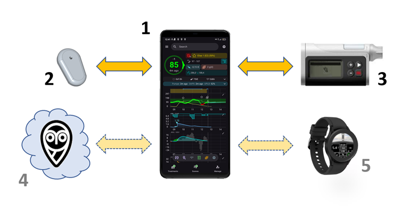

# Úvod do APS a AAPS

```{contents} In this page
:backlinks: entry
:depth: 2
```

## Čo je to „systém umelého pankreasu“?

Ľudský pankreas robí okrem regulácie hladiny cukru v krvi aj mnoho ďalších vecí. Termín **„systém umelého pankreasu“ (APS)** sa však zvyčajne vzťahuje na systém, ktorý automaticky udržiava hladinu cukru v krvi v zdravých hodnotách.

Najzákladnejší spôsob, ako to dosiahnuť, je zistiť **glykémiu**, použiť tieto hodnoty pre **výpočty** a následne dodať (predpokladané) správne množstvo **inzulínu** do tela. Výpočet sa opakuje každých pár minút, 24 hodín denne, 7 dní v týždni. Používa **alarmy** a **upozornenia** na informovanie používateľa, ak je potrebný jeho zásah alebo zvýšená pozornosť. Tento systém sa zvyčajne skladá zo **senzora glukózy**, **inzulínovej pumpy** a **riadiacej jednotky**, ktorá robí výpočty. V **AAPS** a iných systémoch s otvoreným zdrojovým kódom je riadiacou jednotkou aplikácia v telefóne. Vo väčšine komerčných systémov je to softvér zabudovaný priamo v pumpe a aplikácia v telefóne slúži hlavne na zobrazovanie a ovládanie.

Ak chcete vedieť, ako sa systémy s uzavretým okruhom vyvíjali a ako fungujú, dobrým začiatkom je tento prehľadový článok z roku 2022. Majte na pamäti, že vyšiel skôr ako väčšina systémov, ktoré sú dostupné dnes, takže nie je prehľadom toho, čo je momentálne na trhu:

 [Closed-Loop Insulin Delivery Systems: Past, Present, and Future Directions](https://www.frontiersin.org/journals/endocrinology/articles/10.3389/fendo.2022.919942/full) (Templer, _Frontiers in Endocrinology_, 2022).

Takzvané „dvojhormonálne“ systémy podávajú spolu s inzulínom aj glukagón. Cieľom je predchádzať ťažkým hypoglykémiám a umožniť ešte tesnejšiu kontrolu glykémie. Prvý systém tohto typu bol schválený v Európe, ale dodáva sa len v rámci štúdií a projektov a ďalšie sú stále vo vývoji. Zatiaľ sa žiadny z nich bežne nepredáva.

Systém umelého pankreasu možno považovať za [„autopilota pre vašu cukrovku“](https://www.artificialpancreasbook.com/). Čo to znamená?

V lietadle autopilot nevykonáva všetku prácu pilota, pilot nemôže prespať celý let. Autopilot pomáha pilotovi pri práci. Zbavuje pilota záťaže neustále riadiť lietadlo, takže sa môže sústrediť na širšie sledovanie. Autopilot prijíma signály z rôznych senzorov, počítač vyhodnotí údaje spolu so zadaniami pilota, potom urobí potrebné úpravy a upozorní pilota na akékoľvek problémy. Pilot sa už nemusí starať o neustále rozhodovanie a toto prirovnanie platí aj pre **AAPS**.


(Introduction-what-does-hybrid-closed-loop-mean)=
## Čo znamená hybridný uzavretý okruh?

Najlepším riešením pre diabetes 1. typu by bolo „funkčné vyliečenie“ (pravdepodobne implantát pankreatických buniek, ktoré sú chránené pred imunitným systémom). Kým komunita ľudí s diabetom 1. typu (T1D) na to čaká, umelý pankreas s „plne uzavretým okruhom“ je asi najlepšia ďalšia možnosť. Ide o technologický systém, ktorý nevyžaduje žiadne zásahy od používateľa (napríklad podanie bolusu inzulínu k jedlu alebo ohlásenie cvičenia) a pritom dobre reguluje glykémiu. Takmer každý systém v bežnom používaní je „hybridný“ uzavretý okruh, pretože kombinuje automatizovanú technológiu a zásahy používateľa. Prvé systémy s plne uzavretým okruhom boli v Európe schválené v roku 2026, ale zatiaľ nie sú široko dostupné.

## Ako a prečo sa začali používať systémy s okruhom?

Vývoj komerčnej technológie pre ľudí s diabetom 1. typu (T1D) je veľmi pomalý. V roku 2013 komunita ľudí s diabetom 1. typu založila hnutie #WeAreNotWaiting. Sami vyvinuli systémy s využitím existujúcej schválenej technológie (inzulínové pumpy a senzory) na zlepšenie kontroly glykémie, bezpečnosti a kvality života. Označujú sa ako systémy OS-AID (Open-Source Automated Insulin Delivery – automatizované podávanie inzulínu s otvoreným zdrojovým kódom, predtým DIY systémy), pretože ich formálne neschválili zdravotnícke orgány (FDA, NHS atď.). K dispozícii sú štyri hlavné systémy OS-AID: [OpenAPS](https://openaps.org/what-is-openaps/), **AAPS**, [Loop](https://loopkit.github.io/loopdocs/#what-is-loop) a [Trio](https://triodocs.org).

Výborný spôsob, ako pochopiť základy okruhu OS-AID, je prečítať si knihu Dany Lewis „Automated Insulin Delivery“ (Automatizované podávanie inzulínu). Knihu si môžete zadarmo pozrieť [tu](https://www.artificialpancreasbook.com/) (alebo si ju môžete kúpiť v tlačenej podobe). Ak sa chcete dozvedieť viac o [OpenAPS](https://openaps.org/what-is-openaps/), z ktorého sa vyvinul **AAPS**, [webová stránka OpenAPS](https://openaps.org/what-is-openaps/) je skvelým zdrojom.

Na trh sa dostalo aj niekoľko komerčných systémov s hybridným uzavretým okruhom. Tie sa od systémov OS-AID veľmi líšia, hlavne preto, že mnohé z nich obsahujú „učiaci sa algoritmus“, ktorý upravuje množstvo podaného inzulínu podľa vašej potreby inzulínu v predchádzajúcich dňoch. Mnohí ľudia z komunity OS-AID už komerčné systémy vyskúšali a porovnali ich so svojím systémom OS-AID. Viac o tom, ako sa jednotlivé systémy líšia, zistíte, ak sa opýtate v skupinách na Facebooku venovaných týmto systémom, v [skupine AAPS na Facebooku](https://www.facebook.com/groups/AndroidAPSUsers/) alebo na [Discorde](https://discord.com/invite/4fQUWHZ4Mw).

## Čo je Android APS (AAPS)?



**Obrázok 1**. Základný prehľad systému umelého pankreasu (APS) pre systém Android, AAPS.

Android APS (**AAPS**) je systém s hybridným uzavretým okruhom, čiže systém umelého pankreasu (APS). Dávky inzulínu počíta pomocou overených algoritmov [OpenAPS](https://openaps.org/) (súbor pravidiel), ktoré vyvinula komunita T1D #WeAreNotWaiting.

Keďže OpenAPS je kompatibilný len s niektorými staršími inzulínovými pumpami, **AAPS** (ktorý sa dá použiť s väčším počtom inzulínových púmp) vznikol v roku 2016 pre člena rodiny s diabetom 1. typu. Od prvých dní systém **AAPS** neustále vyvíja a zdokonaľuje tím dobrovoľných počítačových vývojárov a ďalších nadšencov, ktorí majú spojenie so svetom diabetu 1. typu. Dnes **AAPS** používa mnoho tisíc ľudí na celom svete. Je to vysoko prispôsobiteľný a všestranný systém a keďže je open-source, je tiež ľahko kompatibilný s mnohými inými open-source softvérmi a platformami pre diabetes. Základné komponenty súčasného systému **AAPS** sú uvedené na **Obrázku 1** vyššie.


## Aké sú základné komponenty AAPS?

„Mozgom“ AAPS je **aplikácia**, ktorú si sami zostavíte. Na to existuje podrobný návod krok za krokom. Potom si nainštalujete **aplikáciu AAPS** na [kompatibilný](../Getting-Started/Phones.md) **smartfón so systémom Android** (**1**). Viacerí používatelia majú okruh radšej na samostatnom telefóne, nie na svojom hlavnom telefóne. Nemusíte teda používať telefón s Androidom na všetko ostatné vo svojom živote, stačí ho mať len na chod okruhu AAPS.

Na **smartfóne so systémom Android** bude potrebné mať nainštalovanú aj ďalšiu aplikáciu okrem **AAPS**. Táto [ďalšia aplikácia](../Getting-Started/CompatiblesCgms.md) prijíma údaje o glykémii zo senzora (**2**) cez Bluetooth a potom ich v rámci telefónu posiela do **aplikácie AAPS**.

**Aplikácia AAPS** používa rozhodovací proces (**algoritmus**) z OpenAPS. Začiatočníci začínajú so základným algoritmom **oref0**, ale keď budete s AAPS napredovať, môžete prejsť na novší algoritmus **oref1**. Ktorý algoritmus použijete (oref0 alebo oref1), závisí od toho, ktorý najlepšie vyhovuje vašej konkrétnej situácii.  V oboch prípadoch algoritmus zohľadňuje viacero faktorov a vykonáva rýchle výpočty vždy, keď zo senzora príde nový údaj. Algoritmus potom cez Bluetooth posiela inzulínovej pumpe (**3**) pokyny, koľko inzulínu má podať. Všetky informácie je možné posielať cez mobilné dáta alebo Wi-Fi na internet (**4**). Tieto údaje je možné v prípade potreby zdieľať aj so sledujúcimi a/alebo zhromažďovať na účely analýzy. Voliteľne môžete s telefónom spárovať aj [inteligentné hodinky](../Getting-Started/Watches.md) (**5**), aby ste svoje údaje videli na prvý pohľad. S niektorými hodinkami môžete do **AAPS** posielať aj základné príkazy.

## Aké sú výhody systému AAPS?

Algoritmus OpenAPS používaný systémom **AAPS** riadi hladinu cukru v krvi bez zásahu používateľa podľa parametrov definovaných používateľom (dôležité sú bazálne dávky, faktory citlivosti na inzulín, pomery inzulínu k sacharidom, trvanie aktivity inzulínu atď.) a reaguje každých 5 minút na nové údaje zo senzora.

Medzi uvádzané výhody používania **AAPS** patria rozsiahle možnosti jemného nastavenia, **Automatizácia** a väčšia transparentnosť systému pre pacienta/opatrovateľa. Vďaka tomu môžete lepšie zvládať svoj diabetes (alebo diabetes človeka, o ktorého sa staráte), čo môže zlepšiť kvalitu života a priniesť väčší pokoj.

S investovaním vášho času môže **AAPS** potenciálne viesť k:

- zmierneniu stresu a záťaže spojenej s liečbou diabetu 1. typu;

- zníženiu množstva bežných rozhodnutí, ktoré prináša diabetes 1. typu;

- individuálnemu a dynamickému dávkovaniu inzulínu na základe údajov v reálnom čase, čo môže znížiť potrebu liečiť hypoglykémie a znížiť počet epizód hyperglykémie;

- lepšej znalosti o liečbe inzulínom a sebavedomiu na lepšie doladenie nastavení;

- možnosti vytvárať automatické nastavenia (**automatizácie**), ktoré sú prispôsobené vášmu životnému štýlu;

- lepšej kvalite spánku a celkovo menšiemu počtu nočných zásahov;

- diaľkovému sledovaniu a podávaniu inzulínu pre opatrovateľov diabetikov 1. typu; a

- zjednodušeniu všetkých vašich prenosných diabetických zariadení (prijímač CGM a zariadenia na podávanie inzulínu) pomocou telefónu s Androidom, ktorý ovláda **AAPS**.


**AAPS** môže v konečnom dôsledku umožniť jednotlivcom lepšie zvládať cukrovku, čo vedie k stabilnej hladine cukru v krvi a zlepšeniu dlhodobých zdravotných výsledkov.

### Medzi špecifické výhody patrí:

#### 1) Zabudovaná bezpečnosť
Ak si chcete prečítať o bezpečnostných funkciách algoritmov známych ako oref0 a oref1, [kliknite sem](https://openaps.org/reference-design/). Používateľ má kontrolu nad vlastnými bezpečnostnými obmedzeniami.

#### 2) Flexibilita hardvéru

**AAPS** funguje so širokou škálou inzulínových púmp a senzorov a ponúka flexibilitu, keď sa život zmení. Napríklad, ak sa u vás objaví alergia na lepidlo senzoru Dexcom, môžete namiesto toho prejsť na používanie senzora Libre. Používatelia nemusia aplikáciu **AAPS** znova zostavovať ani preinštalovať. Na zmenu hardvéru stačí vybrať inú pumpu alebo zdroj glykémie v časti **Konfigurácia**. **AAPS** nezávisí od konkrétnych ovládačov púmp a obsahuje aj „virtuálnu pumpu“, takže používatelia môžu bezpečne experimentovať skôr, než ho začnú používať na sebe.

#### 3) Veľké možnosti prispôsobenia a široký rozsah parametrov

Používatelia môžu jednoducho pridávať alebo odoberať moduly alebo funkcie a **AAPS** sa dá používať v režime otvoreného aj uzavretého okruhu. Tu je niekoľko príkladov možností systému **AAPS**:

 a) Možnosť nastaviť nižší cieľ **glykémie** 30 min pred jedlom; cieľ môžete nastaviť až na 72 mg/dl (4,0 mmol/l).

 b) Ak trpíte inzulínovou rezistenciou, čo má za následok vysokú hladinu cukru v krvi, funkcia **AAPS** vám umožňuje nastaviť pravidlo **automatizácie**, ktoré sa aktivuje, keď glykémia stúpne nad 8 mmol/l (144 mg/dl), čím sa prepne (napríklad) na profil 120 % (čo má za následok 20 % zvýšenie bazálnej dávky a posilnenie aj ďalších faktorov v porovnaní s vaším bežným nastavením **profilu**). Automatizácia bude trvať podľa nastaveného naplánovaného času. Takáto automatizácia by sa dala nastaviť tak, aby bola aktívna iba v určité dni v týždni, v určitých denných hodinách a dokonca aj na určitých miestach.

 c) Ak vaše dieťa bez varovania začne skákať na trampolíne, **AAPS** umožňuje pozastaviť podávanie inzulínu na stanovený čas priamo cez telefón.

 d) Po opätovnom pripojení pumpy, ktorá bola odpojená kvôli plávaniu, systém **AAPS** vypočíta bazálny inzulín, ktorý ste vynechali počas odpojenia, a opatrne ho podá podľa vašej aktuálnej glykémie. Akýkoľvek nepotrebný inzulín je možné prepísať jednoduchým „zrušením“ vynechanej bazálnej dávky.

 e) **AAPS** vám umožňuje nastaviť rôzne profily pre rôzne situácie a jednoducho medzi nimi prepínať. Napríklad funkcie, ktoré algoritmu umožňujú rýchlejšie znižovať zvýšenú glykémiu (ako napríklad Super Micro Bolusy („**SMB**“), neohlásené jedlá („**UAM**“), je možné nastaviť tak, aby fungovali iba počas dňa, ak sa obávate nočných hypoglykémií.

Toto všetko sú príklady, celá škála funkcií poskytuje obrovskú flexibilitu pre každodenný život vrátane športu, choroby, hormonálnych cyklov _atď_. V konečnom dôsledku je na používateľovi, aby sa rozhodol, ako túto flexibilitu využije, a na tento účel neexistuje univerzálne automatizované riešenie pre všetkých.

#### 4) Vzdialené sledovanie
Existuje viacero možných kanálov na sledovanie (Sugarmate, Dexcom Follow, xDrip, Android Auto _atď._), ktoré sú užitočné pre rodičov/opatrovateľov a pre dospelých v určitých situáciách (spánok/šoférovanie), ktorí potrebujú prispôsobiteľné upozornenia. V niektorých aplikáciách (xDrip) môžete alarmy aj úplne vypnúť. To je výborné, ak máte nový senzor, ktorý sa ešte „zabehúva“ alebo ustaľuje a s ktorým zatiaľ nechcete používať okruh.

#### 5) Vzdialené ovládanie
Významnou výhodou **AAPS** oproti komerčným systémom je, že sledujúci môžu pomocou overených textových príkazov (SMS) alebo spárovanej aplikácie **AAPSClient** posielať do systému **AAPS** širokú škálu príkazov. Túto funkciu vo veľkej miere využívajú rodičia detí s diabetom 1. typu, ktoré používajú **AAPS**.

Funkcie vzdialeného ovládania môžu byť veľmi užitočné: napríklad na ihrisku, ak chcete zo svojho telefónu podať bolus vopred na desiatu a vaše dieťa je zaujaté hrou. Systém je tiež možné sledovať z inteligentných hodiniek (_napr._ Garmin) alebo z nich posielať základné príkazy (_napr._ hodinky s Wear OS, ako Samsung Galaxy Watch).

#### 6) Žiadne komerčné obmedzenia vďaka otvoreným aplikačným rozhraniam
Okrem použitia open-source prístupu, ktorý umožňuje kedykoľvek zobraziť zdrojový kód **AAPS**, všeobecný princíp poskytovania otvorených programovacích rozhraní dáva aj iným vývojárom možnosť prispieť novými nápadmi. **AAPS** je úzko prepojený s Nightscoutom. To urýchľuje vývoj a umožňuje používateľom pridávať funkcie, ktoré im ešte viac spríjemnia život s cukrovkou. Dobrými príkladmi takýchto integrácií sú [Nightscout](https://nightscout.github.io/), [Nightscout Reporter](https://nightscout-reporter.zreptil.de/), xDrip, [M5 stack](https://github.com/mlukasek/M5_NightscoutMon/wiki) atď. Medzi vývojármi open-source a tými, ktorí vyvíjajú komerčné systémy, prebieha neustály dialóg. Mnohé inovácie OS-AID postupne preberajú komerčné systémy, kde je vývoj pochopiteľne pomalší. Čiastočne je to preto, že rozhrania medzi systémami rôznych firiem (pumpy, aplikácie, senzory _atď._) treba starostlivo dohodnúť a licencovať. To môže tiež spomaliť inovácie, ktoré sú síce vhodné pre pacienta (alebo malú podskupinu pacientov, ktorí majú veľmi špecifické požiadavky), ale neprinášajú žiadny značný zisk.

#### 7) Podrobné rozhranie aplikácie
S **AAPS** je jednoduché sledovať veci, ako napríklad: množstvo inzulínu v pumpe, vek kanyly, vek senzora, vek batérie pumpy, IOB _atď_. Mnohé úkony sa dajú urobiť v aplikácii **AAPS** (plnenie pumpy, odpojenie pumpy _atď._) namiesto na samotnej pumpe, takže pumpa môže zostať vo vrecku alebo na opasku (vašom alebo človeka, o ktorého sa staráte).

#### 8) Dostupnosť a nízke náklady
**AAPS** dáva ľuďom, ktorí si momentálne nemôžu dovoliť platiť systém sami alebo nemajú financovanie/poistenie, prístup k systému s hybridným uzavretým okruhom, ktorý je koncepčne o roky vpred pred komerčnými systémami, pokiaľ ide o vývoj. Na nastavenie **AAPS** momentálne potrebujete reportovací server (Nightscout alebo Tidepool), hoci na každodenný chod okruhu **AAPS** nie je potrebný. Mnohí ľudia naďalej používajú Nightscout na zhromažďovanie svojich údajov a na vzdialené sledovanie. Hoci je samotný **AAPS** bezplatný, nastavenie Nightscout prostredníctvom jednej z rôznych platforiem môže byť spoplatnené (0 € – 12 €) v závislosti od požadovanej úrovne podpory (pozrite porovnávaciu tabuľku) a od toho, či chcete Nightscout po nastavení naďalej používať alebo nie. **AAPS** funguje so širokou škálou cenovo dostupných (od približne 150 €) [telefónov s Androidom](https://docs.google.com/spreadsheets/u/1/d/e/2PACX-1vScCNaIguEZVTVFAgpv1kXHdsHl3fs6xT6RB2Z1CeVJ561AvvqGwxMhlmSHk4J056gMCAQE02sAWJvT/pubhtml?gid=683363241&single=true). Pre konkrétne lokality a jazyky sú k dispozícii rôzne verzie a AAPS môžu používať aj ľudia, ktorí sú [nevidiaci](#accessibility-for-users-aaps-who-are-partially-or-completely-blind).

#### 9) Podpora
Žiadny automatizovaný systém podávania inzulínu nie je dokonalý. Komerčné aj open-source systémy majú mnoho bežných problémov v komunikácii aj v dočasnom zlyhaní hardvéru. Podporu poskytuje komunita používateľov AAPS na Facebooku, Discorde a GitHube, ktorí navrhli, vyvinuli a v súčasnosti používajú **AAPS** po celom svete. Existujú aj skupiny podpory na Facebooku a pomoc od kliník/komerčných spoločností pre komerčné systémy APS – oplatí sa porozprávať s používateľmi alebo bývalými používateľmi týchto systémov, aby ste získali spätnú väzbu o bežných chybách, kvalite vzdelávacieho programu a úrovni poskytovanej priebežnej podpory.

#### 10) Predvídateľnosť, transparentnosť a bezpečnosť
**AAPS** je transparentný, logický a predvídateľný. Vďaka tomu môže byť ľahšie zistiť, kedy je nastavenie nesprávne, a podľa toho ho upraviť. Presne vidíte, čo systém robí, prečo to robí a nastavíte si jeho prevádzkové limity, čo vám dáva kontrolu (a zodpovednosť). To môže používateľovi poskytnúť sebavedomie a zdravší spánok.

#### 11) Prístup k pokročilým funkciám cez vývojové (dev) verzie vrátane plne uzavretého okruhu
Táto dokumentácia **AAPS** sa zameriava na hlavnú vetvu **„master“** platformy **AAPS**. Výskum a vývoj však prebieha neustále. Skúsenejší používatelia si môžu pozrieť experimentálne funkcie vo **vývojovej** vetve. Inovácie vo vývoji sa zameriavajú na stratégie pre plne uzavretý okruh (bez nutnosti podávať bolus k jedlu _atď._) a vo všeobecnosti sa snažia čo najviac uľahčiť život s diabetom 1. typu.

#### 12) Možnosť sami prispieť k ďalším zlepšeniam
Diabetes 1. typu môže byť veľmi frustrujúci a izolujúci. Mať kontrolu nad vlastnou technikou na liečbu diabetu a hneď, ako robíte pokroky, „posunúť to ďalej“ a pomáhať iným na ich ceste, môže byť naozaj obohacujúce. Môžete sa vzdelávať, objavovať prekážky a vyhľadávať, a dokonca aj prispievať k novému vývoju a dokumentácii. V komunite budú aj iní s rovnakým cieľom, s ktorými môžete vymieňať nápady a spolupracovať. Toto je podstata #WeAreNotWaiting.

## Ako je na tom AAPS v porovnaní s MDI a otvoreným okruhom?

Viacnásobné denné injekcie (MDI, (a) na **Obrázku 2** nižšie) zvyčajne znamenajú injekciu dlhodobo pôsobiaceho inzulínu (_napr._ Tresiba) jedenkrát denne a injekcie rýchlejšie pôsobiaceho inzulínu (_napr._ Novorapid, Fiasp) pri jedle alebo na korekciu. Liečba pumpou bez okruhu (b) znamená, že pumpa podáva bazál rýchlo pôsobiaceho inzulínu vopred naprogramovanými dávkami a bolusy pri jedle alebo na korekciu sa podávajú pumpou. Základom systému s okruhom je, že aplikácia okruhu používa údaje zo senzora glukózy na to, aby pumpe dala pokyn zastaviť podávanie inzulínu, keď predpovedá, že sa blížite k nízkej glykémii, a podať ďalší inzulín, ak glykémia stúpa a predpokladá sa, že bude príliš vysoká (c). Hoci je tento obrázok v porovnaní so skutočným životom príliš zjednodušený, jeho cieľom je demonštrovať kľúčové rozdiely medzi prístupmi. Ktorýmkoľvek z týchto troch spôsobov je možné dosiahnuť výnimočne dobrú kontrolu glykémie.


**Obrázok 2**. Základný prehľad (a) MDI, (b) liečby pumpou bez okruhu a (c) liečby pumpou s hybridným uzavretým okruhom.

## Ako je na tom AAPS v porovnaní s inými systémami s okruhom?

K 25. júnu 2023 sú k dispozícii štyri hlavné systémy s uzavretým okruhom s otvoreným zdrojovým kódom: [OpenAPS](https://openaps.readthedocs.io/), **AAPS**, [Loop](https://loopkit.github.io/loopdocs/#what-is-loop) a [Trio](https://triodocs.org) (predtým FreeAPS X). Vlastnosti rôznych systémov sú uvedené v tabuľke nižšie:


| Typ zariadenia | Názov                                                                     | [AAPS](https://wiki.aaps.app)            | [Loop](https://loopkit.github.io/loopdocs/) | [Open APS](https://openaps.readthedocs.io/en/latest/) | [Trio](https://triodocs.org)             |
| -------------- | ------------------------------------------------------------------------- | ---------------------------------------- | ------------------------------------------- | ----------------------------------------------------- | ---------------------------------------- |
| Telefón        | Android                                                                   |      |     |               |  |
| Telefón        | iPhone                                                                    |  |         |               |      |
| Rig            | malý počítač (1)                                                          |  |     |                   |  |
| PUMPA          | [Dana I](../CompatiblePumps/DanaRS-Insulin-Pump.md)                       |      |         |               |      |
| PUMPA          | [Dana RS](../CompatiblePumps/DanaRS-Insulin-Pump.md)                      |      |         |               |      |
| PUMPA          | [Dana R](../CompatiblePumps/DanaR-Insulin-Pump.md)                        |      |     |               |  |
| PUMPA          | [Omnipod (Dash)](../CompatiblePumps/OmnipodDASH.md)                       |      |         |               |      |
| PUMPA          | [Omnipod (Eros)](../CompatiblePumps/OmnipodEros.md)                       |      |         |               |      |
| PUMPA          | [Diaconn G8](../CompatiblePumps/DiaconnG8.md)                             |      |     |               |  |
| PUMPA          | [EOPatch 2](../CompatiblePumps/EOPatch2.md)                               |      |     |               |  |
| PUMPA          | [Medtrum TouchCare Nano 200U](../CompatiblePumps/MedtrumNano.md)          |      |         |               |      |
| PUMPA          | [Medtrum TouchCare 300U](../CompatiblePumps/MedtrumNano.md)               |      |         |               |      |
| PUMPA          | [Roche Combo](../CompatiblePumps/Accu-Chek-Combo-Pump-v2.md)              |      |     |               |  |
| PUMPA          | [Roche Insight](../CompatiblePumps/Accu-Chek-Insight-Pump.md)             |      |     |               |  |
| PUMPA          | [Starší Medtronic](../CompatiblePumps/MedtronicPump.md)                   |      |         |                   |      |
| PUMPA          | [Equil 5.3](../CompatiblePumps/Equil5.3.md)                               |      |     |               |  |
| PUMPA          | [CareLevo](../CompatiblePumps/CareLevo.md)                                |      |     |               |  |
| CGM            | [Dexcom G7/One+/Stelo](../CompatibleCgms/DexcomG7.md)                     |      |         |               |      |
| CGM            | [Dexcom One](../CompatibleCgms/DexcomG6.md)                               |      |         |               |      |
| CGM            | [Dexcom G6](../CompatibleCgms/DexcomG6.md)                                |      |         |                   |      |
| CGM            | [Libre 3/3+](../CompatibleCgms/Libre3.md)                                 |      |         |               |      |
| CGM            | [Libre 2/2+](../CompatibleCgms/Libre2.md)                                 |      |         |               |      |
| CGM            | [Libre 1](../CompatibleCgms/Libre1.md)                                    |      |         |               |      |
| CGM            | [Eversense](../CompatibleCgms/Eversense.md)                               |      |         |               |      |
| CGM            | [MM640g/MM630g](../CompatibleCgms/MM640g.md)                              |      |     |               |  |
| CGM            | [PocTech](../CompatibleCgms/PocTech.md)                                   |      |     |               |  |
| CGM            | [Ottai](../CompatibleCgms/OttaiM8.md)                                     |      |     |               |  |
| CGM            | [Syai Tag](../CompatibleCgms/SyaiTagX1.md)                                |      |     |               |  |
| CGM            | [Nightscout ako zdroj glykémie](../CompatibleCgms/CgmNightscoutUpload.md) |      |         |                   |      |

_Poznámky k tabuľke:_
1. **Rig** je malý počítač, ktorý nosíte so sebou bez monitora. Jeden podporovaný typ zariadenia je Intel Edison + Explorer Board a druhý Raspberry Pi + Explorer HAT alebo Adafruit RFM69HCW Bonnet. Prvé systémy APS boli založené na tomto riešení, pretože mobilné telefóny nedokázali spúšťať potrebné algoritmy. Používanie týchto systémov kleslo, pretože nastavenie na mobilných telefónoch sa stalo jednoduchším a telefóny majú displej. Spoločnosť Intel tiež prestala predávať počítač Intel Edison. Výborné algoritmy OpenAPS **oref0** a **oref1** sú teraz súčasťou AAPS a Trio.


Medzinárodné recenzované konsenzuálne stanovisko s praktickými odporúčaniami k okruhom s otvoreným zdrojovým kódom napísali zdravotnícki pracovníci pre zdravotníckych pracovníkov. Vyšlo v roku 2022 v poprednom lekárskom časopise: [_Lancet Diabetes Endocrinol_, 2022; 10: 58–74](https://www.ncbi.nlm.nih.gov/pmc/articles/PMC8720075/)(_1_). Určite sa ho oplatí prečítať (aj pre vašu diabetologickú ambulanciu). Zhŕňa hlavné technické rozdiely medzi jednotlivými systémami s hybridným uzavretým okruhom s otvoreným zdrojovým kódom.

Je ťažké získať „cit“ o akomkoľvek systéme bez toho, aby ste ho používali alebo sa porozprávali s ostatnými, ktorí ho používajú, preto sa obráťte na ostatných na Facebooku/Discorde a opýtajte sa. Väčšina ľudí zistí, že **AAPS** je v porovnaní s inými systémami s hybridným uzavretým okruhom (najmä s komerčnými) neuveriteľne prepracovaný a má obrovské množstvo nastavení a funkcií, ktoré si môžete prispôsobiť a ktoré sú opísané vyššie. Pre niektorých to môže byť na začiatku trochu priveľa, ale nie je potrebné preskúmať všetky možnosti naraz. Môžete postupovať tak pomaly alebo tak rýchlo, ako chcete, a na každom kroku je k dispozícii pomoc.


## Používa AAPS umelú inteligenciu alebo nejaký algoritmus učenia?

Súčasná verzia **AAPS** (4.0) nemá žiadne algoritmy strojového učenia, modely odozvy na inzulín s viacerými parametrami ani umelú inteligenciu. Systém je preto otvorený a transparentný vo svojom fungovaní a je zrozumiteľný nielen pre odborníkov, ale aj pre lekárov a pacientov. Znamená to tiež, že ak máte veľmi premenlivý program (napríklad prechod zo stresujúceho pracovného týždňa na pokojnú dovolenku) a pravdepodobne budete potrebovať výrazne iné množstvo inzulínu, môžete **AAPS** okamžite prepnúť na slabší/silnejší prispôsobený profil. „Učiaci sa systém“ túto úpravu vykoná automaticky za vás, ale úprava podávania inzulínu bude pravdepodobne trvať dlhšie.

(which-system-is-right-for-me-or-my-dependent)=
## Ktorý systém je vhodný pre mňa alebo pre človeka, o ktorého sa starám?

V praxi je váš výber systému často obmedzený tým, akú pumpu už máte alebo si ju môžete zaobstarať od svojho lekára, a vaším telefónom (Apple alebo Android). Ak ešte nemáte pumpu, máte najväčší výber systémov. Technológia sa neustále vyvíja, pumpy sa vyraďujú z výroby a na trh sa uvádzajú nové pumpy a senzory. Väčšina systémov s otvoreným zdrojovým kódom pracuje s hlavnými senzormi (Libre a Dexcom) alebo sa rýchlo prispôsobí na prácu s novými senzormi približne rok po ich vydaní (s malým časovým oneskorením kvôli testovaniu bezpečnosti a stability).

Väčšina používateľov **AAPS** hlási dlhší čas v rozsahu, zníženie HbA1c a tiež lepšiu kvalitu života vďaka systému, ktorý dokáže v noci počas spánku automaticky upravovať bazálne dávky. To platí pre väčšinu systémov s hybridným uzavretým okruhom. Niektorí ľudia uprednostňujú veľmi jednoduchý systém, ktorý sa nedá veľmi prispôsobiť (vtedy vám môže viac vyhovovať komerčný systém), a iní považujú takýto nedostatok kontroly za veľmi frustrujúci (vtedy vám môže viac vyhovovať systém s otvoreným zdrojovým kódom). Ak ste vy (alebo človek, o ktorého sa staráte) práve diagnostikovaný, bežný postup je najprv si zvyknúť na MDI so senzorom glukózy, potom prejsť na pumpu, ktorú je možné použiť v okruhu, a potom na **AAPS**, ale niektorí ľudia (najmä malé deti) môžu prejsť priamo na pumpu.

Je dôležité poznamenať, že používateľ **AAPS** musí byť proaktívny pri riešení problémov a ich oprave sám s pomocou komunity. Toto je veľmi odlišný spôsob myslenia od používania komerčného systému. S **AAPS** má používateľ väčšiu kontrolu, ale aj zodpovednosť, a musí sa s tým cítiť dobre.

## Je bezpečné používať open-source systémy ako AAPS?

### Bezpečnosť systému AAPS
Presnejšia otázka pravdepodobne znie: „Je to bezpečné **v porovnaní** s mojím súčasným systémom podávania inzulínu?“, keďže žiadna metóda podávania inzulínu nie je bez rizika. V systéme **AAPS** existuje veľa kontrolných mechanizmov. Nedávna [štúdia](https://www.liebertpub.com/doi/epub/10.1089/dia.2019.0375) skúmala použitie **AAPS** v počítačovej simulácii, čo bol účinný spôsob, ako objektívne otestovať, aký bezpečný a účinný je systém. Vo všeobecnosti mnoho tisíc ľudí na celom svete používa systémy automatizovaného podávania inzulínu s otvoreným zdrojovým kódom a ich používanie celosvetovo stále rastie.

Akékoľvek zariadenie, ktoré používa rádiovú komunikáciu, by mohlo byť napadnuté hackermi, a to platí aj pre inzulínovú pumpu bez okruhu. V súčasnosti si nie sme vedomí žiadneho pokusu o ublíženie jednotlivcom hackerským útokom na ich zdravotnícke zariadenia súvisiace s cukrovkou. Existuje však viacero spôsobov, ako sa pred takýmito rizikami chrániť:

1.  V nastaveniach pumpy obmedzte maximálny povolený bolus aj maximálny dočasný bazál na hodnoty, ktoré považujete za najbezpečnejšie. Toto sú pevne dané limity, o ktorých si nemyslíme, že by ich mohol obísť akýkoľvek hacker.

2.  Zapnite si alarmy CGM pre vysokú aj nízku glykémiu.

3.  Sledujte si podávanie inzulínu online. Používatelia Nightscoutu si môžu nastaviť ďalšie alarmy, ktoré upozornia na širokú škálu podmienok vrátane podmienok, ktorých výskyt je oveľa pravdepodobnejší ako pri hackerskom útoku. Okrem vysokých a nízkych glykémií dokáže Nightscout zobraziť diagnostické údaje užitočné na overenie, či pumpa funguje podľa potreby, vrátane aktuálneho IOB, histórie dočasných bazálov pumpy a histórie bolusov pumpy. Dá sa tiež nastaviť tak, aby používateľov vopred upozornil na nežiaduce stavy, ako sú predpovedaná vysoká a nízka glykémia, málo inzulínu v zásobníku a slabá batéria pumpy.

Ak by došlo k škodlivému útoku na vašu inzulínovú pumpu, takéto riešenie by toto riziko výrazne zmiernilo. Každý potenciálny používateľ **AAPS** musí zvážiť riziká spojené s používaním systému **AAPS** oproti rizikám používania iného systému.

#### Bezpečnostné aspekty týkajúce sa príliš rýchleho zlepšenia kontroly glykémie

Rýchle zníženie HbA1c a zlepšená kontrola glykémie znie lákavo. _Príliš rýchle_ zníženie priemernej glykémie spustením akéhokoľvek systému s uzavretým okruhom však môže spôsobiť trvalé poškodenie, vrátane poškodenia očí, a bolestivú neuropatiu, ktorá nikdy nezmizne. Tomuto poškodeniu sa dá vyhnúť jednoducho pomalším znižovaním hladín. Ak máte momentálne zvýšený HbA1c a prechádzate na AAPS (alebo akýkoľvek iný systém s uzavretým okruhom), prosím, preberte toto možné riziko so svojím lekárskym tímom ešte pred začatím a dohodnite sa s ním na časovom pláne. Viac všeobecných informácií o tom, ako bezpečne znížiť glykémiu, vrátane odkazov na lekársku literatúru, nájdete v sekcii o bezpečnosti [tu](#preparing-safety-first).

#### Bezpečnosť v oblasti zdravotníckych zariadení, spotrebného materiálu a iných liekov

Pre okruh umelého pankreasu používajte testovanú, plne funkčnú inzulínovú pumpu a CGM schválené FDA alebo CE. Úpravy hardvéru alebo softvéru týchto komponentov môžu spôsobiť neočakávané dávkovanie inzulínu, čo predstavuje značné riziko pre používateľa. Ak nájdete alebo vám ponúknu pokazené, upravené alebo svojpomocne vyrobené inzulínové pumpy alebo prijímače CGM, nepoužívajte ich na vytvorenie systému AAPS.

Používajte originálne pomôcky, ako sú zavádzače, kanyly a nádoby na inzulín schválené výrobcom pumpy a systému CGM. Používanie netestovaných alebo upravených pomôcok môže spôsobiť nepresnosť CGM a chyby v dávkovaní inzulínu. Inzulín je pri nesprávnom dávkovaní veľmi nebezpečný – nezahrávajte sa so životom tým, že budete svoje pomôcky upravovať.

Neužívajte SGLT-2 inhibítory (gliflozíny) počas používania **AAPS**, pretože nepredvídateľne znižujú hladinu cukru v krvi. Kombinácia tohto efektu so systémom, ktorý znižuje bazálne dávky s cieľom zvýšiť glykémiu, je nebezpečná, viac podrobností o tom nájdete v hlavnej [sekcii o bezpečnosti](#preparing-safety-first).

(introduction-how-can-i-approach-discussing-aaps-with-my-clinical-team)=
## Ako môžem začať rozhovor o AAPS so svojím lekárskym tímom?

Používateľom odporúčame, aby sa so svojím lekárom porozprávali o tom, že chcú používať **AAPS**. Nebojte sa otvorene porozprávať so svojím diabetologickým tímom, ak plánujete používať **AAPS** (alebo akýkoľvek iný okruh OS-AID). Transparentnosť a dôvera medzi pacientom a lekárom sú prvoradé.

### Odporúčaný prístup:
Porozprávajte sa so svojím lekárom, aby ste zistili, ako dobre pozná diabetické technológie, ako sú CGM, pumpy, hybridné okruhy a komerčné okruhy, a aký k nim má postoj. Váš lekár/diabetológ by mal poznať základnú technológiu a mal by byť ochotný prebrať s vami najnovší pokrok v oblasti komerčných systémov s okruhom dostupných vo vašom regióne.

#### Miestne precedensy

Zistite názor svojich lekárov/diabetológov na okruh OS-AID _oproti_ komerčnému okruhu a odhadnite ich znalosti v tejto oblasti. Poznajú **AAPS** a môžu sa s vami podeliť o užitočné skúsenosti s pacientmi, ktorí používajú okruh OS-AID?

Opýtajte sa, či má váš tím v starostlivosti pacientov, ktorí už používajú okruh OS-AID. Z dôvodu dôvernosti údajov pacienta vám lekári nemôžu poskytnúť údaje o iných pacientoch bez ich súhlasu. Ak však chcete, **môžete** ich požiadať, aby **vaše** kontaktné údaje odovzdali pacientovi, ktorý už okruh OS-AID používa, ak je medzi nimi niekto, s kým by ste si podľa lekára mohli „sadnúť“. Povedzte, že budete radi, ak vás tento pacient kontaktuje a porozprávate sa o okruhu OS-AID. Lekári nie sú povinní to robiť, ale niektorí to robia radi, pretože si uvedomujú dôležitosť vzájomnej podpory pri liečbe diabetu 1. typu. Môže byť užitočné stretnúť sa aj s priateľskými používateľmi okruhu OS-AID vo vašom okolí. To je samozrejme na vás a nie je to úplne nevyhnutné.

#### Národné a medzinárodné precedensy

Ak máte pocit, že vás váš tím pri používaní okruhu s **AAPS** nepodporuje, môžu vám pomôcť tieto body do diskusie:

a) Systém **AAPS** navrhli pacienti a ich opatrovatelia. Bol navrhnutý predovšetkým s ohľadom na bezpečnosť, ale aj na základe rozsiahlych skúseností pacientov. Na celom svete sú mnohé tisíce používateľov **AAPS**. Preto je pravdepodobné, že aj medzi pacientmi vašej ambulancie sú ďalší ľudia s okruhom OS-AID (či o tom vedia, alebo nie).

b) Recent peer-reviewed published guidance in the internationally leading medical journal [The Lancet](https://www.ncbi.nlm.nih.gov/pmc/articles/PMC8720075/pdf/nihms-1765784.pdf)(_1_) has confirmed that OS-AID loops are **safe** and **effective at improving diabetic control**, including time in range. There are regular articles in leading journals like [Nature](https://doi.org/10.1038/d41586-023-02648-9)(_3_) which highlight the progress of the OS-AID looping community.

c) Začiatok s **AAPS** znamená _postupný_ prechod z liečby pumpou s „otvoreným“ okruhom cez Ochranu pred nízkou glykémiou až po hybridný „uzavretý“ okruh, a to splnením viacerých cieľov. Preto existuje štruktúrovaný program, ktorý od používateľa vyžaduje, aby v každej fáze preukázal určitú úroveň zručností a doladil svoje základné nastavenia (bazál, ISF a ICR) predtým, ako môže uzavrieť okruh.

d) Technickú podporu vám poskytne komunita OS-AID cez GitHub, Discord a uzavreté skupiny na Facebooku.

e) Na kontrolách u lekára budete môcť ukázať **údaje z CGM aj údaje o inzulíne z okruhu/pumpy** v spoločných prehľadoch (cez Nightscout alebo Tidepool), buď vytlačené, alebo na obrazovke (ak si prinesiete notebook/tablet). Zjednodušenie údajov o CGM aj inzulíne umožní vášmu lekárovi efektívnejšie využiť čas na kontrolu vašich správ a pomôže mu pri diskusiách o vašom pokroku.

f) Ak váš lekár stále namieta, odovzdajte mu výtlačky referenčných článkov, na ktoré sa v texte odkazuje, a poskytnite mu odkaz na sekciu **AAPS** pre lekárov: [Pre lekárov – všeobecný úvod a príručka k **AAPS**](../UsefulLinks/ClinicianGuideToAaps.md)

#### Podpora okruhov OS-AID zo strany iných lekárov

The paper published in the [Lancet Diabetes Endocrinology](https://www.ncbi.nlm.nih.gov/pmc/articles/PMC8720075/)(_1_) (co-led by King’s and Guy’s and St Thomas’ NHS Foundation Trust, and co-led by Dr Sufyan Hussain, a consultant diabetologist and honorary senior lecturer from King’s in London) provides:

a) **Uistenie** pre odborníkov, že systémy umelého pankreasu OS-AID / s otvoreným zdrojovým kódom sú „bezpečnou a účinnou možnosťou liečby“ diabetu 1. typu, a usmernenia k odporúčaniam, rozhovorom, podpore a dokumentácii;

b) **Uznanie**, že automatizované systémy podávania inzulínu („AID“) s otvoreným zdrojovým kódom môžu predĺžiť čas v rozsahu (TIR) a zároveň znížiť kolísanie glykémie a počet hypoglykemických a hyperglykemických epizód v rôznych vekových skupinách, u oboch pohlaví a v rôznych komunitách;

c) **Odporúčanie**, aby zdravotnícki pracovníci **podporovali** pacientov s diabetom 1. typu alebo ich opatrovateľov, ktorí sa rozhodnú liečiť svoj diabetes pomocou systému AID s otvoreným zdrojovým kódom;

d) Odporúčanie, aby sa zdravotnícki pracovníci pokúsili oboznámiť so všetkými možnosťami liečby, ktoré by mohli byť prospešné pre pacientov, vrátane dostupných systémov AID s otvoreným zdrojovým kódom.  Ak zdravotnícki pracovníci nemajú zdroje na vzdelávanie alebo majú právne či regulačné obavy, mali by zvážiť **spoluprácu alebo spojenie s inými zdravotníckymi pracovníkmi**, ktorí ich majú;

e) Dôraz na to, že všetci používatelia CGM by mali mať kedykoľvek umožnený prístup k **svojim vlastným zdravotným údajom** v reálnom čase

f) Zdôraznenie, že tieto systémy neprešli rovnakými regulačnými hodnoteniami ako komerčne dostupné zdravotnícke technológie a neexistuje žiadna komerčná technická podpora. K dispozícii je však **rozsiahla podpora komunity**; a

g) Odporúčanie, aby sa aktualizovali **regulačné a právne rámce** s cieľom zabezpečiť jasnosť v tom, ako povoliť etické a efektívne zaobchádzanie s takýmito systémami s otvoreným zdrojovým kódom.

Ďalší článok v časopise [Medical Law International, 2021](http://pure-oai.bham.ac.uk/ws/files/120241375/0968533221997510.pdf)(_4_) tiež zdôrazňuje, že „usmernenia k súhlasu“ britskej Všeobecnej lekárskej rady kladú silný dôraz na spoločné rozhodovanie lekára a pacienta. Lekár by mal vysvetliť možné prínosy, riziká, záťaž a vedľajšie účinky APS OS-AID a môže odporučiť konkrétnu možnosť bez toho, aby na pacienta tlačil.

V konečnom dôsledku je na pacientovi, aby zvážil tieto faktory spolu s akýmikoľvek neklinickými problémami, ktoré sú pre neho relevantné, a rozhodol sa, ktorú možnosť liečby, ak vôbec nejakú, prijme.

Ak lekár v ambulancii zistí, že jeho pacient používa okruh OS-AID, nie je oslobodený od povinnosti pacienta sledovať len preto, že konkrétnu technológiu, ktorú pacient používa, nepredpísal; lekári musia pacientov naďalej sledovať.

Lekári (aspoň v Spojenom kráľovstve) nemajú zakázané predpisovať nelicencované lieky a môžu využiť svoje klinické uváženie. Preto by mali podľa svojho klinického úsudku rozhodnúť, či je APS OS-AID vhodný pre konkrétneho pacienta, a prebrať s pacientom, čo považujú za výhody a nevýhody.

#### Články uvedené vyššie a ďalšie užitočné odkazy a stanoviská sú uvedené nižšie:

1. Automatizované podávanie inzulínu s otvoreným zdrojovým kódom: medzinárodné konsenzuálne stanovisko a praktické usmernenie pre zdravotníckych pracovníkov [_Lancet Diabetes Endocrinol_, (2022) _10_, 58–74](https://www.ncbi.nlm.nih.gov/pmc/articles/PMC8720075/)
2. [Štúdie in silico umelého pankreasu s otvoreným zdrojovým kódom pre Android: nová paradigma na testovanie bezpečnosti a účinnosti systémov „urob si sám“, 2020](https://www.liebertpub.com/doi/epub/10.1089/dia.2019.0375)
3. Svojpomocne vyrobený „bionický pankreas“ mení starostlivosť o diabetes – čo bude ďalej? [_Nature_ (2023), _620_, 940-941](https://doi.org/10.1038/d41586-023-02648-9)
4. Predpisovanie neschválených zdravotníckych pomôcok? Prípad DIY systémov umelého pankreasu [_Medical law international_, (2021), _21_, 42-68](http://pure-oai.bham.ac.uk/ws/files/120241375/0968533221997510.pdf)
5. [Stanovisko Berlin Institute of Health, 2022](https://www.bihealth.org/en/notices/do-it-yourself-solutions-for-people-with-diabetes-are-safe-and-recommended)
6. Automatizované podávanie inzulínu svojpomocne: Príručka používateľa pre zdravotníckych pracovníkov (stanovisko a príručka Diabetes Canada) [_Canadian Journal of Diabetes_, (2023)_47_, E8, 389-397](https://www.canadianjournalofdiabetes.com/article/S1499-2671(23)00138-7/fulltext)
7.  Holandsko (EN/NL) – pre lekárov - [how to help people on open source automated insulin delivery systems](https://www.diabetotech.com/blog/how-to-help-people-on-open-source-automated-insulin-delivery-systems)
8. Prvé použitie automatizovaného podávania inzulínu s otvoreným zdrojovým kódom AndroidAPS v režime plne uzavretého okruhu: randomizovaná pilotná štúdia Pancreas4ALL [_Diabetes Technol. Ther._, 25, _5_, 2023](https://www.liebertpub.com/doi/pdf/10.1089/dia.2022.0562?casa_token=D13eFx5vCwwAAAAA:MYvO8hChbViXVJFgov1T11RXBPx2N_wOMThLHwl3TVUxbCuANegPrIFRC5R5VXx_S71FoQYW-qg)
9. Deti predškolského a školského veku profitujú z prechodu z pumpy so senzorom na hybridný uzavretý okruh AndroidAPS: retrospektívna analýza [_Pediatr. Diabetes_ 2021, _22_, 594-604. 2021](https://onlinelibrary.wiley.com/doi/epdf/10.1111/pedi.13190)
10. Výsledky projektu OPEN, projektu financovaného EÚ zameraného na výsledky dôkazov pacientov s novou DIY technológiou umelého pankreasu (https://www.open-diabetes.eu/publications)


## Prečo si nemôžem jednoducho stiahnuť AAPS a hneď ho používať?

Aplikácia **AAPS** nie je dostupná v službe Google Play – z právnych dôvodov si ju musíte sami zostaviť zo zdrojového kódu. **AAPS** nemá licenciu, čo znamená, že nemá schválenie od žiadneho regulačného orgánu v žiadnej krajine. Používanie **AAPS** sa považuje za lekársky experiment na sebe samom a je na vlastné riziko používateľa.

Nastavenie systému si vyžaduje trpezlivosť, odhodlanie a postupný rozvoj technických znalostí. Všetky informácie a podporu možno nájsť v týchto dokumentoch, online alebo od iných, ktorí už systém používajú. Na celom svete mnoho tisíc ľudí úspešne zostavilo a v súčasnosti používa **AAPS**.

Vývojári systému **AAPS** berú bezpečnosť nesmierne vážne a chcú, aby ostatní mali s používaním systému **AAPS** dobrú skúsenosť. Preto je nevyhnutné, aby každý používateľ (alebo opatrovateľ, ak je používateľom dieťa):

- si sám zostaví systém AAPS a prejde **cieľmi**, aby mal primerane dobré vlastné nastavenia a rozumel základom fungovania **AAPS** v čase, keď „uzavrie okruh“;

- zálohuje svoj systém tak, že exportuje a uloží dôležité súbory (napríklad úložisko kľúčov a súbor nastavení .json) na bezpečné miesto, aby ste v prípade potreby mohli všetko rýchlo znova nastaviť;

- aktualizuje na novšie verzie master hneď, ako sú k dispozícii; a

- udržiava a monitoruje systém, aby sa zabezpečilo jeho správne fungovanie.

## Aká je konektivita systému AAPS?

**Obrázok 3 (nižšie)** ukazuje jeden príklad systému **AAPS** pre používateľa, ktorý nepotrebuje sledujúcich, ktorí by so systémom pracovali. Integrovať je možné aj ďalší open-source softvér a platformy, ktoré nie sú zobrazené.


**Obrázok 4 (nižšie)** ukazuje všetky možnosti systému **AAPS** pre používateľa, ktorý má sledujúcich a potrebuje systém sledovať a upravovať na diaľku (napríklad dieťa s diabetom 1. typu). Integrovať je možné aj ďalší open-source softvér a platformy, ktoré nie sú zobrazené.


## Ako sa AAPS neustále vyvíja a vylepšuje?

Väčšina používateľov **AAPS** používa plne otestovanú **hlavnú** verziu AAPS, ktorá bola pred vydaním komunite testovaná na chyby a problémy. Na pozadí vývojári skúšajú nové vylepšenia a testujú ich vo „vývojárskych“ (**dev**) verziách **AAPS** s komunitou používateľov, ktorí sú ochotní rýchlo, aj bez dlhšieho upozornenia, inštalovať opravy chýb. Ak vylepšenia fungujú dobre, sú potom vydané ako nová „hlavná“ verzia **AAPS**. Každé nové vydanie hlavnej verzie je oznámené v skupine na Facebooku, aby si o nej mohli prečítať používatelia **AAPS** a aktualizovať ju na novú verziu.

Niektorí skúsení používatelia aplikácie **AAPS** experimentujú s novými technológiami a s vývojárskymi verziami **AAPS**, o ktorých si môžu menej odvážni používatelia prečítať zaujímavé informácie bez toho, aby to museli robiť sami! Výsledky týchto experimentov ľudia zdieľajú aj v skupine na Facebooku.

Viac o niektorých z týchto experimentov a diskusii o vznikajúcich technológiách si môžete prečítať tu:

Tim Street [https://www.diabettech.com/](https://www.diabettech.com/)

David Burren [https://bionicwookie.com/](https://bionicwookie.com/)

## Kto môže mať úžitok z AAPS?

| Typ používateľa                              |
| -------------------------------------------- |
| ✔️ diabetik 1. typu                          |
| ✔️ opatrovateľ alebo rodič diabetika 1. typu |
| ✔️ nevidiaci používatelia s diabetom 1. typu |
| ✔️ *lekári a zdravotnícki pracovníci         |

Tabuľka vyššie predpokladá, že používateľ má senzor na kontinuálne meranie glukózy (CGM) aj inzulínovú pumpu.

*Všetky údaje z **AAPS** môžu byť sprístupnené zdravotníckym pracovníkom cez platformy na zdieľanie údajov vrátane Nightscoutu, ktorý poskytuje záznamy a sledovanie v reálnom čase pre údaje CGM, podávanie inzulínu, zadané sacharidy, predpovede a nastavenia. Záznamy v Nightscoute obsahujú denné a týždenné prehľady, ktoré môžu zdravotníckym pracovníkom pomôcť v rozhovoroch s pacientmi s diabetom 1. typu vďaka presnejším údajom o kontrole glykémie a o prípadných faktoroch správania.

(accessibility-for-users-aaps-who-are-partially-or-completely-blind)=

### Prístupnosť pre používateľov AAPS, ktorí sú čiastočne alebo úplne nevidiaci

#### Každodenné používanie AAPS:
AAPS môžu používať aj nevidiaci ľudia. Na zariadeniach so systémom Android má operačný systém program s názvom TalkBack. To umožňuje orientáciu na obrazovke pomocou hlasového výstupu ako súčasť operačného systému. Pomocou aplikácie TalkBack môžete ovládať svoj smartfón aj AAPS bez toho, aby ste museli vidieť.

#### Zostavenie aplikácie AAPS:
Ako používateľ zostavíte aplikáciu AAPS v Android Studiu. Mnohí ľudia na to používajú Microsoft Windows, ktorý má čítačku obrazovky podobnú TalkBacku. Keďže Android Studio je aplikácia v jazyku Java, musí byť v ovládacom paneli povolená súčasť „Java Access Bridge“. V opačnom prípade čítačka obrazovky počítača nebude v programe Android Studio fungovať.

Spôsob, ako to urobíte, závisí od vášho operačného systému, nižšie sú uvedené dve metódy:

1) V ponuke Štart systému Windows zadajte do vyhľadávača „Ovládací panel“ a otvorte ho. Otvorí sa: „Všetky položky v ovládacom paneli“.

Otvorte „Centrum zjednodušenia prístupu“.

Potom pomocou Enteru otvorte možnosť „Používať počítač bez displeja“.

V časti **Hear text read aloud** (Počúvať čítaný text) vyberte **turn on narrator** (zapnúť Moderátora) a **turn on audio display** (zapnúť zvukový popis) a potom kliknite na **apply** (použiť).

alebo:

2) Stlačte kláves Windows a do vyhľadávacieho poľa zadajte „Ovládací panel“, otvorte ho klávesom Enter. Otvorí sa: „Všetky položky v ovládacom paneli“.

Stlačením písmena C sa dostanete do „Centrum pre jednoduché používanie“ a otvorte ho klávesom Enter.

Potom pomocou klávesu Enter otvorte možnosť „Používať počítač bez obrazovky“.

Tam, v dolnej časti, nájdete políčko „Povoliť most prístupu Java“, začiarknite ho.

Hotovo, už len zatvorte okno! Čítačka obrazovky by teraz mala fungovať.


Zaujíma vás, ako začať s nastavením AAPS? Pozrite sa do sekcie [príprava](../Getting-Started/PreparingForAaps.md).
