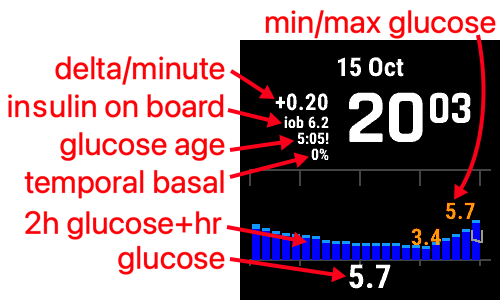

# Inteligentné hodinky a AAPS

Na zobrazenie niektorých informácií dostupných v **AAPS** alebo na vzdialené ovládanie je možné použiť rôzne inteligentné hodinky.

Priame ovládanie **AAPS** (pumpa a senzor) inteligentnými hodinkami sa dá dosiahnuť pomocou hodiniek s Androidom (ktoré sa považujú za malé [smartfóny](./Phones.md)).

Niektoré inteligentné hodinky vám umožňujú zadávať ošetrenia alebo iné veci ale samotný telefón stále spravuje **AAPS**.

Inteligentné hodinky sa čoraz viac používajú s **AAPS** ako aj u dospelých s cukrovkou, tak aj u opatrovateľov/rodičov detí s cukrovkou.

## Všeobecné výhody používania inteligentných hodiniek s **AAPS**


Inteligentné hodinky – v závislosti od modelu – sa dajú s technológiou **AAPS** používať mnohými rôznymi spôsobmi. Môžu sa použiť na úplné alebo čiastočné ovládanie **AAPS** alebo jednoducho na diaľkovú kontrolu hladiny glukózy, inzulínu v krvi a ďalších parametrov.

Integrácia inteligentných hodiniek s **AAPS** môže byť užitočná v mnohých situáciách vrátane šoférovania auta alebo (motorky) a počas cvičenia. Some people feel that looking at a watch (in a meeting, party, dinner table etc.) is more discreet than looking at a phone. From a security perspective, a smartwatch can also be beneficial while on the move, enabling the user to keep their **AAPS** phone stored out of sight (like inside a bag), while still using the smartwatch for remote control.

## Konkrétne výhody pre rodičov/opatrovateľov používajúcich **AAPS**

Pre dieťa – ak má telefón s funkciou **AAPS** nablízku – môže opatrovateľ použiť inteligentné hodinky na monitorovanie alebo vykonávanie úprav bez nutnosti používať telefón s **AAPS**. Toto môže byť užitočné napríklad, ak je telefón **AAPS** skrytý v opasku s pumpou.

Hodinky môžete použiť spolu s mobilom alebo aj namiesto neho či už chcete cez ne ovládať _AAPS_ na diaľku alebo len [sledovať dáta](../RemoteFeatures/FollowingOnly.md).

Navyše, na rozdiel od telefónov pre rodičov/opatrovateľov (ktoré sa spoliehajú na mobilnú sieť alebo Wi-Fi pripojenie), inteligentné hodinky s pripojením Bluetooth môžu byť užitočné na odľahlých miestach, ako je jaskyňa, na lodi alebo turistike. If both devices (**AAPS** phone and smartwatch) are on the same Wi-Fi network, they can also use Wi-Fi.

## Rôzne typy interakcií inteligentných hodiniek a AAPS

V súčasnosti existuje päť hlavných spôsobov, akými sa inteligentné hodinky používajú v spojení s **AAPS**. Tieto sú uvedené v tabuľke nižšie: 

| Nastavenie hodiniek          | Vlastnosti                                     | Požiadavky                                                                                                                                                                                                                                                                                                          |
| ---------------------------- | ---------------------------------------------- | ------------------------------------------------------------------------------------------------------------------------------------------------------------------------------------------------------------------------------------------------------------------------------------------------------------------- |
| Samostatne                   | AAPS bez telefónu                              | Full Android smartwatch (check min Android)</br> Running **app-fullRelease**                                                                                                                                                                                                                                        |
| Kompletné diaľkové ovládanie | Väčšina funkcií AAPS                           | Android **Wear OS** watch (check Android/API)</br>Running **wear-fullRelease**                                                                                                                                                                                                                                      |
| Vzdialené ovládanie          | AAPSClient functions                           | Android **Wear OS** watch (check Android/API)</br>Running **[wear-aapsclientRelease](https://github.com/nightscout/AndroidAPS/releases)**                                                                                                                                                                           |
| Vzdialené ovládanie          | Niektoré funkcie AAPSClienta                   | Garmin watches</br>(older Samsung Tizen and Fitbit setups only, not recommended)</br>See below.                                                                                                                                                                                                                     |
| Displej                      | Glucose, trend, IOB, COB, loop and pump status | Many smartwatches, through a companion app on the **AAPS** phone fed by the [External Companion Apps](#watches-external-companion-apps) broadcast: [WatchDrip+](https://bigdigital.home.blog/) (Xiaomi, Amazfit), [GlucoDataHandler](https://github.com/pachi81/GlucoDataHandler) (Wear OS), G-Watch</br>See below. |

## Pred kúpou inteligentných hodiniek…

Presný model inteligentných hodiniek, ktorý si môžete kúpiť, závisí od požadovaných funkcií. You may find useful information on the [Phones page](#Phones-list-of-tested-phones), including a list of tested phones that also contains some smartwatches.

Popular watch brands include Samsung Galaxy, Garmin, Fossil and Mi band. Možnosti zhrnuté v tabuľke vyššie sú podrobnejšie vysvetlené nižšie, aby ste sa mohli rozhodnúť, ktoré inteligentné hodinky sú pre vašu situáciu tie pravé.

Ak integrujete hodinky s **AAPS** do telefónu s úmyslom vzdialene ovládať **AAPS**, musíte zvážiť aj to, či sú tieto dve zariadenia navzájom kompatibilné, najmä ak máte starší alebo neobvyklý telefón.

Vo všeobecnosti, ak chcete sledovať iba hodnoty glukózy a nechcete interagovať s **AAPS**, existuje širšia škála cenovo dostupných a jednoduchších hodiniek, ktoré môžete použiť.

Najlepší spôsob, ako si vybrať inteligentné hodinky, je vyhľadať príspevky s názvom „hodinky“ v skupinách Discord alebo Facebook **AAPS**. Have a read of others' experiences, and post any specific questions if your query isn't answered by older posts.

## Čistý android

Znie to ako atraktívna možnosť, však? V súčasnosti však len niekoľko nadšencov experimentuje s **AAPS** na samostatných hodinkách. There are a limited number of smartwatches with a reasonable interface which also work well with standalone use of **AAPS** and your CGM app. Popular models include the LEMFO LEM 15 Pro and 16. Do hodiniek budete musieť nahrať „plnohodnotnú“ apk od **AAPS** (apk, ktorá sa zvyčajne inštaluje do smartfónu), a nie „wear“ apk od **AAPS**.

Hoci neexistuje jasná špecifikácia, ktorá by vám pomohla zistiť, či hodinky budú dobre fungovať na samostatné použitie s **AAPS**, nasledujúce parametre vám môžu pomôcť:

1)  Android 12 or newer. 2) Možnosť vypnúť štvorcový režim ciferníka, aby bol text väčší a ľahšie čitateľný. 3) Veľmi dobrá výdrž batérie. 4) Dobrý dosah Bluetooth.

Väčšina frustrácií zo samostatných hodiniek **AAPS** pramení z interakcie s malou obrazovkou a zo skutočnosti, že súčasné rozhranie plnej aplikácie AAPS nebolo navrhnuté pre hodinky. Na úpravu nastavení **AAPS** na hodinkách môžete uprednostniť použitie stylusu kvôli obmedzenej veľkosti obrazovky a niektoré tlačidlá AAPS nemusia byť na obrazovke hodiniek viditeľné.

Ďalšou výzvou je, že je ťažké dosiahnuť dostatočnú výdrž batérie a hodinky s dostatočnou výdržou batérie sú často objemné a hrubé. Používatelia hlásia problémy s operačným systémom a nastaveniami úspory energie, ťažkosti so spustením senzorov na hodinkách, slabý dosah Bluetooth (na udržiavanie spojenia so senzorom aj pumpou). Na fotografiách nižšie je zopár príkladov.


Ak máte záujem o nastavenie samostatných hodiniek, prečítajte si príspevky a komentáre v skupine **AAPS** na Facebooku (skúste hľadať „standalone“ a „Lemfo“) a na Discorde, kde nájdete ďalšie informácie.

## Wear OS

Kód **AAPS** obsahuje rozšírenie aplikácie, ktoré je možné nainštalovať na inteligentné hodinky [**Wear OS**](https://wearos.google.com/#oem-carousel).


Overte si či vaše hodinky spĺňajú **AAPS** [požiadavky](#maintenance-android-version-aaps-version).

### Čo je Wear OS?

Prvé tri možnosti inteligentných hodiniek vyžadujú, aby boli v hodinkách nainštalované operačné systémy **Wear OS**.

**Wear OS** je operačný systém, ktorý beží na niektorých moderných inteligentných hodinkách so systémom Android. Ak popis inteligentných hodiniek uvádza iba _kompatibilitu_ so systémom Android a iOS, neznamená to, že používajú systém Wear OS. Môže ísť o iný druh operačného systému špecifického pre dodávateľa, ktorý nie je kompatibilný s **AAPS**. To support installation and use of any version of **AAPS** or **AAPSClient**, a smartwatch must be running **Wear OS 3.0, 3.2 or 3.5** (Android 11, API level 30) **or newer**. Each Wear OS release follows the Android version it is based on: **Wear OS 3** is Android 11 (API level 30), **Wear OS 4** is Android 13 (API level 33), **Wear OS 5** is Android 14 (API level 34) and **Wear OS 6** is Android 16 (API level 36). Watches on Wear OS 2 cannot run **AAPS**.

Ak si nainštalujete súbor **AAPS** wear.apk na hodinky **Wear OS**, môžete si vybrať z rôznych vlastných ciferníkov **AAPS**. Prípadne môžete použiť štandardný ciferník pre smartfóny s informáciami o **AAPS** zobrazenými v mini okienkach na ciferníku známych ako „complications“. Je to akákoľvek funkcia, ktorá sa zobrazuje na ciferníku okrem času.

```{note}
Recent **Wear OS** changes progressively break the custom **AAPS** watchfaces (the higher the Wear OS version, the more severe), although **complications** keep working. Before buying or updating a watch, read [Wear OS watch face changes](#wearos-watchface-changes).
```


### Ako by mohli vyzerať moje inteligentné hodinky?

Po [nainštalovaní **AAPS** do hodiniek](../WearOS/WearOsSmartwatch.md) si budete môcť automaticky vybrať preferovaný ciferník z ciferníkov určených pre **AAPS**. Na väčšine hodiniek jednoducho stačí dlho stlačiť domovskú obrazovku, kým sa nezmenší, a potom potiahnutím prstom doprava vyberte alternatívnu obrazovku:


Toto sú základné obrazovky vložené do **AAPS**, existuje [viac ciferníkov](#WearOS_changing-to-AAPS-watchface) a môžete použiť aj [complications](#Watchfaces-complications).

### Ako by som mal používať hodinky Wear OS v každodennom živote?

Ďalšie podrobnosti o ciferníkoch a ich každodennom používaní vrátane toho, ako si vytvoriť (a zdieľať) vlastný prispôsobený ciferník, nájdete v časti [Ovládanie Wear AAPS na inteligentných hodinkách](../WearOS/WearOsSmartwatch.md).

(Watchfaces-tizen)= (watches-external-companion-apps)=

## External Companion Apps

**AAPS** can broadcast its status to other apps installed on the same phone: glucose and trend, IOB, COB, basal and temp basal, profile name, loop status, phone and pump battery, reservoir level and bolus progress. Several watch companion apps read this broadcast and display the data on watches that **AAPS** does not support directly. To send the data, enable **External Companion Apps** in **Configuration** > **Communication** (see [External Companion Apps](#external-companion-apps) on the Configuration page). The broadcast is sent with each new reading and cannot be requested: a refresh button in the companion app has no effect on **AAPS**.


Companion apps known to use this broadcast:

- [WatchDrip+](https://bigdigital.home.blog/) for Xiaomi and Amazfit watches, see [Xiaomi and Amazfit watches](#watches-xiaomi-amazfit) below.
- [GlucoDataHandler](https://github.com/pachi81/GlucoDataHandler) for Wear OS watches, as a complication or a widget. It is a useful fallback on Wear OS versions where the **AAPS** watchfaces are unreliable, see [Set up AAPS on your Wear OS watch](../WearOS/WearOsSmartwatch.md). Its companion app GlucoDataAuto shows the same data in a car with Android Auto.
- [G-Watch app](https://play.google.com/store/apps/details?id=sk.trupici.g_watch) for Samsung Tizen watches, and its later Wear OS port. In earlier **AAPS** versions the plugin was named **Samsung Tizen** after this app.

```{warning}
The **G-Watch app** and its **Wear OS** port are no longer maintained, and Samsung has moved its smartwatches from Tizen to Wear OS. G-Watch is only relevant for existing, older setups and is not recommended for a new installation. Check the dedicated [Facebook group](https://www.facebook.com/groups/gwatchapp) for the latest news.
```

(Watchfaces-garmin)=

## Garmin

There are some watch faces for Garmin that integrate with [AAPS](https://apps.garmin.com/search?keywords=androidaps), on the Garmin ConnectIQ store.


Hodinky [AAPS Glucose Watch](https://apps.garmin.com/apps/3d163641-8b13-456e-84c3-470ecd781fb1) sú priamo prepojené s **AAPS**. Zobrazujú údaje o stave slučky (IOB, dočasný bazál) okrem hodnôt glukózy a odosielajú údaje o srdcovej frekvencii do **AAPS**. It is available in the ConnectIQ store; enable the **Garmin** plugin in **Configuration → Communication**. 

1. Highest and lowest glucose values on the graph
2. Glucose change per minute
3. Insulin on board (IOB)
4. Time since the last glucose reading (minutes:seconds)
5. Temporary basal rate, as a percentage of the profile basal rate
6. Glucose graph of the last 2 hours
7. Current glucose value


## Fitbit

```{warning}
Google is moving Fitbit into Google Health and is removing third-party apps and watch faces from Fitbit watches in the EU. Fitbit watchfaces are therefore **no longer a recommended option**, and buying a Fitbit for use with **AAPS** is not recommended.
```

For existing Fitbit watches, the [Nightscout webpages](https://nightscout.github.io/nightscout/wearable/#fitbit) list some monitoring-only options, such as [Glance](https://glancewatchface.com/). These are third-party watchfaces too, so the same EU restriction applies.

## Iba sledovanie

Tieto inteligentné hodinky budú zobrazovať niektoré informácie z **AAPS**, niektoré budú vyžadovať iné aplikácie.

Existuje široká škála cenovo dostupných inteligentných hodiniek, ktoré môžu slúžiť len na zobrazenie údajov. Ak používate Nightscout, prehľad všetkých možností nájdete [tu](https://nightscout.github.io/nightscout/wearable/#)

Nižšie sú uvedené niektoré z možností hodiniek určených iba na sledovanie, ktoré sú obľúbené u používateľov **AAPS**:

(watches-xiaomi-amazfit)=
### Hodinky Xiaomi a Amazfit

**WatchDrip+** is a community-developed companion app that displays glucose and loop data on various smartwatch models, mostly Xiaomi (_e.g._ Mi Band) and Amazfit brands:


Since version 0.5, **WatchDrip+** reads its data directly from **AAPS**, without xDrip+ as a relay. On the **AAPS** phone:

1. Enable **External Companion Apps** in **Configuration** > **Communication**, see [above](#watches-external-companion-apps). It provides the current glucose, delta, trend arrow, IOB and pump status.
2. Enable the **xDrip** plugin in **Configuration** > **Communication** and turn on **Send status to xDrip+** in its settings. It provides the IOB/COB status line, and the glucose graph on the watch fills in after a few readings.
3. If xDrip+ is installed on the phone, disable its **Broadcast Service API** (xDrip+ > Settings > Inter-app settings) so that the watch does not receive the data twice. If xDrip+ was only relaying data to the watch, you can uninstall it.

The refresh button of WatchDrip+ has no effect with **AAPS**: the data arrives with each new reading.


You can read more about them, including how to set them up, on the [WatchDrip+ website](https://bigdigital.home.blog/). Výhodou týchto hodiniek je, že sú malé a relatívne cenovo dostupné. Sú obľúbenou voľbou najmä pre deti a osoby s menšími zápästiami.

### Pebble hodinky


Hodinky Pebble ([už sa nevyrábajú](https://en.wikipedia.org/wiki/Pebble_(watch))) boli v bežnom výpredaji od roku 2013 do roku 2016 a stále môžu byť dostupné z druhej ruky. Fitbit prevzal majetok spoločnosti Pebble. Používatelia Pebble môžu na zobrazenie údajov Nightscout použiť ciferník Urchin. Medzi zobrazené možnosti údajov patrí IOB, aktívny dočasný bazál a predikcie. V prípade otvorenej slučky môžete použiť IFTTT na vytvorenie appletu, ktorý po prijatí oznámenia od **AAPS** odošle buď SMS, alebo pushover oznámenie.

### [Hodinky Bluejay](https://bluejay.website/)


Ide o unikátne technológie, ktoré dokážu prijímať údaje o glukóze **priamo** z vysielača Dexcom. It is not widely known that Dexcom G6/G7 transmitters actually broadcast the current glucose data on _two_ separate channels, a phone channel and a medical channel. The Bluejay watches can be set to receive glucose data on either channel, so if **AAPS** is using the phone channel, then the Bluejay watches can use the medical channel.

The key advantage is that the watch is independent of both the phone and the looping system. Takže napríklad, ak odpojíte pumpu a telefón **AAPS** na pláži alebo v zábavnom parku a ste mimo dosahu telefónu **AAPS**, stále môžete získavať údaje z vášho Dexcomu priamo do hodiniek Bluejay.

The original **Bluejay GTS** is discontinued and cannot read the Dexcom G7. The later models (U1, then the current **U3**, sold as early access at the time of writing) are full Android watches running xDrip, which collect from the Dexcom G6 and G7 directly. The vendor describes the watch as a research tool, not for medical use. Reported disadvantages are that it does not always pick up a reading every 5 minutes and that the battery needs frequent charging. Check the [Bluejay website](https://bluejay.website/) for the current model and availability.

### Apple hodinky

Pozrite si údaje z [Nightscout na hodinkách](https://nightscout.github.io/nightscout/wearable/#).

Hodinky Apple Watch teraz podporujú priame pripojenie G7 a možno ich používať súčasne s **AAPS**.

