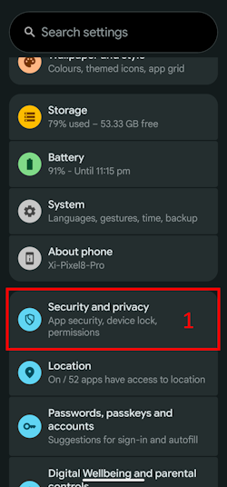
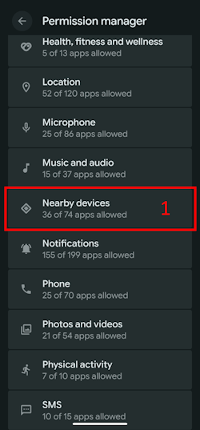
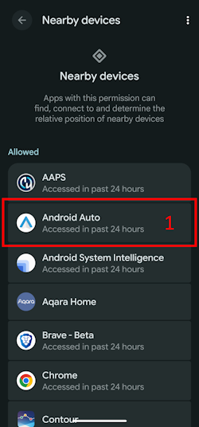

(bluetoothtroubleshooting-bluetooth-related-issues)=

# Problémy súvisiace s Bluetooth

Niektorí používatelia majú problémy so zlyhaním aktivácie Omnipod DASH, s pripojením Medtrum Nano a s ďalšími chybami Podu, ktoré súvisia s Bluetooth. Mnohé z týchto problémov majú jednu z nasledujúcich príčin.

Niektoré z týchto problémov sa pravdepodobne týkajú aj iných inzulínových púmp s Bluetooth. Medtrum Nano má rovnako ako Omnipod DASH známe problémy s povolením pre zariadenia v okolí.

---

(bluetoothtroubleshooting-cannot-start-omnipod-with-android-16)=

## Omnipod sa s Androidom 16 nedá spustiť
- Android 16 potrebuje na správne fungovanie Omnipod DASH minimálne **AAPS** verzie 3.3.2.1, pretože táto verzia obsahuje opravy, ktoré riešia známe problémy, ktoré Android 16 spôsobil pri Omnipode.

---

(bluetoothtroubleshooting-bluetooth-battery-optimisation)=

## Optimalizácia batérie pre Bluetooth

Novšie verzie Androidu majú zapnutú optimalizáciu batérie pre systémovú aplikáciu Bluetooth. Je známe, že to spôsobuje problémy s pumpami a CGM, ktoré používajú Bluetooth.

Ak ste postupovali podľa [Sprievodcu nastavením](../SettingUpAaps/SetupWizard.md) a podľa nastavení v časti [Optimalizácia batérie pre Bluetooth](#setup-wizard-bluetooth-battery-optimisation), toto nastavenie by malo byť správne. Ak ste však postupovali podľa staršej verzie tohto návodu, je možné, že ste toto nastavenie nezmenili.

Ak sa vám odpája pumpa a CGM, overte, či je toto nastavenie správne.

---

(bluetoothtroubleshooting-apps-using-nearby-device-permission)=

## Aplikácie, ktoré používajú povolenie Androidu „Zariadenia v okolí“, môžu spôsobiť výpadky pripojenia a problémy s aktiváciou Podu

Android vám pomocou povolení umožňuje určiť, čo môže každá aplikácia v telefóne robiť alebo k čomu má prístup. Pre každú nainštalovanú aplikáciu môžete povoliť alebo zakázať konkrétne povolenia, napr. prístup k súborom v zariadení, prístup k Bluetooth, vyhľadávanie zariadení v okolí atď.

**AAPS** potrebuje na svoju činnosť viacero konkrétnych povolení. Jedno z nich, ktoré je potrebné na správne fungovanie Podov, je povolenie „Zariadenia v okolí“. Toto povolenie vyžaduje aj mnoho iných aplikácií. Komunita zistila, že niektoré aplikácie, ktoré toto povolenie dostanú, môžu na niektorých zariadeniach spôsobovať problémy s aktiváciou nových Podov.

(bluetoothtroubleshooting-apps-using-nearby-device-permission-known-apps)=

### Aplikácie, ktoré používajú povolenie „Zariadenia v okolí“ a o ktorých je známe, že spôsobili problémy:

O aplikáciách v tomto zozname sa na jednom alebo viacerých miestach v komunite hovorilo, že spôsobujú problémy so zariadeniami Omnipod DASH a v niektorých prípadoch aj s Medtrum Nano.

```{admonition} Updating the list
:class: note
Ak chcete navrhnúť aplikácie na doplnenie do tohto zoznamu, napíšte @XiTatiON na kanáli #omnipod-dash na Discorde.
```

- **myBMW** MyBMW rušila Medtrum Nano a Omnipod DASH. Aplikácia MyBMW sa na povolenie „vyhľadávať zariadenia v okolí“ pýta iba raz. Ak ho neudelíte, funguje stále úplne v poriadku

- **Amazon Alexa**  Odobratie povolenia „Zariadenia v okolí“ aplikácii Alexa niektorým ľuďom vyriešilo problém, ale znemožní to párovanie zariadení Matter IoT

- **Aplikácia MINI**  Zdá sa, že aplikácia vychádza z aplikácie myBMW, a preto sa môže správať rovnako

- **BM2** Aplikácia na sledovanie solárnej batérie, ktorá sa používa v niektorých solárnych zostavách v obytných dodávkach a pri kempovaní: keď aplikácia bežala, bránila aktivácii nového Podu. Problém sa dá obísť tak, že počas aktivácie nového Podu aplikáciu vynútene zastavíte (Force stop). Keď bola aplikácia potom znova spustená, fungovanie Dash zrejme nerušila (na Pixel 8 Pro s Androidom 16).

(bluetoothtroubleshooting-revoke-nearby-device-permission)=

### Ako odobrať povolenie „Zariadenia v okolí“ iným aplikáciám:
Ak máte problémy s aktiváciou nového Podu a používate správnu podporovanú verziu **AAPS** pre vašu verziu Androidu, možno bude počas aktivácie nového Podu potrebné odobrať toto povolenie ostatným aplikáciám.

Podľa tohto postupu odoberte povolenie „Zariadenia v okolí“ všetkým aplikáciám okrem **AAPS**:

```{admonition} Menus and settings
:class: note
Snímky obrazovky a pokyny v tomto návode pochádzajú z čistého Androidu 16 (Vanilla) na Google Pixel 8 Pro. Ponuky a nastavenia u iných výrobcov a na iných zariadeniach pravdepodobne nebudú presne zodpovedať tomuto popisu. Prispôsobte postup svojmu zariadeniu. Ak si neviete rady, v časti [Kde získať pomoc pre Dash](#omnipod-dash-where-to-get-help-for-dash) nájdete, ako požiadať komunitu o pomoc.
```

1. Otvorte v telefóne nastavenia Androidu, posuňte sa nadol a ťuknite na **Zabezpečenie a ochrana súkromia (Security and privacy) (1)**.

    

2. Posuňte sa nadol a ťuknite na **Ovládanie ochrany súkromia (Privacy controls) (1)**.

   

3. Ťuknite na **Správca povolení (Permission manager) (1)**.

   

3. Posuňte sa nadol a ťuknite na **Zariadenia v okolí (Nearby devices) (1)**.

   

4. Prejdite zoznam aplikácií a ťuknite na aplikáciu, ktorej chcete odobrať povolenie **Zariadenia v okolí**.

   V tomto návode odoberáme povolenie aplikácii **Android Auto (1)**.

   Aby sa nepoškodili ďalšie Pody, odporúčame všetkým najprv odobrať toto povolenie všetkým aplikáciám okrem **AAPS**.

```{admonition} Which app to select?
:class: tip
Ak neviete, ktorá aplikácia vám spôsobuje problém, vypnite povolenie všetkým (pozrite si aj zoznam známych problémových aplikácií a začnite nimi). Ak si môžete dovoliť po ceste prísť o niekoľko Podov, pred každou novou aktiváciou Podu povoľte povolenie jednej ďalšej aplikácii, kým nezistíte, ktorá konkrétna aplikácia spôsobuje problémy s Podom. Ak nájdete nové problémové aplikácie, dajte nám vedieť na kanáli #omnipod-dash na Discorde.
```

   

5. Ak chcete povolenie odobrať, ťuknite na **Nepovoliť (Don't allow) (1)** a potom na **Aj tak nepovoliť (Don't allow anyway) (2)**. Ak ste postupovali správne, ako vybranú možnosť uvidíte **Nepovoliť (3)**. Teraz sa môžete vrátiť do ponuky **Zariadenia v okolí** ťuknutím na **šípku Späť (4)** a v prípade potreby zmeniť toto nastavenie aj pre ďalšie aplikácie.

      

(bluetoothtroubleshooting-re-enable-nearby-device-permission)=

### Ako znova povoliť povolenie „Zariadenia v okolí“ systémovým a ďalším aplikáciám:

1. V prípade potreby si v časti **„Ako odobrať povolenie ‚Zariadenia v okolí‘ iným aplikáciám“** pozrite, ako sa dostať k nastaveniam súkromia aplikácií. Keď budete v nastaveniach **Zariadenia v okolí**, pokračujte krokom 2.

2. Prejdite zoznam aplikácií a ťuknite na aplikáciu, ktorej chcete povoliť **Zariadenia v okolí**.

   V tomto návode povoľujeme povolenie aplikácii **Android Auto (1)**.

   Všimnete si, že po odobratí povolenia aplikácia **Android Auto (1)** v zozname aplikácií chýba. Je to preto, že **Android Auto** je **systémová aplikácia** a systémové aplikácie sú predvolene skryté.

   

3. Ak chcete zobraziť skryté systémové aplikácie, ťuknite na **ponuku s tromi bodkami (⋮) (1)** vpravo hore a potom na **„Zobraziť systémové“ (Show system) (2)**. Teraz by ste mali v zozname vidieť skrytú systémovú aplikáciu **Android Auto (3)**.

```{admonition} Find your app
:class: tip
Ak má aplikácia povolenie odobraté, musíte sa posunúť nadol, kým neuvidíte zoznam aplikácií s odobratým povolením nižšie v zozname.
```

     

5. Ak chcete povolenia pre jednotlivé aplikácie znova povoliť, postupujte podľa časti **„Ako odobrať povolenie ‚Zariadenia v okolí‘ iným aplikáciám“** v opačnom poradí.

---

(bluetoothtroubleshooting-android-15-bluetooth-connection-problems)=

## Android 15: časté problémy s pripojením Bluetooth

Po aktualizácii Androidu alebo prechode na nový telefón **AAPS** často stráca pripojenie Bluetooth k pumpe. Po reštarte telefónu problém dočasne zmizne. Ak používate **Omnipod DASH** a váš telefón má Android 15, zapnutie nastavenia **Bluetooth párovanie** môže pomôcť zlepšiť stabilitu pripojenia Bluetooth. Ako ho zapnúť:

```{admonition} Android 16
:class: warning
**Bluetooth párovanie** zapnite iba v Androide 15 a iba vtedy, keď máte problémy s pripojením. V Androide 16 párovanie (bonding) NEZAPÍNAJTE.
```

1. Otvorte [nastavenia Dash](#omnipod-dash-settings): otvorte obrazovku pumpy DASH cez **Spravovať** > **Pumpa** a ťuknite na ikonu **Nastavenia** (ozubené koliesko) vpravo hore.

   

2. Otvorte časť **Rozšírené nastavenia** a zapnite **Bluetooth párovanie**.

   

3. Ak telefón zobrazí žiadosť o spárovanie, prijmite ju.

4. Reštartujte telefón.
