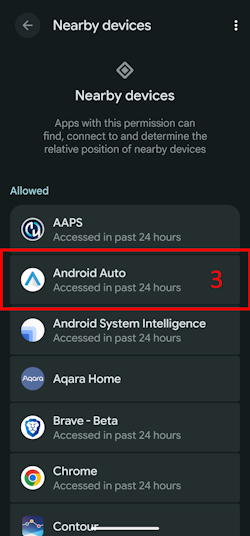
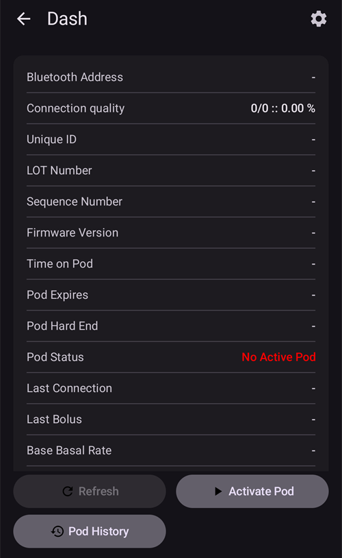

(bluetoothtroubleshooting-bluetooth-related-issues)=

# Problémy súvisiace s Bluetooth

Niektorí používatelia majú problémy so zlyhaním aktivácie Omnipod DASH, s pripojením Medtrum Nano a s ďalšími chybami Podu, ktoré súvisia s Bluetooth. Mnohé z týchto problémov majú jednu z nasledujúcich príčin.

Niektoré z týchto problémov sa pravdepodobne týkajú aj iných inzulínových púmp s Bluetooth. Medtrum Nano má rovnako ako Omnipod DASH známe problémy s povolením pre zariadenia v okolí.

---

(bluetoothtroubleshooting-cannot-start-omnipod-with-android-16)=

## Omnipod sa s Androidom 16 nedá spustiť
- Android 16 potrebuje na správne fungovanie Omnipod DASH aspoň verziu **AAPS** 3.3.2.1, pretože táto verzia obsahuje opravy priamo pre známe problémy s Omnipodom, ktoré priniesol Android 16.

---

(bluetoothtroubleshooting-bluetooth-battery-optimisation)=

## Optimalizácia batérie pre Bluetooth

Newer versions of Android have enabled Battery optimisation for the system Bluetooth app. Je známe, že to spôsobuje problémy s pumpami a CGM, ktoré používajú Bluetooth.

If you followed the [Setup Wizard](../SettingUpAaps/SetupWizard.md) and followed the configuration settings in the [Bluetooth Battery Optimisation](#setup-wizard-bluetooth-battery-optimisation) section then this setting should be correct, however if you followed an older version of this guide it's possible you have not changed this setting.

Verify this is correctly configured if you have pump and CGM disconnections.

---

(bluetoothtroubleshooting-apps-using-nearby-device-permission)=

## Aplikácie, ktoré používajú povolenie Androidu „Zariadenia v okolí“, môžu spôsobiť výpadky pripojenia a problémy s aktiváciou Podu

Android vám pomocou povolení umožňuje určiť, čo môže každá aplikácia v telefóne robiť alebo k čomu má prístup. Pre každú nainštalovanú aplikáciu môžete povoliť alebo zakázať konkrétne povolenia, napr. prístup k súborom v zariadení, prístup k Bluetooth, vyhľadávanie zariadení v okolí atď.

**AAPS** requires a number of specific permissions to function, one which is required to ensure that Pods work is the "Nearby devices" permission. Toto povolenie vyžaduje aj mnoho iných aplikácií. Komunita zistila, že niektoré aplikácie, ktoré toto povolenie dostanú, môžu na niektorých zariadeniach spôsobovať problémy s aktiváciou nových Podov.

(bluetoothtroubleshooting-apps-using-nearby-device-permission-known-apps)=

### Aplikácie, ktoré používajú povolenie „Zariadenia v okolí“ a o ktorých je známe, že spôsobili problémy:

O aplikáciách v tomto zozname sa na jednom alebo viacerých miestach v komunite hovorilo, že spôsobujú problémy so zariadeniami Omnipod DASH a v niektorých prípadoch aj s Medtrum Nano.

```{admonition} Updating the list
:class: note
Ak chcete navrhnúť aplikácie na doplnenie do tohto zoznamu, napíšte @XiTatiON na kanáli #omnipod-dash na Discorde.
```

- **myBMW** MyBMW rušila Medtrum Nano a Omnipod DASH. Aplikácia MyBMW sa na povolenie „vyhľadávať zariadenia v okolí“ pýta iba raz. Ak ho neudelíte, funguje stále úplne v poriadku

- **Amazon Alexa**  Odobratie povolenia „Zariadenia v okolí“ aplikácii Alexa niektorým ľuďom problém vyriešilo, ale potom nebude možné párovať zariadenia IoT so štandardom Matter

- **MINI app**  Appears the app is based on myBMW app and might mirror its behavior as a result

- **BM2** Aplikácia na sledovanie solárnej batérie, ktorá sa používa v niektorých obytných dodávkach a solárnych zostavách na kempovanie. Keď bola aplikácia spustená, zabránila aktivácii nového Podu. Problém sa dá obísť tak, že aplikáciu počas aktivácie nového Podu vynútene zastavíte. Keď bola aplikácia potom znova spustená, fungovanie Dash zrejme nerušila (na Pixel 8 Pro s Androidom 16).

(bluetoothtroubleshooting-revoke-nearby-device-permission)=

### Ako odobrať povolenie „Zariadenia v okolí“ iným aplikáciám:
If you are facing issues activating a new Pod and you are running on the correct supported version of **AAPS** for your version of Android, it may be necessary to revoke the permission for other apps while activating a new Pod.

Follow this procedure to revoke the "Nearby device" permission for all apps except **AAPS**:

```{admonition} Menus and settings
:class: note
Snímky obrazovky a pokyny v tomto návode pochádzajú z čistého Androidu 16 (Vanilla) na Google Pixel 8 Pro. Ponuky a nastavenia u iných výrobcov a zariadení sa pravdepodobne nebudú presne zhodovať s týmto popisom. Prispôsobte kroky svojmu zariadeniu. Ak si neviete rady, v časti [Kde získať pomoc pre Dash](#omnipod-dash-where-to-get-help-for-dash) nájdete, ako požiadať komunitu o podporu.
```

1. Otvorte v telefóne nastavenia Androidu, posuňte sa nadol a ťuknite na **Zabezpečenie a ochrana súkromia (Security and privacy) (1)**.

    

2. Posuňte sa nadol a ťuknite na **Ovládanie ochrany súkromia (Privacy controls) (1)**.

   

3. Ťuknite na **Správca povolení (Permission manager) (1)**.

   

3. Posuňte sa nadol a ťuknite na **Zariadenia v okolí (Nearby devices) (1)**.

   

4. Prejdite zoznam aplikácií a ťuknite na aplikáciu, ktorej chcete odobrať povolenie **Zariadenia v okolí**.

   V tomto návode odoberáme povolenie aplikácii **Android Auto (1)**.

   Aby sa nepoškodili ďalšie Pody, odporúčame všetkým najprv odobrať toto povolenie všetkým aplikáciám okrem **AAPS**.

```{admonition} Which app to select?
:class: tip
Ak neviete, ktorá aplikácia vám spôsobuje problém, vypnite povolenie všetkým (pozrite si aj zoznam známych problémových aplikácií a začnite nimi). Ak si môžete dovoliť po ceste prísť o niekoľko Podov, pred každou novou aktiváciou Podu povoľte povolenie jednej ďalšej aplikácii, kým nezistíte, ktorá konkrétna aplikácia spôsobuje problémy s Podom. Ak nájdete nové problémové aplikácie, dajte nám vedieť na kanáli #omnipod-dash na Discorde.
```

   

5. Ak chcete povolenie odobrať, ťuknite na **Nepovoliť (Don't allow) (1)** a potom na **Aj tak nepovoliť (Don't allow anyway) (2)**. Ak ste postupovali správne, ako vybranú možnosť uvidíte **Nepovoliť (3)**. Teraz sa môžete vrátiť do ponuky **Zariadenia v okolí** ťuknutím na **šípku Späť (4)** a v prípade potreby zmeniť toto nastavenie aj pre ďalšie aplikácie.

      

(bluetoothtroubleshooting-re-enable-nearby-device-permission)=

### Ako znova povoliť povolenie „Zariadenia v okolí“ systémovým a ďalším aplikáciám:

1. Ak je to potrebné, pozrite si v časti **„Ako odobrať povolenie ‚Zariadenia v okolí‘ iným aplikáciám“**, ako sa dostať do nastavení ochrany súkromia aplikácií. Keď ste v nastavení **Zariadenia v okolí**, pokračujte krokom 2.

2. Prejdite zoznam aplikácií a ťuknite na aplikáciu, ktorej chcete povoliť **Zariadenia v okolí**.

   V tomto návode povoľujeme povolenie aplikácii **Android Auto (1)**.

   Všimnete si, že po odobratí povolenia aplikácia **Android Auto (1)** v zozname aplikácií chýba. Je to preto, že **Android Auto** je **systémová aplikácia** a systémové aplikácie sú predvolene skryté.

   

3. Ak chcete zobraziť skryté systémové aplikácie, ťuknite na **ponuku s tromi bodkami (⋮) (1)** vpravo hore a potom na **„Zobraziť systémové“ (Show system) (2)**. Teraz by ste mali v zozname vidieť skrytú systémovú aplikáciu **Android Auto (3)**.

```{admonition} Find your app
:class: tip
Ak má aplikácia povolenie odobraté, musíte sa posunúť nadol, kým neuvidíte zoznam aplikácií s odobratým povolením nižšie v zozname.
```

     

5. Ak chcete povolenie každej aplikácii znova povoliť, postupujte podľa časti **„Ako odobrať povolenie ‚Zariadenia v okolí‘ iným aplikáciám“** v opačnom poradí.

---

(bluetoothtroubleshooting-android-15-bluetooth-connection-problems)=

## Android 15: časté problémy s pripojením Bluetooth

Po aktualizácii Androidu alebo prechode na nový telefón **AAPS** často stráca pripojenie Bluetooth k pumpe. Po reštarte telefónu problém dočasne zmizne. Ak používate **Omnipod DASH** a váš telefón má Android 15, zapnutie nastavenia **Bluetooth párovanie** môže pomôcť zlepšiť stabilitu pripojenia Bluetooth. Ako ho zapnúť:

```{admonition} Android 16
:class: warning
**Bluetooth párovanie** zapnite iba v Androide 15 a iba vtedy, keď máte problémy s pripojením. V Androide 16 párovanie (bonding) NEZAPÍNAJTE.
```

1. Otvorte [nastavenia Dash](#omnipod-dash-settings): otvorte obrazovku pumpy DASH cez **Spravovať** > **Pumpa** a ťuknite na ikonu **Nastavenia** (ozubené koliesko) vpravo hore.

   

2. Otvorte časť **Rozšírené nastavenia** a zapnite **Bluetooth párovanie**.

   

3. Ak telefón zobrazí žiadosť o spárovanie, prijmite ju.

4. Reštartujte telefón.
