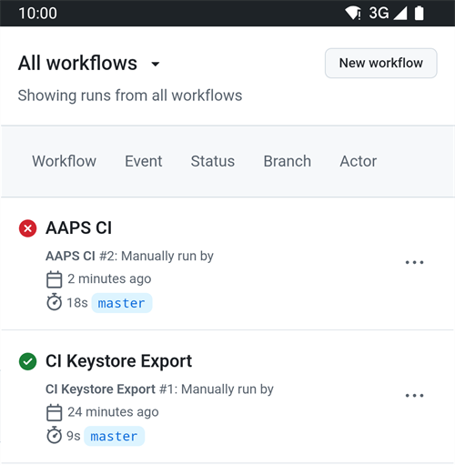

(aaps-ci-troubleshooting)=

# Zostavenie v prehliadači: riešenie problémov

```{note}
Na tejto stránke sú tipy na riešenie problémov pri [zostavení v prehliadači](../SettingUpAaps/BrowserBuild.md).

Používate **AAPS Builder**? Začnite jeho vlastnou [časťou o riešení problémov](#aaps-builder-troubleshooting). Časti o Disku Google nižšie platia aj preň.
```

## Riešenie problémov s AAPS-CI

(aaps-ci-read-the-logs)=
### Najprv: zistite, čo sa pokazilo

Keď zostavenie zlyhá, GitHub uchováva log každého kroku. Log vám povie, ktorý krok zlyhal a prečo. Prečítajte si ho skôr, ako skúsite čokoľvek iné: chybovú správu hľadáte na tejto stránke a na ňu sa vás budú pýtať aj tí, ktorí vám pomáhajú.

1. Vo svojej kópii AndroidAPS na GitHube otvorte **Actions**. Zlyhané zostavenie má červený krížik. Ťuknite na jeho názov.

   

2. Súhrn behu ukazuje **Failure** (zlyhanie) a pod ním úlohu, ktorá zlyhala (**Build AAPS**, s červeným krížikom).

   

3. Prejdite nižšie na **Annotations** a ťuknite na červený riadok **Build AAPS**.

   

4. Otvorí sa úloha. Kroky so sivou fajkou prebehli v poriadku. Krok s červeným krížikom je ten, ktorý zlyhal: GitHub ho otvorí za vás. Kroky po ňom boli preskočené (sivý krúžok).

   

5. Prečítajte si riadky tesne nad `Error: Process completed with exit code 1.`: vysvetľujú problém. V tomto príklade krok **Retrieving Google Drive access token** zlyhal s `invalid_grant` a `Token has been expired or revoked.`, pozrite [Platnosť obnovovacieho tokenu Google vypršala](#aaps-ci-google-token-expired).

   

```{tip}
Žiadate o pomoc? Uveďte názov kroku, ktorý zlyhal, a riadky s chybou (stačí snímka obrazovky ako tá vyššie). Nikdy nezdieľajte obsah svojich secretov.
```

(aaps-ci-update-secret)=
#### Aktualizácia secretu

Mnoho opráv znamená nahradiť hodnotu secretu. Vo svojej kópii AndroidAPS na GitHube prejdite do **Settings** → **Secrets and variables** → **Actions** a ťuknite na ceruzku vedľa secretu.


Zadajte alebo vložte novú hodnotu a ťuknite na **Update secret**. GitHub nikdy neukáže starú hodnotu: pole je vždy prázdne.


(aaps-ci-rerun)=
#### Po oprave spustite zostavenie znova

Keď ste príčinu opravili, nemusíte začínať od začiatku: otvorte beh, ktorý zlyhal, ťuknite na **...** (vpravo hore) a potom na **Re-run failed jobs**.


Ťuknite na **Re-run jobs**. Nové zostavenie môžete spustiť aj ako obvykle cez **Run workflow**.


(aaps-ci-preparation-web)=
### Webová stránka aaps-ci-preparation
  - Prípravnú stránku zobrazuje dočasný lokálny server (napríklad Simple Web Server na počítači), ktorý prijíma aj obnovovací token Google.
  - Ak vidíte obrazovku nižšie, lokálny server sa zastavil alebo nie je dostupný.
  - Zatvorte prípravnú stránku, skontrolujte, či lokálny server beží, a potom znova otvorte aaps-ci-preparation.html rovnako ako v kroku 2 a dokončite zvyšné kroky. Je to potrebné najmä pri vytváraní prvého pripojenia ku Google počas nastavenia.

  

(aaps-ci-google-token-expired)=
### Platnosť obnovovacieho tokenu Google vypršala
  - Obnovovacie tokeny Google OAuth2 vypršia, ak sa nepoužijú 6 mesiacov. Neplatné sa môžu stať aj z iných dôvodov (napr. ste zmenili heslo k účtu Google alebo ste prístup ručne zrušili). Viac podrobností nájdete v [dokumentácii Google OAuth2](https://developers.google.com/identity/protocols/oauth2).
  - V [logu zostavenia](#aaps-ci-read-the-logs) zlyhá krok **Retrieving Google Drive access token** s `invalid_grant` a `Token has been expired or revoked.`:

  

  - Ak vaše zostavenie zlyhá pre obnovovací token Google, ktorý vypršal alebo bol zrušený, musíte zopakovať kroky [Google Drive Auth](#aaps-ci-google-drive-auth), aby ste získali nový token `GDRIVE_OAUTH2`, [aktualizovať secret](#aaps-ci-update-secret) vo svojom repozitári na GitHube a potom [spustiť zostavenie znova](#aaps-ci-rerun).
  - Ak autorizácia znova zlyhá alebo Google už nežiada váš súhlas, najprv odstráňte existujúci prístup AAPS zo svojho účtu Google, pozrite [nižšie](#aaps-ci-google-remove-access).

(aaps-ci-google-remove-access)=
### Odstráňte prístup AAPS zo svojho účtu Google a spustite autorizáciu znova
  - Ak autorizácia Disku Google stále zlyháva alebo chcete začať znova od čistého stavu, najprv odstráňte prístup, ktorý ste predtým dali AAPS, a potom autorizáciu zopakujte.
  - V telefóne otvorte [https://myaccount.google.com](https://myaccount.google.com), ťuknite na **Security** (Zabezpečenie), prejdite nižšie na **Your connections to third-party apps & services** (pripojenia k aplikáciám a službám tretích strán) a otvorte zoznam prepojených aplikácií. Môžete tiež prejsť priamo na [https://myaccount.google.com/connections](https://myaccount.google.com/connections).
  - V zozname ťuknite na **AAPS**.

  

  - Stránka ukazuje prístup, ktorý ste dali AAPS (súbory na Disku Google, ktoré aplikácia používa). Ťuknite na **Delete all** (Odstrániť všetko), aby ste pripojenie odstránili, alebo ťuknite na **See details** (Zobraziť podrobnosti), ak ho chcete najprv skontrolovať.

  

  - Na stránke s podrobnosťami ťuknite na **Remove all access** (Odstrániť všetok prístup).

  

  - Ťuknite na **Confirm** (Potvrdiť).

  

  - Google potvrdí, že AAPS už nemá prístup. AAPS sa už nezobrazuje v zozname prepojených aplikácií.

  

  - Teraz spustite autorizáciu znova od začiatku: zatvorte **obe** – prípravnú stránku aj aplikáciu správcu súborov – a potom znova otvorte aaps-ci-preparation.html zo správcu súborov a zopakujte kroky [Google Drive Auth](#aaps-ci-google-drive-auth). Google vás znova požiada o udelenie prístupu a stránka vám dá nový token `GDRIVE_OAUTH2`.
  - [Aktualizujte secret `GDRIVE_OAUTH2`](#aaps-ci-update-secret) vo svojom repozitári na GitHube novým tokenom a potom [spustite zostavenie znova](#aaps-ci-rerun).

(aaps-ci-disable-software)=
### Vypnite softvér, ktorý môže rušiť overovanie OAUTH
  - Pred pokusom o získanie kľúča OAUTH vypnite v telefóne každú VPN aj každú bezpečnostnú aplikáciu (firewall, antimalvér atď.).

(aaps-ci-actions-permission)=
### Skontrolujte nastavenia povolení GitHub Actions
  - Uistite sa, že pravidlá GitHub Actions sú nastavené na „Allow all actions and reusable workflows“ (Settings → Actions → General). Ak ho zmeníte, stlačte **Save** pod možnosťami.

  

`actions/checkout@v4` and `actions/setup-java@v4` are not allowed to be used in `xxxxx/AndroidAPS`. Actions in this workflow must be: within a repository owned by `xxxxx`

(aaps-ci-workflow-permissions)=
### Skontrolujte nastavenia povolení workflowov na GitHube
  - Ak zostavenie hneď zlyhá s chybou „Invalid workflow file“ podobnou tej nižšie, predvolené povolenia workflowov vo vašom repozitári sú príliš prísne:

```
Invalid workflow file
The workflow is not valid. .github/workflows/aaps-ci.yml (Line: 361, Col: 3):
Error calling workflow 'xxxxx/AndroidAPS/.github/workflows/cleanup-workflow-runs.yml@...'.
The nested job 'cleanup' is requesting 'actions: write', but is only allowed 'actions: none'.
```

  - Uistite sa, že Workflow permissions sú nastavené na „Read and write permissions“ (Settings → Actions → General → Workflow permissions). Potom uložte a spustite workflow zostavenia znova.

  

(aaps-ci-password-special-characters)=
### Zostavenie zlyhá pri kontrole hesla úložiska kľúčov
  - V [logu zostavenia](#aaps-ci-read-the-logs) zlyhá krok **Validating keystore, alias and password** s `Either KEYSTORE_BASE64, KEYSTORE_PASSWORD, KEY_PASSWORD, or KEY_ALIAS is incorrect` a potom s `Keystore was tampered with, or password was incorrect`. Zostavenie sa tam zastaví: úložisko kľúčov a heslá sa kontrolujú skôr, ako sa AAPS zostaví.

  

  - Workflow zostavenia zachová každý znak vašich hesiel bez zmeny. Zadajte `KEYSTORE_PASSWORD` a `KEY_PASSWORD` presne tak, ako sú, bez pridania spätnej lomky alebo iného únikového (escape) znaku. Ak ste pridali spätné lomky, [aktualizujte secrety](#aaps-ci-update-secret) heslom presne tak, ako je. Príklad nižšie je nesprávny: heslo je `Example2026`, spätná lomka bola pridaná.

  

  - Ak zostavenie stále zlyhá pri podpisovaní APK, hoci je vaše heslo správne, a heslo obsahuje `$`, spätný apostrof (backtick), `"` alebo `\`, súbor workflow vo vašom forku je starší ako september 2026 a tieto znaky ešte spracúva. [Synchronizujte svoj fork](#Update-to-new-version-update-your-repo) s najnovšou verziou dev a potom spustite workflow zostavenia znova.
  - Zvislá čiara `|` je špeciálny prípad. Prípravná stránka v [možnosti 1](#aaps-ci-option1) spojí úložisko kľúčov, heslá a alias do jedného secretu `KEYSTORE_SET`, kde sú časti oddelené znakom `|`. Workflow ho podľa tohto znaku znova rozdelí. Heslo, ktoré vygeneruje prípravná stránka, obsahuje iba písmená a číslice, takže pri možnosti 1 sa to stať nemôže. Môže sa to stať iba vtedy, ak ste si secret `KEYSTORE_SET` poskladali sami z hesla, ktoré obsahuje `|`. V takom prípade secret `KEYSTORE_SET` vymažte a namiesto neho zadajte samostatné secrety z [možnosti 2](#aaps-ci-option2).
