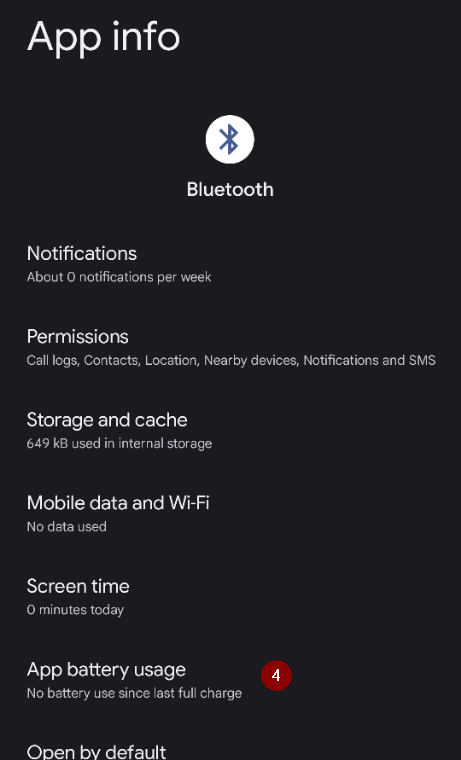

(generaltroubleshooting)=

# Riešenie problémov

**Začnite tu, keď niečo nefunguje.** Informácie o riešení problémov sú na mnohých stránkach dokumentácie. Táto stránka ich spája: je to jeden zoznam odkazov zoradených podľa tém, ktorý vám pomôže vyriešiť najčastejšie problémy.

Ak tu odpoveď nenájdete, pozrite si aj:

* [Najčastejšie otázky používateľov APS](../UsefulLinks/FAQ.md) s odpoveďami na časté otázky a
* návod [Ladenie profilu AAPS](ProfileTuning.md), ak váš okruh beží, ale kontrolu glykémie treba zlepšiť.

```{admonition} Still stuck?
:class: tip
Ak vám žiadny z odkazov nepomôže, pozrite si stránku [Kde získať pomoc](WhereCanIGetHelp.md) a opýtajte sa komunity (Facebook, Discord), alebo pošlite vývojárom svoje [log súbory](AccessingLogFiles.md).
```

---

(generaltroubleshooting-aaps-app)=

## Aplikácia AAPS

### Zostavenie a aktualizácia

* Ak zostavenie zlyhá, pozrite si [Ak zostavenie zlyhá](#building-aaps-troubleshooting): je tam časť o riešení problémov pre každý spôsob zostavenia:
  * [AAPS Builder](#aaps-builder-troubleshooting)
  * [Zostavenie v prehliadači](#aaps-ci-troubleshooting)
  * [Android Studio](TroubleshootingAndroidStudio.md)
* Stratené alebo nové úložisko kľúčov: [Preinštalovanie AAPS](#reinstall-aaps)
* Aktualizácia **AAPS**: [s AAPS Builderom](#aaps-builder-updates), [so zostavením v prehliadači (fork)](#update-browser-build-troubleshooting), [s Android Studiom](#update-computer-build-troubleshooting)

### Inštalácia

* [Varovanie Google Play Protect](#transferring-installing-play-protect-warning): aplikácia je označená ako nebezpečná.
* Inštalácia je **zablokovaná** so správou o neoverenom vývojárovi: bezplatné spôsoby inštalácie nájdete v časti [Overovanie vývojárov pre Android](#android-developer-verification).

### Nastavenia

* [Profil: „Bazál nie je kompatibilný s aktuálnou pumpou“](#your-aaps-profile-basal-not-compatible)
* [Pumpa: „Dáta prichádzajú z inej pumpy“](#config-builder-wrong-pump-data)
* [Nightscout Client](TroubleshootingNsClient.md)
* **"AAPS settings cannot be read"** at start: the settings are encrypted with a key that Android keeps for **AAPS**, and that key does not open them any more, for example after the key store of the phone was reset. While this screen is shown, **AAPS** is not running and does not control the pump. Tap **Retry**: it closes and restarts **AAPS**. If that does not help, restart the phone. Use **Start fresh** only when nothing else helps: it sets the unreadable settings file aside (it is renamed and kept) and starts **AAPS** with empty settings. Then import your last [settings export](../Maintenance/ExportImportSettings.md).

### Používanie

* [Nesprávne hodnoty sacharidov (pomalé vstrebávanie sacharidov)](#CobCalculation-detection-of-wrong-cob-values)
* [Automatizácie](#automations-troubleshooting)
* [Plne uzavretý okruh](#full-closed-loop-troubleshooting)

---

(generaltroubleshooting-bluetooth-related-issues)=


## Problémy súvisiace s Bluetooth

Známe problémy s Bluetooth spojením, výpadky pumpy/Podov alebo problémy s aktiváciou a pripojením: [Problémy súvisiace s Bluetooth](../GettingHelp/BluetoothTroubleshooting.md)

---

(generaltroubleshooting-android-related-issues)=

## Problémy súvisiace s Androidom

### Optimalizácia batérie

**AAPS** vám môže pomôcť nájsť správne nastavenia pre váš telefón: otvorte **ponuku** (☰) > **O aplikácii** a ťuknite na **Nepotláčať moju aplikáciu?**. Otvorí sa návod pre značku vášho telefónu na stránke [Don't kill my app](https://dontkillmyapp.com/). [Sprievodca nastavením](#setup-wizard-bluetooth-battery-optimisation) vás tiež požiada, aby ste vypli optimalizáciu batérie pre **AAPS** a Bluetooth.

Android má nastavenia na šetrenie batérie, ktoré sú predvolene zapnuté. Tieto nastavenia automaticky uspávajú/pozastavujú aplikácie, ktoré systém nepotrebuje na svoju činnosť. Tak šetria energiu batérie, ktorú spotrebúvajú aplikácie, ktoré nemusia bežať stále.

Keď je zapnutá, veľmi pravdepodobne spôsobí problémy **AAPS** a ďalším podporným aplikáciám, ako je **xDrip**.

Je dôležité vypnúť optimalizáciu batérie, aby **AAPS** a ďalšie podporné aplikácie zostali stále aktívne.

Podľa modelu a výrobcu telefónu môže byť na vypnutie viac miest a nastavení.

***POZNÁMKA:** Ak má váš telefón túto možnosť, podľa krokov nižšie vypnite optimalizáciu batérie pre službu Bluetooth. Rovnaké kroky môžete použiť aj na vypnutie pre **AAPS** a ďalšie aplikácie, snímky obrazovky však ukazujú postup iba pre službu Bluetooth.*

#### Telefóny Pixel (čistý Android)

* Prejdite do nastavení Androidu, vyberte „Aplikácie“ (Apps).

  

* Vyberte „Zobraziť všetky aplikácie“ (See all apps)

  

* V ponuke vpravo vyberte „Zobraziť systémové“ (Show system) aplikácie.

  

* Teraz vyhľadajte a vyberte aplikáciu „Bluetooth“.

  

* Kliknite na „Využitie batérie aplikáciou“ (App battery usage) a vyberte „Bez obmedzení“ (Unrestricted) (v niektorých starších verziách Androidu sa volá „Neoptimalizované“ (Not optimized)).

  


#### Telefóny Samsung

* Prejdite do nastavení Androidu, vyberte „Aplikácie“ (Apps)

* Na ikone, ktorá by mala meniť spôsob triedenia (1), vyberte „Zobraziť systémové aplikácie“ (Show system apps) (2).

  

  

* Teraz vyhľadajte aplikáciu Bluetooth a vyberte ju, aby ste videli jej nastavenia.

  

* Vyberte „Batéria“ (Battery).

  

* Nastavte ju na „Bez obmedzení“ (Unrestricted) (v niektorých starších verziách Androidu sa volá „Neoptimalizované“ (Not optimized)).

  

#### Telefóny Huawei

Pozrite si tento návod: [Huawei: Bluetooth a optimalizácia batérie](../CompatiblePhones/Huawei.md)

---

(generaltroubleshooting-cgm)=

## Kontinuálny monitor glykémie (CGM)

Užitočné odkazy na známe problémy a postupy ich riešenia pre CGM.

* [Všeobecne](#general-cgm-troubleshooting)
* [Dexcom G6](#DexcomG6-troubleshooting-g6)
* [Libre 2 s Minimal Looper](#minimallooper-troubleshooting)
* [Libre 3](#libre3-experiences-and-troubleshooting)
* [xDrip – žiadne dáta z CGM](#xdrip-identify-receiver)
* [xDrip – riešenie problémov s Dexcomom](#xdrip-troubleshooting-dexcom-g5-g6-and-xdrip)

---

(generaltroubleshooting-pumps)=

## Pumpy

Užitočné odkazy na známe problémy a postupy ich riešenia pre pumpy

* [Accu-Chek Combo](#combov2-tips-for-basic-usage)
* [Accu-Chek Insight](#Accu-Chek-Insight-Pump-insight-specific-errors)
* [CareLevo](#carelevo-alarms-and-notifications)
* [DanaRS](#DanaRS-Insulin-Pump-dana-rs-specific-errors)
* [Diaconn G8](#diaconn-g8-bluetooth-troubleshooting)
* [EOPatch2](#eopatch2-alarms-and-warnings)
* [Medtronic + RileyLink](#MedtronicPump-what-to-do-if-i-loose-connection-to-rileylink-and-or-pump)
* [Medtrum Nano](#medtrum-nano-troubleshooting)
* [Omnipod DASH](#omnipod-dash-troubleshooting)
* [Omnipod Eros](#OmnipodEros-troubleshooting)

---

(generaltroubleshooting-phones)=

## Telefóny

Užitočné odkazy na známe problémy a postupy ich riešenia pre telefóny

* [Zoznam otestovaných telefónov a zostáv zariadení](https://docs.google.com/spreadsheets/u/1/d/e/2PACX-1vScCNaIguEZVTVFAgpv1kXHdsHl3fs6xT6RB2Z1CeVJ561AvvqGwxMhlmSHk4J056gMCAQE02sAWJvT/pubhtml?gid=683363241&single=true)
* [Jelly](../CompatiblePhones/Jelly.md)
* [Huawei: Bluetooth a optimalizácia batérie](../CompatiblePhones/Huawei.md)

---

(generaltroubleshooting-remote-control)=

## Vzdialené ovládanie

* [AAPSClient a vzdialené ovládanie (párovanie, príkazy neprichádzajú)](#client-master-control-troubleshooting)
* [Problémy s „Nightscout prístupový token“](#remotecontrol-nightscout-access-token)
* [SMS príkazy](#SMSCommands-troubleshooting)
* [Android Auto](#android-auto-troubleshooting)

---

(generaltroubleshooting-smartwatches)=

## Inteligentné hodinky

Užitočné odkazy na známe problémy a postupy ich riešenia pre inteligentné hodinky

* [Riešenie problémov s aplikáciou pre hodinky (Wear)](#Watchfaces-troubleshooting-the-wear-app)
* [Hodinky a telefón spolu nekomunikujú](#wear-os-watch-phone-communication)
* [Wear OS 5](#wear-os-5-troubleshooting)
* [Zostavenie aplikácie pre hodinky (Wear)](#building-aaps-wear-os-troubleshooting)
