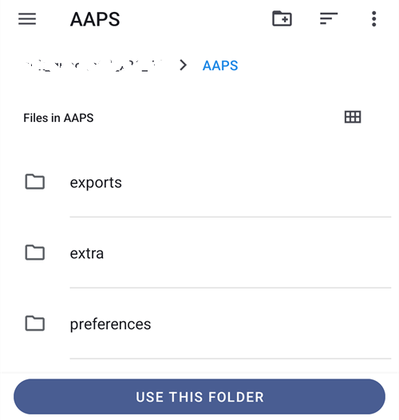
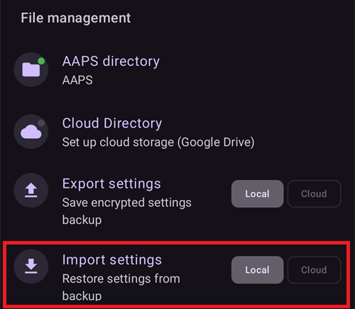

(reinstall-aaps)=
# Preinštalovanie AAPS s novým úložiskom kľúčov

Každé APK **AAPS** je podpísané **úložiskom kľúčov**. Aktualizácia sa nainštaluje cez váš súčasný **AAPS** iba vtedy, ak je podpísaná **rovnakým úložiskom kľúčov**: vtedy sa zachovajú všetky vaše nastavenia a dáta. Preto odporúčame uložiť úložisko kľúčov a jeho heslo na bezpečné miesto.

Ak sa pokúsite nainštalovať APK podpísané iným úložiskom kľúčov ako predtým, dostanete chybovú správu, že inštalácia zlyhala!

(reinstall-aaps-when)=
## Kedy musíte AAPS preinštalovať?

**AAPS** musíte odinštalovať a znova nainštalovať, keď je vaše nové APK podpísané iným úložiskom kľúčov, napríklad:

- Nemôžete nájsť svoje staré úložisko kľúčov alebo jeho heslo.
- Vytvorili ste nové úložisko kľúčov, napríklad pomocou [možnosti 1 zostavenia v prehliadači](../SettingUpAaps/BrowserBuildKeystore.md) alebo pomocou **Create a new key** v [AAPS Builder](../SettingUpAaps/BrowserBuildAapsBuilder.md).
- Zostavujete na novom počítači a neskopírovali ste do neho svoje úložisko kľúčov.

Ak ešte máte svoje úložisko kľúčov, túto stránku nepotrebujete: použite ho znova a [aktualizujte **AAPS**](../Maintenance/UpdateToNewVersion.md) bez odinštalovania.

(reinstall-aaps-before)=
## Skôr než začnete

- Odinštalovanie **AAPS** vymaže všetky jeho nastavenia, vaše [ciele](../SettingUpAaps/CompletingTheObjectives.md) a súčasné pripojenie k pumpe. Získate ich späť importom svojho **súboru s nastaveniami**, preto sa uistite, že máte nedávny súbor.
- Súbor s nastaveniami neobsahuje históriu ošetrení a glykémie. Ak nahrávate dáta do [Nightscoutu](../SettingUpAaps/SettingUpTheReportingServer.md), po preinštalovaní ich môžete načítať späť (krok 8).
- Potrebujete svoje [**hlavné heslo**](#Preferences-master-password): súbor s nastaveniami je ním zašifrovaný.
- **Používatelia Omnipodu a Medtrumu:** najprv si prečítajte [Pumpy bez hadičky](#ExportImportSettings-tubeless-pumps). Váš súbor s nastaveniami musí byť exportovaný počas podu alebo náplasti, ktorú máte práve nasadenú.
- Ak je to potrebné, [nastavte prijímač zdroja CGM/glykémie](../Getting-Started/CompatiblesCgms.md) ešte predtým, ako začnete.

(reinstall-aaps-steps)=
## Kroky

Obrázky ukazujú prechod z **AAPS** 3.4 (kroky 1 až 3) na **AAPS** 4 (kroky 6 až 8). Iné verzie vyzerajú trochu inak.

(reinstall-aaps-export)=
### 1. Exportujte svoje nastavenia

Exportujte svoje nastavenia pomocou **AAPS**, ktorý je teraz nainštalovaný vo vašom telefóne. Podrobnosti nájdete v časti [Export nastavení](#ExportImportSettings-Settings-Export).

V **AAPS** 3.4: otvorte **Údržba** a ťuknite na **Nastavenia exportu**. V časti **Používateľské nastavenia** zaškrtnite **Lokálne úložisko** a ťuknite na **OK**.

*Poznámka: na bezpečnostnú záložnú kópiu môžete použiť aj [Cloudové úložisko](#preferences-maintenance-cloud). Je to dobrý nápad, ale ponechajte si Lokálne úložisko, aby ste mohli nastavenia rýchlo obnoviť.*

Na tlačidle je teraz **Exportovať nastavenia (lokálne)**. Ťuknite naň.

**AAPS** ukáže názov súboru, ktorý vytvorí. Ťuknite na **OK**, zadajte svoje hlavné heslo a ťuknite na **OK**.

V **AAPS** 4: otvorte **Údržba**, vedľa **Exportovať nastavenia** vyberte štítok **Lokálne** a ťuknite na **Exportovať nastavenia**.

(reinstall-aaps-copy)=
### 2. Skopírujte súbor s nastaveniami z telefónu

Súbor je v priečinku **preferences** vo vašom [priečinku **AAPS**](#SetupWizard-StoragePermission) a má názov podobný ako `2026-10-13_222735_full.json`. Skopírujte ho alebo nahrajte na iné miesto mimo telefónu (napr. do počítača, do cloudového úložiska...). Súbor po odinštalovaní zvyčajne zostane v telefóne, ale pre istotu si jeho kópiu uložte aj inde.

(reinstall-aaps-nightscout-before)=
### 3. Synchronizujte s Nightscoutom

Tento krok nie je povinný, ale odporúčame ho, ak používate [DynISF](#Open-APS-features-DynamicISF): umožní vám pokračovať priamo so súčasnými nastaveniami a nemusíte čakať 5 dní, kým sa pre plugin nazbierajú potrebné dáta. NSClient V3 musí byť [povolený a nastavený](../SettingUpAaps/SettingUpTheReportingServer.md).

Pred odinštalovaním sa uistite, že Nightscout má všetky vaše dáta.

Otvorte **NSClient**, ťuknite na tlačidlo **Úplná synchronizácia** v dolnej časti obrazovky a potom na **OK**.

*Poznámka: potrebný čas závisí od služby, ktorá hostí váš Nightscout.*

**AAPS** potom ponúkne vyčistenie databázy. **OK** odstráni z telefónu dáta staršie ako 3 mesiace, vďaka čomu je synchronizácia oveľa rýchlejšia. **Zrušiť** synchronizuje bez vyčistenia. Databáza v telefóne sa pri odinštalovaní aj tak vymaže, takže obe možnosti sú v poriadku.

Nechajte **AAPS** bežať, kým sa synchronizácia neskončí.

(reinstall-aaps-build)=
### 4. Zostavte nové APK

[Zostavte](../SettingUpAaps/BuildingAaps.md) nové podpísané APK s novým úložiskom kľúčov a preneste ho do telefónu.

(reinstall-aaps-uninstall)=
### 5. Odinštalujte AAPS

V telefóne otvorte **Nastavenia** > **Aplikácie** > **AAPS**, ťuknite na **Odinštalovať** (Uninstall) a potvrďte tlačidlom **OK**.

(reinstall-aaps-install)=
### 6. Nainštalujte a spustite nový AAPS

[Nainštalujte](../SettingUpAaps/TransferringAndInstallingAaps.md) nové APK a spustite **AAPS**. [Sprievodca nastavením](../SettingUpAaps/SetupWizard.md) požiada o povolenia, ktoré **AAPS** potrebuje: pri každom z nich ťuknite na **Povoliť**. Tým sa znova vypne aj [optimalizácia batérie](#setup-wizard-bluetooth-battery-optimisation).

Pri **AAPS priečinok** vyberte rovnaký priečinok **AAPS** ako predtým (ten, v ktorom je priečinok **preferences**), ťuknite na **Použiť tento priečinok** (Use this folder) a **Povoliť** (Allow).

Keď **AAPS** nájde vaše exportované nastavenia, sprievodca nastavením zobrazí obrazovku [Nájdené uložené nastavenia](#setup-wizard-import-settings), kde ich môžete importovať. Sprievodcu môžete aj zatvoriť a importovať nastavenia z **Údržba**, ako je opísané nižšie.

(reinstall-aaps-import)=
### 7. Importujte svoje nastavenia

Ak súbor s nastaveniami už nie je v telefóne, skopírujte ho späť do priečinka **preferences** vo vašom priečinku **AAPS**.

Otvorte ponuku (☰) > **Údržba**, vedľa **Importovať nastavenia** vyberte štítok **Lokálne** a ťuknite na **Importovať nastavenia**.

Zoznam ukazuje pri každom súbore jeho verziu **AAPS** a ako je starý. Vyberte súbor, ktorý ste exportovali v kroku 1.

V novom **AAPS** nemusíte najprv nastaviť hlavné heslo. Do poľa **Dešifrovacie heslo** zadajte hlavné heslo, ktoré ste použili pri exporte, a ťuknite na **Dešifrovať**. Hlásenie **Súbor bol zašifrovaný iným heslom** je očakávané: nový **AAPS** vaše heslo ešte nepozná. Import ho obnoví spolu s ostatnými nastaveniami.

Zaškrtnite **Nahradiť aj nastavenia pumpy**: bez toho sa vaša pumpa a jej nastavenia neobnovia. Používatelia Omnipodu a Medtrumu: zaškrtnite to iba vtedy, ak bol súbor exportovaný počas vášho súčasného podu alebo náplasti (pozrite [Pumpy bez hadičky](#ExportImportSettings-tubeless-pumps)).

Ťuknite na **Importovať**, potom na **OK**, aby sa nastavenia použili, a znova na **OK** pri **Nastavenia boli použité**.

(reinstall-aaps-nightscout-after)=
### 8. Získajte späť svoju históriu z Nightscoutu

Otvorte ponuku (☰) > [**Konfigurácia**](../SettingUpAaps/ChangeAapsConfiguration.md) > **Komunikácia** a pod **NSClientV3** ťuknite na **Otvoriť plugin**. Skontrolujte, či stav ukazuje **Pripojené**. Ak nie, pozrite [Riešenie problémov s NSClient](TroubleshootingNsClient.md).

Ťuknite na tlačidlo **Úplná synchronizácia** v dolnej časti obrazovky a na **OK**. Databáza je nová, takže na otázku o vyčistení môžete odpovedať ľubovoľne.

**AAPS** načíta vaše dáta z Nightscoutu. Keď je hotovo, v logu sa zobrazí **Full sync finished**.

(reinstall-aaps-check)=
### 9. Skontrolujte a pokračujte v používaní okruhu

Skontrolujte, či je pumpa pripojená a či prichádzajú hodnoty z CGM, a potom pokračujte v používaní okruhu.

(reinstall-aaps-afterwards)=
## Potom

Odteraz vždy používajte svoje nové úložisko kľúčov a uložte ho spolu s heslom na bezpečné miesto mimo telefónu. Pozrite [Vytváranie a obnova záloh](../Maintenance/ExportImportSettings.md).
