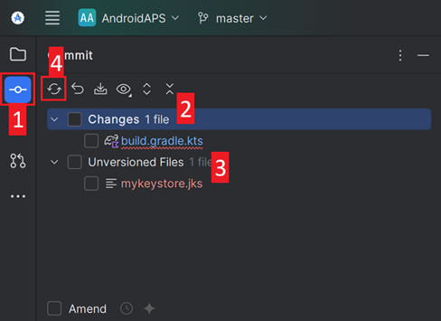

(troubleshooting_androidstudio-troubleshooting-android-studio)=

# Riešenie problémov s Android Studiom

```{contents} List of common issues
:depth: 2
:local: true
```

(troubleshooting_androidstudio-lost-keystore)=
## Stratené úložisko kľúčov
Ak ste stratili úložisko kľúčov alebo jeho heslo, APK podpísané novým úložiskom kľúčov nemôže aktualizovať váš súčasný **AAPS**: musíte ho odinštalovať a znova nainštalovať. Pozrite [Preinštalovanie AAPS s novým úložiskom kľúčov](#reinstall-aaps).

## Gradle Sync zlyhal
Gradle Sync môže zlyhať z rôznych dôvodov. Keď dostanete správu „gradle sync failed“, otvorte kartu „Build“ (1) v dolnej časti Android Studia a pozrite sa, aká chybová správa (2) sa zobrazuje.


```{contents} Likely reasons for gradle sync failures are:
:depth: 1
:local: true
```

*Dôležité*: Keď ste postupovali podľa návodu pre váš konkrétny problém, musíte znova spustiť [synchronizáciu Gradle (Gradle Sync)](#gradle-resync).

(troubleshooting_androidstudio-uncommitted-changes)=
### Uncommitted changes (necommitnuté zmeny)

Ak dostanete chybovú správu ako táto:


```
Build file 'C:\Data\50-Android\AndroidAPS\app\build.gradle.kts' line: 243

There are uncommitted changes.
Naklonujte zdrojový kód znova podľa návodu vo wiki a nepovoľte aktualizáciu Gradle
```

#### Krok 1 – Skontrolujte inštaláciu Gitu
  * Otvorte kartu terminálu (1) v dolnej časti Android Studia, skopírujte nasledujúci text a vložte ho alebo ho napíšte do terminálu (2).
    ```
    git --version
    ```

    

    Poznámka: Medzi git a version je medzera a dve pomlčky!

  * Musíte dostať správu o tom, aká verzia Gitu je nainštalovaná, ako vidíte na snímke obrazovky vyššie. V tomto prípade prejdite na [krok 2](#troubleshooting-android-studio-check-for-uncommitted-changes).

  * Ak dostanete správu
    ```
    Git: command not found
    ```
    vaša inštalácia Gitu nie je v poriadku.

  * [Kontrola inštalácie Gitu](#BuildingAaps-steps-for-installing-git)

  * If you are on Windows and Git was just installed, you should restart your computer to make Git globally available after the installation

  * If Git is installed, you have restarted (if on windows), and Git still cannot be found:

  * Vyhľadajte vo svojom počítači súbor „git.exe“.

    Poznačte si, v ktorom priečinku je uložený.

  * Vo Windows otvorte premenné prostredia (Environment variables), vyberte premennú „PATH“ a kliknite na Upraviť (Edit). Pridajte priečinok, v ktorom ste našli svoju inštaláciu Gitu.

  * Uložte a zatvorte.

  * Reštartujte Android Studio.

(troubleshooting-android-studio-check-for-uncommitted-changes)=
#### Krok 2: Skontrolujte necommitnuté zmeny.

  * V Android Studiu otvorte kartu „Commit“ (1) na ľavej strane. 
  * Uvidíte buď „Changes“ (v starších verziách Android Studia „Default changeset“) (2), alebo „Unversioned Files“ (3):

    * Pri „Changes“ ste pravdepodobne aktualizovali „Gradle“ alebo omylom zmenili obsah niektorých súborov.

    * Kliknite pravým tlačidlom na „Changes“ a vyberte „Rollback…“ (1)

      

    * Súbory sa znova stiahnu zo servera Git. Ak na karte Commit nie sú žiadne ďalšie zmeny, prejdite na [krok 3](#gradle-resync).

  * Ak vidíte „Unversioned Files“, možno ste omylom uložili súbory do priečinka so zdrojovým kódom. Môžu to byť dôležité súbory, napríklad súbor úložiska kľúčov, ktoré treba presunúť inam. Ak neviete, čo sú to za súbory, a nevytvorili ste ich sami, môžete ich vymazať.

    * Pomocou bežného prieskumníka súborov v počítači tento súbor presuňte (alebo vystrihnite a vložte) na bezpečné miesto.

    * Vráťte sa do Android Studia a kliknite na tlačidlo Refresh (4) na karte Commit, aby ste si overili, že súbor už nie je uložený v priečinku **AAPS**.

      Ak na karte Commit nie sú žiadne ďalšie zmeny, prejdite na [krok 3](#gradle-resync).


#### Krok 3: Znova synchronizujte Gradle

Postupujte podľa návodu v časti [Opätovná synchronizácia Gradle](#gradle-resync).

### Git Pull Failed - Please tell me who you are

Ak vidíte túto správu, Git potrebuje, aby ste sa identifikovali.


Otvorte terminál a zadajte postupne tieto dva príkazy.

```
git config --global user.name "Your name here"
git config --global user.email your.email@here.com
```

Vaše meno musí byť v úvodzovkách.


(troubleshooting_androidstudio-android-gradle-plugin-requires-java-11-to-run)=

(incompatible-gradle-jvm)=
### Incompatible Gradle JVM


```
Your build is currently configured to use incompatible Java 21.0.3 and Gradle 8.2.
Cannot sync the project.

We recommend upgrading to Gradle version 8.9.

The minimum compatible Gradle version is 8.5.

The maximum compatible Gradle JVM version is 19.
```

Alebo:

```
Cause: error: invalid source release: 21
```

Ak dostanete chybovú správu vyššie, musíte si stiahnuť správnu verziu JVM a až potom môžete skúsiť zostavenie znova:

1.  V [tabuľke požiadaviek](#Building-APK-recommended-specification-of-computer-for-building-apk-file) si overte, ktorú verziu JVM potrebujete pre verziu **AAPS**, ktorú zostavujete, a poznačte si ju.

2. Otvorte zobrazenie Gradle kliknutím na slona (1) na pravej strane Android Studia, otvorte nastavenia (2) a vyberte **Gradle Settings** (3):


3.  V poli **Gradle JDK** skontrolujte, či je vybratá správna verzia (1). Ak nie, kliknite na pole a pozrite sa, či už je v zozname dostupná. Príklad nižšie ukazuje, že JVM 21 je označený ako „jbr-21“. Ak ho nájdete, jednoducho ho vyberte a máte hotovo. Ak nie je dostupná, vyberte **Download JDK** (2).


4. V poli Version (1) vyberte JDK, ktoré potrebuje vaša verzia **AAPS** (tú, ktorú ste si poznačili pri kontrole tabuľky požiadaviek). V poli Vendor (2) vyberte ľubovoľného dodávateľa. Location (3): nemeňte. Kliknite na **Download** (4).


5.  Zatvorte dialóg **Settings** tlačidlom **OK**.
6. Teraz musíte znova spustiť Gradle Sync. Postupujte podľa návodu v časti [Opätovná synchronizácia Gradle](#gradle-resync).

(incompatible-version-of-android-gradle-plugin)=
### Incompatible version of Android Gradle plugin

  Ak dostanete nasledujúcu chybovú správu

`The project is using an incompatible version (AGP x.x.x) of the Android Gradle plugin. Latest supported version is AGP x.x.x`

  

  Používate zastaranú verziu Android Studia. V ponuke prejdite na Help > Check for updates a nainštalujte všetky nájdené aktualizácie Android Studia a jeho pluginov.

(troubleshooting_androidstudio-could-not-resolve-no-cached-version)=
### Could not resolve/No cached version

  Môžete dostať túto chybovú správu:


  * Na pravej strane otvorte kartu Gradle (1).

    Uistite sa, že tlačidlo zobrazené pri (2) *NIE JE* vybraté.

    

  * Teraz musíte spustiť [opätovnú synchronizáciu Gradle](#gradle-resync)

(troubleshooting_androidstudio-unable-to-start-daemon-process)=
### Unable to start daemon process

  Ak vidíte chybovú správu ako tá nižšie, pravdepodobne používate 32-bitový systém Windows 10. Android Studio 3.5.1 a novšie toto nepodporuje a vývojári **AAPS** s tým bohužiaľ nemôžu nič urobiť!

  Na internete nájdete informácie o tom, ako zistiť, či máte 32-bitový alebo 64-bitový operačný systém – napr. [tento článok](https://support.microsoft.com/en-us/windows/32-bit-and-64-bit-windows-frequently-asked-questions-c6ca9541-8dce-4d48-0415-94a3faa2e13d).

  

(gradle-resync)=
### Opätovná synchronizácia Gradle

  Ak stále vidíte správu, že gradle sync zlyhal, teraz kliknite na odkaz **Try again** (1). 


  Ak už správu nevidíte, môžete synchronizáciu spustiť aj ručne:

  * Otvorte kartu Gradle (1) na pravom okraji Android Studia.

    

  * Kliknite pravým tlačidlom na AAPS (2)

  * Kliknite na „Reload Gradle Project“ (3)

## Generate Signed APK generated successfully with 0 build variants

When you generate the signed apk, you might get the notification that generation was successful but that '0 build variants' were generated:


Toto je falošné varovanie. Pozrite sa do priečinka, ktorý ste pri generovaní vybrali ako „Destination folder“ (krok [Generate Signed APK](#Building-APK-generate-signed-apk)), a nájdete tam vygenerované APK!


## Aplikácia bola vytvorená s varovaniami kompilátora/kotlinu

Ak sa zostavenie úspešne dokončilo, ale dostanete varovania kompilátora alebo kotlinu (označené žltým alebo modrým výkričníkom), tieto varovania môžete jednoducho ignorovať.

 

Vaše APK sa úspešne zostavilo a môžete ho preniesť do telefónu!


## AAPS nedostáva žiadne dáta z CGM

* Ak používate upravenú (patched) aplikáciu Dexcom G6: táto aplikácia je zastaraná. Namiesto nej použite aplikáciu [BYODA](#DexcomG6-if-using-g6-with-build-your-own-dexcom-app).

* Ak používate xDrip: identifikujte prijímač podľa popisu na [stránke nastavení xDrip](#xdrip-identify-receiver).


## APK sa nenainštalovalo


* Uistite sa, že ste do telefónu preniesli súbor „app-full-release.apk“.
* Táto chyba zvyčajne znamená, že nové APK je podpísané iným úložiskom kľúčov ako váš nainštalovaný **AAPS**. Ak ešte máte svoje predchádzajúce úložisko kľúčov, vyberte ho a zostavte APK znova. Inak pozrite [Preinštalovanie AAPS s novým úložiskom kľúčov](#reinstall-aaps).
* Ak sa v telefóne zobrazí „App not installed“ (Aplikácia nebola nainštalovaná), postupujte takto:

1. [Exportujte nastavenia](../Maintenance/ExportImportSettings.md) (vo verzii AAPS, ktorá je už nainštalovaná vo vašom telefóne)
2. Odinštalujte **AAPS** z telefónu.
3. Zapnite režim lietadla a vypnite Bluetooth.
4. Nainštalujte novú verziu („app-full-release.apk“)
5. [Importovať nastavenia](../Maintenance/ExportImportSettings.md)
6. Znova zapnite Bluetooth a vypnite režim lietadla

## APK je nainštalované, ale verzia je stará

Ak ste aplikáciu úspešne zostavili, preniesli do telefónu a úspešne nainštalovali, ale číslo verzie sa nezmenilo, možno ste zabudli [aktualizovať svoju lokálnu kópiu](#Update-to-new-version-update-your-local-copy)

## Nič z uvedeného nepomohlo

Ak vám žiadny z vyššie uvedených tipov nepomohol, môžete skúsiť zostaviť APK úplne od začiatku:

1. [Exportujte nastavenia](../Maintenance/ExportImportSettings.md) (vo verzii AAPS, ktorá je už nainštalovaná vo vašom telefóne)

2. Pripravte si heslo kľúča a heslo úložiska kľúčov.

    Alebo jednoducho použite nové úložisko kľúčov.

3. Zostavte APK úplne od začiatku, ako je opísané [tu](#Building-APK-download-AAPS-code).

4. Keď sa vám APK podarí zostaviť, vymažte existujúce APK v telefóne, preneste do telefónu nové APK a nainštalujte ho.
5. Znova [importujte nastavenia](../Maintenance/ExportImportSettings.md), aby ste obnovili svoje ciele a nastavenia.
6. Skontrolujte nastavenia optimalizácie batérie a znova ju vypnite.

## V najhoršom prípade

Ak to váš problém so zostavením nevyrieši, môžete skúsiť Android Studio úplne odinštalovať a zostaviť všetko znova od začiatku.  Niektorým používateľom to pomohlo vyriešiť problém so zostavením.  Keď odstraňujete Android Studio, nemažte nastavenia používateľa Androidu a **uistite sa, že odinštalujete všetky súbory, ktoré súvisia s Android Studiom.** Ak Android Studio neodstránite úplne aj so všetkými skrytými súbormi, odinštalovanie môže namiesto vyriešenia súčasného problému spôsobiť nové problémy. Návody na úplnú odinštaláciu nájdete na internete, napr.

[https://stackoverflow.com/questions/39953495/how-to-completely-uninstall-android-studio-from-windowsv10](https://stackoverflow.com/questions/39953495/how-to-completely-uninstall-android-studio-from-windowsv10).

Nainštalujte Android Studio úplne od začiatku, ako je opísané [tu](#Building-APK-install-android-studio).
