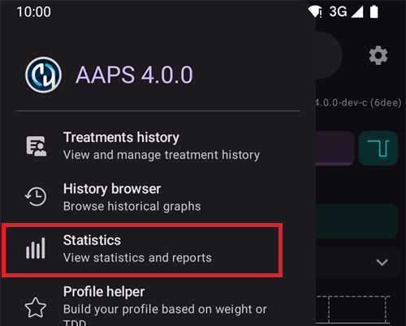
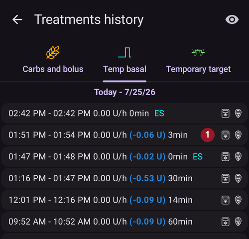

# Kontrola údajov

## Prehliadač histórie AAPS

**AAPS** uchováva celú vašu históriu (**glykémia**, ošetrenia, bazál, ciele, **Prepnutie profilu**, …) v lokálnej databáze v telefóne. Táto databáza nie je súčasťou [exportu nastavení](../Maintenance/ExportImportSettings.md). Môžete ju prezerať priamo v **AAPS** pomocou obrazovky **Prehliadač histórie** a obrazovky **Štatistiky**, ktoré sú opísané nižšie. Na dlhodobé hodnotenie a reporty nahrávajte svoje dáta do [Nightscoutu](../SettingUpAaps/Nightscout.md) alebo [Tidepoolu](../SettingUpAaps/Tidepool.md).

Históriu **AAPS** si môžete pozrieť v **Prehliadači histórie**: otvorte **ponuku** (☰) a vyberte **Prehliadač histórie**.

- Ťuknite na **kartu s dátumom** a vyberte deň, ktorý chcete skontrolovať.
- Grafy sa otvoria oddialené a ukazujú **celý vybraný deň**. Roztiahnutím dvoch prstov si časť grafu priblížite.
- Šípkami **<** a **>** sa posuniete o jeden deň dozadu alebo dopredu a tlačidlom **Teraz** sa vrátite na aktuálny deň.
- Grafy zobrazujú rovnaké dáta ako grafy na hlavnej obrazovke (glykémia, ošetrenia, bazál, IOB, COB, aktivita, odchýlky...).

(reviewing-statistics)=
## Štatistiky AAPS

**AAPS** poskytuje základné štatistiky na sledovanie.

Väčšina hodnôt vychádza z [odporúčaní](https://diabetesjournals.org/care/article/46/Supplement_1/S97/148053/6-Glycemic-Targets-Standards-of-Care-in-Diabetes) ADA 2023.

Ak ich chcete otvoriť, otvorte **ponuku** (☰) a vyberte **Štatistiky**.

Obrazovka **Štatistiky** má štyri karty: **Inzulín**, **Čas v rozsahu**, **Glykémia** a **Cyklus**. Medzi kartami prepínate ťuknutím na kartu alebo potiahnutím doľava či doprava.

(reviewing-tdd)=
### Karta Inzulín: Celková denná dávka

Karta **Celková denná dávka** zobrazuje jeden riadok pre každý z predchádzajúcich dní (najviac jeden týždeň), za ktoré má **AAPS** údaje o inzulíne, potom ich **Priemer** a nakoniec doterajší stav za **Dnes**. Hneď po inštalácii **AAPS** sa zobrazí iba **Dnes**. Stĺpce sú:

- **Bazál**: iba bazál.
- **Bolus**: súčet bolusov a SMB.
- **CDD celkom**: celková denná dávka inzulínu (**CDD**), súčet bolusového a bazálneho inzulínu podaného počas dňa.
- **Sacharidy**: zadané sacharidy a eSacharidy.

Časť **CDD** sa vypočíta, keď otvoríte stránku, a výpočet trvá niekoľko sekúnd. Ak ju chcete vypočítať znova, ťuknite na **Prepočítať**.

**CDD** je váš bolusový plus bazálny inzulín za deň. Niektorí lekári používajú – najmä u nových používateľov pumpy – pomer bazálu a bolusu 50 : 50: celková základná bazálna dávka (**TBB**, súčet vašich bazálnych dávok za 24 hodín) by potom mala byť približne polovica CDD. Iní uprednostňujú TBB vo výške 32 % až 37 % CDD.

Ako väčšina orientačných pravidiel má aj toto len obmedzenú skutočnú platnosť. Váš diabetes môže byť iný!

### Karta Čas v rozsahu

Čas v rozsahu (**TIR**): 70–180 mg/dl alebo 3,9–10 mmol/l.

Údaje o **TIR** sú k dispozícii za 7 a 30 dní, podľa toho, koľko dát je v databáze **AAPS**.

Nižšie sú k dispozícii štatistiky času v úzkom rozsahu (TITR) 70–140 mg/dl alebo 3,9–7,8 mmol/l (obrazovka tento rozsah zobrazuje ako 70–141).

**Ciele preberte so svojím diabetológom**

Váš diabetes môže byť iný. Všetky navrhované ciele by ste mali prebrať so svojím diabetológom alebo lekárskym tímom. Ak sa štatistiky AAPS používajú správne, môžu byť účinným nástrojom na sledovanie trendov __glykémie__ a vášho pokroku.

Nižšie karta **Čas v rozsahu Dexcom** zobrazuje podrobné štatistiky **TIR** za 14 dní.

**SD**: smerodajná odchýlka, [ukazovateľ](https://www.ncbi.nlm.nih.gov/pmc/articles/PMC3125941/) kolísania glykémie (najvyššia = najhoršia).

HbA1c: odhad výsledného glykovaného hemoglobínu na základe priemeru meraní CGM. Ide o orientačnú hodnotu, ktorá sa nemusí zhodovať s výsledkami HbA1c z krvi.

(reviewing-statistics-agp)=
### Karta Glykémia: Ambulantný glukózový profil (AGP)

**Ambulantný glukózový profil** (**AGP**) ukazuje, ako sa vaša glykémia zvyčajne mení počas dňa. Obdobie vyberiete tlačidlami hore: **Dnes**, **24h**, **7d**, **30d** alebo **90d**.

- **Graf**: jeden deň od polnoci do polnoci. Čiara je **Medián** (polovica vašich hodnôt v danej hodine bola nižšia, polovica vyššia). Okolo nej jedno pásmo obsahuje strednú polovicu vašich hodnôt (**25–75%**) a širšie pásmo väčšinu z nich (**10–90%**). Úzke pásmo znamená, že vaša glykémia je v danej hodine zo dňa na deň podobná. Prerušované čiary označujú vašu hodnotu **Dolná značka**, 140 mg/dl (7,8 mmol/l) a vašu hodnotu **Horná značka**.
- **Prehľad glykémie**: čas strávený vo vašom rozsahu, v úzkom rozsahu (70–140 mg/dl alebo 3,9–7,8 mmol/l), nad vaším rozsahom a pod ním, potom **Priemer** a **Medián** vašej glykémie. Váš rozsah tvoria **Dolná značka** a **Horná značka** nastavené v časti [Rozsah pre zobrazenie](#Preferences-range-for-visualization).
- **eA1c** a **GMI**: dva odhady HbA1c vypočítané z vašich hodnôt z CGM. Rovnako ako vyššie uvedený HbA1c sa nemusia zhodovať s vašimi výsledkami HbA1c z krvi.
- **SD** (smerodajná odchýlka) a **CV** (variačný koeficient): ako veľmi vaša glykémia kolíše. Nižšia hodnota znamená stabilnejšiu glykémiu.
- **Dni**: počet dní, z ktorých sa použili dáta z CGM.

 

Pod AGP karta **Glucose Pentagon (CGP)** zobrazuje päť ukazovateľov vašej glykémie za posledných 14 dní ako päťuholník. Menší päťuholník znamená lepšiu kontrolu glykémie.

### Karta Cyklus: Vzor cyklov CDD

**Vzor cyklov CDD** prekrýva vaše denné súčty inzulínu v 28-dňových cykloch, aby ste ľahšie našli opakujúce sa vzorce. Každý cyklus je nakreslený ako čiara (**Jednotlivé cykly**) spolu s ich priemerom.

- **Celková denná dávka (CDD)** / **Celková denná dávka (CDD) - vyčistená**: vyberte celkovú dennú dávku tak, ako bola podaná, alebo CDD mínus inzulín na sacharidy.
- **Posun cyklu**: posunie začiatok cyklu (0 až 27 dní).

Potrebné sú dáta aspoň za 56 dní (2 cykly). Ak je dát menej, karta zobrazí **Nedostatok dát (sú potrebné aspoň 56 dní pre 2 cykly)**. Vzor sa vypočíta až vtedy, keď otvoríte kartu **Cyklus**, pretože načítava dáta za 168 dní.

(aaps-screens-treatments)=
## História ošetrení

Otvorte **ponuku** (☰) v ľavom hornom rohu hlavnej obrazovky a vyberte **História ošetrení**. V tomto zobrazení môžete prezerať a meniť históriu nasledujúcich ošetrení, každé na vlastnej karte (potiahnutím riadka kariet zobrazíte všetky):

* Sacharidy a bolusy
* [Predĺžený bolus](#Extended-Carbs-extended-bolus-and-switch-to-open-loop-dana-and-insight-pump-only)
* Dočasný bazál
* [Dočasný cieľ](../DailyLifeWithAaps/TempTargets.md)
* [Prepnutie profilu](../DailyLifeWithAaps/ProfileSwitch-ProfilePercentage.md)
* Starostlivosť: poznámky a záznamy v Starostlivosti
* Režim prevádzky: história stavu okruhu
* Záznam používateľa: ďalšie poznámky, ktoré sa neodosielajú do Nightscout

Na konci každého riadka malé ikony ukazujú, odkiaľ dáta pochádzajú alebo kam boli odoslané:
* Ikona **Nightscout** (logo Nightscoutu): dáta pochádzajú z Nightscoutu alebo boli do Nightscoutu zaznamenané
* Ikona **pumpy**: dáta pochádzajú z histórie pumpy (pumpa ich spracovala)
* Ikona **koša**: záznam bol odstránený (zobrazí sa, iba keď ikonou **oka** vpravo hore zapnete zobrazenie odstránených záznamov)

(screens-bolus-carbs)=
### Sacharidy a bolusy

Na tejto karte si môžete zobraziť záznam bolusov a sacharidov. Pri každom boluse (riadok **1**) sa vedľa množstva inzulínu zobrazuje zostávajúci súvisiaci IOB. Pôvod bolusu môže byť:
* Jedlo (zadané ručne tlačidlami Inzulín, Rýchly sprievodca alebo Bolusová kalkulačka)
* SMB pri použití funkcie SMB

Záznamy sacharidov (riadok **2**) sa zobrazujú s množstvom v gramoch.

Ak ste na výpočet dávky inzulínu použili [Bolusovú kalkulačku](#aaps-screens-bolus-wizard), môžete stlačiť text „Kalk“ v riadku bolusu a zobraziť podrobnosti o tom, ako sa bolus vypočítal.

V závislosti od použitej pumpy sa inzulín a sacharidy môžu zobraziť v jednom riadku alebo vo viacerých riadkoch: jeden pre podrobnosti výpočtu, jeden pre sacharidy a jeden pre samotný bolus.

Históriu ošetrení môžete použiť na opravu chybne zadaných sacharidov (_napr._ keď ste sacharidy nadhodnotili alebo podhodnotili). Existujúci záznam nie je možné upraviť. Postupujte takto:

1. Skontrolujte si a zapamätajte aktuálne COB a IOB na hlavnej obrazovke.
2. Podľa pumpy sa sacharidy môžu zobraziť spolu s inzulínom v jednom riadku alebo ako samostatný záznam (napr. pri Dana RS).
3. Odstráňte záznam s chybným množstvom sacharidov: stlačte ikonu koša, vyberte riadky, ktoré chcete odstrániť, a na dokončenie znova stlačte ikonu koša.
4. Na hlavnej obrazovke znova skontrolujte COB a uistite sa, že sacharidy boli úspešne odstránené.
5. To isté urobte s IOB, ak sú sacharidy aj inzulín v jednom riadku.

   → Ak sa sacharidy neodstránia správne a pridáte ďalšie sacharidy, ako je vysvetlené tu (6.), COB bude príliš vysoký a to môže viesť k príliš vysokému podávaniu inzulínu.

6. Znova zadajte správne množstvo sacharidov (**Ošetrenia → Sacharidy** v dolnej navigácii alebo tlačidlo **Sacharidy** v [Rýchlom spustení](#quicklaunch)) a nezabudnite nastaviť správny čas udalosti.
7. Ak sú sacharidy aj inzulín v jednom riadku, musíte pridať aj množstvo inzulínu. Nezabudnite nastaviť správny čas udalosti a po potvrdení nového záznamu skontrolujte IOB na hlavnej obrazovke.

### Dočasný bazál

Tu sa zobrazujú **dočasné bazály**, ktoré nastavil okruh. Ak má záznam stále vplyv na IOB, táto informácia sa zobrazuje vedľa dávky (riadok **1**). Môže to byť:
* Kladný IOB, ak bol dočasný bazál vyšší ako bazál nastavený v profile
* Záporný IOB pri nulovom dočasnom bazáli (ako v riadku **1**) alebo ak bol dočasný bazál nižší ako bazál nastavený v profile

Odstránenie záznamov ovplyvní iba vaše reporty v Nightscoute a pravdepodobne skreslí váš skutočný IOB – neodporúča sa to.

Červené S na ľavej strane riadka znamená „Pozastavenie“ (Suspend): objaví sa, keď sa bazál práve nepodáva. Je to bežná situácia napríklad pri výmene podu.

### Dočasný cieľ

Históriu dočasných cieľov si môžete pozrieť tu.

### Prepnutie profilu

Históriu prepínania profilov si môžete pozrieť tu. Pri každom prepnutí profilu môžete vidieť viac záznamov: riadok **1**, uložený v NS aj v histórii pumpy, zodpovedá skutočnému prepnutiu. Riadok **2**, uložený v Nightscoute, ale nie v histórii pumpy, zodpovedá požiadavke používateľa na prepnutie profilu.

Odstránenie záznamov ovplyvní iba vaše reporty v Nightscoute a nikdy nezmení aktuálny profil.

Tlačidlom **Klonovať** v riadku **2** môžete vytvoriť kópiu **Prepnutia profilu**. Viac informácií nájdete v časti [Váš profil AAPS > Správa profilov](#your-aaps-profile-clone-profile-switch).

### Starostlivosť

Táto karta zobrazuje všetky poznámky a záznamy v Starostlivosti zaznamenané v Nightscoute.

(AapsScreens-running-mode)= (aaps-screens-running-mode)=
### Režim prevádzky

Táto karta zobrazuje históriu zmien [stavu okruhu](#AapsScreens-loop-status): otvorený, uzavretý, LGS, pozastavený, odpojený.

### Záznam používateľa

Táto karta obsahuje akcie, ktoré v **AAPS** vykonal používateľ alebo **Automatizácia** (zmeny režimu okruhu, prepnutia profilu, ošetrenia, exporty nastavení...). Tieto záznamy sa neodosielajú do Nightscoutu.

------

## Aký je rozdiel medzi Nightscoutom a Tidepoolom?

Nightscout môže používateľovi uľahčiť ukladanie dát z **AAPS** a ponúka veľa [nástrojov na reporty](https://nightscout.github.io/nightscout/reports/).

Tidepool zase umožňuje používateľovi [prezerať si svoje dáta](https://www.tidepool.org/viewing-your-data) a ponúka [jednoduché zdieľanie s vaším diabetologickým tímom](https://www.tidepool.org/providers/how-it-works#tidepool-data-platform).