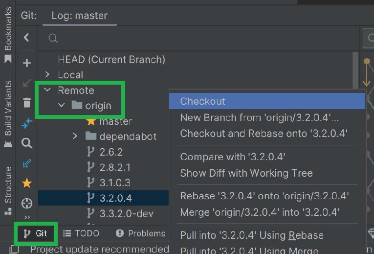

# Aktualizácia na AAPS 3.2.0.4

(update-aaps-3204)=

## Zostavte si aplikáciu sami namiesto stiahnutia

**Aplikácia AAPS (súbor APK) nie je k dispozícii na stiahnutie z dôvodu predpisov týkajúcich sa zdravotníckych pomôcok. Zostaviť si aplikáciu pre vlastné použitie je legálne, ale nesmiete jej kópiu dávať iným!**

Podrobnosti nájdete na stránke [Najčastejšie otázky používateľov APS](../UsefulLinks/FAQ.md).

## Špecifikácia počítača a softvéru na zostavenie AAPS 3.2.0.4

* Na zostavenie APK môže byť potrebná konkrétna verzia **[Android Studio](https://developer.android.com/studio/)**.

| Verzia AAPS             | Preferovaná<br/>verzia<br/>Android Studio | Alternatívna<br/>verzia<br/>Android Studio | Gradle | JVM |
| ----------------------- | ----------------------------------------------------- | ------------------------------------------------------ | ------ |:--- |
| [3.2.0.4](#version3204) | Hedgehog (2023.1.1)                                   | až po Meerkat                                          | 8.2    | 17  |

„Preferovaná verzia“ obsahuje vhodnú verziu JVM. Preferovaná verzia je zároveň najnižšia verzia, ktorou môžete zostaviť **AAPS**. Vo verzii staršej ako „preferovaná“ zostavenie **NEBUDE** možné. Ak používate inú verziu, môžete naraziť na problémy súvisiace s verziou JVM. See the [Troubleshooting Android Studio](#incompatible-gradle-jvm) page to help solve these issues. Ak vaša aktuálna verzia Android Studio nie je uvedená v tabuľke, musíte ju najprv aktualizovať.

Verzia Gradle je viazaná na zdrojový kód. Pri stiahnutí / aktualizácii zdrojového kódu vždy dostanete správnu verziu Gradle. Je tu uvedená iba pre informáciu, nemusíte s ňou nič robiť.

* [32-bitové systémy Windows](#troubleshooting_androidstudio-unable-to-start-daemon-process) Android Studio nepodporuje. Majte na pamäti, že **64-bitový procesor aj 64-bitový operačný systém sú povinnou podmienkou.** Ak váš systém túto podmienku NESPĹŇA, musíte vymeniť príslušný hardvér alebo softvér, prípadne celý systém.

<table class="tg">
<tbody>
  <tr>
    <th class="tg-baqh">OS (iba 64-bitový)</th>
    <td class="tg-baqh">Windows 8 alebo novší</td>
    <td class="tg-baqh">Mac OS 10.14 alebo novší</td>
    <td class="tg-baqh">Akákoľvek distribúcia Linuxu s podporou prostredí Gnome, KDE alebo Unity DE;&nbsp;&nbsp;GNU C Library 2.31 alebo novšia</td>
  </tr>
  <tr>
    <th class="tg-baqh"><p align="center">CPU (iba 64-bitový)</th>
    <td class="tg-baqh">Architektúra procesora x86_64; procesor Intel Core 2. generácie alebo novší, prípadne procesor AMD s podporou <br><a href="https://developer.android.com/studio/run/emulator-acceleration#vm-windows" target="_blank" rel="noopener noreferrer"><span style="text-decoration:var(--devsite-link-text-decoration,none)">Windows Hypervisor</span></a></td>
    <td class="tg-baqh">Čipy založené na architektúre ARM alebo procesory Intel Core 2. generácie či novšie s podporou <br><a href="https://developer.android.com/studio/run/emulator-acceleration#vm-mac" target="_blank" rel="noopener noreferrer"><span style="text-decoration:var(--devsite-link-text-decoration,none)">Hypervisor.Framework</span></a></td>
    <td class="tg-baqh">Architektúra procesora x86_64; procesor Intel Core 2. generácie alebo novší, prípadne procesor AMD s podporou technológií AMD Virtualization (AMD-V) a SSSE3</td>
  </tr>
  <tr>
    <th class="tg-baqh"><p align="center">RAM</th>
    <td class="tg-baqh" colspan="3"><p align="center">8 GB alebo viac</td>
  </tr>
  <tr>
    <th class="tg-baqh"><p align="center">Disk</th>
    <td class="tg-baqh" colspan="3"><p align="center">Najmenej 30 GB voľného miesta. Odporúča sa použiť SSD.</td>
  </tr>
  <tr>
    <th class="tg-baqh"><p align="center">Rozlíšenie</th>
    <td class="tg-baqh" colspan="3"><p align="center">Minimálne 1280 x 800<br></td>
  </tr>
  <tr>
    <th class="tg-baqh"><p align="center">Internet</th>
    <td class="tg-baqh" colspan="3"><p align="center">Širokopásmové pripojenie</td>
  </tr>
</tbody>
</table>

**Dôrazne odporúčame (nie je to povinné) používať SSD (Solid State Disk) namiesto HDD (Hard Disk Drive), pretože zostavenie súboru APK aplikácie AAPS potom trvá kratšie.**  Na zostavenie súboru APK aplikácie **AAPS** však môžete použiť aj HDD. Ak to urobíte, zostavovanie môže trvať dlho, ale keď sa raz spustí, môžete ho nechať bežať bez dozoru.

## Pomoc a podpora pri zostavení verzie 3.2.0.4

Ak budete mať pri zostavovaní aplikácie **AAPS** problémy, k dispozícii je samostatná časť [**Riešenie problémov s Android Studiom**](https://androidaps.readthedocs.io/en/3.2/GettingHelp/TroubleshootingAndroidStudio.html). Najskôr si ju prečítajte.

Ak si myslíte, že niečo v návode na zostavenie je nesprávne, chýba alebo je nejasné, alebo si stále neviete poradiť, obráťte sa na skupinu používateľov **AAPS** na [Facebooku](https://www.facebook.com/groups/AndroidAPSUsers) alebo na [Discorde](https://discord.gg/4fQUWHZ4Mw). Ak chcete niečo zmeniť sami (aktualizovať snímky obrazovky _atď._), pošlite [pull request (PR)](../SupportingAaps/HowToEditTheDocs.md).

```{note}
Táto stránka obsahuje ukážkové obrázky pre nové (**New**) aj staré (**Classic**) používateľské rozhranie Android Studio.
```

## Prehľad aktualizácie z verzie 3.2.0.x na 3.2.0.4

```{contents} Steps for updating to 3.2.0.4
:depth: 1
:local: true
```

### Exportujte aktuálne nastavenia

Exportujte nastavenia z existujúcej verzie **AAPS** vo vašom telefóne. Možno ich nebudete potrebovať, ale opatrnosti nikdy nie je dosť.

Ak si nepamätáte, ako na to, pozrite si stránku [Vytváranie a obnova záloh](ExportImportSettings.md).

### Aktualizujte svoju lokálnu kópiu AAPS

* Otvorte svoj existujúci projekt AAPS v Android Studiu. Možno budete musieť vybrať svoj projekt. (Dvakrát) kliknite na projekt AAPS.


<br>


* Na paneli ponuky Android Studia vyberte Git -> Fetch


<br>


* V pravom dolnom rohu sa zobrazí správa, že Fetch prebehol úspešne.


<br>


* Teraz na paneli ponuky vyberte Git -> Pull


<br>


* Všetky možnosti nechajte tak, ako sú (origin/master), a vyberte Pull


<br>


* Počkajte, kým prebieha sťahovanie. Uvidíte to ako informáciu na spodnom paneli. Po dokončení sa zobrazí správa o úspechu.

  ```{note}
  Aktualizované súbory sa môžu líšiť! This is not an indication of a problem.
  ```


<br>


* Spustí sa Gradle Sync, ktorý stiahne niektoré závislosti. Počkajte, kým sa dokončí.


<br>


### Vyberte verziu JVM 17

- Otvorte zobrazenie Gradle kliknutím na slona (1) na pravej strane Android Studia, otvorte nastavenia (2) a vyberte **Gradle Settings** (3):


<br>


- V poli **Gradle JDK** (1) skontrolujte, či je vybraná vhodná verzia: **jbr-17**. Ak nie, kliknite na pole a pozrite sa, či už je v zozname dostupná. Ak v zozname nie je (na snímke obrazovky nižšie je počítač, na ktorom je dostupná iba **jbr-21**), vyberte **Download JDK...** (2).


- V poli Version (1) vyberte **17**. V poli Vendor (2) vyberte JetBrains Runtime alebo ľubovoľného dodávateľa. Location (3): nemeňte.


- Zatvorte dialóg **Settings** tlačidlom **OK**.

### Vyberte vetvu AAPS 3.2.0.4

- Vľavo dole vyberte symbol Git, kliknite pravým tlačidlom na 3.2.0.4 a zvoľte Checkout.


<br>



### Synchronizujte projekt s Gradle

```{admonition} WARNING!
:class: warning
**Gradle nikdy neaktualizujte.** Vždy ho iba synchronizujte s projektom.
```

Pre nové používateľské rozhranie použite ikonu slona a Sync Project with Gradle Files (alebo postupujte podľa [tohto návodu](#gradle-resync)).


Alebo ([tento návod](https://androidaps.readthedocs.io/en/3.2/GettingHelp/TroubleshootingAndroidStudio.html#gradle-resync)) pre klasické používateľské rozhranie.


### Zostavte podpísaný APK verzie 3.2.0.4

Váš zdrojový kód je teraz aktuálna vydaná verzia a všetky predpoklady sú skontrolované. Teraz je čas zostaviť podpísaný APK podľa popisu v [časti o zostavení podpísaného APK](#Building-APK-generate-signed-apk).

### Preneste a nainštalujte APK verzie 3.2.0.4

APK musíte preniesť do telefónu, aby ste ho mohli nainštalovať.

```{note}
Ak ste zostavenie dokončili s rovnakým existujúcim úložiskom kľúčov v Android Studiu, nemusíte existujúcu aplikáciu v telefóne odstraňovať. Pri inštalácii APK postupujte podľa pokynov na inštaláciu aktualizácií.
V iných prípadoch, napríklad keď ste si pre podpísaný APK vytvorili v Android Studiu nové úložisko kľúčov, musíte pred inštaláciou APK starú aplikáciu odstrániť. **Nezabudnite exportovať nastavenia!**
```

Pozrite si návod na [prenos a inštaláciu AAPS](../SettingUpAaps/TransferringAndInstallingAaps.md)

### Kontrola verzie AAPS 3.2.0.4 v telefóne

Po inštalácii nového APK môžete verziu AAPS v telefóne skontrolovať tak, že kliknete na ponuku s tromi bodkami vpravo hore a potom na O aplikácii. Mali by ste vidieť aktuálnu verziu.

