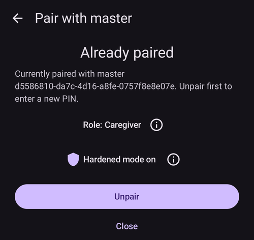
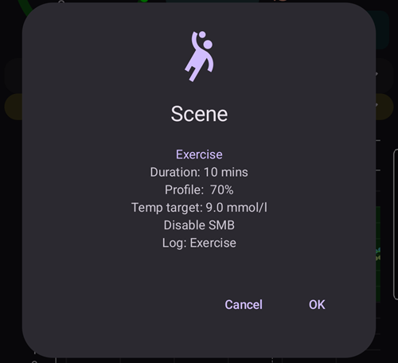

(client-master-control)=
# Ovládanie Master ↔ Client (podpísané vzdialené ovládanie)

Od verzie 4 **AAPS** môže telefón sledujúceho s aplikáciou **AAPSClient** robiť oveľa viac, než len *oznamovať* ošetrenia cez Nightscout: keď je **spárovaný** s hlavným telefónom, môže posielať **podpísané príkazy**, ktoré hlavný telefón (**master**) skontroluje, potvrdí a vykoná — vrátane podania **bolusu inzulínu** pumpou hlavného zariadenia.

Táto stránka vysvetľuje, ako to funguje a ako to nastaviť a používať.

```{contents} Table of contents
:depth: 2
:local: true
```

```{admonition} Wording used on this page
:class: note
- **Master** = hlavný telefón s **AAPS**, ktorý ovláda pumpu a riadi okruh (aplikácia `full`).
- **Client** = telefón s **AAPSClient** bez pumpy, ktorý sleduje hlavné zariadenie a teraz ho aj *ovláda*.
- Oba telefóny musia byť pripojené k **rovnakej stránke Nightscout**. Všetka komunikácia stále prebieha cez Nightscout — priame spojenie medzi telefónmi nie je potrebné.
```

---

## Ako to funguje

```{admonition} Coming from AAPS v3?
:class: note
V **AAPS** v3 mohol **AAPSClient** do Nightscoutu zapisovať iba nepodpísané záznamy Starostlivosti a nemohol podať bolus. Vzdialené ovládanie teraz potrebuje jednorazové [spárovanie](#client_master_master_setup). Pozrite tiež [Čo sa zmenilo v AAPS v4](#v4changes-remote-control).
```

**AAPS** v4 používa samostatný kanál **Client-Control**. Stále ide cez vašu stránku Nightscout (v kolekcii `settings`), ale každá správa je **kryptograficky podpísaná** tajným kľúčom, ktorý poznajú iba tieto dva telefóny. Tajný kľúč sa odovzdá raz, počas **párovania**, a hneď potom sa nahradí novým, takže sa nikdy neprenáša ako čitateľný text.

Základné pravidlo je **rozhoduje hlavné zariadenie**:

1. Klient pošle *zámer* („bolus 2 U“, „spustiť scénu Cvičenie“, „nastaviť tento dočasný cieľ“…).
2. **Hlavné zariadenie** akciu znova prepočíta a **obmedzí** podľa svojich **vlastných** aktuálnych dát (profil, IOB, COB, aktuálny dočasný cieľ, pumpa) a **samo vytvorí presné potvrdenie**, ktoré používateľ uvidí.
3. Klient (alebo hodinky) zobrazí text potvrdenia od **hlavného zariadenia** — nikdy si nevytvára vlastný.
4. Po potvrdení hlavné zariadenie akciu **vykoná raz** a výsledok pošle späť klientovi.

Čo to pre vás znamená:

- **Podpísané príkazy**: príkazy môžu posielať iba klienti, ktorých ste spárovali (každý klient má vlastný párovací kľúč a podpis). Staré alebo znova odoslané príkazy sú odmietnuté.
- **Rola pre každého klienta**: vy rozhodujete, čo môže každý klient robiť, od *Len na čítanie* po *Správca* — pozrite [Roly klientov](#client-master-control-roles).
- **Bolus inzulínu z klienta**: hlavné zariadenie ho podá svojou pumpou a klient zobrazuje priebeh podávania.
- **Rozhoduje hlavné zariadenie**: každú akciu obmedzí podľa svojich vlastných limitov a napíše potvrdenie, ktoré sa zobrazí na klientovi.
- **Liečbu menia iba spárovaní klienti**: kým je ovládanie z klienta zapnuté, hlavné zariadenie už neprijíma ošetrenia ani zmeny zadané priamo do Nightscoutu — pozrite [Režim zvýšeného zabezpečenia](#client-master-control-hardened-mode).
- **Každý klient dostane vlastný Nightscout token** iba s tými oprávneniami, ktoré klient potrebuje — pozrite [Vlastný Nightscout token klienta](#client-master-control-own-token).
- **Hlavné zariadenie je offline**: akcie sú zablokované a zobrazí sa jasná správa.
- **Zrušenie prístupu klienta** je jedno ťuknutie (pre každého klienta), alebo použite prepínač na hlavnom zariadení a zastavte všetkých klientov.

Akcie, ktoré je možné spustiť z klienta: **bolus**, **sacharidy / eSacharidy**, **dočasný cieľ** (nastaviť a zrušiť), **prepnutie profilu**, zmena **okruhu / režimu prevádzky**, **dočasný bazál** (nastaviť a zrušiť), **predĺžený bolus** (nastaviť a zrušiť), **výber inzulínu** a **[scény](../DailyLifeWithAaps/Scenes.md)**. Časť obojsmerných **nastavení** sa tiež synchronizuje medzi hlavným zariadením a klientmi.

---

## Roly a predpoklady

```{admonition} Before you start
:class: important
- **Hlavné zariadenie** používa bežné zostavenie `full` **AAPS** a je pripojené k vašej pumpe.
- **Hlavné zariadenie** používa **NSClientV3** s vaším Nightscoutom a ukazuje stav *pripojené*. Dajte mu **token s rolou Admin** z vášho Nightscoutu: s ním si hlavné zariadenie môže pre každého klienta vytvoriť vlastný token a ukázať ho klientovi ako QR kód.
- **Klient** používa **[AAPSClient](AapsClient.md)** (alebo **AAPSClient2** / **AAPSClient3** pre ďalších pacientov — pozrite [O AAPSClient, AAPSClient2 a AAPSClient3](#remotecontrol-aapsclient-versions)). Musí používať **rovnaký** Nightscout. Ak ho nastavíte pomocou QR kódu z hlavného zariadenia, klient dostane adresu a token Nightscoutu z hlavného zariadenia; inak na ňom najprv sami nastavte **NSClientV3**.
- **Websockety** sú potrebné na oboch telefónoch: príkazy sa k hlavnému zariadeniu dostanú iba cez spojenie websocket. Kým je ovládanie z klienta zapnuté, **AAPS** nechá websockety zapnuté na hlavnom zariadení aj na spárovaných klientoch.
```

Párovanie a synchronizácia sú dve rôzne veci:

- **Synchronizácia** (dáta: glykémia, ošetrenia, profil) sa nastavuje ako predtým — pozrite [Synchronizácia](#RemoteControl_aapsclient). QR kód z hlavného zariadenia to na klientovi môže urobiť za vás.
- **Párovanie** (ovládanie: kanál podpísaných príkazov opísaný tu) je nový krok uvedený nižšie.

---

## Nastavenie

(client_master_master_setup)=
### 1. Na hlavnom zariadení — zapnite ovládanie a pridajte klienta

Na hlavnom zariadení otvorte obrazovku **Spravovať** a vyberte **Autorizovaní klienti**.

Zapnite **Povoliť ovládanie klientom** (predvolene je **vypnuté**). Toto je hlavný vypínač: keď je vypnutý, žiadny klient nemôže posielať príkazy, ale spárovaní klienti zostanú uložení, takže ho môžete neskôr znova zapnúť. Jeho zapnutím sa zapne aj [Režim zvýšeného zabezpečenia](#client-master-control-hardened-mode), zobrazený ako „*Režim zvýšeného zabezpečenia je zapnutý*“ s ikonou **(i)**, ktorá ho vysvetľuje. V [Jednoduchom móde](#preferences-simple-mode) je ovládanie z klienta vždy zapnuté, preto sa prepínač nezobrazuje.


Ťuknite na tlačidlo **+** (vpravo dole) a pridajte klienta. V dialógu **Nový klient**:

1. Zadajte **názov zariadenia**, aby ste ho spoznali v zozname.
2. Vyberte, **ako je telefón nastavený** (pozrite tabuľku nižšie).
3. Vyberte jeho **[rolu](#client-master-control-roles)**. Nič nie je vybraté za vás: správna rola závisí od toho, kto telefón používa.


| Spôsob                             | Čo nový telefón dostane                                                        | Kedy ho použiť                                                                                            |
| ---------------------------------- | ------------------------------------------------------------------------------ | --------------------------------------------------------------------------------------------------------- |
| **QR kód: Nightscout a párovanie** | adresu Nightscoutu, vlastný Nightscout token a spárovanie, jedným naskenovaním | nový telefón má kameru: najrýchlejší spôsob, nič netreba písať                                            |
| **QR kód: iba Nightscout**         | adresu Nightscoutu a vlastný Nightscout token, bez spárovania                  | telefón má údaje iba **zobrazovať** a nikdy neposielať príkazy                                            |
| **PIN**                            | iba spárovanie; nastavenia Nightscoutu, ktoré má, zostanú                      | telefón nemá kameru (alebo hlavné zariadenie nemôže vytvárať tokeny); musí už byť pripojený k Nightscoutu |

Oba spôsoby s QR kódom potrebujú **token s rolou Admin** v nastaveniach **NSClientV3** na hlavnom zariadení, pretože hlavné zariadenie vytvára token klienta v Nightscoute. Bez neho sa možnosti s QR kódom zobrazia, ale nedajú sa vybrať, a dialóg vysvetlí prečo; **PIN** funguje vždy.

#### Pomocou QR kódu

Ťuknite na **OK**: hlavné zariadenie vytvorí Nightscout token klienta a zobrazí **QR kód**. Kód, ktorý aj páruje, platí asi **dve minúty**; obrazovka odpočítava čas a sama sa zavrie, keď sa klient spáruje. Naskenujte ho na novom telefóne podľa postupu v časti [Na klientovi](#client_master_client_setup).

```{admonition} The QR code is a secret
:class: warning
Každý, kto uvidí QR kód, môže čítať váš Nightscout, a kód, ktorý páruje, obsahuje aj spárovanie. Ukážte ho iba novému telefónu. **AAPS** blokuje snímky obrazovky, kým je kód na obrazovke.
```


#### Pomocou PIN kódu

Ťuknite na **OK**: hlavné zariadenie zobrazí 8-miestny **PIN kód na párovanie**, rozdelený do dvoch skupín po štyri číslice (napríklad `1234 5678`). Tento PIN kód je **jednorazový** a **jeho platnosť vyprší asi po dvoch minútach**. As with the QR code, the master refuses a client name that is already in its list: each client gets its own Nightscout token under its name.


```{admonition} The pairing PIN is a secret
:class: warning
PIN kód chráni párovací kľúč, ktorý sa vymieňa cez Nightscout. Zdieľajte ho iba so zariadením, ktoré párujete, nezverejňujte ho a ak ho nepoužijete, nechajte ho vypršať. Nový PIN kód môžete kedykoľvek vytvoriť opätovným ťuknutím na **+**.
```

(client_master_client_setup)=
### 2. Na klientovi — spárovanie s hlavným zariadením

#### Naskenovanie QR kódu

QR kód z hlavného zariadenia môžete naskenovať na dvoch miestach:

- v **Sprievodcovi nastavením** klienta, v kroku „**Nastavenie z hlavného zariadenia**“, ktorý je pred krokom Nightscout. Jedno naskenovanie potom nastaví Nightscout a pri kóde, ktorý páruje, aj spárovanie, takže nastavenie je hotové: sprievodca sa zavrie a otvorí sa hlavná obrazovka;
- kedykoľvek neskôr cez **Spravovať → Spárovanie s hlavným zariadením → Naskenovať QR kód**.

Pri prvom použití **AAPSClient** požiada o povolenie pre **kameru**. Ak ho odmietnete, obrazovka oznámi, že kamera je potrebná, a môžete ju povoliť tlačidlom **Skúsiť to znova** alebo namiesto toho spárovať pomocou PIN kódu.

Nasmerujte kameru na kód. Klient ukáže, čo kód robí — adresu Nightscoutu a pri kóde, ktorý páruje, aj hlavné zariadenie, s ktorým sa spáruje — a opýta sa „**Použiť tento kód?**“. Ťuknite na **Použiť**: klient zapne **NSClientV3**, nahradí svoju adresu a token Nightscoutu údajmi z kódu a zapne websockety. Kód, ktorý páruje, telefón aj spáruje; telefón sa ozve hlavnému zariadeniu hneď, ako sa pripojí k Nightscoutu.


```{admonition} Scanning is available on Android
:class: note
Skener zatiaľ nie je dostupný v iOS a počítač nemá kameru: tam použite PIN kód.
```

#### Zadanie PIN kódu

Na klientovi otvorte **Spravovať → Spárovanie s hlavným zariadením** (alebo krok sprievodcu **Spárovanie s hlavným zariadením**, ktorý je po kroku Nightscout), **zadajte 8-miestny PIN kód** zobrazený na hlavnom zariadení a ťuknite na **Spárovať**. Klient pomocou PIN kódu bezpečne získa ponuku párovania cez Nightscout, potom sa opýta „**Spárovať s týmto hlavným zariadením?**“ a ukáže identifikátor hlavného zariadenia. Ťuknutím na **Spárovať** to potvrďte (snímku obrazovky nájdete v časti [Spárovanie s hlavným zariadením](#aapsclient-pairing-with-the-master)).


#### Po spárovaní

Keď je klient spárovaný, pošle hlavnému zariadeniu správu **Hello** a objaví sa v zozname **Autorizovaní klienti** na hlavnom zariadení ako **Aktívny**, s časom *„naposledy videný“*. Klient pozná svoju [rolu](#client-master-control-roles) zo spárovania, takže hneď zobrazí správne tlačidlá. Spárovanie urobené v Sprievodcovi nastavením sprievodcu ukončí. V tom istom kroku oba telefóny nahradia párovací kľúč novým, ktorý sa nikdy neprenášal (pozrite [Poznámky k bezpečnosti](#client-master-control-security)), a klient nastavený pomocou PIN kódu dostane vlastný Nightscout token (pozrite [Vlastný Nightscout token klienta](#client-master-control-own-token)). Klient môže byť naraz spárovaný iba s **jedným** hlavným zariadením; ak ho chcete spárovať s iným hlavným zariadením, najprv ťuknite na **Zrušiť párovanie**.



### 3. Správa klientov

Na obrazovke **Autorizovaní klienti** na hlavnom zariadení môžete kedykoľvek:

- **Zmeniť rolu** klienta pomocou radu štyroch tlačidiel pod jeho názvom. Nová rola platí okamžite, bez nového párovania.
- **Zistiť, s akým Nightscout tokenom** klient zapisuje: „*Vlastný Nightscout token*“ je to, čo chcete. Červený riadok „*Používa sa Nightscout token …, ktorý má viac oprávnení, než klient potrebuje*“ znamená, že klient stále používa token s viacerými oprávneniami, zvyčajne váš token s rolou Admin — pozrite [Vlastný Nightscout token klienta](#client-master-control-own-token).
- **Zrušiť prístup** jednému klientovi — ťuknite na ikonu **koša** vedľa neho. Klient potom nemôže posielať príkazy, kým ho znova nespárujete. Odstráni sa aj jeho vlastný Nightscout token, takže už nemôže ani čítať váš Nightscout.
- **Zastaviť všetko ovládanie** bez straty spárovaní — vypnite **Povoliť ovládanie klientom**.

Telefóny nastavené pomocou **QR kód: iba Nightscout** sú uvedené pod klientmi, v časti „**Len na čítanie z Nightscoutu**“. Pre každý z nich môžete znova zobraziť QR kód (na opätovné nastavenie toho istého telefónu) alebo zmazať jeho token, čím ukončíte jeho prístup k vášmu Nightscoutu.


---

(client-master-control-roles)=
## Roly klientov

Každý spárovaný klient má **rolu**. Hlavné zariadenie ju kontroluje pri každom príkaze a klient zobrazuje iba to, čo jeho rola dovoľuje. Nová rola platí okamžite, bez nového párovania. Roly na seba nadväzujú: každá môže robiť všetko, čo môže tá pred ňou.

| Rola               | Klient môže                                                                                                                                                                                                                                         |
| ------------------ | --------------------------------------------------------------------------------------------------------------------------------------------------------------------------------------------------------------------------------------------------- |
| **Len na čítanie** | iba zobrazovať dáta. Zostáva spárovaný, takže je pripravený, keď mu dáte vyššiu rolu.                                                                                                                                                               |
| **Jedlá**          | podať bolus, používať bolusovú kalkulačku a Rýchleho sprievodcu, zadávať sacharidy a zastaviť práve bežiaci bolus. Sacharidy zadané tu môžu spôsobiť, že okruh podá viac inzulínu.                                                                  |
| **Opatrovateľ**    | robiť všetko, čo robí používateľ v **AAPS**: dočasné ciele, prepnutia profilu a inzulínu, režim okruhu, dočasný bazál, predĺžený bolus, scény, udalosti Starostlivosti, kalibrácie a odstraňovanie záznamov. Nemôže meniť nastavenia ani predvoľby. |
| **Správca**        | robiť všetko, vrátane nastavení a predvolieb (Rýchly sprievodca, predvoľby dočasného cieľa, scény, profily, automatizácia, inzulín).                                                                                                                |

Ikona **(i)** v hornej časti obrazovky **Autorizovaní klienti** zobrazuje rovnaké vysvetlenie. Na klientovi zobrazí **Spravovať → Spárovanie s hlavným zariadením** vlastnú rolu telefónu.

---

(client-master-control-hardened-mode)=
## Režim zvýšeného zabezpečenia

Keď je zapnuté **Povoliť ovládanie klientom**, hlavné zariadenie je v **režime zvýšeného zabezpečenia**: zmeny prijíma iba od spárovaných klientov. **Neprijíma** ošetrenia, dočasné ciele, zmeny profilu, zmeny režimu prevádzky ani mazania, ktoré sa urobia priamo v Nightscoute, napríklad na webovej stránke Nightscoutu alebo v iných aplikáciách.

- Nastavenia prijímania dát z Nightscoutu (**NSClientV3 → Synchronizácia**) sú v režime zvýšeného zabezpečenia skryté; **AAPS** s nimi pracuje, ako keby boli vypnuté.
- Hlavné zariadenie stále **nahráva** všetky svoje dáta do Nightscoutu, vrátane glykémie, a nechá **websockety** zapnuté.
- Ak hlavné zariadenie dostáva **glykémiu z Nightscoutu**, stále ju odtiaľ prijíma.
- Ak chcete načítať históriu do **nového** hlavného zariadenia, použite **Úplnú synchronizáciu** v **NSClientV3**: prevezme všetko, čo je v Nightscoute, vrátane profilov.
- Na [SMS príkazy](SMSCommands.md) to nemá vplyv.

Spárovaný klient sa riadi režimom zvýšeného zabezpečenia hlavného zariadenia: nechá websockety zapnuté a rovnaké nastavenia Nightscoutu sú na ňom skryté. Nespárovaný klient si ponechá svoje vlastné nastavenia.

[Jednoduchý mód](#preferences-simple-mode) vždy zapne režim zvýšeného zabezpečenia. Ak ho chcete vypnúť, opustite Jednoduchý mód a na hlavnom zariadení vypnite **Povoliť ovládanie klientom**.

```{admonition} Why hardened mode
:class: note
Všetko, čo spárovaný klient pošle, je podpísané, skontrolované a potvrdené hlavným zariadením. Ošetrenie zadané na webovej stránke Nightscoutu nie je: mohol ho pridať ktokoľvek, kto má do vášho Nightscoutu prístup na zápis. V režime zvýšeného zabezpečenia môžu činnosť hlavného zariadenia zmeniť iba podpísané príkazy.
```

---

(client-master-control-own-token)=
## Vlastný Nightscout token klienta

Klient nepotrebuje token s rolou Admin. Iba číta váš Nightscout a cez neho posiela svoje príkazy hlavnému zariadeniu; sám nič nenahráva. Preto hlavné zariadenie dá každému klientovi vlastný Nightscout token iba s týmito oprávneniami:

- čítať všetko,
- zapisovať do kolekcie `settings`, ktorá je kanálom k hlavnému zariadeniu,
- odložiť (snooze) alarmy Nightscoutu.

Token patrí k roli v Nightscoute s názvom **`aaps-client`**, ktorú hlavné zariadenie vytvorí, keď ju prvýkrát potrebuje. Rolu a tokeny (s názvom `aaps-` a názov klienta) nájdete v časti **Admin tools** na vašej stránke Nightscout. Ak sa tam rola zmení, hlavné zariadenie ju nastaví späť pri ďalšom vytváraní tokenu alebo keď otvoríte **Autorizovaní klienti**.

Ako klient získa svoj token:

- **Nastavenie pomocou QR kódu**: token je v kóde.
- **Spárovanie pomocou PIN kódu** (alebo spárovanie pred zavedením tejto funkcie): po spárovaní hlavné zariadenie pošle klientovi jeho vlastný token cez spárovaný kanál, zašifrovaný. Klient najprv skontroluje, že prihlásenie s ním funguje, a potom ho používa namiesto tokenu, ktorý mal. Na to musí mať hlavné zariadenie token s rolou Admin; bez neho si klient ponechá svoj token a jeho karta na hlavnom zariadení ukazuje červený riadok.

**Klient si ponechá vlastný token.** Keď hlavné zariadenie raz uvidí, že klient zapisuje s vlastným tokenom, prijíma príkazy tohto klienta už iba s týmto tokenom. Príkaz zapísaný s iným tokenom (napríklad s tokenom s rolou Admin, ktorý niekto neskôr zadal do klienta, alebo s tokenom iného klienta) je odmietnutý, aj keď je klient spárovaný, a klient zobrazí „*Hlavné zariadenie požiadavku odmietlo: tento telefón zapisuje do Nightscoutu pomocou iného tokenu, než vlastného*“. Jeho karta na hlavnom zariadení to ukazuje červenou farbou. Klient sa stále zobrazuje ako online, takže vidíte, čo je zle. Na opravu odstráňte klienta na hlavnom zariadení a pridajte ho znova.

Hlavné zariadenie nikdy nezmaže ani nezmení Nightscout token, ktorý samo nevytvorilo (token s inými rolami ako `aaps-client`): tie sú vaše. Vlastný token klienta zmaže, keď klienta odstránite.

---

## Používanie vzdialeného ovládania

### Spustenie akcie z klienta

Klienta používajte presne tak ako samotný telefón: otvorte **Sacharidy**, **Inzulín**, **Dočasný cieľ**, **Profil**, **Scény**, panel **Spravovať** atď. a vyplňte hodnoty.

Keď potvrdíte, klient na chvíľu zobrazí **„Kontaktuje sa riadiace zariadenie/telefón…“**, **hlavné zariadenie** akciu vypočíta a obmedzí a klient potom zobrazí **vlastné potvrdenie hlavného zariadenia** — presne tie riadky, hodnoty a farby, ktoré by hlavné zariadenie ukázalo na svojej obrazovke. Skontrolujte ich a ťuknutím na **OK** pokračujte.



To isté platí aj pre jednoduché zadanie sacharidov — množstvo zobrazené na potvrdenie je to, ktoré vypočítalo hlavné zariadenie:


Po potvrdení hlavné zariadenie akciu raz vykoná a výsledok sa zobrazí aj na klientovi.

### Bolus inzulínu z klienta

Toto je hlavná nová funkcia vo v4. Bolus spustený na klientovi **podá hlavné zariadenie svojou pumpou**; hlavné zariadenie ho obmedzí podľa svojich vlastných limitov a klient počas podávania zobrazuje **priebeh podávania v reálnom čase** (a alarm, ak pumpa nahlási chybu).

```{admonition} Boluses are always confirmed and capped on the master
:class: note
Klient nikdy sám nerozhoduje o podanom množstve. Hlavné zariadenie ho znova prepočíta a obmedzí, vy potvrdíte množstvo od hlavného zariadenia a až potom sa podá.
```

(clientmastercontrol-when-the-master-is-offline)=
### When the master is offline

Ak hlavné zariadenie nie je dostupné (telefón je vypnutý alebo v režime spánku, nie je pripojený k Nightscoutu alebo websockety nefungujú), akcie ovládania na klientovi sú **zablokované skôr, než sa čokoľvek odošle**, a dostanete jasnú správu. Nič sa nevykoná iba napoly.


Klient automaticky znova kontroluje dostupnosť a keď je hlavné zariadenie opäť online, ovládanie znova povolí.

(clientmastercontrol-wear-os-on-a-client)=

### Wear OS (hodinky) na klientovi

Hodinky spárované s telefónom **klienta** posielajú svoje akcie cez klienta hlavnému zariadeniu (hodinky → klient → hlavné zariadenie). Hodinky zobrazujú riadky potvrdenia od **hlavného zariadenia** a skutočný výsledok, rovnako ako telefón. Nastavenie hodiniek sa nemení — pozrite [Wear OS](../WearOS/WearOsSmartwatch.md).


<!-- 📷 SCREENSHOT NEEDED (optional): watch confirmation screen relayed from the master,
     and/or the "Contacting master" state on the watch. Requires a paired Wear OS device. -->

---

(client-master-config-prefs)=
## Zmena konfigurácie a nastavení

Spárovanie robí viac, než len odovzdáva jednotlivé akcie — udržiava aj **konfiguráciu** a mnohé **nastavenia** rovnaké na hlavnom zariadení a jeho klientoch.

### Konfigurácia (ktoré pluginy sú aktívne)

Aktívne **pluginy** (algoritmus APS, citlivosť, vyhladzovanie, …) sa vyberajú na **hlavnom zariadení** a **zrkadlia sa** na každého spárovaného klienta. Na klientovi sú tieto voľby označené malou **ikonou mobilu** na obrazovke [Konfigurácia](#configuration_sync_icon) — zmeňte ich na hlavnom zariadení a klienti sa automaticky prispôsobia, a naopak.

Na klientovi sa ikona mobilu zobrazuje pri *Vyhladzovanie*, *Kalibrácia*, *Detekcia citlivosti* a *APS* (synchronizované z hlavného zariadenia), ale nie pri *Komunikácia*:


Údaje o pripojení, ktoré sú pre každé zariadenie jedinečné — najmä **adresa URL Nightscoutu / prístupový token v NSClient** — sa *nesynchronizujú*. Každý telefón má vlastné; na klientovi pochádzajú z QR kódu hlavného zariadenia, alebo ich nastavíte sami.

### Profily

Váš **zoznam profilov** sa tiež synchronizuje medzi hlavným zariadením a jeho spárovanými klientmi. Na spárovanom klientovi zobrazí **Spravovať → Profil** rovnaké profily ako hlavné zariadenie; profil môžete **upraviť** alebo **aktivovať** a — ako každý iný príkaz — zmena sa pošle na **hlavné zariadenie**, tam sa použije a synchronizuje sa späť.

Keď prvýkrát aktivujete profil na novo nainštalovanom klientovi, klient môže zobraziť „*Zatiaľ sa nepoužíva žiadny inzulín*“ a požiadať vás, aby ste **vybrali inzulín**. Vyberte inzulín, ktorý je aktívny na hlavnom zariadení (ukáže ho **Spravovať → Nastavenia inzulínu** na hlavnom zariadení).

Na klientovi, ktorý **nie je spárovaný**, je obrazovka Profil stále dostupná, ale **iba na zobrazenie**: klient ukazuje profily, ktoré dostáva cez Nightscout (potrebuje ich na vlastné výpočty), ale nie je tam tlačidlo na úpravu ani aktiváciu — neexistuje hlavné zariadenie, ktorému by sa zmena poslala.

### Nastavenia

Časť **nastavení** je **obojsmerná**: môžete ich zmeniť na **hlavnom zariadení alebo na spárovanom klientovi** a zmena sa synchronizuje na druhú stranu. Keď takéto nastavenie zmeníte na klientovi, pošle sa hlavnému zariadeniu podpísaným kanálom, tam sa použije a platná hodnota sa pošle späť — takže na klientovi vždy vidíte to, čo hlavné zariadenie uložilo. Ak sa rovnaké nastavenie zmení na dvoch zariadeniach takmer v rovnakom čase, **platí posledná úprava**. Pri nastavení s posuvníkom sa nová hodnota odošle, keď zdvihnete prst.

V nastaveniach rovnaká malá **ikona mobilu** označuje jednotlivé nastavenia, ktoré sa synchronizujú. V príklade nižšie sa *Hraničný čas absorpcie (vstrebávania)* synchronizuje (ikona mobilu), zatiaľ čo nastavenia bez ikony platia iba pre dané zariadenie:


```{admonition} The master must be online to change synced settings from a client
:class: note
Keďže uloženú hodnotu určuje hlavné zariadenie, úprava položky konfigurácie riadenej hlavným zariadením alebo obojsmerného nastavenia z klienta vyžaduje, aby bolo hlavné zariadenie **dostupné**. When the master is offline those controls are disabled on the client (see [When the master is offline](#clientmastercontrol-when-the-master-is-offline)).
```

---

(client-master-control-security)=
## Poznámky k bezpečnosti

```{admonition} How the channel is protected
:class: tip
- **Párovací kľúč**: hlavné zariadenie ho odovzdá klientovi raz — chránený PIN kódom v dokumente v Nightscoute, alebo vo vnútri QR kódu — a oba telefóny ho uložia zašifrovaný.
- **Nový kľúč hneď po spárovaní**: prvá správa klienta po spárovaní spustí výmenu kľúčov a odvtedy oba telefóny používajú kľúč, ktorý sa nikdy neprenášal. Kľúč, ktorý mohol niekto vidieť (odfotený QR kód, ponuka s PIN kódom prečítaná z Nightscoutu), je potom nepoužiteľný. Telefóny spárované pred zavedením tejto funkcie urobia to isté raz po aktualizácii.
- **Každý príkaz je podpísaný** (HMAC). Hlavné zariadenie odmietne všetko, čoho podpis nezodpovedá spárovanému klientovi.
- **Opakovanému odoslaniu (replay) bráni** stále rastúce počítadlo pre každého klienta a platnosť každého príkazu **vyprší** po krátkom čase (time-to-live).
- **Najmenšie oprávnenia v Nightscoute**: každý klient má [vlastný Nightscout token](#client-master-control-own-token), ktorý môže iba čítať a zapisovať do kanála ovládania z klienta. Keď ho klient raz použije, hlavné zariadenie prijíma jeho príkazy už iba s týmto tokenom. Odstránením klienta sa token zmaže.
- **Iba podpísané zmeny**: v [režime zvýšeného zabezpečenia](#client-master-control-hardened-mode) hlavné zariadenie ignoruje zmeny liečby zadané priamo do Nightscoutu.
- **Hlavné zariadenie podpisuje, čo zdieľa**: nastavenia, zoznam klientov a znak „hlavné zariadenie je aktívne“, ktoré hlavné zariadenie ukladá do Nightscoutu pre svojich klientov, nesú podpis hlavného zariadenia. Klient ich prijme iba vtedy, keď je podpis od hlavného zariadenia, takže token iného klienta ich nemôže zmeniť. Klient sa kľúč hlavného zariadenia dozvie pri spárovaní, alebo z QR kódu pri telefóne, ktorý iba číta Nightscout. Odmietnutý dokument sa v logu NSClient zobrazí ako „*✕ SETTINGS … refused*“.
- **Ovládanie máte stále vy**: dajte každému klientovi [rolu](#client-master-control-roles), ktorú potrebuje, zrušte prístup klienta jedným ťuknutím, alebo všetko vypnite pomocou **Povoliť ovládanie klientom**.
```

```{admonition} After restoring a backup
:class: warning
Ak sa klient obnoví zo zálohy, ktorá vráti jeho počítadlo príkazov späť, hlavné zariadenie bude jeho ďalšie príkazy odmietať ako opakované odoslanie. Na nápravu jednoducho **zrušte párovanie a spárujte znova**.
```

---

(client-master-control-troubleshooting)=

## Riešenie problémov

| Problém                                                                                                                           | Čo skontrolovať                                                                                                                                                                                                                                                                                                                                         |
| --------------------------------------------------------------------------------------------------------------------------------- | ------------------------------------------------------------------------------------------------------------------------------------------------------------------------------------------------------------------------------------------------------------------------------------------------------------------------------------------------------- |
| Klient hlási, že **hlavné zariadenie je offline**                                                                                 | Hlavný telefón je zapnutý a beží na ňom **AAPS**; oba telefóny sú pripojené v **NSClientV3**; **websockety** sú zapnuté na oboch; rovnaká stránka Nightscout.                                                                                                                                                                                           |
| Klient hlási, že **nie je spárovaný**                                                                                             | Spárujte ho znova cez **Spravovať → Spárovanie s hlavným zariadením**. Overte, že klient je v zozname **Autorizovaní klienti** na hlavnom zariadení **Aktívny**.                                                                                                                                                                                        |
| Príkaz hlavné zariadenie **odmietlo**                                                                                             | Hlavné zariadenie príkaz znova overí podľa svojho aktuálneho stavu — napr. vybraný profil už neexistuje alebo typ pumpy nesúhlasí. Skontrolujte to znova na hlavnom zariadení.                                                                                                                                                                          |
| Príkazy fungujú, ale sú **pomalé**                                                                                                | Zapnite **websockety** na oboch telefónoch (inak aplikácie prejdú na pomalšie pravidelné dotazovanie).                                                                                                                                                                                                                                                  |
| Párovanie sa zruší so správou *„Párovací kľúč sa nepodarilo uložiť“*                                                              | Nič sa nezmenilo. Spustite párovanie znova; ak to stále zlyháva, reštartujte **AAPSClient** a skúste to ešte raz.                                                                                                                                                                                                                                       |
| Po spárovaní sa nič nedeje                                                                                                        | Uistite sa, že **Povoliť ovládanie klientom** je na hlavnom zariadení ZAPNUTÉ a že hlavné zariadenie je pripojené k Nightscoutu.                                                                                                                                                                                                                        |
| Možnosti s QR kódom sa v dialógu **Nový klient** nedajú vybrať                                                                    | Dialóg vysvetľuje prečo. *Nie je to token s rolou Admin*: dajte hlavnému zariadeniu token s rolou Admin z vášho Nightscoutu, alebo pridajte klienta pomocou **PIN** kódu. *Nepripojené*: počkajte, kým hlavné zariadenie v **NSClientV3** neukáže stav *pripojené*.                                                                                     |
| *„Nightscout už má token s týmto názvom ale inými oprávneniami“*                                                                  | Jeden z vašich vlastných tokenov v Nightscoute sa volá `aaps-` a tento názov. Zvoľte pre klienta iný názov.                                                                                                                                                                                                                                             |
| *„Klient s týmto názvom sa už v zozname nachádza“*                                                                                | Zvoľte iný názov, alebo najprv odstráňte toho klienta.                                                                                                                                                                                                                                                                                                  |
| Klient hlási *„Tento kód pochádza z inej verzie AAPS“*                                                                            | Hlavné zariadenie aj klient musia používať **rovnakú** verziu **AAPS**. Aktualizujte staršiu z nich.                                                                                                                                                                                                                                                    |
| Klient hlási *„Platnosť tohto kódu vypršala“*                                                                                     | Kód, ktorý páruje, platí asi dve minúty. Pridajte klienta na hlavnom zariadení znova a získajte nový kód.                                                                                                                                                                                                                                               |
| Klient hlási *„Tento telefón je už spárovaný“*                                                                                    | Najprv zrušte jeho párovanie (**Spravovať → Spárovanie s hlavným zariadením → Zrušiť párovanie**), potom skenujte znova. Kód **iba Nightscout** funguje aj na spárovanom telefóne.                                                                                                                                                                      |
| Klient hlási *„Hlavné zariadenie požiadavku odmietlo: tento telefón zapisuje do Nightscoutu pomocou iného tokenu, než vlastného“* | Klient predtým používal vlastný Nightscout token a teraz zapisuje s iným, napríklad po tom, ako niekto zadal token do jeho nastavení Nightscoutu. Odstráňte klienta na hlavnom zariadení a pridajte ho znova (pozrite [Vlastný Nightscout token klienta](#client-master-control-own-token)).                                                            |
| Log NSClient na klientovi ukazuje *„✕ SETTINGS … refused“* a jeho nastavenia už nenasledujú hlavné zariadenie                     | Dokument s nastaveniami hlavného zariadenia zapísal niekto iný, alebo má hlavné zariadenie nový kľúč (napríklad po vymazaní jeho dát). Spárovaný klient prijme nový kľúč sám pri ďalšom pripojení k Nightscoutu. Telefón, ktorý iba číta Nightscout, potrebuje znova QR kód z hlavného zariadenia (**Len na čítanie z Nightscoutu → Zobraziť QR kód**). |
| Karta klienta ukazuje červeným *„Používa sa Nightscout token …“*                                                                  | Klient stále zapisuje s tokenom, ktorý má viac oprávnení, než potrebuje. Hlavné zariadenie mu po spárovaní pošle vlastný token, ale iba vtedy, ak má hlavné zariadenie token s rolou Admin. Skontrolujte token hlavného zariadenia, alebo klienta nastavte znova pomocou QR kódu.                                                                       |
| Klient už nemôže čítať Nightscout                                                                                                 | Jeho token bol zmazaný, napríklad preto, že klienta odstránili na hlavnom zariadení. Pridajte ho znova.                                                                                                                                                                                                                                                 |
| Ošetrenia zadané na webovej stránke Nightscoutu sa nepoužijú                                                                      | V [režime zvýšeného zabezpečenia](#client-master-control-hardened-mode) je to očakávané: zadajte ich namiesto toho na spárovanom klientovi.                                                                                                                                                                                                             |

Pri problémoch s Nightscoutom / synchronizáciou si najprv pozrite [Riešenie problémov s NSClient](../GettingHelp/TroubleshootingNsClient.md).

---


<!-- =====================================================================
     SCREENSHOTS STILL TO ADD:
       1. (optional) Wear OS confirmation relayed from the master
     Already included:
       - authorized_clients_master.png       (master: Allow client control, hardened mode, client card, + button)
       - authorized_clients_roles.png        (master: client card with roles, Read Nightscout only section)
       - new_client_master.png               (master: New client dialog, three ways and role row)
       - qr_code_master.png                  (master: pairing QR code with countdown, code blurred; console screenshot)
       - aapsclient_wizard_from_master.png   (client: Set up from the master wizard step)
       - pair_with_master_unpaired.png       (client: pairing screen, unpaired PIN entry)
       - pairing_pin_master.png              (master: one-time pairing PIN — expired demo PIN)
       - pair_with_master_client.png         (client: pairing screen, paired state)
       - confirmation_master_authored.png    (client: master-authored scene confirmation)
       - carbs_confirmation_client.png       (client: master-authored carbs confirmation)
       - master_offline_error.png            (client: master-offline message)
     Maintainers: relocate page + images and fix cross-links as needed.
     ===================================================================== -->
