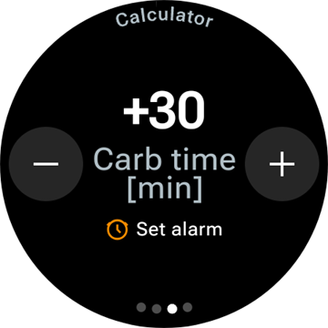
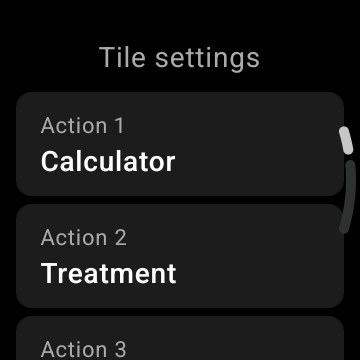

# Ovládanie AAPS pomocou inteligentných hodiniek s Wear OS

(Watchfaces-aaps-watchfaces)=

## Ciferníky AAPS

```{warning}
Klasické ciferníky **AAPS** fungujú iba na Wear OS 5 a starších a už Wear OS 5 ich obmedzuje. Na **Wear OS 6 a novších** aplikácia v hodinkách namiesto nich nainštaluje jeden ciferník vo formáte Watch Face Format od Googlu: váš vlastný ciferník ako obrázok alebo **Ciferník s komplikáciami**. Čo sa v ktorej verzii Wear OS pokazí, nájdete v časti [Zmeny ciferníkov vo Wear OS](#wearos-watchface-changes), a pre Wear OS 6 v časti [ciferník, ktorý AAPS nainštaluje](#wearos-aaps-v4-watchface).
```

Na Wear OS 5 a starších je v aplikácii **AAPS** v hodinkách vstavaných niekoľko klasických ciferníkov. Zobrazujú glykémiu s deltou, IOB, aktívnu bazálnu dávku a graf hodnôt. Fungujú na nich dve ťuknutia:

* Dvojitým ťuknutím na hodnotu glykémie otvoríte hlavnú ponuku **AAPS**
* Dvojitým ťuknutím na graf zmeníte jeho časový rozsah

Vo všetkých verziách Wear OS fungujú [komplikácie](#Watchfaces-complications) a [dlaždice](#WearOsSmartwatch-wear-os-tiles) opísané na tejto stránke s každým ciferníkom, ktorý má na ne miesto.

## Konfigurácia

Zapnite **Wear** v [**Konfigurácia** > **Komunikácia**](#Config-Builder-wear).

Ak chcete z hodiniek podávať bolus alebo vykonávať iné akcie, zapnite **Ovládanie cez Wear**. Na tom istom mieste sa nastavujú aj možnosti bolusovej kalkulačky pre hodinky: pozrite [Nastavenia > Wear](#preferences-wear). Kým je **Ovládanie cez Wear** vypnuté, telefón odmietne každé ošetrenie alebo zmenu režimu poslanú z hodiniek a hodinky zobrazia *„Ovládanie z hodiniek je v nastaveniach telefónu vypnuté.“*

Pomocou **Otvoriť plugin** na karte **Wear** otvoríte obrazovku Wear:


Horný riadok zobrazuje názov pripojených hodiniek alebo **(Žiadne hodinky nie sú pripojené)**. Na tejto obrazovke môžete

* Znovu odoslať všetky údaje. Môže to pomôcť, ak hodinky neboli nejaký čas pripojené a chcete do nich údaje poslať.
* Otvorte nastavenia na hodinkách priamo z telefónu.
* Vybrať, ktorý ciferník **AAPS** nainštaluje do hodiniek (**Ciferník nainštalovaný v hodinkách**: váš vlastný ciferník alebo ciferník s komplikáciami). Táto karta sa zobrazuje, iba kým sú pripojené hodinky s **Wear OS 6** alebo novším. Pozrite [ciferník, ktorý AAPS nainštaluje](#wearos-aaps-v4-watchface).
* Spravovať **Vlastný ciferník** (karta sa zobrazuje, kým sú hodinky pripojené): **Načítať ciferník** pošle vlastný ciferník do hodiniek, **Informácie o ciferníku** zobrazí podrobnosti o načítanom ciferníku a poliach, ktoré obsahuje, **Ďalšie ciferníky** otvorí v prehliadači [stránku na výmenu ciferníkov](../ExchangeSiteCustomWatchfaces/index.md) a **Exportovať šablónu** uloží šablónu, ktorú môžete upraviť. Pod tlačidlami sa zobrazuje náhľad načítaného ciferníka. Pozrite [Prechod na ciferník AAPS](#WearOS_changing-to-AAPS-watchface).

Uistite sa, že notifikácie z AAPS nie sú v hodinkách blokované. Potvrdenie akcie (napr. bolusu, dočasného cieľa) príde ako notifikácia, ktorú musíte potiahnuť a odškrtnúť.

## Otvorenie hlavnej ponuky AAPS


Hlavnú ponuku **AAPS** otvoríte jedným z týchto spôsobov:

* otvorte **AAPS** zo zoznamu aplikácií v hodinkách
* ťuknite na komplikáciu **AAPS**, ktorá otvára ponuku, pozrite [Nastavenia komplikácií](#WearOsSmartwatch-complication-settings)
* ťuknite na dlaždicu **Graf glykémie**, ktorá má **Akcia pri poklepaní** nastavenú na **Hlavné menu**, pozrite [Nastavenia dlaždíc](#WearOsSmartwatch-wear-os-tiles)
* na klasickom ciferníku **AAPS** dvakrát ťuknite na hodnotu glykémie

(WearOsSmartwatch-loop-status)=

## Obrazovka Stav okruhu

Obrazovka **Stav okruhu** zhrnie, čo okruh práve robí, bez toho, aby ste museli vybrať telefón. Otvoríte ju z hlavnej ponuky AAPS (**Stav okruhu** alebo **Stav → Okruh**) alebo ťuknutím na komplikáciu **Glykémia**. Ponuka **Stav** má aj stránku **Pumpa** a stránku **TDD** s celkovými dennými dávkami.


Obrazovka je zoznam kariet. Ak ich chcete vidieť všetky, posuňte sa nadol:

* **Režim prevádzky** — aktuálny režim (uzavretý okruh, otvorený okruh, LGS, pozastavený, odpojený…) a pri dočasnom režime aj to, ako dlho ešte potrvá.
* **Výsledok uzavretého okruhu** — kedy okruh naposledy bežal a aký dočasný bazál alebo SMB požadoval.
* **Scéna** — iba kým je aktívna [scéna](#scenes-from-watch): jej názov, zostávajúci čas (alebo **Do ukončenia** pri scéne bez času ukončenia) a scéna **Ďalší krok**, ktorá sa spustí, keď táto skončí.
* **Ciele** — váš cieľ a dočasný cieľ, ak práve beží.
* **Profil** — názov aktívneho profilu s hodnotami **Percento** a **Časový posun**, ak nie sú predvolené. Dočasné prepnutie profilu je zvýraznené a zobrazuje, ako dlho ešte potrvá a na ktorý profil sa po skončení vráti (**Návrat na**).
* **Citlivosť** — rovnaké riadky ako rámček citlivosti na hlavnej obrazovke telefónu: hodnota autosens a hodnoty ISF z profilu, premenlivá a účinná.

Malá ikona scény vedľa režimu prevádzky, dočasného cieľa alebo prepnutia profilu znamená, že ich **nastavila aktívna scéna**. Rovnaká ikona sa zobrazuje aj vo výbere **Režim prevádzky**.


(WearOsSmartwatch-bolus-calculator)=

## Bolusová kalkulačka v hodinkách

Otvorte **Kalkulačka** z hlavnej ponuky **AAPS**, z [dlaždice Akcie](#WearOsSmartwatch-wear-os-tiles) alebo z komplikácie nastavenej na otvorenie kalkulačky. Kalkulačka má niekoľko stránok, na ďalšiu prejdete potiahnutím sprava doľava:

| Sacharidy                                                              | Požiadavka                                                                | Výsledok                                                               | Výpočet                                                                           | Potvrdiť                                                                |
| ---------------------------------------------------------------------- | ------------------------------------------------------------------------- | ---------------------------------------------------------------------- | --------------------------------------------------------------------------------- | ----------------------------------------------------------------------- |
|  |  |  |  |  |

1. **Sacharidy**: zadajte sacharidy tlačidlami **+10**, **+5**, **−** a **+**.
2. **Požiadavka**: posledná stránka, kým prevezme úlohu telefón. Zobrazuje, čo ste zadali: sacharidy a, ak ich používate, typ jedla, čas sacharidov a percento, pozrite [Voliteľné stránky](#WearOsSmartwatch-calculator-optional-pages). Ťuknutím na fajku ju pošlete do telefónu, ktorý vykoná výpočet.
3. **Výsledok**: bolus, ktorý **AAPS** navrhuje, a pod ním sacharidy: sacharidy teraz a eSacharidy neskôr, čas sacharidov a zvonček pripomienky jedla. Dávku upravíte tlačidlami **−** a **+**, pozrite nižšie. Posuňte sa nadol na kartu **Výpočet**: ťuknutím na ňu uvidíte každý riadok výpočtu, rovnako ako v telefóne.
4. **Potvrdiť**: potiahnite na druhú stránku a ťuknite na fajku. Telefón podá bolus a zaznamená sacharidy.

(WearOsSmartwatch-calculator-optional-pages)=

### Voliteľné stránky

Tri nastavenia hodiniek pridávajú každé jednu stránku za stránku **Sacharidy**. Predvolene sú vypnuté. Otvorte hlavnú ponuku **AAPS**, potom **Nastavenia** > **Rozhranie** a zapnite tie, ktoré chcete; ak je zapnutých viac, stránky idú v poradí **Typ jedla**, **Čas sacharidov**, **Percento**. Bodky v dolnej časti kalkulačky ukazujú, koľko má stránok.

| Nastavenia                                                                                | Typ jedla                                                                  | Čas sacharidov                                                                  | Percento                                                                   |
| ----------------------------------------------------------------------------------------- | -------------------------------------------------------------------------- | ------------------------------------------------------------------------------- | -------------------------------------------------------------------------- |
|  |  |  |  |

* **Typ jedla v kalkulačke**: **Chlieb**, **Koláč** alebo **Pizza**, rozdelí sacharidy pomalého jedla na sacharidy teraz a eSacharidy neskôr, pozrite [Výber typu jedla](#WearOsSmartwatch-wizard-meal-type).
* **Čas sacharidov v kalkulačke**: počet minút do jedla so zvončekom **Nastaviť alarm** pre pripomienku jedla, pozrite [Čas sacharidov a pripomienka jedla](#WearOsSmartwatch-wizard-carb-time).
* **Percento kalkulačky**: percento vypočítaného bolusu, napríklad 70 %, ak chcete menšiu dávku. Začína na hodnote **Percento bolusu** z [nastavení bolusovej kalkulačky](#Preferences-deliver-this-part-of-bolus-wizard-result) v telefóne, teda 100 %, ak ste ju nezmenili. Pozrite aj poznámku v časti [Úprava bolusu na stránke výsledku](#WearOsSmartwatch-wizard-result).

(WearOsSmartwatch-wizard-result)=

### Úprava bolusu na stránke výsledku

Stránka výsledku zobrazuje bolus, ktorý **AAPS** navrhuje, spolu s tlačidlami **−** a **+**. Pomocou nich môžete dávku upraviť ešte pred potvrdením, bez návratu do telefónu.

| Navrhnutý                                                                      | Viac                                                                            | Menej                                                                             |
| ------------------------------------------------------------------------------ | ------------------------------------------------------------------------------- | --------------------------------------------------------------------------------- |
|  |  |  |

* Každé stlačenie zmení bolus o **jeden krok vašej pumpy**, takže ponúkané množstvá vždy zodpovedajú tomu, čo vaša pumpa naozaj dokáže podať.
* Ak chcete hodnotu meniť ďalej, tlačidlo **stlačte a podržte**. Čím dlhšie ho držíte, tým rýchlejšie sa hodnota mení.
* Nemôžete ísť pod **0 U** ani nad nastavenie **Maximálny bolus**.

Priebežný súčet sa zobrazuje na stránke výsledku, takže vždy vidíte množstvo, ktoré idete potvrdiť. Zmena sa zobrazí za sacharidmi, napríklad *(+0,20 U)*, a tlačidlo, ktoré ste použili, sa sfarbí na zeleno pri zvýšení alebo na červeno pri znížení.

Ak **AAPS** musel dávku obmedziť, napríklad preto, že vypočítaný bolus je nad nastavením **Maximálny bolus**, oznámi to jantárový riadok s varovaním pod súčtom (napríklad *„Použité obmedzenie bolusu“*). To isté platí pre obmedzené množstvo sacharidov.

```{admonition} Toto nie je to isté ako Percento kalkulačky :class: note Nastavenie **Percento kalkulačky** vám umožní zadať *percento* vypočítaného bolusu **predtým**, ako sa zobrazí stránka výsledku. Tlačidlá **−** a **+** upravujú *konečné množstvo* **na** stránke výsledku. Môžete použiť oboje.

    <br />(WearOsSmartwatch-wizard-meal-type)=
    
    ### Výber typu jedla
    
    Kalkulačka v hodinkách dokáže rozdeliť sacharidy pomalého jedla na sacharidy teraz a eSacharidy neskôr, podobne ako [typ sacharidov](#AapsScreens-carbs-type) v kalkulačke v telefóne. Zapnite **Typ jedla v kalkulačke** v hodinkách v **Nastavenia** > **Rozhranie**. Nastavenie je predvolene vypnuté a vtedy sa stránka **Typ jedla** preskočí.
    
    * Po zadaní sacharidov sa na stránke **Typ jedla** zobrazia tri ikony: **Chlieb**, **Koláč** a **Pizza**. Ťuknite na ikonu: pod ikonami sa zobrazí jej názov a sacharidy, ktoré z nej vyjdú, napríklad *65 g* pre chlieb alebo *52+22 g* pre pizzu (52 g teraz a 22 g eSacharidov neskôr). **Chlieb** je predvolený a ponechá všetky sacharidy na teraz.
    * Stránky požiadavky a potvrdenia zobrazujú sacharidy rovnakým spôsobom (*52+22 g*). Stránka výsledku navyše zobrazuje, kedy sa eSacharidy začnú a ako dlho potrvajú.
    * Bolus sa vypočíta iba pre sacharidy zjedené teraz. Rozdelenie používa rovnaké čísla ako kalkulačka v telefóne.
    
    (WearOsSmartwatch-wizard-carb-time)=
    
    ### Čas sacharidov a pripomienka jedla
    
    Ak je v hodinkách v **Nastavenia** > **Rozhranie** zapnuté **Čas sacharidov v kalkulačke**, za sacharidmi nasleduje stránka **Čas sacharidov**: počet minút do jedla, podobne ako [čas sacharidov](#aaps-screens-bolus-wizard) v kalkulačke v telefóne. Predvolená hodnota je **Teraz**. Tlačidlá **−** a **+** ho posúvajú po 5 minútach, najviac o hodinu pred alebo po teraz. Čas v minulosti je pre sacharidy, ktoré ste už zjedli.
    
    Pri čase v budúcnosti sa pod hodnotou zobrazí zvonček **Nastaviť alarm**. Predvolene je zapnutý, ťuknutím ho vypnete. Stránky požiadavky a výsledku zobrazujú čas sacharidov, napríklad *+30 min*, a zvonček. Telefón zaznamená sacharidy v tomto čase, posunie s nimi aj eSacharidy podľa typu jedla a spustí pripomienku **Čas na jedlo**.
    
    | Výsledok | Graf glykémie | Prebieha | Čas na jedlo |
    | --- | --- | --- | --- |
    |  |  |  |  |
    
    Pripomienka beží aj v hodinkách, takže zazvoní aj vtedy, keď je telefón mimo dosahu:
    
    * Obrazovka **Graf glykémie**, dlaždica **Graf glykémie** a graf na **Ciferníku s komplikáciami** zobrazujú prerušovanú oranžovú čiaru v čase, keď pripomienka zazvoní, a vedľa nej zostávajúce minúty.
    * Kým pripomienka beží, v zozname notifikácií je tichá notifikácia **Čas na jedlo** s tlačidlami **Zastaviť** a **+5 min**. Keď ju odsuniete, vráti sa, kým pripomienka neskončí.
    * Keď príde čas, hodinky zavibrujú a potom znova každú pol minútu počas piatich minút, kým nezareagujete. Notifikácia ponúka **Stíšiť** a **+5 min** a stíšiť ju môžete aj odsunutím.
    
    **Zastaviť**, **Stíšiť** a **+5 min** fungujú rovnako v hodinkách, v telefóne aj v **AAPSClient** a všetky zobrazujú rovnakú pripomienku.
    
    (Watchfaces-complications)=
    
    ## Komplikácie
    
    _Komplikácia_ je pojem z tradičného hodinárstva, kde označuje doplnok k hlavnému ciferníku – ďalšie malé okienko alebo pomocný ciferník (s dátumom, dňom v týždni, fázou mesiaca atď.). Wear OS 2.0 prenáša tento princíp aj na vlastných poskytovateľov dát, ako sú počasie, notifikácie, fitness počítadlá a ďalšie. Tie je možné pridať na každý ciferník, ktorý komplikácie podporuje.
    
    Aplikácia AAPS pre Wear OS podporuje komplikácie od zostavenia `2.6` a umožňuje nastaviť každý ciferník tretej strany, ktorý podporuje komplikácie, tak, aby zobrazoval údaje súvisiace s AAPS (glykémiu s trendom, IOB, COB atď.).
    
    Komplikácie slúžia aj ako **skratka** k funkciám AAPS. Ťuknutím na ne môžete otvoriť ponuky a dialógy súvisiace s AAPS (podľa typu a nastavenia komplikácie).
    
    
    
    ### Typy komplikácií
    
    Aplikácia AAPS pre Wear OS poskytuje iba surové dáta vo vopred určených formátoch. O tom, kde a ako sa komplikácie zobrazia, vrátane ich rozloženia, okraja, farby a písma, rozhoduje ciferník tretej strany. Z mnohých dostupných typov komplikácií vo Wear OS AAPS používa:
    
    * `SHORT TEXT` – obsahuje dva riadky textu, každý so 7 znakmi, niekedy sa nazývajú hodnota a popis. Zvyčajne sa zobrazuje v krúžku alebo v malom ováliku – jedna pod druhou alebo vedľa seba. Je to komplikácia s veľmi malým priestorom. AAPS sa snaží odstrániť nepotrebné znaky, aby sa údaje zmestili: zaokrúhľuje hodnoty, odstraňuje nuly na začiatku a na konci hodnôt atď.
    * `LONG TEXT` – obsahuje dva riadky textu, každý s približne 20 znakmi. Zvyčajne sa zobrazuje v obdĺžniku alebo v dlhom ováliku – jedna pod druhou. Používa sa na podrobnejšie údaje a textový stav.
    * `RANGED VALUE` – používa sa pre hodnoty z vopred určeného rozsahu, napríklad percento. Obsahuje ikonu a popis a zvyčajne sa zobrazuje ako kruhový ukazovateľ priebehu.
    * `LARGE IMAGE` – vlastný obrázok pozadia, ktorý sa dá použiť ako pozadie (ak to ciferník podporuje).
    * `SMALL IMAGE` / `MONOCHROMATIC IMAGE` – malá ikona. Na mieste `SMALL IMAGE` ju AAPS nakreslí vo vlastnej farbe, na mieste `MONOCHROMATIC IMAGE` ju zafarbí ciferník.
    
    ### Nastavenie komplikácií
    
    Komplikáciu pridáte na ciferník tak, že ho dlho podržíte a kliknete na ikonu ozubeného kolieska nižšie. Podľa toho, ako ich konkrétny ciferník nastavuje, buď kliknite na voľné miesta, alebo otvorte ponuku nastavenia komplikácií na ciferníku. Komplikácie AAPS sú zoskupené pod položkou ponuky AAPS.
    
    Pri nastavovaní komplikácií na ciferníku Wear OS zobrazí a vyfiltruje zoznam komplikácií, ktoré sa zmestia na vybrané miesto na ciferníku. Ak niektorú komplikáciu v zozname nenájdete, pravdepodobne je to kvôli jej typu, ktorý sa na dané miesto nedá použiť.
    
    ### Komplikácie, ktoré poskytuje AAPS
    
    AAPS poskytuje tieto komplikácie. „Otvorí“ znamená, čo urobí ťuknutie, ak je **Akcia po ťuknutí na komplikáciu** ponechaná na **Štandardný**, pozrite [Nastavenia komplikácií](#WearOsSmartwatch-complication-settings).
    
    **Glykémia**
    
    * **Glykémia** (`SHORT TEXT`, otvorí _Stav okruhu_): v prvom riadku hodnota glykémie so šípkou trendu, v druhom vek hodnoty a delta.
    * **Glykémia (veľká)** (`SHORT TEXT`, otvorí _Graf glykémie_): v prvom riadku iba hodnota glykémie, aby ju ciferník mohol zobraziť veľkú. Vek hodnoty a šípka trendu sú v druhom riadku.
    * **Graf glykémie** (`SMALL IMAGE` / `LARGE IMAGE`, otvorí _Graf glykémie_): graf glykémie ako obrázok, pre ciferníky s miestom na obrázok. Je to graf na **Ciferníku s komplikáciami**.
    * **Kompletný stav** (`LONG TEXT`, otvorí _Ponuka_): väčšina údajov v jednom riadku: hodnota glykémie so šípkou trendu, delta a vek hodnoty, potom aktívne sacharidy, aktívny inzulín a bazálna dávka.
    * **Kompletný stav (opačne)** (`LONG TEXT`, otvorí _Ponuka_): to isté, ale s vymenenými riadkami, pre ciferníky, ktoré zobrazujú iba jeden z dvoch riadkov miesta `LONG TEXT`.
    
    **Inzulín a sacharidy**
    
    * **Ikona IOB** (`SHORT TEXT`, otvorí _Bolus_): aktívny inzulín s ikonou injekčnej striekačky.
    * **Detailný IOB** (`SHORT TEXT`, otvorí _Bolus_): v prvom riadku celkový aktívny inzulín, v druhom jeho časť z bolusov a z bazálu.
    * **Ikona COB** (`SHORT TEXT`, otvorí _Kalkulačka_): aktívne sacharidy s ikonou sacharidov.
    * **Detailný COB** (`SHORT TEXT`, otvorí _Kalkulačka_): v prvom riadku aktuálne aktívne sacharidy, v druhom sacharidy, ktoré ešte prídu (eSacharidy).
    * **COB & IOB** (`SHORT TEXT`, otvorí _Kalkulačka_): v prvom riadku aktívny inzulín, v druhom aktívne sacharidy.
    
    **Bazál a cieľ**
    
    * **Bazálna dávka** (`SHORT TEXT`, otvorí _Ponuka_): aktuálna bazálna dávka.
    * **Bazál & IOB** (`SHORT TEXT`, otvorí _Ponuka_): v prvom riadku aktívny inzulín, v druhom bazálna dávka.
    * **Bazál & Cieľ** (`SHORT TEXT`, otvorí _Dočasný cieľ_): v prvom riadku cieľ, pri bežiacom dočasnom cieli aj so zostávajúcim časom, v druhom bazálna dávka.
    * **Cieľ** (`SHORT TEXT`, otvorí _Dočasný cieľ_): v prvom riadku cieľ a kým beží dočasný cieľ, v druhom jeho zostávajúci čas.
    * **Bazál, COB & IOB** (`SHORT TEXT`, otvorí _Ponuka_): v prvom riadku bazálna dávka, v druhom aktívne sacharidy a aktívny inzulín.
    
    **Okruh a telefón**
    
    * **Režim prevádzky** (`SMALL IMAGE` / `ICON`, otvorí _výber režimu prevádzky_): aktuálny režim okruhu ako ikona: uzavretý okruh, otvorený okruh, ochrana pred nízkou glykémiou, pozastavený, odpojený alebo deaktivovaný. Ťuknutie otvorí výber so zmenami režimu, ktoré sú práve povolené, napríklad **Pozastaviť uzavretý okruh**, **Odpojiť pumpu**, **Obnoviť okruh** alebo **Znovu pripojiť pumpu**. Rovnaký výber je aj v hlavnej ponuke **AAPS** pod položkou **Režim prevádzky**.
    * **Batéria telefónu/uploadera** (`RANGED VALUE` / `SHORT TEXT` / `ICON`, otvorí _Stav_): batéria telefónu s **AAPS** ako ukazovateľ s ikonou batérie, ako číslo alebo iba ako ikona. Aktualizuje sa spolu s ostatnými údajmi **AAPS**, zvyčajne každých 5 minút s novou hodnotou.
    
    Výber **Režim prevádzky**, otvorený z komplikácie, z hlavnej ponuky alebo z dlaždice Režim prevádzky:
    
    
    
    (WearOsSmartwatch-complication-settings)=
    
    ### Nastavenia komplikácií
    
    V hlavnej ponuke **AAPS** v hodinkách otvorte **Nastavenia** > **Komplikácia**:
    
    
    
    * **Akcia po ťuknutí na komplikáciu** (predvolene `Štandardný`): čo otvorí ťuknutie na komplikáciu **AAPS**, pre všetky komplikácie naraz:
      * _Štandardný_: to, čo otvára samotná komplikácia, pozrite zoznam vyššie
      * _Ponuka_: hlavnú ponuku **AAPS**
      * _Kalkulačka_: bolusovú kalkulačku
      * _Ošetrenie_: dialóg ošetrenia, inzulín a sacharidy
      * _eSacharidy_: dialóg eSacharidov
      * _Stav_: ponuku stavu
      * _Režim prevádzky_: výber režimu prevádzky. Vyžaduje zapnuté **Ovládanie cez Wear** v nastaveniach Wear v telefóne, inak sa namiesto toho otvorí hlavná ponuka.
      * _Žiadny_: ťuknutie nerobí nič
    * **Časový rozsah grafu glykémie** (predvolene `3 hodiny`): koľko hodín zobrazuje komplikácia **Graf glykémie**, 1, 3 alebo 6. Dlaždica Graf glykémie má vlastné nastavenie.
    * **Unicode v komplikáciách** (predvolene `ZAP`): komplikácie používajú symboly Unicode, napríklad `Δ` pre deltu, `⁞` ako oddeľovač a `⎍` pre bazálnu dávku. Ako vyzerajú, závisí od písma ciferníka. Ak ich ciferník zobrazuje ako štvorčeky alebo prázdne miesta, nastavte túto možnosť na `VYP`.
    
    (WearOsSmartwatch-wear-os-tiles)=
    
    ## Dlaždice Wear OS
    
    Dlaždice sú stránky, na ktoré sa dostanete potiahnutím z ciferníka. **AAPS** prináša sedem dlaždíc, každá má najviac štyri tlačidlá. Ťuknutie na tlačidlo otvorí príslušný dialóg v hodinkách alebo vás požiada o potvrdenie a prácu potom urobí telefón. Dlaždica je skratka, nie zobrazenie stavu: neuchováva stav aplikácie v telefóne.
    
    Pred používaním dlaždíc zapnite **Ovládanie cez Wear** v [Nastavenia > Wear](#preferences-wear).
    
    ### Pridanie dlaždice
    
    Sú dva spôsoby, podľa hodiniek a telefónu:
    
    1. V hodinkách: potiahnite z ciferníka za poslednú dlaždicu na **Pridať dlaždicu** (Add tile) a vyberte dlaždicu **AAPS**. Na väčšine hodiniek otvorí zobrazenie na pridávanie a odstraňovanie aj dlhé podržanie dlaždice.
    2. V telefóne, v sprievodnej aplikácii pre vaše hodinky (**Galaxy Wearable** pre Samsung, **Wear OS** pre ostatné značky): otvorte **Dlaždice** (Tiles), ťuknite na **Pridať** (Add) a vyberte dlaždice **AAPS**, ktoré chcete. Poradie dlaždíc môžete zmeniť potiahnutím.
    
    
    
    ### Nastavenia dlaždíc
    
    Dlaždice **Akcie**, **Dočasný cieľ**, **Graf glykémie** a **Scéna** majú nastavenia v hodinkách. Otvorte hlavnú ponuku **AAPS**, potom **Nastavenia** > **Dlaždice** a vyberte dlaždicu. Nastavenia dlaždice otvorí aj jej dlhé podržanie, okrem hodiniek Pixel. Ostatné tri dlaždice sa plnia z telefónu a v hodinkách nemajú čo nastaviť.
    
    | Hlavná ponuka | Nastavenia | Dlaždice |
    | --- | --- | --- |
    |  |  |  |
    
    Nastavenia dlaždice sú zoznam jej štyroch pozícií. Ťuknite na pozíciu a vyberte, čo má zobrazovať, alebo **Žiadny**, ak má zostať prázdna.
    
    | Dlhé podržanie dlaždice | Nastavenia dlaždice Dočasný cieľ |
    | --- | --- |
    |  |  |
    
    Každá dlaždica má štyri pozície. Dlaždica s viacerými položkami zobrazí prvé štyri.
    
    ### Dlaždica Akcie
    
    
    
    Skratky k dialógom aplikácie **AAPS** v hodinkách. V nastaveniach dlaždice vyberte najviac štyri z nich:
    
    * **Kalk**: bolusová kalkulačka so zadaním sacharidov, voliteľným percentom [1] a voliteľným typom jedla [2]
    * **Ošetr**: inzulín a sacharidy naraz
    * **Inzulín**: bolus zadaný v jednotkách
    * **Sacharidy**: sacharidy, aj predĺžené sacharidy. Prijme sa aj **záporné** množstvo, až do výšky vašich aktuálnych COB, na opravu sacharidov, ktoré ste zadali skôr. Odstránenie sacharidov sa zobrazuje v grafe glykémie v hodinkách.
    * **eSacharidy**: predĺžené sacharidy
    * **TempT**: dočasný cieľ s vlastným cieľom a trvaním
    * **Prepnutie profilu**: prepnutie profilu s percentom, časovým posunom a trvaním
    
    
    
    Dialógy, ktoré tlačidlá otvárajú. Na ďalšiu stránku dialógu prejdete potiahnutím sprava doľava; na poslednej stránke ťuknite na fajku a požiadavka sa pošle do telefónu:
    
    | Ošetr | Inzulín | Sacharidy | eSacharidy | TempT | Prepnutie profilu |
    | --- | --- | --- | --- | --- | --- |
    |  |  |  |  |  |  |
    
    [1] V hodinkách v **Nastavenia** > **Rozhranie** zapnite **Percento kalkulačky**, aby sa v bolusovej kalkulačke zobrazilo zadanie percenta. The default percentage comes from the phone's ["Bolus percentage"](#Preferences-deliver-this-part-of-bolus-wizard-result). Ostatné nastavenia kalkulačky sú tie z telefónu v **Nastavenia** > **Nastavenia bolusovej kalkulačky**.
    
    [2] V hodinkách v **Nastavenia** > **Rozhranie** zapnite **Typ jedla v kalkulačke**, aby sa zobrazila stránka **Typ jedla**, kde vyberiete **Chlieb**, **Koláč** alebo **Pizza** a rozdelíte tak sacharidy pomalého jedla na sacharidy teraz a eSacharidy neskôr. Pozrite [Výber typu jedla](#WearOsSmartwatch-wizard-meal-type).
    
    ### Dlaždica Dočasný cieľ
    
    
    
    Dočasné ciele z predvolieb v telefóne. Trvanie a cieľ každej predvoľby nastavíte v telefóne v **Nastavenia** > [Predvolené dočasné ciele](#Preferences-default-temp-targets). V nastaveniach dlaždice vyberte najviac štyri z nich:
    
    * **Aktivita**: na šport
    * **Jedlo**: pred jedlom, nižší cieľ, aby bolo pri jedle viac aktívneho inzulínu
    * **Hypo**: vyšší cieľ počas liečby hypoglykémie
    * **Ručne**: vlastný cieľ a trvanie
    * **Zrušiť**: zastaví bežiaci dočasný cieľ. Tlačidlo sa zobrazuje iba vtedy, keď beží dočasný cieľ.
    
    ### Dlaždica Rýchly sprievodca
    
    
    
    Položky [Rýchleho sprievodcu](#quickwizards) z telefónu, ktoré majú zapnuté **Zobraziť na hodinkách**, v rámci ich platných hodín. Položka so sacharidmi zobrazuje sacharidy v g, položka s inzulínom pevnú dávku v U. Ťuknutie spustí položku po potvrdení v hodinkách. V hodinkách nie je čo nastaviť: položky upravte v telefóne a pri každej položke, ktorú chcete mať na dlaždici, zapnite **Zobraziť na hodinkách** v časti **Voľba zariadenia**. Mimo platných hodín všetkých vašich položiek dlaždica zobrazuje **Nie je dostupná žiadna konfigurácia**.
    
    
    
    ### Dlaždica Scéna
    
    
    
    [Scény](#scenes-from-watch) z telefónu. Každá zo štyroch pozícií je v nastaveniach dlaždice nastavená na **Automatická**, **Žiadny** alebo na jednu scénu. Pozícia **Automatická** prevezme ďalšiu scénu zo zoznamu v telefóne, ktorú si nezabrala iná pozícia. Pozícia nastavená na scénu, ktorá už v telefóne neexistuje, zobrazuje **Nedostupná**.
    
    
    
    ### Dlaždica Režim prevádzky
    
    
    
    [Režimy prevádzky](#aaps-screens-running-mode), na ktoré môžete z aktuálneho režimu prepnúť, s rovnakými ikonami ako v telefóne: uzavretý okruh, ochrana pred nízkou glykémiou, otvorený okruh, deaktivovať okruh, pozastaviť okruh a odpojiť pumpu, alebo obnoviť a znovu pripojiť, kým niektorý z nich beží. **Pozastaviť uzavretý okruh** a **Odpojiť pumpu** sa najprv opýtajú na trvanie. Ktoré režimy sa ponúknu, rozhoduje telefón; hodinky zobrazia prvé štyri a vynechajú **Deaktivovať uzavretý okruh**, ak je v zozname **Pozastaviť uzavretý okruh**.
    
    ### Dlaždica Akcia používateľa
    
    
    
    Jedno tlačidlo pre každú [automatizáciu](#automations-automation-triggers) v telefóne, ktorej spúšťač je **Akcia používateľa**. Ťuknutie vás požiada o potvrdenie a potom telefón vykoná akcie automatizácie. Tlačidlá majú názvy podľa automatizácií, preto im dajte krátke názvy. V hodinkách nie je čo nastaviť.
    
    ### Dlaždica Graf glykémie
    
    
    
    Hodnota glykémie so šípkou, deltou a vekom hodnoty, pod ňou IOB, COB, bazálna dávka a cieľ a graf glykémie s predikciami, bolusmi, sacharidmi a SMB. V hodinkách sú dve nastavenia: **Časový rozsah** (1, 3 alebo 6 hodín) a **Akcia pri poklepaní**, ktorá otvorí celý **Graf glykémie**, **Hlavné menu** alebo obrazovku **Stav okruhu**.
    
    
    
    
    
    ## Vždy zapnutý displej
    
    Táto a nasledujúca časť platia pre klasické ciferníky **AAPS** na Wear OS 5 a starších. Na Wear OS 6 má **Ciferník s komplikáciami** vlastný režim vždy zapnutého displeja, pozrite [ciferník, ktorý AAPS nainštaluje](#wearos-aaps-v4-watchface).
    
    Dlhá výdrž batérie je pri inteligentných hodinkách s Android Wear OS veľkou výzvou. Niektoré inteligentné hodinky vydržia až 30 hodín, kým ich treba nabiť. Keď displej nepoužívate, mal by byť pre čo najlepšiu úsporu energie vypnutý. Väčšina hodiniek podporuje displej „Vždy zapnutý“ (Always on).
    
    Od verzie AAPS 3 môžeme v režime vždy zapnutého displeja použiť „Zjednodušené používateľské rozhranie“. Toto rozhranie obsahuje iba glykémiu, smer trendu a čas. Toto rozhranie šetrí energiu: aktualizuje sa menej často, zobrazuje menej informácií a rozsvecuje menej pixelov, aby na displejoch OLED šetrilo energiu.
    
    Režim zjednodušeného rozhrania je dostupný pre ciferníky Digital Style a Custom (vlastný ciferník). Zjednodušené rozhranie je voliteľné a nastavuje sa v nastaveniach ciferníka (dlho podržte ciferník a kliknite na „upraviť“ alebo na ikonu ozubeného kolieska). Vyberte nastavenie „Zjednodušené používateľské rozhranie“ a nastavte ho na „Mód vždy zapnuté“ alebo „Vždy zapnuté a nabíjanie“.
    
    ### Nočný režim
    
    Počas nabíjania by bolo užitočné, keby displej zostal „vždy zapnutý“ a v noci zobrazoval vašu glykémiu. Štandardné ciferníky sú však príliš jasné, obsahujú príliš veľa informácií a podrobnosti sa rozospatými očami ťažko čítajú. Preto sme pridali možnosť, aby ciferník zjednodušil rozhranie iba počas nabíjania, ak je to tak nastavené v konfigurácii.
    
    Režim zjednodušeného rozhrania je dostupný pre ciferníky Digital Style a Custom (vlastný ciferník). Zjednodušené rozhranie je voliteľné a nastavuje sa v nastaveniach ciferníka (dlho podržte ciferník a kliknite na „upraviť“ alebo na ikonu ozubeného kolieska). Vyberte nastavenie „Zjednodušené používateľské rozhranie“ a nastavte ho na „Počas nabíjania“ alebo „Vždy zapnuté a nabíjanie“.
    
    Možnosti vývojára v Androide umožňujú, aby hodinky počas nabíjania nezhasli. Ako sprístupniť možnosti vývojára, nájdete v [oficiálnej dokumentácii](https://developer.android.com/training/wearables/get-started/debugging). Set the “Stay awake when charging” to “on” in the developer options.
    
    Poznámka: nie všetky displeje dobre znášajú režim vždy zapnutého displeja. Môže spôsobiť vypálenie obrazovky, najmä na starších displejoch OLED. Hodinky zvyčajne displej stmavia, aby k vypáleniu nedošlo; rady nájdete v návode na použitie, u výrobcu alebo na internete.
    
    
    
    
    
    (WearOsSmartwatch-phone-alarms)=
    
    ## Alarmy telefónu v hodinkách
    
    
    
    Hodinky zobrazujú alarmy telefónu, takže vidíte, prečo telefón vydáva zvuk, a môžete reagovať priamo zo zápästia. Hodinky zavibrujú a potom znova každú pol minútu počas piatich minút, kým nezareagujete. Notifikácia zobrazuje názov a text alarmu s rovnakými odpoveďami ako pripomienka [Čas na jedlo](#WearOsSmartwatch-wizard-carb-time):
    
    * **Stíšiť** alebo odsunutie: alarm prestane a obrazovka alarmu v telefóne sa zatvorí.
    * **Stlmiť na 5 min**: alarm prestane a po piatich minútach zazvoní znova, v telefóne aj v hodinkách.
    
    Do hodiniek prichádzajú dva druhy alarmov:
    
    * Obrazovka alarmu v telefóne (chyby pumpy, alarmy automatizácie, alarmy glykémie): **Stíšiť** a **Stlmiť na 5 min**.
    * Naliehavé notifikácie so zvukom, napríklad *Pumpa nedostupná* alebo alarm Nightscoutu: iba **Stíšiť**. Telefón má pre ne iba **Zatvoriť** a vracajú sa samy, kým trvá ich príčina.
    
    Pripomienka *Čas na jedlo* sa takto neposiela: tú hodinky zvonia samy.
    
    ## Skratka na potvrdenie výstrahy
    
    Hodinky [zobrazia alarm](#WearOsSmartwatch-phone-alarms) samy; skratka je druhý spôsob, ako ho jedným stlačením stíšiť. Môžete si vytvoriť skratku na potvrdenie (odloženie) výstrah/alarmov AAPS. Stíšiť zvuk cez hodinky je pohodlné a rýchlejšie, nemusíte siahať po telefóne. Note: you still have to check your alarm message on your phone and handle it accordingly, but you can check that later. Ak majú vaše hodinky dve tlačidlá, môžete jedno z nich priradiť programu `AAPS Snooze Alert` (v hodinkách „AAPS Potvrdenie výstrahy“).
    
    Ak chcete tlačidlo priradiť na hodinkách Samsung Watch 4, prejdite na `Settings > Advanced Features > Customize Buttons > Double press > AAPS Snooze Alert`
    
    Na ciferníku s komplikáciami urobí to isté ťuknutím komplikácia **App shortcut** (skratka aplikácie) nastavená na **AAPS Potvrdenie výstrahy**. [Alternatívne nastavenie Ciferníka s komplikáciami](#wearos-complications-watchface-setup) na to používa pravé horné miesto.
    
    ### Potvrdenie výstrah xDrip
    
    Ak používate xDrip a máte ho nainštalovaný aj v hodinkách, skratka „AAPS Potvrdenie výstrahy“ potvrdí (odloží) aj každý alarm xDrip. 
    
    
    ## Tipy na výkon a výdrž batérie
    
    Hodinky s Wear OS sú zariadenia s veľmi obmedzenou energiou. Veľkosť puzdra hodiniek obmedzuje kapacitu batérie, ktorá sa do nich zmestí. Aj napriek nedávnemu pokroku v hardvéri aj v softvéri treba hodinky s Wear OS stále nabíjať každý deň.
    
    If an experienced battery span is shorter than a day (from dawn to dusk), here are some tips to troubleshoot the issues.
    
    Najviac batérie spotrebúva:
    
    * aktívny displej so zapnutým podsvietením (pri LED) alebo v režime plného jasu (pri OLED)
    * vykresľovanie na obrazovke
    * rádiová komunikácia cez Bluetooth
    
    Keďže na komunikácii nemôžeme šetriť (potrebujeme aktuálne dáta) a chceme mať zobrazené najnovšie dáta, väčšinu optimalizácií možno urobiť v oblasti _času zobrazenia_:
    
    * Štandardné ciferníky sú zvyčajne lepšie optimalizované ako vlastné, stiahnuté z obchodu.
    * Je lepšie používať ciferníky, ktoré v neaktívnom / stlmenom režime obmedzujú množstvo zobrazených dát.
    * Dávajte pozor pri kombinovaní s inými komplikáciami, napríklad widgetmi počasia tretích strán alebo inými, ktoré využívajú dáta z externých zdrojov.
    * Začnite s jednoduchšími ciferníkmi. Pridávajte komplikácie po jednej a sledujte, ako ovplyvňujú výdrž batérie.
    * Na ciferníku používajte tmavú tému. Na displejoch OLED znamená menej rozsvietených pixelov menšiu spotrebu a menšie vypaľovanie.
    * Vyskúšajte, čo funguje na vašich hodinkách lepšie: štandardné ciferníky AAPS alebo iné ciferníky s komplikáciami AAPS.
    * Sledujte to niekoľko dní pri rôznej aktivite. Väčšina hodiniek zapne displej pri pohľade, pohybe a pri ďalších podnetoch súvisiacich s používaním.
    * Skontrolujte globálne nastavenia systému, ktoré ovplyvňujú výkon: notifikácie, čas do vypnutia podsvietenia/aktívneho displeja, kedy sa zapína GPS.
    * Pozrite si [zoznam testovaných telefónov a hodiniek](#Phones-list-of-tested-phones) a [opýtajte sa komunity](../GettingHelp/WhereCanIGetHelp.md) na skúsenosti ostatných používateľov a hlásenú výdrž batérie.
    * **Nemôžeme zaručiť, že dáta zobrazené na ciferníku alebo v komplikácii sú aktuálne**. Nakoniec o tom, kedy sa ciferník alebo komplikácia aktualizuje, rozhoduje Wear OS. Aj keď aplikácia AAPS požiada o aktualizáciu, systém ju môže odložiť alebo ignorovať, aby šetril batériu. Ak si nie ste istí a batéria hodiniek je slabá, vždy si údaje overte v hlavnej aplikácii AAPS v telefóne.
    
    (Watchfaces-troubleshooting-the-wear-app)=
    
    ## Riešenie problémov s aplikáciou Wear
    
    Ak hodinky nezobrazujú žiadne alebo zobrazujú staré dáta, najprv skontrolujte spojenie medzi hodinkami a telefónom, pozrite [Riešenie problémov s komunikáciou medzi hodinkami AAPS a telefónom AAPS](#wear-os-watch-phone-communication). Pri hodinkách s Wear OS 5 pozrite aj [všeobecné odporúčania na riešenie problémov s Wear OS 5](#wear-os-5-troubleshooting). Komplikácia, ktorá sa neaktualizuje, má rovnaké príčiny ako dlaždica alebo ciferník, ktoré sa neaktualizujú, preto najprv skontrolujte tie.
    
    ## K dispozícii sú aj ďalšie vlastné ciferníky AAPS
    
    [Tu](../ExchangeSiteCustomWatchfaces/index.md) si môžete stiahnuť súbory Zip s vlastnými ciferníkmi, ktoré vytvorili iní používatelia.
    
    ## Vytvorte si vlastný ciferník
    
    Ak si chcete vytvoriť vlastný ciferník, postupujte podľa [tohto návodu](../ExchangeSiteCustomWatchfaces/CustomWatchfaceReference.md).
    
    Once you have built a custom watchface, you can share your own **AAPS** custom watchface with others, the zip-file can be uploaded in the folder "ExchangeSiteCustomWatchfaces" via a Pull Request into GitHub. Pri zlúčení pull requestu tím dokumentácie rozbalí súbor CustomWatchface.png a pridá pred jeho názov názov súboru Zip.
    
    (WearOsSmartwatch-complications-watchface-download)=
    
    ## Vytvorte si vlastnú verziu Ciferníka s komplikáciami
    
    **Ciferník s komplikáciami**, ktorý **AAPS** inštaluje na Wear OS 6 (pozrite [ciferník, ktorý AAPS nainštaluje](#wearos-aaps-v4-watchface)), je vytvorený v aplikácii **Watch Face Studio** od Samsungu. Jeho projektový súbor si môžete zadarmo stiahnuť, takže si ho môžete upraviť podľa seba alebo ho použiť na hodinkách s Wear OS 5 alebo starším, kam ho **AAPS** neinštaluje:
    
    [Ciferník s komplikáciami (AAPS V4), zip](https://github.com/openaps/AndroidAPSdocs/raw/refs/heads/master/docs/_static/wearos/Complications_watchface_AAPS_V4.zip)
    
    Súbor zip obsahuje štyri súbory:
    
    * `AAPS V4_0_2.wfs`: projekt. Otvorte ho vo [Watch Face Studio](https://developer.samsung.com/watch-face-studio/download.html), zmeňte, čo chcete, a odtiaľ ho nainštalujte do hodiniek.
    * `com.watchfacestudio.aapsv4.apk`: ciferník v pôvodnej podobe, pripravený na inštaláciu pomocou [adb](https://developer.android.com/tools/releases/platform-tools): `adb install com.watchfacestudio.aapsv4.apk` s hodinkami pripojenými cez ladenie ADB.
    * `README.txt`: dve odporúčané nastavenia komplikácií, rovnaké ako na [stránke o Wear OS](#wearos-complications-watchface-setup).
    * `AAPS V4.png`: náhľad.
    
    ```{admonition} Toto nie je vlastný ciferník
    :class: note
    Súbor zip nie je vlastný ciferník pre **Načítať ciferník** v plugine **Wear** a telefón ho nemôže nainštalovať. Musí sa rozbaliť a nainštalovať do hodiniek pomocou Watch Face Studio alebo adb, ako je uvedené vyššie.