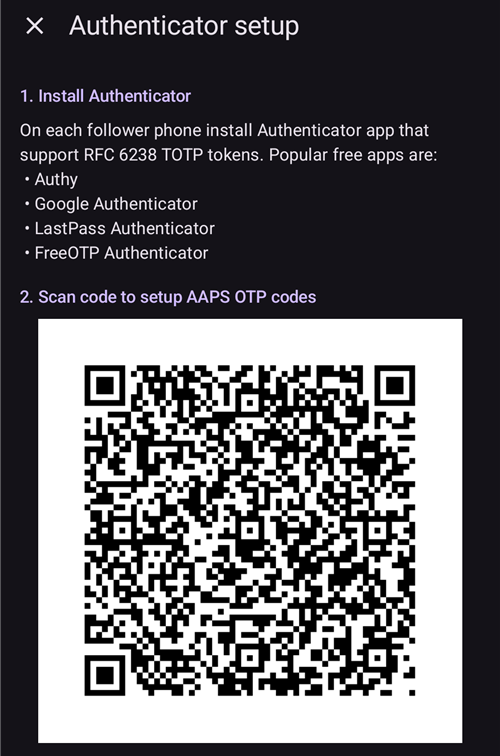
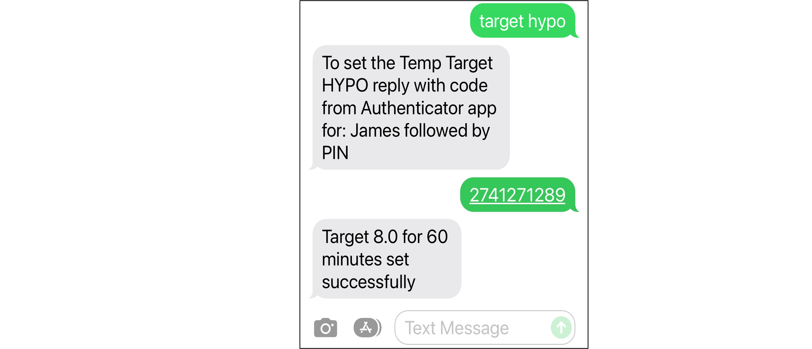

# SMS príkazy

```{contents} Table of contents
:depth: 2
```

Väčšinu úprav na diaľku (dočasné ciele, sacharidy, prepnutia profilu a po spárovaní klienta aj bolusy) môžete urobiť pomocou aplikácie [**AAPSClient**](../RemoteFeatures/RemoteMonitoring.md) v telefóne s Androidom a pripojením na internet, pozrite [Ovládanie Master ↔ Client](#client-master-control) (verzia **AAPSClient** pre iPhone sa vyvíja, pozrite [AAPSClient](AapsClient.md)). SMS príkazy zostávajú alternatívou, ktorá funguje bez internetu, a jedinou možnosťou na diaľku, ak ako sledujúci používate iPhone a ešte nemáte **AAPSClient**.

**SMS príkazy sú veľmi užitočné:**
1. Na bežné ovládanie na diaľku

2. Ak chcete podať bolus inzulínu na diaľku bez spárovaného **AAPSClient**

3. V oblasti so slabým pripojením na internet, kde SMS správy prejdú, ale dátové/internetové pripojenie telefónu je obmedzené. Je to veľmi užitočné pri cestách do odľahlých oblastí (napr. kempovanie, lyžovanie).

4. Ak váš iný spôsob ovládania na diaľku (**AAPSClient**) dočasne nefunguje

## Bezpečnosť na prvom mieste

Ak povolíte **SMS komunikátor** v **AAPS**, myslite na to, že telefón nastavený na posielanie príkazov na diaľku môže niekto ukradnúť alebo ho môže použiť niekto iný. Telefón vždy zamknite aspoň kódom PIN. Dôrazne odporúčame silné heslo a/alebo biometrický zámok. Uistite sa, že sa líši od vášho hlavného hesla APK (heslo, ktoré je potrebné na export nastavení **AAPS**).

Ďalej odporúčame povoliť pre SMS príkazy aj [druhé telefónne číslo](#SMSCommands-authorized-phone-numbers). Takto môžete druhým číslom [vypnúť](#SMSCommands-other) SMS komunikátor, ak by bol váš hlavný telefón na ovládanie na diaľku zneužitý.

Predvolený minimálny čas medzi príkazmi na bolus je 15 minút. Z bezpečnostných dôvodov musíte pridať aspoň dve povolené telefónne čísla, aby ste mohli tento čas skrátiť. Ak sa pokúsite znova podať bolus na diaľku do 15 minút od predchádzajúceho bolusu, dostanete odpoveď „Diaľkovo ovládaný bolus nie je momentálne povolený. Skúste to neskôr.“

AAPS vás tiež SMS správou informuje, či boli vaše príkazy na diaľku, napríklad bolus alebo zmena profilu, vykonané. Je vhodné nastaviť to tak, aby sa potvrdzovacie SMS posielali aspoň na dve rôzne telefónne čísla pre prípad, že by niekto ukradol jeden z prijímajúcich telefónov.

**If you bolus through SMS Commands, you must enter carbs separately (second SMS, AAPSClient...)!** If you fail to do so, the IOB would be correct with too low COB, potentially leading to not performed correction bolus as **AAPS** assumes that you have too much active insulin.

Pri citlivých príkazoch sa na zvýšenie bezpečnosti musí použiť aplikácia Authenticator s časovo obmedzeným jednorazovým heslom.

Ak chcete telefónu opatrovateľa odobrať možnosť posielať SMS príkazy, použite v **AAPS** núdzové tlačidlo „[Resetovať autentifikátory](#sms-commands-authenticator-setup)“ alebo pošlite SMS príkaz „[SMS stop](#SMSCommands-other)“. Resetovaním autentifikátorov urobíte VŠETKY telefóny opatrovateľov neplatnými. Budete ich musieť nastaviť znova.

## Nastavenie SMS príkazov

```{contents} The overall process is as follows
:depth: 1
:local: true
```

(sms-commands-authenticator-setup)=
### Nastavenie autentifikátora

Na zvýšenie bezpečnosti sa používa dvojfaktorové overenie.

Na telefón opatrovateľa stiahnite (z App Store alebo Google Play) a nainštalujte aplikáciu Authenticator. Obľúbené bezplatné aplikácie sú:
  - [Authy](https://authy.com/download/)
  - Google Authenticator - [Android](https://play.google.com/store/apps/details?id=com.google.android.apps.authenticator2) / [iOS](https://apps.apple.com/de/app/google-authenticator/id388497605)
  - [LastPass Authenticator](https://lastpass.com/auth/)
  - [FreeOTP Authenticator](https://freeotp.github.io/)

Tieto aplikácie Authenticator vytvárajú časovo obmedzené jednorazové 6-miestne heslo, podobne ako pri mobilnom bankovníctve alebo nakupovaní. Môžete použiť aj inú aplikáciu Authenticator, ak podporuje tokeny TOTP podľa RFC 6238. Microsoft Authenticator nefunguje.

### Kontrola nastavení telefónu

V telefóne prejdite do **Aplikácie > AAPS > Povolenia** (Permissions). Uistite sa, že **SMS** a **Telefón** (Phone) sú povolené.


```{admonition} "App was denied access to SMS"
:class: tip
Android môže blokovať povolenie **SMS** pre aplikácie, ktoré neboli nainštalované z obchodu s aplikáciami, ako je **AAPS**. Ak sa vám pri udeľovaní povolenia **SMS** zobrazí táto správa, otvorte v telefóne **Nastavenia > Aplikácie > AAPS**, ťuknite na ponuku **⋮** (vpravo hore) a vyberte **Povoliť obmedzené nastavenia** (Allow restricted settings). Potom povolenie **SMS** udeľte znova.
```


### Synchronizácia dátumu a času

Čas na oboch telefónoch musí byť synchronizovaný. Najlepšie je nastaviť ho automaticky zo siete. Rozdiely v čase môžu spôsobiť problémy s overením.

Na telefóne s **AAPS** aj na telefóne opatrovateľa skontrolujte, či sú dátum a čas synchronizované. Presný postup závisí od vášho zariadenia, možno budete musieť vyskúšať rôzne nastavenia.

Príklad (pre Samsung S23): **Nastavenia > Všeobecná správa > Dátum a čas** (Date and time): uistite sa, že je zapnutá možnosť **Automatický dátum a čas** (Automatic date and time).

Niektoré možnosti môžu byť sivé (neaktívne), pretože ak je telefón nastavený ako detský účet, potrebujú správu cez rodinný účet. Na iPhone opatrovateľa/rodiča sa toto nastavenie dátumu a času volá „Nastaviť automaticky“ (Set automatically). Ak si nie ste istí, či ste telefóny synchronizovali, nebojte sa. SMS príkazy môžete nastaviť a problémy riešiť až potom, ak sa ukáže, že spôsobujú problémy (v prípade potreby požiadajte o pomoc).

### Nastavenia AAPS

Keď ste skontrolovali nastavenia telefónu, v samotnej aplikácii **AAPS** prejdite do [**Konfigurácia** → **Komunikácia**](../SettingUpAaps/ConfigBuilder.md) a povoľte plugin **SMS komunikátor**.

Otvorte nastavenia **SMS komunikátora**.

Zapnite **Povoliť príkazy na diaľku cez SMS**. Možnosti **Ďalší povinný kód PIN na konci tokenu** a **Nastavenie autentifikátora** sa zobrazia až potom, ako to zapnete:


(SMSCommands-authorized-phone-numbers)=
#### Povolené telefónne čísla

Zadajte telefónne číslo (čísla) opatrovateľa. Uveďte kód krajiny a vynechajte prvú „0“ telefónneho čísla, ako v týchto príkladoch:
* Telefónne číslo vo Veľkej Británii: +447976304596
* Telefónne číslo v USA: +11234567890
* Telefónne číslo vo Francúzsku:  +33612344567
* _atď._

„+“ pred číslom môže, ale nemusí byť potrebné, podľa toho, kde sa nachádzate. Aby ste to zistili, pošlite skúšobnú SMS. Na obrazovke pluginu **SMS komunikátor** (**Konfigurácia** → **Komunikácia** → **SMS komunikátor** → **Otvoriť plugin**) uvidíte, v akom formáte prišla.

Ak pridávate viac telefónnych čísel, oddeľte ich bodkočiarkami **BEZ medzery medzi číslami** (to je veľmi dôležité!). Vyberte **OK**:


#### Minimálna vzdialenosť pre bolus na diaľku

- Môžete nastaviť minimálny čas (v minútach) medzi dvoma bolusmi poslanými cez SMS.
- Z bezpečnostných dôvodov musíte pridať aspoň dve povolené telefónne čísla, aby ste mohli túto hodnotu upraviť.

#### Ďalší povinný kód PIN na konci tokenu

Z bezpečnostných dôvodov musí za kódom odpovede nasledovať PIN. Zvoľte PIN, ktorý budete vy (a ďalší opatrovatelia) zadávať na konci kódu z aplikácie Authenticator pri posielaní SMS príkazu.

Požiadavky na PIN:

* at least 6 digits
* digits only

For a safer PIN, do not use the same digit many times (_e.g._ 111111) or a sequence (_e.g._ 123456).


#### Nastavenie autentifikátora

* Ťuknite na **Nastavenie autentifikátora** a postupujte podľa pokynov na obrazovke.
* Otvorte nainštalovanú aplikáciu Authenticator na _telefóne opatrovateľa_, nastavte nové pripojenie a
* Telefónom opatrovateľa naskenujte QR kód, ktorý sa zobrazí pod **Naskenujte kód pre nastavenie AAPS OTP kódov**.



* V časti **Otestujte jednorázové heslo** zadajte do poľa **Kód pre kontrolu** jednorazový kód z aplikácie Authenticator v telefóne opatrovateľa a za ním váš PIN:

Example:
* Token z aplikácie Authenticator je 457051
* Váš povinný PIN je 2401
* Kód pre kontrolu: 4570512401

If the entry is correct, the red text “WRONG PIN” will change automatically to a green “OK”. **There is no button you can press!** The process is now complete, there is no “OK” button you need to press after entering the code:


You should now be set up with SMS commands.

Use the **Reset Authenticators** button at the bottom of the **Authenticator setup** screen if you want to remove provisioned authenticators. (By resetting authenticator you make ALL already provisioned authenticators invalid. You will need to set them up again.)

## Používanie SMS príkazov

### Prvé kroky s SMS príkazmi

1)  To check you have set everything up correctly, test the connection by typing “bg” as an SMS message from the caregiver phone to the **AAPS** phone. You should get a response similar to that shown here:


If you don't receive any response, check the [Troubleshooting](#SMSCommands-troubleshooting) section below.

2)  Now try an SMS command that requires the authenticator, _e.g._ “target hypo”. The caregiver’s phone will receive a text back, prompting you to enter the **six-digit authenticator password** from the authenticator app, followed by the additional secret **PIN** known only by caregivers/followers (a string of twelve digits in total, assuming your PIN has 6 digits).

When you try sending an SMS command for the first time, try it in the presence of the **AAPS** phone, to see how it works:


The caregiver’s phone will receive an SMS in reply from **AAPS** to confirm if the remote SMS command has been carried out successfully.

If your command is successful, you will receive a reply to confirm this. If there is a problem you will receive an error message. See [Troubleshooting](#SMSCommands-troubleshooting) below for common errors.

**Hint**: It can be useful to have unlimited SMS on your phone plan (for each phone used) if a lot of SMS will be sent.

### Podávanie bolusov k jedlu pomocou SMS príkazov

Remote bolusing of insulin can be done via **SMS Commands** or through a paired **AAPSClient** (see [Master ↔ Client control](#client-master-control)); it cannot be done through the Nightscout website. Carbs can be announced through SMS or **AAPSClient** as well. With SMS, it is not possible to send both carbs and insulin commands in one single SMS message. These commands must be sent separately as follows:

1)  Send the insulin bolus (_e.g._“bolus 2” will command a bolus of 2 units) through SMS commands is equivalent to **Treatments** → **Insulin** in **AAPS**. 2)  Send the carbs (_e.g._ “carbs 20” will announce 20g of carbs). This is equivalent to **Treatments** → **Carbs** in **AAPS**.

To avoid hypos, it is a good idea to start conservatively, by bolusing **less insulin** than would be needed according to your carb ratio, because you are not taking into account the current glucose level or glucose trend.

**The order in which you send these commands is important**. If you announce a large amount of carbs by any route, and have SMBs enabled, **AAPS** may immediately respond by giving a partial bolus of insulin. So, if you then try to send an insulin bolus _after_ announcing the carbs, you may have a frustrating delay and a “bolus in progress” message, and you then need to check what has been given as an SMB. Or, if you do not realise an SMB is being delivered, and your own subsequent bolus is also successful, too much insulin may be delivered for the meal overall. Therefore, if bolusing for meals remotely, always send the insulin bolus _before_ the carb announcement. If you prefer, you can combine **AAPSClient** with SMS commands: carbs entered on a paired **AAPSClient** need no authentication code and are therefore quicker than SMS commands. Carbs or other treatments entered on the Nightscout website are **not** applied while client control is on; **AAPS** is then in [hardened mode](#client-master-control-hardened-mode).

(SMSCommands-commands)=
## Príkazy

```{contents} List of command groups
:depth: 1
:local: true
```

Commands must be sent in English, the response will be in your local language if the response string is already [translated](#translations-translate-strings-for-AAPS-app). The commands are not case-sensitive, you can use lower or upper case.


The **SMS Commands Tables** below show all the possible SMS commands. _Example values_ are given, to aid understanding. The commands have the same range of possible values (targets, percent profile etc.) which are allowable in the **AAPS** app itself.

(authentication-or-not)=
### S overením alebo bez neho?

Some SMS commands give an immediate response, and some SMS commands require strong **authentication** through the Authenticator app. A simple enquiry like “**BG**” (which requests an update on current glucose) is quick to type, doesn't need authenticating, and returns the **AAPS** status information shown below:


Commands which need more security require a code to be entered, for example:



The *Auth* column in the tables below, indicates whether such a strong authentication is required for each command.

### Dáta CGM

| Príkaz     | Overenie | Funkcia a *odpoveď*                                                                                                                                                                     |
| ---------- | -------- | --------------------------------------------------------------------------------------------------------------------------------------------------------------------------------------- |
| BG         | Nie      | Vráti: poslednú glykémiu, rozdiel, IOB (bolus a bazál), COB<br/>*Posledná glykémia: 5.6 pred 4 min, Rozdiel: -0,2 mmol, IOB: 0.20U (Bolus: 0.10U Bazál: 0.10U)*                   |
| CAL 5.6/90 | Áno      | Kalibruje CGM hodnotou 5.6/90<br/>(použite hodnotu podľa vašich jednotiek glykémie)<br/>Funguje, iba ak je to v **AAPS** správne nastavené.<br/>*Kalibrácia odoslaná* |

### Pumpa

| Príkaz               | Overenie | Funkcia a *odpoveď*                                                                                   |
| -------------------- | -------- | ----------------------------------------------------------------------------------------------------- |
| PUMPA                | Nie      | Last conn: 1 min ago<br/>Temp: 0.00U/h @11:38 5/30min<br/>IOB: 0.5U Reserv: 34U Batt: 100 |
| PUMP DISCONNECT *30* | Áno      | Odpojí pumpu na *30* minút                                                                            |
| PUMP CONNECT         | Áno      | Pumpa bola znovu pripojená                                                                            |

### Bazál

| Príkaz            | Overenie | Funkcia a *odpoveď*            |
| ----------------- | -------- | ------------------------------ |
| BASAL 0.3         | Áno      | Spustí bazál 0,3 U/h na 30 min |
| BASAL 0.3 20      | Áno      | Spustí bazál 0,3 U/h na 20 min |
| BASAL 30%         | Áno      | Spustí bazál 30 % na 30 min    |
| BASAL 30% 50      | Áno      | Spustí bazál 30 % na 50 min    |
| BASAL STOP/CANCEL | Áno      | Zastaví dočasný bazál          |

Some pumps take a temp basal only in percent, others only in U/h. If you use the other form, **AAPS** answers *"This pump takes a temp basal only in percent, not in U/h."* (or the reverse) and sets nothing. The duration must be a multiple of your pump's temp basal duration step.


### Okruh

| Príkaz            | Overenie | Funkcia a *odpoveď*                                                                                                                                                                                                                                                                         |
| ----------------- | -------- | ------------------------------------------------------------------------------------------------------------------------------------------------------------------------------------------------------------------------------------------------------------------------------------------- |
| LOOP STATUS       | Nie      | Odpoveď závisí od aktuálneho stavu:<br/> - *Uzavretý okruh je deaktivovaný*, ak je okruh deaktivovaný alebo v režime LGS<br/> - *Uzavretý okruh je aktivovaný*, ak je okruh uzavretý alebo otvorený<br/> - *Pozastavený (10 min)*, ak je okruh odpojený alebo pozastavený |
| LOOP STOP/DISABLE | Áno      | Pumpa sa vráti k naprogramovanej bazálnej dávke.<br/>*Uzavretý okruh bol deaktivovaný*                                                                                                                                                                                                |
| LOOP SUSPEND 20   | Áno      | *Uzavretý okruh pozastavený na 20 minút*                                                                                                                                                                                                                                                    |
| LOOP RESUME       | Áno      | *Uzavretý okruh obnovený*                                                                                                                                                                                                                                                                   |
| LOOP CLOSED       | Áno      | *Aktuálny režim okruhu: Uzavretý okruh*                                                                                                                                                                                                                                                     |
| LOOP LGS          | Áno      | *Aktuálny režim okruhu: Ochrana pred nízkou glykémiou*                                                                                                                                                                                                                                      |

### Bolus

Remote bolus is not allowed within 15 min (this value is editable only if 2 phone numbers added) after last bolus command or remote commands! In this case, the response would be *Remote bolus not available. Try again later.* This response is also sent when the pump is currently delivering a bolus.

| Príkaz               | Overenie | Funkcia a *odpoveď*                                                                                                                                               |
| -------------------- | -------- | ----------------------------------------------------------------------------------------------------------------------------------------------------------------- |
| BOLUS 1.2            | Áno      |                                                                                                                                                                   |
| BOLUS 0.60 MEAL      | Áno      | Podá zadaný bolus 0,60 U<br/>**a** nastaví [dočasný cieľ Pred jedlom](#TempTargets-eating-soon-temp-target)                                                 |
| CARBS 5              | Áno      | Zadá 5 g sacharidov bez bolusu                                                                                                                                    |
| CARBS 5 17:35/5:35PM | Áno      | Zadá 5 g o 17:35.<br/>Prijateľný formát času závisí<br/> od nastavenia času (12 h/24 h) v telefóne.                                                   |
| EXTENDED 2 120       | Áno      | Spustí predĺžený bolus 2 U na 120 min.<br/>Iba pre [kompatibilné pumpy](#Extended-Carbs-extended-bolus-and-switch-to-open-loop-dana-and-insight-pump-only). |
| EXTENDED STOP/CANCEL | Áno      | Zastaví predĺžený bolus                                                                                                                                           |

### Profil

| Príkaz         | Overenie | Funkcia a *odpoveď*                                                                                                                                     |
| -------------- | -------- | ------------------------------------------------------------------------------------------------------------------------------------------------------- |
| PROFILE STATUS | Nie      | Aktuálny profil a percento                                                                                                                              |
| PROFILE LIST   | Nie      | Aktuálny zoznam profilov v **AAPS**, napr.:<br/>1. Profile1<br/> 2. Profile2                                                                |
| PROFILE 1      | Áno      | Prepne profil na profil 1 v zozname.<br/>Použite čísla, ktoré vráti príkaz **PROFILE LIST**,<br/>nie názvy, pod ktorými ste profily uložili |
| PROFILE 2 30   | Áno      | Prepne profil na Profile2 s 30 %                                                                                                                        |

The percentage must be between 30 and 250 %, as in the app. A value outside this range is refused before you are asked for the authentication code.

### Dočasné ciele

| Príkaz                    | Overenie | Funkcia a *odpoveď*                     |
| ------------------------- | -------- | --------------------------------------- |
| TARGET MEAL/ACTIVITY/HYPO | Áno      | Nastaví dočasný cieľ MEAL/ACTIVITY/HYPO |
| TARGET STOP/CANCEL        | Áno      | Zruší dočasný cieľ                      |


(SMSCommands-other)=
### Iné

| Príkaz           | Overenie | Funkcia a *odpoveď*                                                                                                                                                                                                                                                |
| ---------------- | -------- | ------------------------------------------------------------------------------------------------------------------------------------------------------------------------------------------------------------------------------------------------------------------ |
| RESTART          | Áno      | Reštartuje AAPS. Užitočné pri problémoch, ktoré sa zvyčajne vyriešia reštartom.                                                                                                                                                                                    |
| SMS DISABLE/STOP | Áno      | To disable the SMS Remote Service, reply with the code.<br/>Keep in mind that you'll be able to reactivate it directly<br/>from the **AAPS** master smartphone only.                                                                                   |
| HELP             | Nie      | Vráti všetky funkcie, na ktoré sa môžete opýtať:<br/>BG, LOOP, PUMP, BASAL, BOLUS, EXTENDED, CAL, PROFILE, TARGET, SMS, CARBS, HELP, RESTART<br/>Ďalším príkazom ***HELP ***FUNCTION****** zobrazíte<br/>všetky možnosti dostupné v tejto časti. |
| HELP BOLUS       |          | *BOLUS 1.2<br/>BOLUS 1.2 MEAL*                                                                                                                                                                                                                               |

(SMSCommands-troubleshooting)=
## Riešenie problémov a časté otázky

```{contents} List of questions and issues
:depth: 1
:local: true
```

### Čo _nemôžeme_ robiť pomocou SMS príkazov?

1)  **You cannot set a _temporary_ profile switch** (so for example, setting "profile exercise" for 60 minutes), although you can permanently switch to “profile exercise”. Temporary profile switches can instead be set through **AAPSClient**.

2)  **You cannot cancel automations** or **set user-defined targets** but there are approximate solutions: As an example, imagine the normal profile target is 5.5. You have set an automation in AAPS, to always set a high target of 7.0 between 2.30pm and 3.30pm because of a sports class in school, and a condition of the automation is that “no temp target exists”. This week, you have been told at short notice that the sports class is cancelled, and is being replaced by a pizza-eating session, but your kid is already at school with the **AAPS** phone. If the high temporary target of 7.0 is started by the automation, and you cancel it (on the **AAPS** phone, or remotely) the conditions for the automation are still met and **AAPS** will simply set the high target again, a minute later.

**If you did have access to the AAPS phone**, you could uncheck/modify the automation, or, if you don’t want to do that, you could simply set a new temp target of 5.6 for 60 min by pressing on the target on the main screen, or via **Manage** → **Temp Target**. This would prevent the automation from setting the high target of 7.0.

**If you don’t have access to the AAPS phone** SMS commands can be used for an approximate fix: for example, by using the command “target meal” to set a target of 5.0 for 45 mins (other default targets are 8.0 for activity or hypo, see Table). However, with SMS commands you cannot specify a _specific_ value target value (of 5.6 for 60 minutes, for example), you would need to use **AAPSClient** to do this.

### Čo sa stane, ak si to s práve poslaným príkazom rozmyslím?

**AAPS** will only deliver on the most recent command. So, if you type “bolus 1.5”, and then, without authenticating, you send a new command “bolus 1”, it will ignore the earlier 1.5 command. **AAPS** will always send the caregiver's phone a response to confirm what the SMS command is before you are prompted to enter the authentication code, as well as a response following the action.

### Prečo som nedostal(a) odpoveď na SMS príkaz?

It could be for one of these reasons:

1)  The message has not got through to the phone (network issues). 2)  **AAPS** is still in the process of processing the request (_e.g._ a bolus, which can take some time to deliver depending on your bolus rate). 3)  The **AAPS** phone does not have a good Bluetooth connection to the pump when the command is received, and the command has failed (this usually creates an alarm on the **AAPS** phone).

### Žiadna odpoveď na SMS príkazy

On the caregiver phone and/or **AAPS** phone, try disabling the following options :
* **Send as chat message** 
* Ak používate aplikáciu Android Messages alebo Google Messages (Správy), vypnite správy RCS:
  - otvorte konkrétnu SMS konverzáciu v aplikácii Správy
  - Vyberte ponuku možností (tri bodky) v pravom hornom rohu
  - vyberte „Podrobnosti“ (Details)
  - Zapnite „Only send SMS and MMS messages“ (posielať iba správy SMS a MMS) 

### Chyby pri vykonávaní príkazov

There are several possible reasons the command may not be successful:

* Nastavenie SMS príkazov nie je dokončené/správne
* Poslali ste príkaz v nesprávnom formáte (napríklad „disconnect pump 45“ namiesto „pump disconnect 45“)
* Použili ste nesprávny alebo neplatný kód z aplikácie Authenticator (zvyčajne je dobré počkať pár sekúnd na nový kód, ak aktuálnemu kódu čoskoro vyprší platnosť)
* Kód + PIN boli v poriadku, ale SMS sa pri odoslaní/doručení oneskorila, takže **AAPS** vyhodnotil, že platnosť kódu z aplikácie Authenticator vypršala
* Telefón s **AAPS** je mimo dosahu pumpy alebo s ňou stratil spojenie
* Systém práve podáva bolus

Common errors are shown in the examples below:


### Ako môžem zastaviť príkaz, ktorý už bol overený?

You can't. However, you can cancel a bolus sent by SMS on the **AAPS** phone itself, by simply cancelling it on the bolusing popup, if you are quick. Many SMS commands (apart from bolusing and carb announcements) can be easily reversed, or actions taken to mitigate unintended effects if a mistake is made.

For errors in bolusing and carb announcements, you can still take action. For example, if you have announced 20g carbs but your child only eats 10g and you (or an onhand caregiver) is unable to delete the treatment in the **AAPS** phone directly, you could set a high temporary target, or set a reduced profile, to encourage **AAPS** to be less aggressive.

### Viacnásobné SMS

If you receive the same message repeatedly (_e.g._ a profile switch) you may have accidentally set up a looping condition with other apps. This could be xDrip, for example. If so, please ensure that xDrip (or any other app) does not upload treatments to NightScout.

If the other app is installed on multiple phones make sure to deactivate upload on all of them.

(sms-commands-too-many-messages)=
### Dostávam od SMS príkazov až príliš veľa SMS správ. Môžem ich obmedziť alebo vypnúť?

Using SMS commands may generate a lot of automated messages from the **AAPS** phone to the caregiver’s phone. You will also receive messages, for example “basal profile in pump updated” if you have automations set up in **AAPS**. It can be useful to have unlimited SMS allowance on your **AAPS** phone plan (and for each caregiver phone used) if a lot of SMS will be sent, and to deactivate SMS notifications, alarms or vibrations on all phones. It is not possible to use SMS commands and not receive these updates. Because of this, you may want an alternative way to communicate directly with your child (if they are old enough), instead of SMS. Common alternative communication apps used by **AAPS** caregivers include Whatsapp, Lime, Telegram, and Facebook Messenger.

It is possible to disable the "Profile changed" SMS, when the Profile change originated from Nightscout. To do this, create a file named **exactly**  `do_not_send_sms_on_profile_change` in the `extra` dir of your AAPS directory.
