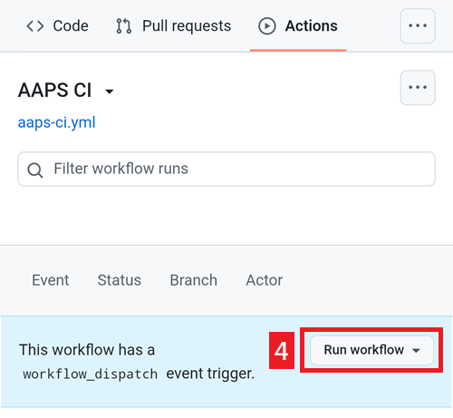

(github-build-apk)=

# Zostavenie v prehliadači – Krok 4: Zostavte APK

```{note}
Toto je **krok 4** návodu [Zostavenie v prehliadači](BrowserBuild.md). Najprv dokončite [krok 3 – Autorizujte Disk Google](BrowserBuildGoogleDrive.md).
```

## Zostavenie AAPS APK pomocou AAPS-CI v GitHub Actions
 - Vhodné pre bežných používateľov.

```{tab-set}

:::{tab-item} Wiki
### Spustite workflow na zostavenie podpísaného APK

1. Vo svojej kópii AndroidAPS na GitHube vyberte Actions.
2. Rozbaľte All Workflows.
3. Vyberte AAPS-CI


4. Posuňte sa nadol a ťuknite na Run Workflow.



5. Pole **Use workflow from** nechajte na vetve master. V poli **Select AAPS Version** vyberte verziu **AAPS**, ktorú chcete zostaviť (zvyčajne najnovšiu). Vyberte [variant](#browserbuild-variant) (fullRelease) a ťuknite na Run workflow.


6. Zobrazí sa správa Workflow run was successfully requested. Obnovte stránku v prehliadači a budete môcť sledovať priebeh zostavenia. Keď sa akcia dokončí, pri akcii AAPS CI sa zobrazí zelená fajka. Úspešne ste zostavili aktualizovanú verziu AndroidAPS.


### Inštalácia AAPS APK

1. Otvorte svoj Disk Google
2. Prejdite do priečinka AAPS, vyberte priečinok s novou verziou a nájdete v ňom verziu pre telefón aj pre Android Wear.


:::

:::{tab-item} Video
<div align="center" style="max-width: 360px; margin: auto; margin-bottom: 2em;">
  <div style="position: relative; width: 100%; aspect-ratio: 9/16;">
    <iframe
      src="https://geo.dailymotion.com/player/x9rdwms.html?video=x9rdwms&loop=true&mute=true"
      loading="lazy"
      style="position: absolute; top: 0; left: 0; width: 100%; height: 100%;"
      frameborder="0"
      allowfullscreen>
    </iframe>
  </div>
</div>
:::  

```

## Výber verzie na zostavenie

**Spôsobom v prehliadači sa dajú zostaviť iba verzie AAPS 3.3.2.1 a novšie.**

Ťuknite na **Select AAPS Version** a vyberte verziu, ktorú chcete zostaviť. Najnovšia verzia je na začiatku zoznamu.


(browserbuild-variant)=

## Výber variantu zostavenia

*Poznámka: aplikácie pre Android aj pre Android Wear sa zostavia automaticky.*

  - Vyberte si variant, ktorý potrebujete:
    - fullRelease: Pre bežné používanie pumpy s plnou funkčnosťou.
    - [aapsclientRelease, aapsclient2Release, aapsclient3Release](#RemoteControl_aapsclient): pre opatrovateľov (vyžaduje [Nightscout](../SettingUpAaps/Nightscout.md)). `aapsclient3Release` zostaví **AAPSClient3**, ktorý je dostupný od verzie **AAPS** 4.0 (pozrite [O AAPSClient, AAPSClient2 a AAPSClient3](#remotecontrol-aapsclient-versions)).
    - pumpcontrolRelease: ako náhrada aplikácie alebo ovládača vašej pumpy


Variants ending with “Debug” indicate that the APK will be built in debug mode, which is useful for developers for troubleshooting.

<!-- If you want to test the items in a pull request has been moved to dev page /AdvancedOptions/DevBranch.md -->

----

Po úspešnom zostavení sa APK uloží na váš Disk Google. Pokračujte stránkou [Prenos a inštalácia AAPS](TransferringAndInstallingAaps.md).

```{note}
Od septembra 2026 môže [overovanie vývojárov pre Android](#android-developer-verification) od Googlu v závislosti od vašej krajiny zablokovať inštaláciu APK ťuknutím na súbor. Bezplatné riešenia sú vysvetlené na tej stránke.
```

Ak zostavenie zlyhá, najprv [zistite v logu zostavenia, čo sa pokazilo](#aaps-ci-read-the-logs), a potom si pozrite stránku [Zostavenie v prehliadači: riešenie problémov](../GettingHelp/BrowserBuildTroubleshooting.md). Ak chcete do zostavenia zahrnúť konkrétny commit, pozrite si časť [Cherry-pick commitu](#github-cherry-pick).
