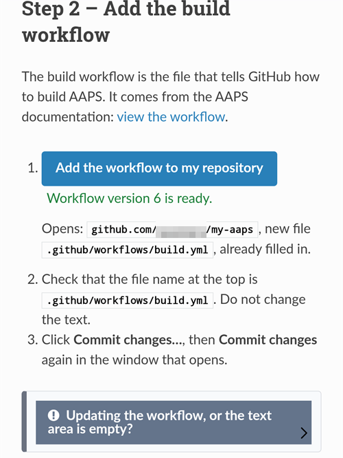

(aaps-builder)=

# Zostavenie v prehliadači pomocou AAPS Builder

```{note}
Toto je odporúčaný spôsob, ako zostaviť AAPS z **telefónu s Androidom**. Funguje aj z prehliadača na akomkoľvek počítači. Ďalšie spôsoby zostavenia z počítača alebo z iPhonu nájdete v prehľade [Zostavenie v prehliadači](BrowserBuild.md).
```

```{contents} In this page
:backlinks: entry
:depth: 2
```

**AAPS Builder** za vás zostaví aplikáciu AAPS na GitHube, bezplatnej webovej stránke na ukladanie kódu. Do telefónu nemusíte nič inštalovať a nemusíte otvárať žiadny prípravný súbor.

Celým postupom vás prevedie stránka nastavenia na tejto webovej stránke. Prvýkrát to trvá asi 10 minút:

1. Vytvorte vo svojom účte GitHub prázdny **súkromný** repozitár: stránka nastavenia otvorí GitHub so všetkým vyplneným, vy iba potvrdíte.
2. Pridajte **workflow zostavenia**, teda súbor, ktorý GitHubu hovorí, ako zostaviť AAPS.
3. Vytvorte alebo nahrajte svoj **podpisový kľúč** (úložisko kľúčov).
4. Odovzdajte kľúč svojmu repozitáru ako GitHub **secret**.
5. **Zostavte** aplikáciu. Jedno zostavenie trvá 15 až 30 minút.
6. **Stiahnite a nainštalujte** aplikáciu do telefónu.

**Nemusíte** vytvárať fork AndroidAPS: zdrojový kód AAPS sa pri každom zostavení stiahne z oficiálneho repozitára AndroidAPS. **Nepotrebujete** ani Disk Google: aplikáciu si stiahnete priamo z GitHubu.

```{admonition} Where the code comes from
:class: note

Stránka nastavenia a workflow zostavenia sú súčasťou tejto dokumentácie: udržiavajú sa a kontrolujú spolu s ňou. <a href="../_static/aaps-builder/aaps-builder-build.yml">Workflow</a>, ktorý pridáte do svojho repozitára, je krátky: spúšťa [kroky zostavenia](https://github.com/openaps/AndroidAPSdocs/blob/dev/.github/workflows/aaps-builder.yml) uložené v repozitári dokumentácie, pevne viazané na jednu skontrolovanú verziu. Pred použitím si môžete oboje prečítať. Pri zostavovaní workflow sťahuje iba oficiálny zdrojový kód AAPS a vlastné nástroje GitHubu na zostavenie. Vaše úložisko kľúčov nikdy neopustí váš prehliadač a váš súkromný repozitár.
```

(aaps-builder-before-you-start)=

## Skôr než začnete

Budete potrebovať:

- **Účet GitHub** (bezplatný). Ak ho nemáte, najprv si ho vytvorte na [github.com](https://github.com/signup).
- **Webový prehliadač**: Chrome v telefóne alebo akýkoľvek prehliadač v počítači. Skôr než začnete, prihláste sa v tomto prehliadači na github.com.
- **Máte v telefóne aplikáciu GitHub?** Môžete si ju nechať. Niektoré tlačidlá stránky nastavenia potom namiesto Chromu otvoria túto aplikáciu. Zostavovanie v aplikácii funguje, ale aplikácia **nedokáže stiahnuť** hotový AAPS: [krok 6](#aaps-builder-step6) ukazuje, ako na stiahnutie prepnúť do Chromu.
- Vaše **existujúce úložisko kľúčov** (súbor `.jks`), jeho heslo a jeho alias, ak ste už AAPS zostavili a chcete ho aktualizovať bez preinštalovania.

```{warning}
**Váš repozitár na zostavenie musí zostať súkromný.** Všetko, čo zostavenie vytvorí, vidí každý, kto vidí repozitár. Stránka nastavenia vám vytvorí súkromný repozitár. Nikdy ho nemeňte na verejný.

Súkromný repozitár dostane každý mesiac 2000 bezplatných minút GitHub Actions, čo stačí na niekoľko zostavení.
```

```{warning}
**Nový kľúč alebo existujúci kľúč: od toho závisí, či môžete AAPS aktualizovať.**

- **AAPS už máte v telefóne a je zostavený s úložiskom kľúčov, ktoré stále máte**: na stránke nastavenia zvoľte **I already have a keystore** (Už mám úložisko kľúčov) a nahrajte ho. Vaše ďalšie zostavenie potom aktualizuje existujúci AAPS. Zostavili ste AAPS predchádzajúcim spôsobom zostavenia v prehliadači (vlastný fork)? Vaše úložisko kľúčov je vo vašom forku: [najprv si z neho vytvorte kópiu](#aaps-builder-from-fork).
- **AAPS zostavujete prvýkrát alebo ste stratili úložisko kľúčov či jeho heslo**: zvoľte **Create a new key** (Vytvoriť nový kľúč). Aplikácia podpísaná novým kľúčom **nemôže aktualizovať** AAPS podpísaný iným kľúčom. Musíte exportovať nastavenia, skopírovať súbor mimo telefón, odinštalovať starý AAPS, nainštalovať nový a potom importovať nastavenia: pozrite [Preinštalovanie AAPS s novým úložiskom kľúčov](#reinstall-aaps).

Potom vždy používajte ten istý kľúč. Keď vytvoríte nový kľúč, stiahnite zálohu, ktorú stránka ponúkne, a uložte ju spolu s heslom a aliasom (`key0`) na bezpečné miesto mimo telefónu.
```

(aaps-builder-from-fork)=

## Prechod z predchádzajúceho zostavenia v prehliadači (fork)

Túto časť preskočte, ak ste nikdy nezostavovali AAPS predchádzajúcim spôsobom zostavenia v prehliadači (vlastná kópia AndroidAPS na GitHube, teda fork, s prípravným súborom a Diskom Google).

Vaše úložisko kľúčov je vo vašom forku uložené ako secrety. GitHub secret už nikdy znova neukáže, preto ho nemôžete skopírovať do nového repozitára. Najprv si vytvorte kópiu úložiska kľúčov a potom ju použite v [kroku 3](#aaps-builder-step3) s voľbou **I already have a keystore**.

```{warning}
Nevyberajte **Create a new key**. AAPS zostavený s novým kľúčom nemôže aktualizovať AAPS vo vašom telefóne.
```

Ktorý prípad je váš?

- **Použili ste Možnosť 2** (nahrali ste vlastné úložisko kľúčov z Android Studia) a stále máte súbor `.jks`, jeho heslá a jeho alias: tu nemusíte nič robiť. Tento súbor použite v kroku 3.
- **Použili ste Možnosť 1** (kľúč vytvoril prípravný súbor) alebo už súbor úložiska kľúčov nemáte: exportujte ho zo svojho forku podľa postupu nižšie.

Export úložiska kľúčov z forku:

1. Vo svojom forku otvorte **Settings** → **Secrets and variables** → **Actions** a pridajte secret s názvom `ZIP_PASSWORD`. Zvoľte heslo iba z anglických písmen a číslic. Chráni súbor, ktorý idete vytvoriť.
2. Otvorte kartu **Actions** svojho forku, ťuknite na **CI Keystore Export** a potom na **Run workflow**. Viac podrobností: [Export úložiska kľúčov](#ci-keystore-export).
3. Keď má beh zelenú fajku, otvorte svoj Disk Google: súbor `keystore.zip` je v priečinku **AAPS** → **KeyStore**. Ak beh zlyhá v kroku Disku Google, prístup vášho forku k Disku Google vypršal: pozrite [Platnosť obnovovacieho tokenu Google vypršala](#aaps-ci-google-token-expired).
4. Stiahnite `keystore.zip` a otvorte ho heslom `ZIP_PASSWORD`: v počítači alebo v telefóne pomocou správcu súborov, ktorý vie otvoriť ZIP súbory chránené heslom. Obsahuje:
   - `keystore.jks`: vaše úložisko kľúčov,
   - `keyStoreInfo.txt`: vaše `KEYSTORE_PASSWORD`, `KEY_PASSWORD` a `ALIAS` (zvyčajne `key0`).
5. Skopírujte `keystore.jks` do telefónu (alebo na Disk Google, aby ste ho mohli vybrať odtiaľ).

V [kroku 3](#aaps-builder-step3) stránky nastavenia:

1. Ťuknite na **I already have a keystore**.
2. V poli **Keystore file** zvoľte `keystore.jks`.
3. Do poľa **Keystore password** zadajte `KEYSTORE_PASSWORD` zo súboru `keyStoreInfo.txt`.
4. V poli **Key alias** vyberte alebo zadajte `ALIAS` zo súboru `keyStoreInfo.txt`.
5. Ak sa `KEY_PASSWORD` líši od `KEYSTORE_PASSWORD`, zrušte zaškrtnutie **Key password is the same as the keystore password** a zadajte `KEY_PASSWORD`.

Súbor `keystore.zip` a jeho `ZIP_PASSWORD` uchovávajte na bezpečnom mieste mimo telefónu: je to záloha vášho kľúča.

Ani prístup vášho forku k Disku Google sa nedá skopírovať. Ak chcete zostavenia z AAPS Builder ukladať aj na Disk Google, urobte [krok 7](#aaps-builder-google-drive). Svoj fork si môžete ponechať, kým nebudete mať v telefóne nainštalovaný AAPS zostavený pomocou AAPS Builder.

## Otvorte stránku nastavenia

**→ [Otvoriť stránku nastavenia AAPS Builder](#aaps-builder-setup)**

Nechajte túto stránku dokumentácie otvorenú: dlho podržte prst na odkaze vyššie a zvoľte **Otvoriť na novej karte**. Nasledujúce kroky podrobnejšie vysvetľujú každú časť stránky nastavenia.

Stránka nastavenia otvára každú stránku GitHubu na novej karte Chromu. Ak sa chcete vrátiť na stránku nastavenia, ťuknite na tlačidlo kariet vedľa panela s adresou v Chrome (štvorček s číslom) a zvoľte stránku nastavenia AAPS Builder.

Stránka nastavenia beží celá vo vašom prehliadači: váš kľúč a heslá sa nikam neposielajú, okrem GitHub secretu, do ktorého ich sami vložíte. Only your GitHub username is sent to GitHub, to check that it exists. Pamätá si vaše používateľské meno na GitHube a názov repozitára, takže sa k nej môžete kedykoľvek vrátiť a znova otvoriť stránku so secretmi alebo svoje zostavenia.


(aaps-builder-step1)=

## Krok 1 – Vytvorte si súkromný repozitár na zostavenie

Tento krok vytvorí vo vašom účte GitHub prázdny súkromný repozitár. Iba vy vidíte repozitár a aplikácie, ktoré v ňom vzniknú.

1. Uistite sa, že ste v tomto prehliadači prihlásení na github.com.

2. Do poľa **Your GitHub username** zadajte svoje používateľské meno na GitHube, nie e-mail. Stránka ho overí na GitHube: **✓ GitHub user found** znamená, že je správne.

3. V poli **Name of your repository** ponechajte navrhnutý názov `my-aaps`. Ak ste už repozitár vytvorili s iným názvom, zadajte presne tento názov.

   ```{tip}
   **Už ste si sami vytvorili prázdny súkromný repozitár?** Zadajte sem jeho presný názov, neťukajte na **Create my private repository** a prejdite na [krok 2](#aaps-builder-step2).
   ```

4. Skontrolujte riadok **Your repository:** ukazuje `github.com/<your username>/my-aaps`.

5. Ťuknite na **Create my private repository**.

   

6. GitHub sa otvorí na novej karte s vaším účtom ako **Owner** a s názvom, ktorý ste zvolili.

   

   Posuňte sa nižšie: **Private**, **No template** a **Add README: Off** sú už zvolené. Nič nemeňte a nepridávajte README ani iné súbory.

7. Posuňte sa nižšie a ťuknite na zelené tlačidlo **Create repository**.

   

   GitHub ukazuje váš nový prázdny repozitár. **Vráťte sa na kartu so stránkou nastavenia** kvôli kroku 2: ťuknite na tlačidlo kariet vedľa panela s adresou v Chrome a zvoľte stránku nastavenia.

(aaps-builder-step2)=

## Krok 2 – Pridajte workflow zostavenia

Workflow zostavenia je krátky textový súbor, ktorý GitHubu hovorí, ako zostaviť AAPS. Stránka nastavenia ho pridá do vášho repozitára raz: vy ho iba potvrdíte.

1. Skontrolujte, či stránka ukazuje **Workflow version … is ready**, potom ťuknite na **Add the workflow to my repository**.

   

2. GitHub otvorí vo vašom repozitári nový súbor, ktorý už má názov `.github/workflows/build.yml` a je už vyplnený. Skontrolujte názov súboru hore: musí byť presne `.github/workflows/build.yml`. Text nemeňte.

3. Ťuknite na **Commit changes…**

   

4. a potom znova na **Commit changes** v okne, ktoré sa otvorí.

   

   GitHub ukazuje nový súbor `build.yml` v priečinku `.github/workflows` vášho repozitára.

   

```{warning}
Kým je otvorený editor súboru, nestláčajte v telefóne tlačidlo **Späť** a neťahajte stránku nadol: GitHub stránku znova načíta a text zmizne. Ak sa to stane, ťuknite na **Restore** v modrom pruhu alebo sa vráťte na stránku nastavenia a znova ťuknite na tlačidlo.
```

Ak je textové pole prázdne, ťuknite na **Updating the workflow, or the text area is empty?** dole v kroku 2 na stránke nastavenia: ťuknite na **Copy workflow** a vložte ho do textového poľa (v telefóne dlho podržte prst).

```{warning}
Používajte iba workflow z tejto stránky nastavenia. Nekopírujte workflow zostavenia z inej webovej stránky ani z iného repozitára: workflow beží vedľa vášho podpisového kľúča.
```

(aaps-builder-step3)=

## Krok 3 – Váš podpisový kľúč

Aplikácia musí byť podpísaná vaším vlastným kľúčom. Zvoľte jednu z dvoch kariet. Najprv si prečítajte [upozornenie o novom alebo existujúcom kľúči](#aaps-builder-before-you-start).


### I already have a keystore

1. Ťuknite na **I already have a keystore**.
2. V poli **Keystore file** zvoľte svoj súbor `.jks` (alebo `.keystore`, `.p12`, `.pfx`). Ak pracujete v telefóne, najprv doň skopírujte súbor alebo ho nahrajte na Disk Google.
3. Do poľa **Keystore password** zadajte heslo úložiska kľúčov.
4. V poli **Key alias** vyberte svoj alias zo zoznamu alebo ho zadajte, ak zoznam nie je. Pri úložiskách kľúčov vytvorených v Android Studiu je to zvyčajne `key0`.
5. Ak sa heslo kľúča líši od hesla úložiska kľúčov, zrušte zaškrtnutie **Key password is the same as the keystore password** a zadajte heslo kľúča.
6. Ťuknite na **Check and continue**.

Stránka skontroluje heslo a alias priamo vo vašom zariadení. **Keystore OK! Continue with step 4.** znamená, že je všetko v poriadku. Ak stránka hlási, že heslo sa skontroluje pri zostavení, aj tak pokračujte: zostavenie vám povie, ak je niečo zle.

### Create a new key

1. Ťuknite na **Create a new key**.

2. Zvoľte heslo a zadajte ho dvakrát. Pravidlá: aspoň 8 znakov, iba písmená a–z a A–Z, číslice 0–9 a symboly ako `! ? #`. Žiadne medzery, žiadne písmená s diakritikou a žiadny znak `|`.

3. Ťuknite na **Create key**. Trvá niekoľko sekúnd, kým sa zobrazí **Key created**.

   

4. Ťuknite na **Download backup (aaps-keystore.jks)**. Ak sa Chrome spýta **Stiahnuť súbor znova?**, v telefóne už je staršia záloha s rovnakým názvom: ťuknite na **Stiahnuť znova**. Chrome potom uloží nový kľúč ako `aaps-keystore (1).jks`: to je súbor, ktorý patrí k tomuto kľúču. Uchovajte si ho a nezameňte ho so starším súborom.

   Tieto tri veci uchovávajte spolu na bezpečnom mieste mimo telefónu (napríklad vo vlastnom cloudovom úložisku):

   - súbor `aaps-keystore.jks`,
   - vaše heslo,
   - alias kľúča: **`key0`**.

   Všetky tri budete potrebovať, ak niekedy budete AAPS zostavovať iným spôsobom, napríklad v Android Studiu. Kľúče vytvorené staršou verziou stránky nastavenia majú alias `aaps`.

   

(aaps-builder-step4)=

## Krok 4 – Odovzdajte kľúč svojmu repozitáru

Krok 4 sa odomkne po dokončení kroku 3. Váš kľúč, jeho heslá a jeho alias sa zbalia do jednej hodnoty, secretu `KEYSTORE_SET`.

1. Ťuknite na **Open the secrets page**.


2. GitHub otvorí stránku **New secret** vášho repozitára. V telefóne je pod ponukou nastavení: posuňte sa nižšie.


3. Prepnite na kartu so stránkou nastavenia a ťuknite na **Copy name**. Prepnite späť na kartu GitHubu a vložte ho do malého poľa **Name**. Názov je `KEYSTORE_SET`.

4. Prepnite na kartu so stránkou nastavenia a ťuknite na **Copy secret**. Prepnite späť na kartu GitHubu a vložte ho do veľkého poľa **Secret** (v telefóne dlho podržte prst). Secret je veľmi dlhý kód s tisíckami znakov: stránka nastavenia ukazuje jeho prvé znaky vedľa tlačidla. Nevkladajte tam slovo `KEYSTORE_SET`.

5. Ťuknite na **Add secret**. `KEYSTORE_SET` sa teraz zobrazuje v časti **Repository secrets**.


Toto stačí urobiť iba raz.

```{tip}
GitHub ukazuje **Page not found** (404)? First check that you are logged in to github.com in this browser: GitHub shows 404 for private repositories when you are not logged in. Inak sa používateľské meno alebo názov repozitára v kroku 1 nezhoduje s vaším repozitárom. Skontrolujte názov na github.com, opravte ho v kroku 1 a znova ťuknite na tlačidlo.
```

(aaps-builder-step5)=

## Krok 5 – Zostavte aplikáciu

1. Na stránke nastavenia ťuknite na **Open the build page**. GitHub otvorí stránku **Build AAPS** vášho repozitára.

   

   Ak sa namiesto toho otvorí **aplikácia GitHub**: ťuknite na **RUN WORKFLOW**, skontrolujte verziu a variant a znova ťuknite na **RUN WORKFLOW**. Aplikácia môže stále ukazovať **Nothing to see here**: potiahnite zoznam nadol, aby sa obnovil a ukázal vaše zostavenie. Potom pokračujte krokom 4 nižšie.

2. Ak sa to GitHub spýta, ťuknite na zelené tlačidlo, ktoré povolí workflowy.
3. Ťuknite na **Run workflow**. Otvorí sa malý formulár:
   - **Version**: ponechajte `latest`, ak chcete zostaviť najnovšie vydanie AAPS, alebo zadajte číslo vydania, napríklad `3.3.2.1`.
   - **Variant**: na bežné používanie s pumpou ponechajte `fullRelease`. Ostatné varianty sú vysvetlené v časti [varianty zostavenia](#browserbuild-variant). `aapsclient3Release` builds **AAPSClient3**, available from **AAPS** version 4.0 (see [About AAPSClient, AAPSClient2 and AAPSClient3](#remotecontrol-aapsclient-versions)).
   - Ťuknite na zelené tlačidlo **Run workflow**.

   

4. Zostavenie sa spustí a ukazuje **In progress** s dvoma časťami: najprv **AAPS / Check**, potom **AAPS / Build AAPS**.

   

5. Počkajte 15 až 30 minút. Zelená fajka znamená, že zostavenie je hotové. Červený krížik znamená, že zlyhalo: otvorte zostavenie, prečítajte si správu a potom pozrite [riešenie problémov](#aaps-builder-troubleshooting).

   

   ```{tip}
   **E-mail po dokončení zostavenia:** GitHub vám pošle e-mail, iba keď zostavenie zlyhá. Ak chcete dostať e-mail aj pri úspechu: na github.com otvorte svoj profilový obrázok → **Settings** → **Notifications** → **System** → **Actions** a zrušte zaškrtnutie **Only notify for failed workflows**.
   ```

Ak tam nie je tlačidlo **Build AAPS** ani **Run workflow**:

- Otvorte svoj repozitár a skontrolujte, či je v ňom súbor `.github/workflows/build.yml`. Ak chýba alebo má iný názov, urobte znova [krok 2](#aaps-builder-step2).
- Otvorte kartu **Actions**. Ak sa tam píše, že workflowy sú vypnuté, ťuknite na zelené tlačidlo, ktoré ich povolí, a potom v zozname ťuknite na **Build AAPS**.

(aaps-builder-step6)=

## Krok 6 – Nainštalujte aplikáciu do telefónu

```{warning}
**Pred každou aktualizáciou** [exportujte svoje nastavenia](#ExportImportSettings-Automating-Settings-Export) v AAPS a súbor skopírujte **mimo telefón** (Disk Google, Dropbox…). Uchovávajte tam aj niekoľko starších exportov a súbory APK, aby ste sa vždy mohli vrátiť späť.
```

1. V telefóne otvorte stránku nastavenia v **Chrome**. Ak sa to vyžaduje, prihláste sa na github.com.
2. Ťuknite na **Open my builds** a potom na najnovšie zostavenie so zelenou fajkou.

   ```{admonition} The GitHub app opened instead of Chrome?
   :class: note

   Aplikácia GitHub nedokáže sťahovať zostavenia. V aplikácii otvorte najnovšie zostavenie a potom ťuknite na **Artifacts ↗** alebo ťuknite hore na ikonu zdieľania a zvoľte **Chrome** (alebo **Copy link** a potom vložte odkaz do panela s adresou v Chrome). Zostavenie sa otvorí v Chrome: pokračujte tam ďalším krokom.

   Aby sa odkazy GitHubu neotvárali v aplikácii: Android **Nastavenia** → **Aplikácie** → **GitHub** → **Otvárať predvolene** (Open by default) → vypnite **Otvárať podporované odkazy** (Open supported links).
   ```

   

3. Posuňte sa nižšie k súhrnu zostavenia a ťuknite na odkaz **Download AAPS**.

   

   ```{tip}
   Posúvajte prstom po texte, nie po diagrame krokov zostavenia: inak sa namiesto stránky posúva diagram.
   ```

   Môžete sa tiež posunúť ešte nižšie k časti **Artifacts** a ťuknúť na ikonu sťahovania vedľa `aaps-….apk`.

   

4. Keď sa sťahovanie dokončí, otvorte ponuku Chrome **⋮** → **Stiahnuté súbory**, ťuknite na `aaps-….apk` a zvoľte **Inštalovať**. Ak sa to vyžaduje, povoľte inštaláciu aplikácií z tohto zdroja.

   

`aaps-wear-….apk` je aplikácia pre smart hodinky. Ak ich nepoužívate, preskočte ju.

Aplikácia zostáva na stránke zostavenia **14 dní**. V repozitári sa nezobrazuje v časti **Code**. Skopírujte ju na bezpečné miesto mimo telefónu, spolu s exportmi nastavení.

Ďalšie spôsoby inštalácie aplikácie nájdete na stránke [Prenos a inštalácia AAPS do smartfónu](TransferringAndInstallingAaps.md).

```{note}
Od septembra 2026 môže [overovanie vývojárov pre Android](#android-developer-verification) od Googlu v závislosti od vašej krajiny zablokovať inštaláciu APK ťuknutím na súbor. Bezplatné riešenia sú vysvetlené na tej stránke.
```

(aaps-builder-google-drive)=

## Krok 7 (voliteľný) – Ukladanie aplikácie aj na Disk Google

Každé zostavenie si môžete nechať uložiť aj na svoj Disk Google, do priečinka `AAPS/<version>`. Je to voliteľné: aplikácia je vždy dostupná na stránke zostavenia.

Potrebuje to ešte jeden secret, `GDRIVE_OAUTH2`. Jeho hodnotu získate pomocou prípravného súboru, ktorý používajú ostatné spôsoby zostavenia v prehliadači:

1. Na **počítači** stiahnite prípravný súbor a otvorte ho podľa popisu v časti [Možnosť 1 – Počítač](BrowserBuildO1Computer.md). Časť o úložisku kľúčov preskočte: kľúč už máte.
2. Postupujte podľa časti [Krok 3 – Autorizácia Disku Google](#aaps-ci-google-drive-auth) a získajte hodnotu `GDRIVE_OAUTH2`.
3. Na stránke nastavenia otvorí krok 7 vašu stránku so secretmi.

   

   Ťuknite na **Copy name** a vložte ho do malého poľa **Name** (názov je `GDRIVE_OAUTH2`). Vložte svoju hodnotu `GDRIVE_OAUTH2` do veľkého poľa **Secret** a ťuknite na **Add secret**.

Od nasledujúceho zostavenia sa súbory APK ukladajú aj na Disk Google.

Google prístup zruší, ak 6 mesiacov nič nezostavíte alebo ak zmeníte heslo ku Googlu. Zostavenie vám to potom oznámi: zopakujte tieto kroky. Pozrite [Platnosť obnovovacieho tokenu Google vypršala](#aaps-ci-google-token-expired).

(aaps-builder-updates)=

## Aktualizácia AAPS

Váš repozitár nikdy nič nezostaví sám: vy rozhodujete, kedy zostaviť, ktorú verziu a ktorý variant. Keď vyjde nová verzia AAPS:

1. [Zálohujte svoje nastavenia](#aaps-builder-step6) podľa popisu v kroku 6.
2. Zostavte novú verziu ako v [kroku 5](#aaps-builder-step5). Ponechajte `latest` alebo zadajte číslo vydania.
3. Stiahnite ju a nainštalujte ako v [kroku 6](#aaps-builder-step6).

**Aktualizácie workflow zostavenia:** váš repozitár si nikdy sám nestiahne nový workflow a kroky zostavenia, ktoré spúšťa, sú pevne viazané na jednu skontrolovanú verziu. Keď sa workflow zmení, oznámi to stránka [Aktualizácie a zmeny dokumentácie](../Maintenance/DocumentationUpdate.md). Ak chcete workflow aktualizovať, otvorte krok 2 stránky nastavenia a potom ťuknite na **Updating the workflow, or the text area is empty?**:

1. Ťuknite na **Copy workflow** a potom na **Open my workflow file**.
2. Nahraďte celý text skopírovaným workflow (v telefóne dlho podržte prst: **Vybrať všetko**, potom **Prilepiť**).
3. Ťuknite na **Commit changes…** a potom na **Commit changes**.

Prvý riadok súboru ukazuje jeho verziu.

(aaps-builder-troubleshooting)=

## Troubleshooting

Ak chcete zistiť, prečo zostavenie zlyhalo, [prečítajte si log zostavenia](#aaps-ci-read-the-logs): názvy krokov sú iné, ale chybu nájdete rovnakým spôsobom. Rovnakým spôsobom môžete aj [aktualizovať secret](#aaps-ci-update-secret) a [znova spustiť zostavenie](#aaps-ci-rerun).

- **Zostavenie sa zastaví s hlásením „This repository is PUBLIC“**: vo svojom repozitári otvorte **Settings** → **General** → **Danger Zone** → **Change visibility** → **Private** a potom zostavte znova.
- **„Secret KEYSTORE_SET is missing“**: urobte krok 4 na stránke nastavenia.
- **„The secret is too short“**, **„The secret is not a valid code“** alebo **„The secret does not contain a keystore“**: do secretu sa vložil nesprávny text, často samotné slovo `KEYSTORE_SET` alebo iba časť kódu. Vo svojom repozitári otvorte **Settings** → **Secrets and variables** → **Actions**, upravte `KEYSTORE_SET` a znova vložte dlhý kód z **Copy secret** (ak ste stránku nastavenia zavreli, najprv zopakujte krok 3).
- **„Keystore, password or alias is wrong“**: skontrolujte heslo a alias svojho úložiska kľúčov a potom zopakujte kroky 3 a 4 na stránke nastavenia.
- **„Version … does not exist“**: verzia, ktorú ste zadali, nie je vydanie AAPS. Použite `latest` alebo skontrolujte číslo vydania.
- **„Page not found“ (404), keď stránka nastavenia otvorí GitHub**: prihláste sa na github.com v tom istom prehliadači (GitHub ukazuje 404 pri súkromných repozitároch, keď nie ste prihlásení). Ak ste prihlásení, používateľské meno alebo názov repozitára v kroku 1 stránky nastavenia sa nezhoduje s vaším repozitárom. Zadajte presné názvy.
- **„No GitHub user with this name“** v kroku 1: zadajte svoje používateľské meno na GitHube tak, ako je uvedené vo vašom profile GitHub, nie e-mail.
- **Chýba odkaz Download alebo sa otvorila aplikácia GitHub**: aplikácia GitHub nedokáže sťahovať zostavenia. Otvorte zostavenie v Chrome podľa popisu v [kroku 6](#aaps-builder-step6). Aby sa odkazy GitHubu neotvárali v aplikácii: Android **Nastavenia** → **Aplikácie** → **GitHub** → **Otvárať predvolene** (Open by default) → vypnite **Otvárať podporované odkazy** (Open supported links).
- **„Could not read the workflow file“** na stránke nastavenia: znova načítajte stránku a znova ťuknite na tlačidlo. Stránka nastavenia musí byť otvorená z tejto webovej stránky dokumentácie.
- **GitHub hlási, že súbor už existuje**, keď robíte commit workflow: váš repozitár už workflow má. Namiesto toho ho aktualizujte podľa popisu v časti [Aktualizácia AAPS](#aaps-builder-updates).
- **„Google Drive access has expired or was revoked“**: zopakujte [krok 7](#aaps-builder-google-drive) a aktualizujte secret `GDRIVE_OAUTH2`.

Ďalšie problémy s GitHubom a Diskom Google nájdete v časti [Riešenie problémov so zostavením v prehliadači](../GettingHelp/BrowserBuildTroubleshooting.md).

```{toctree}
:hidden:

Stránka nastavenia AAPS Builder <BrowserBuildAapsBuilderSetup.md>
```
