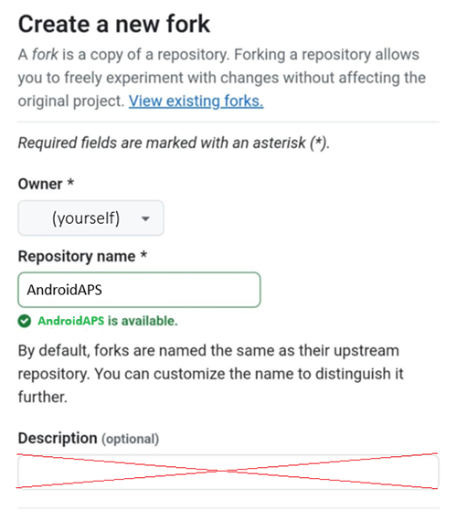

(github-fork)=

# Zostavenie v prehliadači – Krok 1: Vytvorte si fork na GitHube

```{note}
Toto je **krok 1** návodu [Zostavenie v prehliadači](BrowserBuild.md).
```

You will need to store your personal Android Java Key and Google Drive information as secrets in GitHub (later in the process, we will explain how).

Keďže to nie je možné urobiť vo verejnom repozitári AndroidAPS, musíte si vytvoriť vlastnú kópiu zdrojového kódu (tzv. fork).

## Účet na GitHube

Ak ho ešte nemáte, musíte si [vytvoriť účet na GitHube](https://github.com/signup).  
Zaregistrovať sa môžete pomocou e-mailu alebo pomocou účtu Google. Postupujte podľa krokov registrácie a overenia.

Keď máte účet, [prihláste sa do GitHubu](https://github.com/login).

## Vytvorte fork AndroidAPS

Otvorte oficiálny repozitár AndroidAPS pomocou [tohto odkazu](https://github.com/nightscout/AndroidAPS).

Ťuknite na ikonu fork. Týmto sa vytvorí kópia vo vašom vlastnom účte.


Na ďalšej obrazovke sa posuňte nadol a ťuknite na **Create Fork**.



*Note: you can **unselect** "Copy the master branch only" if you will want to build developer versions or customizations.*


```{note}
You cannot fork and you see this?<br/><br/>
**`No available destinations to fork this repository.`**<br/><br/>
<br/><br/>
This means you already have an existing fork of AndroidAPS.<br/>
Make sure it's up to date and continue to Preparation Steps.
```

```{warning}
**Nikdy neodstraňujte svoj fork bez toho, aby ste si zálohovali svoje secrets!**
```

GitHub teraz zobrazuje vašu vlastnú kópiu AndroidAPS. Nechajte túto kartu v prehliadači otvorenú.


----

**Ďalej: [Krok 2 – Vytvorte si podpisové úložisko kľúčov](BrowserBuildKeystore.md) →**
