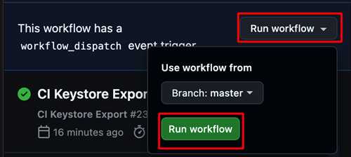

(aaps-ci-preparation)=

# Zostavenie v prehliadači – Krok 2: Vytvorte si podpisové úložisko kľúčov

```{note}
Toto je **krok 2** návodu [Zostavenie v prehliadači](BrowserBuild.md). Najprv dokončite [krok 1 – Vytvorte si fork na GitHube](BrowserBuildFork.md).
```

AndroidAPS musí byť podpísaný súkromnými kľúčmi uloženými v **úložisku kľúčov Java KeyStore (JKS)**. Toto je najdôležitejšie rozhodnutie celého postupu, pretože určuje, či budete môcť AAPS neskôr **aktualizovať** bez preinštalovania.

```{note}
V ďalších krokoch uložíte súkromné údaje (úložisko kľúčov a neskôr prístup k Disku Google) na GitHube ako **secrets** (tajné hodnoty). Secret je jednoducho zašifrovaná hodnota, ktorú môže čítať iba vaše vlastné zostavenie – nikto iný ju nevidí, ani ľudia, ktorí si prezerajú váš fork. Vďaka tomu vaše zostavenie zostáva iba vaše.
```

## Vyberte si spôsob pre úložisko kľúčov

Prečítajte si obe možnosti a vyberte tú, ktorá zodpovedá vašej situácii.

### Možnosť 1 – Vygenerujte nové úložisko kľúčov (noví používatelia)

Túto možnosť vyberte, ak platí **čokoľvek** z tohto:

- Zostavujete AAPS **prvýkrát**.
- Nemáte úložisko kľúčov z predchádzajúceho zostavenia v Android Studiu (v počítači).
- Zabudli ste heslo alebo alias úložiska kľúčov.

```{warning}
Zostavenie AAPS s **možnosťou 1** vytvorí úplne nové úložisko kľúčov, preto **nebudete môcť aktualizovať svoju existujúcu aplikáciu AAPS** priamo. Ak chcete prejsť na toto nové zostavenie, musíte exportovať nastavenia, odinštalovať starú aplikáciu AAPS, nainštalovať novú a znova importovať nastavenia. Postupujte podľa krokov v časti [Preinštalovanie AAPS s novým úložiskom kľúčov](#reinstall-aaps).
```

**→ [Pokračovať možnosťou 1 – Vygenerujte nové úložisko kľúčov](BrowserBuildO1.md)**

### Možnosť 2 – Nahrajte existujúce úložisko kľúčov (súčasní / bývalí používatelia)

Túto možnosť vyberte, ak **už máte** úložisko kľúčov `.jks`, ktoré ste použili pri predchádzajúcom zostavení AAPS v počítači v Android Studiu, **a zároveň** poznáte jeho heslo a alias (zvyčajne `key0`).

Vďaka tomu bude možné vašu súčasnú inštaláciu AAPS aktualizovať: budúce aktualizácie budú používať to isté úložisko kľúčov.

**→ [Pokračovať možnosťou 2 – Nahrajte existujúce úložisko kľúčov](BrowserBuildO2.md)**

----

```{note}
Na ďalšej stránke si vyberiete zariadenie (počítač alebo iPhone). Stránka pre každé zariadenie vás potom prevedie stiahnutím a otvorením prípravného súboru správnym spôsobom pre dané zariadenie a vytvorením úložiska kľúčov. Zostavená aplikácia AAPS sa uloží na váš Disk Google.
```

**Ďalej: vyberte vyššie [možnosť 1](BrowserBuildO1.md) alebo [možnosť 2](BrowserBuildO2.md) a potom postupujte podľa stránky pre vaše zariadenie.**

----

(ci-keystore-export)=

## Export úložiska kľúčov (voliteľné)

Ak chcete exportovať uložené úložisko kľúčov, použite tento postup.

Tento skript exportuje predtým nastavené údaje úložiska kľúčov (z možnosti 1 alebo možnosti 2) ako súbor ZIP chránený heslom do priečinka `/AAPS/KeyStore` na vašom Disku Google.

```{warning}
Pred použitím tohto exportu sa uistite, že máte dokončené nastavenie úložiska kľúčov a Disku Google.
```

### Kroky:

1. **Pridajte secret s heslom pre ZIP:**
   - Vo svojom repozitári prejdite do **Settings** → **Secrets and variables** → **Actions**
   - Kliknite na **New repository secret**
   - Do poľa **Name** zadajte: `ZIP_PASSWORD`
   - Do poľa **Secret** zadajte vlastné heslo na zašifrovanie súboru ZIP
   - V hesle používajte iba anglické písmená a číslice (žiadne špeciálne znaky)
   - Kliknite na **Add secret**

   

2. **Spustite workflow exportu:**
   - Vo svojom repozitári prejdite na kartu **Actions**
   - Vyberte položku **CI KeyStore Export**
   - Kliknite na **Run workflow**
   - Exportovaný súbor ZIP s úložiskom kľúčov sa uloží na váš Disk Google

   

   

```{toctree}
:hidden:

Možnosť 1 – Vygenerujte nové úložisko kľúčov <BrowserBuildO1.md>
Možnosť 2 – Nahrajte existujúce úložisko kľúčov <BrowserBuildO2.md>
```
