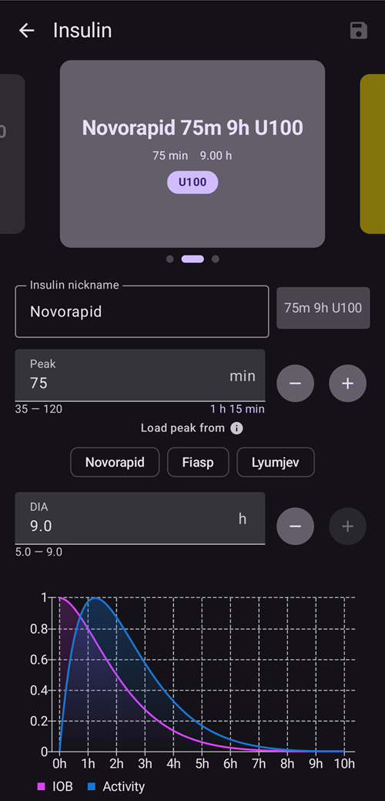
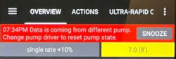
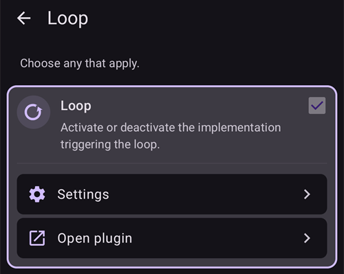

# Konfigurácia (Config Builder)

```{admonition} Prechádzate z AAPS v3? :class: note **Config Builder** sa teraz volá **Konfigurácia** a nájdete ho v **menu** (☰). Pozrite [Čo sa zmenilo v AAPS v4](#v4-changes).

    <br />V **Konfigurácii** vyberáte, ktoré pluginy sú aktívne (CGM, pumpa, algoritmus APS, citlivosť, synchronizácia, …), a otvárate každý plugin a jeho nastavenia. [Postup krok za krokom](#configuration-v4) nájdete nižšie; zvyšok stránky podrobne opisuje každú časť.
    
    (configuration-v4)=
    ## Konfigurácia v AAPS v4
    
    V **AAPS** v4 ťuknite na **menu** (☰) v **ľavom hornom** rohu hlavnej obrazovky a vyberte **Konfigurácia** (*„Nastavte si konfiguráciu (CGM, pumpa, …) a zapnite funkcie“*).
    
    
    
    Pluginy sú zoskupené podľa **kategórie** – napríklad *Vyhladzovanie*, *Kalibrácia*, *Detekcia citlivosti*, *APS*, *Komunikácia* a *Všeobecné*. Každý riadok ukazuje názov kategórie a **práve aktívny** plugin (napr. *APS → OpenAPS SMB*). Ťuknutím na riadok otvoríte kategóriu.
    
    
    
    V kategórii vidíte pluginy, ktoré sú pre ňu k dispozícii. V kategóriách s jednou voľbou vyberiete jeden aktívny plugin; niektoré kategórie umožňujú vybrať viac pluginov (*„Vyberte, čo sa použije.“*). Každý plugin ponúka dve akcie:
    
    - **Otvoriť plugin** – otvorí vlastnú obrazovku pluginu.
    - **Nastavenia** – otvorí nastavenia pluginu (nastavenia môžu byť zoskupené do rozbaľovacích častí).
    
    
    
    (configuration_sync_icon)=
    ### Ikona mobilu – „synchronizované z hlavného zariadenia“
    
    Malá **ikona mobilu (telefónu)** vedľa kategórie alebo nastavenia znamená, že táto položka je **synchronizovaná z hlavného zariadenia (master)** – jej hodnota alebo výber prichádza do tohto zariadenia cez kanál NSClientV3 (Nightscout).
    
    Na **klientovi** (**AAPSClient**) sa tieto položky **udržiavajú v súlade s hlavným zariadením**. Ikona sa zobrazuje iba na klientovi, preto ju na snímke obrazovky vyššie, ktorá bola urobená v hlavnej aplikácii **AAPS**, nevidíte. Na klientovi sa zvyčajne zobrazuje pri *Vyhladzovanie*, *Kalibrácia*, *Detekcia citlivosti* a *APS*. Ako presne zostávajú hlavné zariadenie a klienti zosúladení a ktoré nastavenia môžete zmeniť na ktorej strane, opisuje časť [Ovládanie Master ↔ Client](#client-master-config-prefs).
    
    Rovnaká ikona sa zobrazuje aj **v nastaveniach**, pri jednotlivých nastaveniach, ktoré sa synchronizujú. V príklade nižšie má ikonu *Hraničný čas absorpcie (vstrebávania)*; nastavenia bez ikony sa nastavujú na každom zariadení zvlášť:
    
    
    
    Položky **bez** ikony sa nastavujú **na každom zariadení zvlášť**. Najdôležitejším príkladom je samotné pripojenie **NSClientV3 (Komunikácia)** – **Adresa Nightscoutu**, **prístupový token** a **websockety** sa nastavujú na každom telefóne zvlášť, preto pri nich ikona mobilu **nie je**.
    
    ---
    
    (Config-Builder-tab-or-hamburger-menu)=
    ## Otvorenie obrazovky pluginu
    
    Obrazovku pluginu otvoríte jedným z týchto spôsobov (karty a zaškrtávacie políčko s okom z **AAPS** v3 už nie sú, pozrite [Čo sa zmenilo v AAPS v4](#v4-changes)):
    
    - **Konfigurácia** → kategória pluginu → **Otvoriť plugin**,
    - panel **Spravovať** v dolnej navigácii, pre obrazovky, ktoré používate najčastejšie (Profil, Nastavenia inzulínu, Pumpa, Automatizácia, Jedlo...),
    - tlačidlo [Rýchleho spustenia](../DailyLifeWithAaps/QuickLaunch.md), ktoré si pridáte sami,
    - **vyhľadávacie pole** na hlavnej obrazovke.
    
    ```{contents}
    :backlinks: entry
    :depth: 2
    

(ConfigBuilder_Profile)=

## Profil

Tento modul sa nedá vypnúť, pretože je základnou súčasťou **AAPS**.

Základné informácie o tom, čo sa nachádza vo vašom **profile**, nájdete v časti [Váš profil AAPS](../SettingUpAaps/YourAapsProfile.md).

(insulin)= (Config-Builder-insulin)=

## Inzulín



V **AAPS** 4 už inzulín nie je plugin, ktorý sa vyberá v **Konfigurácii**. Inzulín, ktorý používate, nastavíte v **Spravovať → Nastavenia inzulínu**.

Editor inzulínu vám umožňuje:

* dať profilu **Prezývku inzulínu**, aby ste ho ľahko spoznali,
* nastaviť **Vrchol** (čas do najväčšej aktivity inzulínu, v minútach) a **DIA** (dobu pôsobenia inzulínu, v hodinách), buď zadaním hodnoty, alebo tlačidlami **–** / **+**,
* ťuknúť na tlačidlo predvoľby **Načítať vrchol z** – **Novorapid** (75 min), **Fiasp** (55 min) alebo **Lyumjev** (45 min) – a jedným krokom vyplniť štandardný čas vrcholu pre daný inzulín.

Povolené rozsahy sú rovnaké pre každý inzulín:

* **DIA**: 5 až 9 hodín (5 až 10 hodín, ak je typ pacienta nastavený na **Tehotná**). Ako zvoliť hodnotu, nájdete v časti [Doba pôsobenia inzulínu (DIA) a vrchol](#Config-Builder-insulin-dia).
* **Vrchol**: 35 až 120 minút.

Krivky **IOB** (aktívny inzulín) a **Aktivita** v dolnej časti editora sa menia hneď, ako meníte hodnoty, takže okamžite vidíte, ako vaše nastavenia ovplyvňujú pôsobenie inzulínu.

Viac informácií o inzulínovom profile, ako ho zobrazuje **AAPS**, nájdete [tu](#AapsScreens-insulin-profile).

(Config-Builder-insulin-change-active)=

### Zmena používaného inzulínu (DIA alebo vrcholu)

Inzulín označený **AKTÍVNY** je ten, ktorý používa váš bežiaci profil. Jeho polia sú sivé: nemôžete ho upraviť ani vymazať. Vďaka tomu sa názov inzulínu vo vašom bežiacom profile vždy zhoduje s nastaveniami, ktoré sa naozaj používajú.

Ak chcete zmeniť používané DIA alebo vrchol:

1. Otvorte **Spravovať → Nastavenia inzulínu**. Ak sa obrazovka otvorí iba na čítanie (**✏️ ceruzka** v hornej lište), ťuknite na ceruzku a odomknite nastavenia.
2. Ťuknite na **+** (*Pridať nový inzulín*). **AAPS** vytvorí kópiu inzulínu zobrazeného na obrazovke.
3. Nastavte nový **Vrchol** a/alebo **DIA** a potom ťuknite na ikonu uloženia (vpravo hore).
4. Ťuknite na **▶** (*Aktivovať inzulín*) a potvrďte. Nový inzulín sa stane **AKTÍVNYM**.

```{admonition} Názov obsahuje vrchol a DIA :class: note **AAPS** automaticky pridá do názvu inzulínu vrchol, DIA a koncentráciu (napríklad *Fiasp 55m 8h U100*), takže svoje konfigurácie na prvý pohľad rozlíšite.

    <br />Starý inzulín môžete vymazať, keď už nie je aktívny.
    
    ### Predvoľby „Načítať vrchol z“
    
    V **AAPS** 4 už nie je zoznam typov inzulínu, z ktorého by ste vyberali. Každý inzulín používa rovnakú exponenciálnu krivku aktivity; líši sa iba jeho **Vrchol** a **DIA**. Predvoľby **Načítať vrchol z** v editore inzulínu jedným ťuknutím vyplnia odporúčaný vrchol pre najčastejšie inzulíny (malé ⓘ vedľa **Načítať vrchol z** ich vypíše aj s hodnotami vrcholu). **Vrchol** a **DIA** môžete potom ešte upraviť.
    
    Vrchol meňte mimo odporúčanej hodnoty iba vtedy, ak rozumiete, aký to bude mať účinok. [Graf krivky inzulínu](#AapsScreens-insulin-profile) vám pomôže krivkám porozumieť.
    
    #### Novorapid
    
    
    
    * odporúča sa pre Humalog, Novolog a Novorapid (v **AAPS** v3 sa volal *Rapid-Acting Oref*)
    * Vrchol = 75 minút po podaní
    
    #### Fiasp
    
    
    
    * odporúča sa pre Fiasp (v **AAPS** v3 sa volal *Ultra-Rapid Oref*)
    * Vrchol = 55 minút po podaní
    
    (Config-Builder-lyumjev)=
    #### Lyumjev
    
    
    
    * odporúča sa pre Lyumjev
    * Vrchol = 45 minút po podaní
    
    #### Vlastný vrchol
    
    * V **AAPS** 4 nie je samostatný typ inzulínu „Voliteľný vrchol Oref“ (Free-Peak Oref): ľubovoľný **Vrchol** (35 až 120 minút) zadajte priamo v [editore inzulínu](#Config-Builder-insulin), bez použitia predvoľby.
    * Vlastný vrchol sa hodí, ak používate inzulín, ktorý v zozname nie je, alebo zmes rôznych inzulínov.
    
    (Config-Builder-insulin-dia)=
    ### Doba pôsobenia inzulínu (DIA) a vrchol
    
    ```{warning}
    Pri používaní okruhu znamená zníženie DIA alebo vrcholu vždy viac podaného inzulínu. DIA funguje v AAPS inak ako v komerčných systémoch AID a neopatrné zmeny týchto nastavení môžu zmeniť dávkovanie inzulínu oveľa viac alebo menej, než čakáte.
    

AAPS modeluje priebeh pôsobenia inzulínu matematickým vzorcom, ktorý sa nastavuje pomocou **DIA** a úzko súvisiaceho nastavenia **vrcholu**. DIA je teoretická doba, kým IOB klesne na nulu, a vrchol je okamih, keď je účinok inzulínu najsilnejší. Z toho vyplýva krivka IOB a krivka aktivity, ktorá je jednoducho **rýchlosť** poklesu IOB.

Majte na pamäti, že keď AAPS používa okruh, je normálne mať obdobia [nulového dočasného bazálu (zero-temping)](#Open-APS-features-super-micro-bolus-smb). Tento chýbajúci bazálny inzulín sa celý odpočíta od IOB, a preto IOB v praxi klesne na nulu o mnoho hodín skôr, než je nastavené DIA. [IOB z bolusov a IOB z bazálu](#aaps-screens-iob-cob-basal-sens) si môžete pozrieť zvlášť na hlavnej obrazovke.

Ak chcete nastaviť DIA a vrchol, ťuknite na hlavnej obrazovke na **Spravovať** a potom na **Nastavenia inzulínu**. AAPS zobrazí aktívnu konfiguráciu inzulínu takto:


V tomto príklade je vrchol nastavený na 55 minút, DIA na 8 hodín a [koncentrácia inzulínu](#Insulin-Concentration) je štandardných 100 IU/ml.

Pre vplyv nulového dočasného bazálu opísaný vyššie a pre vzorec, ktorý AAPS používa na pokles IOB, nastavuje väčšina používateľov zreteľne dlhšie DIA ako v komerčných systémoch. Mnohým ľuďom vo všeobecnosti dobre funguje **DIA** 9 h. Keď budete mať s AAPS viac skúseností a dobre vyladený profil, môžete skúsiť nájsť vlastné nastavenie DIA a vrcholu pomocou informácií nižšie.

````{admonition} Podrobnosti o vplyve nastavenia DIA a vrcholu :class: dropdown

Keďže bazálna dávka má v AAPS nepriamy vplyv na pokles IOB, príliš vysoké bazálne dávky môžu zakryť príliš vysoké DIA a naopak. Je rozumné najprv starostlivo vyladiť bazálne dávky a až potom upravovať DIA a vrchol. Majte tiež na pamäti, že nastavenia DIA a vrcholu sa navzájom ovplyvňujú: účinok DIA závisí od vrcholu a naopak.

Tieto grafy ukazujú presný vplyv DIA a vrcholu na krivky IOB v celom rozsahu povolených hodnôt.

Úprava DIA:

```{image} ../images/iob_remaining_static_peak.png :width: 400px

    <br />Úprava vrcholu:
    
    ```{image} ../images/iob_remaining_static_dia.png
    :width: 400px
    

Nakoniec porovnanie, keď sa DIA a vrchol upravujú súčasne. Logika je tu taká, že obe hodnoty sa upravia v rovnakom pomere, takže `49/35 ~ 7/5`. Alebo podobne `120/93 ~ 9/7`. Intervaly budú rovnaké bez ohľadu na východiskové DIA alebo vrchol, pokiaľ je pomerná zmena pre obe hodnoty rovnaká.

```{image} ../images/iob_remaining_uniform.png :width: 400px

    <br />Všimnite si, že keď sa DIA a vrchol upravujú týmto spôsobom, každý bod krivky sa posunie o rovnaký pomer.
    
    ````
    
    #### Ďalšie čítanie o nastavení DIA a vrcholu
    
    * [Technické podrobnosti a historické pozadie od predchodcu AAPS, OpenAPS](https://openaps.readthedocs.io/en/latest/docs/While%20You%20Wait%20For%20Gear/understanding-insulin-on-board-calculations.html#understanding-the-new-iob-curves-based-on-exponential-activity-curves).
    * [Why we are regularly wrong in the duration of insulin action (DIA) times we use, and why it matters…](https://www.diabettech.com/insulin/why-we-are-regularly-wrong-in-the-duration-of-insulin-action-dia-times-we-use-and-why-it-matters/) (prečo často používame nesprávnu dobu pôsobenia inzulínu) na Diabettech.
    * [Exponential Insulin Curves + Fiasp](https://web.archive.org/web/20220630154425/http://seemycgm.com/2017/10/21/exponential-insulin-curves-fiasp/) (exponenciálne krivky inzulínu a Fiasp) na See My CGM (archív).
    * [Revised Humalog model in a closed loop](https://bionicwookiee.com/2022/04/13/revised-humalog-model-in-a-closed-loop/) (upravený model Humalogu v uzavretom okruhu) a ďalšie články na Bionic Wookie, ktoré odporúčajú DIA 9 h pre Lyumjev, Fiasp, NovoRapid a Humalog.
    
    (Config-Builder-bg-source)=
    ## Zdroj glykémie
    Vyberte zdroj glykémie, ktorý používate. Ďalšie informácie o nastavení nájdete na stránke [Zdroj glykémie](../Getting-Started/CompatiblesCgms.md).
    
    
    
    Ďalšie zdroje uvidíte, keď posuniete obrazovku nadol:
    
    
    
    
    
    * [xDrip+ glykémia](../CompatibleCgms/xDrip.md) – aj pre kompatibilné aplikácie, napríklad [Juggluco](../CompatibleCgms/Juggluco.md)
    * [Glykémia z NS](../CompatibleCgms/CgmNightscoutUpload.md) – iba ak viete, čo robíte, pozrite [Zdroj glykémie](../Getting-Started/CompatiblesCgms.md).
    * [MM640g](../CompatibleCgms/MM640g.md)
    * Glimp – podporovaná je iba verzia 4.15.57 a novšia
    * [BYODA (Build Your Own Dexcom App – vlastnoručne zostavená aplikácia Dexcom)](#DexcomG6-if-using-g6-with-build-your-own-dexcom-app).
    * MicroTech CGM aplikácia – pre CGM Aidex / LinX
    * [Poctech](../CompatibleCgms/PocTech.md)
    * Tomato (MiaoMiao) – aplikácia Tomato pre zariadenie MiaoMiao
    * [Glunovo](https://infinovo.com/) – aplikácia Glunovo pre systém CGM Glunovo
    * Intelligo – aplikácia Intelligo
    * Syai/Ottai – pre aplikácie Syai a Ottai (pozrite [Syai Tag](../CompatibleCgms/SyaiTagX1.md) a [Ottai](../CompatibleCgms/OttaiM8.md))
    * Aplikácia SI – upravená aplikácia SI alebo aplikácia Sibionics pre CGM Sibionics
    * Aplikácia Sino – upravená aplikácia pre CGM Sinocare
    * Čítačka notifikácií – číta hodnoty glykémie z notifikácií, ktoré zobrazujú oficiálne aplikácie CGM (Dexcom, Medtronic, Eversense atď.)
    * Instara – aplikácia Instara
    * Náhodná glykémia – generuje náhodné údaje glykémie na testovanie. Dá sa zapnúť iba vo vývojárskom (engineering) zostavení s **Virtuálnou pumpou**, takže v bežnej inštalácii **AAPS** sa použiť nedá.
    
    ## Vyhladzovanie
    
    
    
    Pozrite [Vyhladzovanie údajov glykémie](../CompatibleCgms/SmoothingBloodGlucoseData.md).
    
    ## Kalibrácia
    
    Vyberte, ako má **AAPS** zaobchádzať s hodnotami, ktoré dostáva zo senzora:
    
    - **Žiadna kalibrácia**: hodnoty zo senzora sa použijú tak, ako sú. Použite to, keď je senzor kalibrovaný už z výroby a je presný. Toto je predvolené nastavenie.
    - **Lineárna kalibrácia**: **AAPS** opraví hodnoty zo senzora pomocou sklonu a posunu, ktoré vypočíta z vašich meraní z prsta.
    
    Ako funguje **Lineárna kalibrácia**:
    
    - Potrebuje zaznamenanú **výmenu senzora**, aby vedela, kedy sa začala relácia senzora. Prvé 2 hodiny relácie sa vynechajú ako zahrievanie.
    - Potrebuje aspoň **2 merania z prsta**. Novšie merania majú väčšiu váhu ako staršie.
    - Oprava sa použije iba vtedy, keď je výsledok v bezpečnom rozsahu. Ak sú vaše merania príliš blízko pri sebe, opraví sa iba posun.
    - **Otvoriť plugin** ukazuje stav kalibrácie, používaný sklon a opravu a zoznam meraní z prsta. Meranie môžete pridať tlačidlom **Pridať kalibráciu** a nesprávne meranie odstrániť.
    
    ```{admonition} Kalibrujte opatrne
    :class: warning
    Nesprávna hodnota z prsta vedie k nesprávnym hodnotám glykémie, a tým aj k nesprávnemu dávkovaniu inzulínu. Pred meraním si umyte ruky a nekalibrujte, keď sa glykémia rýchlo mení.
    


(Config-Builder-pump)=

## Pumpa

Vyberte pumpu, ktorú používate. Viac informácií nájdete na stránke [Kompatibilné pumpy](../Getting-Started/CompatiblePumps.md).


Všetky ovládače púmp uvidíte, keď posuniete obrazovku nadol:


Keď vyberiete inú pumpu, **AAPS** vás požiada o potvrdenie zmeny:


* [Dana R](../CompatiblePumps/DanaR-Insulin-Pump.md)
* Dana R Korean (pre domácu kórejskú verziu pumpy DanaR)
* Dana Rv2 (pumpa DanaR s neoficiálnou aktualizáciou firmvéru)
* [Dana-i/RS](../CompatiblePumps/DanaRS-Insulin-Pump.md)
* [Accu Chek Insight](../CompatiblePumps/Accu-Chek-Insight-Pump.md)
* [Accu Chek Combo](../CompatiblePumps/Accu-Chek-Combo-Pump-v2.md)
* Omnipod pre [Omnipod Eros](../CompatiblePumps/OmnipodEros.md)
* Dash pre [Omnipod DASH](../CompatiblePumps/OmnipodDASH.md)
* [Medtronic](../CompatiblePumps/MedtronicPump.md)
* [Diaconn G8](../CompatiblePumps/DiaconnG8.md)
* [EOPatch2](../CompatiblePumps/EOPatch2.md)
* [Medtrum](../CompatiblePumps/MedtrumNano.md)
* [Equil 5.3](../CompatiblePumps/Equil5.3.md)
* [CareLevo](../CompatiblePumps/CareLevo.md)
* Virtuálna pumpa: otvorený okruh – **AAPS** iba navrhuje, inzulín nepodáva 
  * Keď začínate s **AAPS**, počas prvých [cieľov](../SettingUpAaps/CompletingTheObjectives.md)
  * pre pumpu, ktorá ešte nemá žiadny ovládač

(config-builder-wrong-pump-data)=

### Správa: „Dáta prichádzajú z inej pumpy“

**AAPS** si pamätá pumpu, ku ktorej je pripojený (typ pumpy a sériové číslo). Ak dostane dáta z inej pumpy, napríklad po výmene pumpy za novú rovnakého modelu, zobrazí túto správu a dáta z tejto pumpy ignoruje:



Ak chcete použiť novú pumpu, zmeňte ovládač pumpy: vyberte **Virtuálna pumpa**, potvrďte a potom znova vyberte svoju pumpu. **AAPS** potom zaregistruje pumpu, ku ktorej je teraz pripojený.

(Config-Builder-sensitivity-detection)=

## Detekcia citlivosti


Vyberte akým spôsobom má byť zisťovaná vaša citlivosť na inzulín. Viac informácií o jednotlivých možnostiach nájdete [tu](../DailyLifeWithAaps/SensitivityDetectionAndCob.md). Táto funkcia priebežne analyzuje vaše dáta a upravuje parametre, ak rozpozná, že reagujete na inzulín citlivejšie (alebo naopak, odolnejšie) ako obvykle. Viac podrobností o tom, ako sa počíta samotný pomer citlivosti, nájdete v časti [Kľúčové funkcie AAPS > Autosens](#Open-APS-features-autosens).

Svoju citlivosť môžete sledovať na hlavnej obrazovke v [doplnkovom grafe](#AapsScreens-section-g-additional-graphs): vyberte SEN a sledujte bielu čiaru. Upozorňujeme, že musíte plniť [Cieľ 8](#objectives-objective8), aby detekcia citlivosti/[Autosens](#Open-APS-features-autosens) automaticky upravila množstvo podaného inzulínu. Pred dosiahnutím tohto cieľa sa percento Autosensu / čiara v grafe zobrazí len pre informáciu.

### Nastavenie vstrebávania sacharidov

Ak používate Oref1 s **SMB**, musíte zmeniť **min_5m_carbimpact** na 8. Hodnota sa používa iba počas chýbajúcich údajov **CGM** alebo keď fyzickou aktivitou „spálite“ nárast glykémie, ktorý by inak spôsobil rozklad COB v **AAPS**. V prípadoch, keď [absorpciu sacharidov](../DailyLifeWithAaps/CobCalculation.md) nemožno dynamicky vypočítať na základe reakcií vašej glykémie, systém do sacharidov vloží predvolený rozklad. V podstate je to niečo ako poistka.

(Config-Builder-aps)=

## APS


Zvoľte ktorý algoritmus má AAPS používať na prispôsobenie dávkovania vášho inzulínu. Aktuálne podrobnosti zvoleného algoritmu si pozriete cez **Otvoriť plugin**.

* OpenAPS AMA 
  * Advanced Meal Assist: starší algoritmus sa už neodporúča.
  * Jednoducho povedané, výhoda je v tom, že po podaní bolusu k jedlu môže systém rýchlejšie nastaviť vysoký dočasný bazál, AK spoľahlivo zadáte sacharidy.
* [OpenAPS SMB](#Open-APS-features-super-micro-bolus-smb) 
  * Super Micro Bolus: najnovší algoritmus, odporúčaný pre všetkých používateľov.
  * Na rozdiel od AMA nepoužíva SMB na riadenie glykémie dočasné bazály, ale hlavne malé **Super Micro Bolusy**.
  * Poznámka: Odporúča sa používať tento algoritmus od začiatku, aj keď v skutočnosti nebudete dostávať SMB do [Cieľa 9](#objectives-objective9).
* [Auto ISF](#Open-APS-features-auto-isf) 
  * Experimentálny algoritmus pre pokročilých používateľov. Zobrazí sa v zozname až po splnení cieľov.

Ak prechádzate z algoritmu AMA na SMB, musíte *min_5m_carbimpact* ručne zmeniť na **8** (predvolená hodnota pre SMB) v [Nastavenia → Nastavenie vstrebávania sacharidov](#Preferences-min_5m_carbimpact).

## Okruh

Tento modul sa nedá vypnúť, pretože je základnou súčasťou **AAPS**.



## Obmedzenia


### Ciele

**AAPS** má vzdelávací program (sériu cieľov), ktoré musíte krok za krokom splniť. Mal by vás bezpečne previesť nastavením systému s uzavretým okruhom.

Viac informácií nájdete na stránke [Ciele](../SettingUpAaps/CompletingTheObjectives.md).

## Komunikácia

V tejto kategórii (v **AAPS** v3 sa volala **Synchronizácia**) vyberáte, či a kam má **AAPS** posielať vaše dáta.


Zvyšok zoznamu uvidíte, keď posuniete obrazovku nadol:


### NSClientV3

Môže sa použiť ako [reportovací server](../SettingUpAaps/SettingUpTheReportingServer.md) a/alebo na [vzdialené sledovanie](../RemoteFeatures/RemoteMonitoring.md), [vzdialené ovládanie](../RemoteFeatures/RemoteControl.md).

Ako nastaviť synchronizáciu NSClientV3, nájdete v časti [Synchronizácia s reportovacím serverom](#SetupWizard-synchronization-with-the-reporting-server-and-more).

### Tidepool

Môže sa použiť ako [reportovací server](../SettingUpAaps/SettingUpTheReportingServer.md).

Pozrite [Tidepool](../SettingUpAaps/Tidepool.md).

### xDrip

Slúži na **odosielanie** dát, napríklad hodnôt glykémie a ošetrení, do xDrip+ v tom istom telefóne. Jeho nastavenia obsahujú aj **Odosielať stav do xDrip+**, riadok stavu s IOB a COB, ktorý zobrazuje xDrip+ a niektoré sprievodné aplikácie pre hodinky.

### Open Humans

Pozrite [Open Humans](../SupportingAaps/OpenHumans.md).

(Config-Builder-wear)=

### Wear

Sledujte a ovládajte **AAPS** z hodiniek s Wear OS. Nastavenie hodiniek je opísané na stránke [Nastavenie AAPS na hodinkách s Wear OS](../WearOS/WearOsSmartwatch.md). Po zapnutí pluginu vyberte jeho možnosti v [Nastavenia > Wear](#preferences-wear). Používanie hodiniek je opísané na stránke [Ovládanie AAPS pomocou inteligentných hodiniek s Wear OS](../RemoteFeatures/RemoteControlWearOS.md).

(external-companion-apps)=

### Externé sprievodné (Companion) aplikácie

Vysiela stavové údaje **AAPS** v telefóne, aby ich mohli zobraziť iné aplikácie nainštalované v tom istom telefóne – napríklad sprievodné aplikácie pre hodinky alebo widgety. Vysielanie obsahuje glykémiu a trend, IOB, COB, bazál a dočasný bazál, názov profilu, stav okruhu, batériu telefónu a pumpy, stav zásobníka a priebeh bolusu. Zapnite ho, iba ak tieto údaje vyžaduje sprievodná aplikácia, ktorú používate.

Aplikácie, o ktorých vieme, že toto vysielanie čítajú, sú [WatchDrip+](https://bigdigital.home.blog/) (hodinky Xiaomi a Amazfit), [GlucoDataHandler](https://github.com/pachi81/GlucoDataHandler) (komplikácie a widgety pre Wear OS a Android Auto cez GlucoDataAuto) a aplikácia G-Watch. Ich nastavenie je opísané na stránke [Inteligentné hodinky a AAPS](#watches-external-companion-apps). Niektoré z nich používajú aj **Odosielať stav do xDrip+** z pluginu **xDrip** vyššie, kvôli riadku stavu s IOB a COB.

V starších verziách sa tento plugin volal **Samsung Tizen**, podľa [aplikácie G-Watch pre hodinky Samsung Tizen](#Watchfaces-tizen), pre ktorú bol pôvodne vytvorený.

### Garmin

Pripojenie k zariadeniu Garmin (Fenix, Edge...)

## Ošetrenia

Otvorte **menu** (☰) a vyberte [História ošetrení](#aaps-screens-treatments), kde uvidíte zaznamenané ošetrenia. Ak chcete záznam upraviť alebo vymazať (napr. ste zjedli menej sacharidov, ako ste čakali), vyberte „Odstrániť“ a zadajte novú hodnotu (v prípade potreby zmeňte čas) cez **Ošetrenia → Sacharidy** v dolnej navigácii (pozrite [Sacharidy](#screens-bolus-carbs)).

## Všeobecne

V **AAPS** 4 kategória **Všeobecné** v **Konfigurácii** obsahuje iba **Autotune**. Ostatné funkcie opísané nižšie sú vždy k dispozícii a netreba ich tu zapínať; v každom odseku je uvedené, kde ich nájdete.


### Prehľad

[Hlavná obrazovka](#AapsScreens-the-homescreen) **AAPS** už nie je plugin a v **Konfigurácii** nemá vlastné nastavenia. Možnosti, ktoré tu boli predtým, sú v **Nastaveniach** (ikona ozubeného kolieska): [Zobraziť poznámky v dialogových oknách](#Preferences-show-notes-field-in-treatments-dialogs), [Indikátory stavu](#Preferences-status-lights) a [Percento bolusu](#Preferences-deliver-this-part-of-bolus-wizard-result), ktoré používa bolusová kalkulačka. Možnosť superbolusu z **AAPS** 3.x [nie je dostupná ako nastavenie](#Preferences-advanced-settings-overview) v **AAPS** 4.

(Config-Builder-actions)=

### Akcie

Karta Akcie z **AAPS** 3.x už neexistuje. Jej tlačidlá sú teraz v paneli **Spravovať** – pozrite [Kam zmizla karta Akcie?](#screens-action-tab).

### Automatizácia

**Spravovať → Automatizácia** vám umožní spravovať vaše [automatizácie](../DailyLifeWithAaps/Automations.md), a to od [Cieľa 10](#objectives-objective10).

(Config-Builder-sms-communicator)=

### SMS komunikátor

Umožňuje vzdialene opatrovateľom ovládať niektoré funkcie **AAPS** prostredníctvom SMS, ďalšie informácie o nastavení nájdete v časti [SMS príkazy](../RemoteFeatures/SMSCommands.md).

### Jedlo

**Spravovať → Jedlo** zobrazuje predvoľby jedál definované v databáze jedál Nightscoutu, ďalšie informácie o nastavení nájdete v [Nightscout Readme](https://github.com/nightscout/cgm-remote-monitor#food-custom-foods).

Poznámka: Záznamy nie je možné použiť v kalkulačke **AAPS**. (iba na zobrazenie)

(Config-Builder-autotune)=

### Autotune

Môžete povoliť Autotune, pozrite [tu](../AdvancedOptions/Autotune.md).

### Údržba

Otvorte **menu** (☰) a vyberte **Údržba**, kde môžete exportovať / importovať nastavenia a spravovať log súbory.


### Konfigurácia

Teraz sa volá **Konfigurácia**: táto stránka.