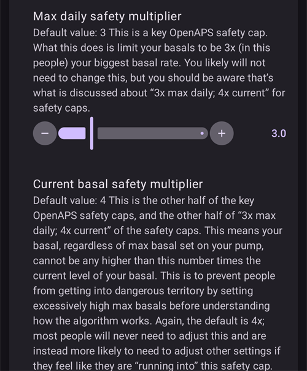
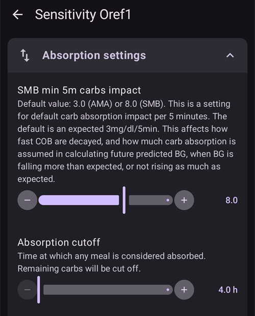
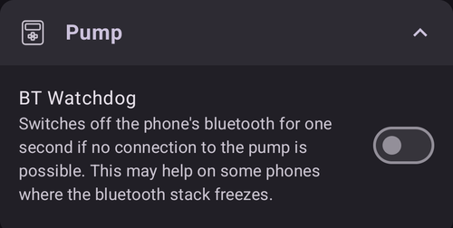

# Settings (Preferences)

In **AAPS** v4 the preferences are found on the **Settings** screen. There are three routes to reach them — see [Making changes to your AAPS' configuration](../SettingUpAaps/ChangeAapsConfiguration.md) for details:

1. Tap the **Settings** (gear) icon in the top-right corner of the main screen: all settings, grouped into expandable sections.
2. In **Configuration**, tap "**Settings**" underneath an active plugin: only that plugin's settings.
3. Use the **search bar** on top of the main screen: just start typing part of the text you are looking for. This finds individual settings (even those not visible in the Settings screen), dialogs and documentation.


- **Sections** are opened and closed by tapping them. The sections you see depend on the plugins you have enabled and on [Simple mode](#preferences-simple-mode).


```{contents}
:backlinks: entry
:depth: 2
```

(Preferences-general)=
## Všeobecne


**Jednotky**

- Set units to mmol/L or mg/dL depending on your preferences.

**Jazyk**

- Máte aj možnosť použiť predvolený jazyk telefónu (odporúčané).

- Ak chcete **AAPS** v inom jazyku, ako je váš štandardný jazyk telefónu, môžete si vybrať zo širokej ponuky.

- When you change the language, the texts of **AAPS** switch to the new language straight away. If some texts still show the old language, restart **AAPS**.
- Nastavenie je skryté v [jednoduchom režime](#preferences-simple-mode).

(preferences-simple-mode)= **Simple mode**

**Jednoduchý režim**je predvolene aktivovaný pri prvej inštalácii **AAPS**. V **jednoduchom režime** je značné množstvo nastavení skryté a nastavenia sú nahradené preddefinovanými hodnotami. Jednoduchý režim by ste mali vypnúť hneď, ako sa oboznámite s používateľským rozhraním a nastaveniami **AAPS**.

**Insulin concentration support**

- Enables support for different insulin concentrations (U50, U200, ...). Only enable this if you really use a concentration other than U100, and read the warnings carefully.
- Nastavenie je skryté v [jednoduchom režime](#preferences-simple-mode).

**Nechať obrazovku zapnutú**

- Forces Android to keep the screen on at all times. Toto je užitočné pri prezentáciách atď. Ale spotrebuje veľa energie batérie. Preto sa odporúča pripojiť smartfón k nabíjačke.

**Instance name**

- The name of the person using this phone. It tells this **AAPS** instance apart in reports and synchronization, for example if two children with type 1 diabetes in your family use **AAPS**.
- Used in the names of exported settings files.
- Zobrazuje sa v [dvojitom ciferníku](../WearOS/WearOsSmartwatch.md).

(Preferences-skin)=
### Vzhľad

The skin selection from **AAPS** 3.x (Original, Low resolution, Large display...) no longer exists in **AAPS** 4. The new interface adapts to your screen automatically, and the color scheme can be changed in [Appearance](#preferences-appearance).

(preferences-appearance)=
## Appearance


(Preferences-range-for-visualization)=
### Rozsah pre zobrazenie

Choose the high and low marks for the BG-graph on **AAPS** main screen and smartwatch. Je to len vizualizácia, nie cieľový rozsah vašej glykémie. Example: 70 - 180 mg/dL or 3.9 - 10 mmol/L

(Preferences-show-notes-field-in-treatments-dialogs)=
### Show notes in dialogs

Ponúka možnosť pridať k ošetreniam krátke textové poznámky (kalkulačka, sacharidy, inzulín...)

Nastavenie je skryté v [jednoduchom režime](#preferences-simple-mode).

### App Color Scheme

Choose between the light theme, the dark theme, or following the phone's system setting.

(Preferences-protection)=
## Ochrana


(Preferences-master-password)=
### Hlavné heslo

Povinné pre možnosť [exportovať nastavenia](../Maintenance/ExportImportSettings.md), pretože sú od verzie 2.7 šifrované.

**Biometrická ochrana nemusí na telefónoch OnePlus fungovať. Toto je známy problém na niektorých telefónoch OnePlus.**


(Preferences-settings-protection)=
### Ochrana nastavení

- Chráňte svoje nastavenia heslom alebo biometrickým overením telefónu (napr. [ak dieťa používa **AAPS**](../RemoteFeatures/RemoteMonitoring.md)). If you enable this feature, you will be prompted for authentication each time you want to access any Settings related view.

- The management screens (**Profile**, **Insulin settings**, **Temp Target**, **QuickWizard**) then open **read-only**. You can still activate or use an entry, but adding, editing, cloning and deleting are hidden until you unlock your settings. See [Settings protection now also locks the management screens](#v4changes-read-only-management).

- Custom password should be used if you want to use master password just for securing [exported settings](../Maintenance/ExportImportSettings.md), and use a different one for editing the settings.

- Ak používate vlastné heslo, kliknite na riadok „Nastavenia hesla“ a nastavte heslo podľa postupu [vyššie](#Preferences-master-password).

### Ochrana aplikácie

If the app is protected, you must enter the password or use the phone's biometric authentication to open **AAPS**, and again when you come back to it after the [protection timeout](#Preferences-password-and-pin-retention).

**AAPS** sa okamžite vypne, ak zadáte nesprávne heslo, ale bude stále bežať na pozadí, ak bol predtým úspešne spustený.

### Ochrana bolusu

- Ochrana bolusu môže byť užitočná, ak **AAPS** používa malé dieťa a vy [podávate bolus cez SMS](../RemoteFeatures/SMSCommands.md).

- **Bolus protection** can only be selected once **Settings protection** (Level 2) is set.

- In the example below, bolus protection uses the **Master password**: **AAPS** asks for it before opening a treatment dialog such as **Insulin**. With **Biometric**, if biometric authentication does not work, you can enter the master password instead.


(Preferences-password-and-pin-retention)=
### Uchovanie hesla a PIN

**Protection timeout** defines how long (in seconds) the settings or bolus functionalities remain unlocked after you successfully enter the password.

## Bezpečnosť ošetrení


(preferences-patient-type)=
### Patient age

- Bezpečnostné limity sú nastavené na základe veku, ktorý vyberiete v tomto nastavení.
- Ak začnete narážať na tieto pevné limity (ako napríklad maximálny bolus), je čas posunúť sa o krok vyššie.
- Neodporúčame zadať vyšší vek ako je skutočný pretože to môže viesť k predávkovaniu inzulínom (napríklad vynechaním desatinnej bodky).
- Ak vás zaujímajú aké presné hodnoty majú tieto bezpečnostné limity, prejdite na [stránku](../DailyLifeWithAaps/KeyAapsFeatures.md) k funkcii algoritmu, ktorý používate.

(Preferences-maximum-bolus)=
### Maximum bolus

- Definuje maximálne množstvo bolusového inzulínu v inzulínových jednotkách, ktoré môže systém **AAPS** podať naraz.
- Je to bezpečnostné nastavenie aby sa predišlo podaniu príliš velkého bolusu v prípade, že omylom zadáte chybné množstvo sacharidov a pod.
- Odporúča sa ho nastaviť na takú hodnotu, ktorá zhruba zodpovedá maximálnemu bolusu, ktorý budete potrebovať pri jedle alebo korekcii.
- Toto obmedzenie sa vzťahuje aj na výsledky bolusovej kalkulačky.

### Maximum carbs allowed

- Definuje maximálne množstvo sacharidov v gramoch, ktoré môže bolusová kalkulačka **AAPS** použiť pre výpočet.
- Je to bezpečnostné nastavenie aby sa predišlo podaniu príliš velkého bolusu v prípade, že omylom zadáte chybné množstvo sacharidov a pod.
- Odporúča sa ho nastaviť na takú hodnotu, ktorá zhruba zodpovedá maximálnemu množstvu sacharidov, ktoré prijmete v jednom jedle.

## BG source

The settings of your selected [BG source](#Config-Builder-bg-source) appear as their own section. For example with **xDrip+ BG**:


- **Upload BG data to NS**: let **AAPS** upload the received BG values to Nightscout. Only enable this if the CGM app itself is not already uploading them.
- **Log sensor change**: create a sensor change therapy event automatically when the sensor is inserted.

## The main screen

In **AAPS** 3.x these settings were grouped in an "Overview" section. In **AAPS** 4 they are configured directly from the main screen elements they belong to.

(Preferences-buttons)=
### QuickLaunch buttons

Define which action buttons are visible on the main screen: tap the small **gear** at the bottom center of the main screen ("Configure QuickLaunch") and **Add** the actions you want quick access to (treatments, CGM actions, careportal entries...).


(Preferences-quick-wizard)=
### Sprievodca rýchlym bolusom

Create customized buttons for certain standard meals or snacks which will be displayed on the main screen. Užitočné pre jedlá, ktoré často konzumujete.

Pre každé tlačidlo definujete sacharidy a spôsob výpočtu bolusu. Then, you define during which time period the button will be visible on your main screen - just one button per period. Tlačidlo nebude viditeľné, ak je časový rozsah mimo zadaného rozsahu alebo ak máte dostatok IOB na pokrytie sacharidov definovaných v tlačidle rýhleho bolusu. If different times are specified for the different meals you will always have the appropriate standard meal button on the main screen, depending on the time of day.

To manage your Quick Wizard presets, type "QuickWizard" in the main screen search bar and open **QuickWizard - Manage quick wizard presets**.

Ak kliknete na tlačidlo rýchleho bolusu, systém **AAPS** vypočíta a navrhne bolus pre tieto sacharidy na základe vašich aktuálnych pomerov (s prihliadnutím na hodnotu glukózy v krvi alebo IOB, ak je nastavený).

Návrh musí byť potvrdený pred podaním inzulínu.

(Preferences-default-temp-targets)=
### Predvolené dočasné ciele

[Dočasné ciele (TT)](../DailyLifeWithAaps/TempTargets.md) vám umožňujú zmeniť cieľovú hodnotu glukózy v krvi na určité časové obdobie. Pri nastavovaní predvoleného TT môžete jednoducho zmeniť cieľ aktivity, pred jedlom atď.

Tap the **target range** on the main screen to open the **Temp Target** screen. Swipe through the preset cards (Eating Soon, Activity, Hypo) and change the target and the duration of each preset under **Preset Settings**. Prednastavené hodnoty sú:

* Eating soon: target 90 mg/dL / 5.0 mmol/L, duration 45 min
* Activity: target 140 mg/dL / 7.8 mmol/L, duration 90 min
* Hypo: target 160 mg/dL / 8.9 mmol/L, duration 60 min


[Tu](#TempTargets-where-can-i-select-a-temp-target) si môžte pozrieť ako aktivovať dočasné ciele.

### Štandardné množstvo inzulínu pre Plnenie/Doplňovanie

If you want to fill the tube or prime the cannula through **AAPS** you can do this with the **Prime/Fill** buttons in the expanded status panel of the main screen.

The default amounts of the three fill buttons can be defined in the **Prime/Fill** settings, depending on the length of your catheter. Type "prime" in the main screen search bar to open them.


(Preferences-status-lights)=
### Indikátory stavu

Indikátory stavu zobrazujú vizuálne varovanie pre tieto možnosti:

- Vek senzora
- Vek inzulínu (dni používania zásobníka)
- Hladina inzulínu v zásobníku (units)
- Vek kanyly
- Vek batérie v pumpe
- Úroveň nabitia batérie pumpy (%)

Ak je prekročená prahová hodnota varovania, hodnoty sa zobrazia žltou farbou. Ak je prekročená kritická hodnota, hodnoty sa zobrazia červenou farbou.

To change the thresholds, expand the status panel on the main screen (chevron on the right of the status row) and tap the small **Settings** icon next to "Status":


Tap an item (**Cannula**, **Insulin**, **Sensor** or **Pump battery**) to open its warning and critical thresholds:


Posledná možnosť vám umožňuje importovať tieto nastavenia z Nightscoutu, ak sú tam definované. Viac informácií nájdete v [dokumentácii k Nightscoutu](https://nightscout.github.io/nightscout/setup_variables/#age-pills).

(Preferences-deliver-this-part-of-bolus-wizard-result)=
### Bolus wizard settings

Type "bolus" in the main screen search bar to open the **Bolus wizard** settings:


**Bolus percentage** sets the [default percentage](#AapsScreens-section-j) of the bolus calculated when using the bolus wizard.

Predvolená hodnota je 100 %: žiadna korekcia. Aj keď tu nastavujete inú hodnotu, stále ju môžete zmeniť pri každom použití bolusovej kalkulačky. Ak je toto nastavenie 75 % a museli ste podať bolus 10 jednotiek, kalkulačka navrhne bolus k jedlu iba 7,5 jednotiek.

Pri používaní systému [SMB](#objectives-objective9) si veľa ľudí nepodáva 100 % potrebného inzulínu v podobe bolusu k jedlu, ale iba jeho časť (napr. 75 %) a zvyšok nechávajú na systém SMB s funkciou UAM (Unattended Meal Detection). Použitie hodnoty nižšej ako 100 % tu môže byť dosť nápomocné:
* Pre ľudí s pomalým trávením: odoslanie celého bolusu naraz môže spôsobiť hypoglykémiu, pretože účinok inzulínu je rýchlejší ako trávenie.
* aby sa **AAPS** mohol sám vysporiadať so **zvýšenou hladinou glukózy v krvi**. V oboch prípadoch systém **AAPS** kompenzuje chýbajúcu časť bolusu pomocou SMB, ak/keď sa to bude považovať za dostatočné.

**Use bolus advisor**

When enabled, if you use the bolus wizard while you are in hyperglycemia, you will get a warning, prompting you if you wish to pre-bolus and eat later, when your **BG** gets back in range.

(Preferences-advanced-settings-overview)=
### Superbolus

The Superbolus option of **AAPS** 3.x is not available as a setting in **AAPS** 4.

## Uzavretý okruh

See [AAPS screens > The main screen > Loop status](#AapsScreens-loop-status) to change loop mode now.

(Preferences-minimal-request-change)=
### Open mode minimum change

Pri používaní **Otvorenej slučky** budete dostávať upozornenia vždy, keď systém **AAPS** odporučí úpravu bazálnej dávky. To reduce the number of notifications you can either use a [wider bg target range](#profile-glucose-targets) or increase the percentage of the "**Open mode minimum change**" setting. Tým nastavíte aká veľká zmena je potrebná aby sa zobrazilo upozornenie.


## Rozšírený asistent jedla (AMA) alebo super mikro bolus (SMB)

Depending on your settings in [Configuration > APS](../SettingUpAaps/ConfigBuilder.md) you can choose between two algorithms:

- [Advanced meal assist (OpenAPS AMA)](#Open-APS-features-advanced-meal-assist-ama) – stav algoritmu v roku 2017
- [Super micro bolus (OpenAPS SMB)](#Open-APS-features-super-micro-bolus-smb) – najnovší algoritmus odporúčaný pre začiatočníkov

Od
**AAPS** verzie 3.3 bola funkcia [Dynamic ISF](../DailyLifeWithAaps/DynamicISF.md) presunutá ako súčasť OpenAPS SMB.</p> 


### OpenAPS AMA

Všetky nastavenia pre OpenAPS AMA sú popísané v časti [Kľúčové funkcie AAPS – Pokročilý asistent pri jedle (AMA)](#Open-APS-features-advanced-meal-assist-ama).

(Preferences-openaps-smb-settings)=


### OpenAPS SMB

Všetky nastavenia pre OpenAPS SMB sú popísané v časti [Kľúčové funkcie AAPS – Super mikrobolus (SMB)](#Open-APS-features-super-micro-bolus-smb).

The list of settings you see depends on your progress in the [Objectives](../SettingUpAaps/CompletingTheObjectives.md) and on [Simple mode](#preferences-simple-mode). On a new installation only **Use dynamic sensitivity** is shown. Once the objectives are completed, the section looks like this:


**Advanced Settings** at the bottom of the section holds values that you normally do not have to change:





## Nastavenie vstrebávania sacharidov



(Preferences-min_5m_carbimpact)=


### SMB min 5m carbs impact (min_5m_carbimpact)

Toto nastavenie je skryté v [jednoduchom režime](#preferences-simple-mode).

Algoritmus používa BGI (vplyv glukózy v krvi) na určenie, kedy sa [sacharidy vstrebávajú](../DailyLifeWithAaps/CobCalculation.md).

V prípadoch, keď absorpciu sacharidov nie je možné dynamicky vypočítať na základe reakcií vašej glykémie, **AAPS** vloží do vašich sacharidov predvolený rozklad. V podstate je to niečo ako poistka. Táto hodnota sa používa iba počas chýbajúcich údajov **CGM** alebo keď fyzická aktivita „spotrebuje“ všetok nárast hladiny glukózy v krvi, ktorý by inak spôsobil rozklad COB pomocou **AAPS**.

Jednoducho povedané: Algoritmus „*vie*“, ako by sa vaše glykémie mali správať, keď sú ovplyvnené aktuálnou dávkou inzulínu atď. Whenever there is a positive deviation from the expected behavior, some carbs are absorbed/decayed. Veľká zmena = veľa sacharidov atď.

Parameter min_5m_carbimpact definuje predvolený vplyv absorpcie sacharidov za 5 minút. For the full parameter reference see [OpenAPS's preferences and safety settings documentation](https://openaps.readthedocs.io/en/latest/docs/While%20You%20Wait%20For%20Gear/preferences-and-safety-settings.html?highlight=carbimpact#min-5m-carbimpact).

Standard value for AMA is 3, for SMB it's 8.

The COB graph on the main screen indicates when min_5m_carbimpact is being used by putting orange dots along the top of the COB curve.


### Absorption cutoff

Time at which any meal is considered absorbed; remaining carbs will be cut off. Ak často jedávate jedlá s vysokým obsahom tuku alebo bielkovín, budete musieť nastaviť dlhší čas vstrebávania jedla.


### Rozšírené nastavenia – pomer autosens


- Definujte min. a max. pomer [automatickej citlivosti](#Open-APS-features-autosens).
- Štandardné hodnoty (max. 1,2 a min. 0,7) by sa normálne nemali meniť.


## Pumpa




### Strážny pes BT

V prípade potreby aktivujte BT watchdog (napr. pre pumpy Dana). It switches off Bluetooth for one second if no connection to the pump is possible. This may help on some phones where the Bluetooth stack freezes.


## Nastavenia pumpy

The options here will vary depending on which pump driver you have selected in [Configuration > Pump](#Config-Builder-pump). Pair and set up your pump according to the [pump-related instructions](../Getting-Started/CompatiblePumps.md).

For example with the **Virtual Pump**, the section is called **Virtual pump settings**. You choose the **Pump type** the virtual pump imitates, and whether its status is uploaded to Nightscout:


## Tidepool

Viac informácií nájdete na stránke [Tidepool](../SettingUpAaps/Tidepool.md).

(Preferences-nsclient)=


## Interný NSClient


The NSClient plugin (shown as **NSClientV3** in the configuration menu) synchronizes your data with Nightscout. It uses the Nightscout API v3.


```{admonition} Data uploaders
:class: warning

When using NSClientV3, all uploaders must use the Nightscout API v3. If another uploader (for example your CGM app) is not API v3 compliant, **let **AAPS** upload all data** (BG, treatments, ...) to Nightscout and disable that uploader.
```


- Nastavte si *URL adresu Nightscout* (napr. <https://yoursitename.yourplaform.dom>).
- **Uistite sa, že adresa URL je BEZ /api/v1/ na konci.**
- In Nightscout, create an *[Admin token](https://nightscout.github.io/nightscout/security/#create-a-token)* (requires [Nightscout 15](https://nightscout.github.io/update/update/) to use the V3 API) and enter it in the **Nightscout access token** (not your API Secret!). On **AAPSClient** you can scan the main phone's QR code instead, which sets up a token of the client's own. A client paired with the PIN gets its own token from the main phone after pairing. See [The client's own Nightscout token](#client-master-control-own-token).
- To vám umožní čítanie a zápis údajov medzi webovou stránkou Nightscout a **AAPS**.
- Ak ste sa zasekli pri Cieli 1, prekontrolujte si zadané údaje.
- Leave "Use websockets" enabled (recommended).

(Preferences-nsclient-synchronization)=


### Synchronizácia


Možnosti synchronizácie budú závisieť od spôsobu, akým chcete používať **AAPS**.

Môžete si vybrať, ktoré údaje chcete [nahrať a stiahnuť do alebo z Nightscoutu](#Nightscout-aaps-settings).

While client control is on (always in Simple Mode), these settings are hidden: **AAPS** is then in [hardened mode](#client-master-control-hardened-mode), takes no changes made directly in Nightscout and uploads all its data.


### Nastavenie alarmov


- Možnosti alarmov vám umožňujú vybrať si, ktoré alarmy Nightscout chcete používať prostredníctvom aplikácie. **AAPS** potom spustí alarm, keď sa spustí alarm Nightscout.
- Aby sa spustili alarmy, musíte nastaviť hodnoty alarmov Urgent High (Veľmi vysoká), High (Vysoká), Low (Nízka) a Urgent Low (Veľmi nízka) v [nastaveniach Nightscoutu](https://nightscout.github.io/nightscout/setup_variables/#alarms).
- They will only work while you have a connection to Nightscout and are intended for parent/caregivers.
- If you have the **CGM** source on your phone (i.e. xDrip or BYODA) then use those alarms instead of Nightscout Alarms.
- NS announcements will echo Nightscout [announcements](https://nightscout.github.io/nightscout/discover/#announcement) in the **AAPS** notifications.
- Môžete zmeniť prah alarmov zastaraných údajov a urgentných zastaraných údajov, keď sa z Nightscoutu po určitom čase neprijmú žiadne údaje.


### Vzdialené ovládanie

The switch "**Allow client control**" is no longer in these settings: it is at the top of **Manage → Authorized clients**, where the paired clients are managed. See the dedicated [Client / Master control](../RemoteFeatures/ClientMasterControl.md) page, including [hardened mode](#client-master-control-hardened-mode), which this switch turns on.


### Nastavenie pripojenia


- Nastavenia pripojenia definujú, kedy sa AAPS bude pripájať k Nightscoutu.
- Môžete nastaviť aby AAPS posielal dáta do Nightscoutu len vtedy keď ste pripojený na Wi-Fi alebo len na konkrétnu Wi-Fi sieť, ktorú si zvolíte.
- Ak chcete používať iba konkrétnu sieť Wi-Fi, môžete zadať jej SSID.
- Viaceré SSID je možné oddeliť bodkočiarkou.
- Ak chcete odstrániť všetky SSID, zadajte do poľa prázdne miesto(medzeru).

(Preferences-advanced-settings-nsclient)=


### Rozšírené nastavenia (NSClient)


Možnosti v rozšírených nastaveniach sú samovysvetľujúce.


## SMS komunikátor

Viac informácií nájdete na stránke [SMS príkazy](../RemoteFeatures/SMSCommands.md).

(preferences-wear)=


## Wear

This section is shown when the **Wear** plugin is enabled in [Configuration > Communication](#Config-Builder-wear). More information on the dedicated [Wear OS smartwatch](../WearOS/WearOsSmartwatch.md) and [Operation of AAPS via your Wear OS smartwatch](../RemoteFeatures/RemoteControlWearOS.md) pages.


- **Wear control**: allow treatments and other actions to be sent from the watch. Without it, the watch only displays data: the phone refuses any command from the watch, and tapping a complication that would open a control screen opens the **AAPS** menu on the watch instead.

**Wear Wizard Settings** defines which calculations are included in the result of the bolus wizard on the watch. On the watch you only enter the carbs; these switches replace the choices you would make in the bolus wizard on the phone:

- **Include BG in wizard**: add a correction for the difference between your current glucose and your target.
- **Include temp target in wizard**: use the running temp target instead of the profile target for this correction.
- **Include trend in wizard**: take the current glucose trend into account.
- **Include COB in wizard**: add insulin for the carbs that are still on board.
- **Include IOB in wizard**: subtract the insulin that is still on board.


**Custom Watchface Settings** contains **Authorize custom watchfaces**. A custom watchface file can include values for some watch settings. When this switch is on, loading such a watchface is allowed to change those settings on the watch; when it is off, the watchface is loaded but the settings stay as they are:


**General Settings** contains **Notify on SMB**, to get a notification on the watch each time an SMB is delivered:


## Autotune

This section is shown when the **Autotune** plugin is enabled in [Configuration > General](#Config-Builder-autotune). The settings are described on the dedicated [Autotune](../AdvancedOptions/Autotune.md) page.


## Automatizácia


Vyberte, ktorá lokalizačná služba sa má použiť:

- Použiť pasívnu polohu: **AAPS** zaznamenáva polohu iba v prípade, že o ňu požadujú iné aplikácie
- Použiť sieťovú polohu: Poloha vašej siete Wi-Fi
- Použiť GPS polohu (Pozor! Môže spôsobiť nadmerné vybitie batérie!)


## Lokálne výstrahy


Nastavenia by mali byť samovysvetľujúce.

(preferences-maintenance-settings)=


## Nastavenia údržby


**Príjemca e-mailu**: Informácie o chode aplikácie sa štandardne posielajú na  <logs@aaps.app>.

**Number of logs to send**: how many of the most recent log files are attached when you send logs.

**Možnosti dát**


Môžete pomôcť vývojárom **AAPS** zasielaním hlásení o chybách aplikácie.

**automatický export nastavení**<br/> Povolením tejto funkcie umožníte **AAPS** export nastavení bez zásahu používateľa. Pri ďalšom manuálnom exporte sa hlavné heslo bezpečne uloží len do vášho telefónu. Uložené heslo bude platné až 4 týždne. Po 4 týždňoch budete upozornení, že platnosť hesla čoskoro vyprší. Počas týždňa od posledného exportu si môžete heslo obnoviť manuálnym exportom nastavení z menu údržby.

Po uplynutí 1 týždňa uložené heslo vyprší a akýkoľvek automatický export nastavení sa preruší, pričom sa používateľovi zobrazí upozornenie s otázkou [(**Automated settings exports**)](../DailyLifeWithAaps/Automations.md#automating-preference-settings-export) will be logged to the **AAPS** 'Careportal' and 'User entry' lists under Treatments.

Po povolení tejto možnosti nezabudnite na manuálny export nastavení, kde sa od vás bude vyžadovať heslo, aby ho **AAPS** mohol uložiť.


### Log files

AAPS will save logs for troubleshooting.

Do not disable this feature: it will help understanding the reasons if something goes wrong.

If you need to send the logs to the developers, make sure you accurately describe the issue in the email. It is preferable to send logs only after being requested to do so, following an [issue report in GitHub](https://github.com/nightscout/AndroidAPS/issues).

You can find AAPS logs in your phone memory -> Android -> data -> info.nightscout.androidaps -> files.

Log handling (log settings, sending and deleting logs) and file management are found on the **Maintenance** screen, opened from the **menu** (☰) in the top-left corner of the main screen:


(preferences-maintenance-logdirectory)=


### Setting the local AAPS directory

The **Maintenance** screen also includes the **AAPS directory**. Toto nastavenie umožňuje používateľovi vybrať si adresár v telefóne, kam bude **AAPS** ukladať nastavenia, protokoly a ďalšie súbory. Once a directory is chosen, its path (for example `Documents/AAPS`) is shown below **AAPS directory**, so you can always see where your files are saved.

It is strongly recommended to use a directory directly in the main entry of your phone memory. Default is AAPS.


If you select a subdirectory of AAPS, you will see an error message. Tap "OK" and retry, selecting the correct directory (one above). Do not select "DISMISS" unless you clearly know what you are doing.


Android can silently take the directory permission away, for example after you reinstall **AAPS** or clear its storage. When that happens, **AAPS** shows a persistent **Access to the AAPS directory was lost** notification and local settings export stops working until you come back here and select the directory again. Do this promptly, otherwise your backups on the phone are no longer refreshed.

(preferences-maintenance-cloud)=


### Setting a cloud directory

You can export your settings, logs and CSV data to a cloud service.

1. Open the **menu** (☰), select **Maintenance** and tap **Cloud Directory** (under **File management**).
   
   

2. In **Select Storage Type**, select **Google Drive**.
   
   

3. A Google sign-in page opens. Choose the Google account that will hold your backups (you can use a [dedicated Google account](../UsefulLinks/DedicatedGoogleAccountForAaps.md)).
   
   

4. Check that the account is the right one and tap **Continue** to give **AAPS** access. If you set up the cloud directory before, the page says that **AAPS** already has some access.
   
   

5. Back in **AAPS**, the message **Cloud storage authentication successful** appears at the bottom of the main screen:
   
   
   
   In the **Maintenance** menu, **Cloud Directory** now has a green dot, and the **Cloud** buttons next to **Send logs**, **Export settings**, **Import settings** and **Export User Entries to Excel (csv)** are available.
   
   

To stop exporting to the cloud, tap the **✕** (**Clear Settings**) icon at the end of the **Cloud Directory** row in the **Maintenance** menu (it is shown once a cloud service is set up) and confirm **Clear Cloud Settings**. This switches back to local storage and clears the authorization.


## Open Humans

Môžete pomôcť komunite zdielaním svojich údajov na výskumné projekty! Podrobnosti sú popísané na [stránke Open Humans](../SupportingAaps/OpenHumans.md).

In **Settings → Open Humans**, you can define when data shall be uploaded

- iba ak ste pripojený k Wi-Fi
- len pri nabíjaní
