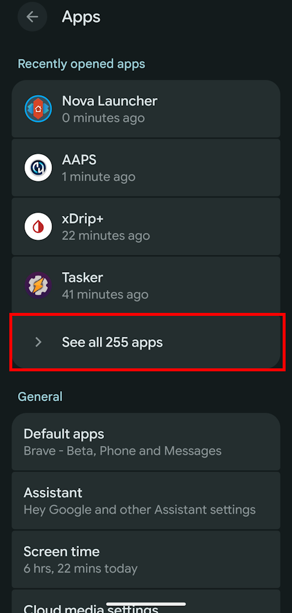
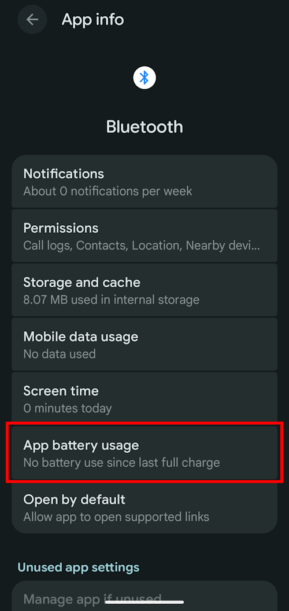
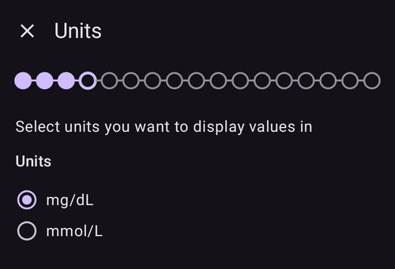
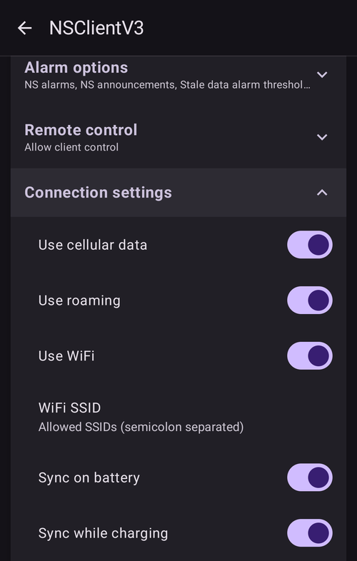
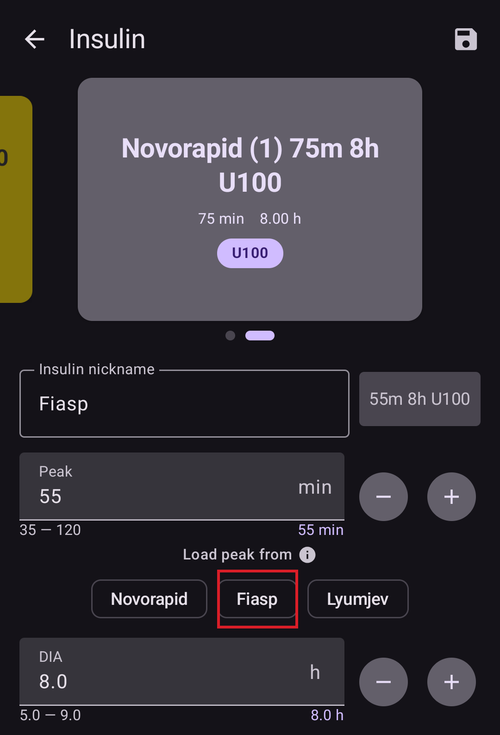

# Sprievodca nastavením AAPS

```{contents} In this page
:backlinks: entry
:depth: 2
```

Pri prvom spustení **AAPS** vás prevedie „**Sprievodca nastavením**“, aby ste mohli rýchlo nastaviť všetky základné nastavenia vašej aplikácie jedným ťahom. **Sprievodca nastavením** vás navedie, aby ste nezabudli na niečo zásadné. Napríklad **nastavenia povolení** sú základom správneho nastavenia **AAPS**.

Nie je však povinné mať všetko úplne nakonfigurované pri prvom spustení **Sprievodcu nastavením**. Sprievodcu môžete jednoducho ukončiť a vrátiť sa k nemu neskôr. Po dokončení **Sprievodcu nastavením** máte tri spôsoby, ako konfiguráciu ďalej vyladiť alebo zmeniť. Vysvetlíme ich v ďalšej časti. Nevadí teda, ak niektoré body v Sprievodcovi nastavením preskočíte, môžete ich ľahko nastaviť neskôr.

Počas používania **Sprievodcu nastavením** a hneď po ňom si v **AAPS** nemusíte všimnúť žiadne výrazné zmeny. Ak chcete zapnúť okruh **AAPS**, musíte postupne plniť **Ciele**, ktoré povoľujú jednu funkciu za druhou. **Cieľ 1** spustíte na konci Sprievodcu nastavením. Vy ovládate **AAPS**, nie naopak.

```{admonition} Preview Objectives
:class: note
Ak chcete poznať štruktúru cieľov, prečítajte si [Plnenie cieľov](../SettingUpAaps/CompletingTheObjectives.md), ale potom sa sem vráťte a najprv prejdite Sprievodcu nastavením.

```

Zo skúseností vieme, že začiatočníci sa často sami nútia nastaviť **AAPS** čo najrýchlejšie. To môže viesť k frustrácii, pretože sa treba naučiť veľa nového.

Preto si na nastavenie okruhu nechajte dosť času. Prínos dobre fungujúceho okruhu **AAPS** je obrovský.

```{admonition} Ask for Help
:class: note
Ak je v dokumentácii chyba alebo máte lepší nápad, ako niečo vysvetliť, môžete požiadať o pomoc komunitu, ako je opísané v časti [Kde získať pomoc](../GettingHelp/WhereCanIGetHelp.md).
```
## Uvítacia správa

Po otvorení Sprievodcu nastavením sa zobrazí krátka uvítacia správa a hneď v dolnej časti obrazovky aj panel „**Požadované povolenia**“ (pozrite ďalšiu časť).

Keď udelíte povolenia, panel sa zatvorí a na uvítacej obrazovke sa zobrazí tlačidlo „**Ďalej**“. Pokračujte stlačením „**ĎALEJ**“:


## Požadované povolenia

**AAPS** potrebuje na správne fungovanie niekoľko povolení. Sprievodca ich zoskupuje na jednom paneli „**Požadované povolenia**“, každé s vlastným tlačidlom „**Povoliť**“. Udeľte ich jedno po druhom – keď je povolenie udelené, ikona vedľa položky sa zmení na fajku.


### Optimalizácia batérie

Spotreba batérie je pri smartfónoch dôležitá, pretože výkon batérií je stále dosť obmedzený. Preto operačný systém Android vo vašom smartfóne obmedzuje, ktoré aplikácie môžu bežať a spotrebúvať čas procesora, a tým aj energiu batérie.

**AAPS** však musí bežať pravidelne, _napr._ aby každých pár minút prijal hodnoty glykémie a potom pomocou algoritmu rozhodol, ako na vašu glykémiu reagovať podľa vašich nastavení. Preto musí byť vyňatý z optimalizácie batérie.

Stlačte „**Povoliť**“ vedľa „**Optimalizácia batérie**“ a potom v dialógu „Povoliť aplikácii stále bežať na pozadí?“ vyberte „**Povoliť**“:


(SetupWizard-StoragePermission)=

### AAPS priečinok

**AAPS** potrebuje ukladať svoje nastavenia a logy do trvalého úložiska vášho smartfónu. Trvalé úložisko znamená, že údaje budú dostupné aj po reštarte smartfónu. Ostatné informácie sa jednoducho stratia, pretože sa neukladajú do trvalého úložiska.

Stlačte „**Povoliť**“ vedľa „**AAPS priečinok**“. Otvorí sa súborový systém telefónu a môžete vybrať, kam bude **AAPS** ukladať svoje údaje.

```{tip}
Odporúčame zvoliť predvolený priečinok AAPS.</br>
**Nevyberajte** podpriečinok priečinka AAPS.
```

Predvolený priečinok je **AAPS**, ale môžete použiť akýkoľvek iný priečinok určený len na tento účel. Ak je to potrebné, priečinok vytvorte, otvorte ho a vyberte „**POUŽIŤ TENTO PRIEČINOK**“ (USE THIS FOLDER):


Tlačidlom „**POVOLIŤ**“ (ALLOW) potvrďte, že chcete **AAPS** udeliť prístup k vybranému priečinku:


### Notifikácie

Android vyžaduje pre aplikácie špeciálne povolenie, ak vám chcú posielať notifikácie.

Vypnúť notifikácie _napr._ zo sociálnych sietí je užitočné, ale je nevyhnutné, aby ste **AAPS** dovolili posielať vám notifikácie.

Stlačte „**Povoliť**“ vedľa „**Notifikácie**“ a v systémovej výzve vyberte „**Povoliť**“:


### Alarmy a pripomienky

V **Androide 14 a novšom** potrebuje **AAPS** povolenie „**Alarmy a pripomienky**“, aby alarmy mohli zobudiť obrazovku, keď **AAPS** beží na pozadí, a aby pripomienky (napríklad z **Automatizácie**) zazneli načas.

Táto položka sa zobrazuje, len kým je potrebná. Keď je **AAPS** vyňatý z optimalizácie batérie (pozrite vyššie), Android povolí presné alarmy automaticky a položka zmizne. Ak je stále v zozname, stlačte „**Povoliť**“ vedľa „**Alarmy a pripomienky**“. Otvorí sa obrazovka systémových nastavení pre **AAPS**. Zapnite prepínač a vráťte sa do **AAPS**. V Androide 13 a staršom sa táto položka nezobrazuje a nie je potrebné nič robiť.

Keď majú všetky povolenia fajku (tri, alebo štyri v Androide 14 a novšom), panel „**Požadované povolenia**“ sa sám zatvorí a na uvítacej obrazovke môžete pokračovať stlačením „**ĎALEJ**“.

(setup-wizard-bluetooth-battery-optimisation)=
### Optimalizácia batérie pre Bluetooth

```{admonition} Extra Android setting, not part of the Wizard
:class: note
Nasleduje ďalšie nastavenie Androidu, ktoré sa robí mimo Sprievodcu nastavením. Nie je to žiadne z tlačidiel „Povoliť“ vyššie, ale je dôležité pre spoľahlivé spojenie s pumpou.
```

Novšie verzie Androidu pridali optimalizáciu batérie aj do systémovej aplikácie Bluetooth.

Okrem vypnutia optimalizácie batérie pre **AAPS** ju pravdepodobne budete musieť vypnúť aj pre systémovú aplikáciu Bluetooth. Ak to neurobíte, môže dochádzať k výpadkom spojenia s pumpou a ďalším problémom.

***POZNÁMKA: Postup je popísaný aj v dokumentácii xDrip: [dokumentácia xDrip](https://navid200.github.io/xDrip/docs/BluetoothBatteryOpt.html)***

V Androide 16 postupujte podľa týchto krokov; v iných verziách sa obrazovky budú od snímok mierne líšiť:

1. Otvorte nastavenia Androidu, vyhľadajte **Aplikácie** (Apps) a otvorte nastavenia aplikácií.

   

2. Zobrazia sa nastavenia aplikácií, ale musíme ich rozbaliť, aby boli vidieť všetky aplikácie. Kliknite na **Zobraziť všetky aplikácie** (See all apps).

   

3. Aplikácia Bluetooth je systémová aplikácia, a preto je predvolene skrytá. Musíme teda zobraziť systémové aplikácie. Kliknite na **tri bodky** (⋮) vpravo hore (1). Potom kliknite na **Zobraziť systémové** (Show system) (2).

   

4. Vyhľadajte aplikáciu `Bluetooth` a kliknite na `Bluetooth` a/alebo `Legacy Bluetooth`. Ak sú tam obe, postup urobte pre obe.

   ***POZNÁMKA: `Bluetooth MIDI Service` môžete pokojne ignorovať, AAPS ju nepoužíva***

           

   1. On Android 12 click on `Battery`, on Android 13+ click on `App battery usage`.

      

5. V Androide 12 a novšom vyberte možnosť `Bez obmedzení` (Unrestricted). V Androide 15 a novšom musíte rozbaliť nastavenie `Povoliť používanie na pozadí` (Allow background usage) – kliknite na časť zvýraznenú červenou a potom dokončite postup krokom 6.

       

6. V Androide 16 vyberte `Bez obmedzení` (Unrestricted)

   

## Licenčná zmluva

V licenčnej zmluve pre koncového používateľa sú dôležité informácie o právnych aspektoch používania **AAPS**. Pozorne si ju prečítajte.

Ak nerozumiete alebo nemôžete súhlasiť s licenčnou zmluvou koncového používateľa, nepoužívajte **AAPS** vôbec!

Ak rozumiete a súhlasíte, stlačte tlačidlo „**ROZUMIEM A SÚHLASÍM**“ a pokračujte v Sprievodcovi nastavením:


Po vyjadrení súhlasu sa zobrazí tlačidlo „**Ďalej**“. Stlačte „**ĎALEJ**“.

Na ďalšej obrazovke „**Povolenia**“ sú povolenia uvedené znova. Všetky by mali mať fajku, pretože ste ich udelili hneď na začiatku. Ak niektoré chýba, stlačte vedľa neho „**Povoliť**“. Pokračujte stlačením „**ĎALEJ**“:


## Hlavné heslo

Konfigurácia **AAPS** obsahuje citlivé údaje (_napr._ prístupový token k vášmu serveru Nightscout), preto je zašifrovaná heslom, ktoré tu nastavíte.

Sprievodca zobrazuje „**Heslo nie je nastavené**“. Stlačte „**Nastaviť**“:


Otvorí sa obrazovka „**Ochrana**“. Stlačte „**Hlavné heslo**“ (zobrazené ako „Heslo nie je nastavené“):


Zadajte rovnaké heslo do oboch polí a stlačte „**OK**“:


Vráťte sa späť šípkou v ľavom hornom rohu. Sprievodca teraz zobrazuje „**Heslo nastavené!**“:


```{admonition} Do not lose your Master Password
:class: danger
**NESTRAŤTE SVOJE HLAVNÉ HESLO**. Poznačte si ho _napr._ na Disku Google – je to dobré miesto, pretože Google ho za vás zálohuje. Váš smartfón alebo počítač sa môže pokaziť a nemusíte mať žiadnu aktuálnu kópiu. Ak zabudnete hlavné heslo, môže byť neskôr ťažké obnoviť nastavenie profilu a postup v **Cieľoch**.
```

Keď skončíte, stlačte „**ĎALEJ**“ a prejdite na ďalšiu obrazovku.

(setup-wizard-import-settings)=
## Importovať nastavenia

Táto obrazovka sa zobrazí, len keď **AAPS** nájde v priečinku **AAPS** skôr exportované nastavenia („Nájdené uložené nastavenia“), napríklad keď aplikáciu preinštalujete alebo prechádzate na nový telefón.

- Ak chcete obnoviť predchádzajúcu konfiguráciu, stlačte „**Importovať nastavenia**“ – pozrite [Vytváranie a obnova záloh](../Maintenance/ExportImportSettings.md).
- Ak chcete začať s novou konfiguráciou, stlačte „**ĎALEJ**“ a pokračujte v Sprievodcovi.


## Jednotky (mg/dl <-> mmol/l)

Vyberte, či sú vaše hodnoty glykémie v mg/dl alebo v mmol/l, a potom stlačte tlačidlo „**ĎALEJ**“:



## Nastavenie zobrazenia

Tu nastavíte „**Dolná značka**“ a „**Horná značka**“ pre zobrazenie glykémie zo senzora. Hodnoty glykémie medzi týmito dvoma značkami sa zobrazujú ako „v rozsahu“. Predvolené hodnoty (72 a 180 mg/dl) zatiaľ môžete nechať a neskôr ich upraviť.

Hodnoty, ktoré zvolíte, ovplyvňujú iba grafické zobrazenie grafu a nič iné.

_Napr._ vašu cieľovú glykémiu nastavujete samostatne vo svojom profile.

Rozsah na analýzu TIR (čas v rozsahu) sa nastavuje samostatne vo vašom reportovacom serveri.

Ak je to potrebné, upravte značky tlačidlami „−“ / „+“ a potom stlačte tlačidlo „**ĎALEJ**“:


(SetupWizard-synchronization-with-the-reporting-server-and-more)=
## Komunikácia

Obrazovka „**Komunikácia**“ obsahuje zoznam pluginov na nahrávanie, synchronizáciu a vysielanie vašich údajov:

- **SMS komunikátor** – vzdialené ovládanie **AAPS** pomocou SMS príkazov
- **NSClientV3** – synchronizuje vaše údaje s Nightscoutom cez API v3
- **Tidepool** – nahráva údaje do Tidepoolu
- **xDrip** – posiela údaje do xDripu
- **Open Humans** – nahratie a darovanie vašich údajov o diabete pre vedecké projekty
- **Wear** – sledovanie a ovládanie **AAPS** z hodiniek s Wear OS
- **Externé sprievodné (Companion) aplikácie** – vysielanie údajov do rôznych externých aplikácií
- **Garmin** – pripojenie k zariadeniu Garmin


Zvyšok zoznamu uvidíte, keď posuniete obrazovku nadol:


Viaceré z nich by ste mohli nastaviť už teraz, ale pri prvom spustení sa zameriame len na reportovací server. Ak ho teraz nemôžete nastaviť, zatiaľ ho preskočte – nastaviť ho môžete aj neskôr.

V tomto príklade používame ako reportovací server Nightscout. Zaškrtnite políčko vpravo od „**NSClientV3**“ a tým ho zapnete. Pri Tidepoole je to ešte jednoduchšie, pretože potrebujete iba svoje osobné prihlasovacie údaje.

Po zapnutí stlačte „**Nastavenia**“ pod NSClientV3 a nastavte ho:


Tu nastavíte reportovací server Nightscout. Nastavenia NSClientV3 sú zobrazené na jednej stránke, ktorou sa dá posúvať:


Stlačte „**Adresa Nightscoutu**“ a zadajte adresu svojho osobného servera Nightscout (URL, ktorú ste si nastavili sami alebo ktorú ste dostali od poskytovateľa služby). Potvrďte tlačidlom „**OK**“.

Stlačte „**Nightscout prístupový token**“ a zadajte prístupový token pre váš server Nightscout. Bez tohto tokenu prístup nebude fungovať. Ak ho ešte nemáte, pozrite si dokumentáciu k nastaveniu reportovacieho servera.

Nechajte zapnuté „**Použiť websockety**“ pre komunikáciu s Nightscoutom v reálnom čase.

Ostatné časti môžete zatiaľ nechať v predvolenom nastavení. Popisujeme ich tu, aby ste neskôr vedeli, kde ich nájdete:

**Nastavenie alarmov** – alarmy z Nightscoutu, oznámenia a limity pre neaktuálne údaje. Prepínače zatiaľ nechajte vypnuté; otvárame ich len preto, aby ste o týchto možnostiach vedeli.

**Nastavenie pripojenia** – vyberte, ako sa majú údaje prenášať. Opatrovatelia musia zapnúť „**Použiť mobilné dáta**“, inak telefón osoby, o ktorú sa starajú (_napr._ dieťaťa), nemôže nahrávať údaje mimo dosahu Wi-Fi, _napr._ cestou do školy. Ostatní používatelia môžu prenos cez mobilnú sieť vypnúť, aby šetrili dáta alebo batériu. Ak si nie ste istí, nechajte všetko zapnuté.



**Rozšírené nastavenia** – zapnite „**Zaznamenávať spustenie aplikácie**“, ak chcete v Nightscoute vidieť, kedy sa aplikácia reštartuje (užitočné pre opatrovateľov). Nechajte zapnuté „**Vytvárať z chýb oznámenia**“ a „**Vytvoriť oznámenie z výstrahy požadovaných sacharidov**“. „**Použiť pomalú synchronizáciu**“ nechajte vypnuté; použili by ste ju len vtedy, keby server Nightscout spracovával veľké množstvo údajov pomaly.


Vráťte sa do zoznamu pluginov a stlačením „**ĎALEJ**“ prejdite na ďalšiu obrazovku.

## Ovládanie z klienta

Od verzie 4 **AAPS** môžu byť klientske zariadenia s aplikáciou **AAPSClient** **spárované** s týmto telefónom (**master**) a ovládať ho podpísanými príkazmi posielanými cez Nightscout. Toto je nový odporúčaný spôsob vzdialeného ovládania **AAPS** – úplné vysvetlenie a nastavenie nájdete v [Ovládanie Master ↔ Client](../RemoteFeatures/ClientMasterControl.md).

Na tejto obrazovke teraz nemusíte nič nastavovať; klientov môžete kedykoľvek neskôr spárovať cez **Spravovať → Autorizovaní klienti**. Tam pridáte klienta pomocou **QR kódu** (ten nastaví aj Nightscout na klientovi) alebo pomocou **PIN** kódu a priradíte mu **rolu**.

- „**Autorizovaní klienti**“ – správa spárovaných klientskych zariadení, ktoré môžu ovládať tento master.
- „**Prijímanie dát z Nightscoutu**“ – prijímanie ošetrení a údajov zadaných priamo v Nightscoute (starý, menej bezpečný spôsob) je teraz predvolene vypnuté. Tieto nastavenia otvorte, len ak to ešte potrebujete, _napr._ na zadávanie údajov cez Nightscout alebo aplikácie tretích strán.

Keď je ovládanie z klienta už zapnuté – v [Jednoduchom móde](#preferences-simple-mode) vždy – je tento telefón v [režime zvýšeného zabezpečenia](#client-master-control-hardened-mode): prijíma zmeny len od spárovaných klientov, preto obrazovka namiesto nastavení „**Prijímanie dát z Nightscoutu**“ vysvetľuje režim zvýšeného zabezpečenia.


„**Prijímanie dát z Nightscoutu**“ otvorí nastavenia „**Synchronizácia**“, kde má každý druh údajov prijímaných z Nightscoutu vlastný prepínač:


Stlačením „**ĎALEJ**“ prejdite na ďalšiu obrazovku.

(setup-wizard-instance-name)=
## Kto používa tento telefón?

Tu zadáte meno osoby, ktorá tento telefón používa. Podľa neho sa táto inštancia **AAPS** v reportoch a pri synchronizácii odlíši od ostatných, napríklad ak **AAPS** používajú dve deti vo vašej rodine. Používa sa aj v názvoch exportovaných súborov s nastaveniami a zobrazuje sa na hodinkách.

Môže to byť čokoľvek. Neskôr ho môžete zmeniť v **Nastavenia → Všeobecné → Názov inštancie**.

Stlačením „**ĎALEJ**“ prejdite na ďalšiu obrazovku.


## Typ pacienta

Tu si vyberiete „Typ pacienta“, čo je dôležité, pretože softvér **AAPS** má rôzne limity v závislosti od veku pacienta. Je to dôležité z bezpečnostných dôvodov.

Tu môžete tiež nastaviť **maximálny povolený bolus** pre jedlo. Teda najväčší bolus, ktorý potrebujete na pokrytie svojich bežných jedál. Je to bezpečnostná funkcia, ktorá pomáha predísť náhodnému predávkovaniu pri boluse na jedlo.

Druhý limit je podobný, ale týka sa maximálneho príjmu sacharidov, ktorý očakávate.

Po nastavení týchto hodnôt stlačením „**ĎALEJ**“ prejdite na ďalšiu obrazovku:


## Inzulín

Tu nastavíte inzulín, ktorý používate v pumpe. Nové inzulínové profily vyžadujú **DIA aspoň 5 h**.

Stlačením tlačidla „**Inzulín**“ otvoríte editor inzulínu:


V editore môžete inzulínu dať **prezývku** a nastaviť jeho **Vrchol** (v minútach) a **DIA** (v hodinách). Najrýchlejšie je načítať predvoľbu cez „**Načítať vrchol z**“ – vyberte **Novorapid**, **Fiasp** alebo **Lyumjev** – a vrchol sa vyplní za vás. Graf v dolnej časti zobrazuje náhľad výslednej krivky aktivity inzulínu.


Vyberte predvoľbu, ktorá zodpovedá vášmu inzulínu, napríklad **Fiasp**:



```{admonition} Use your insulin brand's preset peak
:class: danger
Vrchol nemeňte, ak nie ste odborník – predvolené hodnoty pre jednotlivé značky inzulínu zvyčajne fungujú dobre.
```

Ak ste nový používateľ **AAPS**, nastavte **DIA** na 9 hodín – prečo, vysvetľuje časť [Doba pôsobenia inzulínu (DIA) a vrchol](#Config-Builder-insulin-dia).

```{admonition} "Insulin configuration changed" dialog
:class: note
Ak spárovaný klient (_napr._ iný telefón) zmenil konfiguráciu inzulínu, zobrazí sa dialóg. Stlačením **OK** načítate jeho zmeny, stlačením **Zrušiť** budete pokračovať v úpravách (vaše ďalšie uloženie prepíše jeho zmeny).
```


Stlačte ikonu uloženia (vpravo hore) a potom stlačením „**ĎALEJ**“ prejdite na ďalšiu obrazovku.

## Zdroj glykémie

Tu vyberiete, odkiaľ **AAPS** získava údaje o glykémii. Prečítajte si dokumentáciu k vášmu [zdroju glykémie](../Getting-Started/CompatiblesCgms.md).

K dispozícii je veľa zdrojov – prejdite zoznamom a vyberte ten, ktorý používate:


Keď vyberiete zdroj, jeho karta sa rozbalí a zobrazí dve tlačidlá: „**Nastavenia**“ na úpravu príjmu údajov a „**Otvoriť plugin**“ na otvorenie vlastnej obrazovky zdroja. V príklade nižšie je vybraný **BYODA**. Niektoré zdroje v tomto kroku nemajú čo nastaviť, takže zvyčajne môžete prejsť rovno na ďalšiu obrazovku:


Po výbere stlačením „**ĎALEJ**“ prejdite na ďalšiu obrazovku.

(setup-wizard-profile)=
## Profil

Teraz sa dostávame k veľmi dôležitej časti Sprievodcu nastavením.

Skôr než na nasledujúcej obrazovke zadáte údaje svojho profilu, prečítajte si dokumentáciu o [profiloch](../SettingUpAaps/YourAapsProfile.md).

```{admonition} Working profile required - no exceptions here !
:class: danger
Pre bezpečnú činnosť **AAPS** je nevyhnutný presný profil.

Je nutné, aby ste svoj profil určili a prebrali so svojím lekárom a aby sa jeho funkčnosť potvrdila úspešným testovaním bazálnej dávky, ISF a I:C!

Ak robot dostane nesprávne vstupy, zlyhá – a to zakaždým. **AAPS** môže pracovať iba s informáciami, ktoré mu poskytnete. Ak je váš profil príliš silný, riskujete hypoglykémiu a ak je príliš slabý, riskujete hyperglykémiu. 
```

Stlačením tlačidla „**Profil**“ otvoríte editor profilu:


Editor sa otvorí prázdny („Nie sú k dispozícii žiadne záznamy“). Stlačením tlačidla „**+**“ v dolnej časti vytvoríte nový profil:


Z dlhodobého hľadiska môžete mať podľa potreby viacero profilov. Tu vytvoríme iba jeden.

```{admonition} Profile only for tutorial - not for your usage
:class: note
Tento vzorový profil slúži len na ukážku, ako zadávať údaje.

Nemá to byť presný ani dobre optimalizovaný profil, pretože potreby každého človeka sú veľmi odlišné.

Nepoužívajte ho na skutočnú liečbu okruhom!
```

Nový profil (napríklad „**LocalProfile1**“) má štyri karty: **I:C**, **ISF**, **BAZ** a **CIEĽ**. Profil premenujete stlačením ceruzky vedľa jeho názvu. Vyplňte všetky karty – karta zostane červená a zobrazuje chybové hlásenie, kým neobsahuje platné hodnoty:


Stlačte „**I:C**“ a zadajte svoje hodnoty [I:C](#your-aaps-profile-insulin-to-carbs-ratio). Ďalšie časové úseky pridáte tlačidlom „**+**“:


Stlačte „**ISF**“ a zadajte svoje [hodnoty ISF](#your-aaps-profile-insulin-sensitivity-factor):


Stlačte „**BAZ**“ a zadajte svoje [bazálne dávky](#your-aaps-profile-basal-rates):


Stlačte „**CIEĽ**“ a zadajte svoje cieľové hodnoty glykémie.

Pri otvorenom okruhu môže byť tento cieľ širší rozsah, inak by vás **AAPS** neustále upozorňoval, aby ste zmenili dočasný bazál alebo iné nastavenie, a to môže byť vyčerpávajúce.

Neskôr, pri uzavretom okruhu, budete mať zvyčajne iba jednu hodnotu pre hornú aj dolnú hranicu. Vďaka tomu **AAPS** ľahšie dosiahne cieľ a celkovo lepšie kontroluje váš diabetes.


Keď sú všetky štyri karty platné, **ikona uloženia** (vpravo hore) sa aktivuje. Stlačením profil uložíte:


Editor zatvorte tlačidlom „**X**“ v ľavom hornom rohu. Súhrn profilu potom zobrazí jeho názov, celkový denný bazál (∑), jednotky a hodnoty I:C a ISF s ich grafmi:


```{admonition} Several defined but only one active profile
:class: note
Môžete mať definovaných viac profilov, ale v jednej chvíli môže bežať len jeden aktivovaný profil.
```

Stlačte tlačidlo „**▶**“ (aktivovať) vpravo dole. Otvorí sa obrazovka „**Aktivovať**“. Keďže sa zatiaľ nepoužíva žiadny inzulín, najprv vás požiada o výber inzulínu, ktorý používate, aby ho prepnutie profilu mohlo zaznamenať. Tlačidlo „**Aktivovať**“ zostane sivé, kým to neurobíte:


Stlačte „**Zvoľte inzulín**“ a vyberte inzulín, ktorý ste nastavili predtým. Percento nechajte na 100 % a stlačte „**Aktivovať**“:


Zobrazí sa dialóg prepnutia profilu. V tomto prípade nechajte predvolené hodnoty a potvrďte tlačidlom „**OK**“:

```{admonition} Profile switch dialog
:class: note
Neskôr sa naučíte, ako tento všeobecný dialóg použiť v situáciách, ako je choroba alebo šport, keď musíte profil prispôsobiť okolnostiam.
```


Váš profil je teraz aktívny. Stlačením „**ĎALEJ**“ prejdite na ďalšiu obrazovku.

## Inzulínová pumpa

Teraz vyberiete svoju inzulínovú pumpu. Prečítajte si dokumentáciu k vašej [inzulínovej pumpe](../Getting-Started/CompatiblePumps.md).

Prejdite zoznamom a vyberte svoju pumpu. V tomto príklade používame „**Virtuálna pumpa**“, ktorá je užitočná, kým sa ešte učíte a nemáte pripojenú skutočnú pumpu:


Podporovaných púmp je veľa – posuňte sa nižšie a nájdite tú svoju:


Keď vyberiete skutočnú pumpu, **AAPS** si vyžiada potvrdenie, pretože skopíruje bazálne dávky z vášho profilu do pumpy a prepíše bazálne dávky, ktoré sú v nej uložené. Stlačte „**OK**“, len ak sú bazálne dávky vo vašom profile **AAPS** správne; inak stlačte „**Zrušiť**“ a na pumpu prepnite neskôr:


If the pump you select communicates over Bluetooth, **AAPS** asks for permission to connect to nearby devices once you finish the Wizard (see [Bluetooth permission](#setup-wizard-bluetooth-permission)).

Ak už máte nastavený profil a viete, ako pripojiť pumpu, môžete ju pripojiť hneď. Inak zatiaľ nechajte **Virtuálna pumpa** – zmeniť to môžete kedykoľvek, alebo môžete Sprievodcu nastavením opustiť šípkou v ľavom hornom rohu a nechať **AAPS** najprv zobraziť nejaké hodnoty glykémie.

Stlačením „**ĎALEJ**“ prejdite na ďalšiu obrazovku.

## Algoritmus APS

Ako algoritmus APS použite algoritmus OpenAPS SMB. Napriek názvu je funkcia SMB tohto algoritmu vypnutá, kým sa s AAPS neoboznámite a nesplníte prvé ciele. OpenAPS SMB je aj tak novší a zvyčajne lepší ako OpenAPS AMA.

SMB je na začiatku vypnuté, pretože funkcia SMB reaguje na nárast glykémie rýchlejšie – namiesto zvýšenia percenta bazálnej dávky použije Super Micro Bolus. Keďže váš profil na začiatku zvyčajne nie je taký dobrý ako po získaní skúseností, je táto funkcia najprv vypnutá.

```{admonition} Only use the older algorithm **OpenAPS AMA** if you know what you are doing
:class: note
OpenAPS AMA je najjednoduchší algoritmus, ktorý nepodporuje mikrobolusy na korekciu vysokých hodnôt. Môžu nastať situácie, keď je lepšie použiť tento algoritmus, ale neodporúčame to.
```

Vyberte „**OpenAPS SMB**“ a potom stlačením „**Nastavenia**“ zobrazte podrobnosti:


Jediná možnosť je tu „**Použiť dynamickú citlivosť**“. Nechajte ju vypnutú a zatiaľ nič nemeňte – len si prečítajte text.

Kvôli obmedzeniam v **Cieľoch** teraz aj tak nemôžete používať „uzavretý okruh“ ani „funkcie SMB“.

Vráťte sa späť a stlačením „**ĎALEJ**“ prejdite na ďalšiu obrazovku:


## Detekcia citlivosti

Ako štandardný plugin citlivosti nechajte vybrané „**Citlivosť Oref1**“:


Ak stlačíte „**Nastavenia**“, môžete si pozrieť nastavenia absorpcie; predvolené hodnoty (_napr._ hraničný čas absorpcie 6 h) sú zatiaľ v poriadku.


Stlačením „**ĎALEJ**“ prejdite na ďalšiu obrazovku.

## Spustite Cieľ 1

Teraz vstupujete do Cieľov – sú to podmienky na prístup k ďalším funkciám **AAPS**.

Stlačte „**Otvoriť Ciele**“:


Tu spúšťame Cieľ 1, aj keď naše nastavenie v tejto chvíli ešte nie je úplne pripravené na úspešné splnenie tohto Cieľa. Ale je to začiatok.

Press the "**Start**" button of **Objective 1**:


Cieľ sa rozbalí a zobrazí jednotlivé kontroly. Vidíte, že niektoré veci už máte splnené a iné ešte treba urobiť:


Vráťte sa späť a stlačením „**DOKONČIŤ**“ ukončite Sprievodcu nastavením:


Po stlačení „**DOKONČIŤ**“ sa dostanete na hlavnú obrazovku **AAPS**. Môže sa otvoriť panel „**Notifikácia**“ s informačnými správami, napríklad o prepnutí profilu, ktoré ste práve urobili – každú správu odstránite stlačením „**Zatvoriť**“ pod ňou.

Ak v ktoromkoľvek bode omylom opustíte Sprievodcu nastavením, môžete ho jednoducho spustiť znova alebo zmeniť [konfiguráciu okruhu AAPS](../SettingUpAaps/ChangeAapsConfiguration.md) ručne.

(setup-wizard-bluetooth-permission)=
## Povolenie pre Bluetooth

Ak vyberiete pumpu, ktorá sa pripája cez Bluetooth (napríklad **Omnipod Dash**), banner vám pripomenie, že **AAPS** potrebuje povolenie pre Bluetooth. Zatiaľ môžete stlačiť „**Zatvoriť**“ – povolenie udelíte po dokončení Sprievodcu:


Po dokončení Sprievodcu nastavením sa na hlavnej obrazovke **AAPS** zobrazí panel „**Požadované povolenia**“. Ostatné povolenia sú už udelené; stlačte „**Povoliť**“ vedľa „**Bluetooth**“:


Vyberte „**Povoliť**“, aby **AAPS** mohol nájsť vašu pumpu a pripojiť sa k nej:


Ak je váš okruh **AAPS** teraz úplne nastavený, pokračujte ďalšou časťou [„Plnenie cieľov“](../SettingUpAaps/CompletingTheObjectives.md).
