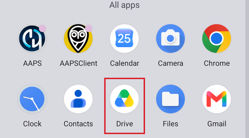

# Prenos a inštalácia AAPS do smartfónu

V predchádzajúcej časti, [Zostavenie **AAPS**](../SettingUpAaps/BuildingAaps.md), ste na počítači zostavili aplikáciu **AAPS** (je to súbor .apk).

Ďalším krokom je **preniesť** súbor APK **AAPS** (a aj ďalšie aplikácie, ktoré môžete potrebovať, napríklad BYODA, xDrip alebo inú aplikáciu na príjem dát z CGM) do vášho smartfónu s Androidom a potom aplikáciu (aplikácie) **nainštalovať**. Po inštalácii **AAPS** do smartfónu môžete prejsť na [**nastavenie okruhu AAPS**](../SettingUpAaps/SetupWizard.md).

Táto stránka tiež vysvetľuje [overovanie vývojárov pre Android](#android-developer-verification). Je to zmena, ktorú Google zavádza od septembra 2026 a ktorá ovplyvňuje inštaláciu vlastnoručne zostavených aplikácií. Opisuje aj [bezplatné spôsoby inštalácie](#android-developer-verification-free-methods), ktoré budú fungovať aj po tejto zmene.

```{contents} Table of contents
:depth: 1
:local: true
```

## Inštalácia AAPS ťuknutím na súbor APK

Dnes sa **AAPS** inštaluje tak, že súbor APK prenesiete do telefónu a otvoríte ho (ťuknete naň). Existuje niekoľko spôsobov, ako preniesť súbor APK **AAPS** z počítača do smartfónu. Tu vysvetľujeme dva rôzne spôsoby:

* Možnosť 1 – pomocou Disku Google (Gdrive)
* Možnosť 2 – pomocou kábla USB

Upozorňujeme, že prenos e-mailom môže spôsobovať problémy a neodporúča sa.

```{admonition} Android developer verification
:class: warning
Google zavádza [overovanie vývojárov pre Android](#android-developer-verification) od septembra 2026 (najprv v Brazílii, Indonézii, Singapure a Thajsku; na celom svete v roku 2027). Tam, kde sa overovanie vyžaduje, je inštalácia súboru APK ťuknutím na súbor – ako to opisujú obe možnosti nižšie – zablokovaná. V takom prípade použite jeden z [bezplatných spôsobov inštalácie](#android-developer-verification-free-methods) nižšie na tejto stránke.
```

### Možnosť 1. Prenos súborov pomocou Disku Google

Vo webovom prehliadači otvorte [Google.com](https://www.google.com/) a prihláste sa do svojho účtu Google.

Vpravo hore v ponuke Google vyberte aplikáciu Disk.


Kliknite vľavo hore na **Nový** (New) (alebo kliknite pravým tlačidlom na prázdne miesto pod vašimi súbormi a priečinkami) a vyberte **Nahrať súbor** (File upload).


Súbor apk by teraz mal byť nahratý na Disk Google.

#### Inštalácia súboru apk pomocou aplikácie Disk Google

Prepnite sa do mobilu a spustite aplikáciu Disk Google. Je to predinštalovaná aplikácia a nájdete ju tam, kde sú ostatné aplikácie Google, alebo vyhľadaním jej názvu.



Inštaláciu súboru apk spustíte ťuknutím na názov súboru v aplikácii Disk Google v mobile.


Ak dostanete bezpečnostné upozornenie, že momentálne nemáte povolené inštalovať aplikácie z Disku Google, ťuknite na „Nastavenia“ a povoľte to len na tento krátky čas. Potom to znova zakážte, pretože nechať to stále povolené je bezpečnostné riziko.


Po dokončení inštalácie je tento krok hotový.

Mali by ste vidieť ikonu **AAPS** a mať možnosť otvoriť aplikáciu.

```{warning}
**DÔLEŽITÉ BEZPEČNOSTNÉ UPOZORNENIE**
Nezabudli ste zakázať inštaláciu z Disku Google?
```

Pokračujte [nastavením okruhu AAPS](../SettingUpAaps/SetupWizard.md).

### Možnosť 2. Prenos súborov pomocou kábla USB

Druhý spôsob, ako preniesť súbor apk AAPS, je pomocou [kábla USB](https://support.google.com/android/answer/9064445?hl=en).

Preneste súbor z jeho umiestnenia v počítači do priečinka „downloads“ (Stiahnuté súbory) v telefóne.

V telefóne budete musieť povoliť inštaláciu z neznámych zdrojov. Vysvetlenia, ako to urobiť, nájdete na internete (_napr._ [tu](https://www.expressvpn.com/de/support/vpn-setup/enable-apk-installs-android/) alebo [tu](https://www.androidcentral.com/unknown-sources)).

Keď súbor prenesiete pretiahnutím, otvorte v telefóne priečinok „Stiahnuté súbory“ (Downloads) a ťuknite na súbor apk AAPS:


Pri prvej inštalácii vám Android oznámi, že telefón nemá povolené inštalovať neznáme aplikácie z tohto zdroja. Ťuknite na „**Nastavenia**“:


Zapnite „**Povoliť z tohto zdroja**“ a vráťte sa späť:


Znova ťuknite na súbor apk a vyberte „**Inštalovať**“:


Keď sa inštalácia dokončí, ťuknite na „**Otvoriť**“, aby ste spustili **AAPS**, alebo na „**Hotovo**“, ak ju chcete otvoriť neskôr:


```{warning}
**DÔLEŽITÉ BEZPEČNOSTNÉ UPOZORNENIE**
Po inštalácii nezabudnite znova vypnúť „Povoliť z tohto zdroja“, pretože nechať to stále zapnuté je bezpečnostné riziko.
```

Pokračujte [nastavením okruhu AAPS](../SettingUpAaps/SetupWizard.md).

(transferring-installing-play-protect-warning)=
## Upozornenie Google Play Protect

Keď inštalujete **AAPS**, Google Play Protect vás môže upozorniť, že aplikácia nie je bezpečná, bola zostavená pre staršiu verziu Androidu a neobsahuje najnovšiu ochranu súkromia.


Pri aplikácii, ktorú ste si zostavili sami, je to očakávané. Ťuknite na **Ďalšie podrobnosti** (More details) a potom na **Napriek tomu inštalovať** (Install anyway).

Ak je inštalácia **zablokovaná** so správou o neoverenom vývojárovi (nie je to len upozornenie), pozrite si časť [Overovanie vývojárov pre Android](#android-developer-verification) nižšie.

(android-developer-verification)=

## Overovanie vývojárov pre Android

Google zavádza **overovanie vývojárov pre Android**: na väčšine telefónov s Androidom sa budú dať nainštalovať iba aplikácie, ktoré v Google zaregistroval overený vývojár. Týka sa to aj aplikácií inštalovaných zo súboru APK („sideloading“) – a presne takto inštalujete aplikáciu **AAPS**, ktorú ste si sami zostavili.

### Čo sa mení

Keď inštalujete **AAPS** do telefónu so službami Google („certifikované“ zariadenie s Androidom – prakticky každý telefón predávaný s Obchodom Play), Android overí, či aplikácia pochádza od vývojára zaregistrovaného v Google. Ak nie, bežná inštalácia ťuknutím na súbor APK je zablokovaná.

**Kontrola prebieha pri inštalácii alebo aktualizácii aplikácie.** Neodstraňuje aplikácie, ktoré sú už nainštalované a bežia.

Google to zavádza postupne:

| Kedy               | Čo sa stane                                                                                                                                               |
| ------------------ | --------------------------------------------------------------------------------------------------------------------------------------------------------- |
| August 2026        | Bezplatné vývojárske účty s „obmedzenou distribúciou“ sú dostupné na celom svete a do telefónov sa začína dostávať „rozšírený postup“ (advanced flow)     |
| 30. september 2026 | Overovanie sa vyžaduje v **Brazílii, Indonézii, Singapure a Thajsku** pre aplikácie inštalované z Google Play a niekoľkých ďalších obchodov s aplikáciami |
| 2027               | Overovanie sa rozšíri na **zvyšok sveta** a na **všetky inštalácie** vrátane súborov APK                                                                  |

Podrobnosti zverejňuje Google na stránkach [Android developer verification](https://developer.android.com/developer-verification) (overovanie vývojárov pre Android) vrátane [častých otázok](https://developer.android.com/developer-verification/guides/faq). Google môže termíny a podrobnosti ešte zmeniť; táto stránka sa bude aktualizovať podľa toho, ako bude zavádzanie pokračovať.

### Týka sa to aj mňa?

- **Na zostavenie AAPS to nemá žiadny vplyv.** [Zostavenie v prehliadači](#browser-build), [zostavenie v Android Studiu](ComputerBuild.md) aj [zostavenie z príkazového riadku](CLIBuild.md) fungujú presne ako predtým a vaše úložisko kľúčov sa nemení.
- **Vaše súčasné AAPS beží ďalej.** Overenie sa kontroluje iba pri inštalácii alebo aktualizácii aplikácie.
- **Ak žijete v Brazílii, Indonézii, Singapure alebo Thajsku:** od 30. septembra 2026 sa overovanie vyžaduje pre aplikácie inštalované z Google Play a niekoľkých ďalších obchodov s aplikáciami. Google uvádza, že priama inštalácia súboru APK do tohto prvého kroku nepatrí, takže **AAPS** by sa malo stále inštalovať ako zvyčajne. Napriek tomu si už teraz pripravte jeden z [bezplatných spôsobov inštalácie](#android-developer-verification-free-methods) nižšie, aby vás neprekvapilo, ak sa to zmení.
- **Ak žijete kdekoľvek inde:** pred rokom 2027 sa pre vás nič nemení a zatiaľ nerobiť nič je tiež rozumná voľba. Ale nastavte si jeden z [bezplatných spôsobov inštalácie](#android-developer-verification-free-methods) nižšie, kým ešte všetko funguje. Zlá chvíľa je zistiť blokovanie v deň, keď telefón odmietne aktualizáciu, a mať pred sebou 24-hodinové čakanie [rozšíreného postupu](#android-developer-verification-advanced-flow).
- **Staré telefóny:** overovanie platí pre telefóny s Androidom 7 alebo novším, teda pre každý telefón, na ktorom môže bežať **AAPS**.

(android-developer-verification-free-methods)=

## Bezplatné spôsoby inštalácie AAPS

Aby ste mohli **AAPS** používať ďalej, **nemusíte** Googlu nič platiť. Existuje niekoľko bezplatných spôsobov; vyberte si ten, ktorý zodpovedá vašej situácii.

```{admonition} Which method should I use?
:class: tip
- Máte **počítač** (bez ohľadu na to, ako ste **AAPS** zostavili): použite [ADB](#android-developer-verification-adb) alebo, ak sa chcete vyhnúť príkazovému riadku, [webový inštalátor](#android-developer-verification-web). Oba spôsoby sú z overovania vyňaté, nemajú žiadne obmedzenia a nepotrebujú účet Google.
- **Nemáte vôbec žiadny počítač**: použite v telefóne [rozšírený postup](#android-developer-verification-advanced-flow).
- Chcete sa radšej zaregistrovať v Google, aby bežná inštalácia „ťuknutím na APK“ fungovala ďalej: existuje [bezplatný účet s obmedzenou distribúciou](#android-developer-verification-limited-account), ale s **AAPS** zatiaľ nie je vyskúšaný.
```

(android-developer-verification-adb)=

### Možnosť 1: Inštalácia pomocou ADB (potrebujete počítač)

ADB (Android Debug Bridge) je oficiálny nástroj od Google na inštaláciu aplikácií z počítača do telefónu cez kábel USB. Google potvrdil, že **aplikácie inštalované cez ADB nevyžadujú overenie** – nie je tu žiadna čakacia doba, žiadny limit zariadení a žiadna registrácia.

Jednorazová príprava:

1. V telefóne zapnite skryté možnosti vývojára: prejdite do **Nastavenia** > **Informácie o telefóne** (na niektorých telefónoch **Informácie o softvéri**) a ťuknite sedemkrát na **Číslo zostavy**, kým telefón nepotvrdí, že ste vývojár.
1. Vráťte sa do hlavných **Nastavení**, otvorte novú položku **Možnosti vývojára** a zapnite **Ladenie cez USB**.
1. V počítači skontrolujte, či máte ADB:
   - Ak používate **Android Studio**, ADB je už nainštalované spolu s ním.
   - Inak si stiahnite bezplatné [SDK Platform Tools](https://developer.android.com/tools/releases/platform-tools) od Google a priečinok rozbaľte. Nič nie je potrebné inštalovať; ADB je program `adb` v tomto priečinku.

Inštalácia (a neskôr aktualizácia) **AAPS**:

1. Pripojte telefón k počítaču káblom USB. Súbor APK nemusíte najprv prenášať do telefónu: ADB ho pošle priamo z počítača.
1. V telefóne potvrďte výzvu **Povoliť ladenie cez USB?** (iba prvýkrát).
1. V počítači otvorte terminál (príkazový riadok) v priečinku, v ktorom je ADB a súbor APK **AAPS**, a spustite:

   ```
   adb install -r app-full-release.apk
   ```

   Namiesto `app-full-release.apk` zadajte skutočný názov vášho súboru APK. Voľba `-r` aktualizuje už nainštalované **AAPS** a zachová všetky jeho dáta a nastavenia.

1. Počkajte, kým sa zobrazí `Success`. **AAPS** je teraz nainštalované vo vašom telefóne.

Rovnaký príkaz použijete pri každej ďalšej aktualizácii. [Stránky o Wear OS](../WearOS/WearOsSmartwatch.md) už používajú ADB rovnakým spôsobom na inštaláciu aplikácie do hodiniek.

Ak nechcete použiť kábel: od Androidu 11 dokáže to isté cez Wi-Fi **bezdrôtové ladenie** (tiež v **Možnostiach vývojára**), po jednorazovom spárovaní pomocou kódu, ktorý sa zobrazí v telefóne.

(android-developer-verification-web)=

### Možnosť 2: Inštalácia z webovej stránky (počítač, bez príkazového riadku)

Ak vám príkazový riadok nevyhovuje, webová stránka dokáže priamo z prehliadača urobiť presne to isté, čo ADB. Keďže s telefónom komunikuje rovnakým mechanizmom ako ADB, má **rovnakú výnimku z overovania** – ale nič nesťahujete, nič nerozbaľujete a nepíšete žiadny príkaz.

Je to najjednoduchšia cesta, ak ste použili [zostavenie v prehliadači](#browser-build) a nikdy ste neotvorili príkazový riadok.

1. V telefóne zapnite **Ladenie cez USB** (kroky 1 a 2 [spôsobu s ADB](#android-developer-verification-adb) vyššie – jednorazové nastavenie).
1. V prehliadači otvorte **[Webový inštalátor AAPS](#web-installer)**.
1. Pripojte telefón káblom USB a postupujte podľa pokynov na stránke: pripojte, vyberte súbor APK a nainštalujte.

Tri veci, ktoré treba vedieť:

- Funguje iba v prehliadačoch **Chrome, Edge alebo Opera**. Firefox a Safari nedokážu komunikovať so zariadeniami USB.
- Pripojenie ADB telefónu môže naraz používať iba jeden program, preto pred pripojením **zatvorte Android Studio** (alebo čokoľvek iné, čo používa ADB).
- Webová stránka pripojená týmto spôsobom získa úplnú kontrolu nad vaším telefónom. **Používajte iba adresu uvedenú vyššie** z dokumentácie **AAPS** – nikdy nie stránku s inštalátorom nájdenú cez vyhľadávač. Webový inštalátor **AAPS** beží celý vo vašom prehliadači: váš súbor APK sa nikam nenahráva.

```{admonition} No computer? A second phone works too
:class: tip
Webový inštalátor funguje aj z **Chromu na inom telefóne s Androidom** s káblom USB-C na USB-C – takže rodič môže nainštalovať **AAPS** do telefónu dieťaťa, aj keď doma nemá počítač.
```

(android-developer-verification-advanced-flow)=

### Možnosť 3: „Rozšírený postup“ (advanced flow) v telefóne (bez počítača)

Pre skúsených používateľov, ktorí rozumejú rizikám inštalácie neoverených aplikácií, ponúka Google núdzové riešenie s názvom **rozšírený postup** (advanced flow). Google ho začal do telefónov zavádzať v auguste 2026, ešte pred začiatkom vynucovania, takže si ho môžete nastaviť už teraz. Je to jednorazové nastavenie priamo v telefóne a jeho dokončenie **trvá 24 hodín**:

1. Zapnite skryté možnosti vývojára (pozrite krok 1 spôsobu s ADB vyššie) a potom otvorte **Nastavenia** > **Možnosti vývojára** > **Aplikácie od neoverených vývojárov** (Apps from unverified developers).
1. Zapnite **Povoliť aplikácie od neoverených vývojárov** (Allow apps from unverified developers). Telefón si vyžiada zámku obrazovky, aby overil, že ste to vy.
1. Telefón sa opýta, či vás niekto žiada o zapnutie tohto nastavenia, a vysvetlí, že banky, štátne úrady ani polícia vás o to nikdy nežiadajú. Prečítajte si upozornenie a potvrďte, že vás nikto nenúti ani nenavádza (je to ochrana pred podvodníkmi).
1. **Reštartujte telefón.** Tým sa spustí jednorazová **24-hodinová čakacia doba**.
1. Po 24 hodinách sa vráťte do **Nastavenia** > **Možnosti vývojára** > **Aplikácie od neoverených vývojárov** a dokončite nastavenie.
1. Vyberte, či chcete neoverené aplikácie povoliť na **7 dní** alebo **natrvalo**. Pre **AAPS** vyberte **natrvalo**, inak bude vaša ďalšia aktualizácia po uplynutí 7 dní zablokovaná.

Po tomto nastavení funguje inštalácia alebo aktualizácia APK **AAPS** ako dnes, len s jedným upozornením navyše, že aplikácia je od neovereného vývojára – ťuknite na **Napriek tomu inštalovať**.

Dobré vedieť:

- **Možnosti vývojára** potom môžete znova vypnúť: rozšírený postup zostane zapnutý. Google tiež aplikáciám (napríklad bankovým) nedáva žiadnu možnosť zistiť, že je rozšírený postup zapnutý.
- Ak rozšírený postup vypnete, inštalácia **aj aktualizácia** **AAPS** je znova zablokovaná (vaše nainštalované **AAPS** beží ďalej). Na jeho opätovné zapnutie máte 10 minút; potom sa 24-hodinová čakacia doba začne znova.
- Zmena času v telefóne čakaciu dobu neskráti a ADB ju nedokáže preskočiť.
- Google uvádza, že vaša voľba prejde s vaším účtom Google aj na vaše ďalšie zariadenia, takže nový telefón by nemal znamenať ďalšie 24-hodinové čakanie.
- Ak v možnostiach vývojára nenájdete **Aplikácie od neoverených vývojárov**, váš telefón túto funkciu ešte nedostal. Dodáva ju systémová súčasť s názvom **Android Developer Verifier**, ktorú Google postupne zavádza cez Obchod Play. Môžete to urýchliť tak, že v Obchode Play otvoríte **Android Developer Verifier**.

```{note}
Google to opisuje ako prvú verziu a obrazovky aj kroky sa ešte môžu zmeniť; keď bude dostupná konečná verzia, táto časť sa doplní o snímky obrazovky.
```

(android-developer-verification-limited-account)=

### Možnosť 4: Registrácia v Google (bezplatný účet s obmedzenou distribúciou)

Google ponúka **bezplatný** typ vývojárskeho účtu pre nadšencov a osobné použitie s názvom **účet s obmedzenou distribúciou** (limited distribution account), ktorý je od augusta 2026 dostupný pre všetkých:

- **Bez občianskeho preukazu** a **bez poplatku** (na rozdiel od plateného vývojárskeho účtu, ktorý na osobné používanie **AAPS** nepotrebujete). Potrebujete však účet Google s dvojstupňovým overením, platobný profil Google s vaším úradným menom a adresou a kontaktnú e-mailovú adresu.
- V Android Developer Console od Google zaregistrujete názov balíka vašej aplikácie a autorizujete telefóny, do ktorých sa môže inštalovať, najviac **20 zariadení**. Autorizácia prebieha spárovaním telefónu a konzoly cez QR kód alebo odkaz.
- Po registrácii na autorizovaných telefónoch znova funguje bežná inštalácia (ťuknutím na súbor APK), bez ADB a bez rozšíreného postupu.
- Účet s obmedzenou distribúciou sa dá neskôr zmeniť na plný účet, ale nie naopak.

```{warning}
Google nevysvetlil, ako funguje registrácia, keď tú istú aplikáciu s otvoreným zdrojovým kódom zostavuje veľa ľudí: každé vlastnoručne zostavené **AAPS** používa rovnaký názov balíka (`info.nightscout.androidaps`) s iným podpisovým kľúčom. Podľa častých otázok Google nie je možné názov balíka, ktorý už používajú iní, jednoducho získať a vyžaduje sa ďalšia kontrola. Výsledok takej kontroly nie je známy a platený vývojársky účet (25 USD a občiansky preukaz) tu nepomôže: zaplatenie odstráni iba limit 20 zariadení, nie kontrolu názvu balíka.

Preto zatiaľ nie je možné napísať podrobný návod krok za krokom. Táto časť sa doplní, keď bude registrácia vyskúšaná s **AAPS**. Medzitým sú ADB, webový inštalátor a rozšírený postup opísané vyššie spoľahlivé alternatívy.
```

## Čo sa nemení

- Vlastné zostavenie **AAPS** ktorýmkoľvek z troch [spôsobov zostavenia](BuildingAaps.md).
- Váš účet GitHub, váš repozitár na zostavenie (AAPS Builder) alebo fork a vaše úložisko kľúčov.
- Vaša nainštalovaná aplikácia **AAPS**, vaše nastavenia a vaše [ciele](CompletingTheObjectives.md).
- Telefóny bez služieb Google a vo všeobecnosti [inštalácie cez ADB](#android-developer-verification-adb).

## Kde získať pomoc

1. **Prečítajte si** [časté otázky o overovaní vývojárov](https://developer.android.com/developer-verification/guides/faq) od Google, ak máte otázky o samotnom overovaní.
2. Ak je inštalácia zablokovaná, **opýtajte sa** na kanáli *#AAPS* na [Discorde](https://discord.gg/4fQUWHZ4Mw) alebo na niektorom z ďalších [kanálov komunity](../GettingHelp/WhereCanIGetHelp.md).
3. Keď žiadate o pomoc, uveďte značku a model telefónu, verziu Androidu, vašu krajinu a presné znenie správy, ktorá sa zobrazí, keď inštalácia zlyhá.

```{toctree}
:hidden:

Webový inštalátor AAPS <WebInstaller.md>
```
