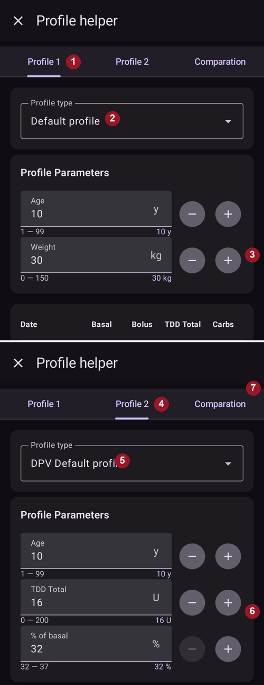
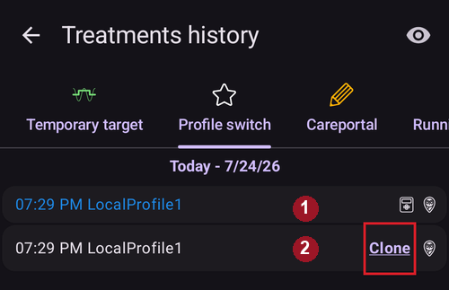

# Váš profil AAPS

Váš **profil AAPS** je súbor štyroch kľúčových parametrov, ktoré určujú, ako má **AAPS** podávať inzulín podľa hodnôt glykémie zo senzora. Toto sú hlavné parametre, na ktorých je postavený **AAPS**. Ako budete postupovať cez **Ciele**, odomknú sa vám ďalšie nastaviteľné parametre (napríklad nastavenia SMB), ale výkon týchto funkcií závisí od správneho nastavenia vášho **profilu**. **Profil** zahŕňa:
* [cieľové glykémie](#profile-glucose-targets),
* [bazálne dávky](#your-aaps-profile-basal-rates) (BR),
* [faktory citlivosti na inzulín](#your-aaps-profile-insulin-sensitivity-factor) (ISF) a
* [inzulínovo-sacharidové pomery](#your-aaps-profile-insulin-to-carbs-ratio) (IC alebo ICR).

```{admonition} Where did DIA go?
:class: note
**Doba pôsobenia inzulínu (DIA)** už nie je súčasťou vášho **profilu**. Namiesto toho sa nastavuje pre každý inzulín – pozrite [Spravovať → Nastavenia inzulínu](#Config-Builder-insulin-dia).
```

Pri liečbe s **AAPS** by ste mali priebežne hodnotiť a kontrolovať, či sú nastavenia vášho **profilu** presné. Odporúča sa vykonať nastavenia v poradí, v akom sú uvedené tu. Snažte sa správne nastaviť jeden parameter predtým, než začnete meniť ďalší. Postupujte pomaly a nerobte súčasne viacero zmien. Po každej zmene si nezabudnite nový profil aktivovať. Pravidelne [zálohujte svoj **profil**](#YourAapsProfile_Profile-backup) exportom nastavení.

Nastavenia vášho **profilu** sa navzájom ovplyvňujú – môžete mať „nesprávne“ nastavenia, ktoré za určitých okolností dobre fungujú, ale za iných nie. Napríklad sa môže stať, že je príliš vysoký bazál a súčasne príliš vysoký **CR**. To znamená, že musíte zvážiť jednotlivé nastavenia a skontrolovať, či spolu dobre spolupracujú za rôznych okolností.

Môžete použiť [Autotune](https://autotuneweb.azurewebsites.net/), aby vás nasmeroval, ale nemali by ste ho slepo nasledovať: nemusí pre vás dobre fungovať alebo nemusí fungovať za všetkých okolností.

```{admonition} Your diabetes may vary
:class: note
**Profily** sa od človeka k človeku veľmi líšia.

Pri bazálnych dávkach (BR), faktoroch citlivosti na inzulín (ISF) a inzulínovo-sacharidových pomeroch (IC alebo ICR) sa absolútne hodnoty a trendy potreby inzulínu veľmi líšia od človeka k človeku. Závisia od vašej biológie, pohlavia, veku, kondície atď., ako aj od krátkodobých faktorov, napríklad choroby alebo nedávneho cvičenia. For more guidance on this, the book [“Bright Spots and Landmines”](https://diatribe.org/bright-spots-and-landmines/) by Adam Brown is an excellent book to read.

```

Posledné štyri parametre (cieľové glykémie, bazálne dávky, faktory citlivosti na inzulín a inzulínovo-sacharidové pomery) môžete počas 24 hodín nastaviť na rôzne hodnoty, v prípade potreby aj každú hodinu inak.


Nižšie sú snímky obrazovky _vzorového_ profilu z **AAPS**. Upozorňujeme, že tento vzorový profil nižšie zobrazuje veľké množstvo časových bodov. Keď začnete s **AAPS**, váš profil bude pravdepodobne oveľa jednoduchší.


(profile-glucose-targets)=
## Cieľové hodnoty glykémie

### Popis

Vaša **cieľová glykémia** je základná hodnota a na nej sú založené všetky výpočty **AAPS**. Líši sa od cieľového rozsahu, v ktorom sa zvyčajne snažíte udržať glykémiu. Cieľ sa používa vo výpočtoch **AAPS**: ak **AAPS** predpovedá, že vaša **glykémia** bude mimo cieľového rozsahu, urobí kroky, aby vás do tohto rozsahu vrátil.

Ciele môžete nastaviť v rámci týchto hraníc:

|         | _Nízky_ cieľ              | _Vysoký_ cieľ               |
| ------- | ------------------------- | --------------------------- |
| Minimum | 4,4 mmol/l alebo 80 mg/dl | 5 mmol/l alebo 90 mg/dl     |
| Maximum | 10 mmol/l alebo 180 mg/dl | 11,1 mmol/l alebo 200 mg/dl |

### Vplyv

Ak je cieľ vo vašom **profile** veľmi široký (napríklad 3 mmol/l [50 mg/dl] alebo viac), **AAPS** často urobí len málo zásahov. Je to preto, že predpovedaná **glykémia** bude pravdepodobne niekde v tomto širokom rozsahu, a preto **AAPS** dočasné bazály pravdepodobne nenastaví.

### Ako to nastaviť

**Obrázok nižšie** ukazuje príklad, ako možno nastaviť cieľ v profile **AAPS**.


Ciele **glykémie** si nastavujete podľa svojich osobných preferencií a potrieb. Ak sa napríklad obávate nočných hypoglykémií, môžete si od 21:00 do 7:00 nastaviť cieľ o niečo vyšší, na 117 mg/dl (6,5 mmol/l). Ak chcete mať ráno pred bolusom na raňajky dostatok aktívneho inzulínu (IOB), môžete od 7:00 do 8:00 nastaviť nižší cieľ 81 mg/dl (4,5 mmol/l).

V [otvorenom okruhu](#KeyAapsFeatures-OpenLoop), najmä keď prechádzate [prvými cieľmi](../SettingUpAaps/CompletingTheObjectives.md), môže byť široký cieľový rozsah dobrou voľbou, kým sa učíte, ako sa **AAPS** správa, a upravujete svoj **profil**.<br/> V [uzavretom okruhu](#KeyAapsFeatures-ClosedLoop) (od **[Cieľa 6](#objectives-objective6)**) sa odporúča rozsah zužovať, až kým nebudete mať pre každú časť dňa jediný cieľ (_Nízky_ cieľ = _Vysoký_ cieľ), aby **AAPS** rýchlo reagoval na výkyvy **glykémie**.

(your-aaps-profile-basal-rates)=

## Bazálne dávky

### Popis

Bazálna dávka inzulínu (jednotky/hodina) zabezpečuje bazálny inzulín, ktorý udržiava glykémiu stabilnú bez jedla alebo pohybu.

Inzulínová pumpa každých pár minút podáva malé množstvá rýchlo pôsobiaceho inzulínu, aby pečeň neuvoľňovala príliš veľa glukózy a aby sa glukóza presúvala do buniek tela. Bazálny inzulín zvyčajne tvorí 40–50 % vašej celkovej dennej dávky (CDD) v závislosti od stravy a zvyčajne sleduje cirkadiánny rytmus s jedným vrcholom a jedným poklesom potreby inzulínu počas 24 hodín. Viac informácií nájdete v 6. kapitole knihy [„Think like a Pancreas“](https://amzn.eu/d/iVU0RGe) od Garyho Scheinera, ktorá je veľmi užitočná.

Väčšina edukátorov diabetu 1. typu (aj ľudí s diabetom 1. typu!) sa zhoduje, že najprv treba správne nastaviť bazálne dávky a až potom optimalizovať ISF a ICR.

### Vplyv

Presné bazálne dávky vám umožnia zobudiť sa v rozsahu a vynechať jedlo – alebo sa najesť – skôr alebo neskôr počas dňa bez toho, aby ste mali vysokú alebo nízku glykémiu.

Príliš vysoká bazálna dávka môže viesť k nízkej glykémii. A naopak.

**AAPS** berie predvolenú bazálnu dávku ako základnú líniu. Ak je bazálna dávka príliš vysoká, „nulový dočasný bazál“ sa započíta ako väčší záporný IOB, než by mal. Preto **AAPS** následne podá viac korekcií, než by mal, aby IOB nakoniec vrátil na nulu.

Príliš vysoká bazálna dávka teda spôsobí nízke **glykémie** nielen pri predvolenej dávke, ale aj o niekoľko hodín neskôr, keď **AAPS** koriguje k cieľu.

Naopak, príliš nízka bazálna dávka môže viesť k vysokým glykémiám a k tomu, že sa hodnoty nepodarí znížiť na cieľ.

### Ako to nastaviť

**Obrázok nižšie** ukazuje príklad, ako možno nastaviť bazálne dávky v profile **AAPS**.


Setting your basal rates right is done by trial and error, and should be done in consultation with your diabetes team.

Existujú metódy testovania bazálu, pri ktorých zvyčajne sledujete bazálne dávky a potrebu inzulínu počas <u>prerušovaného</u> hladovania v priebehu 24 hodín. Hoci potrebujete otestovať bazálne dávky pre celý deň, neodporúča sa hladovať 24 hodín v kuse. Telo totiž spúšťa kompenzačné mechanizmy, napríklad hormóny. Odporúčaný spôsob je hladovať v 3 rôznych dňoch, vždy počas 8 hodín.

Odporúčaná metóda je pozastaviť okruh (pre bezpečnosť môžete AAPS prepnúť do režimu Ochrana pred nízkou glykémiou ([**LGS**](#KeyAapsFeatures-LGS)), aby ste sa vyhli hypoglykémiám, ako pri plnení [cieľa 6](#objectives-objective6)). Tým sa vráti vaša predvolená bazálna dávka. Sledujte, ako sa mení vaša **glykémia**: ak klesá, bazálna dávka je príliš vysoká. A naopak.<br/> Alternatívna metóda (môže byť zložitejšia) je nechať okruh bežať a sledovať, ako sa mení **IOB**. Ak je hodnota **IOB** záporná, vaša bazálna dávka je príliš vysoká. A naopak. Majte na pamäti, že táto metóda sa pri korekcii **glykémie** spolieha na **ISF**, a preto je úspešná, len ak sú aj ostatné premenné nastavené rozumne dobre.<br/> Ďalší spôsob úpravy bazálnych dávok je sledovať činnosť okruhu v noci, keď sú už všetky COB vstrebané. Táto metóda je užitočná najmä pri deťoch, keď je hladovanie ťažké alebo sa potreba inzulínu často mení. [Dr. Saleh Adi z Tidepoolu](https://www.youtube.com/watch?v=-fpWnGRhLSo) ukazuje užitočné spôsoby, ako analyzovať nočné krivky glykémie a optimalizovať bazálne dávky.

[Tu](../GettingHelp/ProfileTuning.md) nájdete, ako upraviť bazálny profil analýzou vzorcov v uzavretom okruhu.

Keď na základe výsledku testu bazálu robíte zmeny, upravte **profil** 1 až 2 hodiny (podľa typu inzulínu) pred vzostupom/poklesom. Opakujte test podľa potreby, kým nebudete spokojní s nastaveniami **bazálnych dávok**.

(your-aaps-profile-basal-not-compatible)=
#### Správa: „Bazál nie je kompatibilný s aktuálnou pumpou“

Každá pumpa má limity: najnižšiu a najvyššiu bazálnu dávku, ktorú dokáže podať, a pri niektorých pumpách (napríklad Dana, Accu-Chek Combo, Medtronic a Diaconn G8) sa bazálne dávky môžu meniť len v celú hodinu. **AAPS** kontroluje váš profil voči pumpe, ktorú používate, **po** použití zvoleného percenta.

Ak je niektorá bazálna dávka mimo týchto limitov, obrazovka **Aktivovať** zobrazí túto správu a tlačidlo **Aktivovať** zostane sivé:


Napríklad pri bazálnej dávke 0,10 U/h v noci a percente profilu 35 % by **AAPS** musel podávať 0,035 U/h. To je menej, než dokáže podať pumpa Dana (0,04 U/h).

Vyriešite to tak, že buď:

* zvolíte iné percento: **vyššie**, ak je bazálna dávka príliš nízka, alebo **nižšie**, ak je bazálna dávka príliš vysoká, alebo
* [upravíte profil](#your-aaps-profile-create-and-edit-profiles) a zmeníte bazálnu dávku.

Editor profilu umožňuje začať bazálne dávky len v celú hodinu. Bazálna dávka, ktorá začína napr. o 06:30, môže pochádzať len zo staršieho profilu, napríklad po prechode na pumpu, ktorá to nepodporuje.

(your-aaps-profile-insulin-sensitivity-factor)=

## Faktor citlivosti na inzulín (ISF)

### Popis

Faktor citlivosti na inzulín (niekedy nazývaný korekčný faktor) udáva, o koľko jedna jednotka inzulínu zníži vašu glykémiu.

**V jednotkách mg/dl:** Ak máte **ISF** 40, každá jednotka inzulínu zníži vašu glykémiu o cca 40 mg/dl (napríklad glykémia klesne zo 140 mg/dl na 100 mg/dl).

**V jednotkách mmol/l:** Ak máte **ISF** 1,5, každá jednotka inzulínu zníži glykémiu približne o 1,5 mmol/l (napríklad z 8 mmol/l na 6,5 mmol/l).

Z týchto príkladov vidíte, že čím _menšia_ je hodnota **ISF**, tým menej ste citliví na inzulín. Ak teda znížite ISF zo 40 na 35 (mg/dl) alebo z 1,5 na 1,3 (mmol/l), často sa tomu hovorí posilnenie **ISF**. Conversely, increasing the **ISF** value from 40 to 45 (mg/dL) or 1.5 to 1.8 (mmol/L) is weakening your **ISF**.

### Vplyv

**Nižší / silnejší ISF** (napr. 40 namiesto 50) znamená, že jedna jednotka inzulínu zníži vašu **glykémiu** menej. To vedie k agresívnejšej / silnejšej korekcii okruhu s **väčším množstvom inzulínu**. Ak je váš **ISF** príliš silný (malá hodnota), môže to viesť k nízkej **glykémii**.

**Vyšší / slabší ISF** (napr. 45 namiesto 35) znamená, že jedna jednotka inzulínu zníži vašu **glykémiu** viac. To vedie k menej agresívnej / slabšej korekcii okruhu s **menším množstvom inzulínu**. Ak je váš **ISF** príliš slabý (veľká hodnota), môže to viesť k vysokej **glykémii**.

**Example:**
* **BG** is 190 mg/dL (10.5 mmol/L) and target is 100 mg/dL (5.6 mmol/L).
* So, you want a correction of `190 - 100 = 90 mg/dL` or `10.5 - 5.6 = 4.9 mmol/L`
* Ak `ISF = 30` -> `90 / 30 = 3` alebo `ISF = 1,63` -> `4,9 / 1,63 = 3`: 3 jednotky inzulínu
* Ak `ISF = 45` -> `90 / 45 = 2` alebo `ISF = 2,45` -> `4,9 / 2,45 = 2`: 2 jednotky inzulínu

Príliš nízky **ISF** (a teda agresívnejší, čo nie je nezvyčajné) môže viesť k „nadmerným korekciám“, pretože **AAPS** vypočíta, že na korekciu vysokej **glykémie** potrebujete viac inzulínu, než je naozaj potrebné. To môže viesť ku glykémii ako na „horskej dráhe“ (najmä pri hladovaní), ako vidíte na obrázku nižšie. V takom prípade treba hodnotu **ISF** zvýšiť, aby bol **AAPS** menej agresívny. Tak **AAPS** podá menšie korekčné dávky a nebude nadmerne korigovať vysokú **glykémiu**, čo by viedlo k nízkej **glykémii**.


Naopak, príliš vysoký **ISF** môže viesť k nedostatočným korekciám, takže vaša **glykémia** zostane nad cieľom – čo je viditeľné najmä v noci.

### Ako to nastaviť

Na **obrázku nižšie** je príklad, ako možno nastaviť hodnoty ISF v profile **AAPS**.


Základným východiskovým bodom na určenie denného ISF je odvodiť ho z celkovej dennej dávky (CDD) pomocou pravidla 1700 (94). Viac podrobností nájdete v 7. kapitole knihy [„Think like a Pancreas“](https://amzn.eu/d/iVU0RGe) od Garyho Scheinera.

| 1700 (ak meriate v mg/dl) alebo 94 (mmol/l) / CDD (TDD) = približný ISF.<br/><br/>Príklad: CDD = 40 U<br/>Približný ISF (mg/dl) = 1700/40 = 43<br/>Približný ISF (mmol/l) = 94/40 = 2,4 |
| --------------------------------------------------------------------------------------------------------------------------------------------------------------------------------------------------------------- |
|                                                                                                                                                                                                                 |

Ak máte správne bazálne dávky, môžete to otestovať tak, že pozastavíte okruh, skontrolujete, že **IOB** je nula, a zjete niekoľko glukózových tabliet, aby ste sa dostali na stabilnú „vysokú“ hladinu.

Potom si podajte odhadované množstvo inzulínu (podľa aktuálneho 1/ISF), aby ste sa dostali na cieľovú glykémiu.

Buďte opatrní, pretože táto hodnota je dosť často nastavená príliš nízko. Príliš nízka znamená, že 1 U zníži glykémiu rýchlejšie, než sa očakáva.

(your-aaps-profile-insulin-to-carbs-ratio)=

## Inzulínovo-sacharidový pomer (ICR)

### Popis

**ICR** udáva, koľko gramov sacharidov pokryje jedna jednotka inzulínu.

Niektorí ľudia používajú namiesto **ICR** aj skratku **I:C** alebo hovoria o sacharidovom pomere: **CR**.

Napríklad inzulínovo-sacharidový pomer 1 ku 10 (1:10) znamená, že si podáte 1 U inzulínu na každých 10 gramov zjedených sacharidov. Jedlo s 25 g sacharidov by potrebovalo 2,5 U inzulínu.

Ak je váš **ICR** slabší (vyššia hodnota), napríklad 1:20, na pokrytie 10 g sacharidov budete potrebovať iba 0,5 U inzulínu. Jedlo s 25 g sacharidov by potrebovalo 25/20 = 1,25 U inzulínu.

Je bežné mať v rôznych častiach dňa rôzny **ICR**, a to v dôsledku hladín hormónov a fyzickej aktivity. Mnohí ľudia zistia, že najnižší / najsilnejší **ICR** majú okolo raňajok, pretože vtedy bývajú rezistentnejší voči inzulínu. Napríklad **ICR** dospelého používateľa môže byť 1:8 na raňajky, 1:10 na obed a 1:10 na večeru. Tieto vzorce však nie sú univerzálne: niektorí ľudia sú rezistentnejší voči inzulínu pri večeri a vtedy potrebujú silnejší / menší **ICR**.

> **POZNÁMKA:**
> 
> V niektorých európskych krajinách sa na určenie množstva inzulínu potrebného na pokrytie jedla používali chlebové jednotky. Spočiatku sa 1 chlebová jednotka rovnala 12 g sacharidov, neskôr niektorí prešli na 10 g sacharidov.
> 
> V tomto modeli bolo množstvo sacharidov fixné a množstvo inzulínu bolo variabilné. („Koľko inzulínu treba na pokrytie jednej chlebovej jednotky?“)
> 
> Pri **ICR** je množstvo inzulínu pevné a množstvo sacharidov sa mení. („Koľko g sacharidov dokáže pokryť jedna jednotka inzulínu?“)
> 
> Example:
> 
> Faktor chlebovej jednotky (BU = 12 g sacharidov): 2,4 U/BU -> Keď zjete jednu chlebovú jednotku, potrebujete 2,4 jednotky inzulínu.
> 
> Zodpovedajúci **ICR**: 12 g / 2,4 U = 5,0 g/U -> Jednou jednotkou inzulínu sa dá pokryť 5,0 g sacharidov.
> 
> Faktor BU 2,4 U / 12 g   ===>   IC = 12 g / 2,4 U = 5,0 g/U
> 
> Prevodové tabuľky sú dostupné online, napr. [tu](https://www.mylife-diabetescare.com/files/media/03_Documents/11_Software/FAS/SOF_FAS_App_KI-Verha%CC%88ltnis_MSTR-DE-AT-CH.pdf).

### Vplyv

**Nižší / silnejší ICR** znamená menej jedla na jednotku, t. j. na pevné množstvo sacharidov dostávate viac inzulínu. Dá sa nazvať aj „agresívnejším“. Ak je váš IC príliš silný, dostávate príliš veľa inzulínu a to môže viesť k nízkym **glykémiám**.

**Vyšší / slabší ICR** = viac jedla na jednotku, t. j. na pevné množstvo sacharidov dostávate menej inzulínu. Dá sa nazvať aj „menej agresívnym“. Ak je váš IC príliš slabý, dostávate menej inzulínu, než potrebujete, a to môže viesť k vysokým **glykémiám**.

### Ako to nastaviť

**Obrázok nižšie** ukazuje príklad **ICR** používateľa a ako ho možno nastaviť v **profile AAPS**. Pri zadávaní týchto hodnôt sa zadáva len posledná časť pomeru, takže inzulínovo-sacharidový pomer 1:3,5 zadáte jednoducho ako „3,5“.


Ak po strávení jedla a návrate **IOB** na nulu zostáva vaša **glykémia** vyššia ako pred jedlom, váš **ICR** je pravdepodobne príliš slabý (_t. j._ číslo je príliš vysoké a treba ho postupne znižovať). Naopak, ak je vaša **glykémia** nižšia ako pred jedlom, **ICR** je príliš silný (_t. j._ číslo je príliš malé a treba ho postupne zvyšovať).

Ak máte správne bazálne dávky, môžete to otestovať takto: skontrolujte, že **IOB** je nula a glykémia je v rozsahu, zjedzte presne známe množstvo sacharidov a podajte si odhadované množstvo inzulínu podľa aktuálneho inzulínovo-sacharidového pomeru. Najlepšie je zjesť jedlo, ktoré v tomto čase dňa bežne jete, a presne spočítať jeho sacharidy.

## Bežné otázky týkajúce sa profilu

```{contents} Common questions related to the Profile
:depth: 1
:local: true
```

### About the importance of getting your profile right

**Prečo by som sa mal snažiť o správne nastavenie profilu? Nemôže sa o to jednoducho postarať okruh?**

Hybridný uzavretý okruh _sa môže_ pokúsiť upraviť podávanie inzulínu tak, aby zmiernil zlú kontrolu glykémie spôsobenú nesprávnymi hodnotami **profilu**. It can do this, for example, by withholding insulin delivery if you are going to hypo. Oveľa lepšiu kontrolu glykémie však dosiahnete, ak sú nastavenia vášho **profilu** už čo najbližšie tomu, čo vaše telo potrebuje. To je jeden z dôvodov, prečo **AAPS** používa postupné ciele na prechod od liečby pumpou bez okruhu k hybridnému uzavretému okruhu. Okrem toho budú chvíle, keď budete musieť okruh otvoriť (zahrievanie senzora, porucha senzora _atď._), niekedy aj uprostred noci, a pre tieto situácie budete chcieť mať správne nastavenia.

Ak začínate s **AAPS** po inom systéme s otvoreným alebo uzavretým okruhom, už budete mať dobrú predstavu, aké hodnoty použiť pre bazálne dávky (**BR**), faktory citlivosti na inzulín (**ISF**) a inzulínovo-sacharidové pomery (**ICR**).

Ak prechádzate z injekcií (MDI) na **AAPS**, je dobré si najprv prečítať, ako prejsť z MDI na pumpu, a prechod starostlivo naplánovať a urobiť po dohode s vaším lekárskym tímom. [„Pumping insulin“](https://amzn.eu/d/iaCsFa2) od Johna Walsha a Ruth Robertsovej a [„Think like a Pancreas“](https://amzn.eu/d/iVU0RGe) od Garyho Scheinera sú veľmi užitočné knihy.

### Čo spôsobuje vysoké vrcholy glykémie po jedle v uzavretom okruhu?
Najprv skontrolujte bazálnu dávku a urobte test bazálu bez sacharidov. Ak je správny a vaša **glykémia** po úplnom vstrebaní sacharidov klesá k cieľu, skúste nejaký čas pred jedlom nastaviť v **AAPS** dočasný cieľ „Pred jedlom“ alebo sa so svojím diabetológom poraďte o vhodnom čase predbolusu. <br/> Ak je vaša **glykémia** po jedle príliš vysoká a zostáva príliš vysoká aj po úplnom vstrebaní sacharidov, zvážte so svojím endokrinológom zníženie **ICR**. Ak je vaša **glykémia** príliš vysoká, kým sú aktívne sacharidy (**COB**), a príliš nízka po úplnom vstrebaní sacharidov, poraďte sa so svojím diabetológom o zvýšení **ICR** a o vhodnom čase predbolusu.

### Mám dlho vysokú glykémiu a okruh ju neznižuje
Možné dôvody, prečo **AAPS** nepodáva dostatok inzulínu, sú:
* **ISF** nie je dostatočne silný
* Bazálna dávka možno nie je dostatočne silná
* Môže zasahovať bezpečnostné nastavenie, napríklad **maxIOB**. Alebo je **SMB** v tomto čase podľa vašich nastavení vypnutý.
* Je nastavená automatizácia, ktorá prepísala rozhodnutie **AAPS**.

Pozrite si aj [Ladenie profilu AAPS](../GettingHelp/ProfileTuning.md).

### Mám záporný IOB, je to problém?
Záporný **IOB** znamená, že celkové množstvo inzulínu (bazál + bolus) vo vašom tele je menšie ako pri samotnom bazále. Spôsobí, že **AAPS** podá viac inzulínu hneď, ako **glykémia** začne stúpať, pretože si myslí, že inzulín chýba. To môže neskôr viesť k nízkej **glykémii**.

Tu je niekoľko dôvodov, prečo môžete mať záporný IOB, a čo s tým robiť:
* príliš silný bazál: upravte svoj **profil**
* príliš veľký bolus pri predchádzajúcom jedle: upravte svoj **profil** alebo skontrolujte, či podávate bolus v správnom čase.
* DIA je pre váš typ inzulínu nastavená príliš krátko, takže sa inzulín hromadí: upravte ju v [Spravovať → Nastavenia inzulínu](#Config-Builder-insulin-dia)
* fyzická aktivita: nabudúce zvážte zníženie [percenta profilu](../DailyLifeWithAaps/ProfileSwitch-ProfilePercentage.md) počas aktivity, aby ste zohľadnili zvýšenú citlivosť.

## Správa profilov

```{contents} Operations that you can perform on your **Profiles** in **AAPS**
:depth: 1
:local: true
```
(your-aaps-profile-create-and-edit-profiles)=
### Vytvorenie a úprava profilov

V **AAPS** v4 nájdete svoje profily na obrazovke **Spravovať** (spodná navigácia) → **Profil**. Zobrazujú sa ako karty, medzi ktorými sa posúvate potiahnutím, s panelom akcií (**➕ Pridať**, **✏️ Upraviť**, **⧉ Klonovať**, **🗑️ Vymazať**, **▶ Aktivovať**). Ako spravovať a aktivovať profil, nájdete v časti [Správa a aktivácia profilov](#ProfileSwitch-manage-v4). Prechádzate z **AAPS** v3, kde mali profily vlastnú kartu? Pozrite si [Čo sa zmenilo v AAPS v4](#v4changes-manage).

Ťuknutím na **✏️ Upraviť** otvoríte editor. Nastavte **názov** a **jednotky** profilu a potom na kartách vyplňte štyri časové plány:

- **I:C** — inzulínovo-sacharidový pomer (g/U)
- **ISF** — faktor citlivosti na inzulín
- **BAZ** — bazálne dávky
- **CIEĽ** — cieľový rozsah


Každý časový plán je zoznam **časových blokov**: pridajte blok, nastavte jeho čas začiatku a hodnotu a potom ťuknite na **Uložiť**.

Ak meníte svoj **profil**, uistite sa, že upravujete správny **profil**: karta používaného profilu je označená **AKTÍVNY**, ale karta vybratá na obrazovke môže byť iná.

(your-aaps-profile-profile-from-scratch-for-a-kid)=
### Vytvorenie profilu pre dieťa od začiatku

[Pomocník s profilom](#aaps-screens-profile-helper) (menu ☰ → **Pomocník s profilom**) vám môže pomôcť vytvoriť profil pre dieťa (do 18 rokov).

**Dôležitá poznámka:**

**Pomocník s profilom vám má pomôcť nájsť počiatočný profil pre vaše dieťa. Hoci vychádza zo súborov údajov dvoch rôznych nemocníc, pred použitím nového profilu sa vždy poraďte so svojím lekárskym tímom!**

Pomocník s profilom ponúka súbory údajov pre deti z dvoch rôznych nemocníc, aby ste našli počiatočný profil pre vaše dieťa do 18 rokov.



1. Uistite sa, že ste na karte **Profil 1**.
2. V poli **Typ profilu** sa uistite, že je vybraté „Predvolený profil“.
3. Upravte predvolený profil (založený na súbore údajov nemocnice) zadaním veku dieťaťa a buď CDD celkom, **alebo** hmotnosti.
4. Prepnite na kartu **Profil 2**.
5. Ťuknite na **Typ profilu** a vyberte „Predvolený DPV profil“.
6. Upravte predvolený DPV profil (založený na súbore údajov inej nemocnice) zadaním veku dieťaťa, CDD celkom a percenta bazálu. Súbor údajov DPV obsahuje iba **bazálne dávky**, preto sú IC a ISF pri tomto profile zobrazené ako nula.
7. Otvorte kartu **Porovnanie**. Zobrazí sa porovnanie oboch upravených profilov (pozrite snímku obrazovky nižšie).
8. Ak chcete začať ladiť svoj profil podľa jedného z týchto návrhov, použite tlačidlo **Klonovať** pod porovnaním.


### Prepnutie profilu

Pozrite si [Prepnutie profilu a percento profilu](../DailyLifeWithAaps/ProfileSwitch-ProfilePercentage.md).

(your-aaps-profile-clone-profile-switch)=
### Klonovanie prepnutia profilu do nového profilu



[História ošetrení](#aaps-screens-treatments) zobrazuje všetky minulé **prepnutia profilu**. Na karte **Prepnutie profilu** môžete minulé **prepnutie profilu** použiť ako základ na vytvorenie nového **profilu**. V tomto prípade sa na nový lokálny profil aplikuje časový posun a percento profilu. Použite tlačidlo **Klonovať** v riadku **2**.

Teraz môžete prejsť na [obrazovku Profil](#your-aaps-profile-create-and-edit-profiles) (**Spravovať → Profil**) a upraviť novovytvorený profil.

(YourAapsProfile_Profile-backup)=
### Záloha profilu

Vaše **profily** sú základným nastavením vášho okruhu. Sú to veľmi citlivé údaje a určite o ne nechcete prísť.

* Vaše **profily** sú uložené v databáze **AAPS**.
* Keď je nastavený **NSClientV3** (pozrite [Synchronizácia](#SetupWizard-synchronization-with-the-reporting-server-and-more)), vaše **profily** sa automaticky nahrávajú aj do Nightscoutu.
* Sú tiež súčasťou [exportovaných nastavení](../Maintenance/ExportImportSettings.md). Preto sa uistite, že máte zálohu na bezpečnom mieste.

### Úprava profilov v Nightscoute

Ak je to povolené, **AAPS** môže prijímať zmeny **profilu** urobené priamo v Nightscoute. Nastavenie sa volá „**Prijímať úložisko profilov z NS**“ a je súčasťou možností **Prijímanie dát z Nightscoutu** (prijímanie dát z Nightscoutu je predvolene vypnuté, pozrite [krok Ovládanie z klienta v Sprievodcovi nastavením](../SettingUpAaps/SetupWizard.md)); rýchlo ho nájdete cez **vyhľadávacie pole** na hlavnej obrazovke. Kým je ovládanie z klienta zapnuté, nastavenie je skryté a **AAPS** neprijíma z Nightscoutu žiadne zmeny profilu ([režim zvýšeného zabezpečenia](#client-master-control-hardened-mode)). Profil namiesto toho upravte v spárovanom klientovi alebo ho raz načítajte pomocou **Úplná synchronizácia**.

To môže pomôcť, keď sa chystáte urobiť veľké zmeny v rozsiahlejšom **profile**. Cez webové rozhranie sa dajú zadať jednoduchšie, _napr._ keď ich ručne kopírujete z tabuľky.

Na to je však dôležité klonovať celý **záznam databázy**, ktorý obsahuje viac profilov, v editore Nightscoutu (modrá šípka na snímke obrazovky nižšie). Nové záznamy databázy potom majú aktuálny dátum. Po uložení môžete zmenený/nový **profil** aktivovať v **AAPS** bežným [prepnutím profilu](../DailyLifeWithAaps/ProfileSwitch-ProfilePercentage.md).


(your-aaps-profile-compare-profiles)=
### Porovnanie dvoch profilov

Na porovnanie dvoch rôznych profilov alebo prepnutí profilu (percento jedného z vašich profilov, ktoré ste predtým použili v [prepnutí profilu](../DailyLifeWithAaps/ProfileSwitch-ProfilePercentage.md)) môžete použiť aj [Pomocníka s profilom](#aaps-screens-profile-helper) (menu ☰ → **Pomocník s profilom**).


1. Uistite sa, že ste na karte **Profil 1**.
2. V poli **Typ profilu** vyberte „Dostupný profil“, aby ste mohli vyberať zo všetkých uložených **profilov**.
3. Vyberte **profil**, ktorý chcete porovnať.
4. Prepnite na kartu **Profil 2**.
5. V poli **Typ profilu** vyberte „Prepnutie profilu“, aby ste mohli vyberať z histórie všetkých svojich **prepnutí profilu**.
6. Vyberte **prepnutie profilu**, s ktorým ho chcete porovnať.
7. Otvorte kartu **Porovnanie**. Zobrazí sa porovnanie oboch profilov (pozrite snímku obrazovky nižšie).


