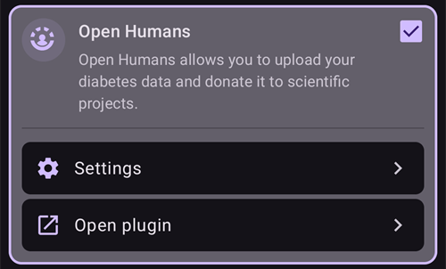

# Open Humans Uploader

## Darujte svoje dáta vede

Komunite môžete pomôcť tým, že darujete svoje dáta výskumným projektom! Pomáha to vedcom posúvať pomoc ďalej, rozvíjať nové vedecké myšlienky a rozširovať otvorený prístup k uzavretým okruhom s otvoreným zdrojovým kódom. AAPS je pripravené synchronizovať vaše dáta s [Open Humans](https://www.openhumans.org), platformou, ktorá vám umožňuje nahrávať, prepájať a ukladať vaše osobné dáta – napríklad genetické údaje, údaje o aktivite a zdravotné údaje.

Máte plnú kontrolu nad tým, čo sa s vašimi dátami stane a ktoré projekty chcete podporiť tým, že im dáte prístup k svojim dátam. Podľa toho, ku ktorému projektu sa pripojíte, projekt vaše dáta vyhodnocuje a používa rôznymi spôsobmi a v rôznom rozsahu.

Do vášho účtu Open Humans sa nahrajú tieto dáta:

- Hodnoty glykémie
- Udalosti v Starostlivosti (okrem poznámok)
- Predĺžené bolusy
- Prepnutia profilu
- Celkové denné dávky
- Dočasné bazály
- Dočasné ciele
- Nastavenia
- Verzia aplikácie
- Model zariadenia
- Rozmery obrazovky

Tajné alebo súkromné informácie, napríklad adresa vášho Nightscoutu alebo API secret, sa nenahrajú.

## Nastavenie

1. Ak ešte nemáte účet na [Open Humans](https://www.openhumans.org), vytvorte si ho. Ak chcete, môžete použiť svoj existujúci účet Google alebo Facebook.
2. Povoľte plugin **Open Humans** v [**Konfigurácia** > **Komunikácia**](../SettingUpAaps/ConfigBuilder.md).



3. Ťuknite na **Nastavenia** na karte **Open Humans**. Nahrávanie môžete obmedziť na čas, keď telefón používa Wi-Fi (**Iba WiFi**) a/alebo sa nabíja (**Iba pri nabíjaní**).


4. Ťuknite na **Otvoriť plugin** na karte **Open Humans** a potom ťuknite na **Nastaviť**.


5. Na obrazovke **Vitajte v Open Humans** ťuknite na **Ďalej**. Pozorne si prečítajte obrazovku **Súhlas**: ukazuje podmienky používania a to, ktoré dáta sa nahrávajú a ktoré nie.
6. Zapnite **Rozumiem a súhlasím.** (1) a ťuknite na **Prihlásenie do Open Humans** (2).


7. Otvorí sa webová stránka Open Humans. Prihláste sa svojimi prihlasovacími údajmi.
8. Rozhodnite sa, či chcete vo svojom verejnom profile Open Humans skryť svoje členstvo v AAPS Uploader (1).
9. Kliknite na **Authorize project** (2).


```{admonition} Older screenshot
:class: note
Snímky obrazovky vyššie ukazujú staršiu verziu webovej stránky Open Humans a ešte používajú starý názov projektu **AndroidAPS Uploader**. Postup je rovnaký.
```

10. Späť v **AAPS** sa vás obrazovka **Posledné úpravy** opýta, či chcete pokračovať. Ťuknite na **Pokračovať**.
11. Počkajte, kým sa zobrazí **Skončili sme!**, a potom ťuknite na **Zavrieť**. Odteraz bude telefón čas od času nahrávať dáta na pozadí.
12. Obrazovka pluginu **Open Humans** teraz zobrazuje vaše **ID člena projektu**. Ak chcete nahrávanie spustiť hneď, ťuknite na **Nahrať teraz**.
13. Ak chcete prestať nahrávať dáta do Open Humans, ťuknite na **Odhlásiť sa**.
14. Notifikácia Androidu vás bude informovať o prebiehajúcom nahrávaní.


```{admonition} Older screenshot
:class: note
Snímka obrazovky vyššie je zo staršej verzie **AAPS**. V **AAPS** 4 sú potvrdzovacie obrazovky **Posledné úpravy** a **Skončili sme!**, nezobrazuje sa veľkosť fronty a tlačidlá sú **Nahrať teraz** a **Odhlásiť sa**.
```

15. Svoje dáta môžete spravovať po prihlásení na [webovú stránku Open Humans](https://www.openhumans.org).


## Možnosti zdieľania

### [Projekt „OPEN“](https://www.open-diabetes.eu/)

Projekt „OPEN“ spája medzinárodné a medziodvetvové konzorcium pacientov-inovátorov, lekárov, sociálnych vedcov, informatikov a organizácií na podporu pacientov. Spoločne skúmajú rôzne aspekty systémov umelého pankreasu „urob si sám“ (DIY APS), ktoré používa stále viac ľudí s diabetom. Viac podrobností nájdete na ich [webovej stránke](https://www.open-diabetes.eu/).

V septembri 2020 projekt „OPEN“ spustil [prieskum](https://survey.open-diabetes.eu/), ktorého súčasťou bola aj možnosť darovať dáta, ktoré ste nahrali do Open Humans. [Návod](https://open-diabetes.eu/en/open-survey/survey-tutorials/), ako darovať dáta projektu „OPEN“, nájdete na ich stránke aj priamo v prieskume.

### [OpenAPS Data Commons](https://www.openhumans.org/activity/openaps-data-commons/)

OpenAPS Data Commons vznikol, aby umožnil jednoducho zdieľať súbory dát z komunity DIYAPS na výskum. Dáta sa zdieľajú s tradičnými výskumníkmi, ktorí robia tradičné výskumné štúdie, aj so skupinami alebo jednotlivcami z komunity, ktorí chcú dáta skúmať v rámci vlastných výskumných projektov. OpenAPS Data Commons používa platformu „Open Humans“, aby ľudia mohli jednoducho nahrávať a zdieľať svoje dáta zo systémov DIYAPS vrátane AAPS, Loop a OpenAPS.

Svoje dáta môžete dostať do Open Humans jedným z troch spôsobov:

1. použite možnosť nahrávania v AAPS a dostaňte svoje dáta do Open Humans
2. použite Nightscout Data Transfer a dostaňte svoje dáta do Open Humans
3. ručne nahrajte súbory s dátami do Open Humans.

Keď si vytvoríte účet a vaše dáta začnú prúdiť do Open Humans, pripojte sa aj k OpenAPS Data Commons, ak chcete svoje dáta darovať na výskum.

## Podmienky používania

Toto je nástroj s otvoreným zdrojovým kódom, ktorý skopíruje vaše dáta do [Open Humans](https://www.openhumans.org). Nevyhradzujeme si žiadne právo zdieľať vaše dáta s tretími stranami bez vášho výslovného súhlasu. Dáta, ktoré projekt a aplikácia dostanú, sú označené náhodným ID používateľa a bezpečne sa prenesú iba do účtu Open Humans, a to iba s vaším súhlasom. Nahrávanie môžete kedykoľvek zastaviť a nahrané dáta vymazať cez [www.openhumans.org](https://www.openhumans.org). Pozor, niektoré projekty, ktoré dáta dostávajú, to nemusia podporovať.

Pozrite si aj [Podmienky používania Open Humans](https://www.openhumans.org/terms/).

## Ochrana súkromia

Open Humans chráni vaše súkromie tak, že vám pre každý projekt pridelí číselné ID. This allows projects to recognize but not identify you. ID aplikácie, ktoré AAPS nahráva, je podobné a pomáha iba pri správe dát. Viac informácií nájdete tu:

- [Zásady používania dát Open Humans](https://www.openhumans.org/data-use/)
- [Open Humans a GDPR](https://www.openhumans.org/gdpr/)
