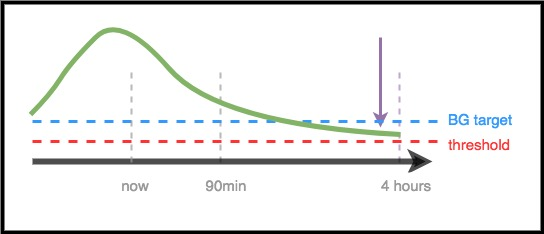

# Pre lekárov – všeobecný úvod a príručka k AAPS

```{note}
Táto stránka je základný úvod pre lekárov. Naposledy bola skontrolovaná v júni 2026. AAPS sa neustále vyvíja, preto najpresnejšie a najaktuálnejšie podrobnosti vždy hľadajte v [hlavnej dokumentácii AAPS](../index.md).
```

Táto stránka je určená lekárom, ktorí sa zaujímajú o technológiu umelého pankreasu s otvoreným zdrojovým kódom, ako je AAPS, alebo pacientom, ktorí chcú tieto informácie zdieľať so svojimi lekármi.

Táto príručka obsahuje základné informácie o vlastnoručne zostavenom (DIY) uzavretom okruhu a najmä o tom, ako funguje AAPS. Viac podrobností o všetkých týchto témach nájdete v [úplnej online dokumentácii AAPS](../index.md). Ak máte otázky, opýtajte sa svojho pacienta na podrobnosti alebo sa kedykoľvek s otázkou obráťte na komunitu. (Ak nepoužívate sociálne siete (napr. [Twitter](https://twitter.com/kozakmilos) alebo Facebook), môžete napísať e-mail na developers@aaps.app). [Niektoré z najnovších štúdií a údajov o výsledkoch nájdete aj tu](https://openaps.org/outcomes/).

## Postup zostavenia vlastného (DIY) uzavretého okruhu:

Ak chcete začať používať AAPS, treba urobiť tieto kroky:

* Nájsť [kompatibilnú pumpu](../Getting-Started/CompatiblePumps.md), [kompatibilné zariadenie s Androidom](../Getting-Started/Phones.md) a [kompatibilný zdroj CGM](../Getting-Started/CompatiblesCgms.md).
* [Stiahnuť zdrojový kód AAPS a zostaviť softvér](../SettingUpAaps/BuildingAaps.md).
* [Nakonfigurovať softvér, aby komunikoval s ich zariadeniami na liečbu diabetu, a zadať nastavenia a bezpečnostné predvoľby](../SettingUpAaps/SetupWizard.md).

## Ako funguje vlastný (DIY) uzavretý okruh

Bez uzavretého okruhu človek s diabetom zbiera údaje z pumpy a CGM, rozhodne, čo urobiť, a koná.

Pri automatizovanom podávaní inzulínu systém robí to isté: zbiera údaje z pumpy, z CGM a z ďalších miest, kde sa zaznamenávajú informácie (napríklad z Nightscoutu), z týchto informácií vypočíta a rozhodne, o koľko viac alebo menej inzulínu je potrebné (nad alebo pod nastavenou bazálnou dávkou), a pomocou dočasných bazálnych dávok urobí potrebné úpravy, aby glykémiu udržal v cieľovom rozsahu alebo ju do neho postupne vrátil.

If the device running AAPS breaks or goes out of range of the pump, once the latest temporary basal rate ends, the pump falls back to being a standard pump with the preprogrammed basal rates running.

## Ako sa zbierajú údaje:

Pri AAPS beží na zariadení s Androidom špeciálna aplikácia, ktorá robí výpočty, a zariadenie komunikuje cez Bluetooth s podporovanou pumpou. AAPS môže cez Wi-Fi alebo mobilné dáta komunikovať s inými zariadeniami a s cloudom, aby získalo ďalšie informácie a aby pacienta, opatrovateľov a blízkych informovalo o tom, čo robí a prečo.

Zariadenie s Androidom musí:

* komunikovať s pumpou a čítať históriu – koľko inzulínu bolo podaného
* komunikovať s CGM (buď priamo, alebo cez cloud) – aby videlo, ako sa glykémia správa a ako sa správala

Keď zariadenie tieto údaje zozbiera, spustí sa algoritmus a rozhodne na základe nastavení (ISF, sacharidový pomer, DIA, cieľ atď.). Ak je to potrebné, potom pošle pumpe príkazy na zmenu rýchlosti podávania inzulínu.

Z pumpy alebo z Nightscoutu tiež zbiera všetky informácie o bolusoch, zjedených sacharidoch a dočasných cieľoch a používa ich pri výpočte rýchlosti podávania inzulínu.

## Ako systém vie, čo má urobiť?

Softvér s otvoreným zdrojovým kódom je navrhnutý tak, aby zariadenie ľahko urobilo prácu, ktorú ľudia predtým robili sami (v manuálnom režime), keď počítali, ako upraviť podávanie inzulínu. It first collects data from all the supporting devices and from the cloud, prepares the data and runs the calculations, makes predictions of what BG levels are expected to do during the next hours in different scenarios, and calculates the needed adjustments to keep or bring BG back into target range. Ďalej pošle pumpe všetky potrebné úpravy. Potom údaje znova načíta a celé to opakuje stále dookola.

Keďže najdôležitejším vstupným údajom je glykémia z CGM, je dôležité mať kvalitné údaje z CGM.

AAPS je navrhnuté tak, aby prehľadne zaznamenávalo všetky vstupné údaje, ktoré zbiera, výsledné odporúčanie a každý vykonaný krok. Preto je kedykoľvek ľahké odpovedať na otázku „prečo robí X?“ – stačí si pozrieť logy.

## Príklady rozhodovania algoritmu AAPS:

AAPS používa rovnaký základný algoritmus a rovnaké funkcie ako OpenAPS. Algoritmus robí viacero predpovedí (na základe nastavení a situácie), ktoré predstavujú rôzne scenáre toho, čo sa môže stať v budúcnosti. V Nightscoute sa zobrazujú ako „fialové čiary“. AAPS používa rôzne farby na odlíšenie týchto [predikčných čiar](#aaps-screens-prediction-lines). V logoch je opísané, ktorá z týchto predpovedí a ktoré časové obdobie určuje potrebné kroky.

### Tu sú príklady fialových predikčných čiar a toho, ako sa môžu líšiť:


(clinicianguide-dosing-scenarios)=

### Tu sú príklady rôznych časových horizontov, ktoré ovplyvňujú potrebné úpravy podávania inzulínu:

### Scenár 1 – nulový dočasný bazál kvôli bezpečnosti

V tomto príklade glykémia v krátkom časovom horizonte stúpa, ale v dlhšom časovom horizonte sa predpovedá nízka glykémia. Predpovedá sa dokonca, že klesne pod cieľ *a* pod bezpečnostný prah. Kvôli bezpečnosti, aby zabránilo nízkej glykémii, AAPS nastaví nulový dočasný bazál (dočasný bazál 0 %), kým konečná glykémia (eventualBG) (v ktoromkoľvek časovom horizonte) nebude nad prahom.


### Scenár 2 – nulový dočasný bazál kvôli bezpečnosti

V tomto príklade sa predpovedá, že glykémia v krátkom horizonte klesne nízko, ale nakoniec bude nad cieľom. Keďže je však krátkodobá nízka glykémia skutočne pod bezpečnostným prahom, AAPS nastaví nulový dočasný bazál, kým už žiadny bod predikčnej čiary nebude pod prahom.


### Scenár 3 – je potrebné viac inzulínu

V tomto príklade krátkodobá predpoveď ukazuje pokles pod cieľ. Nepredpovedá sa však pokles pod bezpečnostný prah. Konečná glykémia je nad cieľom. Therefore, AAPS will refrain from adding any insulin that would contribute to a near-term low (by adding insulin that would make the prediction go below threshold). Potom zváži pridanie inzulínu, aby najnižšiu predpovedanú konečnú glykémiu znížil na cieľ, keď to bude bezpečné. *(Depending on settings and the amount and timing of insulin required, this insulin may be delivered via temp basals or SMBs (super micro boluses)).*


### Scenár 4 – nízky dočasný bazál kvôli bezpečnosti

V tomto príklade AAPS vidí, že glykémia prudko stúpa vysoko nad cieľ. Vďaka načasovaniu inzulínu je však v tele už dosť inzulínu na to, aby sa glykémia nakoniec dostala do rozsahu. Predpovedá sa dokonca, že glykémia nakoniec klesne pod cieľ. Preto AAPS nepodá inzulín navyše, aby neprispelo k nízkej glykémii v dlhšom časovom horizonte. Hoci je glykémia vysoká alebo stúpa, je tu pravdepodobný nízky dočasný bazál.



## Optimalizácia nastavení a vykonávanie zmien

Ako lekár, ktorý možno nemá skúsenosti s AAPS ani s vlastnoručne zostavenými (DIY) uzavretými okruhmi, môžete mať problém pomôcť pacientovi optimalizovať nastavenia alebo urobiť zmeny na zlepšenie výsledkov. V komunite máme viacero nástrojov a [návodov](https://openaps.readthedocs.io/en/latest/docs/Customize-Iterate/optimize-your-settings.html), ktoré pacientom pomáhajú robiť malé, overené úpravy na zlepšenie ich nastavení.

Pre pacientov je najdôležitejšie meniť vždy iba jednu vec naraz a 2–3 dni sledovať jej vplyv, než sa rozhodnú zmeniť alebo upraviť ďalšie nastavenie (okrem prípadu, keď je zmena zjavne zlá a situáciu zhoršuje – vtedy sa majú okamžite vrátiť k predchádzajúcemu nastaveniu). Ľudia majú sklon otočiť všetkými gombíkmi a zmeniť všetko naraz. Kto to však urobí, môže skončiť s ešte horšími nastaveniami a bude ťažké vrátiť sa k známemu dobrému stavu.

Jedným z najsilnejších nástrojov na zmenu nastavení je nástroj na automatický výpočet bazálnych dávok, ISF a sacharidového pomeru. Nazýva sa to „[Autotune](#autotune-how-autotune-calculates-adjustments)“. It is designed to allow the data to guide you or your patient in making incremental changes to settings. V komunite je osvedčené najprv spustiť (alebo si pozrieť) reporty z Autotune a až potom skúšať ručne meniť nastavenia. Autotune je súčasťou AAPS ako plugin (**Konfigurácia** → **Všeobecné** → **Autotune**), pozrite [Autotune](../AdvancedOptions/Autotune.md). Dá sa spustiť na požiadanie alebo automaticky. Keďže tieto parametre sú predpokladom pre podávanie inzulínu bežnou pumpou aj v uzavretom okruhu, diskusia o výsledkoch Autotune a úprava týchto parametrov sú prirodzeným bodom spolupráce s lekárom.

Okrem toho výsledky často ovplyvňuje aj ľudské správanie (naučené pri manuálnej liečbe diabetu), a to aj pri vlastnoručne zostavenom (DIY) uzavretom okruhu. Napríklad ak sa predpovedá pokles glykémie a AAPS pri poklese zníži inzulín, na zvýšenie glykémie zo 70 mg/dl (3,9 mmol/l) môže stačiť iba malé množstvo sacharidov (napr. 3–4 g). V mnohých prípadoch sa však človek môže rozhodnúť liečiť hypoglykémiu oveľa väčším množstvom sacharidov (napr. podľa „pravidla 15“), čo spôsobí rýchlejší vzostup glykémie, a to kvôli glukóze navyše aj preto, že inzulín bol v čase pred nízkou glykémiou znížený.

## OpenAPS

**This guide was adapted from [The clinician's guide to OpenAPS](https://openaps.readthedocs.io/en/latest/docs/Resources/clinician-guide-to-OpenAPS.html).** OpenAPS is a system developed to be run on a small portable computer (generally referred to as the "rig"). AAPS používa mnoho techník z OpenAPS a má s ním spoločnú veľkú časť logiky a algoritmov, preto je táto príručka veľmi podobná pôvodnej príručke. Mnohé informácie o OpenAPS sa dajú ľahko použiť aj pre AAPS. Hlavný rozdiel je v hardvéri, na ktorom jednotlivé časti softvéru bežia.

## Zhrnutie

Má to byť základný prehľad o tom, ako AAPS funguje. Viac podrobností vám poskytne pacient, komunita alebo úplná online dokumentácia AAPS.

Ďalšie odporúčané čítanie:

* [Úplná dokumentácia AAPS](../index.md)
* [Referenčný návrh OpenAPS (OpenAPS Reference Design)](https://OpenAPS.org/reference-design/), ktorý vysvetľuje, ako je OpenAPS navrhnuté s ohľadom na bezpečnosť: https://openaps.org/reference-design/
* [Úplná dokumentácia OpenAPS](https://openaps.readthedocs.io/en/latest/index.html) 
  * Pozrite si, [ako AAPS mení predpovede na rozhodnutie o dávkovaní](#aaps-screens-how-predictions-become-a-dosing-decision) v tejto dokumentácii, alebo [dokumentáciu OpenAPS k determine-basal](https://openaps.readthedocs.io/en/latest/docs/While%20You%20Wait%20For%20Gear/Understand-determine-basal.html#understanding-the-determine-basal-logic), kde je základný algoritmus opísaný so všetkými technickými podrobnosťami.