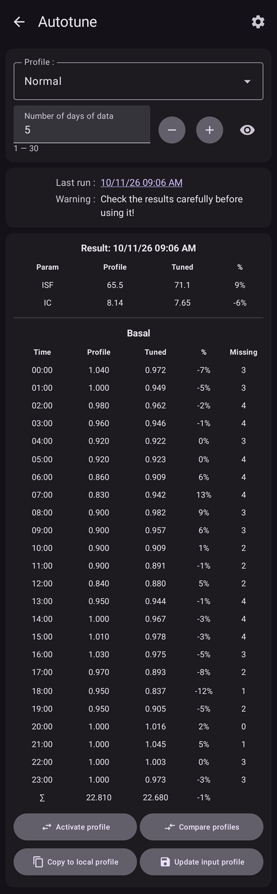
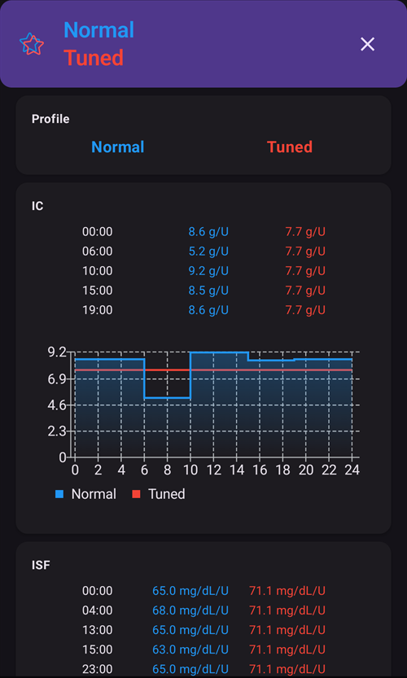
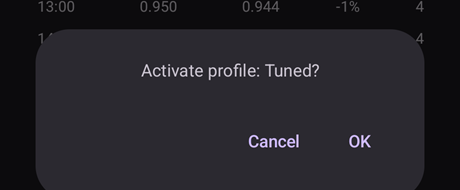
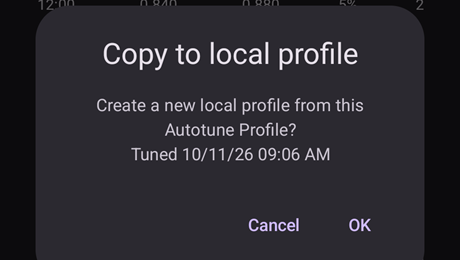

# Så använder du Autotune-pluginet

Autotune-pluginet är en implementering av OpenAPS autotune-algoritm i AAPS. Det analyserar din senaste AAPS-historik och föreslår ändringar av dina basaldoser, ISF och KH-kvot.

Autotune-pluginet finns i AAPS-versioner sedan [3.4](#version3400) men är dolt som standard.

(autotune-how-autotune-calculates-adjustments)=
## Hur Autotune beräknar ändringar

Autotune går igenom din senaste AAPS-historik – CGM-värden, bolusar, kolhydrater och tillfälliga basaldoser – och räknar ut var din **Profil** (basaldoser, ISF, KH-kvot) inte riktigt stämmer med vad som faktiskt hände med ditt BG.

För varje datapunkt (var 5:e minut) jämför den din **faktiska BG-ändring** med den ändring som din profil förutsade, och sorterar avvikelsen i en av tre grupper:

* avvikelser som hände utan kolhydrater ombord och utan insulinaktivitet (används för att justera **basaldoser**, timme för timme),
* avvikelser som hände efter en bolus/korrigering utan kolhydrater (används för att justera **ISF**), eller
* avvikelser som hände medan kolhydrater absorberades (används för att justera **KH-kvot**).

Sedan tittar den på mönstret av avvikelser i varje grupp (med percentiler i stället för ett enkelt medelvärde, så att några få störda datapunkter inte förvränger resultatet) och föreslår ett nytt värde för den timmen/parametern.

För att en enskild körning inte ska rätta för mycket flyttar varje Autotune-körning ett värde bara en del av vägen mot det som datan pekar på: högst 10 % för ISF och KH-kvot, och högst 20 % för varje basalperiod. Den totala ändringen begränsas dessutom av inställningarna **Autosens max** / **Autosens min** (se [Övriga inställningar](#autotune-other-settings) nedan) – samma gränser som begränsar Autosens. Därför är Autotune gjort för att köras flera gånger (dag efter dag, eller varje natt) och inte för att man ska lita på det efter en enda körning: resultaten ska närma sig ett stabilt värde steg för steg, och ett stort hopp i en körning är ett tecken på att du ska dubbelkolla din data (glömda kolhydrater, en dålig sensordag, _etc._) i stället för att lita blint på det.

Autotune kan köras på tre sätt: manuellt som en enstaka körning inifrån pluginet (som beskrivs nedan), automatiskt varje natt med en [automationsregel](#autotune-run-autotune-with-an-automation-rule), eller – helt utanför AAPS – som ett fristående kommandoradsverktyg på exporterad data. Det är så vissa guider i gemenskapen beskriver hur man använder det utan en telefon som kör AAPS.

*Den underliggande oref0-algoritmen med alla matematiska detaljer finns i [OpenAPS dokumentation om Autotune](https://openaps.readthedocs.io/en/latest/docs/Customize-Iterate/autotune.html).*

## Visa Autotune-pluginet

Skapa en tom fil som heter `enable_autotune` i undermappen `extra` i telefonens [AAPS-katalog](#preferences-maintenance-settings).

***OBS! Kontrollera i AAPS-inställningarna var din AAPS-katalog finns, och att du har lagt filen i rätt katalog. Flera användare har lagt filen i fel mapp.***


Starta om **AAPS**. Öppna sedan **menyn** (☰), välj **Konfiguration**, sedan kategorin **Generellt**, och markera **Autotune**. Kortet visar då **Inställningar** och **Öppna plugin**:


## Autotunes användargränssnitt

Tryck på **Öppna plugin** på kortet **Autotune** för att öppna Autotune-skärmen:


- I rullgardinsmenyn Profil kan du välja den angivna profil som du vill justera (som standard är din aktiva profil vald)
  - Obs! Varje gång du väljer en ny profil tas tidigare resultat bort och **Antal dagar med data** sätts till sitt standardvärde
- Sedan används **Antal dagar med data** (som hette **Tune days** i äldre versioner) för att välja hur många dagar som används i beräkningen när din profil justeras. Minsta värdet är 1 dag och högsta värdet är 30 dagar. Antalet ska inte vara för litet, annars blir resultaten inte korrekta och jämna efter flera körningar (mer än 7 dagar för varje beräkning)
  - Obs! Varje gång du ändrar **Antal dagar med data** tas tidigare resultat bort
- Kördes senast är en länk som hämtar tillbaka din senaste giltiga beräkning. Om du inte har startat Autotune under den aktuella dagen, eller om tidigare resultat togs bort när du ändrade en beräkningsparameter ovan, kan du hämta tillbaka parametrar och resultat från den senaste lyckade körningen.
- Varning visar till exempel information om den valda profilen (om du har flera IC-värden eller flera ISF-värden)
  - Obs! Autotune räknar bara med ett enda IC-värde och ett enda ISF-värde. Det finns för närvarande ingen Autotune-algoritm som kan justera en dygnsbaserad IC eller en dygnsbaserad ISF. Om din angivna profil har flera värden ser du under varningen vilket medelvärde som används för att justera din profil.
- Knappen Kontrollera profilen öppnar profilvisaren så att du snabbt kan kontrollera din profil (enheter, IC, ISF, basal och målvärde)
  - Obs! Autotune justerar bara din IC (ett värde), ISF (ett värde) och basal (med dygnsvariation). Enheter och målvärde är oförändrade i den nya profilen.

- "Kör Autotune" startar Autotune-beräkningen med den valda profilen och det valda antalet dagar med data
  - Obs! Autotune-beräkningen kan ta lång tid. När beräkningen har startat kan du byta till en annan vy (startskärmen, ...) och senare gå tillbaka till Autotune-pluginet för att se resultatet

  

- Under körningen ser du sedan delresultat nedan

  - Obs! Under körningen är inställningarna låsta, så du kan inte längre ändra den valda angivna profilen eller antalet dagar. Du måste vänta tills den pågående beräkningen är klar om du vill starta en ny körning med andra parametrar.

  

- När Autotune-beräkningen är klar ser du resultatet (den justerade profilen) och fyra knappar nedanför.

  

- Det är viktigt att alltid jämföra den angivna profilen (kolumnen "Profil"), den nya profilen (kolumnen "Justerad") och den procentuella ändringen för varje värde (kolumnen "%").

- För basaldoser ser du också antalet "saknade dagar". Du har saknade dagar när Autotune inte har tillräckligt med data som klassats som "Basal" för att justera basaldosen för den perioden (till exempel efter varje måltid när du har kolhydratabsorption). Antalet ska vara så lågt som möjligt, särskilt när basalen är viktig (till exempel under natten eller i slutet av eftermiddagen)

- Knappen "Jämför profiler" öppnar vyn där du jämför profiler. Den angivna profilen är blå och den nya profilen (som heter "Justerad") är röd.

  - Obs! I exemplet nedan har den angivna profilen dygnsvariation för IC och ISF, men den beräknade nya profilen har ett enda värde. Om det är viktigt för dig att få en dygnsbaserad ny profil, se [Dygnsbaserad IC- eller ISF-profil](#autotune-circadian-ic-or-isf-profile) nedan.

  

- Om du litar på resultatet (liten procentuell ändring mellan den angivna och den nya profilen) kan du klicka på knappen "Aktivera profil" och sedan på OK för att bekräfta.

  - "Aktivera profil" skapar automatiskt en ny profil "Justerad" i din profillista (**Hantera → Profil**).
  - Om du redan har en profil som heter "Justerad" i **Hantera → Profil** uppdateras den profilen med den beräknade Autotune-profilen innan den aktiveras

  

- Om du tycker att den justerade profilen behöver ändras (till exempel om du tycker att vissa ändringar är för stora) kan du klicka på knappen "Kopiera till lokal profil"

  - En ny profil med prefixet "Justerad" och datum och tid för körningen skapas i **Hantera → Profil**

  

- Du kan sedan redigera den justerade profilen: öppna **Hantera** > **Profil**, svep till kortet som heter "Justerad" med datum och tid för körningen, och tryck på knappen **Redigera** (pennan)

  - värdena i profilen avrundas i användargränssnittet till vad din pump klarar

  

- Om du vill ersätta din angivna profil med Autotune-resultatet, klicka på knappen "Uppdatera angiven profil" och bekräfta popup-fönstret med OK

  - Obs! Om du klickar på "Aktivera profil" efter "Uppdatera angiven profil" aktiverar du din uppdaterade profil och inte standardprofilen "Justerad".

  

- Om du har uppdaterat din angivna profil ersätts knappen "Uppdatera angiven profil" av knappen "Återställ angiven profil" (se skärmbilden nedan). På så sätt ser du direkt om din angivna profil i **Hantera → Profil** redan innehåller resultatet från den senaste körningen eller inte. Med den här knappen kan du också få tillbaka din angivna profil utan Autotunes resultat

  


## Autotune-inställningar

(autotune-plugin-settings)=

### Inställningar för Autotune-pluginet

  

```{admonition} Only DEV
:class: note
Funktionen **Byt profil automatiskt** finns bara i Dev/Engineering Mode.
```

- **Byt profil automatiskt** (standard Av): se [Kör Autotune med en automationsregel](#autotune-run-autotune-with-an-automation-rule) nedan. Om du sätter denna inställning till På uppdateras den angivna profilen automatiskt med den justerade profilen, och den aktiveras.
  - **Var försiktig: du måste lita på och kontrollera under flera dagar efteråt att din loop blir bättre efter att du har uppdaterat och aktiverat den justerade profilen utan ändringar**

- **Kategorisera UAM som basal** (standard Av): Denna inställning är för dig som använder AAPS utan att ange några kolhydrater (Full UAM). När den är Av hindrar den att UAM klassas som basal.
  - Obs! Om minst en timme med kolhydratabsorption har upptäckts under en dag klassas all data som klassats som "UAM" som basal, oavsett denna inställning (På eller Av)
- **Standardantal dagar för Autotune** (standard 5): Med denna inställning bestämmer du standardvärdet. Varje gång du väljer en ny profil i Autotune-pluginet ersätts **Antal dagar med data** med detta standardvärde
- **Använd dygnsbaserad IC/ISF** (standard Av): se [Dygnsbaserad IC- eller ISF-profil](#autotune-circadian-ic-or-isf-profile) nedan.

(autotune-other-settings)=
### Övriga inställningar

- Autotune använder också Autosens max och Autosens min för att begränsa ändringen. Du kan se och ändra dessa värden i [**Inställningar** > **Absorptionsinställningar** > **Avancerade inställningar**](../SettingUpAaps/Preferences.md) (**Autosens max** och **Autosens min**).

  


## Avancerad funktion

(autotune-circadian-ic-or-isf-profile)=

### Dygnsbaserad IC- eller ISF-profil

- Om din profil har stora variationer i IC och/eller ISF och du litar helt på dina dygnsbaserade tider och variationer kan du slå på **Använd dygnsbaserad IC/ISF** (som hette "Apply average result in circadian IC/ISF" i äldre versioner)

  - Observera att Autotune alltid räknar med ett enda värde, och att Autotune inte justerar dygnsvariationen. Denna inställning använder bara den genomsnittliga ändring som beräknats för IC och/eller ISF på dina dygnsbaserade värden

- Skärmbilden nedan visar en justerad profil med Använd genomsnittlig ändring Av (till vänster) och På (till höger)

  


### Justera vissa veckodagar

- Om du trycker på ikonen **öga** till höger om fältet **Antal dagar med data** ser du dagvalet. Du kan välja vilka veckodagar som ska tas med i Autotune-beräkningen (i skärmbilden nedan ser du ett exempel för "arbetsdagar" där lördag och söndag är borttagna från Autotune-beräkningen)
  - Om antalet dagar som tas med i Autotune-beräkningen är lägre än **Antal dagar med data** ser du hur många dagar som tas med till höger om dagväljaren (10 dagar i exemplet nedan)
  - Denna inställning ger bara bra resultat om antalet återstående dagar inte är för litet (om du till exempel justerar en viss profil för helgdagar med bara söndag och lördag valda, ska du sätta **Antal dagar med data** till minst 21 eller 28 för att få med 6 eller 8 dagar i Autotune-beräkningen)

  

- Under Autotune-beräkningen kan du följa hur beräkningen går ("Delresultat för dag 1 / 4 justerat" i exemplet nedan, där lördag och söndag är uteslutna)

  


(autotune-run-autotune-with-an-automation-rule)=

## Kör Autotune med en automationsregel

```{admonition} Only DEV
:class: note
Funktionen **Byt profil automatiskt** finns bara i Dev/Engineering Mode.
```

Det första steget är att välja rätt utlösare för en automationsregel med Autotune:

Obs! Mer information om hur du skapar en automationsregel finns [här](../DailyLifeWithAaps/Automations.md).

- Välj utlösaren Återkommande tid: kör Autotune bara en gång per dag. Autotune är gjort för att köras dagligen (vid varje ny körning flyttas perioden en dag framåt, och profilen bör snabbt bara ändras mycket lite)

  

- I början är det bättre att köra Autotune på dagen så att du kan kontrollera resultatet. Om du vill köra Autotune på natten måste du välja 04:00 eller senare i utlösaren, så att den aktuella dagen tas med i nästa Autotune-beräkning.

  

- Sedan kan du välja åtgärden **Kör Autotune** (i gruppen **Loop & insulin**)

  

- Sedan kan du ställa in åtgärdens parametrar för din körning. I en ny åtgärd visar **Välj profil att justera** den första profilen i din lokala profillista, fältet **Dagar att justera** är tomt och alla dagar är valda. Välj profilen som ska justeras och ange antal **Dagar att justera** (1 till 30).

  

- Om du efter några dagar litar helt på Autotunes resultat och den procentuella ändringen är liten kan du slå på [Autotune-inställningen](#autotune-plugin-settings) "**Byt profil automatiskt**" så att profilen uppdateras och den justerade profilen aktiveras automatiskt efter beräkningen.

Obs! Om du vill justera profiler automatiskt för vissa veckodagar (till exempel en profil för "helgdagar" och en annan för "arbetsdagar"), skapa en regel för varje profil, välj samma dagar i utlösaren och i Autotune-åtgärden. Antalet dagar att justera måste vara så högt att justeringen säkert görs med minst 6 eller 8 dagar, och glöm inte att välja en tid efter 04:00 i utlösaren...

- Nedan ser du ett exempel på en regel som körs varje arbetsdag (måndag till fredag) kl. 04:00 och justerar profilen "Normal" med 14 **Dagar att justera**, bara arbetsdagar (så bara 10 dagar tas med i Autotune-beräkningen).

  


## Tips och tricks

Autotune arbetar med informationen i din databas. Om du nyss har installerat AAPS på en ny telefon måste du därför vänta flera dagar innan du kan starta Autotune med tillräckligt många dagar för att få relevanta resultat.

Autotune är bara ett hjälpmedel. Det är viktigt att regelbundet kontrollera om du håller med om den beräknade profilen. Om du är osäker, ändra Autotune-inställningarna (till exempel antalet dagar) eller kopiera resultatet till en lokal profil och justera profilen innan du använder den.

Kör alltid Autotune manuellt under flera dagar för att kontrollera resultatet innan du använder det. Börja använda Automation först när du litar helt på Autotunes resultat och när skillnaden mellan den tidigare och den beräknade profilen har blivit mycket liten (aldrig tidigare)

- Autotune kan fungera mycket bra för vissa användare och inte för andra, så **om du inte litar på Autotunes resultat, använd det inte**

Det är också viktigt att analysera Autotunes resultat för att förstå (eller försöka förstå) varför Autotune föreslår dessa ändringar

- hela din profil kan bli starkare eller svagare (till exempel högre total basal tillsammans med lägre ISF- och IC-värden). det kan hänga ihop med flera dagar i följd med autosens-korrigering över 100 % (mer aggressivitet krävs) eller under 100 % (du är känsligare)
- Ibland föreslår Autotune en annan balans mellan basaldoser och IC/ISF (t.ex. lägre basal och mer aggressiv IC/ISF)

Vi avråder från att använda Autotune i följande fall:

- Du anger inte alla dina kolhydrater
  - Om du inte anger kolhydrater som du äter för att rätta en hypo ser Autotune en oväntad ökning av ditt BG och ökar dina basaldoser 4 timmar tidigare. Det kan vara motsatsen till vad du behöver för att undvika hypo, särskilt mitt i natten. Därför är det viktigt att ange alla kolhydrater, särskilt de som rättar en hypo.
- Du har många perioder med upptäckt UAM under dagen.
  - Har du angett alla dina kolhydrater och uppskattat dem rätt?
  - Alla UAM-perioder (utom om du inte anger några kolhydrater under en dag och Kategorisera UAM som basal är avstängt): alla dina UAM-perioder klassas som basal, och det kan öka din basal mycket (mycket mer än nödvändigt)

- Din kolhydratabsorption är mycket långsam: om det mesta av din kolhydratabsorption beräknas med parametern min_5m_carbimpact (du ser dessa perioder som en liten orange punkt överst på COB-kurvan) kan COB-beräkningen bli fel och ge felaktiga resultat.
  - När du tränar är du oftast känsligare och ditt BG stiger inte så mycket, så under eller efter träning är det vanligt att se perioder med långsamma kolhydrater. Men om du ofta har oväntat långsam kolhydratabsorption kan du behöva justera profilen (högre IC-värde) eller så är min_5m_carbimpact lite för högt.
- Du har "mycket dåliga dagar", till exempel när du har fastnat flera timmar i hyperglykemi och behövt en mycket stor mängd insulin för att komma ner i målintervallet, eller när du efter ett sensorbyte har långa perioder med felaktiga BG-värden. Om du under de senaste veckorna bara har en eller 2 "dåliga dagar" kan du manuellt stänga av dessa dagar i Autotune-beräkningen för att utesluta dem, och återigen **noga kontrollera om du kan lita på resultatet**
- Om den procentuella ändringen är för stor
  - Du kan prova att öka antalet dagar för att få jämnare resultat
